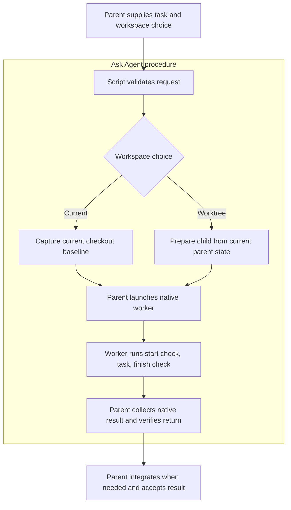

# Ask Agent normal entry implementation

Make the compact task interface the normal standalone Ask Agent procedure. The
parent describes the task, expected result, write scope and workspace choice;
native workers do the work. Scripts own package binding, workspace preparation
and filesystem checks. This plan does not add a model launcher or coordinator.

The skill boundary groups the procedure; only native launch creates another
agent context. Worktree separation is not an operating-system sandbox.

## Scope and invariants

- Current workspace remains the default. Current editing requires one writer,
  an explicit write set and no overlap with the parent's dirty files.
- Explicit worktree selection starts from the current parent checkout's HEAD,
  applies staged and unstaged binary Git patches separately, and copies
  nonignored untracked files. Existing root `.gitignore` and `.claspignore` are
  preserved even if ignored; absent/deleted controls stay absent.
- The worker runs both production checks in its assigned directory. The parent
  collects the native terminal result before checking the returned filesystem.
- Verified worker changes are integrated and tested by the parent. Native
  completion, filesystem checks and semantic acceptance remain distinct.
- Consumer-owned, commit-delivery and orchestrated contracts retain their
  existing interfaces. Unsupported requests fail; no route changes silently.
- No global host configuration, plugin installation, release or publication is
  part of this source implementation.

## Work sequence

| Step | Change | Completion evidence |
| --- | --- | --- |
| Baseline | Import the earlier reusable harness into the attached worktree without changing its bytes | Import hashes and offline baseline receipt |
| Normal entry | Promote compact routing and align references, examples and errors | Executable request tests and contract wiring checks |
| Experiment | Add a compact treatment that calls the production interface and reuses the existing fixture/integration checks | Offline controls reject missing checks, wrong bindings and incomplete native evidence |
| Native validation | Run a Grok medium parent with three then five native workers; separately exercise current-workspace editing with a native worker | Fresh retained trials, actual worker script calls, unique worktrees and verified combined results |
| Review and integration | Review the change, run affected suites, and merge only task-owned changes into the source checkout | Unchanged unrelated-file hashes, combined catalog checks and retained verification |

Keep every failed attempt and give retries new output directories. A fixture
pass is not native proof. A completed trial is functional evidence, not a
performance improvement claim; speed comparison needs matched repetitions.

## Starting evidence

The prior candidate passed 189 tests in ten Ask Agent suites plus 21 catalog
and six marketplace tests (216 total), with unchanged source fingerprint.
That proves the local interface/helper candidate, not the new normal-entry
wording or a live compact-treatment run. The earlier packet trials used a
different workflow and remain comparison evidence only.
