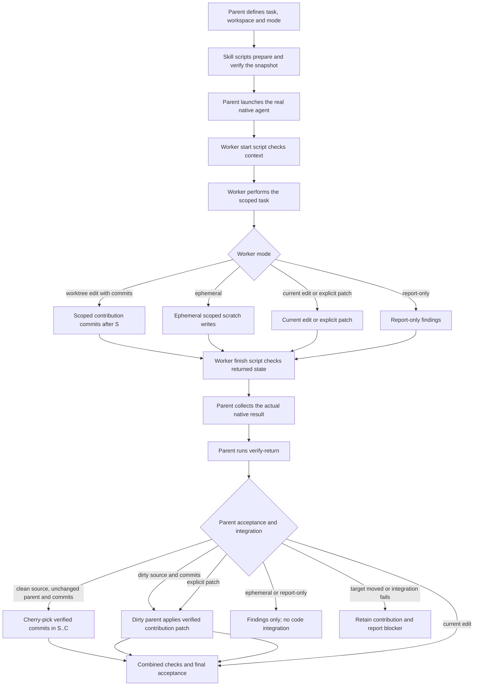
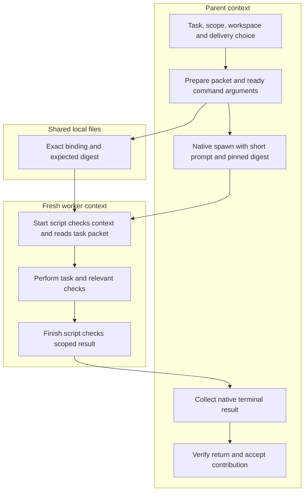

# Ask Agent normal entry implementation

Make the compact task interface the normal standalone Ask Agent procedure.
The parent describes the task, expected result, write scope, workspace and
mode; native workers do the work. Scripts own package binding, workspace
preparation and filesystem checks. Worktree edits default to commits, with an
explicit patch option; ephemeral work returns findings only. This plan does not
add a model launcher or coordinator.



The skill scripts prepare and inspect; the parent launches and collects the
native agent and owns integration and acceptance. The scripts do not launch
agents or clean up. Worktree separation is not an operating-system sandbox.

## Scope and invariants

- Current workspace remains the default. Editing requires one writer, an exact
  write set and no overlap with the parent's dirty paths; it is never committed
  automatically. Report-only work makes no filesystem edits.
- Worktree selection is explicit. Preparation verifies source `HEAD`, separate
  staged and unstaged binary patches, nonignored untracked files, and existing
  root `.gitignore` and `.claspignore` controls, even when ignored. Other
  ignored dependencies remain omitted; absent or deleted controls stay absent.
- Commit delivery establishes base `S` in the child only. A clean source uses
  its original `HEAD`; dirty layers that change the inherited tree create a
  private one-parent snapshot and retain the original source capture and patch
  layers. If the dirty source nets to `HEAD`, `S` stays at `HEAD` and
  `snapshot.source_dirty` preserves the original state.
- The worker commits only declared contribution paths. Verification requires
  the complete ordered linear range `S..C`; `S` is excluded. Residuals,
  out-of-scope paths, incomplete history or branch movement fail closed.
- After native completion and parent `verify-return`, a clean captured source
  with an unchanged parent may cherry-pick the verified range. A dirty captured
  source applies only the verified contribution patch, preserving parent
  `HEAD` and index and excluding any private `S` from parent history. The
  parent runs combined checks before acceptance.
- Ephemeral worktree mode allows only scoped scratch writes and returns findings
  with audit metadata, no commits or patch, and no code integration. The worker
  and parent scripts do not launch agents, integrate changes or clean up.
- Consumer-owned and orchestrated callers keep their existing contracts.
  Unsupported requests fail; no route changes silently.
- No global host configuration, plugin installation, release or publication is
  part of this source implementation.

## Work sequence

| Step | Change | Completion evidence |
| --- | --- | --- |
| Baseline | Import the earlier reusable harness into the attached worktree without changing its bytes | Import hashes and offline baseline receipt |
| Normal entry | Promote compact routing and document edit, report-only, commit, patch and ephemeral behavior | Request tests and contract wiring checks identify the exact candidate source |
| Experiment | Exercise the production compact interface for commit and ephemeral delivery | Offline controls reject missing checks, wrong bindings, invalid ranges, residual changes and unexpected ephemeral delivery |
| Native validation | Run a three-worker and a five-worker commit-delivery case, a separate explicit ephemeral case, and current-workspace editing | Retained native events, worker script calls, verified snapshots, parent integration or findings-only result, and combined checks |
| Review and integration | Review the change, run affected suites, and integrate only task-owned changes into the source checkout | Unchanged unrelated-file hashes, combined checks and retained verification |

Keep every failed attempt and give retries new output directories. A fixture
pass is not native proof. A completed native trial applies only to its retained
source revision and route; it is not a cross-host or performance claim.
The focused fixture demonstrates one contribution commit, while production
verification accepts the complete ordered linear range containing one or more
commits. In each native commit case, the retained event log must show separate
explicit calls between worker start and finish, using only exact contribution
paths:

```sh
git -C "/absolute/path/to/worker-worktree" add -- path/to/changed-file
git -C "/absolute/path/to/worker-worktree" commit -m "task contribution"
git -C "/absolute/path/to/worker-worktree" rev-parse HEAD
```

## Source and release boundary

The approved commit-snapshot and ephemeral paths are implemented in the
`skills/ask-agent/` source checkpoint with 402 offline tests passing across 13 checks at
`6bf14791`; fresh native qualification remains pending. Earlier patch/current-workspace trials remain separate evidence
and do not qualify those paths. Tests and native pilots must name the exact
candidate revision and remain separate evidence types. No installed copy or
release was produced: this change does not update the skill version, generated
plugin views, catalogs, installed copies, or marketplace release. Publication
follows the repository release process.

## Starting evidence

The evidence record for this candidate should separate the offline
commit-snapshot and ephemeral checks, fresh native cases, combined-result
checks, installed-copy state, and release state. Earlier patch/current-workspace
trials are retained as separate pilot evidence; they do not prove this new
commit or ephemeral contract. A fixture pass is not native proof, and a
successful native trial is not a release claim.

## Startup optimization after the checkpoint

The next iteration moves binding transport and final audit formatting into the
existing scripts. The parent still invokes native workers directly. A packet is
coordination data read by a worker-side script, not a second agent or a native
host file-upload feature.



The existing start call now returns the actionable task, so packet transport
adds no model round trip. Each emitted helper command carries the expected
binding digest. A changed packet, wrong working directory or changed package
fails before task work. Current edits remain a single writer with no commits
or further delegation; report-only makes no edits; ephemeral retains scoped
scratch and returns findings only; worktree edits retain commit or explicit
patch delivery. Inline transport remains available for hosts without shared
file access.

The experiment's final result writer runs after its successful filesystem gate.
It writes an index of exact evidence records and parent-asserted native handles;
the independent native auditor checks the handles and record hashes after the
parent exits. A file-written assertion cannot promote itself to native proof.
Existing artifacts and failed attempts remain retained.

### Evaluation boundary

Compare inline and packet launch byte counts on the same prepared task to
measure transport size. These counts are not token measurements or an elapsed
speedup. Offline suites exercise path containment, changed valid packets,
mode-specific delivery, native evidence rejection and indexed-record tampering.
A model-free comparison using the same binding in each renderer measured these
UTF-8 launch sizes with the retained fixture paths:

| Task | Inline bytes | Packet bytes | Reduction |
| --- | ---: | ---: | ---: |
| Current checkout edit | 5,719 | 2,176 | 61.95% |
| Worktree commit contribution | 6,741 | 2,226 | 66.98% |
| Worktree ephemeral scratch | 5,889 | 2,229 | 62.15% |

All three executed the real start, finish and parent-return checks while
preserving source HEAD, index, staged/unstaged notes and both ignore controls.
The commit contribution and ephemeral scratch remain in their fixture
worktrees; this measurement neither launched native agents nor integrated
changes into the parent. The retained `startup-packet-measurement2/measurement.json`
in the task audit directory names exact package hashes and per-case evidence.
An earlier failed attempt remains separately retained: installing the package
under an unrelated Git-tracked home exposed an overbroad packet boundary check.
The repaired check protects that package and its Git metadata without rejecting
all neighboring files. A second regression preserves actionable diagnostics if
a current-workspace packet write fails after preparation.

A matched repeated Grok-medium campaign remains necessary to measure end-to-end
time; the previously blocked external-service payload needs explicit approval
before that campaign runs. No model defaults or persistent configuration change.
