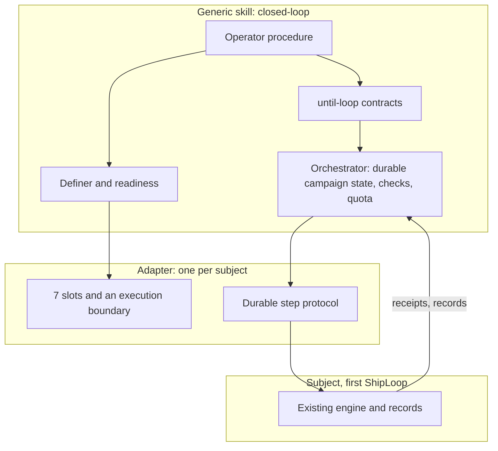

# Closed-loop: a generic improvement loop with ShipLoop as its first adapter (plan, 2026-11-15)

**Status: plan; Phase 1 is built and hardened (see *Phase 1 as built* below).** The owner said (2026-11-15) "I want to make progress and not worry about the past", which
this plan takes as the go for Phase 1, with the working choices in section 11. It supersedes sections 2 and 3 of
[docs/shiploop-e2e-iterate-skill-plan-2026-11-15.md](shiploop-e2e-iterate-skill-plan-2026-11-15.md): the ShipLoop-only
`shiploop-e2e-iterate` skill becomes this generic skill plus a ShipLoop adapter. That plan's facts and effectiveness list stand and
are absorbed below.

**What changed.** The first plan advised against generalizing until a second subject existed. The owner has now asked for the generic
skill, with a way to discover or have a reviewer define what is subject-specific, three readiness checks, until-loop considered,
iteration, and escalation to broader cases. This plan builds the generic layer thin, with ShipLoop as the first adapter and a second
subject as the generality test. An Astra max review (read-only, about 10 minutes) of the first draft found real errors; every
correction I could check against the code, the runtime or the docs held, and section 12 lists them.

## Phase 1 as built (added 2026-11-15, updated after four max reviews: Astra twice, Sol twice)

Phase 1 is built and hardened. The sections below are the plan as it was reviewed; where the build differs, the difference is here.
Evidence and decisions: `docs/closed-loop-journal.md` and `docs/experiments/closed-loop-review-20261115/` (the four reviews' findings,
the reproductions, and the mutation checks of the new tests).

| The plan said | The build does | Why |
| --- | --- | --- |
| the contract's workspace is the subject's linked worktree (section 5: "tested in P1 with the real runtime") | the workspace is the **campaign folder**, a small Git repo that `init` creates and that holds only campaign state; the runtime's state, the contract and the receipts live in the sibling `<campaign>.work` | the checks read evidence in the campaign folder, so a change to it after a green verify (an unknown added) did not change the fingerprint and the real runtime still completed (the reviewer reproduced it); receipts inside the folder would rewrite the fingerprinted tree |
| the runtime's Git-tree fingerprint holds whatever is in the workspace | every check and `contract` prove that the fingerprint will hold the state now **and after the next change**: no flagged (`assume-unchanged`, `skip-worktree`) or unmerged index entry, no Git filter on a state file, no `core.fsmonitor` hook, and the runtime's own procedure (`git add -A` into a copy of the index, then `git write-tree`) succeeds and stages what `git add` makes of each state file; otherwise they exit 2 and `contract` refuses | an ignore rule (Astra, round 2), an index flag or a constant clean filter (Sol, round 3), a flag set after a matching snapshot, a filter returning a saved copy, and an unmerged entry that makes `write-tree` fail (Sol, round 4) each let the real runtime complete over an incomplete certificate; a same-as-today comparison cannot see a later change |
| two sequential root contracts: readiness, then scope | one contract kind, the scope contract; readiness is a gate that records its result | exit checks only read recorded evidence, and the readiness contract reran effectful probes |
| the start rule is checked by `readiness --require-start` | `step` also refuses to start until the owner has ratified the boundary hash, readiness has recorded a pass for that hash and every selected case is released | `init` then `step` ran a hosted case with none of these |
| convergence is checked from the facts an adapter reports | the facts are validated first (types, the exact case set, identities, amounts, build consistency); a report that fails is a failed step, never a quiet iteration | malformed and partial reports converged |
| coverage by dimension value | plus declared `combinations`, and hunt results that need a disposition for every blind spot | an AX, BY, AY catalog left AY unselected; a hunt's findings were ignored |
| a quota | a mandatory budget; failed steps, probes, tasks and hung calls are charged; every adapter call has a timeout; stops for three failed starts, three iterations without progress and a metric regression | the quota was bookkeeping |
| frozen checks | every check also carries the scope and the campaign identity | a contract frozen for S0 certified whichever scope was current |

Known limits kept: the script checks what an adapter reports and cannot prove it truthful (the ratified boundary, `execution.pin` and
the readiness probes are the trust); the budget is checked between steps; a change to the subject between the verify run and the
report is outside the fingerprint, and the checks catch it as stale the next time they run.

**Words used here.**
*Subject*: the thing being improved (first ShipLoop). *Case*: one scenario the subject is run on. *Adapter*: the small set of files
and commands that tell the generic loop what is specific to a subject. *Scope*: the cases, run profiles and claims a campaign is
working on now. *Campaign*: the continuing effort across many iterations and scopes. *Quiet iteration*: one full pass whose reviews
were valid and found nothing material. *Evaluator identity*: a fingerprint of everything that grades runs; results are compared only
under the same identity. *Convergence certificate*: a script-checked statement that nothing material is left in this scope, on this
build, as graded by this evaluator, or an "incomplete" statement with reasons.

## 1. What was asked, and where each part lands

| The owner asked for | It becomes |
| --- | --- |
| a generic skill | `closed-loop`: an operator procedure, an adapter contract, a small orchestrator script (section 2) |
| a way to call out, discover, or ask the reviewer to define what must be specific | the adapter slots are the call-out; a **definer** proposes the missing slots; the run reviewer reports adapter gaps every iteration (section 4) |
| the ShipLoop-specific items that support it | the ShipLoop adapter, starting with a continuation seam (section 7) |
| an until-loop, if it helps | yes, for the campaign's scope contract with script-owned checks; its native streak is not used (section 5) |
| checks that there are cases, a way to evaluate a run, and a way to call the improvement stage | three readiness checks, each a set of claims a script has proven (section 3) |
| iterate again when concluded | durable campaign state and a certificate that goes stale when the build or the evaluator changes (sections 5, 6) |
| escalate and widen to a broader set of cases when stuck | a diagnostic ladder, E0 to E5, with guards (section 6) |

## 2. Design



- **Prompt-first, with one small orchestrator.** `SKILL.md`, `references/` (adapter schema, readiness, convergence, escalation),
  `prompts/` (definer, blind-spot hunter, adapter-gap question) and `closed_loop.py`, a Python-stdlib state machine: it persists
  campaign state, prints the next action, runs or polls a step, runs the exit checks, tracks quota and emits until-loop contracts.
  The first draft left this out and assumed the subject's engine would carry all state; Astra's review showed it cannot (section 7).
- **The subject's engine is reached through a durable step protocol**, not replaced. Each step has an idempotency key, a run handle,
  and poll, resume, cancel, receipt and cleanup operations, so an interrupted campaign continues without launching duplicate work. A
  step can be coarse (ShipLoop: one `iterate.py` iteration) or fine (a new subject: build, run, observe, evaluate, improve, verify).
  A generic engine is extracted from ShipLoop's only when a second subject needs a piece (S-12), never as a refactor up front.
- **Same split one level up.** The SPEC already separates "the common loop" from per-case adapters, which supply facts, commands and
  checks but never change the loop ("Case adapters and run evidence"). This adds the same split between the generic loop and a subject.
- **Invocation** (proposal):

  ```text
  /skill-craft:closed-loop readiness <subject>   print each claim's state and what it unlocks
  /skill-craft:closed-loop define <subject>      have the definer propose the missing slots (staged, then validated)
  /skill-craft:closed-loop run <subject>         a campaign: scope contracts, checkpoints, escalation, report
  /skill-craft:closed-loop status <subject>      certificate, scopes, stale scopes, quota, unresolved records
  ```

**Adapter slots: the call-out of what must be specific.**

| Slot | The subject must supply | ShipLoop today |
| --- | --- | --- |
| 1 Mission | clauses a reviewer can cite | `SPEC.md` S-clauses, the review PREMISE |
| 2 Cases | scenarios with dimensions, cost, requirements | `cases.json`: 37 cases, 7 styles (brownfield 15, web-service 6, hosted-platform 6, parallel-graph 4, cli-files 2, stateful-service 2, smoke 2), 31 not needing a hosted org; cost history in `baselines.jsonl` (235 rows) |
| 3 Steps | the durable step protocol above | per run: `run.py`, `slice.py`, `epoch.py`, `lifecycle.py`; per iteration: `iterate.py`, with no base ref and no resume (S0) |
| 4 Evaluation | floors by script, measures with validity, sensitivity probes, a noise report | `checks/`, scorecard, `promotion.py`, `spread.py` |
| 5 Improvement stage | candidate, withheld and evaluator path sets; build; verify; improver role; landing | `boundary.CANDIDATE_PREFIXES`, `iterate.improve`, the quick tier |
| 6 Authority | routine versus owner-only, the campaign budget, hosted requirements, an **execution boundary** | AGENTS.md decisions; Salesforce cases need an org |
| 7 Records | ledger, journal, evidence location | `learning-records.jsonl`, `LEARNINGS.md` |

The execution boundary is part of slot 6: commands are pinned argument lists (never shell strings), with an environment allowlist, a
capability class (read-only, writes the worktree, touches a hosted or external system), a working directory and an owned-cleanup
command.

**Two identities.** *Scoring identity* is what `boundary.qualification_snapshot` already computes (top-level harness `*.py` and
`*.cjs`, checks, fixtures, `evaluators/`, case entries, the SPEC, the catalogs, the scorecard modules); results are compared only under
the same one. *Campaign identity* is new: the adapter manifest, the facade, the orchestrator scripts and the scope definitions. A
budget or scope-list edit changes only the campaign identity and does not invalidate measurements; an adapter whose code could change
scores is not allowed (section 7).

## 3. Readiness: three checks, each a set of claims a script has proven

Nothing a model declares or proposes counts. Readiness is claim-specific, not one ladder:

| Check | Claim | Proven by | States |
| --- | --- | --- | --- |
| **Cases** | case X runs on build B | the case runs, writes evidence, and its cleanup receipt is verified | declared, **runs** |
| **Grading** | measure M returns a valid score | `evaluate` on a real run | declared, **scores** |
| | M is sensitive to property P | a seeded defect, a known-bad build, an independently specified mutation, or a metamorphic relation, run through `evaluate` | unknown, **sensitive(P)** |
| | M has noise N on profile Q | an A/A calibration for that profile | unmeasured, **calibrated(Q)** |
| **Improvement stage** | the improver can land an in-bounds change | build and verify pass on the tip, and a planted out-of-bounds edit is caught | declared, **bounded** |
| | the improver is invocable | it lands a trivial in-bounds change on a throwaway branch | **invocable** (plumbing only: it says nothing about improvement quality) |

- **Start rule**: at least one case `runs`, one measure `scores`, the improvement stage `bounded`.
- **Allowed claims follow from proven claims.** A quality claim about property P needs `sensitive(P)`; where no known-good and
  known-bad pair exists the report says sensitivity is *unknown*, it does not guess. A *measured* efficiency claim needs
  `calibrated(profile)`; an efficiency claim under an owner-stated tolerance is allowed and labelled "stated, not measured", as cycles
  already do. An evaluator that returns valid scores but is not sensitive is `scores`, not `declared`.
- **Model-judged quality** (no scripted oracle) is allowed only with the judge's reliability measured and recorded, as `rubric-eval`
  does (blind, order-randomized, kappa and noise). Whether such a verdict may *promote* a change is a policy for the owner (section
  11); the first draft's flat ban had no basis in `rubric-eval`.
- Precedents already in ShipLoop's harness: `seeded_defects.py verify` ("the probe tells naive from fixed"; it covers particular step
  probes, not every measure), the 2026-11-01 restore pilot (accuracy 0.0 on a control without a known-good hook, 1.0 with it; one
  property on one case), and the boundary tests.

## 4. Discovery: how a reviewer defines what is specific

1. **Find an adapter**: an explicit `--adapter`, else `<subject>/closed-loop.adapter.json`. No registry of subjects at first.
2. **Readiness, read-only**: report each claim's state from existing evidence; run nothing effectful.
3. **Definer** (a model role; default Codex Astra at max because adapter design is a design question; overridable). It reads the
   subject's source, docs, tests and history and returns a schema-checked proposal into a staging file, never into the subject: per
   slot `found | proposed | unknown`, evidence references, the pinned argument list, risks, `needs_owner`. Its prompt: adopt what
   exists before writing anything new; propose contrasting dimension values at the least cost; prefer scripted oracles; never put
   graders in the candidate set; mark any hosted, credential, spend or deletion command `needs_owner`.
4. **Ratify the authority block and the execution boundary, then validate.** The first draft validated first; Astra's point is that
   validation runs proposed commands, so the owner approves the pinned argument lists, environment, capability classes, budget and
   cleanup *before* any effectful validation. Only read-only discovery runs earlier.
5. **Validate by script**, claim by claim, to the states in section 3. A failure returns to the definer with the evidence.
6. **Freeze** the manifest; its hash is the campaign identity.

**The reviewer keeps calling out specifics during the loop.** The run reviewer is already asked about the harness separately from
ShipLoop (`learning_retention`, `further_learning`, `evaluation_criteria`) and may file discoveries with `target: harness`
(`review.py` validates exactly `shiploop` or `harness`). That is the channel. Do **not** rename it in `review.py`: that breaks
validation and routing and changes the scoring identity. The facade presents `harness` as `adapter`; the one added question ("what
could you not determine because the adapter does not record it?") joins the other batched `review.py` edits (section 7). Adapter
findings never reach the improver; they are worked between scopes by re-running the definer and readiness for the affected claim.

**Testing the definer** (reconstruction and discovery are different tests):
- *Reconstruction* on ShipLoop: give it `skills/shiploop/` only. It cannot discover a withheld harness, so score required
  **properties** against a checklist written first (scripted oracles with held-out acceptance proposed; candidate and evaluator paths
  separated; hosted cases marked owner-only; contrasting styles; noise calibration per driver named), reward *justified unknowns*, and
  count any unsafe proposal (a grader in the candidate set; an unmarked hosted command) as a failure.
- *Discovery* on Backchain, where the harness is in view: can it find what exists and the risks in section 8?

## 5. Running a campaign: certificate, until-loop, state, quota

### 5.1 The convergence certificate

A campaign reports one of two statuses for a named scope, on a named build and identity: `converged` or `incomplete(reasons)`.
`converged` needs all of these; the checks are script-owned reads of recorded evidence that print the identity of the script they ran:

| Check | Requires |
| --- | --- |
| **C1 backlog** | every material in-scope record is promoted and verified, or dropped, refuted or rejected *with evidence*. A material record that is deferred, owner-held or an unresolved unknown keeps the scope **incomplete** (SPEC "Campaign operator directive"), with its reason and reopening condition listed. Records whose target is the evaluator (`harness`) are outside a subject certificate and go to the adapter backlog, listed |
| **C2 quiet window** | the last K iterations at the same scope, build and scoring identity were each *quiet*: valid, complete review and judge; no material discovery, new or repeated; no candidate outcome pending. K = 2 is the value `iterate.py` already uses for clean passes: an operational default, not calibrated evidence |
| **C3 green** | every scope case meets its floors on the current build against a *registered comparable baseline* (same host, model, effort and identity, `run.matching_rows`) within the registered tolerance. No comparable baseline means unknown, which blocks |
| **C4 coverage exercised** | every declared dimension value and declared combination (for example style by profile) has a run on the current build; each `not_covered` entry has a reason |
| **C5 clean, with positive evidence** | lifecycle receipts show everything the campaign started was ended (absence is not evidence); the worktree is clean; a quick-tier receipt for the current tree is green |
| **C6 acceptance** | a promoted candidate's acceptance evidence names the same candidate hash; with nothing promoted the certificate says "no candidate" |
| **C7 no invalid or unknown evidence** | no invalid, incomplete or missing review, judge, baseline or receipt in the window; any remaining unknown lies outside the scope's stated claim |

The certificate binds (scope, build, scoring identity, campaign identity, candidate hash). Astra's single biggest risk is **false
convergence**: certifying tidy bookkeeping while material work or invalid evidence remains. C1 and C7 exist for that, and the
operator drill in section 9 tests it.

The counters `iterate.py` and `cycle.py` keep (`clean_streak`, `idle_streak`, `misses`, `NON_PROMOTE_STOP`) are variables inside one
invocation, and `learning_records.select` returning nothing can mean an invalid review or a filtered record. The quiet
classification therefore has to be **written down per iteration** (S4, section 7), including invalid and incomplete evidence.

### 5.2 Where until-loop fits (mechanics checked in the vendored runtime)

until-loop (0.10.1; `improve` vendors the same version) gives a frozen contract (`workspace`, `work`, `exit_condition`,
`repeat_condition`, `required_trivial_reviews`, `exit_checks`, and a `context` of `request`, `scope`, `authority`, `environment`,
`resources`), a per-iteration report (`classification`, `exit_assessment`, `continuation_assessment`, `evidence`, `handoff`), and a
rule that a revised scope is a new contract. Checked in `scripts/until_loop_ephemeral.py` and `references/runtime-ephemeral.md`:

- **The runtime never runs the checks.** Each active packet carries a `verify_script` that the operator runs with its own shell tool;
  `record` stores each exit code with the action number and the workspace's Git tree; `done` refuses "satisfied" without a recorded
  run for the current action or after the tree changed. A forged `record` is outside the protocol's trust boundary (it is a visible
  command).
- **One counter, not two.** A failed frozen check sets the native trivial streak to zero. With `required_trivial_reviews: 2` plus a
  script-owned C2 of K = 2, a failed C2 on pass 1 resets the streak and convergence takes three passes. So the contract sets
  `required_trivial_reviews: 0` and C2 is the only counter. The first-pass shortcut (`unchanged_first_pass`) exists only for 2 or
  more, so it is off; journals written into the workspace would defeat it anyway.
- **Frozen means command text** (up to two repairs per check), not implementation. The contract binds the hash of the check script and
  the adapter, and each check prints and compares it.
- **Exit checks are quick reads.** The quick tier took 726 to 1050 s in this session's runs, and a command that outlasts the host's
  timeout records nothing; the iteration's own work runs the tier and writes a receipt, and C5 reads the receipt.
- **Mode**: isolated, with a durable `--directory` **and** a `--receipt`. A receipt holds packets but cannot recreate missing active
  state, and the default state parent is a temporary directory. `improve` also uses isolated mode with its own per-run state; ordinary
  host-session mode needs a stable session identity and plugin hooks, and nested contracts need it, so none are planned.
- **Two sequential root contracts**: readiness (it may start as a plain gate) and scope. Committing edits does not hide changes from
  the Git-tree fingerprint; the linked-worktree behaviour was to be tested in P1 with the real runtime (the build binds the campaign folder instead: see *Phase 1 as built*).
- **What it adds** once its native streak is unused: a refusal to accept "satisfied" without fresh recorded checks, an immutable
  contract (a widened scope is a new contract and nothing carries over silently), and a handoff that survives compaction. That is the
  convergence discipline the SPEC asks of a model operator and nothing enforces today. It stays optional: the procedure works by hand.

### 5.3 State, recovery and quota

**A purpose-built schema is allowed.** The owner, 2026-11-15: "I don't know if you need to use existing records or not. You can
build another schema if you think that would be more opportune. I want to make progress and not worry about the past." That
supersedes the 2026-10-31 preference to reuse existing records (3380b25671eefdc8d0100dd1d6c40026f93532c8). The orchestrator
therefore defines one campaign schema, `closed-loop-campaign/1`, that every adapter fills: the accepted tip, the scope history, a
per-iteration record (what the adapter reported and whether the iteration was quiet), step receipts, tasks, unknowns, consumed quota
and an event trail. An adapter may fill it from whatever its subject already records; ShipLoop's facade reads its ledger, baselines,
lifecycle receipts and epoch decisions into the adapter's `records` and iteration facts, and nothing in the schema is bound to their
shape. After any interruption the orchestrator reads its state; a step with an existing receipt is polled or resumed, never
relaunched. Quota is **aggregate**: setup, retries, children and widening all draw on it, and a new scope
does not renew it. The owner's global rule is that every autonomous loop carries a real quota; a campaign therefore states a budget
(wall-clock, turns or spend: the owner's number, or a default the owner confirms), and an exhausted budget ends the scope as
`incomplete(budget used)`, never as converged. On interruption it stops launching steps, lets in-flight steps finish or cancels them
with their cleanup, and records which. This is a limit on a campaign's authorization, not on ShipLoop's own loops or any model text.

## 6. Stuck, escalation, and iterating again

"Cannot improve any more" is three situations, read from the persisted iteration records:

| Mode | Signal | First move |
| --- | --- | --- |
| **Saturated** | C1 holds and the quiet window is full, but coverage is the limit | widen coverage (E1 to E4) |
| **Stalled** | admitted records remain but candidates end DROP or UNDECIDED, or the improver commits nothing | diagnose before widening: UNDECIDED for noise means a deeper instrument (E2); DROP for a regression means a candidate-design review (E3); an unactionable finding becomes an owner or investigation record |
| **Blocked** | a required unknown, missing authority, an unavailable resource, or budget used | E5 |

**Escalation is diagnostic, not compulsory.** The ladder is a menu ordered by information per cost; the stuck signal picks the rung.

| Rung | Move | Authority |
| --- | --- | --- |
| **E0** | a cheap discriminating probe first: read the failing runs' upstream records, run the real case to the stage and stop it, or ask one advisor the stuck question | routine |
| **E1** | add existing catalog cases for uncovered dimension values or combinations, cheapest first (turns by style, indicative, mixed hosts: smoke 152, cli-files 178, stateful-service 201, brownfield 210.5, web-service 301) | routine within budget |
| **E2** | a deeper instrument: attempts per arm fixed in the registration **before** any run (no sampling until PROMOTE); another host or model profile is a separate baseline cell; a tolerance change is the owner's | routine within budget |
| **E3** | widen the critique: a blind-spot hunter and one read-only advisor propose cases or probes, never changes; a panel only on disagreement | routine |
| **E4** | author a new case for a named blind spot through the definer; it must `run` and be sensitive before use; the campaign identity changes | owner if hosted, spending or one-way |
| **E5** | stop with a report: `converged` or `incomplete`, for a named scope, with options for the owner | n/a |

**Rules for a widened scope**
1. A scope is explicit, a union where needed: `suites.json` breadth excludes smoke, so smoke then breadth is not nested.
2. **Baseline sweep first**: run the new cases on the current build with no improver. A new failure has **unknown regression
   attribution**: nothing says an earlier change caused it; attribute it by running an earlier build only if it is material.
3. **Guards are an explicit set**, not an accident. `cycle.roles_for` marks the exposing case and an optional generality case; it does
   not accumulate earlier scopes. A qualification registers a guard set (the cheapest representative of each converged style, as an
   owner-set size), which needs `cycle.loop` to accept repeated guard cases (the registration already takes any number of cases).
4. **Freeze each registration before either arm runs.**
5. **Exposure provenance**: cases used while developing a change are development exposure; keep confirmation cases unexposed and
   replenish them by exposure count (the loop-recommendations R11). Current withholding is not read isolation (SPEC: "A tool call that
   names a held-out file is detected; a read that never names the file is not").

**Iterating again.** A certificate goes **stale** when the build, the scoring identity or the campaign identity changes; a stale scope
gets a regression sweep before the campaign widens. A new campaign starts when a release changes the build, an adapter changes, a case
is added, or the owner supplies what a blocked scope waited for.

**Autonomy rules inherited from the owner's global instructions**: a dedicated worktree with a random suffix; one append-only journal
entry per iteration; stop and report on three iterations without progress, the same error three times, or a metric regression (halt,
never auto-revert); code-touching work runs the repository's quick tier before any completion claim.

## 7. The ShipLoop adapter

**The continuation problem (Astra's finding, verified).** `iterate.new_worktree` always runs `git worktree add ... HEAD` from the main
checkout, with no base reference, so repeated `iterate.py --iterations 1` invocations start from the checkout's HEAD and do not
continue the previous accepted tip; an interrupted invocation has no resume; and exploration leaves its final candidate unevaluated.
The orchestrator cannot persist an accepted tip the engine will not start from.

| Item | What | Priority |
| --- | --- | --- |
| **S0** | continuation seam: a base reference, a reusable worktree and output folder with resume, and a machine-readable iteration record (edits `iterate.py`, and `cycle.py` for the qualified loop) | first |
| S1 | `adapter.json`: mission references, authority and execution boundary, path sets (from `boundary`), step commands, ledger and journal paths, role profiles | first |
| S2 | facade in `test/shiploop_e2e/adapter/`: cases with **derived** dimensions and cost class, step wrappers with handles, poll, resume, cancel, probes, cleanup. **No scoring logic** (a test enforces that it only calls scoring-covered modules) | first |
| S3 | scope ladder as data from `suites.json` and the cost class, as explicit unions | first |
| S4 | persisted per-iteration record and quiet classification (review and judge validity; material discoveries new or repeated; candidate outcome; invalid or incomplete evidence) | first |
| S5 | backlog reconciliation: dispositions and staleness of the unresolved records against the current ShipLoop version | next |
| S6 | guard cases in `cycle.loop` (repeatable); reviewer comparator (`matching_rows`) and a coverage record; the adapter-gap question | next, batched with S0 |
| later | instrument recorded in `next_experiment`; the productivity line; a calibration for Grok 4.6 xhigh (3 of 235 baseline rows today; owner's call) | on demand |

**Identity rules.** Any edit to a top-level harness module (`iterate.py`, `cycle.py`, `review.py`, ...) changes the scoring identity,
so S0, S4's engine edits and S6 go in **one batched change with one re-baseline**. AGENTS.md reserves changes that break
comparability with earlier evidence for the owner; harness fixes have been routine so far, so whether this batch counts is the
owner's call. Adapter files in a subdirectory escape the scoring snapshot, which is why the facade holds no
scoring logic and is bound by the campaign identity. Keep `target: harness` in `review.py`; dimensions are derived from `style`,
`follows`, `platform` and `needs`, so `cases.json` is not edited; no SPEC edit at first.

**What the certificate would say today.** Folding the ledger: 14 material records with target `shiploop` are unresolved (9 owner-held,
2 deferred, 2 admitted, 1 open), so by the SPEC's own rule a subject-scope certificate reads `incomplete`. Five records with target
`harness` (1 admitted, 4 deferred) are outside it and go to the adapter backlog. The nine owner-held records are exactly the decisions
blocking convergence; S5 would present them.

## 8. The second subject: Backchain

Read from its README, Makefile, `harness/bench.sh` and AGENTS.md; nothing there was run. `/Users/dadleet/src/backchain` has:
(1) a prompt benchmark, `harness/bench.sh`, which scores `fixtures/` draft plans with a rubric judge (a majority of k = 3 rounds by
default; k = 1 is labelled a wiring check) and compares two prompts with a blind pairwise judge; (2) an improvement evaluator and a
calibration corpus (21 directories under `cases/`, 32 exposed calibration cases, valid and invalid reviewer controls); (3)
deterministic validators (`harness/lib.js`, `schema/plan.schema.json`); (4) a holdout manifest with a discipline ("do not read
held-out results while iterating"; an active-set rate is never compared with a full-corpus rate); (5) a planning flow that already
uses an Until Loop review (README: plan, Until Loop review, validate and export), with Improve optional. Evaluation class: scripted
plus judge. The first draft blended (1) and (2), called k = 3 a property of the comparison, and wrongly gave Backchain its own copy
of until-loop.

What is missing is an identified outer, source-changing campaign. Risks for the adapter: a candidate edits `skills/backchain` in
skill-craft, while the bench scores `prompts/elaborator.v1.md` in the Backchain repository by default, so the adapter must **pin both
repositories and the exact prompt bytes exercised** or it grades the wrong artifact; candidate paths must exclude packaged
evaluations and holdouts; and Backchain's own rules become the authority slot (no commits unless asked, commits made in a worktree, a
completion gate, `run-harness.sh` with `PASS_CLEAN`, and the real judge-drift experiment only behind an explicit flag).

## 9. Phases, gates and stop rules

| Phase | Deliverable | Proof | Stop or reshape if |
| --- | --- | --- | --- |
| **P0** | owner decisions to start (section 11) | the answers | no go |
| **P1** generic skill v0 | skill, references, prompts, `closed_loop.py` (state, checks, quota, contract emitter); a **fake subject** (a small program with planted defects, two styles of case, a scripted improver); hermetic tests that use no models; Astra max review of the contract | the escalation demo (converge at S0, widen on an uncovered style, find the defect only the new case exposes, fix it, converge at S1, stop `incomplete` on an owner-only rung) **and** failure cases: stale evidence, missing state, duplicate resume, invalid review, a deferred material record, a journal that defeats "unchanged", quota exhaustion, a linked-worktree run on the real until-loop runtime | the demo needs engine code the skill does not have: add it to the orchestrator |
| **P2** ShipLoop adapter | S0 to S4 (S0 needs the owner's batched-change decision), a readiness report, S5, then the **operator drill** | the drill: frozen campaign checkpoints with planted traps (a deferred material record, an invalid review in the quiet window, a stale scope after a release, a duplicate resume, a used-up budget, a journal entry that defeats "unchanged") taken by two operators, the generic skill and the same model by hand with `iterate.py`, scored on false completion, next-action quality, recovery and overhead, against a margin set before the drill; then one real step at the smoke scope | the generic operator does not beat the by-hand one on false completion or recovery by that margin: keep only the facade and readiness, and stop |
| **P3** definer tests | reconstruction on ShipLoop and discovery on Backchain | the checklists written first, with predefined pass criteria and zero unsafe proposals | it fails them: keep the schema as a hand-filled form and drop the model role |
| **P4** escalation on a real subject | smoke then breadth as an explicit union, with aggregate quota | the scope converged by checks; widening followed the ladder; budget used counts as `incomplete` | the budget runs out: report `incomplete` and stop |
| **P5** extraction | only the engine pieces Backchain needed, one at a time with tests | ShipLoop's harness stays green and its identity unchanged, or re-based explicitly | nothing is needed: extract nothing |

K = 2 is not proven by any phase; it stays an operational default. An Astra max review follows P1's contract and any change to a
prompt; other phases are reviewed on demand. **Deferred until needed**: a registry of subjects, automatic advisor panels, a
review of every phase, schema expansion beyond what the fake subject and ShipLoop use, and extraction.

## 10. Why not just run `iterate.py` by hand?

What this adds: a convergence discipline enforced by scripts where today a model operator decides when to stop; durable state that
recovers without duplicate runs; a readiness report that says which claims a subject can support before runs are spent; escalation by
rule; and a path to a second subject. What is unproven: that it changes outcomes on ShipLoop. P2's drill tests that on frozen
checkpoints before live runs are spent, and its stop rule keeps only the part that earns its place. Not built: a universal oracle,
automatic adapter acceptance, a new statistics engine, a framework.

## 11. Decisions for the owner

**To start P1.** The owner's go ("I want to make progress") is taken as decision 1, and decisions 2 to 5 take the bracketed values
as working choices until the owner says otherwise:
1. Build the generic skill now, thin and gated as above, reversing the earlier "wait for a second subject". [yes]
2. Name: `closed-loop`, the repository's own term from the 2026-10-30 plan. Its description must separate measured improvement of a
   subject from `improve` (a review-and-improve of a repository candidate) and `improve-loop` (a test-driven repository campaign).
   Rivals: `self-improve` (collides with both and hides that a separate improver under an evaluator boundary does the changing),
   `evidence-loop`. No ShipLoop-only alias skill. [`closed-loop`]
3. Second subject: Backchain. [yes]
4. until-loop: the vendored runtime in isolated mode with durable directory and receipt, `required_trivial_reviews: 0`, K = 2 in C2. [yes]
   Sequencing: P1 binds `improve`'s validated copy by a package-relative path; a copy owned by this skill waits until the contract
   is stable (the vendor test validates only `improve`'s copy).
5. Campaign budget policy: who states the number, and the default if none is stated. [you state it per campaign; I propose a default]

**Before P2**:
6. One batched harness change (S0, S4's engine edits, S6) with a new scoring identity and a re-baseline. This breaks comparability
   with earlier evidence, which AGENTS.md reserves for you; say whether this batch counts. [yes, once]
7. Guard-set size per qualification (cost against protection). [one cheapest case per converged style]
8. May a model-judged quality verdict promote a change, given measured judge reliability? [only with the owner's per-subject approval]

**Later**: 9. A calibration for Grok 4.6 xhigh. 10. The definer's model default. [Astra at max]

Routine (the session decides and logs it): everything in P1 to P5 that stays inside the ratified authority and budget, including
verification and owned cleanup. Existing authorization carries forward; new defaults, statistical policies, product trade-offs and
limits keep their owner gates. The reviewer and judge defaults stay Codex Astra at high (SPEC roles).

## 12. Astra's review: what held, what changed

Astra (gpt-6-astra, effort max, 2026-11-15, about 10 minutes, read-only; it reported "ready with changes"). It confirmed the data
facts (37 cases, 7 styles, 31 not hosted, 235 baseline rows, 3 Grok 4.6 xhigh rows, the until-loop 0.10.1 parity). Every correction
below was checked against the code, runtime or docs named in the second column before use.

| Astra's point | Checked against | Disposition |
| --- | --- | --- |
| C1 contradicts the SPEC: deferred and owner-held material work keeps a campaign incomplete | SPEC "Campaign operator directive" | accepted; C1 rewritten; today's certificate is `incomplete` (section 7) |
| quiet and stuck counters are per-invocation; empty selection can mean an invalid review | `iterate.main` locals, `cycle.loop`, `learning_records.select` | accepted; S4 persists the classification |
| C3 to C6 are too weak (baseline, combinations, positive cleanup, candidate binding) | `run.matching_rows`, lifecycle receipts | accepted; C3 to C7 rewritten |
| native streak and C2 double count | runtime transition code: a failed check sets the streak to 0 | accepted; `required_trivial_reviews: 0` |
| frozen checks pin text, not implementation | runtime docs | accepted; script and adapter hashes bound |
| use `--directory` and `--receipt` | `ADAPTER.md` recovery text | accepted; a P1 test confirms it |
| no durable step protocol; repeated invocations do not continue | `iterate.new_worktree` | accepted; S0 and the orchestrator |
| bind evaluator code; `evaluators/` recursion; campaign versus scoring identity | `boundary.evaluator_files`, `qualification_snapshot` | accepted; section 2 and 7 |
| the `harness` to `adapter` rename breaks validation | `review.py` target check | accepted; mapped in the facade |
| escalation must be diagnostic; breadth excludes smoke; guards do not accumulate; attribution; statistics; exposure | `suites.json`, `cycle.roles_for`, `registration_template` | accepted; section 6 |
| readiness is claim-specific; insensitive scores is `scores`; calibration label; judge-only ban; ratify before validate; definer test | `seeded_defects.py`, `cycle._load_calibration`, `rubric-eval` | accepted; the ban became an owner policy |
| Backchain: bench runs `fixtures/`; k = 3 is the rubric default; two repositories; commit rules | README, Makefile, `bench.sh` usage, AGENTS.md | accepted (read, not run) |
| gates: drill on frozen checkpoints; failure cases; aggregate quota; budget used is incomplete | n/a (judgement) | accepted; section 9 |
| cut ceremony; keep the name | n/a | accepted; section 9 deferrals, section 11 |

My own errors the checks found first, before the review returned: the runtime does not run exit checks; the one-pass shortcut will
not apply because the harness commits a journal entry each iteration; and exit checks must be quick reads.

## 13. Unknowns

- Whether the generic operator changes outcomes on ShipLoop (P2's drill), and the definer's recall (P3).
- Noise and wall time of a scope on Grok 4.6 xhigh (the only calibration is Codex Terra at high on 1.27.0).
- Whether the receipt plus durable directory recovers cleanly after a real compaction and reboot (a P1 test).
- Whether the 9 owner-held and 2 deferred ShipLoop records are still live after ShipLoop's releases since they were filed.
- The cost of a guard set and of K = 2 quiet iterations per scope (each is at least two full run-and-review passes).

## 14. Evidence

[docs/experiments/closed-loop-plan-review-20261115/](experiments/closed-loop-plan-review-20261115/README.md): the draft Astra
reviewed (`draft-before-review.md`, which holds the errors section 12 corrects), the brief, and Astra's verbatim answer. Code and
records are cited by symbol, read at the commit this plan was written on top of; the first plan is commit
e0b13db06647f92082ea650a2de86ce50e4fc20c.
