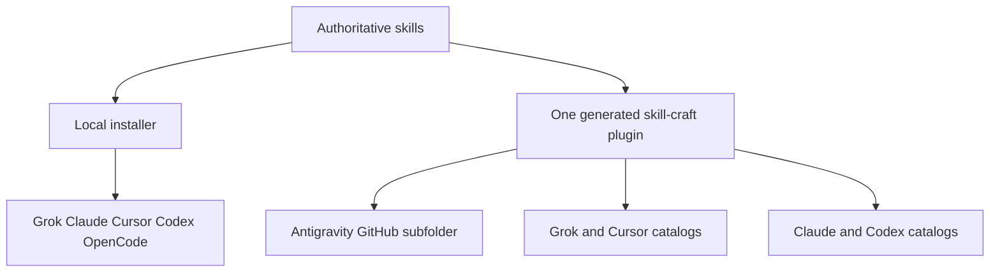

# Install and distribute Skill Craft



Edit `skills/<leaf>/`, then add a change note under `changes/<leaf>/`
([format](../changes/README.md)). At release, `scripts/release.py` runs
`./scripts/sync-plugin-views.sh`, which copies every skill into the one
`skill-craft` plugin at `plugins/skill-craft/skills/<leaf>/` and derives host
metadata from the frontmatter and `catalog/skill-craft-plugin.json`. Each native
catalog lists that plugin once as `./plugins/skill-craft`, so hosts expose every
skill as `skill-craft:<leaf>` (Claude `/skill-craft:shiploop`, Codex
`$skill-craft:shiploop`). All hosts receive the same skill body; host-specific
files describe how to find it.

## Your own use

Claude, Codex, Antigravity, Grok and Cursor install every skill from the `skill-craft`
marketplace plugin ([entry points](#marketplace-entry-points)). OpenCode has no
skill marketplace, so `install.sh` links it from the source checkout; without
host flags the installer targets only OpenCode (Hermes needs `--hermes-only`):

```sh
./install.sh --dry-run
./install.sh
./install.sh --status
```

To develop against the checkout on a plugin host, link it explicitly (for example
`./install.sh --claude-only --skill shiploop`) and disable the plugin meanwhile;
`--status` warns when an enabled `skill-craft` plugin would load the same skill
twice. Add `--skill shiploop` to select one skill. Links use `~/.grok/skills`, `~/.claude/skills`, `~/.cursor/skills`, `~/.codex/skills`, and
`${XDG_CONFIG_HOME:-$HOME/.config}/opencode/skills`. Keep the checkout in place. Update with `git pull` and rerun
the installer when new skills are added. Restart the host session to refresh discovery.

OpenCode's [Agent Skills documentation](https://opencode.ai/docs/skills/) defines
the XDG path above as its native global target. The installer does not edit
`opencode.json`, permissions, provider configuration, or experimental flags. OpenCode
also discovers `~/.claude/skills`. In an isolated OpenCode 1.18.31 check, matching
Claude and native symlinks to the same `ask-agent` source produced one selected
native skill root. Treat those links as one shared source, not independent copies.
Do not rely on that selection for divergent source trees or copied versions: keep one
source for each name, or use `--opencode-only` when the native path must be unambiguous.

Cursor also discovers Claude/Codex skill directories. Its native links point to
the same canonical files. Do not install another plugin copy of a skill already
provided through skill-dir. Claude's installer status distinguishes
`confirmed-enabled`, `disabled`, and `cached-state-unknown` plugin records. Only
confirmed enabled records produce an active-duplicate warning. When enablement
is unknown, inspect `claude plugin list --json` for the host's current state.

## Marketplace entry points

`whichguy/skill-craft` is the one marketplace for every host:

| Host | Index | Packages |
|------|-------|----------|
| Claude Code | `.claude-plugin/marketplace.json` | Skill packages and external pins |
| Codex | `.agents/plugins/marketplace.json` (falls back to the Claude index) | Same selection |
| Antigravity | `plugins/skill-craft/.antigravity-plugin/plugin.json` + root `hooks.json` | Published GitHub subfolder (`tree/main/plugins/skill-craft`) |
| Grok | `.grok-plugin/marketplace.json` | Skill packages |
| Cursor | `.cursor-plugin/marketplace.json` | Skill packages |
| OpenCode | none (no skill marketplace) | `./install.sh` skill directories |

All four indexes are generated at release (`scripts/release.py` runs
`scripts/sync-plugin-views.sh`), are named `whichguy` after the publisher, and point at
`./plugins/skill-craft`. The install ID on every host is
`skill-craft@whichguy`. Lennox S40, Until Loop and Workflow are published
from their own repositories and pinned by full commit in
`catalog/external-plugins.json`; they are listed in the Claude and Codex indexes
only.

`plugins/` and the indexes are **release output**. They change only in a
release commit made by `scripts/release.py`, so users of a marketplace
install receive released packages, never work in progress. The plugin updates
when its `version` (in `catalog/skill-craft-plugin.json`) changes, which happens
at every release; each skill keeps its own `version:` for the changelog.

Plan Dispatcher is an ordinary skill here (`skills/plan-dispatcher`), shipped in the skill-craft
plugin like every other skill. Backchain, its former planning sibling, was retired on 2026-11-16
(docs/backchain-efficiency-journal-2026-11.md, Round 16); its research harness stays in the
separate Backchain development checkout.
Improve remains owned here and includes its own compatible runtime; the standalone
Until Loop entry does not replace Improve's selected source.

### Grok

Use the local source checkout while developing:

```sh
grok plugin marketplace add /absolute/path/to/skill-craft
grok plugin list --available --json
```

After publishing the native index, consumers register `whichguy/skill-craft`.
Install the plugin with `grok plugin install skill-craft --trust`, only
after reviewing its contents. Grok
supports these same-repository local source entries and the existing
`.claude-plugin/plugin.json` package manifests. Its installed user guide documents
this under **Plugins → Create your own marketplace**.

### Claude Code and Codex

```sh
claude plugin marketplace add whichguy/skill-craft
claude plugin install skill-craft@whichguy

codex plugin marketplace add whichguy/skill-craft
codex plugin list --marketplace whichguy --available --json
codex plugin add skill-craft@whichguy
```

For local development, pass the absolute `skill-craft` checkout path to
`marketplace add`. To pick up a release, follow
[Refreshing after a release](#refreshing-after-a-release): on Claude and Grok a
marketplace refresh alone leaves the installed plugin on the old version. Start a
new Codex task after installing. See the [Codex marketplace reference](https://developers.openai.com/plugins/build/plugins#marketplace-metadata).

### Antigravity

Antigravity (`agy` CLI and the Antigravity App) loads native plugins from
`plugins/skill-craft/.antigravity-plugin/plugin.json` and plugin-root
`hooks.json` (generated from `skills/*/host-hooks.json`). Because the monorepo
root has no `plugin.json`, pass the published `plugins/skill-craft` subfolder URL
rather than the repository root:

```sh
agy plugin validate https://github.com/whichguy/skill-craft/tree/main/plugins/skill-craft
agy plugin install https://github.com/whichguy/skill-craft/tree/main/plugins/skill-craft
agy plugin list --json
```

`agy plugin install` unpacks the bundle (every skill, agent card, and ShipLoop's
native `PostToolUse` + `Stop` keepalive hooks) into
`~/.gemini/config/plugins/skill-craft`, which is shared live across the
Antigravity App and `agy` CLI (`/<skill-name>` or progressive disclosure). Re-running
the same `agy plugin install` command after a release replaces the existing
installation in place. For isolated local smoke testing without publishing, pass
the generated directory path (`/absolute/path/to/skill-craft/plugins/skill-craft`).

#### Moving from per-skill plugins

Earlier releases published one plugin per skill (`shiploop@skill-craft-market`)
from a Claude/Codex marketplace named `skill-craft-market`. Those IDs are gone.
Remove the old registration, which uninstalls the per-skill plugins installed
from it, then add the repository again and install the one plugin:

```sh
claude plugin marketplace remove skill-craft-market
claude plugin marketplace add whichguy/skill-craft
claude plugin install skill-craft@whichguy
```

Codex: `codex plugin marketplace remove skill-craft-market`, add the repository,
then `codex plugin add skill-craft@whichguy`. Grok: uninstall each per-skill
plugin (`grok plugin list` shows them), update the `whichguy` marketplace and
install `skill-craft`. Plugins from other repositories (Until Loop, Workflow) are
separate sources; keep them.

### Install IDs and skill namespaces

The marketplace selects a package; the plugin name supplies the skill namespace.
Skill Craft ships every source skill in one plugin named `skill-craft`, so the
namespace is `skill-craft` on every host. The marketplace is named after its
publisher, `whichguy`, so the install ID reads `skill-craft@whichguy`. Keep `name: shiploop` in the source
card: the host adds the `skill-craft:` prefix when it loads the plugin. Do not
put `skill-craft:` into the source card's name.

| Identity | ShipLoop example | Purpose |
|----------|------------------|---------|
| Marketplace | `whichguy` | Catalog registration on every host |
| Plugin install ID | `skill-craft@whichguy` | Install or remove every skill at once |
| Plugin skill in Codex | `$skill-craft:shiploop` | Select the installed plugin's skill |
| Plugin skill in Claude | `/skill-craft:shiploop` | Select the installed plugin's skill |
| Plugin skill in Antigravity | `/shiploop` | Select the installed `skill-craft` plugin's skill |
| Skill-dir skill in Codex | `$shiploop` | Select the separately side-loaded skill |

In a fresh task, the host exposes the packaged `skills/shiploop/SKILL.md` as
`skill-craft:shiploop`. If a side-loaded `shiploop` also exists, a bare
`$shiploop` does not establish that the marketplace copy was selected. Inspect
the loaded card's path and plugin identity when verifying an installation. A
bare `/shiploop` is not a registered command in headless Claude; use the
qualified name.

The generated Codex action prompts and package README use the qualified plugin
identity. The source card retains its portable bare name for skill-dir installs.

This distinction follows the [OpenAI plugin namespace contract](https://developers.openai.com/plugins/build/plugins#create-a-plugin-manually)
and [Claude plugin skill namespacing](https://code.claude.com/docs/en/plugins#create-your-first-plugin).
`bash test/native-marketplace-adapters.test.sh` checks the generated invocation
examples; runtime discovery remains a separate host check.

### Cursor

The plugin has a generated `.cursor-plugin/plugin.json`. The root marketplace
uses same-repository paths, as required by the
[Cursor multi-plugin format](https://cursor.com/docs/reference/plugins).

For a local plugin smoke test, first remove skill-dir installs of the same skills.
Place or symlink the generated `plugins/skill-craft` directory under
`~/.cursor/plugins/local/skill-craft`, reload Cursor, and inspect **Customize →
Plugins** and **Skills**. Do not link the whole monorepo there. Remove the test
link when finished. This tests the package; it is not a public catalog submission.

Cursor also supports a personal marketplace import in the current desktop UI:
**Customize → Browse Marketplace → Add Marketplace → Import from GitHub**. Select
**Scope: User** and enter the source repository root exactly as
`https://github.com/whichguy/skill-craft`. That repository
owns the required root
`.cursor-plugin/marketplace.json`; the retired `skill-craft-market`
repository has no Cursor index. Cursor does not document a ref or `/tree/<branch>` URL syntax for
this field, so use the repository root. To stage a different default branch without
changing the production repository, use a separate staging repository with a valid
root marketplace index.

Verified in Cursor 3.27.22 on 2026-11-01: with the repository registered, **Browse Marketplace → Whichguy → skill-craft →
Add** installs the one `skill-craft` plugin (2.32.1, 23 skills, identical to `plugins/skill-craft` at the indexed commit),
cached under `~/.cursor/plugins/cache/whichguy/skill-craft/<commit>`. The Cursor CLI registers the same marketplace without the
UI, at user scope on the account: `cursor-agent plugin marketplace add https://github.com/whichguy/skill-craft`, and
`cursor-agent plugin marketplace list --format json` shows each registration's `gitRef` and `lastIndexedAt`. The CLI has no
plugin install command; the install is the click.

A registration holds one commit. `add` resolves the ref it is given (the default branch when none is) to the commit that
ref names at that moment, stores that commit as `gitRef` and indexes it; `update` re-indexes the same commit and does not
advance it. Observed on 2026-11-01 (Cursor 3.27.22, twice: `main` moved on from `f5fb7d6446bb461e1a771a7bc64effaabd6822d1` while
the registration stayed there) and again on 2026-11-15 (Cursor 3.30.14, Cursor Agent 2026.09.23-86fc751): a registration added
with `--git-ref main` stored `0eb91fc0bc1860ee158c822d62b81e65c3099a18`, and once `main` had reached
`581791995824c9bce0d7ea32098f664caf67b5a7`, `update` moved `lastIndexedAt` and kept that commit. That is how three registrations
of this repository (`whichguy`, `skill-craft`, `whichguy-skill-craft`), indexed at commits from 2026-09-16 to 2026-09-27 and one
of them still on the per-skill catalog, sat side by side and stale.

The owner's decisions about the registration, both on 2026-11-15. In the morning: never pin it; register the repository root on
its default branch (no `--git-ref`, or `--git-ref main`), never a commit or a tag. Cursor still snapshots the commit, so each
release then needed a re-registration, a reload and a click. In the evening the owner said they did not want it pinned, or unable
to update by itself, and chose **no Cursor registration and no native install of skill-craft on a machine that has Claude
Code**: Cursor runs Claude Code's copy.

Cursor imports Claude Code's installed plugins and marks them **Imported**. It watches `~/.claude/plugins/installed_plugins.json`,
`known_marketplaces.json` and `cache/`, and shows a plugin newly installed in Claude Code within seconds (2026-11-15: 1.8 s and
1.2 s for two plugins). With no native copy, the Installed list shows skill-craft **Imported** at the version Claude Code has installed: 2.42.0
with 26 skills on 2026-11-15, read in the app after the registration was removed and Cursor was quit and reopened (Round 12,
F34 to F38 of [the portability journal](shiploop-portability-audit-journal.md)). So Cursor's refresh after a release is Claude
Code's, `claude plugin update skill-craft@whichguy`, followed by a Cursor launch: a running Cursor did not react to a version
bump for 15 minutes.

On such a machine do not run `cursor-agent plugin marketplace add` for this repository and do not click **Add** for skill-craft:
that installs a native copy pinned to one commit, and the native copy is the one the app shows (2026-11-15: v2.41.1 with 27
skills stayed on screen while Claude Code had 2.41.2 with 26; Round 12, F36). If a registration exists, remove it with
`cursor-agent plugin marketplace remove whichguy`; the app keeps the registration it loaded until it is quit and reopened. Do
not press **Uninstall** on the Imported row: that row is Claude Code's copy, and what the button does to it is untested.

A machine with Cursor but without Claude Code has nothing to import, so it takes the native route, which is pinned: register the
repository root, reload the app (first check that every sidebar chat reads Completed), then **Customize → Browse Marketplace →
Personal → Whichguy → skill-craft → Add**. After each release repeat the remove, the add, the reload and the Add, because
`update` re-indexes the same commit and does not advance it. After a `remove` and a relaunch the plugin was no longer
installed (Round 11, F30), so the Add is a fresh install; if a running app still shows the old install as **Added**,
**Uninstall** it, which leaves Cursor's cloud agents without the plugin until the next Add, reload the window, then **Add**.
Once the marketplace plugin is installed, move any copy under `~/.cursor/plugins/local/skill-craft` out of the way so the
skills do not load twice.

Team-scoped marketplace import remains a Teams or Enterprise administrator action
through **Dashboard → Settings → Plugins → Import from Repo**. A public listing
additionally requires submitting the public repository through
[Cursor's publication form](https://cursor.com/marketplace/publish) and passing
review. See [Cursor plugin distribution](https://cursor.com/docs/plugins).

Cursor's own documentation names the one route that tracks a branch: a team marketplace imported from GitHub with Auto Refresh,
which needs the Cursor GitHub app installed on the repository and re-indexes at most once every 10 minutes. It needs a Teams
plan (one team marketplace) or Enterprise, and it was not tried here (Round 12, F39).

### Refreshing after a release

Run the guarded multi-host refresh helper from the clean, fast-forwarded canonical
checkout so Claude Code, Codex, Antigravity, Grok, and Cursor update together and
verify both the outer `skill-craft` bundle version and every bundled skill's
version (including `shiploop` and newly added skills):

```sh
python3 scripts/release-refresh.py --repo /Users/dadleet/src/skill-craft
python3 scripts/release-refresh.py --repo /Users/dadleet/src/skill-craft --check-only
```

`release-refresh.py` refuses when the checkout carries unreleased `changes/` notes
or unsynced plugin views, checks for live runs executing from the real host plugin
paths before touching Codex, Antigravity, or Grok, runs each host's refresh sequence,
and fails closed if any host's installed `skill-craft` version, `shiploop` version,
or bundled skill inventory disagrees with the release.

Under the hood, each host refreshes and reads back differently:

| Host | Refresh the catalog | Move the installed plugin | Read back |
|------|---------------------|---------------------------|-----------|
| Claude Code | `claude plugin marketplace update whichguy` | `claude plugin update skill-craft@whichguy --scope user`, then restart | `claude plugin list --json` |
| Codex | `codex plugin marketplace upgrade whichguy`; it deletes every other installed version, so [check for live runs first](#check-for-live-runs-before-refreshing-codex-antigravity-or-grok) | none: the installed plugin is read from the marketplace clone; start a new task | `codex plugin list --marketplace whichguy --json` |
| Antigravity | none (`agy` fetches the GitHub subfolder directly) | `agy plugin install https://github.com/whichguy/skill-craft/tree/main/plugins/skill-craft`; replaces `~/.gemini/config/plugins/skill-craft` in place, so [check for live runs first](#check-for-live-runs-before-refreshing-codex-antigravity-or-grok) | `agy plugin list --json` |
| Grok | `grok plugin marketplace update whichguy` | `grok plugin update skill-craft` | `grok plugin list --json` / `grok plugin details skill-craft` |
| Cursor | none: Cursor runs Claude Code's copy (Imported), so the Claude Code row is its refresh | a Cursor launch after `claude plugin update`; do not re-register or Add skill-craft in Cursor (a native copy pins one commit and shadows the import); a machine without Claude Code takes the native route under [Cursor](#cursor) | the Installed list's skill-craft row (version and skill count), or Claude Code's `~/.claude/plugins/installed_plugins.json` |

Checked on 2026-11-09 for 2.36.0 to 2.36.1 (Claude Code 2.1.319, Codex 0.167.0,
Grok 1.0.77, Cursor Agent 2026.09.23):

- **Claude:** after `marketplace update` the plugin was still at 2.36.0:
  `claude plugin update` reported "updated from 2.36.0 to 2.36.1" and says to
  restart to apply the change.
- **Grok:** after `marketplace update`, `grok plugin details skill-craft` still
  reported v2.36.0 (its installed copy is under `~/.grok/installed-plugins/`);
  `grok plugin update skill-craft` then reported "2.36.0 -> 2.36.1".
  `marketplace update` takes the marketplace name, `whichguy`; the URL that
  `grok plugin marketplace list` prints answers "not found".
- **Codex and Cursor** were already current when read, so that check did not
  exercise them. Codex's one-command refresh was checked on 2026-11-04 (2.32.2 to
  2.32.7), and the same day Cursor's CLI re-index left the installed plugin where
  it was ([LEARNINGS](../test/shiploop_e2e/LEARNINGS.md)); the 2026-11-09 byte
  comparison is in [the test-harness journal](test-harness-journal.md).

After a release that adds or changes a skill, also compare one installed skill
directory with the published one: extract `git archive origin/main
plugins/skill-craft/skills/<leaf>` into an empty directory and run `diff -rq`
against each host's copy.

#### Check for live runs before refreshing Codex, Antigravity or Grok

A ShipLoop run calls its CLI by the installed plugin's path, and every packet
repeats that path. On Codex the path names the version
(`~/.codex/plugins/cache/whichguy/skill-craft/<version>/skills/shiploop/scripts/shiploop`),
and `codex plugin marketplace upgrade whichguy` deletes every other version
folder. Seen twice while processes of a run started on 3.3.0 (its viewers, and
on the first day its observer) were live from that folder (Codex CLI 0.171.0
when read on 2026-11-20):

- 2026-11-19, refresh for 4.1.0: `3.3.0` and `4.0.0` were gone.
- 2026-11-20, refresh for 4.2.0: `3.3.0` and `4.1.0` were gone.

A run whose CLI is gone would fail its next `check` or `complete`, or the model
would go looking and run a newer CLI against the run's files. Neither was
observed: both times the folder was restored within about a minute, and on
2026-11-19 the run's next `complete`, four minutes later, succeeded.

The other hosts differ:

- **Claude Code** keeps old version folders (36 on 2026-11-20), so its refresh
  leaves a live run's path in place.
- **Antigravity** replaces `~/.gemini/config/plugins/skill-craft` in place on
  `agy plugin install`, so a live Antigravity run executing from that directory
  would have its files replaced mid-run.
- **Grok** updates one folder in place (`~/.grok/installed-plugins/skill-craft-<id>`),
  so a live Grok run would get the new release's files mid-run. No live Grok
  run has been refreshed, so the effect is not measured.
- **Cursor** runs Claude Code's copy.

`python3 scripts/release-refresh.py` checks the real user profile directories
automatically before refreshing Codex, Antigravity, or Grok (ignoring isolated
throwaway E2E homes). To inspect processes manually before refreshing:

```sh
ps -ax -ww -o command | grep -o -E '/[^ ]*(plugins/cache|installed-plugins|\.gemini/config/plugins)/[^ ]*skill-craft[^ /]*(/[0-9][0-9.]*)?' | sort | uniq -c
```

If a run is live, refresh that host after it ends. To refresh anyway, restore
the deleted version at once. The cache folder is exactly `plugins/skill-craft`
of that version's release commit (`diff -rq` showed no difference for 3.3.0 and
for 4.1.0):

```sh
version=3.3.0
cache=~/.codex/plugins/cache/whichguy/skill-craft
commit=$(git log origin/main -1 --format=%H --grep="^Skill-Craft-Release:.*skill-craft@${version//./\\.}")
scratch=$(mktemp -d)
git archive "${commit:?no release commit for $version}" plugins/skill-craft | tar -x -C "$scratch"
[ -e "$cache/$version" ] || mv "$scratch/plugins/skill-craft" "$cache/$version"
```

Then confirm from the restored path with a command that only reads:
`"$cache/$version/skills/shiploop/scripts/shiploop" view --run-dir <run> --status`.
A call that failed while the folder was missing leaves no line in the run's
`trace.jsonl`, so a clean trace does not show that nothing failed.

## Checking packages

`plugins/` and the catalogs are committed only by `scripts/release.py`, so
between releases they lag the source. Check a build of the current source
instead:

```sh
OUT="$(mktemp -d)/build"
python3 scripts/build-packages.py "$OUT"
python3 scripts/check-marketplace-packages.py --root "$OUT"
python3 test/installed-skill-invocation.test.py
```

`build-packages.py` writes every package, the four host catalogs and the README
inventory into `OUT` without touching the checkout; package tests build the same
way through `test/package_build.py` (or reuse `SKILL_CRAFT_PACKAGES`). The sync
it runs refuses an empty source tree or missing inventory markers. Never run
`sync-plugin-views.sh` to commit its output by hand, and never hand-edit
generated manifests.

Every package contains its own LICENSE, generated root README, canonical skill
tree, and Claude, Cursor and Codex manifests. Authored skill READMEs remain next
to their SKILL.md. The Codex adapter declares `./skills/`; it does not require
an MCP server. A skill with `host-hooks.json` also gets generated host hook files
under `hooks/`, and its Codex and Cursor manifests name theirs. The offline package checker rejects incomplete payloads,
escaping paths, leftover symlinks and invalid metadata. It is not host approval.

Script-backed cards bind the directory of the **loaded** SKILL.md before running
a quoted absolute bundled-script path. The consumer's working directory remains
the target project. Package resources are read-only; state belongs in that
project or a declared writable data location. In particular, the installed
Skill Interop marketplace helper works without a source checkout. Its optional
`install-local` route instead requires an explicit absolute `MARKETPLACE_INSTALL_SH`
pointing to a trusted source checkout's installer.

Optional real-host checks (installed CLIs required):

```sh
bash test/run-integration.sh marketplace-claude
bash test/run-integration.sh marketplace-grok
bash test/run-integration.sh marketplace-codex
```

These create disposable host profiles and local catalogs, install Skill Interop,
invoke its installed marketplace helper, install Review Coverage, run its bundled
script from an unrelated project, and remove the target. They do not inherit
provider credentials, alter personal plugin registrations, call a model, or prove
that remote pins already serve these bytes. Cursor import and public marketplace
review remain separate manual checks.

Remote installs serve only published release commits: cut one with
`scripts/release.py`, then publish it with `scripts/release-push.py` (see the
[release checklist](skill-release-checklist.md)) before giving remote install
instructions to other people. External plugins are pinned by full commit `sha`
in `catalog/external-plugins.json`; verify each pinned commit in its own
repository. Catalog generation and local validation do not establish that
changes are published or that every script can execute on every host.

## Runtime limits

Skill discovery is separate from execution. Prompt skills can still reference
optional host agents, external CLIs, or project-specific harnesses.
Benchmark skills retain declared independent-session, harness and project-access
prerequisites; packaging does not manufacture unavailable capabilities.

### ShipLoop's prerequisites

ShipLoop's scripts and hooks need `python3` and `git` on PATH, on Linux or macOS (they use `fcntl`; there is no
Windows support). Their code needs Python 3.9 or newer (the library modules subscript `os.PathLike` and call
`str.removeprefix`), so Apple's `/usr/bin/python3` runs it as it is. That is all `shiploop_pyfloor.FLOOR` holds: it is
what the code needs, not a support policy, and the skill card states no version (owner, 2026-11-18: no artificial
mandates). When `python3` is older still, each entry script runs itself again with the newest `python3` or `python3.N`
on PATH that meets the floor. No particular dependency manager or third-party package is required. The repository's
own tooling, the E2E apparatus included, needs Python 3.15 or newer; the apparatus's throwaway homes put the harness's
own interpreter first as `python3`. CI qualifies latest stable Python (`3.x`, `check-latest: true`) only, so ShipLoop's
floor is checked when it changes, by the local `python-floor` selector (its 76-suite legacy component subset, run with
the caller's `python3`, without selecting another interpreter) under an old `python3`, not on every push.
Below the floor, with no newer Python on PATH, the CLI exits 2 with one line naming the
requirement, and a host hook event does nothing; with no `python3`, the hook entries exit 0 silently. Setting
`SHIPLOOP_KEEPALIVE=off` turns the hooks off whatever the interpreter. Historical behavior measurements:
[the portability audit](shiploop-portability-audit-journal.md).

### Smoke checks after a release

A release is not proven by CI alone: CI runs the source and the built package, not what a stranger installs. After
`scripts/release-push.py`, use a checkout at `origin/main` and Python 3.15 or newer first on PATH.
Step 1 needs the Claude CLI, Git on PATH, and network access to `github.com/whichguy/skill-craft`.
It creates a fresh disposable `CLAUDE_CONFIG_DIR`, downloads the published plugin there, and writes a temporary Git
repository, ShipLoop workspace state and complete command logs under a new scratch directory. The directory must not
exist; the probe leaves it for inspection and never removes existing directories. `PYTHON` may select a supported
interpreter; otherwise it resolves the currently selected `python3`. That absolute interpreter is retained in the clean
environment. Automatic progress observation is disabled so the probe leaves no observer process. Docker is optional:
the old-interpreter check uses only an already-local `node:14` image, without pulling or container network access.
Steps 2 and 3 require the selected authenticated host and network access and launch live model work;
run them only with authorization for that work and its spend (historically about 20 minutes on one machine).

```sh
# 1. No model: install and probe the published plugin in a new disposable Claude config.
#    Use a checkout whose origin/main names the release being checked; the output directory must not exist.
SKILL_CRAFT_CHECKOUT="$PWD" python3 -B test/published-install-smoke.py \
  /tmp/skill-craft-published-install-$(date +%s)

# 2. A live ShipLoop session on the Claude host, on Anthropic's Sonnet 5.5, the harness's default for that host
#    (16 to 21 minutes and $4 to $6 in the two runs so far):
python3 test/shiploop_e2e/run.py --case hello --host claude --source marketplace --max-budget-usd 25

# 3. Optional, the Codex host from a fresh-profile marketplace install (no Anthropic spend):
python3 test/shiploop_e2e/run.py --case hello --host codex --source marketplace
```

For step 1, require `PASS required published clean-install checks` and inspect the scratch directory's numbered
command, stdout, stderr and exit logs. The checks cover native Claude install, installed bytes against the recorded
`origin/main` commit's `plugins/skill-craft`, all eight entry modes, the installed guard/card agreement (minimum 3.15),
CLI help and workspace start in a clean environment, and all five hooks quiet without Python. The optional real
old-interpreter check requires CLI refusal exit 2 and quiet hook exit 0; absent Docker, daemon or local image is an
explicit `SKIP`, not a pass of that check. A failed required check exits nonzero. This is a no-model install check;
it does not prove a live session or other hosts. These instructions do not record a new host-install result.
The [2026-11-01 probe and results](experiments/clean-install-20261101/README.md) remain dated evidence only;
the historical script retains its old interpreter and 3.9 prerequisite and is not the current release check.
The separate [marketplace lifecycle procedure](marketplace-e2e-testing.md) checks local-fixture install, upgrade and
removal; it does not replace the published-package checks above.
For steps 2 and 3, read `PASS ... every verdict passed` and the `versions` line, which names the skill-craft and
ShipLoop versions installed; they must match the release. Step 2 proves a real session on the Claude host, but through
`--plugin-dir` on an export of the published tree, not a native Claude install; step 3 proves a real session from a
native Codex marketplace install. The Claude host's
default backend is Anthropic since 2026-11-01; Ollama's monthly usage cap had blocked runs (2026-10-29, 2026-11-01), and
`--backend ollama` still selects it.

Steps 2 and 3 refuse to start while `origin/main` carries an unreleased change note, because the harness insists that what it
tests is what the marketplace serves, and another session's merge can add a note within minutes of a release. The refusal
names the note. If the marketplace payload is still the release you mean to check (`git diff --stat <release commit>
origin/main -- plugins/skill-craft .claude-plugin catalog/skill-craft-plugin.json` prints nothing), step 2 can run that
payload through `--plugin-dir`, and the evidence must say that the gate was bypassed and why:

```sh
D=$(mktemp -d) && git archive origin/main plugins/skill-craft | tar -x -C "$D"
python3 test/shiploop_e2e/run.py --case hello --host claude --plugin-dir "$D/plugins/skill-craft" --max-budget-usd 25
```

Step 3 has no such route, because a native install is its point: wait for the next release, or skip it. Evidence: the 2.27.x
release in [clean-install-20261101](experiments/clean-install-20261101/README.md), and 2.30.0 and 2.31.0, including a refusal
and the route above, in [release-smoke-20261101](experiments/release-smoke-20261101/README.md).
