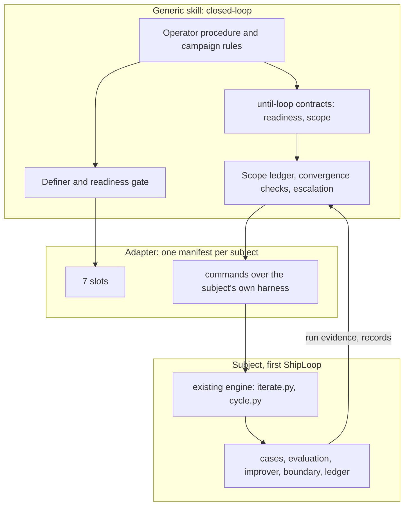

# Closed-loop: a generic improvement loop, with ShipLoop as its first adapter (plan, 2026-11-15)

**Status: plan for the owner's decision; nothing is built.** If approved it supersedes sections 2 and 3 of
[docs/shiploop-e2e-iterate-skill-plan-2026-11-15.md](shiploop-e2e-iterate-skill-plan-2026-11-15.md) (the ShipLoop-only
`shiploop-e2e-iterate` skill becomes this generic skill plus a ShipLoop adapter). That plan's facts stand and its effectiveness
list is absorbed in section 9.

**What changed.** That plan advised against generalizing until a second subject existed. The owner has now asked for the generic
skill, with a way to discover or have a reviewer define what is subject-specific, three readiness checks (cases, evaluation,
improvement stage), until-loop considered, iteration, and escalation to broader cases. So this plan builds the generic layer thin,
with ShipLoop as the first adapter and a second subject as the generality test.

## 1. What was asked, and where each part lands

| The owner asked for | It becomes |
| --- | --- |
| a generic skill | `closed-loop`: an operator procedure, an adapter contract and a few small scripts (section 2) |
| a way to call out, discover, or ask the reviewer to define what must be specific | the adapter schema is the call-out (7 slots); a **definer** discovers or proposes the missing slots; the run reviewer reports adapter gaps every iteration (section 4) |
| ShipLoop-specific items to support it | the ShipLoop adapter (section 7) |
| an until-loop, if it helps | yes, for two contracts: setup readiness and each campaign scope; not for the inner iterations (section 5) |
| check there are cases to run, a way to evaluate a run, and a way to call the improvement stage | readiness checks R1, R2, R3, each proven by a script (section 3) |
| iterate again when concluded | a campaign is a sequence of scopes; a converged scope goes stale when the build or the evaluator changes (section 6) |
| escalate and widen to a broader set of cases when stuck | two stuck modes and a five-rung ladder (section 6) |

## 2. Design



- **Prompt-first, scripts small** (repository convention). The generic skill is `SKILL.md` plus `references/` (adapter schema,
  readiness, scope and escalation rules), `prompts/` (definer, blind-spot hunter, adapter-gap questions) and one Python-stdlib
  script, `closed_loop.py` (adapter check, readiness, coverage, scope status/widen/report, until-loop contract emitter).
- **The engine is the subject's own, at first.** ShipLoop's `iterate.py` and `cycle.py` stay the engine, reached through the
  adapter. A generic engine is extracted from them only when the second subject needs a piece (one implementation of each
  mechanism, S-12): never as a big-bang refactor.
- **Same split one level up.** The SPEC already separates "the common loop" from per-case adapters ("Case adapters and run
  evidence"): the loop does not acquire a product's rules. This plan adds the same separation between the generic loop and a
  subject.
- **Invocation** (proposal):

  ```text
  /skill-craft:closed-loop readiness <subject>   check the slots; print what is missing and what is only declared
  /skill-craft:closed-loop define <subject>      have the definer propose the missing slots; validate; ask for ratification
  /skill-craft:closed-loop run <subject>         a campaign: scope contracts, checkpoints, escalation, report
  /skill-craft:closed-loop status <subject>      scopes, converged at which build, backlog, stale scopes
  ```

**Adapter slots: the call-out of what must be specific.**

| Slot | The subject must supply | ShipLoop today |
| --- | --- | --- |
| 1 Mission | what the subject promises, as clauses a reviewer can cite | `SPEC.md` S-clauses, the review PREMISE |
| 2 Cases | runnable scenarios with dimensions (style, follow-on, hosted), cost, requirements | `cases.json`: 37 cases, 7 styles (brownfield 15, web-service 6, hosted-platform 6, parallel-graph 4, cli-files 2, stateful-service 2, smoke 2); 31 do not need a hosted org; cost history in `baselines.jsonl` |
| 3 Run | build an artifact; run a case headless to completion or a stop point; cheaper instrument tiers; cleanup | `build-packages.py`, `run.py`, `slice.py`, `epoch.py`, `lifecycle.py` |
| 4 Evaluation | floors by script, measures with validity, a sensitivity probe, a noise report, an evaluator identity | `checks/`, scorecard, `promotion.py`, `spread.py`, `boundary` digests |
| 5 Improvement stage | candidate, withheld and evaluator path sets; build; verify command; improver role; landing rule | `boundary.CANDIDATE_PREFIXES`, `iterate.improve`, the quick tier |
| 6 Authority | what is routine, what is owner-only, the campaign budget, hosted requirements | AGENTS.md decisions; Salesforce cases need an org |
| 7 Records | ledger, journal, evidence location | `learning-records.jsonl`, `LEARNINGS.md` |

Evaluation comes in three classes, and the class limits the claims the loop may make: **scripted oracle** (preferred),
**scripted plus judge**, and **judge-only** (blind, order-randomized, reliability measured, as `rubric-eval` does). A judge-only
subject can improve, but its quality verdicts are labelled as model-judged and cannot qualify a promotion alone.

## 3. Readiness: the three checks, each proven by a script

A slot is only ready when a script has watched it work. Model proposals and declarations are never the evidence.

| Check | States, lowest to highest | The proof for each step |
| --- | --- | --- |
| **R1 cases** | missing, declared, runs | `declared`: the manifest lists cases and a run command. `runs`: the cheapest case runs at the current tip, writes evidence, and its cleanup is verified |
| **R2 evaluation** | missing, declared, scores, sensitive, calibrated | `scores`: `evaluate` returns floors and measures for that run. `sensitive`: a probe separates a known-bad build or tree from a known-good one. `calibrated`: a noise report exists for the profile in use; otherwise efficiency verdicts are labelled unmeasured |
| **R3 improvement stage** | missing, declared, bounded, exercised | `bounded`: build and verify pass on the tip and a planted out-of-bounds edit is caught. `exercised`: the improver lands a trivial in-bounds change that passes verify, on a throwaway branch |

Start rule: R1 at least `runs`, R2 at least `scores`, R3 at least `bounded`. Allowed claims: a quality claim needs R2 `sensitive`; an
efficiency claim needs `calibrated`; "the improver works" needs `exercised`. The readiness report says which claims the loop may make.

Precedents for the proofs already exist in ShipLoop's harness: `seeded_defects.py verify` ("the probe tells naive from fixed"), the
2026-11-01 restore pilot (a control without a known-good hook scored accuracy 0.0 and the candidate 1.0, so the evaluator separates
them), and the boundary tests (an edit outside the candidate paths is caught).

## 4. Discovery: how a reviewer defines what is specific

1. **Find an adapter.** Look for an explicit `--adapter`, then `<subject>/closed-loop.adapter.json`, then a registry of known
   subjects shipped with the skill. A subject with a harness but no manifest (Backchain) is *adopted*: the definer drafts a manifest
   that points at what exists.
2. **Readiness gate** (script) reports each slot's state. Only the missing or merely declared slots go to the definer.
3. **Definer** (a model role, default Codex Astra at max, because adapter design is a design question; overridable). It reads the
   subject's source, docs, tests and history, and returns a schema-checked proposal into a staging file, never into the subject:
   per slot `found | proposed | unknown`, evidence (file references), the command, risks, `needs_owner`. Rules in its prompt:
   adopt what exists before writing anything new; propose contrasting dimension values at the least cost; prefer scripted oracles;
   never put graders in the candidate set; mark any command that touches a hosted system, credentials, spend or deletion
   `needs_owner`.
4. **Validate by script**, slot by slot, to the readiness states above. A failure goes back to the definer with the evidence. This
   is the setup loop (section 5).
5. **Ratify** the authority block once: candidate and withheld paths, budget, hosted requirements. No proposed command beyond
   read-only discovery runs before this.
6. **Freeze** the manifest. Its digest, with the case catalog and the oracle files, is the **evaluator identity**. Verdicts are
   compared only under the same identity; a change to the adapter starts a new baseline cell (this is the SPEC's rule for the
   harness today).

**The reviewer keeps calling out specifics during the loop.** The run reviewer is already asked, separately from ShipLoop, about the
harness (`learning_retention`, `further_learning`, `evaluation_criteria`) and may file discoveries with `target: harness`. That is the
channel. Generalize `harness` to `adapter`, add one question ("what could you not determine because the adapter does not record
it?"), and keep the rule that adapter findings never reach the improver: they are worked between scopes by re-running the definer and
readiness for the affected slot.

**A known-answer test for the definer** (phase 3): give it only `skills/shiploop/` and compare its proposal with the real adapter,
slot by slot, against a checklist written before the run; then run it on Backchain, whose answer is partly known.

## 5. Where until-loop fits

until-loop (v0.10.1; `improve` vendors the same version under `skills/improve/runtime/until-loop/`) is a script-owned loop: the
contract carries `work`, `exit_condition`, `repeat_condition`, `required_trivial_reviews`, frozen `exit_checks` (shell commands
written before any work) and a `context`; each iteration reports a classification, an exit assessment, evidence and a handoff; the
runtime counts the trivial streak, refuses "satisfied" unless the frozen checks ran after the last change, and treats the contract as
immutable, so a revised scope is a new contract and the streak starts again.

That matches what the SPEC's campaign directive asks of a model operator and nothing enforces today: a script stop ends an
invocation and is not convergence. Two contracts:

- **Readiness contract** (setup). Work: define and validate the missing slots. Exit: R1, R2 and R3 at their start-rule states, each
  an `exit_check` running `closed_loop.py readiness --slot ... --min ...`. Repeat while proposals remain unvalidated and fixable.
  Stop incomplete: ratification, authority or a resource is needed.
- **Scope contract** (campaign). Work: one closed-loop iteration at scope S through the adapter (explore or qualify), then the
  checkpoint the directive prescribes (read the whole backlog, not the truncated reviewer view; reconcile; choose the next
  investigation). Exit: **converged(S, build, identity)**, as these checks, all passing after the last change:
  - **C1 backlog**: every material in-scope record has a terminal disposition (promoted and verified; dropped with a reopen
    condition; deferred or owner-held with a reason); none is open or selectable.
  - **C2 quiet**: at least K consecutive iterations at this scope and identity opened no new material record (K defaults to 2, the
    value `iterate.py` already uses for clean passes, and is the contract's `required_trivial_reviews`).
  - **C3 green**: every scope case meets its floors on the current build, within tolerance of its last good result.
  - **C4 coverage**: every dimension value the scope declares has a run on the current build; each `not_covered` entry has a reason.
  - **C5 clean**: no live runs or leases the campaign owns, the worktree is clean, the quick tier is green.
  - **C6 acceptance**: the last promoted change carries the acceptance evidence its claim needs.

  The classification is the model's report, so it is never the only signal: if a mislabelled "trivial" iteration hides a new
  material record, C2 fails and the runtime refuses "satisfied". The first pass of a freshly widened scope runs the new cases with no
  change to the subject; if they pass and find nothing, the runtime completes the contract at once (`unchanged_first_pass`).
- **Not used for** the inner iteration (`iterate.py` has its own stops), the statistics, the isolation (those stay in the harness's
  boundary), or the nested definer loop at first (a plain script-and-prompt step until it proves too clumsy).
- **Mode**: the runtime's isolated or receipt mode, as `improve` does, not automatic host-session mode. A receipt in the campaign
  folder survives context loss without host hooks; which of the two is a phase-1 detail to check against the runtime's adapter doc.
- If the loop is not used the procedure still works by hand; the until-loop makes the convergence discipline refusable.

## 6. Iterate again, stuck modes and escalation

"Cannot improve any more" is three different situations. They need different moves, and each is a script-computed signal from
counters the harness already keeps, not a model's opinion.

| Mode | Signal | First move |
| --- | --- | --- |
| **Saturation** | C1 holds, and at least K quiet iterations (`iterate.py`'s clean streak; or no admitted record after exploring) | widen coverage (E1 to E4) |
| **Stall** | admitted records remain, but cycles end DROP or UNDECIDED, or the improver commits nothing twice (`NON_PROMOTE_STOP`, `idle_streak`) | diagnose before widening: UNDECIDED for noise means a deeper instrument (E2); DROP for a regression means a candidate-design review (E3); an unactionable finding becomes an owner or investigation record |
| **Blocked** | a required unknown, missing authority, an unavailable resource, or the campaign budget used | E5: stop with a named-scope report and a reopening condition |

**Escalation ladder**, cheapest information first. Each rung is a new scope with its own contract and a fresh streak:

| Rung | Move | How it is chosen | Authority |
| --- | --- | --- | --- |
| **E1** | add catalog cases that cover dimension values the scope lacks | `coverage` lists uncovered values; pick the cheapest by median turns from `baselines.jsonl` (indicative, mixed hosts: smoke 152, cli-files 178, stateful-service 201, brownfield 210, web-service 301) | routine within budget |
| **E2** | same cases, deeper instrument: more attempts, a qualified epoch, another host or model profile | the noise report for the profile; efficiency effects smaller than the tolerance need more attempts | routine within budget; changing a tolerance is the owner's |
| **E3** | widen the critique: a blind-spot hunter and a read-only advisor panel propose cases or probes, never changes | any stuck mode | routine |
| **E4** | author a new case for a named blind spot (the definer; R1 and R2 validate it; the evaluator identity changes) | only when E1 is exhausted and a blind spot has evidence | owner if hosted, spending or one-way |
| **E5** | stop with a convergence report | rungs exhausted within authority, or blocked | n/a |

How a widened scope starts and stays safe:
1. **Baseline sweep first**: run the new cases on the current build with no improver. New failures are findings, not regressions.
2. Findings enter the ledger; the loop continues at the wider scope.
3. **Narrower converged scopes become regression guards**: in later qualification registrations a case that is not the one being
   improved is registered as a regression case (an established requirement that must not fall, as `cycle.roles_for` already does).
4. This is the SPEC's own rule made mechanical: "a change justified by one case is re-checked on another before it is called
   general" and "convergence only within a named reviewed scope".

**Iterating again.** The scope ledger records converged(S, build, identity). A scope goes **stale** when the subject's build or the
evaluator identity changes; a stale scope gets a cheap regression sweep before the campaign widens. A new campaign starts when the
build changes (a release), the adapter changes, a case is added, or the owner supplies the authority a blocked scope waited for.

**Autonomy rules inherited from the owner's global instructions.** Every campaign states a budget (wall-clock, turns or spend; the
owner's number, or a default the owner confirms): an exhausted budget ends the scope as blocked, never as converged. Work runs in a
worktree with a random suffix; each iteration appends to an append-only journal; stop and report on three iterations with no
progress, the same error three times, or a metric regression (halt, never auto-revert). Code-touching work runs the repository's quick
tier before any completion claim. These are limits on a campaign's authorization, not on ShipLoop's own loops.

## 7. The ShipLoop adapter: what exists and what to build

Constraint: the evaluator identity covers the top-level `*.py` and `*.cjs` files in `test/shiploop_e2e/`, the checks and fixtures,
the case entries, the SPEC and the catalogs (`boundary.evaluator_files`, `qualification_snapshot`). So adapter files go in a
subdirectory (`test/shiploop_e2e/adapter/`), still outside the improver's reach (`HARNESS_PREFIXES`), dimensions are **derived** from
existing case fields (`style`, `follows`, `platform`, `needs`) and `cases.json` is not edited, and any SPEC amendment is a separate,
visible step because it starts a new baseline cell.

| Item | What it is | Priority |
| --- | --- | --- |
| S1 | `adapter.json`: mission references, authority, candidate/withheld/evaluator path sets (from `boundary`), commands, ledger and journal paths, role profiles | needed first |
| S2 | `adapter/` facade: `cases` (with derived dimensions and cost class), `run` (delegating to `run.py`, `slice.py`, `epoch.py` by instrument), `evaluate`, `coverage`, `iterate` (explore or qualify for a scope), `probes` (seeded-defect verify, boundary negative test), `cleanup` | needed first |
| S3 | scope ladder as data, derived from `suites.json` (`focused`, `breadth`, `batch` with its `not_covered` reasons) and the cost class | needed first |
| S4 | reviewer additions: `adapter` gap question, matched baseline rows (`run.matching_rows`) and a coverage record (stages and artifacts read, omitted, unknown) | next |
| S5 | record the instrument in the record's `next_experiment` first; add a field to the prediction only if that proves insufficient | next |
| S6 | backlog reconciliation view: dispositions and staleness of the 9 held, 6 deferred and 2 open records against the current ShipLoop version | next |
| S7 | campaign report and the productivity line (accepted, demonstrated improvements per total hours and tokens) from the journal | next |
| S8 | a calibration for the default driver. The only one is Codex Terra at high on ShipLoop 1.27.0; the default driver Grok 4.6 xhigh has 3 of the 235 baseline rows | owner's call (D1, D3) |

**Expected readiness today, to be confirmed by running it (phase 2):** R1 `runs`; R2 `sensitive` (restore pilot, seeded defects) but
not `calibrated` for Grok 4.6 xhigh; R3 `bounded` and likely `exercised`. If that is so, ShipLoop is ready to start with efficiency
verdicts labelled unmeasured, and the readiness report says so in one line.

## 8. The second subject: Backchain

`/Users/dadleet/src/backchain` is its research and evaluation harness: 21 case directories, deterministic validators
(`harness/lib.js`, `schema/plan.schema.json`), a blind A/B bench with a majority-vote judge (`harness/bench.sh`, judge rounds k=3),
Makefile targets for tests, calibration and judge drift, and saved results. It has cases and an evaluator of a different shape
(scripted plus judge, comparing prompt elaborations), no improvement stage and no loop. That is a good test of the contract: slots
2 and 4 exist in another language and repository, slot 5 must be defined (candidate paths under `skills/backchain`, with its own
tests), and the repository's own rules (no commits unless asked; commits in worktrees) become part of the authority slot.
The alternatives: `improve` (no case harness), or no second subject (then generality stays unproven).

## 9. Phases, gates and what would make us stop

| Phase | Deliverable | Proof | Stop or reshape if |
| --- | --- | --- | --- |
| **P0** owner decisions (section 11) | go, name, second subject, until-loop mode, budget policy | the answers | no go |
| **P1** generic skill v0, no models and no engine | skill, references, prompts, `closed_loop.py`; a **fake subject** (a small program with planted defects, two styles of case, a scripted improver) with hermetic tests; Astra max review | tests pass, including an escalation demo: converge at S0, widen on an uncovered style, find the defect only the new case exposes, fix it, converge at S1, then stop blocked on an owner-only rung with the report. Readiness reports `missing` for a planted gap and `declared` (not `sensitive`) for a planted insensitive oracle | the fake-subject demo needs engine code the skill does not have |
| **P2** ShipLoop adapter (S1 to S3) | manifest, facade, scope ladder; a readiness report; one real scope-contract step at the smoke scope | the report is truthful; the step ends in a convergence verdict by checks, not by a script stop | the same scope run by hand through `iterate.py` ends the same way at the same cost: then keep only the facade and readiness, and stop |
| **P3** definer known-answer test | proposals for ShipLoop (from `skills/shiploop/` only) and for Backchain | recall and false proposals against a checklist written first; Backchain readiness reaches R1 and R2 | the definer misses most slots: keep the schema as a hand-filled form and drop the model role |
| **P4** escalation on a real subject | ShipLoop smoke to breadth (the `focused` to `breadth` suites), until-loop contracts, one widening decided by rule | scope converged by checks; widening followed the ladder; the productivity line recorded | breadth costs more than the owner's budget: report and stop at E5 |
| **P5** extraction | only the engine pieces Backchain needed (promotion statistics, boundary mechanics, host launchers), one at a time with tests | each move leaves ShipLoop's harness green and its evaluator identity unchanged or explicitly re-based | no piece is needed: extract nothing |

Each phase ends with a verbose learning commit, and an Astra max review before the next phase is presented as ready. Phases are
sized to the cheapest instrument that can answer: P1 and P2's first half use no models.

## 10. Why not just run `iterate.py` by hand?

What this adds, honestly: (1) a script-enforced convergence discipline where today a model operator decides when to stop (the
failure the campaign directive exists to prevent); (2) a readiness check that prepares a subject before runs are spent, and says
which claims it can support; (3) escalation by rule instead of ad hoc; (4) a path to a second subject. What is unproven: that the
extra layer changes outcomes on ShipLoop. P2's stop rule tests exactly that before P3 to P5 are spent. Not built here: a universal
oracle, an automatic adapter acceptance, a new statistics engine, or a framework.

## 11. Decisions for the owner

Direction-setting (one-way or changing earlier advice), each with the recommendation:
1. **Build the generic skill now**, reversing the earlier "wait for a second subject". Recommended: yes, thin, gated as above.
2. **Name**: `closed-loop` (the repository's own term from the 2026-10-30 plan; precise: a loop closed by measurement). Rivals:
   `self-improve` (collides with `improve` and `improve-loop`, and hides that a separate improver under an evaluator boundary does
   the changing), `evidence-loop`. No ShipLoop-specific alias skill (one implementation of each mechanism).
3. **Second subject**: Backchain.
4. **until-loop**: the vendored runtime in isolated or receipt mode, as `improve` does, for both contracts; optional (the procedure
   still works by hand).
5. **Campaign budget policy**: who states the number for each campaign, and the default if none is stated.
6. **Definer**: Codex Astra at max, staged proposals only, authority ratified by the owner once.
7. **K** for the quiet streak: 2.
Routine (the session decides and logs): everything in phases P1 to P5 that stays within the ratified authority and budget.

## 12. Risks and unknowns

- Over-generalizing from one subject: mitigated by the fake subject and Backchain.
- Definer proposals that look plausible and are wrong: nothing counts until a script has watched it work.
- Evaluator drift between scopes: the evaluator identity and new-baseline-cell rule.
- Cost of widening: every scope carries a budget and an authority line; E4 and hosted cases are owner-gated.
- A model-reported "trivial" streak: the exit checks are scripts, and the runtime refuses "satisfied" without them.
- Duplicated mechanisms between the generic skill and the harness: the facade delegates; extraction only on demand.
- Unknown: whether the generic operator changes outcomes on ShipLoop (P2's test); the definer's recall (P3); wall time and noise of a
  scope on Grok 4.6 xhigh (unmeasured); whether `unchanged_first_pass` behaves as described when the subject's workspace is a
  worktree that the campaign itself commits to (check in P1 with the real runtime).
