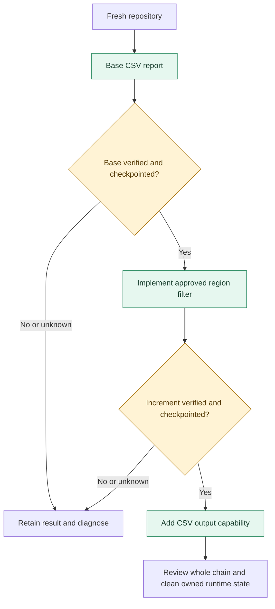

# One base, then two features: an incremental ShipLoop test plan

Status: the three requests now have experiment-local behavior checks, synthetic
calibration, a one-link launcher and an evidence-bound predecessor gate. Independent
verification passed 30 pilot tests and 52 suite-registration tests; the first live chain is pending. This is test apparatus, not a
measured ShipLoop improvement. The earlier 45 focused checks at
`3423e21801165d86c21e1d9e59d5c55d130bff66` verified reused components only.

Consumer: the E2E operator planning and reviewing successive ShipLoop runs. The
builder always invokes ShipLoop in a separate fresh context; the operator does
not build or repair the app in that context.

## The first chain

Use the existing `csv-report` case as a small, port-free starting point. Give the
decision-bearing variant its own identity; do not silently change the existing
catalog case. It exercises a real create followed by two changes, without an org
or browser obscuring the question about repository knowledge.



Each arrow carries the same product's files and Git history into a **new run and
fresh model context**. It does not carry the preceding chat or replay its plan.

| Link and request | Kind of work | Critical distinction |
|---|---|---|
| [1. Base](01-base.txt) | New app from an empty product | Deliver the existing CSV-to-JSON contract. Record the approved future filter requirement, but leave that feature outside this delivery. |
| [2. Region selection](02-region.txt) | Extension of existing aggregation | Implement the already-decided filter. Retrieve its matching and validation rules from the repository rather than asking the owner to decide again. |
| [3. CSV output](03-csv-output.txt) | New capability in the existing app | Add an output format while retaining the existing entrypoint, JSON default, filter and validation semantics. A new capability is not a new project. |

The base request preserves the existing `csv-report` prompt verbatim and adds
an explicit future requirement and scope boundary. A decision being accepted does not put
its implementation into the current delivery: the request expressly defers it.
At link 2 it becomes current work. Record and assess that scope boundary.

Record the handoff's actual `follow_on` class, statement, source and rationale.
`extension` is a prediction, not a required label: the current vocabulary also
allows a `note` for knowledge retained for a later change. Judge whether the run
preserves the settled rule, marks implementation as deferred and fulfills this
delivery's recording obligation. A label alone neither proves nor disproves those
facts. If it says `gap` or `decision`, inspect which outcome or choice it describes;
do not fail the base merely because a deferred future feature got that label, or
accept a claim that the already-settled matching rule needs another owner answer.
Retain any disagreement with the class definitions as a separate classification
finding. A recommended follow-on command never bypasses the checkpoint review.
If a primary-requirement gate precedes premature implementation, retain the
refusal and subsequent actions in `shiploop_failures`/events. That is a possible
scope-handling defect to diagnose, not automatic proof the model ignored the user.

## Decision authority and implementation are separate

Use these as evaluation questions, not new ShipLoop state names or a new ledger.
The product keeps its existing three living knowledge files.

| What is known before the request | Expected response | Failure example |
|---|---|---|
| Accepted, implemented and verified | Preserve it; rerun relevant regression checks. | Rebuild the application or claim the old feature as newly delivered. |
| Accepted, deferred from the base, now requested | Acknowledge the missing implementation and implement the settled design. | Ask again whether matching is case-sensitive, or treat the decision record as proof the filter already works. |
| Proposed or explicitly reserved for the owner | Continue independent work; ask only for the material unresolved choice when no authorized default can proceed. | Treat an old proposal as permission to implement it. |
| Explicitly rejected | Preserve that decision unless the new authorized request changes it. | Revive the rejected option because it appeared in an old plan. |
| Explicitly replaced by this request | Change code, current spec, design and affected tests together; retain the earlier rationale as history. | New code uses the new rule while the current spec or test suite still requires the old one. |
| Implementation exists but proof is absent | Verify it or report the evidence gap. | Mark it verified from prose, a filename or a test count. |

For example, the base approves **exact, case-sensitive region matching** for later.
Link 2's prompt deliberately does not repeat that rule. `North`, `north` and
`Northern` distinguish retrieval of the settled decision from a plausible guess.
The prior decision remains applicable; the work changes from deferred to current
and then to implemented and verified only when evidence supports it.

## Concrete conditions to exercise

All checks derive from the public request or applicable prior decisions. Keep an
external `checks_source` map identifying the request sentences behind each check.
Link 2 intentionally incorporates link 1's accepted requirement by reference.
The separately implemented user-listing Chain B carries the dated SPEC
amendment for explicit incorporation by reference. This CSV pilot remains
experiment-local and does not add a central catalog case. The evaluator's
inputs and expected outputs remain outside the builder's product.

| Condition group | Required observations |
|---|---|
| Base behavior, at every link | All five existing `csv_report.py` modes: `unit`, `totals`, `invalid`, `missing`, `empty`. Existing tests remain meaningful and passing. |
| Base scope, link 1 only | The future filter requirement is retained with its basis and deferred implementation; the filter is not silently delivered early. Behavior probes plus source review establish this, not a keyword search alone. Never inherit this negative check into links 2 or 3. |
| Filter matching | Exact match, different case, substring near-match, empty region and no matching region; multiple input files. |
| Filter interactions | Filter affects `rows`, `revenue`, `by_region` and `by_product` together. Invalid rows outside the selection still produce the prescribed diagnostic and exit 2. An unreadable file still produces no stdout and exits 1. |
| Filter compatibility | Omitted selector preserves base behavior. The implemented option and its behavior agree with the accepted decision recovered from the base. |
| New output | Explicit JSON equals default JSON; CSV header/columns, Unicode code-point region ordering, two decimal places, commas/quotes/newlines and header-only empty selection. Parse CSV fields, allowing valid quoting and line endings. Avoid rounding ties not settled by the base request. |
| Cross-feature behavior | CSV honors the filter and the same validation/errors. All prior base and filter checks still run at link 3. |
| Repository continuity | Predecessor commit is an ancestor, copied start head matches the checkpoint, standing documents/tests/data survive, and the new run has its own identity and saved incoming prompt. |

Do not equate a feature with a new file or a growing test count. Extending existing
tests can be correct. Extracting a shared module can be appropriate. Evaluate
whether code responsibilities, interfaces, documentation and tests remain coherent.
Only grade flag placements and error cases defined in the request files; repeated
flags and placements after file arguments are outside this scenario.

## Where the knowledge should land

| Existing artifact | What the next run needs | What does not belong there |
|---|---|---|
| `docs/shiploop/spec.md` | Current requirements, acceptance conditions and which prior rule the new request replaces, if any. | A second competing specification for the same feature. |
| `docs/shiploop/architecture.md` | Current structure/interfaces, accepted design and its rationale; explicit supersession where authorized. | A live new decision accidentally appended under `Superseded`. |
| `docs/shiploop/environment.md` | Current commands, runtime and standing test/release procedures. | Dated stage reports and repeated run transcripts. |
| Git history and external run records | Changes, reasoning, measurements, earlier requests and execution evidence. | Earlier action IDs or one-off approvals treated as the new run's instructions. |

Read `metrics.json`'s existing `delta` observations: IDs added/kept/changed/retired,
born-retired decisions, changed sections, source/test footprint and plan scope.
Then inspect the cited artifacts. These metrics are useful locators; they do not
prove that a decision is correct or that its implementation exists. File size and
heading counts remain diagnostics, not substitutes for semantic review.

Grade the base's knowledge placement at its checkpoint independently of link 2's
behavior. Record which living files, Git messages and prior external run files
link 2 actually reads. Correct code recovered from an old request does not prove
the living knowledge worked. If the access trace is incomplete, retrieval source
is unknown. Do not delete retained evidence to manufacture isolation. A behavioral
requirement belongs in the living spec; an architecture reference may support it.
Record authority retention and placement separately if the rule survives only in
architecture, rather than silently discarding that evidence or calling placement correct.

## Score each link without hiding unknowns

| Dimension | Pass | Fail | Unknown |
|---|---|---|---|
| Requested behavior | Independent checks demonstrate every required condition. | A valid check contradicts a requirement. | A required check was absent, skipped or unusable. |
| Prior behavior | Inherited checks and relevant stored data remain valid. | An unrelated existing contract regresses. | The predecessor or its obligations cannot be established. |
| Decision handling | Current authority, scope and implementation evidence are distinguished correctly. | Rejected/proposed work is adopted, a settled choice is reopened without cause, or accepted text is called implemented. | The decision source, rationale or observed action cannot be linked. |
| Knowledge and organization | Current files tell the next run the applicable rules and actual structure. | Active contradictory rules, misplaced live decisions, duplicated mechanisms or discarded required knowledge. | Only headings/counts are available, with insufficient semantic evidence. |
| Workflow and lineage | Fresh invocation, correct predecessor, completed callbacks and retained proof. | Old state is replayed or the wrong repository/result is used. | A required invocation, callback or delivery receipt is missing. |

Report each dimension separately and give condition counts with the gaps named.
Quality and authority failures cannot be averaged away with efficiency. A correct
owner-question stop can pass that particular workflow expectation while the
original delivery result remains BLOCKED/failed; never rewrite it into a delivered
product pass. Eligibility to advance is a separate checkpoint decision.

## Execution and cleanup

Use the source harness `test/shiploop_e2e/run.py` and its current CLI. The installed
`shiploop-e2e-audit` package has another bundled harness and a different `--baseline`
contract; do not mix their commands. For this source harness, `--continue-from`
copies `PRIOR/work`, including `.git` and untracked files, and launches a fresh host.
It is a new physical work directory with the same project lineage, not a new app.

**Before each next link**, the operator must verify the intended predecessor case,
its terminal result, relevant quality/fidelity evidence and the actual checkout.
Pin the commit, file manifest and worktree state, including declared untracked
files, so edits after grading cannot masquerade as the tested predecessor. Missing,
failed, mismatched, dirty-unexplained or unverified predecessors do not advance.
`--continue-from` alone checks only for `work/.git`; it does not enforce these
conditions. The suite path skips failed predecessors, but that alone is not a
complete provenance or semantic-review check.

Custom requests all report `case: custom`. An external `runs.json` must distinguish
the named links with prompt digest, output path, predecessor path and checkpoint
HEAD; asserting `case == custom` alone does not identify the intended predecessor.

For the new custom-prompt kit, explicitly supply each link's checks: lasting base
checks at all links, the “filter absent” check only at link 1, filter checks at
links 2 and 3, output checks at link 3. Custom
`--prompt` runs do not acquire catalog `follows` inheritance automatically.
Keep a fresh external output/run directory per invocation. Review a completed
link before launching its successor. Pin the evaluator, requests, checks,
published ShipLoop package and requested/observed model identity; use the selected
profile consistently rather than silently changing its default. Proposed pilot:
Codex `gpt-6.1-terra`, **high**, honoring the owner's request to return to high.
This is not a high-versus-xhigh comparison and changes no harness default.

The original review used skill-craft 2.31.0 / ShipLoop 1.30.0 at release
`5c9bf5e8786a1d44a1389a3b98fa8c5da3c05a8a`. Before the first live launch, the
published locator was refreshed to skill-craft **2.32.1 / ShipLoop 1.30.2**,
`9273b4cfda87761f4ad002324b238e6d8f755bfb`; the launcher accepts an explicit
`--release-commit` and requires that exact clean, detached release checkout.
Resolve the selected published build again before launching and freeze it for all
links. Following the existing experiment pattern, use `--source checkout` on a
detached checkout of that release, with the pilot requests/checks in this experiment
directory. Keep `cases.json`, `checks/csv_report.py` and the qualification evaluator
unchanged: adding to the central checks directory changes all oracle digests.
An external pilot must record its own request/check digests and cannot claim
`promotion/5` qualification merely because its scripts pass.

```text
Independent repetition A: clean start → base → filter → CSV output → cleanup
Independent repetition B: clean start → base → filter → CSV output → cleanup
                                      preserve state within each chain
```

Preserve verified predecessors and raw evidence. Stop only the chain's owned
processes and remove its disposable scratch after checking teardown. For later
hosted cases, preserve the deployment/data/schema within a chain and reset only
tracked test-owned state between independent repetitions. A Git copy does not
establish a remote-system checkpoint. The shared Salesforce org's unrelated apps
remain outside cleanup scope.

## Run the implemented kit

Use a clean detached checkout of the selected release for `RELEASE_TREE`, and
put `OUT` outside both source checkouts. `KIT` is this experiment directory in
the apparatus checkout. The source harness builds the released tree into the
isolated subject's package; the current implementation checkout is not the
subject build.

```sh
mkdir -p "$OUT"
python3 -B "$KIT/calibrate_checks.py" \
  --base-checks "$RELEASE_TREE/test/shiploop_e2e/checks/csv_report.py" \
  > "$OUT/calibration.json"
python3 -B "$KIT/test_checkpoint.py"
python3 -B "$KIT/launch.py" --release-tree "$RELEASE_TREE" \
  --release-commit 9273b4cfda87761f4ad002324b238e6d8f755bfb \
  --output-root "$OUT" --calibration "$OUT/calibration.json" \
  --trial-id pilot-a --link base --dry-run
```

After checking the command, repeat the launch without `--dry-run`. It launches
one fresh Codex invocation, records its exact request/check/model/release identity
in external `runs.json`, and preserves a failed attempt. A launch requires a
passing calibration artifact whose input digests still match the checks, their
fixtures, the requests and the selected release's base checker. Editing a checker
after calibration invalidates that proof. It neither schedules the
next link nor supplies its semantic verdict. No new turn, resume or runtime cap
is added by the kit.

Before the next link, follow the [review guide](review-guide.md):

```sh
python3 -B "$KIT/checkpoint.py" inspect --run-dir "$OUT/pilot-a/base" \
  --inventory "$OUT/runs.json" --trial-id pilot-a --link base \
  --output "$OUT/reviews/pilot-a/base-snapshot.json"
# Fill a separate base-review.json from review-template.json and retained evidence.
python3 -B "$KIT/checkpoint.py" create --run-dir "$OUT/pilot-a/base" \
  --inventory "$OUT/runs.json" --trial-id pilot-a --link base \
  --review "$OUT/reviews/pilot-a/base-review.json" \
  --snapshot "$OUT/reviews/pilot-a/base-snapshot.json" \
  --output "$OUT/checkpoints/pilot-a/base.json"
python3 -B "$KIT/launch.py" --release-tree "$RELEASE_TREE" \
  --release-commit 9273b4cfda87761f4ad002324b238e6d8f755bfb \
  --output-root "$OUT" --calibration "$OUT/calibration.json" \
  --trial-id pilot-a --link filter \
  --checkpoint "$OUT/checkpoints/pilot-a/base.json"
```

Repeat inspection and review for `filter`, then launch `output` from its
checkpoint. Review the final link too. The [source map](checks-source.json) links
each condition to the public request. The [calibration](calibrate_checks.py)
uses two independent implementation structures and explicit good/bad expectations.
Keep this calibration artifact immutable across the chain; a new calibration gets a
new filename. Editing or overwriting a pinned artifact invalidates the checkpoint.
Repository CI runs both calibration and checkpoint tests through
`test/shiploop-e2e-incremental-pilot.test.py`.

If the host interrupts an unfinished link, repeat that link's launcher command
with `--resume`. The launcher uses the harness's existing `--resume-run` path:
it continues the same link and retains the earlier attempt before updating its
result. It does not copy the predecessor again or repeat the original request.
The same source, profile, calibrated checks and recorded partial checkout must
still match. A completed delivery that failed its checks, or an owner-decision
stop, is not a transient host interruption. Preserve and review that result.

## Accepted sequence and optional extensions

1. Build the filter/output checks and the predecessor inspection for these exact
   requests. Reuse the existing base checks and `delta` reader; add no controller,
   product stage, per-feature spec folder, decision database or dependency.
2. Before a live run, calibrate the executable checks against at least two correct
   implementations and targeted faulty variants: lost base behavior, filter built
   too early, wrong case/substring matching, filtered-away validation error, CSV
   bypassing the filter and wrong default format. Predecessor probes cover absent
   result, `pass: false`, wrong link/prompt and post-grade checkout changes. Require
   100% agreement with expectations frozen before calibration; retain discrepancies
   and revise prospectively. Separately rehearse the human review on in-place
   requirement updates, new-ID-plus-retirement, live ADs under Superseded and false
   implementation claims. These are semantic judgments, not new keyword detectors.
3. Run one base and its two increments through ShipLoop. If the base fails or the
   needed decision was not retained, report that failure; do not inject the missing
   answer into link 2 to rescue the lineage. Review before deciding the next action.
4. Optionally repeat link 2's request on a copy of its verified checkpoint. The
   expected response recognizes the work already exists, verifies it and avoids
   rebuilding it. This is one cheap branch, not a fourth mandatory feature. The
   harness's `committed` check expects HEAD to move, so a correct no-op may receive
   a failing delivery result: preserve that result and assess behavior separately.
   Repeat a whole chain from a fresh base only for a named confidence question.
5. Cross-check the result in a different family: reuse the existing
   `ticket-assignment → ticket-escalation → ticket-comments` chain. Its base is a
   pinned brownfield fixture, not an app created from empty. Use `ticket-sla` as a
   separate fourth-link test when explicit rule replacement is the hypothesis.
   The planned small `user-listing` Chain B is another option; its in-memory HTTP
   base must not be assumed to have persistence, a CLI or an audit subsystem.

The existing owner-question experiment already covers proposed/unanswered work;
reuse its evidence rather than adding a matrix of decision states to this pilot.
The separately approved Chain B remains a distinct coverage lane, not displaced
by this small create-first test.

One passing chain establishes only that observed lineage. Record token/turn/cost
coverage and overhead, but make no efficiency claim from one or two chains. A
ShipLoop fix discovered here gets its own prediction and `promotion/5` comparison,
with protected quality, applicable calibration and frozen evaluator. Keep measured
wins; retain rejected experiments and influential hashes in verbose learning
commits. Do not reuse a historical tolerance whose calibration no longer binds.

## Evidence behind this plan

Reviewed source contracts: [copy and predecessor metadata](../../../test/shiploop_e2e/run.py#L432),
[inherited checks](../../../test/shiploop_e2e/chains.py#L37),
[follow-on case-writing rules](../../../test/shiploop_e2e/SPEC.md#L705),
[accepted intent versus implementation](../../../skills/shiploop/references/project-knowledge.md#L329),
[handoff class definitions](../../../skills/shiploop/scripts/shiploop_prompts.py#L1861),
[primary requirement verification](../../../skills/shiploop/scripts/shiploop_primary.py#L1)
and [qualification input boundary](../../../test/shiploop_e2e/boundary.py#L88).
These links describe the reviewed source revision; line positions can move later.

- `f9454b31ff1751d333e16b6439842a312f3e6f31`: two primed follow-on sequences
  correctly stopped for an unanswered owner decision and delivered after an answer.
  Useful mechanics evidence; it does not test the accepted-but-unimplemented case.
  `445e275f69cc77838cadc90c2bdced4313001d96` records that delivery-versus-correct-stop
  distinction in the follow-on design; this pilot does not add automatic chaining.
- `a232cf038789b532c8485c7583136177cb6be929`: correct live SLA work was rejected by
  a copied retention predicate. Calibration had tested only the new-ID path, missing
  the valid in-place update. Original failure remains recorded.
- `bf68e9590a009e3087c7acfefa895d158d9b7034`: explicit replacement needs revised
  acceptance, not automatic retention of an obsolete assertion.
- `9e39b146db427c26f68c0e22d900e70c92be5011` and
  `d71eaa7198772501b189dff76308d4ee7ac533cb`: later-pass placement improvements
  and their limits; notices are not semantic completeness guarantees.
- `3423e21801165d86c21e1d9e59d5c55d130bff66`: same-build token variation and an
  evaluator-digest mismatch make a universal efficiency threshold unjustified.
- `916a2c2b32e451f3748a1b8be4675b88cbcb113b`: the E2E learning-owner safeguard
  protects harness decisions; this plan tests decisions inside the generated app.
- `e7c05e6875679ad0a617923c41e1f9fd5c57079e`: the separately registered
  recommended-gap experiment treats the class of intentionally deferred work as
  an open question. This is a plan, not a result. It prompted removal of this
  pilot's categorical `extension` expectation without weakening its scope or
  accepted-decision requirements.

Opus reviewed the frozen brief read-only: `claude-opus-5-5`, xhigh, verified served
model, no fallback, exit 0. Adopted its warnings about negative-check inheritance,
predecessor identity, old-request retrieval, deferred-scope gates, ambiguous CLI
semantics and no-op grading. Kept semantic review separate from script calibration
and reduced extra branches. Its suggestion to prefer xhigh does not override the
owner's high-effort request. Its suggestion to accept architecture-only placement
as equivalent is not adopted: retain the rule's evidence, but separately assess
whether the living spec contains the behavioral requirement.
Full advice and the frozen brief are retained externally alongside the run logs.

The pinned baseline registry contains four successful Codex Terra xhigh CSV rows
and two at high, alongside three older/other-host rows. This is selected historical
evidence, not a reliability estimate for the new request, profile or release.

Design references: [Hypothesis stateful testing](https://hypothesis.readthedocs.io/en/latest/stateful.html)
describes sequences and invariants and cautions that simple cases need no new
state-machine framework. [Playwright project dependencies](https://playwright.dev/docs/test-projects#dependencies)
illustrate explicit prerequisites and skipped dependent tests. These inform the
test design; neither library is added. [Decision-record guidance](https://adr.github.io/)
supports retaining rationale; ShipLoop's existing living files remain the home.

Verification so far: 39 selected delta/chain/placement tests and 6 follow-on/suite
tests passed on the pinned clean source, with unchanged tracked-file fingerprint
`8f518ba265aff6e9b485b4bd2138ed677a6b93667ce190d60b4b837a6d7d0ac1`.
Raw evidence is external at
`/Users/dadleet/e2e-runs/2026-11-01/incremental-chain-d9x1yges/apparatus-validation/`.
These are apparatus checks, not new live-case results.

Document check: relative source/request links resolve and the rendered Markdown
tables were inspected in a local HTML preview. The Mermaid source was reviewed;
the local Pandoc preview does not render Mermaid diagrams.

## Implementation verification, 2026-11-01

The final independent check passed 30 pilot tests (29 checkpoint/launch tests plus
calibration) and 52 suite-registration tests. The calibrated matrix matched all
136 cells (17 variants by eight oracles), with no live model calls and unchanged
input/source identity. The dry-run selected the clean detached 9273b4cf release,
verified the calibration binding and created no product output. Raw evidence is
retained outside the repository under
`/Users/dadleet/e2e-runs/2026-11-01/incremental-implementation-6vr1vrbo/csv-verification-03`.
These results qualify the apparatus contracts; live ShipLoop behavior is pending.

Interrupted-run recovery requires a harness result and invocation to have been
recorded. It does not recover a killed launcher with no retained record. The
source harness records copied start HEAD/tree and ancestry, but does not expose
an atomic post-copy whole-file manifest before the child starts.
