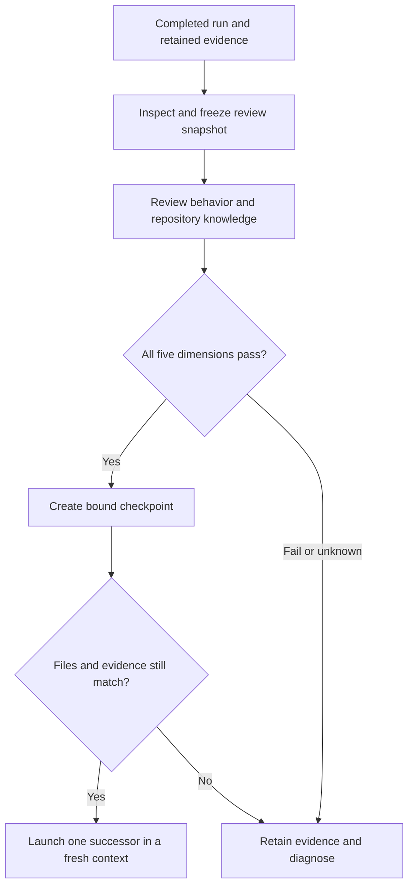

# Review one completed link before advancing

The executable checks establish behavior. A separate review establishes whether
the repository retains the right authority and the next run can use it. Neither
alone qualifies a predecessor. Keep `pass`, `fail` and `unknown` separate; any
non-pass dimension blocks the next link.

The snapshot binds the review to the actual files, including declared untracked
files, rather than only to a success field in `result.json`. The launcher checks
the same identity again before copying the predecessor.

## Operator procedure

Use the source-harness launch kit described in [README](README.md). After the
process exits, retain the launcher inventory, the original result and check logs.
Run `checkpoint.py inspect` with this run, its inventory, trial and link identity
to create a snapshot **before** reviewing. Fill [review-template.json](review-template.json)
from that snapshot and from direct inspection. Evidence paths are files relative
to the run output; locators identify a line, JSON key, check condition or stream
event. A citation must explain what it proves.

| Dimension | Inspect before marking pass |
|---|---|
| Requested behavior | Every required condition in the request/check source map has usable passing evidence. At base, inspect the source as well as the probe to establish that region filtering was deferred. |
| Prior behavior | All five base checks remain passing. Link 3 also retains the complete filter checks. Inspect meaningful earlier tests and explain any authorized edits; test counts alone do not prove retention. |
| Decision handling | Compare the incoming request, previous checkpoint and current spec/design. Accepted future work stays accepted but unimplemented at base; link 2 implements it without reopening the choice. Link 3 adds capability without treating the repository as a new app. |
| Knowledge and organization | Read the actual current rules, implementation claims and code responsibilities. Check for contradictory active requirements, live decisions under Superseded, repeated mechanisms and obsolete structure/commands. |
| Workflow and lineage | Inspect invocation, exact prompt, selected ShipLoop run, terminal receipts/report and copied predecessor identity. A successful app check does not replace a missing callback or receipt. |

Record the observed follow-on class, statement, source and rationale. There is no
required class label. Record retrieval evidence separately: which living files,
Git messages or previous external run files the subject actually read. If the
trace does not establish that source, retain `retrieval_source.status: unknown`.
Correct later behavior alone does not prove retrieval from living knowledge.

Then run `checkpoint.py create` with the review and its snapshot. If a file,
result or bound evidence changed after inspection, review the new state instead
of editing the old checkpoint. If behavior or authority failed, do not repair the
product in the coordinator or inject the missing answer into the next request.

## Four semantic rehearsal cases

These are illustrative evidence packets for the operator, not executable keyword
detectors or results from a live ShipLoop run. The expected judgments are frozen
before the first live chain.

| Packet | Evidence presented | Expected judgment and reason |
|---|---|---|
| In-place update | R-7 originally says exact region selection is accepted for later implementation. The new authorized increment changes R-7 to implemented and cites passing exact/case/empty/error checks. No contradictory active requirement remains. | **Pass** for decision handling. Keeping the ID and updating its state is a valid reconciliation. A new ID is not required. |
| New ID and retirement | R-7 retains its historical wording but is explicitly retired and points to current R-12. R-12 names the authorized change and verification. The current design points to R-12; no active rule claims the old behavior. | **Pass** for decision handling. An explicit replacement is valid; literal preservation of the old active wording is not required. |
| Live decision filed as superseded | The implementation uses AD-9 as its current behavior, but AD-9 appears only under Superseded, with no current successor or explanation. Behavior checks pass. | **Fail** for knowledge and organization. A passing implementation does not make contradictory authority safe for the next run. |
| False implementation claim | The base correctly omits the region flag, but its living spec calls the future filter implemented and verified. Base and negative scope checks pass. | **Fail** for decision handling. Accepted scope is not implementation evidence; those passing checks actually contradict the completion claim. |

For each example, unrelated dimensions remain **unknown** unless its packet
supplies their evidence. None of these four judgments, by itself, makes a whole
run eligible to advance. This avoids turning a local semantic example into an
invented complete E2E pass.
