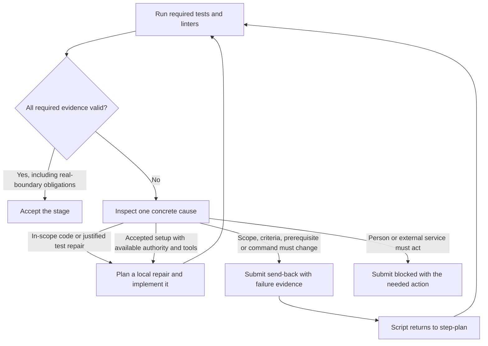

# Recovery, test discrimination and deployed readiness — 2026-11-07

Use the existing Until Loop for a repair that fits the accepted item and its available, authorized tools. Return to step-plan when the observations require changing the plan. This follow-up demonstrated one successful local setup recovery without replanning, and retained small improvements to the tests and their evaluators. It does not establish a general prompt improvement or complete Salesforce acceptance.

## Which loop owns a failure

Replanning changes the accepted work contract; ordinary local repair planning does not. A send-back is a structured stage result accepted by ShipLoop, which returns the item to step-plan with that result as evidence. It is not a conversational suggestion to another model. Test changes require an independent reason in the action notes; tests may not be weakened, skipped or removed just to produce green. A passing smoke check cannot replace a required recorded command or live consumer check.

This is already expressed by [test duties](../../../skills/shiploop/scripts/shiploop_prompts.py), [Until Loop repeat conditions](../../../skills/shiploop/scripts/shiploop_loops.py), and [native outcome contracts](../../../skills/shiploop/scripts/shiploop_reference.py). No new stage, loop limit, production prompt or default was adopted.

## What the follow-up established

| Probe | Observed result | Limit |
| --- | --- | --- |
| Native setup recovery | Preparation 541.190s; continuation 399.876s; five authored tests, no send-back, item carried forward. Independent oracle passed 6/6 dimensions and 11/11 actual-target checks. | One synthetic item slice; stopped at system-test-author before system tests and release. |
| Counterfactual replay | Same five tests pass on ready state; the sandbox test fails when its receipt is missing. Neither replay performs setup. | Trusted local fixture, not an adversarial security boundary. |
| Invalid-type fault bank | Prior generated suite kills two of four faults; retained author examples kill all four while accepting both correct implementations. | Two additional discriminating faults. Original six-mutant score and cohort are unchanged. |
| Code-knowledge review | Six frozen examples match four registered dimensions; independent review supports the judgments. | One sample per case; B04 rationale sufficiency remains a judgment boundary. |
| Child Chrome DevTools | Third attempt passes local click/readback, public example page and Salesforce public login rendering. | No authenticated org UI or app acceptance. Multiple launch settings and fresh context changed together. |
| Real provider protocol | Existing key authenticates; two live Grok 4.7 calls perform a synthetic read-only tool roundtrip with exact result consumption. | No Apex, Named Credential or real Salesforce record operation. Earlier exact-OK probe remains false. |

The recovery subject first probed current state, found its sandbox receipt missing, invoked the permitted public setup command, separately probed again, independently read configuration and receipt, and then ran the consumer journey. Its tests only observe state. The grant requiring owner authorization remained blocked and unchanged. Source, target state, frozen inputs and authored test bytes were unchanged during independent verification; the test SHA-256 is 9a8cbed3ebae95bcc70c6942709829e9b11f8abee9eb6dca1daca62f3158749a.

The native harness was frozen at c233c18acec66237534680695e8e5648a82f9511 with 29 corpus files. The subject requested Terra xhigh; served identity is UNKNOWN. Seeded upstream acceptance is not evidence of repeating those stages in the continuation. The native host was deliberately stopped at the slice boundary; its internal -9 termination is distinct from the successful wrapper and is not whole-run completion.

## Small gains worth retaining

The [recovery fixture](../../../test/fixtures/native-setup-pilot/recovery/README.md) retains the stale prerequisite, accepted-plan export, independent state oracle and 17-check calibration with ten negative controls. Review exposed two false-pass paths in the checker: a denial could conceal a protected-state write, and a late successful completion could conceal an earlier completion before setup. Both were reproduced against the old checker, fixed and covered by counterexamples. A subsequent 16/17 result came from counting the seed audit's blank line as an event; the corrected calibration passed 17/17 on Python 3.15 and 3.9.

The [typed boundary bank](../../../test/fixtures/native-setup-pilot/README.md) independently varies dictionary record IDs, coerced versions, stringified idempotency keys and pair-list changes. The earlier generated suite already caught version and key faults through boolean and None inputs. The improvement is two more discriminating faults in author-written examples, not four absent boundaries or a better model prompt.

The [knowledge examples](../../../test/fixtures/native-setup-pilot/knowledge-fixture/README.md) separate broken behavior, weak diagnostics, absent causal rationale, misleading comments and a simple case needing no historical warning. They help evaluate whether comments preserve useful knowledge without comment quotas. The first calibration version had genuine defects in its supposed positive control; retain it as confounded rather than declaring reviewer false positives.

## Failures and evidence boundaries

Two continuation launches failed before a model call because the frozen seed reapplied catalog work_item metadata after accepted plan records, injecting an unsupported obligations field. The corrected exporter forwards the exact accepted work item at both seams. Original catalogs, failed launches and accepted records remain retained; no subject sample was replaced or pooled into an A/B result.

Browser attempts one and two had navigation or runtime timeouts. The third used an isolated Chrome profile with mock keychain and media-route discovery disabled, among other settings. It demonstrates a usable child-host route in that invocation, not that one flag caused the improvement. The guarded Salesforce route still lacks an authorized private authentication handoff for the isolated browser. No new org deployment or credential configuration occurred in this follow-up.

The provider key was already available through an environment reference; its value was never retained or sent to the subject. A separate prospectively registered tool roundtrip passed after a looser chat probe returned a nonempty response that was not exactly OK. Preserve both observations.

Verified Opus advice informed actual readiness checks, phase-correct accepted seeds, independent oracles and the separate fault bank. Its prediction that all four typed faults would survive was contradicted by execution and rejected. Code and semantic reviews complement measurements; they do not establish general effectiveness.

## Reproduction and retained evidence

[results.json](results.json) contains portable artifact locators and scope. The external bundle is recovery-followup-20261108T010005Z, dated November 7 in America/Los_Angeles. It retains registrations, frozen inputs, raw runs, earlier failures, oracle controls, provider/browser receipts and a rendered owner report.

The no-model CI wrapper is test/native-setup-pilot.test.py. Recovery and API checks use local fixtures; knowledge reviews and provider/browser probes are not silently added to CI. This is test apparatus and learning retention. No packaged skill source changes or release are required.

The restored checkout passed all 27 selected quick suites in 225.923 seconds. The native fixture wrapper passed eight checks there and eight checks on Python 3.9. All 9,858 registered files and the source identity were unchanged during execution. Exact-commit CI is recorded separately after publication.
