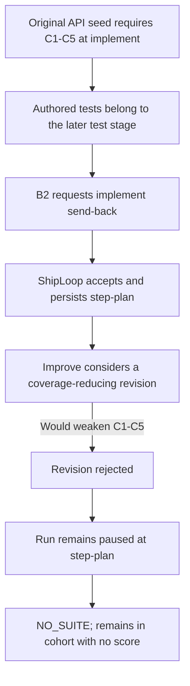

# Native setup pilot: retained findings (2026-11-07)

**Decision:** Keep the reusable local apparatus and its no-model calibration. Do not adopt the production prompt draft. The API comparison is unqualified, and planning tied on five usable properties in four plans; this is insufficient evidence of a prompt effect, not proof of no effect.

This was a descriptive native-stage pilot, not a promotion comparison or full E2E. Its external evidence bundle is `native-setup-pilot-20261107220147Z`; [results.json](results.json) records hashes, outcomes, and bundle-relative artifact locators without machine-local paths, profiles, or raw transcripts.

The frozen source was commit `b237a3e89147e18a9f8450e63afb0814eeafd9be`, tree `ea70d8d823c2c8f5c31162343f957c30f63081eb`. Candidate B overlaid `shiploop_prompts.py` only. The subject request was Codex `gpt-6.1-terra` at `xhigh`; served identity is **UNKNOWN**.

## Native slices

Seven of eight slices completed: four planning slices and three of four API slices. The planning output folders labeled `runs/v3` and `runs/v4` are output versions; all four launches used the same `corpus-v3` native runner, case catalog, and fixture root.

| Trial | Arm / rep | Seconds | Slice outcome | Callback refusals |
|---|---:|---:|---|---:|
| readiness-A1 | A / 1 | 212.581 | PASS, stopped at prepare | 1 |
| readiness-B1 | B / 1 | 276.526 | PASS, stopped at prepare | 1 |
| readiness-B2 | B / 2 | 220.540 | PASS, stopped at prepare | 1 |
| readiness-A2 | A / 2 | 280.904 | PASS, stopped at prepare | 0 |
| api-B1 | B / 1 | 226.523 | PASS, stopped at document | 0 |
| api-A1 | A / 1 | 219.880 | PASS, stopped at document | 0 |
| api-A2 | A / 2 | 226.206 | PASS, stopped at document | 0 |
| api-B2 | B / 2 | 309.954 | PAUSED at step-plan, exit 1 | 0 |

The three planning callback refusals were runner validation of `owner_stage=prepare`; they did not erase the accepted plans. B2 is a valid observed send-back route, not a completed recovery:

The implement criteria required authored tests to pass, while protocol ownership put test authoring in the later test stage. B2's send-back was defensible. Improve rejected a baseline-only replacement that would lose the five coverage obligations; routing was observed, successful recovery was not. See the [fixture guide](../../../test/fixtures/native-setup-pilot/README.md) for the reusable fixture and [results.json](results.json) for exact trial receipts.

## API oracle results

| Trial | Suite | Oracle repeats | Correct + alternative | Six planted mutants | Qualification |
|---|---:|---:|---|---|---|
| api-A1 | 5 tests | 2, stable | PASS + PASS | 6 KILLED each repeat | Valid suite |
| api-A2 | 5 tests | 2, stable | PASS + PASS | 6 KILLED each repeat | Valid suite |
| api-B1 | 5 tests | 2, stable | PASS + PASS | 6 KILLED each repeat | Valid suite |
| api-B2 | No suite | Not run | — | — | Registered; no score |

Each repeated run reused the same suite hash and unchanged fixture inputs. The six controls were `cancel_still_writes`, `denied_write`, `duplicate_replay`, `preconfirmation_write`, `setup_noop`, and `wrong_persisted_value`. Repeats establish fixed-suite oracle stability; they are not additional model samples. Keep B2 in the four-sample cohort: no suite is neither zero kills, exclusion, nor a replacement. Only one B run is scoreable, so the A/B comparison cannot rank prompts.

## Planning and corrected-seed diagnostic

All four accepted planning outputs passed the five usable properties: reuse of ready access, permitted setup before a consumer, offline-work eligibility, readiness kept separate from journeys, and authority kept within scope. P3 is withheld: the grader required a fresh-probe command that the rubric did not require, despite 7/7 calibration cases passing. This is a five-property tie on this small synthetic sample; producer quality is unranked because original pre-Improve knowledge snapshots are not guaranteed.

A separate corrected-seed baseline diagnostic completed in 234.342 seconds, exited 0 at document, and passed five new tests plus four existing tests. The parent recomputed and verified the production source, `contract.txt`, and `test_existing.py` hashes unchanged; the separate read-only review did not recompute those identities. Two unchanged-input oracle executions (0.471 and 0.447 seconds) used the same five-test file and passed both correct implementations while killing all six planted mutants. This diagnostic is separate from A/B and supports the corrected fixture for further diagnostics only.

The diagnostic oracle worker retained an INCOMPLETE output-boundary handoff after observing concurrent report files. Adjudication verified those files were separate from oracle inputs; the raw execution receipts are retained without rerun or rewriting that handoff.

Keep its limits visible: the five focused IDs are loosely associated with C0 command metadata even though test-spec maps them to R-1 through R-5. Coverage review found missing invalid-type checks for proposal record IDs, expected versions, idempotency keys, and change objects. Six planted-fault kills are not exhaustive contract coverage.

## What to retain and what remains unqualified

Retain the portable fixture, independent API oracle, readiness calibration, native packet path, and no-model regression checks. The recorded snapshot passed six wrapper tests (including six nested adapter checks) on Python 3.15 and 3.9.6, 55 catalog tests, and earlier 11 CI-policy and 19 qualification checks. Four earlier apparatus failures remain in their separate calibration/retention records. Exact-current-commit CI is not claimed here.

Four author-written typed-boundary examples and one wrapper check now preserve the observed gaps. The final seven-test wrapper passed on Python 3.15.1 and 3.9.6 in 29.937 and 94.551 test-reported seconds; all 55 catalog tests also passed in 77.133 seconds. The 9,798-file code/test snapshot was unchanged. These examples stay outside the frozen subject, original generated suites, and six-mutant denominator. Exact-commit CI follows publication; its receipts remain in the external bundle.

No live Salesforce, browser, provider, service, credential, or deployment checks occurred. A read-only Opus review was verified as `claude-opus-5-5` at `xhigh`, with no fallback; its apparatus advice helped but did not prevent the original seed conflict.

Existing ShipLoop source/prompts, the E2E evaluator, shipped package, model default, and loop limits remain unchanged. No `LEARNINGS.md` entry or release is needed for this journal. A future live Salesforce claim needs a child browser route, scoped setup authority, and an independent live oracle.

For reuse, calibrate each oracle before scoring; freeze source, build, catalogs, case bytes, requested model, observed identity, and authority; use actual native packets; and preserve failed or incomplete runs. The typed-boundary examples are checked against both correct implementations as a separate example bank; include them in a future model comparison only after explicitly registering its scope and denominator.
