# Experiments before decomposition: evidence and Until Loop decision

Owner question, November 7, 2026: would identifying temporary experiments after the spec and before step definition improve ShipLoop? The owner authorized the evidence audit and added: “consider if an until-loop would help, but not required.”

**Defer a new stage, mandatory early experiment pass, and additional Until Loop.** The reviewed evidence does not establish an avoidable planning error that a new early experiment would catch beyond the existing duties. This is a decision to retain the current behavior, not a claim that temporary prototypes are useless. No production prompt, runtime, evaluator, model default, or loop limit changes in this work.

## What was actually examined

The audit starts at source `0a148ea7d2ca07cff42f9ec6f2c5fa99b7c93160`. It recounts the committed [step-plan corpus](../step-plan-review-20261101/README.md), screens its recorded classifications and summaries, checks five potentially relevant primary send-back results, and follows chronology in one recent Salesforce chat run. The older planning-experiment studies provide contrary evidence. This is a retrospective evidence audit, not a new model comparison or full reread of every event in every run.

[inventory.json](inventory.json) records input hashes and the presence/hash of all 112 primary traces. All 50 classification rows match one source send-back. The 50 send-backs occur in 45 distinct traces, among 178 step-plan actions in 112 run records. Historical versions span ShipLoop 1.12.0–1.26.1; these are not 112 trials of today's planner.

| Recorded cause | Send-backs | Relevance to an earlier experiment |
| --- | ---: | --- |
| Proof needs a future test, with or without a path | 23 | Proof and stage ownership; the plan already contains the ordering information. |
| Focused test IDs incomplete | 9 | Acceptance coverage and test-command agreement. |
| Proof command defects | 8 | Command/API/setup errors; not by themselves evidence of a wrong architectural assumption. |
| Proof cannot be repeated | 3 | Stateful proof design; the inspected example had already passed the live UI check. |
| Runner IDs or test floors | 3 | Runner contract and test coverage. |
| Check needs a later implementation step | 2 | Decomposition and sequencing. |
| Other | 2 | One missing schema test and one opaque controller-response failure, examined below. |

These are the retained study's classifications, not a fresh blind adjudication. Their counts do not measure the frequency of all planning failures or the benefit of any candidate.

## The cases that looked promising

The exact accepted result excerpts and event locators are retained in [selected-evidence.json](selected-evidence.json). Primary files remain unchanged.

| Case | What the primary record establishes | Disposition |
| --- | --- | --- |
| Salesforce permission assignment, `repeatable-proof` | Deployment and the direct UI check succeeded. Repeating the proof attempted the same permission assignment and failed with a duplicate-assignment error. | Proof repeatability. A new architecture experiment is not needed to distinguish an action from its read-only verification. |
| Board regression and ticket-import route, `future-board` / `future-route` | Tests depended on components assigned to later steps. | Ordering errors. Running the incomplete product earlier would not supply the missing implementation. |
| Gym schema, `schema-coverage` | Deployment succeeded, but the step lacked a focused test for exact schema properties. | A missing acceptance case, not a platform-feasibility question. |
| Gym UI, `controller-response` | A live controller-response check kept failing after successful self-save; the receipt lacked enough detail to identify the failing action. | A real post-build uncertainty. A smaller representative pre-plan probe and its architecture-changing consequence are not established. Keep this case unresolved rather than claim prevention. |
| Recent Salesforce chat, `chat-line-140` through `chat-line-240` | Browser-route unavailability was reported after spec review and before plan decomposition. Test strategy explicitly kept browser evidence open. Plan review fixed permission-set ordering. | The strongest apparent late discovery was already known. The eventual release-verification block does not show that planning missed it. Provider availability remains unknown. |

The recent chat run also omitted a named successful administrator save/readback test, despite the requirement already existing. That is a coverage gap, not evidence that an early prototype would change the design. A hypothetical prototype of the administrator authority/persistence boundary could reveal a design conflict, but this run does not demonstrate such a conflict. Preserve that distinction from the [retained setup investigation](https://github.com/whichguy/skill-craft/commit/b237a3e89147e18a9f8450e63afb0814eeafd9be); its exact local evidence root is recorded in the commit message.

## Earlier trials constrain the recommendation

The [September component pilot](../../shiploop-planning-experiments-results-2026-09-21.md) used SQLite sharing and no-overwrite publication as discriminators. Both arms found both planted mistakes. It qualified a reconciliation mechanism, not a planning-quality gain or whole-product outcome.

In the [October research experiment, E14](../../shiploop-question-driven-planning-journal.md#e14--2026-10-31-xi-does-research-probing-each-experiment-question-help-live-delivery-terra-high-all-tools), the candidate passed 6/6 versus 3/6, but the registered comparison did not pass (`p = 0.0909`), and actual probe commands appeared in only 1/6 candidate runs. The baseline failures were attempts to require proof of an unbuilt endpoint on the unchanged base. The subsequent E15 mechanism let the item's executed criterion settle that question; both arms passed 4/4. The corrected E16 conclusion explicitly leaves its live benefit unmeasured.

These examples do not prohibit disposable prototypes. A small implementation of a proposed mechanism can be informative before the product exists. The distinction is whether it can settle a named approach or readiness decision now, rather than pretending to prove the completed feature's acceptance criteria.

## Would an Until Loop help?

**Keep the existing Plan Improve loop as the owner of iterative planning experiments.** Its [current contract](../../../skills/shiploop/references/planning-experiments.md#one-review-cycle) already evaluates evidence, revises decisions, reassesses the next useful uncertainty, preserves evidence across iterations, and reconciles upstream findings. It explicitly forbids launching an additional Until or Backchain convergence loop inside that work. Choosing zero experiments remains valid.

An extra Until Loop would be useful only if new evidence showed that an early investigation needs repeated, adaptive inquiry: one result exposes a new consequential question, and another feasible authorized probe can change a decision. The reviewed cases show prerequisite ordering and corrective replanning, not an observed sequence of that kind. Multiple independent checks or several tool calls do not themselves justify another loop.



*Begin only with a consequential question and a feasible authorized probe; sufficient existing evidence needs no experiment. Repetition requires a useful next probe that could change a decision. This is investigation logic, not a new stage or a replacement for Plan Improve's completion rules. Failed apparatus and inconclusive observations leave the affected decision open; independent work can still proceed on its own prerequisites.*

If a future early investigation earns a separate loop, the existing script-owned runtime can preserve action identity and durable continuity. The model should judge the meaning of evidence, not carry its own counters or recovery state. Successful exit would require supported decisions and explicit ownership of remaining gaps; repetition would require a concrete useful next probe. A blocked investigation would remain incomplete. No new count, time allowance, trivial-review requirement, or limit is proposed here.

The [earlier question-frontier loop proposal](../../shiploop-question-record-verdicts-and-plan-2026-10-31.md#1-verdict-per-goal) was closed because its numbered-record prerequisite was rejected. That is not direct experimental evidence that Until Loops are ineffective. It is a reason not to silently revive the old design without a new basis.

## What would justify a pilot

Reopen when a retained run supplies a consequential unresolved assumption, a feasible representative probe available before decomposition, and a plausible result that changes the approach, dependencies, or readiness. Establish that earlier discovery/test-strategy work did not already supply the same evidence. A thin prototype is eligible; a full duplicate implementation or a mock that assumes the questioned behavior is not.

The smallest useful comparison would keep current ShipLoop as the baseline and add only the early experiment-selection duty. Include controls for sufficient existing evidence, acceptance requiring future implementation, and inconclusive apparatus. Measure correct downstream decisions, preserved acceptance, avoidable rework, and total cost. Experiment counts and completion of bookkeeping are not product gains. Only if adaptive follow-up becomes a demonstrated need should a further comparison isolate the Until Loop contribution from the duty itself. No such model comparison was launched in this audit because no qualifying failure mechanism was established in the reviewed evidence.

## Reproduction and verification scope

From the repository root:

```sh
python3 -B docs/experiments/preplan-experiments-20261107/audit.py --output /tmp/preplan-inventory.json
```

The script reads committed summaries and available local traces, writes only the requested report, and never starts or resumes a product run. Missing local traces are counted explicitly; committed-summary counts remain reproducible. A later checkout naturally changes `source_head`; use input hashes to establish source equivalence.

The rendered diagram, JSON evidence, count reconciliation, source links, Python syntax and whitespace were checked. This does not qualify a production change, prove the case counterfactuals, or certify current external services. The two focused read-only investigators helped classify evidence; their initial browser-access interpretation was corrected against event chronology before this decision. The prior verified Opus 5.5/xhigh consultation supported retaining the existing planning owner, while its restriction to probing only already-existing code was not adopted: a disposable prototype may test a real mechanism too.
