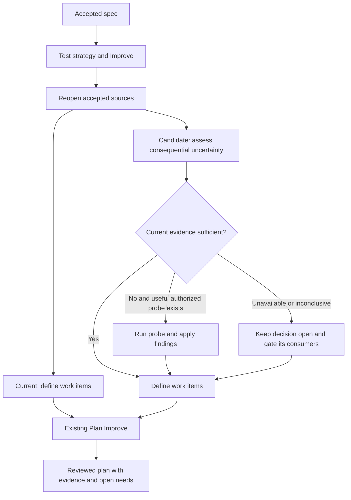

# Early experiments before work-item definition

This pilot compares ShipLoop's current planning flow with a duty that identifies and runs worthwhile decision experiments before defining work items. Plan Improve remains identical in both arms and can reassess the resulting plan later. The owner authorized the pilot after reviewing the earlier [historical audit](../preplan-experiments-20261107/README.md); the new instruction does not change those historical observations.

The candidate adds a duty inside the plan producer, after source reopening and before decomposition. It adds no navigator stage, schema or Until Loop. Existing evidence can settle a question; an experiment is valuable only when its answer changes a consequential decision or readiness. A failed apparatus does not establish a product fact.

## Comparison

Both arms use the same baseline commit, `93dd53b73e1931c5847ad75d9bc19205c40fb441`, the existing `test/shiploop_e2e/slice.py` runner, identical synthetic accepted prelude records and live test strategy through Plan Improve. Subjects and inline reviews explicitly request Sol 6.1/high. The independent judge explicitly requests Astra/xhigh under the owner's named override. Requested model identity is not provider-side served-model attestation.

| Constructed case | Decision tested | Important control |
| --- | --- | --- |
| Atomic import | How to prevent partially applied adapter writes becoming visible | Source inspection can be sufficient evidence |
| Unicode search | Which mechanism meets the specified matching semantics on the application binding | Correct local algorithms also receive credit |
| Supplied evidence | Whether prior same-source observations are reused | Required future product checks stay due |
| Unavailable service | How to keep service-dependent decisions conditional | Independent validation and preview can proceed |

The [registration](registration.json) freezes two repetitions per case and arm, exact models, failure rules, outcomes and limitations. The [obligations](obligations.json) score consequential planning quality, evidence and readiness. Experiment counts and adherence to the new wording are not outcome wins. First submitted and final reviewed plans are retained separately to assess decision-changing review work.

The [candidate overlay](candidate-overlay.json) is applied only to each candidate's disposable plugin build. The [preflight](preflight.py) proves that test strategy, Plan Improve and all existing plan text remain unchanged. The [fixture calibration](fixture-calibration.json) records actual local mechanism observations; these are apparatus evidence, not subjects' observations.

## Limits

This is a planning component pilot on four constructed cases, not a historical failure replay, full delivery comparison, statistically powered adoption test or cross-host qualification. Synthetic prelude receipts are disclosed. Read isolation is audited from transcripts; Codex's shell is not OS-fenced to its workspace on this host. A missing terminal usage event means token cost is unavailable, not zero. A completed review receipt establishes the recorded callback sequence, not the truth of every model claim.

No candidate behavior is adopted or released by this registration. The pilot can recommend a follow-up, identify harm or establish that these cases cannot separate the flows. Promotion would need separate confirmation and review on the exact text to ship.

## Reproduction

`setup.py` builds the local fixture files and calibrates their baseline and adapter observations. `run_slice.py` injects this catalog into the existing runner without changing its host, callbacks or stop logic. Supply explicit `--host codex --model gpt-6.1-sol --effort high --seed-at test-strategy --stop-after plan --planning-review stage --delegation inline`, the frozen `--ref`, an owned output directory, and `--opening-note opening.txt`; add `--overlay candidate-overlay.json` only for the candidate. The queued run manifest and retained evidence identify every exact invocation.

Sol's independent design review was adopted by preserving Plan Improve byte for byte, moving the duty after accepted-source reopening, carrying the shared investigation allowance, requiring real review completion evidence, and retaining adverse and inconclusive outcomes. Astra calibration credited supported source reasoning and conditional planning while rejecting an unrepresentative success probe as proof of atomicity.
