# Early experiments before step definition: pilot result

**The early duty moved useful feasibility evidence ahead of the first plan, but this pilot found no material final-plan quality advantage.** Astra judged all seven pairs without the recorded scope deviation tied. The eighth pair also tied and remains reported separately. Defer promoting the candidate to a mandatory default; retain the current flow while preserving this evidence for a stronger follow-up.

The study completed **16 live planning slices**: four constructed cases, two repetitions and two flows. Subjects and their inline Improve work requested **Sol 6.1/high**; 16 individual judgments and eight fresh paired judgments requested **Astra/xhigh**. This is a planning comparison, not delivered-product acceptance or a model comparison. [Results and full paired explanations](retained/protocol/results.json)

## What changed

The candidate adds a duty inside the existing plan producer after accepted-source reopening and before defining work items. It uses sufficient current evidence first, runs a representative experiment only when useful and authorized, and keeps affected work conditional when evidence is unavailable or inconclusive. Independent work remains eligible. Zero experiments is valid.

*Only the early duty differs. Both flows can already investigate during earlier work; test strategy and Plan Improve are identical between arms.*

No additional navigator stage or Until Loop was tested. The accepted spec and earlier records were synthetic seeds; test strategy, its Improve, plan production and Plan Improve ran live. The [registration](retained/protocol/registration.json) and [obligations](retained/protocol/obligations.json) define the comparison. The frozen candidate and complete apparatus remain in the [experiment commit](https://github.com/whichguy/skill-craft/tree/82046998cbcdef05cfdf2459d22c6dc6ecbb7dfa/docs/experiments/preplan-pilot-20261108).

## What the cases showed

| Case | Final comparison | Evidence and review work |
| --- | --- | --- |
| Atomic import | Both repetitions tied: [1](retained/paired/atomic-1/judge.json), [2](retained/paired/atomic-2/judge.json) | Early runs entered review with publication evidence and supported mechanisms. Current runs correctly kept feasibility conditional, then resolved more of it during Plan Improve. Neither current first plan falsely claimed readiness. Later review still repaired handoff details and, in the current second run, supplied a concrete worker-exit solution for inaccessible adapter handles. |
| Unicode search | Both tied: [1](retained/paired/unicode-1/judge.json), [2](retained/paired/unicode-2/judge.json) | Both flows established a correct normalized substring mechanism during test strategy, before the changed duty. The early duty added no demonstrated mechanism benefit. One early run needed more concrete future acceptance fixtures during Plan Improve; the other passed plan review unchanged. |
| Supplied evidence | Both tied; repetition 1 is qualified: [1](retained/paired/evidence-1/judge.json), [2](retained/paired/evidence-2/judge.json) | Both reused the supplied adapter evidence. New probes addressed different publication questions. Early runs obtained those observations before their first plans; current runs obtained more during review. Review also clarified connection lifetime, cleanup constraints and implementation prerequisites. |
| Unavailable service | Both tied: [1](retained/paired/unavailable-1/judge.json), [2](retained/paired/unavailable-2/judge.json) | Both kept service integration conditional on an approved sandbox and contract evidence while preserving independent local work. Neither treated the offline exception as remote readiness. A useful parser probe occurred during the shared test-strategy stage; no extra planning experiment was needed to rediscover the unavailable service. |

The clearest benefit is a less provisional first plan in the import cases. That does not by itself establish less work overall: the current flow's first plan was explicitly conditional, and Plan Improve resolved the mechanism before the steps were accepted. The candidate moved some work earlier. Across cases, meaningful later review work did not consistently decrease.

Plan Improve still has a distinct job after decomposition. Experiments can establish what a mechanism does; the chosen design can introduce additional assumptions about handle lifetime, cleanup, verification interfaces or acceptance semantics. In the atomic cases, observing pre- and post-commit states did not resolve the owner's meaning of an interruption after visible publication. The paired judges correctly retained that uncertainty and challenged individual grades that treated a clarification gate as automatically harmful.

## Time and token evidence

These are subject host minutes from the first to last recorded host activity, excluding runner installation and postprocessing. Plan-stage timing, including Improve, is also retained in the results JSON.

| Matched pair | Current minutes | Early minutes |
| --- | ---: | ---: |
| Atomic import 1 | 14.6 | 17.1 |
| Atomic import 2 | 18.1 | 17.0 |
| Unicode search 1 | 10.1 | 11.2 |
| Unicode search 2 | 10.7 | 9.4 |
| Supplied evidence 1 † | 15.1 | 15.2 |
| Supplied evidence 2 | 14.1 | 13.9 |
| Unavailable service 1 | 15.1 | 10.4 |
| Unavailable service 2 | 11.9 | 11.9 |

† Supplied evidence 1 is excluded from the comparison subset because of the scope deviation below.

Across the seven pairs without that deviation, mean subject time was **13.5 minutes current versus 13.0 early**. The median paired difference was only **13 seconds in favor of early**. Across all eight pairs, early was faster in four and slower in four. Fixed four-subject cohorts, shared provider load and only two repetitions make these descriptive measurements; they do not establish a dependable speed or monetary-cost winner. Total subject token usage was unavailable at the deliberate planning stop. Peak context is retained but is not a substitute for total tokens.

## Validity and limits

All 16 slices reached an accepted plan with a matching real Plan Improve terminal receipt and no later accepted stage. Every initial fixture matched its frozen input, and every installed plugin matched the intended arm digest. The existing slice suite passed **73 tests** before measured subjects. A fresh Sol/high test worker verified all 16 subject records, eight paired records and 24 Astra launch records, including quote matching, with the frozen source unchanged. These checks establish execution and evidence provenance; they do not establish the truth of every planning claim. [Preflight](retained/protocol/preflight-completion.json), [final verification](retained/protocol/final-verification.json), [mechanical audit](retained/protocol/closeout-audit.json)

In early-arm `sample-06`, an unscoped Git status from an installed-skill directory enumerated unrelated ancestor/home path names. The observed command does not establish file-content access, credential-content access, mutation or exposure to another arm's result. Nevertheless, it violated the bounded read scope. Its `evidence-1` pair is excluded from the unqualified subset, retained separately and not rerun. The exclusion was recorded before its paired judgment. A uniform scan found no additional instance across all 16 runs. Transcript auditing is not an OS read fence. The unrelated name listing is omitted from the repository capture; its raw local trace remains hashed. [Scope disposition](retained/protocol/scope-disposition.json), [scope audit](retained/protocol/scope-audit-findings.json)

The supplied-evidence control pins adapter source, not a fully attested identical interpreter environment. Actual subject probes record their own runtime where available; a later parent-runtime observation cannot attest the earlier calibration environment. The adapter's per-row commit remains directly inspectable source evidence. [Runtime qualification](retained/protocol/runtime-identity-note.json)

The candidate, cases, models and outcomes were frozen before measured subjects. Apparatus corrections are retained: a launcher filename collision failed before any subject; large judge inputs switched to stdin before measured individual judgments; the compact paired view was finalized before the first paired judgment; nested-JSON quote decoding corrected an audit false flag without changing a judgment. Full command evidence remained available to individual judges and in local traces. Raw individual grades are preserved; paired reviews explain their factual qualifications instead of silently rewriting them. Requested launch identity is verified, while provider-served model identity is not independently exposed.

Four constructed cases, two repetitions, one judge family and a small calibration cannot establish general effectiveness, statistical equivalence, full-delivery gains or cross-host behavior. A tie means no material final-quality advantage was demonstrated in the retained comparison. The method separates outcomes from transcript claims and uses repeated trials, consistent with [Anthropic's agent-evaluation guidance](https://www.anthropic.com/research/demystifying-evals-for-ai-agents); that guidance does not determine this pilot's result.

## Decision and retained evidence

**Defer default promotion.** The observed timing benefit supports investigating a lightweight pre-decomposition duty further, with Plan Improve reassessing the resulting plan. It does not yet justify another mandatory stage. These cases completed with the existing control flow and its Improve runtime; no additional Until Loop was needed or evaluated. A separate loop would need evidence that adaptive investigation adds value beyond those existing mechanisms. This is an inference from this pilot, consistent with the general principle of requiring measurable value from added workflow complexity in [Building effective agents](https://www.anthropic.com/research/building-effective-agents).

A stronger follow-up should use fresh realistic cases where the current flow commits to an unsupported choice that changes decomposition or causes meaningful downstream rework, then continue through implementation. Include both sufficient-evidence and unavailable-boundary controls, preserve exact prompts and models, and improve read isolation. No such follow-up or default change is claimed here.

The product baseline is `93dd53b73e1931c5847ad75d9bc19205c40fb441`; the study freeze is `82046998cbcdef05cfdf2459d22c6dc6ecbb7dfa`. The [evidence index](retained/evidence-index.json) hashes compact first/final plan views, individual and paired judgments, operator source captures, protocol amendments and 160 raw local artifacts. Full local evidence is under `/Users/dadleet/Documents/Codex/experiments/shiploop-preplan-pilot-20261108-f2qois1r/`. The captured scripts are audit copies with their original layout documented; they are not installed skill code. This closeout retains learning and adopts no candidate product behavior.
