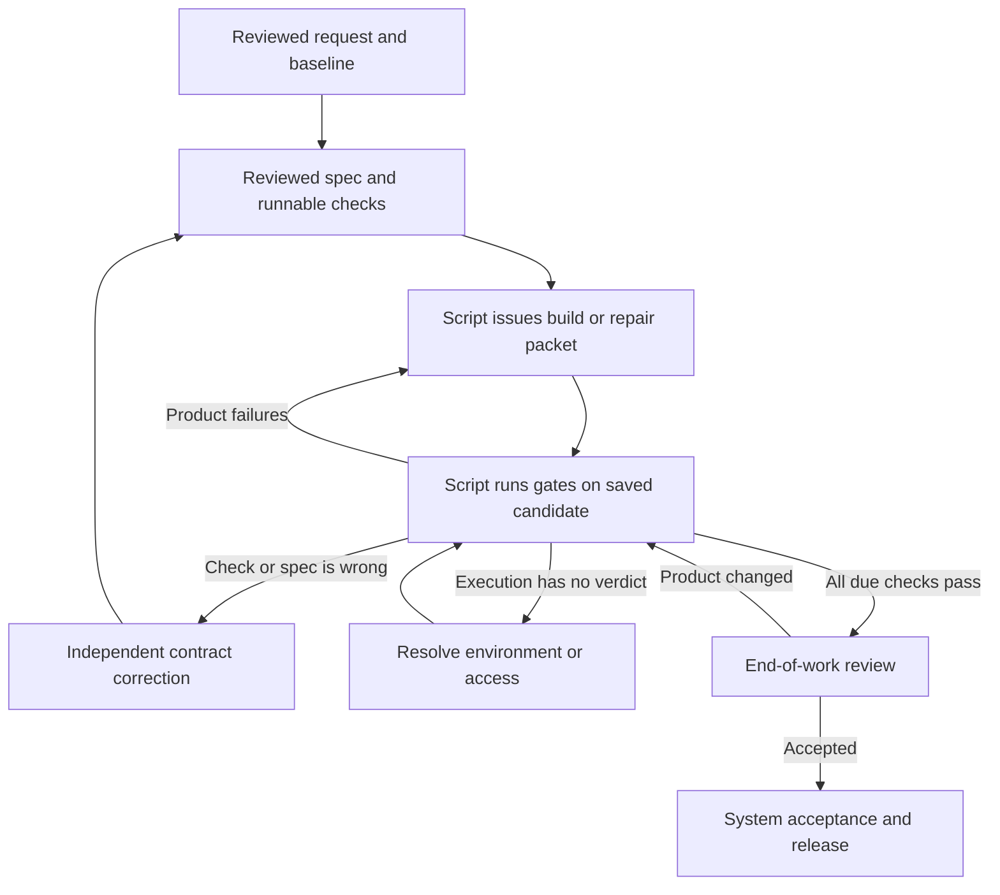

**Pilot the idea as a different way to supply ShipLoop’s work, but do not yet adopt the proposed removal of planning stages.** The build–test–repair cycle is sound. The unsupported leap is that a frozen, generated test suite can reliably turn “nothing fails” into “the request is complete.”

The strongest case **for** the idea is the measured success of fewer, larger implementation steps: less repeated work, with no observed loss on the applicable behavior checks. The strongest case **against** it is that the proposed stopping rule trusts the very thing the records repeatedly find weak: the tests’ interpretation and enforcement of the requirements.

I reviewed checkout `4a2020d5aa7396d621bbdd51bb1fa61626ab96ca`, the named source and journals, saved measurements, and relevant full commit messages. I independently recomputed the 84-run snapshot totals from the saved JSON. I changed nothing and launched no model run, test suite, or E2E slice.

Below, **verified** means supported by inspected source, retained measurements, or history. **Inferred** marks a design conclusion or an untested prediction. A test **pins a condition** when making that condition false would cause the test to fail. A **held-out check** is an evaluation check withheld from the builder.

**1. [Verified evidence; inferred design consequence] The main risk is a wrong completion signal, not an imperfect first implementation.**

There is already a concrete local example of the failure you are worried about.

In E18, all four Claude redo trials encountered a test that pinned an old ticket shape. They satisfied it by putting the new `assignee` field behind an invented `ASSIGNEES=on` switch. The tests remained unchanged and the final project suite passed, but the new feature violated its required behavior. Its held-out checks failed. All twelve repair trials were valid; the repairs corrected the conflicting test.

That result is narrow—one interaction between two features, using bare workers rather than ShipLoop’s complete lifecycle—but the mechanism is directly relevant: **protecting a test from edits does not protect the product from being distorted to satisfy it.** See [parallel-execution journal — F88: unchanged tests and a wrong feature](/Users/dadleet/src/skill-craft/docs/shiploop-parallel-execution-journal.md:733) and commit `3cbf8f05fcdf4d66a3b4fa3b8afb844214b8ef20`.

Your draft therefore needs two correction routes:

- A product violates a valid check: repair the product.
- A check contradicts accepted intent, or fails to enforce it: return to the test/specification producer.

The builder should not edit protected acceptance tests. It must nevertheless be able to challenge one with evidence. The script routes that challenge; an independent correction changes the test version when warranted. Otherwise the loop has only three possible outcomes on a bad test: run indefinitely, violate the specification, or stop without a supported remedy.

The same problem occurs without conflicting tests. A condition omitted from both the implementation and the suite produces no failure to put in the next packet. A second session reduces implementation-induced bias, but can still make the same mistake when interpreting ambiguous prose.

**My inference:** use passing tests as the required evidence for completion criteria, while retaining a separate assessment of whether those criteria cover the original request. Those are different questions. Today’s `product-acceptance` explicitly assesses the original outcome, rather than only the specification. [Stage specification — `product-acceptance`: original-outcome assessment](/Users/dadleet/src/skill-craft/skills/shiploop/scripts/shiploop_stage_spec.py:527)

**2. [Verified] The measurements support fewer planned steps. They do not establish that planning can be removed.**

Here is my check of the five factual premises.

| Premise | Verdict | What I verified |
|---|---|---|
| **1. 83/84 recorded runs and every counted slice already pass all held-out checks at the first complete implementation; no later stage changes a verdict.** | **Substantially supported for applicable product behavior; too broad literally.** | The saved 84-run JSON gives exactly **83/84 runs and 1,266/1,267 checks** at `implement`. The exception uses an earlier step because the final implementation snapshot is missing. The raw table consequently records one later verdict change. In round 6, one-step expenses implementations pass 5/6 because `unit` requires tests that are not written until `test`; all five behavior checks already pass. Round 4 also records an unexplained intermediate `unit` dip. |
| **2. Slices start from a seeded spec without planning, and every fewest-steps plan is one step.** | **First part true with an important distinction; second part only true for the smaller round-6 cases.** | Stages **before `step-plan`** are synthetic. The slices then execute `step-plan`, its review, `test-spec`, and the build stages. All eleven counted round-6 F1 slices initially planned one step. In the due-times guard, Sonnet planned two steps and Grok’s plan-only trial also planned two. A one-step initial plan can also undergo a send-back and another implementation action. |
| **3. The step’s own tests fail in about 5%; test strength is what repeats.** | **Confirmed for the recorded population.** | Among 448 steps with a test-stage command stream, about 5% contain an observed failing self-run. ShipLoop refuses `test` in 43% of recorded steps; the dominant reason is a surviving seeded fault. This measures the observed streams, not the rate of all latent defects. |
| **4. 30–40% before the first edit; reviews 20–33%; 17→8 stages and disabling Until Loop did not save time.** | **Confirmed, with different denominators.** | Before-first-edit is 30–40% in the round-4 baseline slices. Their three reviews take 20–31%; all reviews take 32.9% across recorded full runs. The earlier four 8-stage slices were 2–38% slower. L0 showed no saving, with three cells slower and one level. These are measurements, not proof that every possible consolidation is ineffective. |
| **5. Nothing larger than one work item of eleven steps has been run.** | **Supported as the structure journal’s corpus limit; not established as a repository-wide absolute.** | The journal expressly identifies this limit and leaves substantially larger requests unmeasured. Other history includes multi-item deliveries. Eleven steps is not a measured capacity boundary, and step count changes with wording and model. |

Sources: [structure journal — R22–R26: failures and snapshot results](/Users/dadleet/src/skill-craft/docs/shiploop-sdlc-structure-journal.md:655), [R29–R33: slice results and time](/Users/dadleet/src/skill-craft/docs/shiploop-sdlc-structure-journal.md:755), [R48: behavior checks versus test availability](/Users/dadleet/src/skill-craft/docs/shiploop-sdlc-structure-journal.md:1281), [guard R52–R55: larger-item results](/Users/dadleet/src/skill-craft/docs/shiploop-sdlc-structure-journal.md:1478), [earlier 8-stage comparison](/Users/dadleet/src/skill-craft/test/shiploop_e2e/LEARNINGS.md:2129), and [F7: corpus size limit](/Users/dadleet/src/skill-craft/docs/shiploop-sdlc-structure-journal.md:165).

Two distinctions change the interpretation.

First, **“first complete implementation” means the accepted implementation snapshot of the last step**. It does not necessarily mean the first code the model wrote. Earlier steps have already been built, tested and reviewed; the current implementation action has already satisfied its proof gate. The snapshot instrument explicitly selects that point. [Snapshot sampler — last-step selection](/Users/dadleet/src/skill-craft/docs/experiments/sdlc-structure-20261119/snapshot_acceptance.py:85)

Second, the successful one-step arms retained the planning outputs, proof, test specification and reviews. The F1 overlay explicitly changes only the sizing wording. It cannot answer the counterfactual “would the same implementation succeed without those inputs?” [F1 overlay — unchanged duties and gates](/Users/dadleet/src/skill-craft/docs/experiments/sdlc-structure-20261119/overlays/f1-fewest-steps.json:1)

That is F6’s central caution: a review edit is not evidence that a defect would otherwise escape, and a review with no edit is not evidence that nothing was missed. The approved comparison remains unrun. Its three arms were per-stage planning reviews, one bundle review, and reviews off—**not planning versus no planning**. [Structure journal — F6](/Users/dadleet/src/skill-craft/docs/shiploop-sdlc-structure-journal.md:161), [Improve-value journal — registered three-arm comparison](/Users/dadleet/src/skill-craft/docs/shiploop-improve-value-journal.md:468)

The October rejection and November deferral therefore still matter. They are not scientific proof against the owner’s new idea. They establish that removing stages remains a proposed experiment, rather than an already-supported optimization. [Planning-time analysis — section 5](/Users/dadleet/src/skill-craft/docs/planning-time-analysis-2026-10-06.md:71), [lifecycle assessment — deferred structural changes](/Users/dadleet/src/skill-craft/docs/shiploop-lifecycle-assessment-2026-11-13.md:139)

**3. [Verified evidence; inferred design consequence] Freezing acceptance tests is compatible with the idea; freezing all test development is incompatible with the existing test-strength gate.**

The existing mutation check makes small deliberate changes to product code and asks whether the focused tests detect them. Its actual implementation:

- Samples at most eight changes from changed product lines.
- Refuses an all-surviving sample.
- Requires a disposition for other surviving changes.
- Can return a recorded skip when it cannot judge the candidate.
- Checks the shape of disposition explanations, rather than proving their semantic truth.

The module’s opening description and function docstring are incomplete descriptions of the current survivor-disposition behavior; the executable code is the stronger evidence. [Mutation gate — `_check`, sampling and execution](/Users/dadleet/src/skill-craft/skills/shiploop/scripts/shiploop_mutation.py:300), [disposition validation](/Users/dadleet/src/skill-craft/skills/shiploop/scripts/shiploop_mutation.py:410), [actual refusal logic](/Users/dadleet/src/skill-craft/skills/shiploop/scripts/shiploop_mutation.py:475)

This gate can report: “The product passes, but the tests fail to distinguish this bad version.” That is a **test-development task**. It is not automatically a product defect.

Your draft is ambiguous here. If the folded build packet still writes supplementary unit and integration tests, those tests can improve while acceptance tests remain protected. That is workable. If the frozen acceptance suite is the only suite allowed to grow, the mutation failure needs an independent test-authoring packet.

I would distinguish three sets explicitly:

| Test set | Rule |
|---|---|
| Acceptance tests derived independently from accepted intent | Builder cannot change them; challenges go through a separate correction route. |
| Existing regression tests | Preserve their binding behavior; an authorized behavior change may require an independently justified expectation change. |
| Builder-authored supplementary tests | May be added and strengthened; weakening an expectation requires an independent reason, as today. |

Two further consequences are **inferred**:

**A larger shot weakens the interpretation of the same eight-mutant sample.** Eight sampled changes over an entire large request are a thinner probe than repeated samples over smaller changes. A passing sample must not be reported as coverage of every clause.

**Changing the mutation base to the last repair would hide earlier omissions.** Retain the original request base for assessing the complete delivered change, alongside any repair-specific measurements. Otherwise a tiny final repair can become the only code whose tests receive scrutiny.

**4. [Verified] Much of the demonstrated benefit is already in the current fewest-steps rule. Your control must include it.**

Commit `67ac34ae2b996205ba6018ebbd7f78bee9d338dd` adopted the tested F1 wording. It is no longer merely a candidate.

The measured benefit was strongest on Sonnet: 19–44% shorter inner-loop slices on the three cases. Grok’s single comparison was 30% shorter. Sol’s result depended on the case; its small ticket change did not improve. The guard found a 19% saving on Sol and a Sonnet difference inside the registered noise band. The numbers in the prompt influenced planning but did not enforce a size boundary. [Structure journal — round-6 findings](/Users/dadleet/src/skill-craft/docs/shiploop-sdlc-structure-journal.md:1344), [guard findings](/Users/dadleet/src/skill-craft/docs/shiploop-sdlc-structure-journal.md:1552), [plan-sizing journal — entry 13](/Users/dadleet/src/skill-craft/docs/shiploop-plan-sizing-journal.md:474)

This removes most of the repeated per-step reviews on the small items already tested. Comparing your draft against the earlier two-to-four-step baseline would credit the new design with an improvement ShipLoop has already adopted.

The subsequent full deliveries add useful, narrower evidence:

- Ticket assignment completed in 13.2 minutes, with 18/18 held-out checks.
- Shared expenses completed in 48.8 minutes; product acceptance added a corrective item for startup hardening.
- They used different planning-review modes, and had no matched earlier-source controls.

They verify functioning deliveries, not another speed gain. Commit `4a2020d5aa7396d621bbdd51bb1fa61626ab96ca` records those limits explicitly.

There is also an instrumentation inconsistency worth correcting **before** another registration: some journal Limits say the slice excludes the end-of-work review. The source says it includes the last item’s `carry-forward` Improve child, and the saved census has `improve:carry-forward` time. The normal slice advances beyond the item only after that boundary. Specify the exact endpoint in the next experiment instead of inheriting the contradictory wording. [Slice contract](/Users/dadleet/src/skill-craft/test/shiploop_e2e/slice.py:8), [slice completion predicate](/Users/dadleet/src/skill-craft/test/shiploop_e2e/slice.py:117), [stage table — `carry-forward`, `improve="last-item"`](/Users/dadleet/src/skill-craft/skills/shiploop/scripts/shiploop_stage_spec.py:479)

**5. [Inferred recommendation, grounded in verified contracts] The smallest useful form is ShipLoop with an acceptance-driven work list. It does not need a new production skill yet.**

The valuable change is **no mandatory advance breakdown into implementation steps**. That is more defensible than “no planning.”

An independently executable suite still needs decisions about interfaces, prerequisites, preservation, fixtures, environments, required observation surfaces and expected results. Removing the `plan` heading does not remove that work; it relocates it into specification, test authoring or the builder’s session.

I would pilot this shape:

*The script routes failures to the producer responsible for correcting them. An empty product-failure list is only one completion condition.*

For the pilot, preserve the following responsibilities even where their prompts are combined:

| Today’s stages | What must survive in the pilot |
|---|---|
| `intake`, `discovery`, `research` | Original request, unchanged baseline observations, consequential unknowns, existing conventions and authority boundaries. |
| `spec` and its review | Observable requirements, preservation obligations, exclusions and unresolved intent. |
| `test-strategy`, `prepare` | Suitable runners, real-boundary checks, isolation and executable setup. A suite that cannot run is not a product failure. |
| `plan`, `step-plan`, `test-spec` | A short execution contract: scope, criteria, commands, expected observations, baseline expectations, prerequisites and checks due later. The experiment may remove decomposition and separate authoring stages; it must account for these outputs. |
| `validate-existing` | Script-run checks that the assumed starting state actually holds. |
| `implement`, `test`, `document` | Product work, supplementary tests, lint/type/build checks, observed documentation and knowledge updates. |
| `carry-forward` and end-of-work review | Remaining work, reconciled current knowledge, review findings and their final verification. |
| `system-test-author`, `system-test`, `product-acceptance` | Assembled-system checks and comparison against the original request. |
| `release-plan`, `release-check`, `release`, `release-verify`, `operations`, `handoff` | Existing delivery, rollback, consumer observation, authority and return contracts. |

These responsibilities are visible in [`_ROWS`, the stage table](/Users/dadleet/src/skill-craft/skills/shiploop/scripts/shiploop_stage_spec.py:214) and [`DUTIES["step-plan"]`](/Users/dadleet/src/skill-craft/skills/shiploop/scripts/shiploop_prompts.py:1291).

Keep the existing evidence records wherever possible: baseline and candidate trees, test commands and output, test IDs and floors, lint results and waivers, mutation results and dispositions, action identity, review binding, accepted commits, and unresolved requirements. Add a version or digest for the protected acceptance package, including the runner configuration that determines what executes.

The next packet should contain **the full binding scope and preservation obligations, plus current failures**. A red list alone loses the conditions that are presently passing.

A “shot” should mean one script-issued work action, potentially involving many edits and local observations. It should not mean one API response or a rebuild from an empty directory.

The repository already has a simulation environment: `slice.py`, fixtures, overlays, seeded implementations, snapshot grading and host adapters. Use an experiment-local driver or overlay. A different graph may need a different completion predicate; it must not acquire a false qualification by recording removed stages as if they ran. There is no demonstrated need for another installed skill or a second production lifecycle.

**6. [Verified evidence; inferred experiment recommendation] The cheapest falsification is to challenge the proposed acceptance suite before paying for a build.**

Your most useful early question is:

> Can the code-blind writer and condition-by-condition second look produce a suite that rejects known contract violations while accepting correct implementations?

That can fail without any implementation-model call.

The existing `stand-in-rules` apparatus has four plausible bad implementations:

| Existing variant | What it violates |
|---|---|
| `one-rule-missing` | Leaves status unnormalized while preserving plausible totals. |
| `tested-only` | Rejects the example’s invalid value but accepts another invalid value. |
| `limit-never-trips` | Exceeds the promised work budget while remaining below the dependency’s hard failure limit. |
| `cross-field` | Accepts fields that are individually valid but inconsistent together. |

The apparatus already has correct, weak-test and strong-test controls. [Subtle stand-ins — calibrated failure mechanisms](/Users/dadleet/src/skill-craft/test/shiploop_e2e/evaluators/e1b_subtle_stand_ins.py:1), [case contract](/Users/dadleet/src/skill-craft/test/shiploop_e2e/step_cases.json:409)

A small future experiment would:

1. Give the writer only the accepted contract and required public interface—not the reference or bad implementations.
2. Run the second look against every condition, then freeze the acceptance package.
3. Execute that unchanged package against the correct reference and all four bad variants.
4. Compare with the existing controls.

If a known violation passes, the result disproves the claim that this particular preparation is sufficient to support the proposed stopping rule. It does **not** disprove all acceptance-driven development. It tells you exactly what the prototype must repair before testing lifecycle speed.

Then exercise repair using due times. Its six existing faults cover rollback format, changing an existing due time, losing persistence, omitting backfill, ignoring the flag and an incorrect overdue filter. The calibration already distinguishes their expected outcomes. [Due-times reference — `DEFECTS`](/Users/dadleet/src/skill-craft/test/fixtures/quality/reference_due_times.py:167), [retained calibration results](/Users/dadleet/src/skill-craft/docs/experiments/planning-points-probe-20261114/evidence/calibration.json:1)

`no-backfill` is especially useful: one omitted responsibility causes several failures. It tests whether one repair packet fixes the common cause rather than generating a task per red assertion. `version-two` tests preservation and rollback. A subsequent combined-defect case tests interacting repairs.

Planted defects guarantee that repair has something to do. Weakening the model in the hope of obtaining an interesting first failure adds variability and may test a model you do not intend to use.

For prospective execution, use the owner’s selected production model and effort. For reproduction of the existing slice comparison, use its exact recorded subjects—Sol 6.2 medium or Sonnet 5.5 high—and identify that as a separate comparison. Do not combine results from those settings with Sol 6.1 medium or another effort as though they were one population. Nothing here warrants changing a default.

**7. [Verified evidence; inferred limits] The condition-by-condition second look is promising, but its measured gain does not yet transfer to your proposed setup.**

The stacked-test result is strong evidence for a particular intervention:

- Starting suites caught 55.1% of attempts against 74 selected missed-condition variants.
- An undirected second look reached 57.4%.
- A second look given **every condition, its wording and an observable description** reached 84.8%.
- Supplying Claude’s selected list reached the same total; the judge call was not shown to add.
- No starting-suite kills were lost.
- The all-condition arm consumed about 114.5% of the authoring session’s reported token count.

I verified the full message and archived script at commit [`f9e225ce29bdfc0cec8b2cb742c6b4968b5764dd`](https://github.com/whichguy/skill-craft/commit/f9e225ce29bdfc0cec8b2cb742c6b4968b5764dd).

Three restrictions matter.

**It was after implementation.** The product code was present and available. The second-look sessions were forbidden to change it, not forbidden to see it.

**It used additional condition descriptions.** The corpus supplied what an outside observation would see. The commit expressly says that producing those descriptions from ShipLoop’s ordinary clauses is unmeasured.

**It assumed an accepted product.** Its prompt told a session to drop an assertion and report it when the product disagreed with a requirement. That instruction is unsuitable for independently authoring acceptance tests for an untrusted implementation. [Archived stacked-test script — `FRAME` and `TASK_E`](https://github.com/whichguy/skill-craft/blob/f9e225ce29bdfc0cec8b2cb742c6b4968b5764dd/docs/experiments/fast-model-test-review-20261114/stacked_test.py#L92)

Also, 84.8% is a result on a selected difficult subset, not coverage of all 448 conditions, and not completeness. The original accepted-spec conditions were not all literal user promises.

**My recommendation:** retain the all-condition question as the cheapest supported second-look form. Do not add a judge-selection subsystem. Test its code-blind transfer and actual cost before making it mandatory.

**8. [Inferred experiment contract, tied to verified instruments] Register failure readings before speed readings.**

The first pilot should be able to reject the design for correctness even when it is fast. I would register this contract:

| Dimension | Pass reading | Fail or incomplete reading |
|---|---|---|
| **Test validity** | Correct reference passes; failures on bad references occur for the intended behavioral reason. | Correct product rejected by an invented condition; a bad reference passes; a syntax or startup error is mistaken for behavioral detection. |
| **Protected tests** | Exact frozen package executes, with expected IDs and test counts. | Tests, selection, fixtures or runner configuration change unnoticed; zero tests becomes green. |
| **Repair** | The planted defect is reproduced, then the script observes its checks pass after repair. | Builder claims success without that evidence, or passes the suite while the independent defect probe remains red. |
| **Preservation** | Every required preserved check continues to pass on the completed candidate. | A new feature is satisfied by disabling or distorting another requirement. Compare check identities, not just totals. |
| **Test strength** | Applicable mutation checks run; survivors are killed or explicitly addressed under the existing policy. | A skipped or unjudged mutation check is reported as strength; a test-strength failure is silently treated as product work. |
| **Completion** | All due checks are observed passing, with remaining required-surface observations honestly accounted for. | The failure list is empty while a due obligation was omitted, could not run or remains unobserved. |
| **Final review** | Review changes are followed by fresh applicable gates on the final tree. | The published evidence belongs to the pre-review tree. |
| **Recovery** | A fresh session resumes the candidate and its records without replaying completed effects. | Context loss reopens accepted work or loses a binding condition. |
| **Value** | A registered improvement survives comparison with current fewest-steps ShipLoop, counting all added authoring, review and gate costs. | No outcome differs; or a faster build hides a larger total preparation cost. |

Keep a truly independent evaluation set out of the repair feedback. Otherwise it becomes another development suite and stops measuring what the builder generalizes beyond the visible tests.

For time, charge the complete path from the same starting boundary:

> acceptance authoring + second look + build/repair actions + gate execution + documentation + final review and reruns.

Report inner-loop time separately, but do not use it alone to claim delivery savings. The previous stage-count and Until Loop results show why subtracting named stages is a poor time model.

For the first paired comparison, use identical starting content, specification, protected tests, model, effort and environment. Let both arms see the same acceptance tests if the question is whether decomposition and separate stages help. If only the candidate gets those tests, the experiment evaluates the whole bundle; it cannot attribute the result to removing planning.

One pair can expose a mechanism. It cannot establish a reliable speed gain. Earlier baseline slices differed by 60%, and several comparisons used concurrent runs with shared machine and provider capacity.

Do not introduce an iteration cap. Record candidate identity, failed-check identity, repair attempts and newly obtained evidence. The existing rule already routes a genuine fix that leaves the same check failing the same way, while teaching nothing new, back for reconsideration. That is a diagnostic condition rather than an attempt count. [Stage specification — `STUCK_FIX`](/Users/dadleet/src/skill-craft/skills/shiploop/scripts/shiploop_stage_spec.py:91)

An observation deadline can leave a trial **incomplete**. It must not silently become a new product-loop limit or be reported as proof that eventual convergence is impossible.

**9. [Verified and inferred, marked below] These are the concrete failure modes the design must expose.**

| Failure mode | How it would become visible | Status and implication |
|---|---|---|
| **Code and tests share a misunderstanding** | Visible suite passes; independent condition-breaking variant or held-out check fails. | **Inferred for this draft.** Code-blind authoring helps, but shared prose can still produce shared error. |
| **Builder bends the product to a test** | Final suite passes while the feature’s independent checks fail; diff adds special cases or an invented switch. | **Verified mechanism in E18.** Preserve the contract-challenge route. |
| **Several failures have one cause** | One storage or initialization change repairs several failing modes together. | **Verified calibration mechanism:** due-times `no-backfill`. Keep one repair packet capable of addressing the common cause. |
| **Repairs oscillate** | A later candidate reintroduces a previously fixed behavior; failure identities alternate. | **Inferred risk.** Retain all binding conditions, not merely the latest failures. |
| **Loop repeatedly makes the same ineffective repair** | Same failure and materially equivalent candidate recur without new evidence. | **Inferred risk; existing diagnostic route verified.** Reconsider the assumption or contract; do not call repetition progress. |
| **Tests are too weak** | Candidate passes but a deliberate behavioral fault survives. | **Verified frequently in current runs.** Route to supplementary tests or independent acceptance correction. |
| **Tests are wrong or mutually inconsistent** | Correct reference fails; satisfying one accepted condition necessarily violates another. | **Verified local conflicting-test mechanism.** More product repair cannot solve an inconsistent contract. |
| **Environment failure masquerades as a product defect** | Unchanged reference also hangs or fails; no trustworthy test result exists. | **Verified:** ticket-fixture port collisions and lost verdicts. Keep the original result and separately identified diagnostic reruns. |
| **An implied condition is never tested** | Everything passes; review or later use exposes an unstated boundary. | **Verified review pattern.** A failure-only loop cannot discover an omitted oracle. |
| **Brownfield preservation is incomplete** | Local new-feature tests pass, but restart, old-client, old-data, CLI or rollback behavior fails. | **Verified as calibrated failure classes.** Preserve baseline and cross-version checks. |
| **One long packet loses obligations** | Missing duties, stale context, partial implementation after a clear, or completion claimed from a subset. | **Inferred at larger scale.** The tested size range does not settle this. |
| **Documentation and maintained knowledge become false** | Product checks pass while completed requirements remain marked pending or verification claims refer to another tree. | **Verified in the lifecycle assessment.** Keep final knowledge reconciliation. |

Sources for the last three verified groups: [guard R55 — lost verdicts and retained reruns](/Users/dadleet/src/skill-craft/docs/shiploop-sdlc-structure-journal.md:1511), [round-3 F14 — disagreement about unstated limits](/Users/dadleet/src/skill-craft/docs/shiploop-sdlc-structure-journal.md:466), [lifecycle assessment — current knowledge versus historical evidence](/Users/dadleet/src/skill-craft/docs/shiploop-lifecycle-assessment-2026-11-13.md:54).

Your “a passing frozen test may never turn red” rule is useful **at acceptance of a completed candidate**. Applied after every intermediate edit, it would obstruct ordinary multi-file repairs. A refused candidate should remain available for diagnosis and repair; refusal need not discard all its work.

Likewise, fresh model context and a fresh product implementation are separate decisions. A fresh session can repair the current tree. E18’s paired evidence favors retaining the failed implementation for its tested recovery states; it does not justify routinely rebuilding the request after every failure. [Parallel-execution journal — F87 and its scope](/Users/dadleet/src/skill-craft/docs/shiploop-parallel-execution-journal.md:732)

**10. [Verified assessment; inferred priorities] Your scenarios are mostly useful, but their order and claims should change.**

| Scenario | Assessment | Revision |
|---|---|---|
| **A. Easy controls** | Useful for integration and measuring ceremony. They are already at the behavior-check ceiling. | Compare against current fewest-steps ShipLoop. Expect a time or regression result, not evidence that repair works. Preserve the ticket slice’s exact scoring exclusions. |
| **B. Chess and due times** | Good controls, but neither now reliably produces a failed first implementation on the tested drivers. Chess was explicitly tried as the harder case and remained at the ceiling. | Retain due times for migration, flag, persistence and rollback interactions. Use its planted defects to exercise repair. Do not budget repeated clean chess builds to search for a failure. |
| **C. Repair starts** | **Highest-value early scenario.** Deterministic failures separate repair behavior from first-shot luck. | Start with one fault, then a common-cause fault, then interacting faults. Distinguish test detection from successful product repair. |
| **D. Test strength** | **Highest-value prerequisite.** The second look is partly answered, but its proposed transfer is not. | Run code-blind tests against correct and contract-breaking implementations before running builders. Include an alternative valid implementation where feasible to detect tests that overconstrain design. |
| **E. Silent-spec defects** | Valuable, but the expected verdict needs care. Several recorded “finds” were choices about limits the spec did not settle. | Record whether the condition was explicit, implied or unresolved. Do not automatically treat one historical reviewer’s preferred answer as the correct oracle. |
| **F. Much larger whole request** | Necessary before broad adoption, expensive and poor as the first falsifier. | Attempt it after the test and repair protocol survives smaller counterexamples. Include a context interruption and a later feature addition; a long clean first build alone misses both risks. |

I would add two small controls before F:

**A deliberately wrong acceptance test.** The correct behavior is a supported challenge and contract correction—not product distortion and not endless repair.

**A lost test verdict.** The correct behavior is “not observed,” with retained evidence and the established diagnostic route—not another product-edit instruction.

The second control matters because the guard’s apparent quality loss changed after diagnosing a known apparatus fault. Register that policy in advance rather than rediscovering it after a bar fails.

Finally, I checked the strongest parts of R27 against primary sources. They support experimentation, not a universal answer:

- **AgentCoder** directly reports better test accuracy with separate programmer and test-writer contexts: 61.0/51.8 versus 87.8/89.9 on its two benchmarks. These are small coding tasks, not evidence that code-blind repository acceptance is complete. [AgentCoder, §4.7](https://arxiv.org/html/2312.13010v3)
- **TDFlow** is repository-scale support for test-driven repair, but also a warning about generated tests: 94.3% with human-written tests versus 68.0% with generated tests, at greater cost. [TDFlow, Table 2](https://arxiv.org/html/2510.23761v2)
- **ImpossibleBench** confirms that read-only tests prevent test modification while leaving special-casing and other ways to satisfy tests illegitimately. Its deliberately inconsistent tasks differ from ordinary delivery, but the mechanism matches the local E18 concern. [ImpossibleBench, §5.2–5.3](https://arxiv.org/html/2510.20270v1)
- **TDDev** compares whole-project, incremental and agent-directed testing protocols on web applications. Which protocol works best differs by model. This is contrary evidence to treating “test-first has no gain on real work” as a general conclusion. [TDDev, §5–6](https://arxiv.org/html/2605.17242v1)
- **GTDD** finds lower final error under dynamic tester conditions than under its fixed generated-test condition. Test quantities differed, and the trajectories lacked an acceptance gate, so it does not isolate regeneration as the cause. It does challenge the assumption that a once-generated suite necessarily remains sufficient throughout repair. [GTDD, §6.2–6.3](https://arxiv.org/html/2610.02952v1)

The decision I would register is therefore: **pilot independent acceptance preparation and acceptance-driven repair; defer stage deletion and a new production skill.** Promote only the part that changes measured outcomes against the current lifecycle.