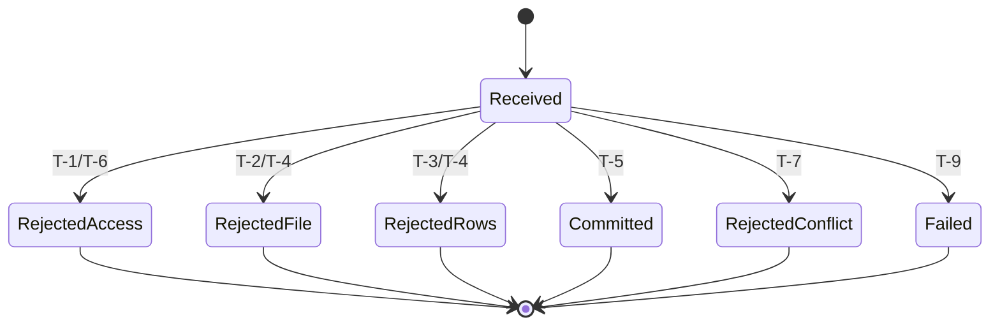

# Product Specification — User Administration

Living specification of what the product must do for administrators who manage user accounts. This run adds one
capability: **bulk user import from a CSV file**. Structure and technology choices are not recorded here; they belong
in `architecture.md` as `AD-<n>` decisions, and this run records none (see "Structure and technology" below).
Product decisions use the `PD-<n>` prefix, never `AD-`.

## Status, basis and evidence limits

| Item | Value |
| --- | --- |
| Request (source, 2026-11-21) | "Let admins upload a CSV to bulk-create users." |
| Prior spec / `R-<n>` set | None existed in `KNOWLEDGE/spec.md`. All requirements below are **added**; nothing is preserved, changed or retired. |
| Research / discovery results | None existed. |
| Repository and baseline | None available. No existing user model, role model, admin screen, auth mechanism, store, log sink, UI identity or runtime was inspected. Every statement about the host product is therefore an **unknown**, recorded as an open gap (G-n), never as observed behaviour. |
| Execution | Nothing was run or built. Acceptance lines are plans, not results. Status of every line: **not run**. |
| Reference guides used | `GUIDES/behavioral-requirements.md` (behavior model, traceability, interaction design), `GUIDES/requirements-definition.md`, `GUIDES/service-discovery.md#verification`, `GUIDES/platforms/ui.md#light-expressive-starting-point`, `GUIDES/current-system-baseline.md#planning-and-review-handoff` |

Evidence classes used below: **Request** = the sentence above. **Decision** = a `PD-<n>` default chosen here with
rationale, not a user requirement; the user may override it. **Unknown** = a fact about the host product that could not be
inspected.

### Structure and technology

No `AD-<n>` is recorded by this stage. The request does not force a stack, no repository was available to extend, and
the spec states observable behaviour only. The plan must choose the transport binding for the upload operation, the
parser, the atomic-commit mechanism and the UI toolkit, record them as `AD-<n>` in `architecture.md`, and check them
against G-2, G-3, G-5, G-6 and G-7.

## Scope

**In scope (from the request):** an administrator uploads one CSV file; every row becomes a new user account; the
administrator learns what happened. Only administrators can do it.

**Out of scope — not requested, not added** (each is repeated under the `R-<n>` it bounds): updating or deleting existing
users; setting roles or creating further admins; setting, generating or emailing passwords or invitations; a dry-run /
preview mode; background or asynchronous import jobs; an import-history page; undo of a committed import; a downloadable
CSV template; CSV export of users or of error reports; rate limiting; internationalisation.

## Vocabulary

- **Admin**: a signed-in person holding the product's administrator role (G-1).
- **Import**: one upload of one file, from receipt to the response.
- **Data row**: a non-blank record after the header record. **Row number** = 1-based index among data rows. **Line number** =
  1-based physical line of the file on which the record starts (the header is on line 1 unless blank lines precede it).
- **Outcome** (the upload operation's result, transport-neutral): `created`, `rejected`, `unauthenticated`, `forbidden`,
  `failed`. A non-normative HTTP binding is an AD for the plan.
- **File error codes** (outcome `rejected`, exactly one): `NO_FILE`, `MULTIPLE_FILES`, `TOO_LARGE`, `NOT_UTF8`,
  `MALFORMED_CSV`, `HEADER_INVALID`, `NO_ROWS`, `TOO_MANY_ROWS`.
- **Row error codes** (outcome `rejected`, listed in `errors[]`): `FIELD_COUNT`, `EMAIL_INVALID`,
  `EMAIL_DUPLICATE_IN_FILE`, `EMAIL_EXISTS`, `NAME_INVALID`. Each entry carries `row`, `line`, `column` (`email`, `name` or
  null for `FIELD_COUNT`), `code`, and `first_row` for `EMAIL_DUPLICATE_IN_FILE`.
- **V1** (the reference valid file, 71 bytes, LF line ends, named `users.csv`): `email,name` / `ada@example.com,Ada Lovelace` / `grace@example.com,Grace Hopper`, each line ending in LF.
- **Seed S0** (used by all worked examples): four existing users — admins `root@example.com` and `root2@example.com`;
  non-admins `sam@example.com` and `existing@example.com` (name "Existing User"). Sessions exist for root, root2 and sam;
  "anonymous" has none.

## Product decisions (defaults the request leaves open)

Each is a reasonable in-scope default, labelled as a decision, with its alternatives and the condition that reopens it.
The request does not state any of these; none is a user requirement.

| ID | Decision | Basis | Alternatives | Revalidate when |
| --- | --- | --- | --- | --- |
| PD-1 | An import is **all-or-nothing**: if any row or file problem exists, no user is created and every problem found is reported. | Safest default for bulk account creation: no half-imported state to untangle; re-upload after fixing the file is idempotent (R-5). Fully reversible by changing R-5/R-6. | Partial import (create valid rows, report the rest). | The user prefers partial import, or files routinely contain a few bad rows. |
| PD-2 | Import is **create-only**: a row whose email already belongs to a user is a row error; existing users are never modified. | "bulk-create users" says create. | Upsert; skip-and-report. | Request widens to updating users. |
| PD-3 | The header must be exactly `email` and `name`, each once, any order, case-insensitive, no other columns. | The request names no fields; a strict header avoids silently dropping a column (e.g. `role`) the admin expects to take effect. | Ignore unknown columns; add optional columns. | The host user model has more required fields (G-2). |
| PD-4 | Imported users get the product's **default non-admin role**; the import can never create an admin. | Creating privileged accounts from a spreadsheet is a privilege-escalation risk the request does not authorise. | `role` column with an allow-list. | The user wants roles in the file. |
| PD-5 | The import sets **no credentials and sends no email**. | Not requested; the host's activation flow is unknown (G-4). | Invitation emails; generated passwords. | G-4 is resolved. |
| PD-6 | Emails are trimmed and compared **case-insensitively**; stored trimmed and lower-cased. | Prevents `Ada@x.com` and `ada@x.com` becoming two accounts. | Store as typed. | The host already defines an email normalisation (G-2): the host's wins. |
| PD-7 | Limits: file **2,097,152 bytes (2 MiB)**; **5,000 data rows**; **100 listed row errors**; name **1–255 characters**; email **≤ 254 characters**, local part ≤ 64, domain labels ≤ 63. | See R-3, R-4, R-6. Labelled defaults, not requirements. | See R-3, R-4, R-6. | See R-3, R-4, R-6. |
| PD-8 | The import is **one synchronous request/response**; the response is sent only after the outcome is final. | At ≤ 5,000 rows no queue is needed; acknowledgement therefore means committed-or-rejected. | Asynchronous job with status polling. | A 5,000-row import approaches the host request timeout (G-5). |
| PD-9 | Error messages identify problems by row, line, column and code and **never repeat cell values**. | Keeps personal data out of messages, logs and markup. | Echo the offending value. | Admins report the locators are insufficient. |
| PD-10 | The uploaded file is **not retained**; the audit log records counts and outcome only. | Data minimisation (R-8). | Keep the file for audit. | A compliance requirement appears. |

## Requirements

Acceptance line format: `R-n.ACk [kind]` — kind is `positive`, `failure` or `boundary`, each present only where it says
something the others do not, otherwise `n/a: <reason>`. Then the consumer **surface** where it is observed and how it is **confirmed**.
Every acceptance line's status is **not run**.

### R-1 — Only administrators can import users

- **Basis:** Request 2026-11-21, "Let **admins** upload…". Added.
- **Behaviour:** The import operation succeeds only for a signed-in user who is an admin **at the time of the request**.
  The role is read from the product's authoritative current role data on every import; a cached client state, a hidden
  menu item or an earlier session claim never grants access. Authorisation is decided **before the request body is read**.
- **Boundaries:** Admin status lost after sign-in (role changed, session still valid) → the next import is denied. An
  import already past authorisation is not interrupted (its window is one request, PD-8).
- **Error behaviour:** No session → outcome `unauthenticated`. Signed in, not admin → `forbidden`. Both leave users
  unchanged and reveal nothing about the file.
- **Consumer outcome:** Admins see the import screen entry (R-7); others do not, and a direct call is refused anyway.
- **Left out:** Defining who counts as admin (G-1); finer permission levels; per-admin quotas.
- **Open gap G-1 (user decision / prerequisite):** the host's administrator role and how its current value is read are
  unknown. If the host has no admin concept, who may import is a decision only the user can make. Blocks R-1 and R-7
  entry-visibility work only.
- **Acceptance**
  - R-1.AC1 [positive] Given S0 and root signed in, when root uploads V1 (below), then outcome `created` (see R-5.AC1). *Surface:* upload operation. *Confirmed by:* integration test using the real role lookup.
  - R-1.AC2 [failure] Given S0, when anonymous uploads V1, then outcome `unauthenticated` and users remain the 4 seeded. *Surface:* upload operation. *Confirmed by:* integration test; count users.
  - R-1.AC3 [failure] Given S0, when sam uploads V1, then outcome `forbidden`, users remain 4. *Surface:* upload operation and, in the browser, the screen is absent for sam. *Confirmed by:* integration test; UI test that sam's navigation has no "Import users" entry and that opening its URL shows the forbidden state.
  - R-1.AC4 [boundary] Given root has a valid session and the harness sets root's role to non-admin directly in the user store, when root uploads V1, then `forbidden` and users remain 4 (revocation takes effect without sign-out). *Surface:* upload operation. *Confirmed by:* integration test. (The role change is test setup, not a product action.)
  - R-1.AC5 [failure] Given anonymous sends a 50 MiB body, then `unauthenticated` is returned without the body being parsed (authorisation precedes body read). *Surface:* upload operation. *Confirmed by:* integration test that asserts no CSV parser was invoked (spy) and the response arrives before the body completes or the connection is closed.
- **Pending:** implementation, tests, G-1 resolution.

### R-2 — Intake: one UTF-8 CSV file, parsed to header and data rows

- **Basis:** Request, "upload a CSV"; format rules are Decisions PD-3, plus RFC 4180 §2 for CSV syntax (cited from the standard; not re-fetched in this run). Added.
- **Behaviour:** The import takes **exactly one file**. File name, extension and declared content type are ignored; the content decides. Checks run in this fixed order and the **first failing file-level check is the only one reported**: (1) exactly one file; (2) size (R-3); (3) valid UTF-8, an optional leading byte-order mark is removed; (4) CSV syntax; (5) header; (6) at least one data row; (7) row count (R-3). Only then are rows validated (R-4).
  CSV syntax: comma delimiter; records end in LF or CRLF; a field may be quoted with `"`, in which case it may contain commas, line breaks and doubled quotes (`""` = one quote); blank lines (zero-length lines) are ignored wherever they occur and never count as rows; the final line terminator is optional. Leading/trailing Unicode whitespace of every unquoted or quoted field and of header names is trimmed.
  Header: first non-blank record; names matched case-insensitively after trimming; must be exactly `email` and `name`, each once, in any order.
- **Boundaries:** A `;` or tab separated file has a single column and fails the header check. A header with only one required column, a duplicated column, or any extra column (e.g. `role`) → `HEADER_INVALID`. A file with no records at all → `HEADER_INVALID`. Header only → `NO_ROWS`.
- **Error behaviour:** Zero files → `NO_FILE`; two or more → `MULTIPLE_FILES`; bytes that are not UTF-8 → `NOT_UTF8`; a NUL byte, a bare CR outside quotes, a quote inside an unquoted field, text after a closing quote, or an unterminated quote → `MALFORMED_CSV` carrying the `line` of the defect (for an unterminated quote, the line of the opening quote). Each → outcome `rejected`, `created_count` 0, users unchanged.
- **Consumer outcome:** The admin gets the fixed message for the code (R-6 table) and a corrected file can be uploaded again.
- **Left out:** Other delimiters/encodings (UTF-16, Windows-1252), Excel `.xlsx`, compressed files, multiple files per import, ignoring unknown columns, optional columns, column mapping.
- **Open gap G-2 (prerequisite):** the host user model may require other fields or define its own validation; the two-column set is a default (PD-3). Reconcile at the first look at the repository; blocks R-2/R-4/R-5 implementation only.
- **Acceptance**
  - R-2.AC1 [positive] Given S0, root uploads `\xEF\xBB\xBF Name , EMAIL \r\n"Hopper, Grace",Grace@Example.com\r\n` (BOM, CRLF, swapped, padded and mixed-case header, quoted comma), then `created`, 1 user: email `grace@example.com`, name `Hopper, Grace`. *Surface:* upload operation. *Confirmed by:* integration test; read the user back from the store.
  - R-2.AC2 [positive] Given S0, root uploads V1 with extra blank lines before the header, between rows and after the last row, then `created` with 2 users (blank lines are ignored and never counted as rows). *Surface:* upload operation. *Confirmed by:* integration test.
  - R-2.AC3 [failure] Given S0, root uploads `email;name\nada@example.com;Ada\n` → `rejected`, file error `HEADER_INVALID`, users 4. Likewise `email,name,role\nada@example.com,Ada,admin\n` and `email,email,name\na@example.com,b@example.com,X\n` and a zero-byte file → `HEADER_INVALID`. *Surface:* upload operation; screen shows the R-6 message. *Confirmed by:* integration test per fixture.
  - R-2.AC4 [failure] `email,name\n` (header only) → `NO_ROWS`. Zero files → `NO_FILE`; two files → `MULTIPLE_FILES`. *Surface:* upload operation. *Confirmed by:* integration test.
  - R-2.AC5 [failure] `email,name\nada@example.com,"Ada\n` → `MALFORMED_CSV`, `line` 2. `email,name\nada@example.com,Ada \xFF\n` → `NOT_UTF8`. *Surface:* upload operation. *Confirmed by:* integration test.
  - R-2.AC6 [boundary] A file named `users.txt` with content type `image/png` whose bytes are V1 → `created` (content decides, name and type ignored). *Surface:* upload operation. *Confirmed by:* integration test.
  - R-2.AC7 [positive] `email,name\nzoe@example.com,Zoë Müller\n` (UTF-8 non-ASCII name) → `created`, name stored exactly `Zoë Müller`. *Surface:* upload operation; user read back. *Confirmed by:* integration test.
- **Pending:** implementation, tests, G-2. The parser is exercised with the fixtures above; library behaviour for bare CR, BOM and quote handling is **unverified** and must be probed in the chosen parser before the plan relies on it.

### R-3 — Size and row limits (defaults)

- **Basis:** Request does not state a limit. A limit is needed so a single admin action cannot exhaust memory or hold a transaction open (R-1.AC5, R-12). Values are Decision PD-7, **labelled defaults**; applicable runtime limits are an **Unknown** (G-5). Added.
- **Behaviour:** (default) A file larger than **2,097,152 bytes** is rejected `TOO_LARGE`; a file with more than **5,000 data rows** is rejected `TOO_MANY_ROWS`. The size check counts the file's bytes only (not transport framing) and happens before the content is decoded; the server stops reading the file after limit + 1 bytes. The row check happens after parsing and before any row is validated, so the response carries only the file error. The limits appear in the user-facing messages from the same constants.
- **Boundaries:** exactly 2,097,152 bytes is accepted; 2,097,153 is rejected. Exactly 5,000 data rows is accepted; 5,001 is rejected. Blank lines count towards bytes, never towards rows.
- **Error behaviour:** `rejected`, `created_count` 0, users unchanged, nothing retained (R-8).
- **Consumer outcome:** The admin is told which limit was hit and to split the file. The screen also checks size when a file is chosen (R-7), but the server is the authority.
- **Left out:** Per-admin or per-day limits, limits on number of imports, rows-per-second throttling.
- **Acceptance (limits are defaults and are labelled as such in each line)**
  - R-3.AC1 [boundary] *(default limit 5,000)* Given S0, root uploads `email,name` plus rows `u0001@example.com,User 0001` … `u5000@example.com,User 5000` (140,011 bytes) → `created`, `created_count` 5000, users 5004. *Surface:* upload operation; user count read from the store. *Confirmed by:* integration test.
  - R-3.AC2 [failure] *(default limit 5,000)* The same file plus `u5001@example.com,User 5001` → `rejected`, file error `TOO_MANY_ROWS`, no `errors[]`, users 4. *Surface:* upload operation; screen message. *Confirmed by:* integration test.
  - R-3.AC3 [boundary] *(default limit 2,097,152 bytes)* V1 (71 bytes) followed by exactly 2,097,081 LF bytes (total 2,097,152) → `created`, 2 users. Appending one more LF (2,097,153 bytes) → `rejected`, `TOO_LARGE`, users 4. *Surface:* upload operation. *Confirmed by:* integration test generating both files.
  - R-3.AC4 [failure] *(default limit 2 MiB)* `email,name\nada@example.com,` followed by 2,097,152 `a` bytes and LF (> 2 MiB) → `TOO_LARGE` (size precedes name validation). *Surface:* upload operation. *Confirmed by:* integration test.
  - R-3.AC5 [boundary] Size/row check order: a file with 5,001 valid rows and 2,097,153 bytes reports `TOO_LARGE` (size is check 2, row count is check 7). *Surface:* upload operation. *Confirmed by:* integration test.
- **Pending:** implementation and checks; G-5 may force the values to change (basis and alternatives in the submission summary).

### R-4 — Every row is validated; all problems are collected

- **Basis:** Request, "bulk-create users" (a row can only create a user if it is a valid new user); rules are Decisions PD-2, PD-6, PD-7, PD-9. Added.
- **Behaviour:** After the file-level checks, **every** data row is validated and all problems are collected (none stops early), in row order, email problem before name problem within a row. For each row after trimming (PD-6):
  - field count ≠ header column count → `FIELD_COUNT` (the only error for that row; `column` null);
  - email: not syntactically valid → `EMAIL_INVALID`; else same normalised email as an earlier row → `EMAIL_DUPLICATE_IN_FILE` with `first_row` (the earliest row with that syntactically valid email); else already belongs to an existing user → `EMAIL_EXISTS`. At most one email error per row, precedence in that order;
  - name: 1–255 Unicode code points with no control characters (U+0000–U+001F, U+007F, which includes line breaks) → else `NAME_INVALID`.
  Valid email (default, a deliberately simple syntax check, no deliverability test): ASCII only; exactly one `@`; local part 1–64 characters of RFC 5322 `atext` with single interior dots only; domain of at least two dot-separated labels of 1–63 characters from `A–Z a–z 0–9 -`, not starting or ending with `-`; total ≤ 254 characters.
- **Boundaries:** email of 254 characters accepted, 255 rejected; name of 255 accepted, 256 rejected; a name or email consisting only of whitespace is empty after trimming → invalid. The same email differing only in case or surrounding spaces is a duplicate.
- **Error behaviour:** any row error → outcome `rejected`, `created_count` 0, users unchanged (R-5). Messages carry no cell value (PD-9).
- **Consumer outcome:** The admin gets every locatable problem in one pass, not a fix-one-retry-one loop.
- **Left out:** Deliverability/MX checks, disposable-domain filtering, internationalised (non-ASCII) email addresses, name normalisation beyond trimming, uniqueness of names, checking for near-duplicates.
- **Open gap G-2** also applies: if the host already validates emails or names, the host's rules win and these defaults yield (PD-6, PD-7).
- **Acceptance**
  - R-4.AC1 [failure] Given S0, root uploads `email,name\nAda@Example.com,Ada Lovelace\nada@example.com,Ada Again\nexisting@example.com,Existing User\nnew@example.com,New User\n` → `rejected`, `errors_total` 2: `{row:2,line:3,column:"email",code:"EMAIL_DUPLICATE_IN_FILE",first_row:1}` and `{row:3,line:4,column:"email",code:"EMAIL_EXISTS"}`; rows 1 and 4 are valid yet **no** user is created (users 4). *Surface:* upload operation; screen error table. *Confirmed by:* integration test.
  - R-4.AC2 [failure] `email,name\nada@example.com\n` → `rejected`, one error `{row:1,line:2,column:null,code:"FIELD_COUNT"}`. *Surface:* upload operation. *Confirmed by:* integration test.
  - R-4.AC3 [failure] `email,name\nada@example.com,"Ada\nLovelace"\nnot-an-email,Grace Hopper\n` → errors `{row:1,line:2,column:"name",code:"NAME_INVALID"}` and `{row:2,line:4,column:"email",code:"EMAIL_INVALID"}` (the quoted line break moves row 2 to physical line 4). *Surface:* upload operation. *Confirmed by:* integration test.
  - R-4.AC4 [boundary] Email = 64×`a` + `@` + 63×`b` + `.` + 63×`c` + `.` + 61×`d` (254 characters) with name `Long Mail` → accepted (`created`); the same with 62×`d` (255 characters) → `EMAIL_INVALID`. Name of 255×`n` with email `n1@example.com` → accepted; 256×`n` → `NAME_INVALID`. *Surface:* upload operation. *Confirmed by:* integration tests generating the strings.
  - R-4.AC5 [failure] `email,name\nzoë@example.com,Zoe\n` → `EMAIL_INVALID` (non-ASCII, default). A row with a single-space name (` `) → `NAME_INVALID`. *Surface:* upload operation. *Confirmed by:* integration test.
  - R-4.AC6 [positive] Messages: for the row errors above, no response text, no UI text and no log line contains `ada@example.com`, `Ada Again` or any other cell value from the uploaded file (PD-9). *Surface:* response body, rendered screen text, log. *Confirmed by:* integration test searching all three for the cell values.
- **Pending:** implementation and checks, G-2.

### R-5 — Users are created atomically

- **Basis:** Request, "bulk-create users"; atomicity is Decision PD-1; role/credentials are PD-4/PD-5; normalisation PD-6. Added.
- **Behaviour:** When the file passes R-2–R-4, **every** data row becomes a new user in **one atomic commit**: afterwards either all N users exist or none does. Each created user has the trimmed, lower-cased email, the trimmed name, the product's default non-admin role and the same defaults as a user created one at a time by the existing product path (Unknown, G-2). Email uniqueness is enforced **at commit time**, not only during validation, so a conflicting user created between validation and commit by anyone else is detected.
- **Boundaries:** One row (N = 1) and 5,000 rows (N = max) behave identically. Created users are visible through the product's existing user lookup as soon as outcome `created` is returned.
- **Error behaviour:** A uniqueness conflict at commit → `rejected` with the conflicting rows as `EMAIL_EXISTS` errors, nothing created. Any other store failure or crash during the commit → outcome `failed` ("The import could not be completed. No users were created."); after recovery no partial set of the file's users exists. Re-uploading a file whose import was committed changes nothing: every row is `EMAIL_EXISTS`.
- **Consumer outcome:** `created_count` = N and the created emails in row order; the users exist.
- **Left out:** Updating existing users; deleting or deactivating; roles or admin creation; passwords, activation or invitation emails; per-row partial success; undo after commit; background execution; import provenance field on the user.
- **Open gaps:** **G-3 (prerequisite)** — whether the host's user store can commit N inserts atomically with a uniqueness guarantee is unknown; if not, the plan needs a compensation design before R-5 is ready. **G-4 (user decision, non-blocking for the import itself)** — how imported users obtain a way to sign in is not specified; PD-5 imports them without credentials.
- **Acceptance**
  - R-5.AC1 [positive] Given S0, root uploads V1 (`email,name\nada@example.com,Ada Lovelace\ngrace@example.com,Grace Hopper\n`) → `created`, `created_count` 2, created `[(1,ada@example.com),(2,grace@example.com)]`; users total 6; `ada@example.com` named `Ada Lovelace` and `grace@example.com` named `Grace Hopper`, both with the default non-admin role. *Surface:* upload operation, then the user store/lookup. *Confirmed by:* integration test, then read-back.
  - R-5.AC2 [failure] Given S0 then the AC1 import done, when root uploads V1 again → `rejected`, errors `{row:1,line:2,column:"email",code:"EMAIL_EXISTS"}` and `{row:2,line:3,column:"email",code:"EMAIL_EXISTS"}`; users stay 6 (idempotent re-upload). *Surface:* upload operation. *Confirmed by:* integration test chaining both calls.
  - R-5.AC3 [boundary] Concurrent conflict. Given S0 and sessions root and root2, file A = `email,name\nrace@example.com,Racer A\na1@example.com,A One\n`, file B = `email,name\nrace@example.com,Racer B\nb1@example.com,B One\n`; a test barrier makes both imports pass validation before either commits. Then exactly one of A/B is `created` (2 users) and the other is `rejected` with `{row:1,line:2,column:"email",code:"EMAIL_EXISTS"}`; users total 6; exactly one user has email `race@example.com`; exactly one of `a1@example.com`/`b1@example.com` exists. Which file wins is not specified. *Surface:* upload operation, user store. *Confirmed by:* integration test against the real store (a mock does not prove uniqueness).
  - R-5.AC4 [failure] A store failure injected on the 2nd of 2 inserts in V1's commit → `failed`, users 4 afterwards (not 5). *Surface:* upload operation, user store. *Confirmed by:* integration test with fault injection at the store boundary.
  - R-5.AC5 [boundary] Imported user cannot be admin: a header `email,name,role` is refused (R-2.AC3); no accepted file can produce a user with the admin role. *Surface:* user store. *Confirmed by:* every `created` test also asserts the role is the default non-admin role.
- **Pending:** implementation, tests, G-3, G-4.

### R-6 — The admin is told exactly what happened

- **Basis:** Request implies the admin must learn the result of a bulk action; shape is Decision PD-7, PD-9. Added.
- **Behaviour:** Every import returns one outcome. `created`: `created_count` and `created` (row, email) in row order. `rejected`: `created_count` 0 and either one `file_error` (with `line` for `MALFORMED_CSV`) or `errors[]` with `errors_total`; **at most 100 errors are listed** (default), in row order, and `errors_total` is the full count. `unauthenticated`, `forbidden`, `failed`: no other payload. The user-facing text per code is fixed:

| Code | Message |
| --- | --- |
| `NO_FILE` | Choose a CSV file to import. |
| `MULTIPLE_FILES` | Upload one CSV file at a time. |
| `TOO_LARGE` | The file is larger than 2 MiB. Split it into smaller files. |
| `NOT_UTF8` | The file isn't UTF-8 text. Save it as CSV (UTF-8) and try again. |
| `MALFORMED_CSV` | The file isn't valid CSV (line {line}). |
| `HEADER_INVALID` | The first row must have the columns email and name, each once, and no others. |
| `NO_ROWS` | The file has a header but no users. |
| `TOO_MANY_ROWS` | The file has more than 5,000 users. Split it into smaller files. |
| `FIELD_COUNT` | Wrong number of fields in this row. |
| `EMAIL_INVALID` | Not a valid email address. |
| `EMAIL_DUPLICATE_IN_FILE` | Same email as row {first_row}. |
| `EMAIL_EXISTS` | A user with this email already exists. |
| `NAME_INVALID` | Name must be 1–255 characters with no line breaks or control characters. |
| `forbidden` | You don't have permission to import users. |
| `unauthenticated` | Sign in to import users. |
| `failed` | The import could not be completed. No users were created. |

  Rejected and failed results always add: **"No users were created."**; success reads "{n} user(s) created" (singular for 1).
- **Boundaries:** With exactly 100 row problems all 100 are listed with no truncation notice; with 101, 100 are listed, `errors_total` is 101 and the notice "Showing the first 100 of 101 problems" appears.
- **Error behaviour:** A response that cannot be produced (connection lost) is covered by R-7.
- **Consumer outcome:** The admin can find and fix each problem by row, line and column, and can tell success from failure without opening the user list.
- **Left out:** Downloadable error report, emailed summary, per-user links. The message table shows the default limits; the strings derive from the same constants as R-3.
- **Acceptance**
  - R-6.AC1 [positive] R-5.AC1's `created` result lists both rows in order; the screen shows "2 users created" and both emails. *Surface:* upload operation and screen. *Confirmed by:* integration and browser test.
  - R-6.AC2 [boundary] *(default cap 100)* A file with 150 rows `bad{i}, X` (i = 0..149) → `errors_total` 150, `errors` length 100, rows 1–100; with 101 such rows → total 101, length 100; with exactly 100 → total 100, length 100 and no truncation notice. *Surface:* upload operation; screen notice. *Confirmed by:* integration and browser test.
  - R-6.AC3 [failure] For each code in the table the response carries the code and the screen shows the exact message, followed by "No users were created.". *Surface:* screen. *Confirmed by:* browser test table-driven over the codes using the fixtures of R-2…R-4.
  - R-6.AC4 [failure] Outcomes `unauthenticated`, `forbidden`, `failed` carry no created list and no row errors. *Surface:* upload operation. *Confirmed by:* integration tests (R-1.AC2/AC3, R-5.AC4).
- **Pending:** implementation and checks.

### R-7 — Admin upload screen

- **Basis:** Request, "Let admins **upload**" (the human consumer surface). Added. Whether the host is a web product is **unknown** (G-6); the screen is specified for a web admin area, to be restated in the host's medium if different.
- **Behaviour:** An admin-only "Import users" screen in the admin area, wired to the upload operation. It contains: a title; the accepted format (columns `email` and `name`, an example of two rows, the 2 MiB / 5,000-row limits); a file chooser operable by keyboard, button and drag-and-drop, accepting one file; the chosen file's name and size; a primary "Import users" button, disabled until a file is chosen; a way to choose a different file. Choosing a file larger than 2 MiB shows the `TOO_LARGE` message at once and sends nothing (convenience only, the server stays the authority).
  Premises (component / interaction / skin, per the interaction-design guide): the screen reuses the host's existing admin layout and components where they exist (G-6); local state holds the chosen file, the request state and the last result and nothing else.
  Truthful async feedback (trigger → state → cue → outcome):

  | State | Entered by | What the admin sees | Leaves by |
  | --- | --- | --- | --- |
  | Empty | open screen | format help, empty drop zone, button disabled | file chosen |
  | Ready | file chosen (≤ 2 MiB) | file name and size, button enabled | Import clicked / other file / clear |
  | TooLarge | file chosen (> 2 MiB) | inline `TOO_LARGE` message, button disabled | other file |
  | Importing | Import clicked | button disabled and relabelled "Importing…", indeterminate progress, chooser disabled; no success text | response / connection loss |
  | Created | outcome `created` | "{n} user(s) created", all created emails, "Import another file" | Import another |
  | Rejected | outcome `rejected` | headline "No users were created", file-error message **or** a problem table (row, line, column, message) with the truncation notice when applicable | other file / Import again |
  | Denied | `forbidden` / `unauthenticated` | R-6 message; sign-in prompt follows the host's existing session-expiry behaviour (Unknown) | host flow |
  | Failed | `failed` | R-6 `failed` message with "Try again" | Try again |
  | ResultUnknown | no response (timeout, network error) | "We couldn't confirm whether the import finished. Check the user list before importing again. Importing a file that already succeeded reports every row as already existing and changes nothing." The file stays chosen. Never shows success and never claims nothing was created. | Try again / other file |

- **Boundaries:** A second click, Enter or drop during Importing sends **no** second request. Rejected, Failed, Denied and ResultUnknown stay on screen until the admin acts or navigates (not a transient toast). Reloading the page returns to Empty; the last result is not persisted (R-8). After a result, keyboard focus moves to the result heading, which is announced (R-10). "Import another file" returns to Empty with focus on the chooser.
- **Error behaviour:** See the state table; a late response from a request the admin has already navigated away from is discarded.
- **Consumer outcome:** The admin can upload, watch honest progress, and read an unambiguous result without leaving the screen.
- **Left out:** Preview of parsed rows, column mapping, resumable/background upload, upload progress percentage, import history.
- **Open gap G-6 (prerequisite):** the host UI medium, toolkit and visual identity are unknown (R-9).
- **Acceptance**
  - R-7.AC1 [positive] As root, open the screen: Empty state with disabled button. Choose V1 (71 bytes): "users.csv", "71 B" shown and the button enabled; click Import: Importing state, then Created with "2 users created", `ada@example.com`, `grace@example.com`. *Surface:* browser. *Confirmed by:* browser test with a controlled (held) response to observe Importing before completion.
  - R-7.AC2 [failure] Choose the R-4.AC1 file, click Import → Rejected with "No users were created." and a table with 2 rows: (2, 3, email, "Same email as row 1.") and (3, 4, email, "A user with this email already exists."). *Surface:* browser. *Confirmed by:* browser test.
  - R-7.AC3 [boundary] Choose the 2,097,153-byte file of R-3.AC3 → TooLarge immediately, no network request recorded. Choose the 2,097,152-byte file → Ready. *Surface:* browser. *Confirmed by:* browser test with request spy.
  - R-7.AC4 [failure] During Importing, double-click the button and press Enter → exactly one upload request recorded. *Surface:* browser. *Confirmed by:* browser test with request spy.
  - R-7.AC5 [failure] Simulate dropped connection after the request is sent (response never arrives) → ResultUnknown with the exact text above; text "created" and "No users were created" absent. *Surface:* browser. *Confirmed by:* browser test with network fault injection.
  - R-7.AC6 [failure] As sam, the navigation has no "Import users" entry; opening the screen's URL → Denied with the `forbidden` message and no chooser. *Surface:* browser. *Confirmed by:* browser test.
  - R-7.AC7 [n/a: boundary] Other boundaries are covered by R-3.AC3 and R-6.AC2.
- **Pending:** implementation, tests, G-6.

### R-8 — Data handling, retention and audit logging

- **Basis:** Request is silent; emails and names are personal data and an import is a bulk privileged action, so handling is Decisions PD-9, PD-10. Added.
- **Behaviour:** The uploaded bytes and parsed rows live only in the request's memory (or an equivalent transient scope) and are discarded when the response is sent; they are never written to durable storage, the user store (other than the created users), logs, analytics or browser storage, and are visible only to the uploading admin's request. For **every** import attempt, including denied ones, exactly one structured log entry is written with: timestamp, actor id (or `anonymous`), outcome, file error code if any, data rows parsed, created count, errors total, duration. It never contains emails, names, any cell value, file content or the file name. Retention of that log follows the host's log policy (G-7).
- **Boundaries:** A transient copy made by the framework (e.g. spooled upload) is deleted on completion, including on failure.
- **Error behaviour:** If the log sink is unavailable the import itself is not changed by that failure (it neither blocks creating users nor reports the logging failure to the admin) — default, reversible; the plan records how logging failure is made visible to operators.
- **Consumer outcome:** Operators can answer "who imported, when, how many, did it succeed" without personal data in logs.
- **Left out:** A user-visible audit trail, SIEM integration, per-user provenance field, log retention periods (not invented).
- **Open gap G-7 (prerequisite):** the host's log sink, retention and redaction capabilities.
- **Acceptance**
  - R-8.AC1 [positive] After R-5.AC1, exactly one new log entry exists, with outcome `created`, rows parsed 2, created count 2, errors total 0, actor id of root; a full-text search of all logs and of the temp/upload directories for `ada@example.com`, `Ada Lovelace`, `grace@example.com`, `users.csv` finds nothing. *Surface:* log sink, file system. *Confirmed by:* integration test.
  - R-8.AC2 [failure] After R-1.AC2 and R-1.AC3 there is one entry each with outcome `unauthenticated` (actor `anonymous`) and `forbidden` (actor sam) and zero created. *Surface:* log sink. *Confirmed by:* integration test.
  - R-8.AC3 [failure] After R-5.AC4 (injected store failure) the temp/upload locations contain no remnant of the file and the log entry has outcome `failed`. *Surface:* log sink, file system. *Confirmed by:* integration test.
  - R-8.AC4 [boundary] A log sink that throws during an otherwise valid import still yields `created` and the users exist. *Surface:* upload operation. *Confirmed by:* integration test with a failing sink.
- **Pending:** implementation, tests, G-7.

## Non-functional requirements

Requirement IDs continue the `R-<n>` sequence. For each: operating conditions, bound or observable criterion, verification, exclusions and unresolved bounds. Nothing here is a number the request or a platform limit gave unless said so.

### R-9 — Designed, polished interface (applies to the R-7 screen)

- **Basis:** Stage duty 6 for any deliverable with a user interface; Request 2026-11-21 has no visual constraint. Added.
- **Visual direction:** Named reference **the light Google Gemini look and feel with Material 3 Expressive principles** (`GUIDES/platforms/ui.md#light-expressive-starting-point`). Starting appearance: **light**, with a **dark** option. This is a starting point only: the host product's established identity, if one exists (G-6), takes precedence and the screen inherits its tokens and components; no repository was available to check, so none is claimed. Concrete treatment (type face, accent, the screen's one memorable signature such as a drop zone that doubles as the progress indicator) is chosen by the plan and recorded in the UI `AD`.
- **Observable criteria:**
  - Consistent visual system: spacing and type defined as scales and colours as semantic tokens, with a light and a dark set; no one-off literals in the screen's styles. *Verified by:* review of the token definitions and a style-lint for literal colour/spacing values.
  - Designed empty, loading (Importing), error (Rejected/Denied/Failed/ResultUnknown) and success (Created) states — the nine states of R-7, each rendered and reviewed. *Verified by:* browser screenshots per state in both themes.
  - Layout works at 360 px and 1280 px viewport widths with no horizontal page overflow, including a problem table of 100 rows (reflows to stacked rows at the narrow width). *Verified by:* browser test asserting document width ≤ viewport width at both sizes with the R-6.AC2 fixture.
  - Visible keyboard focus on every interactive element; text contrast ≥ 4.5:1 (≥ 3:1 for large text and for UI component boundaries and focus indicators), in both themes. *Verified by:* automated contrast check on rendered states plus manual keyboard pass.
  - Motion only where it explains a change (progress, panel arrival), and under `prefers-reduced-motion: reduce` no non-essential motion (no animation, state changes are immediate). *Verified by:* browser test with the media preference emulated.
  - One icon set. *Verified by:* review of imports.
  - Dark option: follows the system preference and, where the host offers a theme control, that control. *Verified by:* browser test with colour-scheme emulation.
- **Left out:** Branding assets beyond the host's, animation libraries, illustrations.
- **Pending:** G-6, UI AD, implementation, visual review. Status **not run**.

### R-10 — Accessibility of the import screen

- **Basis:** Stage duty 6 (focus states, WCAG AA contrast); usability of a form for all admins. Added.
- **Criteria:** The file chooser has an accessible name and works by keyboard alone (open, choose, submit); drag-and-drop is never the only way. State changes (Importing, Created, Rejected, Denied, Failed, ResultUnknown) are announced via a status/alert region without moving the page; after a result focus lands on its heading; problem tables have header cells and row/line/column are available as text, not colour alone; the disabled button states why (e.g. "Choose a file first"). Contrast as in R-9. *Verified by:* browser test using accessible-role queries and focus assertions, plus an automated accessibility scan (a scan is **not** a complete audit; a manual keyboard and screen-reader pass is a pending check). No claim of full WCAG conformance is made.
- **Left out:** A formal WCAG conformance statement, localisation of messages.
- **Pending:** implementation; status **not run**.

### R-11 — Security and output safety

- **Basis:** Request is silent; bulk privileged creation of accounts from untrusted file content. Added.
- **Criteria:** Authorisation is server-side and precedes body processing (R-1). File content is untrusted: every value rendered back is shown as inert text, never as markup — in this spec's responses only codes and locators are returned (PD-9), and created emails shown on the screen are escaped. A created user name that begins with `=`, `+`, `-` or `@` is stored verbatim; neutralising such values is the duty of any future CSV/spreadsheet export, which this request does not include (unverified obligation, owner: the feature that adds a user export; due: before that feature's spec is accepted). No secrets, credentials or session contents are read, stored or logged by this feature. *Verified by:* R-1.AC5, R-4.AC6, R-8.AC1; browser test creating `@example.com`-style attempts as an invalid email (rejected, nothing rendered) and name `<b>x</b>` (accepted and displayed as literal text in the created list).
- **Left out:** Malware scanning (nothing is stored or executed), CSRF mechanism choice (the host's existing protection applies to the upload operation; unverified, G-6).
- **Pending:** implementation; status **not run**.

### R-12 — Capacity and responsiveness

- **Basis:** R-3 limits; Request states no latency or load target. Added.
- **Operating conditions:** One admin imports at a time per session; a handful of admins at most concurrently (an assumption, no figure was given); file at the R-3 limits (5,000 rows).
- **Criteria:** **No numeric latency bound is set here (unresolved):** the only hard bound is the host's request timeout, which is unknown (G-5). Observable acceptance instead: the R-3.AC1 file (5,000 rows) receives a **definitive outcome** (`created`, `rejected` or `failed`) inside the host's request timeout with no partial effects; memory use is bounded by the R-3 size limit regardless of the body size sent (R-1.AC5, R-3.AC4); the measured duration of the 5,000-row import in the target environment is recorded as a baseline, not a requirement. If the baseline approaches the timeout, PD-8 is reopened.
- **Excluded with reason:** availability/SLA and throughput targets — admin-only, low-frequency maintenance action, none requested; rate limiting — not requested.
- **Pending:** G-5; verification in the target runtime; status **not run**.

### R-13 — Compatibility and supported environments

- **Basis:** No repository or runtime stated. Added.
- **Criteria:** The screen supports the browsers the host product already supports, and the operation runs on the host's existing runtime and store, adding no new runtime service. The concrete list is **unresolved** (G-6) and must be taken from the host at plan time; no browser matrix is invented. *Verified by:* running R-7/R-9 browser tests on the host's supported browsers once known.
- **Pending:** G-6.

## Behavior model

### Flows

- **F-1 Successful import** (R-1…R-8): admin chooses V1 → screen enters Importing → one upload request → server: T-1 authorise, T-2 file checks, T-3 parse and validate every row, T-5 atomic commit, T-8 log → response `created` → screen Created.
- **F-2 Denied** (R-1): request without a session or without admin role → `unauthenticated`/`forbidden`; body not read; log entry; screen Denied.
- **F-3 Rejected file** (R-2–R-4): file or row problems → `rejected`, nothing created; screen Rejected; the admin fixes the file and starts F-1 again.
- **F-4 Commit conflict** (R-5): validation passes, another import commits a same email first → `rejected` with `EMAIL_EXISTS`; nothing created.
- **F-5 Failure and unknown outcome** (R-5, R-7): store failure → `failed`; lost response → ResultUnknown; retry is safe because a committed import re-reports every row as `EMAIL_EXISTS`.

```mermaid
sequenceDiagram
  participant A as Admin (browser)
  participant S as Import service
  participant U as User store
  participant L as Log
  A->>S: F-1 upload file (one request)
  S->>S: T-1 role read now; body not yet read
  alt not authenticated / not admin
    S->>L: T-8 entry (outcome, no cell values)
    S-->>A: T-6 unauthenticated / forbidden
  else admin
    S->>S: T-2 one file, size, UTF-8, syntax, header, rows, count
    S->>U: read emails for conflicts
    S->>S: T-3 validate every row, collect errors
    alt file or row errors
      S->>L: T-8 entry
      S-->>A: T-4 rejected (codes, locators)
    else no errors
      S->>U: T-5 atomic commit of N users (uniqueness at commit)
      alt commit succeeds
        S->>L: T-8 entry
        S-->>A: T-5 created
      else uniqueness conflict
        S-->>A: T-7 rejected EMAIL_EXISTS
      else store failure
        S-->>A: T-9 failed
      end
    end
  end
```

### State: an import attempt (transient, owner: the request handler)



All end states are terminal; each triggers T-8 (log entry) and discards the file (R-8). The only durable effect of any path is in `Committed`.

| T | R / F | Before | Trigger and guard | Operation | After and observation | Failure / recovery | Validation |
| --- | --- | --- | --- | --- | --- | --- | --- |
| T-1 | R-1 F-2 | Received | upload; guard: session valid **and** role admin now | read current role; stop if denied | proceed, or RejectedAccess (`unauthenticated` if no session, `forbidden` if not admin); users unchanged | role lookup failure → `failed`, nothing created | R-1.AC1–AC5 |
| T-2 | R-2 R-3 F-3 | Received (authorised) | file-level checks in the fixed order | exactly-one-file, size, UTF-8, syntax, header, ≥ 1 row, row count | proceed, or RejectedFile with exactly the first failing code | none; nothing persisted | R-2.AC3–AC6, R-3.AC2–AC5 |
| T-3 | R-4 F-3 | parsed | always, for every data row | validate all rows, read existing emails, collect errors (cap listing at 100) | proceed (0 errors) or RejectedRows with `errors_total` | store read failure → `failed` | R-4.AC1–AC6, R-6.AC2 |
| T-4 | R-6 F-3 | RejectedFile / RejectedRows | — | build response: codes, locators, `created_count` 0 | `rejected`; users unchanged | — | R-6.AC3 |
| T-5 | R-5 F-1 | validated, 0 errors | commit | insert N users in one atomic commit, uniqueness enforced | Committed: all N exist, outcome `created` | see T-7, T-9 | R-5.AC1 |
| T-6 | R-1 R-6 | RejectedAccess | — | build response, no payload | `unauthenticated` / `forbidden` | — | R-6.AC4 |
| T-7 | R-5 F-4 | validated, 0 errors | commit fails on a uniqueness conflict | roll back all | RejectedConflict: none created; `EMAIL_EXISTS` per conflicting row | re-upload after fixing | R-5.AC3 |
| T-8 | R-8 all | any terminal | always | write one log entry (no cell values); delete transient copies | entry exists | sink failure ignored for the import (R-8) | R-8.AC1–AC4 |
| T-9 | R-5 F-5 | validated, 0 errors | commit fails for any other reason, or crash | roll back / recovery | Failed: none created | after crash no partial set exists (atomic commit); retry safe | R-5.AC4 |

Invalid or repeated events on a terminal import: not applicable, an import is one request; a repeat is a **new** import and obeys the rules above (R-5.AC2).

### State: user record (owner: user store, durable)

`Absent → Present` happens only in T-5 (all N at once). Invariant: after any import, the number of new users is N or 0 and no email appears twice (case-insensitive). Import never changes `Present` users (PD-2).

### State: import screen (transient, owner: browser memory)

States Empty, Ready, TooLarge, Importing, Created, Rejected, Denied, Failed, ResultUnknown (R-7). Transitions: choose file (Empty/Ready/TooLarge/Rejected/Failed/ResultUnknown → Ready or TooLarge); Import (Ready → Importing, guard: no request in flight); response → Created/Rejected/Denied/Failed; no response → ResultUnknown; "Import another" (Created → Empty). Ignored events: Import or file selection while Importing (documented no-op, no second request); a response for a superseded or abandoned request (discarded).

## State and data assessment

| Resource / identity | Changed? | Before → after | Owner, authority | Recovery / applicable checks | Unknowns |
| --- | --- | --- | --- | --- | --- |
| User records, one per data row, identified by normalised email | **Changed** (create only) | S0 4 users → +N or +0 | user store (G-2) | atomic commit, uniqueness at commit; R-5.AC1–AC5; re-upload idempotent | G-3 atomic capability; G-2 model |
| Existing users | Observed only (conflict check) | unchanged | user store | R-4.AC1 | — |
| Uploaded file, parsed rows | Transient | none → memory → discarded | request handler | R-8.AC1, AC3 | framework spooling behaviour |
| Import log entry | Created | none → 1 per attempt | log sink | R-8.AC1–AC4 | G-7 retention |
| Roles / admin assignments, credentials, config | Out of scope, untouched | — | — | R-5.AC5 | G-1, G-4 |
| Screen state | Transient | memory only, gone on reload | browser | R-7.AC1–AC6 | — |

No migration is involved. No data is shared across users except the created accounts.

## Service boundary contracts

Boundaries: browser ↔ import service; import service ↔ role/session source; import service ↔ user store; import service ↔ log sink. No external third-party service is called (PD-5).

- **Current authority:** the role source and the user store are authoritative; nothing is cached by the import (R-1, R-5.AC3).
- **Freshness versus revocation:** role read per request; revocation takes effect on the next import without sign-out (R-1.AC4). Any host session or role cache that delays revocation is unknown (G-1) and must be reconciled.
- **Incremental state / caching:** not applicable — the whole file is sent each time; nothing is cached.
- **Async completion and recovery:** none; the response is sent after the final outcome (PD-8); a lost response is recoverable by re-uploading (idempotent, R-5.AC2) and the screen says so (R-7.AC5). Acknowledgement = outcome is final (committed or rejected).
- **Owned event coverage:** one log entry per attempt including denied ones, no personal data (R-8). Unauthorised status access: not applicable (no status endpoint).
- **Duplicate/stale input:** a duplicate submission is a new import that reports `EMAIL_EXISTS`; concurrent overlapping imports resolve by commit-time uniqueness (R-5.AC3).

## State and information lifecycle

| State | Owner and location | Who may read | Simultaneous changes | Ends / removed | Runtime quotas |
| --- | --- | --- | --- | --- | --- |
| Uploaded bytes / parsed rows | request memory | the uploading admin's request only | n/a (one request) | on response | 2 MiB, 5,000 rows (defaults) |
| Validation result | request → response to uploader | the uploading admin | n/a | on response; screen keeps it until reload/navigation | 100 listed errors (default) |
| User accounts | product user store | per the host's existing user-management permissions (unchanged) | unique email at commit decides | existing lifecycle of users (unchanged) | host store limits (unknown) |
| Import log entry | host log sink | operators per host policy | append-only | host retention (G-7) | host |
| Screen state | browser memory | the admin | single tab; independent tabs are independent | reload, navigation | none |

Personal data (emails, names): shown only to the uploading admin in the created list and on the screen; stored only as user accounts; never logged, never echoed in error messages (PD-9), never kept in browser storage or in the uploaded file's afterlife; removed from transient memory when the response is sent. No new identity, sharing or persistence is added.

## Request-outcome traceability

| Request outcome | Acceptance lines |
| --- | --- |
| "admins" — only admins can do this | R-1.AC1–AC5, R-7.AC6 |
| "upload a CSV" | R-2.AC1–AC7, R-3.AC1–AC5, R-7.AC1–AC5, R-8.AC1–AC4 |
| "bulk-create users" | R-4.AC1–AC6, R-5.AC1–AC5, R-6.AC1–AC4 |
| Quality of the UI, security, capacity (not in request, required by the stage) | R-9, R-10, R-11, R-12, R-13 |

## Replay walks (worked examples checked against the rules)

Method: each action is walked from seed S0 against the spec rule that permits it, then the expected result is recomputed by hand from the rules. A reference model (`refmodel.py` in the run scratch area) was written to compute the same values mechanically, but **running it required an approval that was not available, so it was not executed.** Every recomputed value below is therefore **NOT-REPLAYED (machine confirmation)** and stays open until a test run confirms it.

1. **R-5.AC1 → AC2 (import then re-upload).** Start: root signed in (S0 session), admin by seed. Step 1 upload V1: permitted by R-1 (admin now); R-2 checks pass (one file, 71 bytes ≤ 2 MiB, UTF-8, header `email,name`, 2 rows ≤ 5,000); R-4: `ada@example.com` valid, new; `grace@example.com` valid, new; names 12 characters each; no errors → R-5 commits: users 4 + 2 = **6**. Step 2 upload V1 again: root still admin (nothing changed it); R-4: both emails now exist → `EMAIL_EXISTS` on row 1 (line 2) and row 2 (line 3); R-5 not reached; users **6**. NOT-REPLAYED.
2. **R-4.AC1.** Lines: 1 header, 2 `Ada@Example.com`, 3 `ada@example.com`, 4 `existing@example.com`, 5 `new@example.com`. Row 1 normalises to `ada@example.com` (first); row 2 same → duplicate of row 1, line 3; row 3 exists in S0, line 4; row 4 valid. Errors total 2, nothing created, users 4. NOT-REPLAYED.
3. **R-4.AC3.** Row 1 starts on line 2 and its quoted name spans lines 2–3 (name contains LF → `NAME_INVALID`); row 2 starts on line 4 with `not-an-email` → `EMAIL_INVALID`. NOT-REPLAYED.
4. **R-3.AC3.** V1 size: header 11 + row 1 29 + row 2 31 = 71 bytes; 2,097,152 − 71 = 2,097,081 LF; trailing blank lines are ignored (R-2), so the file is valid at exactly the limit; one more LF = 2,097,153 > limit → `TOO_LARGE`. R-3.AC1 size: each row is 28 bytes, 5,000 × 28 + 11 = 140,011. NOT-REPLAYED.
5. **R-4.AC4.** 64 + 1 + 63 + 1 + 63 + 1 + 61 = 254; with 62 = 255. Labels ≤ 63 and local part = 64 satisfy the syntax, so only length decides. NOT-REPLAYED.
6. **R-6.AC2.** Rows `bad{i}, X`: no `@` → exactly one `EMAIL_INVALID` each (name ` X` trims to `X`, valid): 150 rows → total 150, listed 100; 101 → 101/100; 100 → 100/100. NOT-REPLAYED.
7. **R-5.AC3.** Start: root and root2 both signed in; both admins by seed (R-1 permits both). Each file has 2 rows; neither email exists in S0 → both pass R-4 (barrier holds both before commit). Commit by the first: +2 users (6 total). Commit by the second: `race@example.com` now exists → T-7 rolls back, `EMAIL_EXISTS` row 1 line 2. Total 6; which wins is unspecified. NOT-REPLAYED.
8. **R-1.AC4.** Reachable: root has a session; the role change is a harness step directly on the store (no product rule is needed for it); R-1 reads the role at the request, so root is denied; users 4. NOT-REPLAYED.

## Open gaps

| ID | R-<n> | Kind | Gap | Effect |
| --- | --- | --- | --- | --- |
| G-1 | R-1, R-7 | user decision / prerequisite | The host's administrator role, and how its current value is read (and whether a session cache delays revocation), are unknown; if there is no admin concept the user must say who may import. | Only R-1 and the R-7 entry-visibility work are unready. |
| G-2 | R-2, R-4, R-5 | prerequisite | The host user model (required fields, default role, email normalisation and validation, defaults on creation) is unknown; the two-column set is a default. | Column set and validation rules may change; other work proceeds. |
| G-3 | R-5 | prerequisite | Whether the user store commits N inserts atomically with a uniqueness guarantee is unknown. | R-5 is unready until known; otherwise a compensation design is needed. |
| G-4 | R-5 | user decision (non-blocking) | How imported users obtain a way to sign in (activation, reset, invitation) is not specified; PD-5 defers it. | The import itself proceeds; usefulness of the accounts depends on the answer. |
| G-5 | R-3, R-12 | prerequisite | Host request body-size, timeout and store-transaction limits are unknown. | The default limits in PD-7 may need to change; R-12 has no numeric bound. |
| G-6 | R-7, R-9, R-13 | prerequisite | Host UI medium, toolkit, visual identity, theme control, session-expiry and CSRF behaviour, and supported browsers are unknown. | R-9/R-13 specifics wait for the plan's look at the host. |
| G-7 | R-8 | prerequisite | Host log sink, redaction and retention policy are unknown. | Retention is not invented; logging contract stands. |

## Retired

None. This is the first specification for this capability; no earlier `R-<n>` existed.

## Submission

**summary:**

Specified bulk user import by admins from a CSV file: R-1 admin-only access, R-2 CSV intake and format, R-3 size and row limits, R-4 row validation, R-5 atomic creation, R-6 result reporting, R-7 admin upload screen, R-8 data handling and logging; non-functional R-9 UI quality, R-10 accessibility, R-11 security, R-12 capacity, R-13 compatibility. All requirements are new; none preserved, changed or retired. No repository, discovery or research existed, so every host-product fact is an open gap (G-1 to G-7). Nothing was run; every acceptance line is **not run**; the worked-example arithmetic was derived by hand because executing the reference model needed an approval that was not available (NOT-REPLAYED, open).

Assumptions (best reversible defaults, each with value, basis, alternatives and revalidation condition):

- **R-3 limits (PD-7): 2,097,152-byte file and 5,000 data rows, labelled defaults.** Basis: bulk onboarding of one organisation's staff in one action; 5,000 rows is about 140 KB at typical row length, so the byte cap is headroom and abuse protection; the request and the unknown host runtime (G-5) give no figure. Alternatives: 1 MiB / 1,000 rows; 10 MiB / 50,000 rows (would need an asynchronous job). Revalidate when the host request-size, timeout or transaction limits are known, when a measured 5,000-row import approaches the host timeout (R-12), or when an organisation exceeds 5,000 users per import.
- **R-4 field limits (PD-7): name 1–255 characters, email ≤ 254 characters (local ≤ 64, labels ≤ 63), ASCII-only simple syntax.** Basis: the 254-character email maximum derives from the SMTP path limit in RFC 5321 (cited, not re-fetched here); 255 for names is a common column size, with no host evidence. Alternatives: the host's existing validators, IDN/SMTPUTF8 emails, longer names. Revalidate when G-2 reveals the host's rules; the host's rules win.
- **R-6 listing cap (PD-7): 100 row errors listed, full count reported.** Basis: keeps the response and the 360 px layout bounded while a 150-error file still shows the first screenful to fix. Alternatives: 50; 1,000; downloadable full report. Revalidate if admins report needing more than 100 at once.
- **R-5 all-or-nothing (PD-1), create-only (PD-2), default non-admin role (PD-4), no credentials or emails (PD-5), email normalised to lower case (PD-6):** basis and alternatives in the PD table; revalidate on user override, on G-2/G-3/G-4.
- **R-2 strict two-column header (PD-3):** basis in PD table; revalidate on G-2.
- **R-1/R-8 per-request role check and one log entry per attempt without personal data (PD-8, PD-9, PD-10):** revalidate on G-1, G-7, or a compliance need to retain the file.
- **R-7/R-9 web admin screen, light first with dark option:** revalidate on G-6 (host medium and identity take precedence).

Open items: G-1 (R-1, R-7), G-2 (R-2, R-4, R-5), G-3 (R-5, keeps R-5 unready), G-4 (R-5, user decision, non-blocking), G-5 (R-3, R-12), G-6 (R-7, R-9, R-13), G-7 (R-8). No material requirement conflict. Unverified obligation: neutralising spreadsheet-formula values belongs to any future CSV export (owner: that feature's spec; due before its acceptance). Parser behaviour for bare CR, BOM and quote handling is unverified and must be probed in the chosen library.

**primary:** R-1, R-2, R-5, R-7 (admins only; upload a CSV through the admin screen; bulk-create the users). R-3, R-4 and R-6 are supporting behaviours of those outcomes; R-8 to R-13 are non-functional.

**evidence_refs:** `spec.md` (whole), sections R-1 … R-13, "Product decisions", "Behavior model", "State and data assessment", "Service boundary contracts", "State and information lifecycle", "Replay walks"; the request sentence of 2026-11-21; `GUIDES/behavioral-requirements.md#behavior-model`, `#traceability-and-review`, `#actors-channels-and-state-ownership`; `GUIDES/requirements-definition.md`; `GUIDES/service-discovery.md#verification`; `GUIDES/platforms/ui.md#light-expressive-starting-point`; `GUIDES/current-system-baseline.md#planning-and-review-handoff`; RFC 4180 §2 and RFC 5321 §4.5.3.1 (cited from knowledge, not fetched). No `backchain-check` receipt (the command does not exist in this run; duty 11 left out). No repository or baseline reopened because none exists.
