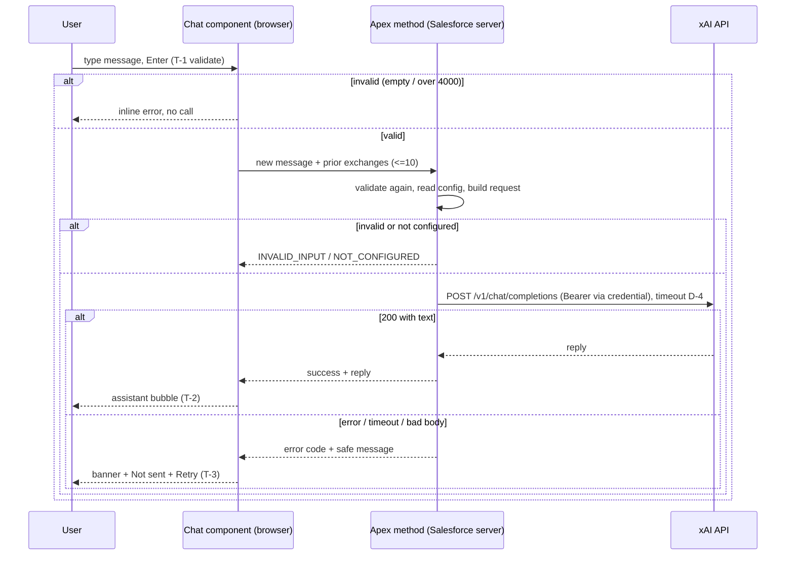

# Grok Bot for Salesforce: product specification

Living product specification. Structure and technology choices are AD-<n> entries in `architecture.md`; this file
holds requirements only (R-<n>), their acceptance lines, non-functional requirements, state/data assessment and open gaps.

## Request and basis

- Request, 2026-11-21 (source `REQ-1`): "Create a Grok bot in a Salesforce development org."
- Baseline classification: **genuinely new**. The working directory holds only `GUIDES/`; no repository, earlier
  spec, discovery or research result was supplied, and no Salesforce org, `sf` login or xAI account was inspected
  (the `sf` probe was not run; org state is unknown, not absent). Nothing is preserved; every requirement below is
  an **add**. Guide locators: `GUIDES/behavioral-requirements.md#behavior-model`,
  `GUIDES/requirements-definition.md`, `GUIDES/service-discovery.md`, `GUIDES/platforms/salesforce.md`,
  `GUIDES/platforms/ui.md#light-expressive-starting-point`.
- Interpretation (decision AD-1, accepted-default): "Grok" is xAI's model family; a "bot" is a chat surface in
  Lightning Experience that sends the user's messages to xAI's Grok API and shows its replies.

### Request outcomes to requirements

| Outcome (REQ-1) | Requirements |
| --- | --- |
| O-1 "a bot": a user can converse with it | R-1, R-2, R-3, R-9 |
| O-2 "Grok": replies come from xAI's Grok API, using the org's key | R-2, R-4, R-5, R-7 |
| O-3 "in a Salesforce development org": deployed and usable there | R-1, R-4, R-10 |
| Unstated but needed to be safe/correct (bounds, privacy, failure) | R-6, R-7, R-8, R-11, NFR section |

### Scope

In scope: one chat component, one entry (tab + app), server-side call to xAI, configuration, access control,
safe errors, transient transcript.
Out of scope (non-goals, bounded under the R-<n> shown): grounding on or writing Salesforce records (R-2, R-8);
saved or shared conversations (R-8); token streaming (R-2); image/file/voice input and tool calling (R-6);
Agentforce/Einstein Bot, Messaging, Experience Cloud and Salesforce mobile app surfaces (R-1, R-9);
per-user quotas inside Salesforce (R-6, G-4); automatic retries (R-7).

## Requirements

### R-1 Chat entry in Lightning Experience (primary)
- Basis: REQ-1 (2026-11-21) "Create a Grok bot in a Salesforce development org." Add; preserves nothing.
- Behaviour: a user holding the Grok Bot permission set sees an app named "Grok Bot" in the App Launcher; opening
  it shows one tab containing the chat component at `/lightning/n/<TabApiName>`. Opening the tab shows the empty
  state (R-9) and a ready composer; no network call to xAI occurs on open.
- Boundaries: a user without the permission set cannot see the app or open the tab. Salesforce mobile app,
  Experience Cloud and Utility Bar placement are out of scope.
- Error behaviour: the tab opens for an assigned user even when the credential is not configured; the first send
  then yields error code `NOT_CONFIGURED` (R-7), not a blank page.
- Consumer outcome: an assigned user reaches a working chat in two clicks from the App Launcher.
- Domain rules left out: no record context is passed to the component; it works the same on any tab/app host.
- Source locators: `GUIDES/platforms/salesforce.md` "Service discovery" (tab and app are files, `lightning__Tab` alone creates no tab);
  AD-7. Evidence limit: no org inspected; naming clashes unknown. Pending: implementation, deploy, checks below.
- Acceptance:
  - **AL-1.1** Positive: given user `U1` with the permission set, when `U1` opens App Launcher and searches "Grok Bot",
    then the app is listed; opening it lands on `/lightning/n/<TabApiName>` showing the empty state and an enabled
    composer. Surface: browser, deployed org. Confirm: browser check with the intended user; destination URL
    verified after redirects.
  - **AL-1.2** Failure: given user `U2` without the permission set, then App Launcher lists no "Grok Bot" and a direct
    visit to `/lightning/n/<TabApiName>` shows Salesforce's "Page does not exist" (platform guide "Consumer entry access"). Surface: browser as `U2`.
    Confirm: browser plus read-only `PermissionSetTabSetting` query for `U2` returning no row. Prerequisite: a second user (G-8).
  - **AL-1.3** Boundary: n/a: the entry has no numeric boundary; the metadata presence check is covered by AL-10.1.

### R-2 Send a message and receive Grok's reply (primary)
- Basis: REQ-1 "Grok bot". Add.
- Behaviour: when the user submits a valid message (R-6), the component shows it in the transcript as the user's
  message, sends it with the prior conversation (R-3) to xAI's chat API from the Salesforce server side, and when
  xAI returns reply text appends it as one assistant message. One send causes exactly one xAI request. The reply
  appears whole once complete (no token streaming, AD-6). The reply is displayed as plain text (no HTML/markup is
  interpreted), so model output cannot inject script or links into the page.
- Request content: configured model ID, the configured system prompt as the first message, then the conversation
  messages in order, with streaming off. Nothing else is sent: no record data, user name, email, org id or session
  id.
- Boundaries: reply reaching the configured max output tokens (D-3) is shown with the notice "Reply was cut off at
  the length limit" (finish reason `length`); an empty reply is an error (R-7 `BAD_RESPONSE`), never an empty bubble.
- Consumer outcome: the user reads Grok's answer in the transcript, below their message.
- Domain rules left out: no streaming; no tool/function calling; no citation/search features; no multimodal input.
- Source locators: AD-3, AD-6; xAI docs `https://docs.x.ai/developers/model-capabilities/legacy/chat-completions.md`
  (found by search, response schema not yet read). Evidence limit: response shape unverified (G-5). Pending:
  implementation, mock-based Apex tests, one live smoke call after G-1/G-2.
- Acceptance:
  - **AL-2.1** Positive (mocked xAI): input `What is the capital of France?`; mock returns 200 with
    `{"choices":[{"message":{"role":"assistant","content":"Paris."},"finish_reason":"stop"}]}`. Expect: transcript shows
    user bubble then assistant bubble `Paris.`; the captured request is POST to the named-credential path
    `/v1/chat/completions` with body `model`=configured model, `stream`=false, `messages` = [`system`(configured prompt),
    `user` `What is the capital of France?`]; callout count = 1. Surface: Apex unit test with `HttpCalloutMock`
    (request/response) plus Jest for the bubbles. Confirm: assertions on captured request body fields and rendered text.
  - **AL-2.2** Positive (live): after G-1 and G-2, sending `Reply with exactly the word: pong` yields a non-empty
    assistant message in the deployed tab. Surface: browser on the deployed org. Confirm: screenshot/DOM text of the
    assistant bubble; exact words are not asserted (model output varies). Until G-1/G-2 are resolved this line is
    NOT-REPLAYED and stays unverified (owner: user, due: release-verify).
  - **AL-2.3** Failure: mock returns 200 with `{"choices":[]}` or content `""`: expect error code `BAD_RESPONSE`, no
    assistant bubble, user message marked failed (R-7). Surface: Apex test + Jest.
  - **AL-2.4** Boundary: mock returns `finish_reason":"length"` with content `Partial answer`: expect the assistant
    bubble `Partial answer` and the cut-off notice; result `finishReason` = `length`. Surface: Apex test + Jest.
  - **AL-2.5** Failure (output safety): mock content ` **bold**` is rendered as that literal
    text; no element is created from it. Surface: Jest DOM assertion (no `img` in the transcript).

### R-3 Multi-turn context with a bounded window
- Basis: REQ-1 "bot" (a conversational bot answers follow-ups). Add. The window size is a chosen default D-2 (see Defaults).
- Behaviour: each send includes the most recent completed exchanges (user message plus its assistant reply) so
  follow-ups make sense. Only completed exchanges count; a message that failed is shown but is never sent as
  context. The component sends at most the last D-2 = 10 completed exchanges plus the new message; older exchanges
  stay visible in the transcript but are not sent. The server rejects (does not silently trim) a request that
  carries more than 10 exchanges plus the new message, and rejects any history message whose role is not `user`/`assistant`,
  so a client cannot inject a system role.
- Consumer outcome: asking "And its population?" after "What is the capital of France?" is answered about Paris
  (observed live only; mock tests assert what is sent).
- Source locators: AD-5. Evidence limit: no xAI context-length limit verified (G-5); 21 messages of at most D-1/D-9
  characters is far below the 6 MB Apex heap and callout size limits (see NFR N-4).
- Acceptance:
  - **AL-3.1** Positive: send `q1`, then `q2` (mock replies `a1`, `a2`). Request 2 `messages` = [system, `q1`, `a1`, `q2`] (4 items, roles
    system,user,assistant,user). Surface: Jest (the component's outgoing payload) and Apex test (the callout body).
  - **AL-3.2** Boundary: send `m1`..`m12` one at a time, each after the previous reply, with the mock replying `ok-1`..`ok-12` in order. Request 11 has 22 messages
    (system, `m1`,`ok-1`,...,`ok-10`,`m11`); request 12 has 22 messages whose second item is `m2` and last is `m12`,
    and contains no `m1` or `ok-1`. All 24 messages remain visible in the transcript. Surface: Jest payload assertion
    plus Apex callout-body assertion.
  - **AL-3.3** Failure: mock fails request 2 (HTTP 500), then succeeds for `q3`. Request 3 `messages` = [system, `q1`, `a1`, `q3`]; the
    failed `q2` is not in it. Surface: Jest + Apex test.
  - **AL-3.4** Failure (server side): calling the Apex method directly with 12 prior exchanges + new message returns
    `INVALID_INPUT` and makes 0 callouts; a history item with role `system` returns `INVALID_INPUT` and makes 0 callouts. Surface: Apex test.

### R-4 Credential custody and who may call Grok
- Basis: REQ-1 "Grok bot in a Salesforce development org" (calling xAI needs a key; custody is an unstated but
  required safety rule). Add.
- Behaviour: the xAI API key exists only inside the org's credential facility (AD-2) and is sent only by the Salesforce
  server to `api.x.ai`. It is never in source control, deployable metadata, Custom Metadata, records, debug output, the
  browser or any response to the browser. Only users whose permission set is mapped to the credential principal can
  trigger a call; for others the send yields `NOT_CONFIGURED` or Salesforce denial, and no request leaves the org.
- Boundaries: the key's validity is checked only by use (xAI answers 401/403 → `AUTH_FAILED`, R-7). Rotation is an
  admin editing the secret in Setup; it takes effect on the next send with no deploy.
- Error behaviour: missing/incomplete credential setup → `NOT_CONFIGURED` with an admin-facing hint that never
  contains the key or its header.
- Person-only prerequisites (open, owner user): obtain an xAI API key (G-2) and enter it as the credential secret
  in the target org (G-1).
- Source locators: AD-2; `GUIDES/service-discovery.md#runtime-state-placement` ("credential custody"); Salesforce
  Named Credentials docs (search only). Evidence limit: AuthHeader/Bearer configuration unverified.
- Acceptance:
  - **AL-4.1** Positive: repository search of all tracked files and the deployment payload for the live key value (or any
    string beginning `xai-`) finds nothing; the Named Credential/External Credential source files contain no secret. Surface: repository +
    metadata files. Confirm: grep over the source tree and a `sf project deploy start --dry-run`/`validate` payload listing. Key value is
    not printed in evidence.
  - **AL-4.2** Positive (live): an assigned user's send succeeds (AL-2.2) while the key never appears in the browser network
    tab responses or the Apex debug log at FINEST level for that request. Surface: browser devtools + debug log. NOT-REPLAYED until G-1/G-2.
  - **AL-4.3** Failure: a user without the principal mapping (second user, G-8) sends via direct Apex invocation or UI and receives
    `NOT_CONFIGURED`/denial; the xAI mock/endpoint receives 0 requests. Surface: deployed org as that user; xAI console shows no call.
  - **AL-4.4** Failure: mock returns HTTP 401 → code `AUTH_FAILED`; the safe message contains neither the response body nor any `Authorization` text.
    Surface: Apex test asserting the returned message against a forbidden-substring list (`Bearer`, `xai-`, the mock body marker `SECRET-BODY-MARKER`).
  - **AL-4.5** Boundary: n/a: key length/format is xAI's concern, validated by use.

### R-5 Administrator-configurable behaviour
- Basis: REQ-1; model IDs change over time (AD-3), so the model and bounds are configuration, not code. Add.
- Behaviour: model ID, system prompt, endpoint path, max output tokens, callout timeout, history exchanges, max
  user-message length and max history-message length are read from one configuration record on every send
  (defaults D-1..D-9). An edit in Setup applies to the next send; no deploy, no page reload of the component's code.
- Boundaries and error behaviour: a missing record, empty model ID, non-positive or non-numeric bound, or timeout outside
  1–120,000 ms makes the send return `NOT_CONFIGURED` with no callout; the allowed range is the Apex per-callout limit.
- Source locators: AD-4; Apex callout limits `https://developer.salesforce.com/docs/atlas.en-us.apexcode.meta/apexcode/apex_callouts_timeouts.htm`.
- Acceptance:
  - **AL-5.1** Positive: with the model changed to `test-model-x` in the config record, the captured request body has `"model":"test-model-x"`. Surface: Apex test (the configuration read is overridden through a test seam the plan defines, since a test cannot insert Custom Metadata). Confirm: body assertion.
  - **AL-5.2** Failure: timeout `0` and `120001` each → `NOT_CONFIGURED`, 0 callouts. Surface: Apex test.
  - **AL-5.3** Boundary: timeout `120000` and `1` are accepted, and the request's configured timeout equals the value. Surface: Apex test (`HttpRequest.getTimeout()` captured by the mock).

### R-6 Input validation and bounds
- Basis: REQ-1 states no limits; limits are introduced only where the behaviour is unsafe without them (every value is a default, labelled below).
- Behaviour: the user message is trimmed of leading/trailing whitespace; if empty → rejected with `INVALID_INPUT`. Length is counted in
  characters of the trimmed text (`String.length()` / JS `length`, UTF-16 units; an emoji counts as 2, unverified for Apex, G-9). Maximum **D-1 = 4,000**:
  4,000 accepted, 4,001 rejected with `INVALID_INPUT`. Validation runs in the component (immediate feedback, character counter) **and**
  again on the server, which is authoritative. A rejected message makes 0 xAI calls and is not added to the transcript as sent.
- Defaults (each is a chosen default, reversible via R-5 configuration; basis and revalidation in `## Submission` assumptions):
  - **D-1** max user message 4,000 characters.
  - **D-2** history window 10 completed exchanges (+ the new message = 21 messages).
  - **D-3** max output tokens 1,024.
  - **D-4** callout timeout 60,000 ms (runtime hard limit: 120,000 ms per callout and per transaction).
  - **D-5** model ID `grok-4.7` (named in xAI documentation search results; revalidate against `docs.x.ai` models page at step-plan, G-5).
  - **D-6** system prompt: `You are Grok, a helpful assistant inside Salesforce. Answer concisely.` (max 2,000 characters).
  - **D-7** endpoint: base `https://api.x.ai`, path `/v1/chat/completions`.
  - **D-8** no automatic retry (R-7).
  - **D-9** max history message length 16,000 characters (four times D-1; an assistant reply of D-3 tokens fits with margin).
- Text only: no attachments, images, or voice (non-goal).
- Source locators: runtime limits: `https://developer.salesforce.com/docs/atlas.en-us.apexcode.meta/apexcode/apex_callouts_timeouts.htm`
  (120 s cumulative per transaction, ≤ 100 callouts, per-callout timeout 1 ms–120,000 ms; read via search result).
- Acceptance:
  - **AL-6.1** Positive/boundary: a message of exactly 4,000 `a` characters is sent (callout count 1); 4,001 `a` characters is rejected: composer shows
    `Message is too long (4001/4000)`, server returns `INVALID_INPUT`, callout count 0. Surface: Jest (client) + Apex test (server, called directly).
  - **AL-6.2** Failure: input `   \n  ` (whitespace only) → `INVALID_INPUT`, Send stays disabled in the UI, callout count 0. Surface: Jest + Apex test.
  - **AL-6.3** Boundary: `  hi  ` is sent as `hi` (trimmed) and the counter counts 2. Surface: Apex test captured body + Jest.
  - **AL-6.4** Boundary (unicode): 2,001 copies of `😀` (4,002 UTF-16 units) is rejected; 2,000 copies (4,000 units) accepted. Surface: Apex test and Jest. NOT-REPLAYED:
    whether Apex counts an astral character as 2 units is unverified; if it counts 1, the server and client counts disagree and the plan must pick one rule (G-9).
  - **AL-6.5** Failure: history item of 16,001 characters → `INVALID_INPUT`, 0 callouts. Surface: Apex test.

### R-7 Failure behaviour: safe, distinct, recoverable
- Basis: REQ-1 (a bot must say what went wrong; external-service failures are certain). Add.
- Behaviour: every send ends in exactly one outcome: success, or one stable error code with a safe, human-readable message. Codes:
  `INVALID_INPUT` (R-6/R-3), `NOT_CONFIGURED` (R-4/R-5), `AUTH_FAILED` (xAI 401/403), `RATE_LIMITED` (xAI 429),
  `REQUEST_REJECTED` (other xAI 4xx, e.g. 400 context too long), `SERVICE_ERROR` (xAI 5xx), `TIMEOUT` (read timeout at the configured limit),
  `NETWORK_ERROR` (callout exception other than timeout), `BAD_RESPONSE` (200 without usable text). Messages never include the key, the
  `Authorization` header, a raw response body, a stack trace or an exception class name. The failed user message stays in the
  transcript marked "Not sent" with a Retry action; nothing is retried automatically (a timeout may still have been processed and billed by xAI; an
  automatic retry could double the spend). Retry sends the same text as a new request. Retry is user-driven and unbounded.
- Boundaries: at the timeout bound (D-4 elapsed) the user sees `TIMEOUT`, the pending state ends, the composer re-enables. A late xAI answer after timeout is never shown.
- Consumer outcome: the user always sees either an answer or an error with what to do ("ask your admin to check the xAI key" for `AUTH_FAILED`/`NOT_CONFIGURED`, "try again in a moment" for `RATE_LIMITED`/`SERVICE_ERROR`/`TIMEOUT`).
- Acceptance:
  - **AL-7.1** Positive (mapping): mock statuses 401→`AUTH_FAILED`, 403→`AUTH_FAILED`, 429→`RATE_LIMITED`, 400→`REQUEST_REJECTED`, 500→`SERVICE_ERROR`, 503→`SERVICE_ERROR`,
    200 with body `not json`→`BAD_RESPONSE`, a mock throwing `CalloutException('Read timed out')`→`TIMEOUT`, one throwing another `CalloutException`→`NETWORK_ERROR`. Surface: Apex test, one assertion per row on the returned code.
  - **AL-7.2** Failure (no leak): each error body in AL-7.1 contains marker `SECRET-BODY-MARKER`; the returned message never contains it, `Bearer` or `xai-`. Surface: Apex test.
  - **AL-7.3** Positive (recovery): after a `SERVICE_ERROR` for `hello`, the transcript shows `hello` marked "Not sent", an error banner with the message, the composer enabled; pressing Retry sends `hello` again, and on success the
    bubble is no longer marked. Surface: Jest with a controlled promise; browser smoke on the deployed tab with the key deliberately wrong (G-2 permitting) to see `AUTH_FAILED` end to end.
  - **AL-7.4** Boundary: exactly one callout per send, including on every error row (callout count 1, never 2). Surface: Apex test counting mock invocations.
  - **AL-7.5** Failure (unclassified exception): any non-callout exception inside the method (for example a null read forced by the test seam) returns code `SERVICE_ERROR` with the generic message "Something went wrong. Try again." and no exception text; the exception class and line appear only in the debug log. Surface: Apex test forcing the exception and asserting the returned message equals that generic text.

### R-8 Privacy, retention and logging
- Basis: REQ-1; user messages go to a third party (xAI), which makes privacy rules a necessary part of the bot. Add. Retention length is a chosen default: none beyond the page session.
- Behaviour: (a) the conversation exists only in the component's memory: no Salesforce record, Custom Setting, file or cache stores a message or reply (AD-5); a page refresh, navigating away, or "New conversation"/Clear removes it. (b) The component shows a one-line
  notice near the composer: "Messages are sent to xAI (Grok)." (c) Apex writes no message or reply text to debug logs, Platform Events or records; it may log the outcome code, HTTP status and elapsed milliseconds
  (R-11). (d) What xAI itself retains is governed by xAI's terms and is out of the org's control and out of scope; the notice is the mitigation.
  (e) Out of scope: sending Salesforce record data to xAI.
- Boundaries: the transcript is readable only by the signed-in user in that browser page; a second browser tab or user has an independent transcript.
- Source locators: AD-5; `GUIDES/service-discovery.md#observability-coverage` ("omit raw sensitive payloads").
- Acceptance:
  - **AL-8.1** Positive: after sending `SECRET-MSG-1` and receiving the mock reply `SECRET-REPLY-1`, the org debug log for that request, read at level FINEST, contains neither string. Surface: deployed org debug log (needs G-1; Apex tests cannot read their own debug output, so this line is NOT-REPLAYED until then). Lower-layer check available now: source review that every logging statement in the Apex class references only outcome code, status, elapsed time and model ID.
  - **AL-8.2** Positive: SOQL count of records created in the org by a send is 0 for every custom object and for standard objects owned by the feature (the feature owns none). Surface: Apex test asserting `Limits.getDmlStatements() == 0` after a send, plus no new object in the metadata.
  - **AL-8.3** Positive: reload the tab → empty state, previous messages absent. Surface: browser.
  - **AL-8.4** Positive: the disclosure notice text is visible without scrolling at 320 px and 1440 px widths. Surface: Jest DOM (presence) + browser (visibility).
  - **AL-8.5** Boundary: n/a: no retention period exists to bound (nothing is stored).

### R-9 Chat interface states and interactions
- Basis: REQ-1 "bot"; interface requirements per the UI non-functional requirement N-6. Add.
- Behaviour:
  - **Empty state:** before the first message, a designed empty state with a short description and three example prompts; clicking an example fills the composer (does not auto-send).
  - **Pending state:** after Send, the composer is disabled and a "Grok is thinking" indicator is visible, announced to assistive tech (`aria-live=polite`) ; Enter and the Send button do nothing while pending (single in-flight request per component instance). Enter sends; Shift+Enter inserts a newline.
  - **Error state:** per R-7, in an inline banner (not a transient toast) that remains until dismissed or the next send; the failed message carries Retry.
  - **Clear:** "New conversation" empties the transcript and resets state. If pressed while a request is pending, the pending response is discarded when it arrives (a cancelled request does not undo the server call, but its result is never shown).
  - **Scroll:** new messages scroll into view unless the user has scrolled up; then a "Jump to latest" control appears.
  - **Copy:** each assistant message has a copy action.
  - Layout works at 320 px and 1440 px widths without horizontal overflow (N-6).
- Out of scope: message editing, regeneration, ratings, markdown rendering, attachments, theming controls.
- Acceptance:
  - **AL-9.1** Positive: on first open the empty state and three example prompts show; clicking `Summarize a support case in 3 bullets` puts exactly that text in the composer and makes no callout. Surface: Jest + browser.
  - **AL-9.2** Positive/failure (pending guard): with a pending mock held open, pressing Enter or Send a second time produces no second callout and the composer is disabled; releasing the mock appends exactly one assistant bubble. Surface: Jest with a controlled promise.
  - **AL-9.3** Failure (stale result): send `m1` (mock held open), click "New conversation", release the mock: the transcript stays empty and no error banner shows. Surface: Jest with controlled promise.
  - **AL-9.4** Positive: the pending indicator is in an `aria-live` region and the error banner has `role="alert"`; the composer has an accessible label; all actions reachable by Tab in DOM order; focus returns to the composer after a reply or error. Surface: Jest (semantic queries) + browser keyboard pass.
  - **AL-9.5** Boundary: `Shift+Enter` inserts a newline and does not send; Enter on a valid message sends. Surface: Jest.

### R-10 Delivery into the development org
- Basis: REQ-1 "in a Salesforce development org". Add.
- Behaviour: the bot is a Salesforce DX source project deployable to the target org with the `sf` CLI. The deployed set (AD-7) contains: the chat component, the Apex controller and its tests, the configuration type and its default record, the Named/External Credential **without secret**, the tab, the app, and one permission set. Deploy, permission-set
  assignment, and credential-secret entry are separate steps with separate authority (platform guide "Service discovery"). The deployment's terminal status is read back, not assumed from an accepted job id. Names must not collide with metadata already in the org (listing performed before names are fixed).
- Boundaries: redeploying does not overwrite a secret the admin entered or the configuration values an admin edited unless the source record is intentionally changed.
  Deployment to an org that is not a development/sandbox/scratch org is out of scope.
- Error behaviour: a deploy failure leaves the org without a partially working entry (tab visible without class access is a defect; the permission set is deployed atomically with the rest).
- Acceptance:
  - **AL-10.1** Positive: `sf project deploy validate` (dry run) and the real deploy exit 0 with terminal status Succeeded; `sf org list metadata --metadata-type CustomTab --target-org <alias>` lists the tab API name. Surface: CLI against the org (G-1). Confirm: exit codes and listing output.
  - **AL-10.2** Positive: `sf apex run test --class-names <TestClass> --synchronous --result-format tap --target-org <alias>` prints only `ok` lines (no `not ok`). Surface: org Apex run.
  - **AL-10.3** Boundary: Apex coverage of the controller class is ≥ 75% (the production deploy threshold, used as the default target). Surface: Apex test run with `--code-coverage`.
  - **AL-10.4** Failure: deploy a second time after changing the model value in the Setup config record: the Setup edit is reported as drift in source tracking and not silently overwritten unless the source record changed; a read-back of the record shows the expected value. Surface: CLI. NOT-REPLAYED until org exists.

### R-11 Operational diagnostics without content
- Basis: REQ-1; an operationally consequential external outcome needs owned observability (`GUIDES/service-discovery.md#observability-coverage`). Add.
- Behaviour: each send writes one diagnostic line to the Apex debug log containing only: outcome code, HTTP status (or `none`), elapsed ms, model ID. No message text, reply text, key or headers (R-8). Log retrieval needs a trace flag set by an admin; Salesforce audit or Event Monitoring coverage is not assumed. xAI-side usage is visible in the xAI console to the key owner.
- Acceptance:
  - **AL-11.1** Positive: source review shows one logging statement per send with exactly those four fields; a debug-log read from a deployed send shows the line `GrokBot outcome=SUCCESS status=200 ms=<n> model=<id>` shape. Surface: code review + org debug log (G-1). Failure: n/a: a failed logging sink must not change the user's outcome (Apex debug logging cannot fail the transaction).
  - **AL-11.2** Boundary: n/a: no volume or retention bound is defined for debug logs (platform-owned retention).

## Behaviour model

### Flows
- **F-1 Open** (R-1): user → App Launcher → tab → component renders empty state (T-0 initialise). No callout.
- **F-2 Send** (R-2,R-3,R-6,R-7,R-9): composer → client validation (T-1) → Apex method (server validation, configuration read, callout via credential) → xAI → result → transcript (T-2 success / T-3 failure).
- **F-3 Clear** (R-8,R-9): "New conversation" → T-4; a pending result arriving afterwards is dropped (T-5).
- **F-4 Retry** (R-7): Retry on a failed message → F-2 with the same text (T-6).

### State inventory
| Entity (owner, durability) | States | Invariant |
| --- | --- | --- |
| Component send state (component instance, transient) | `Idle`, `Pending` | at most one in-flight request; `Pending` only between a valid send and its terminal outcome or a Clear |
| Message (component, transient) | `Sent` (user, answered), `Failed` (user, not answered), `Assistant` | only `Sent` user messages and their `Assistant` reply are eligible as context (R-3) |
| Request epoch (component, transient) | integer incremented by Clear | a result is applied only if its epoch equals the current epoch |
| Credential secret, configuration record, permission-set assignment (org, durable) | n/a (see state and data assessment) | not changed by a send |

### Transition ledger
| ID | R / F | Before | Trigger and guard | Operation and after | Failure / recovery | Cases |
| --- | --- | --- | --- | --- | --- | --- |
| T-0 | R-1 F-1 | none | tab opens | `Idle`, empty transcript, no call | none | AL-1.1, AL-9.1 |
| T-1 | R-6 F-2 | `Idle` | Send with valid trimmed text (1..4,000) | → `Pending`; user bubble added; composer disabled | invalid → stays `Idle`, inline error, no message added (AL-6.x) | AL-6.1, AL-6.2, AL-6.3 |
| T-2 | R-2 F-2 | `Pending`, epoch e | result success and epoch == e | → `Idle`; user message → `Sent`; assistant bubble added | n/a | AL-2.1, AL-2.4 |
| T-3 | R-7 F-2 | `Pending`, epoch e | result error and epoch == e | → `Idle`; user message → `Failed`; banner with code message | Retry (T-6) | AL-7.1, AL-7.3 |
| T-4 | R-8 R-9 F-3 | any | "New conversation" | epoch += 1; transcript emptied; → `Idle` | n/a | AL-8.3, AL-9.3 |
| T-5 | R-9 F-3 | `Idle` (after T-4) | result arrives with epoch != current | dropped: no bubble, no banner; the server effect is not undone | n/a | AL-9.3 |
| T-6 | R-7 F-4 | `Idle`, a `Failed` message | Retry | as T-1 with the same text; the old `Failed` bubble is replaced by the new attempt | as T-3 | AL-7.3 |
| T-7 | R-9 | `Pending` | Send / Enter | ignored: no change, no call | n/a | AL-9.2 |

Equivalence partitions audited: input (empty, 1, 4,000, 4,001, whitespace, unicode); history (0, 1, 10, 11 exchanges, failed message among them); xAI outcomes (200 text, 200 empty, 200 truncated, 400, 401, 403, 429, 500, 503, timeout, other exception); actor (assigned, unassigned); concurrency (double send, clear while pending). Omitted with reason: duplicate delivery of a send (one click = one call, T-7; browser/network retries by Salesforce are not controlled here), expiry of a transcript (none stored).

## Non-functional requirements

- **N-1 Security (R-4, R-8).** Operating condition: any signed-in user. Criteria: no secret in source/metadata/client/logs (AL-4.1, AL-4.2, AL-4.4); reply rendered as text (AL-2.5); the server revalidates all client input (AL-3.4, AL-6.1). Sharing/CRUD/FLS: the feature reads and writes no Salesforce object data; sharing, object and field permissions are therefore n/a by design, recorded as separate rules so a later record-grounding feature must add them. Access to the Apex class and credential principal is by permission set only. Verification: tests above; code review for stray logging.
- **N-2 Latency and timeouts (R-2, R-7).** The request names no latency target; none is invented. Observable criteria: the pending state appears synchronously with Send (before the callout returns); the pending state never outlasts the configured timeout D-4 = 60,000 ms (default) within the Apex hard limit of 120,000 ms per callout/cumulative per transaction. A typical xAI reply time is a measured baseline to take at the live smoke call (unmeasured now). Verification: AL-5.3, AL-7.1 (timeout row), live timing note at release-verify.
- **N-3 Platform limits and capacity.** One callout per send (limit 100 per transaction), cumulative callout time ≤ 120 s, request ≤ 21 messages × 16,000 characters ≈ 336,000 characters, bounded far below the 6 MB synchronous heap. The max output tokens D-3 caps the response size. The concurrent long-running Apex request limit and Aura request size for imperative calls are **unverified** and **unresolved** (G-6): behaviour beyond them is platform-defined; the plan must read the Salesforce limits documentation for the target edition, and the unresolved value keeps capacity claims for concurrent use open. xAI-side limits (requests per second and tokens per minute per model, tier dependent; `https://docs.x.ai/developers/rate-limits`) appear to the user as `RATE_LIMITED`; no in-org throttle is added (G-4).
- **N-4 Reliability.** Availability is xAI's plus Salesforce's; no SLA is claimed. No automatic retry, no cache, no queue (AD-6). A failed send never corrupts the transcript or blocks the next send (T-3, T-6). Recovery from outage is the user's manual retry.
- **N-5 Cost.** Each send spends xAI tokens billed to the key owner; per-user quotas or a spend cap are not requested and are not invented (G-4). Bounded per request by D-1, D-2, D-3. Observability: xAI console usage page.
- **N-6 Interface quality (new graphical UI; Lightning component).** Visual reference: the light Gemini look with Material 3 Expressive principles (`GUIDES/platforms/ui.md#light-expressive-starting-point`), adapted to Salesforce Lightning Design System conventions, which take precedence as the platform convention: SLDS styling hooks/tokens for color, spacing and type; tonal rounded message surfaces; one restrained accent for primary actions; the composer is the focal point. Starting appearance: light, with the dark option supplied by the same tokens (if the Lightning host exposes a dark theme; G-7). Observable criteria:
  1. one visual system: spacing and type from a small scale, colors only from SLDS/styling-hook tokens (no hard-coded hex outside a documented exception);
  2. designed empty, pending (thinking indicator), error (banner with action) and success states (AL-9.1, AL-9.2, AL-7.3);
  3. works at 320 px and 1440 px with no horizontal overflow (checked in browser at those two widths);
  4. visible keyboard focus on every control; text contrast ≥ 4.5:1, non-text ≥ 3:1 (WCAG AA), in light and in dark where the host offers it;
  5. motion only to explain change (message arrival, thinking indicator), disabled under `prefers-reduced-motion: reduce`;
  6. one icon set: SLDS utility icons through the platform icon component;
  7. no iframe or third-party script/CDN dependency (Lightning Locker/LWS and CSP restrict them; AD-1).
  Verification: Jest semantic checks, a browser pass at both widths in light (and dark if available), a contrast check of the token pairs used, and a reduced-motion check. Not a substitute for each other. The plan chooses the concrete treatment (the memorable visual signature, e.g. the composer/message-surface shape language) and records it in an AD.
- **N-7 Compatibility.** Target: Lightning Experience in current evergreen desktop browsers. The API version is the target org's current supported version, to be read at step-plan (value unresolved, not invented). Salesforce mobile app support is not requested and untested.
- **N-8 Testability and maintainability.** All xAI behaviour is testable through an `HttpCalloutMock`; a production-code seam supplies configuration to tests; Apex class coverage ≥ 75% (AL-10.3); LWC logic has Jest tests; no real xAI call occurs in any automated test.
- **N-9 Operability and rollback.** Diagnostics per R-11. Rollback of a deploy = redeploying the prior source or deleting the components with a destructive-changes manifest (the secret and permission-set assignments are removed by hand and by an admin). Credential rotation needs no deploy.
- **N-10 Accessibility.** Covered by N-6 item 4, AL-9.4; screen-reader announcement of replies via polite live region.

## State and data assessment

| Carrier | Owner / location | Changed by a send? | Before → after invariant | Reader | Recovery / unknowns |
| --- | --- | --- | --- | --- | --- |
| Conversation transcript | component memory (browser page) | yes (T-1..T-5) | grows by one user message and 0–1 reply per send; emptied by Clear/refresh | the signed-in user in that page only | lost on refresh by design (R-8); no recovery promised |
| xAI API key | External Credential principal (org) | no | unchanged | not readable by users or the client; Salesforce platform encrypts | admin re-enters after rotation/loss; secret not in source (G-2) |
| Named/External Credential definition | deployed metadata | deploy only | secret-free definition | admins | redeploy; the principal's secret survives a redeploy of the definition: UNVERIFIED, check at step-plan |
| Configuration record | Custom Metadata | no (admin or deploy) | values within R-5 ranges | admins; Apex reads | invalid → `NOT_CONFIGURED`; revert by redeploy |
| Permission-set assignment | org | no (admin) | assigned set = users who can use the bot | admins | removal ends access on the next page load (revocation takes effect on the next call; a page already open can still send until the callout is denied, then `NOT_CONFIGURED`/denial) |
| Debug log line | Salesforce debug log | yes (R-11) | content-free | users with log access | platform retention |
| Salesforce records (any object) | n/a | **intentionally untouched** | zero DML | n/a | n/a |

Simultaneous changes: two tabs or users have independent transcripts and share only the credential and configuration; there is no shared mutable domain state. Concurrent sends from many users share the xAI key's rate limit (G-4, N-3). Partial failure: the only multi-step effect is the xAI call and the UI update; an unknown outcome (timeout) can mean xAI processed the request; the user sees `TIMEOUT`, and any retry is a new, separately billed request (R-7). No migration, backfill or data conversion is involved.

## Service boundaries

- **Salesforce (platform).** Authority: the org for identity and permission (current at each call; no copy kept). Developer/deploy identity (the `sf` CLI user) is distinct from the runtime caller (the signed-in assigned user); a deploy login does not prove the runtime user's access (platform guide "Service discovery"). Freshness vs revocation: permission is evaluated by Salesforce on each callout; no cache exists. Incremental state: none. Async completion: not applicable (synchronous, AD-6). Owned events: debug-log outcome line (R-11).
- **xAI API.** Authority: xAI for generation and billing. Current-authority check: each request carries the Bearer key; revocation by xAI shows as 401/403 on the next call (`AUTH_FAILED`). Freshness: no response cache (every send is a fresh call); no replay or idempotency key is used, so duplicate processing is possible on timeout (accepted, R-7). Incremental state: none held by us; conversation context is resent each time (R-3). Async completion/recovery: synchronous; unknown outcome handled by user retry. Event coverage: xAI console usage is xAI-owned; no webhook/event consumption. Contract status: the Chat Completions endpoint is documented but labelled legacy (AD-3, G-5).
- No other service is added (no queue, cache, middle tier).

## Information lifecycle

| State | Owner/location | Who may read | Simultaneous changes | Ends / removed by | Runtime quotas met |
| --- | --- | --- | --- | --- | --- |
| Transcript | component memory | that user's page only | single in-flight guard (T-7); epoch guard (T-5) | refresh, navigation, Clear | D-1, D-2 per request; none for display |
| API key | External Credential | nobody through the UI; admins can replace, not read back | last admin write wins | admin deletes/rotates | none |
| Configuration | Custom Metadata record | admins; Apex | last write wins (Setup or deploy) | admin/deploy | none |
| Message text in transit | browser → Salesforce → xAI (TLS) | the user, Salesforce runtime, xAI | n/a | not retained by the org (R-8); xAI retention is its own policy (out of scope) | callout 120 s, heap 6 MB (N-3) |

Personal or secret data: user messages may contain personal data; shown only to the author, never stored or logged by the org, sent to xAI (disclosed in the UI), removed with the page. The key is shown nowhere and logged nowhere. No identity, sharing or persistence is added beyond the request.

## Open gaps (affect only the work noted; independent work proceeds)

- **G-1** (R-1, R-4, R-10) Target development org alias/username unknown; `sf` login not probed. Owner: user. Unready: any deploy, live check, metadata clash listing. Safe interim: author source offline; mock-based tests. Smallest confirming observation: `sf org list` (aliases only) and `sf org list metadata --metadata-type CustomTab --target-org <alias>`.
- **G-2** (R-2, R-4) An xAI API key and account must be created by a person and entered as the credential secret in the org (person-only). Owner: user. Until then AL-2.2, AL-4.2, AL-7.3 (live part) stay unverified; due phase: release-verify.
- **G-3** (R-1, AD-1) Whether "bot" means an Agentforce/Einstein Bot instead of a custom chat UI. Default taken (custom chat). Owner: user; revalidate before plan if the user disagrees.
- **G-4** (N-3, N-5, R-6) No spend cap or per-user rate limit specified; none introduced. Owner: user decision. Mitigation: per-request bounds; an xAI console spend limit set by the key owner.
- **G-5** (R-2, R-5, R-6, AD-3) Unverified: exact current model ID (D-5), response schema `choices[0].message.content`, parameter name for output cap (`max_tokens` vs `max_completion_tokens`), context-length limit, and legacy status consequences. Confirming action: read `docs.x.ai` Chat Completions and Models pages at step-plan; one authorized smoke call after G-2.
- **G-6** (N-3) Concurrent long-running Apex request limit and Aura payload limit for the target edition not verified.
- **G-7** (N-6) Whether Lightning Experience desktop provides a dark theme the component can adopt; if not, the dark option is verified through token-only styling and a forced-dark harness, and recorded as such.
- **G-8** (AL-1.2, AL-4.3) A second user without the permission set is needed for the negative authorization checks; Developer Edition license count unknown. Without it those lines are NOT-VERIFIED with this reason.
- **G-9** (R-6) Whether Apex `String.length()` counts an astral character as 2 units like JavaScript; the rule must be made identical on client and server.
- **G-10** (AD-2) Whether the External Credential AuthHeader parameter can express `Authorization: Bearer <key>` and whether a redeploy preserves the principal's secret.

## Replay review (duty 10)

- Procedures walked from the stated start by hand against the spec rules (method: step through T-0..T-7; start state reachable only after G-1/G-2/permission set, recorded as prerequisites): AL-3.2 (`m1`..`m12`): after 10 exchanges, request 11 = system + 10×2 + `m11` = 22; request 12 prior exchanges = 11, window keeps the last 10 (`m2`..`ok-11`), so 1 + 20 + 1 = 22 with second item `m2` and last `m12`; walk valid (each send occurs from `Idle` after the prior reply, T-1/T-2). AL-3.3: `q2` failed → not eligible, request 3 = system, `q1`, `a1`, `q3` = 4. AL-9.3: epoch e → Clear → e+1 → result dropped (T-5). AL-6.1: 4,000 accepted (guard 1..4,000), 4,001 rejected. AL-6.4: 2,000 emoji = 4,000 units accepted if units count as 2.
- None of the above was **executed**: `NOT-REPLAYED: no code, org or key exists at the spec stage`. They are plans, not results.
- No documented command was run; commands cited in AL-10.x are plans (`NOT-REPLAYED`, exit codes unknown). Their flags come from the platform guide only.
- Weak-stand-in check: each positive line asserts request-body fields or rendered text, not only absence of errors; absence-style lines (AL-4.1, AL-8.1) name their search method.
- Platform/library claims and their status: Apex limits 120 s/100 callouts/timeout 1–120,000 ms — read in search-result summaries of the Salesforce callout limits page (primary page, snippet only). xAI endpoint/auth/legacy label — primary page found by search (`docs.x.ai`), body not read. 6 MB synchronous heap, "tests cannot make real callouts", "no streaming from Apex", Named Credential AuthHeader/Bearer, redeploy preserving secrets: **UNVERIFIED**, listed in G-5/G-6/G-10 and AD-2/AD-6/AD-8 for step-plan confirmation. Model ID `grok-4.7` comes from search snippets of `docs.x.ai` pages.
- Earlier accepted version: none, so nothing was dropped or weakened.

## Retired

None.

## Submission

- **summary:** New spec for a Grok bot in a Salesforce development org: a Lightning chat tab (R-1) that sends each valid message and a bounded window of prior exchanges (R-3) from Apex to xAI's Chat Completions API (R-2) using a key held only in a Named/External Credential (R-4), configurable via Custom Metadata (R-5), validated and bounded (R-6), failing safely with nine stable error codes and no auto-retry (R-7), storing nothing and logging no content (R-8, R-11), with a designed chat UI (R-9, N-6) delivered as an SFDX source project (R-10). Decisions: AD-1..AD-8 in `architecture.md`. No earlier version; all R-1..R-11 are adds. Open: G-1..G-10 (notably the org and the xAI key are person-only prerequisites; live checks AL-2.2, AL-4.2, AL-7.3-live, AL-10.x stay unverified until then; owner user; due release-verify). No requirement conflicts found.
  - **Assumptions (defaults, bounds not in the request):**
    - D-1 max message 4,000 chars (R-6). Basis: keeps a message to roughly 1,000 tokens of cost, far below the 6 MB Apex heap; no user bound given. Alternatives: 2,000, 8,000. Revalidate if users paste documents or xAI cost/limits change. Behaviour at the bound: 4,000 accepted, 4,001 `INVALID_INPUT`, no call.
    - D-2 window 10 completed exchanges (R-3). Basis: bounds request size/cost with plenty of context for a chat; 21 messages x 16,000 chars is far under heap/callout limits. Alternatives: 5, 20. Revalidate against xAI context limit (G-5). At the bound: oldest exchange not sent; server rejects more than 10 exchanges + new.
    - D-3 max output tokens 1,024 (R-2). Basis: bounds spend and response size per send; truncation is visible to the user. Alternatives: 512, 2,048, 4,096. Revalidate after the live smoke measure and the parameter-name check (G-5).
    - D-4 callout timeout 60,000 ms (R-5, N-2). Basis: below the Apex hard limit of 120,000 ms per callout and per transaction, so a reply that needs longer is reported as `TIMEOUT` rather than risking the platform limit; alternatives 30,000 / 120,000. Revalidate after measuring reply times, particularly for reasoning models.
    - D-5 model `grok-4.7` (R-5). Basis: appears in `docs.x.ai` search results; configurable. Revalidate at step-plan.
    - D-6 system prompt text; D-7 endpoint base/path (AD-3); D-8 no automatic retry (basis: possible double billing after an unknown outcome); D-9 history message cap 16,000 chars (four times D-1). Alternatives and revalidation as D-1.
    - Transcript retained only in page memory (R-8): chosen default because the request mentions no saved conversations and storing text adds CRUD/FLS/retention duties. Alternative: custom object. Revalidate if the user wants history.
    - Dark theme availability (G-7) and the 75% Apex coverage target (production threshold used as a default).
- **primary:** R-1, R-2, R-3 (the bot exists in the org, converses with Grok, and keeps follow-up context). R-2 live proof AL-2.2 needs G-1/G-2; until then product-acceptance may accept it only with the passed mock-based lower-layer tests AL-2.1/AL-2.3/AL-2.4.
- **evidence_refs:** `KNOWLEDGE/spec.md` (R-1..R-11, NFR N-1..N-10, State and data assessment, Service boundaries, Information lifecycle, Open gaps, Replay review); `KNOWLEDGE/architecture.md` (AD-1..AD-8); guides `GUIDES/behavioral-requirements.md#behavior-model`, `GUIDES/requirements-definition.md`, `GUIDES/service-discovery.md`, `GUIDES/platforms/salesforce.md`, `GUIDES/platforms/ui.md#light-expressive-starting-point`, `GUIDES/current-system-baseline.md#planning-and-review-handoff`; external sources (search-level evidence): Salesforce callout limits `https://developer.salesforce.com/docs/atlas.en-us.apexcode.meta/apexcode/apex_callouts_timeouts.htm`; xAI Chat Completions `https://docs.x.ai/developers/model-capabilities/legacy/chat-completions.md`; xAI rate limits `https://docs.x.ai/developers/rate-limits`; Salesforce Named Credentials glossary `https://developer.salesforce.com/docs/platform/named-credentials/references/named-credentials-reference/nc-glossary.html`. No `backchain-check` receipt (command not available here).
