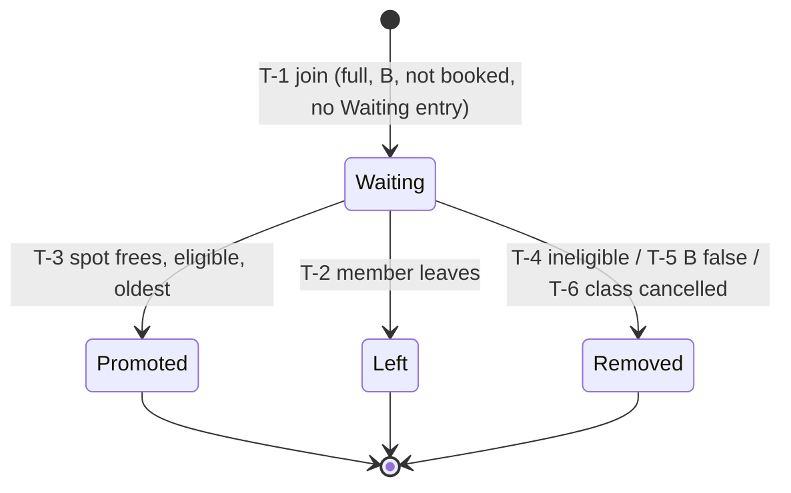

# Class Booking App — Product Requirements

## Source and evidence limits

- **Request (2026-11-21):** "Add a waitlist to our class booking app so full classes don't
  turn people away." Cited below as *Request-2026-11-21*.
- **Baseline: none.** No repository, discovery result, research result, earlier spec or
  selected baseline was available. Nothing about the current app is observed. Every statement
  about existing behaviour below is either (a) an explicit dependency on "the existing X",
  left as an open gap, or (b) a labelled default. No existing R-<n> existed; none is retired.
- **Observations / inferences / unknowns are kept apart:** Observations: none. Inferences: the
  app has members who book classes with a finite capacity (from the request's word "full").
  Unknowns: G-1 … G-8 below.
- **Reference model:** `waitlist_model.py` (agent scratchpad, outside this directory) encodes the rules
  with guard-checked operations. Execution was **not permitted in this run**, so no machine
  replay exists: the scenarios S-1 … S-6 were hand-walked against the guards, and the machine
  replay is `NOT-REPLAYED: script execution not approved` (this leaves them open for the test
  stage). The model is a cross-check of the rules, not product evidence.

## Vocabulary

- **Class** — a bookable session with a `capacity` and a start time. **Booked count** — members
  holding a booking. **Full** — booked count ≥ capacity.
- **B(class, now)** — the app's *existing* "may a member book this class right now" predicate
  (cut-off rules, class started or cancelled). This spec never gives it a value; see G-2.
- **Entry** — one member's place on one class's waitlist. States: `Waiting`, `Promoted`,
  `Left`, `Removed` (reason ∈ `INELIGIBLE`, `WAITLIST_CLOSED`, `CLASS_CANCELLED`).
- **Position** — 1 + number of `Waiting` entries on the same class that joined earlier.

## Request outcome map

| Outcome | Source words | Acceptance lines |
|---|---|---|
| O-1 A member can join a waitlist on a full class | "Add a waitlist" | R-1.a–e, R-2.a–c, R-8.a–c |
| O-2 A full class is no longer a dead end | "full classes don't turn people away" | R-1.a, R-8.a, R-8.b, R-9.b |
| O-3 Waiting members get a spot when one frees, in a fair order | implied by "waitlist" (a list that never pays out turns people away later) | R-3.a–f, R-2.a, R-5.a–b, R-10.a–c |
| O-4 Members can see and leave their waitlist place | needed to use a waitlist honestly | R-2.b, R-4.a–c, R-7.a–c |
| O-5 Existing booking keeps working | unstated; preservation | R-9.a–c |

**Primary outcomes (asked for directly):** R-1, R-3, R-8.

## Assumptions and defaults (each with basis, alternatives, revalidation)

| ID | Default chosen | Basis | Alternatives | Revalidate when |
|---|---|---|---|---|
| A-1 | **Automatic promotion, no claim window.** The oldest eligible waiter is booked the moment a spot frees; no accept/decline step and no timer. | Request-2026-11-21 mentions neither offers nor deadlines; a claim window would add a time bound the request leaves unstated and a timer owner. Reversible: it changes R-3 and AD-3 only. | Offer with claim window of *N* minutes (value open: no evidence for N). | The owner wants confirm-to-claim, or no-shows from late promotions are reported. |
| A-2 | **No cap on waitlist length.** The only bound is the natural one: one `Waiting` entry per member per class (R-1.d). Waitlist size therefore ≤ number of distinct members. | A cap is not needed for correct or safe behaviour: duplicates are blocked, so growth is bounded by membership; any numeric cap would be invented. | Per-class cap *W* (value open, no evidence). | The owner asks for a cap, or storage/UI limits are found in discovery (G-1). |
| A-3 | **First-come-first-served** by join order (AD-2). | Plain meaning of "waitlist"; no priority tiers in the request. | Priority by membership tier. | The owner names a priority rule. |
| A-4 | **Joining the waitlist is consent to be booked automatically.** The join screen states this before the member confirms. | Follows from A-1; avoids a surprise booking. | Separate consent step. | G-3 is resolved. |
| A-5 | **Waitlist is open exactly while B(class, now) is true**, and entries die when it turns false. No new cut-off value is introduced. | Reuses the existing rule instead of inventing one. | Waitlist open until class start regardless of cut-off. | G-2 reveals the real cut-off and the owner prefers otherwise. |
| A-6 | **Pull-based freshness**: statuses refresh on load, focus and after the member's own actions; no push or polling (AD-6). | Request asks for no live updates. | Polling or push. | Members need live position. |
| A-7 | **Ended entries are kept** (not deleted) while the class record exists, and shown to the member until the class's start time passes. No new retention period is introduced. | Members need to learn why a place ended (R-7); reuses the class record's lifecycle. | Delete on end; fixed retention period. | Retention policy is found/set (G-1). |
| A-8 | **An ineligible waiter is removed, not skipped-and-retained** (R-5). | Keeps the promotion loop bounded and the reason visible. | Retain and retry at the next free spot. | The owner prefers retry. |

## Requirements

### R-1 Join the waitlist of a full class  *(primary)*

- **Basis:** Request-2026-11-21 "Add a waitlist … so full classes don't turn people away"; A-2, A-4, A-5. **Change type:** add.
- **Preserved / changed:** the existing refusal of a booking on a full class is *changed* into
  an offer to join the waitlist (the booking itself is still refused). Source-section locators:
  none (no baseline; G-1). Evidence limit: nothing observed of the current full-class behaviour.
- **Pending:** implementation and all checks (not run).
- **Behaviour:** operation `JoinWaitlist(classId)` by an authenticated member. If the class is
  full, B(class, now) is true, the member holds no booking for it and has no `Waiting` entry,
  a new `Waiting` entry is created at the end of the order (R-2) and the member's position is
  returned.
- **Boundaries:** one `Waiting` entry per member per class (the effective bound, A-2). A member
  who `Left` or was `Removed` may join again and goes to the **end** of the order. A member whose
  entry was `Promoted` holds a booking and can rejoin only after cancelling it, and only if
  the class is full again. There is no length cap: the Nth member (N unbounded, ≤ distinct
  members) is accepted exactly like the first.
- **Errors (no state change in every case):** `UNAUTHENTICATED`; `CLASS_HAS_SPACE` (class not
  full: the member should book instead); `ALREADY_BOOKED`; `ALREADY_WAITLISTED` (returns the
  existing position; idempotent for double submits); `BOOKING_CLOSED` (B false);
  `CLASS_CANCELLED`; `NOT_FOUND` (unknown class).
- **Consumer outcome:** the member sees "You're #N on the waitlist" and a Waitlisted badge on
  the class (R-8).
- **Out of scope here (bounded by this R):** waitlist length cap; priority tiers; joining several
  overlapping classes' waitlists (no clash check is added); paid or premium waitlist; waitlist
  for a recurring series as a whole; staff adding a member to a waitlist.
- **Open gaps:** G-3 (classes whose booking needs payment/credit): until decided, the interim
  safe behaviour is that `JoinWaitlist` returns `WAITLIST_UNAVAILABLE` for such classes and no
  entry is created. Affected work: only those classes.

Acceptance lines (fixture F-A: class C-100 "Spin 18:00", capacity 2, booked `m-ann`, `m-bob`,
B true; members `m-cat`, `m-dan`, `m-eve`, `m-fay`):

- **R-1.a positive:** `m-cat` calls `JoinWaitlist(C-100)` → success, position 1, entry `Waiting`; booked count still 2. *Surface:* booking API. *Confirm:* automated API test asserting response and stored entry. Planned, not run.
- **R-1.b failure:** with a free spot (booked only `m-ann`), `m-cat` joins → `CLASS_HAS_SPACE`, no entry. *Surface:* API. *Confirm:* API test asserting no entry row.
- **R-1.c failure:** `m-ann` (booked) joins → `ALREADY_BOOKED`, no entry; when B is false → `BOOKING_CLOSED`; on a cancelled class → `CLASS_CANCELLED`; no session → `UNAUTHENTICATED`; class `C-999` → `NOT_FOUND`. *Surface:* API. *Confirm:* one API test per code, asserting stored state unchanged.
- **R-1.d boundary (effective bound):** `m-cat` joins twice in a row → second call `ALREADY_WAITLISTED` with position 1, exactly one `Waiting` entry stored. Two simultaneous joins by `m-cat` → exactly one entry. *Surface:* API. *Confirm:* API test, the simultaneous case run as two parallel requests against the test store.
- **R-1.e boundary:** after S-1 step 6 (`m-dan` left) `m-dan` joins again → position at the end, not their old place. *Surface:* API. *Confirm:* API test (follows S-1).
- **R-1.f boundary (beyond the bound):** with 20 distinct waiters on one class (a fixture size, not a limit) the 21st distinct member is accepted at position 21. *Surface:* API. *Confirm:* API test.

### R-2 Waitlist order and position  

- **Basis:** Request-2026-11-21 (implied by "waitlist"); A-3. **Change type:** add.
- **Behaviour:** order is join order per class (AD-2). Position is derived: when someone ahead leaves, is promoted or is removed, each member behind moves up by one. The member can read their own position and the number of members waiting; no other member's identity is exposed (R-11).
- **Boundaries:** the head has position 1; a class with no `Waiting` entries shows none.
- **Errors:** reading position with no `Waiting` entry returns the member's latest entry state (R-7) or `NOT_FOUND`.
- **Consumer outcome:** "You're #2 on the waitlist · 3 waiting".
- **Out of scope:** estimated wait time or probability of getting in (needs data the request does not give).
- **Acceptance lines** (continuing S-1 from R-1.a, hand-walked):
  - **R-2.a positive:** after `m-cat`, `m-dan`, `m-eve` join in that order → positions 1, 2, 3 and count 3. *Surface:* API read and UI. *Confirm:* API test; browser check on the class card.
  - **R-2.b positive:** after `m-dan` leaves → `m-cat` 1, `m-eve` 2, count 2 (positions move up). *Surface:* API and UI. *Confirm:* API test; browser check after reload.
  - **R-2.c boundary:** order is by server sequence, not request arrival time claimed by the client: a join carrying a forged client timestamp does not change its place. *Surface:* API. *Confirm:* API test sending a past timestamp header/field and asserting last place.

### R-3 Automatic promotion when a spot frees  *(primary)*

- **Basis:** Request-2026-11-21 "so full classes don't turn people away"; A-1, A-4, A-5. **Change type:** add.
- **Behaviour:** whenever the booked count drops below capacity while B(class, now) is true and the class is not cancelled — by a member cancelling their booking, a staff removal of an attendee, or a capacity increase — the system, in the same atomic unit (AD-1, AD-3), books the oldest `Waiting` entry whose member passes the existing booking eligibility (R-5), marks it `Promoted`, and repeats until the class is full again or no `Waiting` entry remains. A capacity increase of *k* promotes up to *k* entries.
- **Boundaries:** no free spot → nothing happens. Free spots exceed waiters → all eligible waiters are promoted and the rest remain free for direct booking. A free spot while B is false → no promotion (the spot stays free; entries are closed by R-6). Promotion never exceeds capacity.
- **Errors:** if the booking cannot be created for a reason other than the waiter's eligibility (store failure), the whole unit rolls back (AD-1: all-or-nothing): the originating operation (e.g. the cancellation) fails and reports failure, the booking stays held and the entry stays `Waiting`. No half-promoted state, and I-1 never breaks.
- **Consumer outcome:** the promoted member finds the class under their bookings with a "Booked from waitlist" marker (R-7); waiters behind move up.
- **Out of scope:** claim window / accept-decline offers (A-1); manual staff promotion; swapping places; promoting a party of several members together; refunds or penalties.
- **Open gaps:** **G-3** — if booking consumes a prepaid credit or charges a payment instrument, whether automatic promotion may do that on the member's behalf needs an owner decision (A-4 supplies consent to *book*, not to *charge*). Interim: those classes are excluded from the waitlist (R-1 open gap). **G-5** — existence of the staff actions "remove attendee" and "change capacity" must be confirmed; if an action does not exist, its acceptance line is dropped for it and the trigger list shrinks. Both leave only the affected lines unready.
- **Acceptance lines** (S-1, S-2, S-4, S-6; hand-walked results, machine replay `NOT-REPLAYED`):
  - **R-3.a positive (S-1 step 8):** C-100 full (`m-ann`, `m-bob`), waiting `m-cat`(1), `m-eve`(2). `m-ann` cancels → `m-cat` booked, entry `Promoted`; booked `{m-bob, m-cat}`; waiting `{m-eve}` at position 1. *Surface:* API + UI (bookings list). *Confirm:* API test then browser check as `m-cat`.
  - **R-3.b positive (S-2):** C-200 capacity 1, booked `m-ann`, waiting `m-cat`, `m-dan`, `m-eve`. Staff sets capacity 3 → `m-cat` and `m-dan` promoted; `m-eve` position 1; booked `{m-ann, m-cat, m-dan}`. *Surface:* API. *Confirm:* API test.
  - **R-3.c boundary (S-2 second step):** setting capacity 3 → 3 changes nothing. *Surface:* API. *Confirm:* API test.
  - **R-3.d boundary (S-6):** capacity 1, booked `m-b0`, waiters `m-w01`…`m-w20`. Capacity → 4 → `m-w01`, `m-w02`, `m-w03` promoted in that order; 17 remain, head `m-w04`. *Surface:* API. *Confirm:* API test.
  - **R-3.e failure (S-3):** after booking closes, a booked member cancelling frees a spot that is **not** filled; the entry is `Removed(WAITLIST_CLOSED)`. *Surface:* API. *Confirm:* API test.
  - **R-3.f failure:** with an injected store failure between freeing and promoting, neither the cancellation nor the promotion is persisted, or both are (never one without the other); the cancellation call reports failure. *Surface:* API against a fault-injecting test store. *Confirm:* API test with injected fault. If the real store cannot inject faults this stays `NOT-REPLAYED`/open (G-7).

### R-4 Leave the waitlist

- **Basis:** Request-2026-11-21 (a waitlist without exit would trap members); **Change type:** add.
- **Behaviour:** operation `LeaveWaitlist(classId)` acts on the caller's own `Waiting` entry → `Left`; members behind move up.
- **Boundaries:** repeating a leave after `Left` succeeds with no change (idempotent). Leaving and rejoining goes to the end (R-1.e).
- **Errors (no change):** `NOT_WAITING` when the entry is `Promoted` (the member now holds a booking; they use the existing cancel-booking action) or `Removed`; `NOT_FOUND` when the member never had an entry; `UNAUTHENTICATED`.
- **Consumer outcome:** the badge and position disappear; the class shows Join waitlist again if still full. Leaving warns that rejoining goes to the back.
- **Out of scope:** pause/snooze a place.
- **Acceptance lines (S-1 steps 6, 7, 11; S-4):**
  - **R-4.a positive:** `m-dan` leaves → entry `Left`, `m-cat` 1, `m-eve` 2. *Surface:* API + UI. *Confirm:* API test; browser check including the warning dialog text.
  - **R-4.b boundary:** `m-dan` leaves again → success, no change. *Surface:* API. *Confirm:* API test.
  - **R-4.c failure:** `m-cat` (already `Promoted`) calls leave → `NOT_WAITING`, booking unchanged. A member with no entry → `NOT_FOUND`. *Surface:* API. *Confirm:* API tests.

### R-5 Waiter who cannot be booked at promotion time

- **Basis:** Request-2026-11-21 (promotion must not break existing booking rules); A-8. **Change type:** add.
- **Behaviour:** at promotion the booking is attempted through the existing booking path, so existing eligibility applies (account in good standing, membership valid, and so on — whatever G-2 finds). If it is refused for eligibility, that entry becomes `Removed(INELIGIBLE)`, the spot is **not** consumed, and the next `Waiting` entry is tried. Eligibility is evaluated at promotion time, never cached from join time.
- **Boundaries:** every waiter ineligible → all become `Removed(INELIGIBLE)`, spot stays free. Loop ends after one pass over the waitlist.
- **Errors:** the ineligibility reason shown to the member is a category (e.g. "your membership has expired"), never another member's data.
- **Out of scope:** defining eligibility itself (it is existing behaviour, G-2); automatic retry later.
- **Acceptance lines (S-1 step 10, fixture eligibility stub):**
  - **R-5.a positive:** `m-eve` (1) is ineligible, `m-fay` (2) eligible; `m-bob` cancels → `m-eve` `Removed(INELIGIBLE)`, `m-fay` `Promoted`; booked `{m-cat, m-fay}`; waiting empty. *Surface:* API with eligibility stubbed at the booking-path seam. *Confirm:* API test. (Real eligibility changes — e.g. suspension — are a fixture seed, not an app action: no action in this spec lets a test cause them.)
  - **R-5.b boundary:** all waiters ineligible → all `Removed(INELIGIBLE)`, booked count unchanged, one pass. *Surface:* API. *Confirm:* API test.

### R-6 End of a waitlist

- **Basis:** Request-2026-11-21 (a waitlist cannot outlive its class); A-5, A-7. **Change type:** add.
- **Behaviour:** `Waiting` entries become `Removed(WAITLIST_CLOSED)` as soon as B(class, now) is false (evaluated lazily on the next read or operation, AD-3, with the same observable result as if it happened at that instant) and `Removed(CLASS_CANCELLED)` when staff cancel the class. Joining after either → `BOOKING_CLOSED` / `CLASS_CANCELLED` (R-1).
- **Boundaries:** at the exact instant B turns false, a promotion in the same transaction as a cancellation evaluates B at the transaction's own time — one instant is used for the whole unit.
- **Errors:** leave on an ended entry → `NOT_WAITING` (R-4).
- **Out of scope:** reopening a closed waitlist; transferring waiters to another class.
- **Open gaps:** G-5 (does staff class-cancel exist?).
- **Acceptance lines (S-3, S-5):**
  - **R-6.a positive (S-3):** `m-cat` waiting; booking closes → `m-cat`'s next read shows `Removed(WAITLIST_CLOSED)`; `m-dan` joining → `BOOKING_CLOSED`; `m-cat` leave → `NOT_WAITING`. *Surface:* API with a controllable clock/predicate. *Confirm:* API test.
  - **R-6.b positive (S-5):** capacity 2, booked `m-ann`; `m-cat` join → `CLASS_HAS_SPACE`; `m-bob` books → full; `m-cat` join → position 1; staff cancels class → `m-cat` `Removed(CLASS_CANCELLED)`; `m-dan` join → `CLASS_CANCELLED`. *Surface:* API. *Confirm:* API test.
  - **R-6.c boundary:** entries are evaluated with B at the operation's instant: an operation timestamped one tick before B turns false promotes; one tick after does not. *Surface:* API with injected clock. *Confirm:* API test.

### R-7 Member-visible outcomes and notification

- **Basis:** Request-2026-11-21 ("don't turn people away" is only true if members learn what happened). **Change type:** add.
- **Behaviour:** the member's own view of a class shows their latest entry state: `Waiting` with position, `Promoted` as a booking marked "Booked from waitlist", `Left` (not shown after action), `Removed` with the reason in plain words. Ended entries stay visible until the class's start time passes (A-7). Outbound notification of promotion and removal uses an existing channel if one exists (AD-7, G-4).
- **Boundaries:** where no outbound channel exists the in-app state is the only signal; the spec does not claim delivery.
- **Errors:** a failed notification send never reverses a promotion; it is logged (R-12).
- **Out of scope:** a new email/push/SMS system; reminders to waiters.
- **Open gaps:** G-4 (channel).
- **Acceptance lines:**
  - **R-7.a positive:** after R-3.a, `m-cat`'s bookings list contains C-100 marked "Booked from waitlist". *Surface:* member client. *Confirm:* browser check, semantic query by text.
  - **R-7.b positive:** after R-5.a, `m-eve` sees "Removed from waitlist: your membership could not be used for this booking" (copy is a default; the reason text depends on G-2). *Surface:* client. *Confirm:* browser check.
  - **R-7.c boundary:** once C-100's start time passes, ended entries no longer appear. *Surface:* client/API with injected clock. *Confirm:* API test.
  - **R-7.d positive (conditional on G-4):** if an existing channel is found, `m-cat` receives one message per promotion (not zero, not two, including on retry). `NOT-REPLAYED` until G-4 is resolved.

### R-8 Full-class experience in the member client  *(primary)*

- **Basis:** Request-2026-11-21 "so full classes don't turn people away". **Change type:** modify (the full-class state of the existing class view).
- **Behaviour:** on a full class the primary action reads "Join waitlist" (replacing a dead-end "Full"/disabled state) with the line "If a spot opens up, you'll be booked automatically." (A-4). Pressing it enters a pending state ("Joining…", control disabled, status announced) and shows the result **only after the server answers**: success → "You're #N on the waitlist" + badge; any error code → a specific message with the next action (for `CLASS_HAS_SPACE`, the view refreshes and offers Book). A waitlisted class shows the badge, position, count and "Leave waitlist". Late changes from the server (promotion, removal) appear on the next refresh (A-6) without losing the member's place on the page.
- **Boundaries:** a double press sends one request. A stale view (class got a space meanwhile) is corrected by the server error, never by guessing locally. Loading, empty (nobody waiting: "Be the first on the waitlist"), error and success states are each designed.
- **Errors:** network failure on join → error state with Retry; no badge is shown (not optimistic success). Retry after an unknown outcome is safe because join is idempotent (R-1.d).
- **Consumer surface:** the member-facing client; platform unknown (G-8), so surface-specific checks are chosen when the platform is known.
- **Out of scope:** staff waitlist screens (not requested; revalidate if staff need a roster with waiters).
- **Acceptance lines:**
  - **R-8.a positive:** on C-100 (full) as `m-cat`, the class card shows an enabled "Join waitlist" control, not a disabled "Full" control; activating it ends in "You're #1 on the waitlist". *Surface:* member client. *Confirm:* browser check with controlled response completion (no sleeps), semantic queries.
  - **R-8.b positive:** while the join request is held pending, the control is disabled, a pending status is announced, and no "#N" appears; it appears only after the response is released. *Surface:* client. *Confirm:* browser check with a held response.
  - **R-8.c failure:** join answered `CLASS_HAS_SPACE` → the card re-renders with Book offered, no badge; join with the network failing → error with Retry, no badge; Retry succeeds → badge. *Surface:* client. *Confirm:* browser check with injected responses.
  - **R-8.d boundary:** two rapid activations → exactly one request. *Surface:* client. *Confirm:* browser check counting requests.
  - **R-8.e positive:** empty/loading/error states each render a designed state (see R-13). *Surface:* client. *Confirm:* browser check per state.

### R-9 Existing booking behaviour is preserved

- **Basis:** Request-2026-11-21 adds a waitlist and asks for no other change; silence is not retirement. **Change type:** preserve.
- **Behaviour:** classes that are not full, booking, cancelling a booking, capacity enforcement and the existing cut-off rules behave as before, except that cancelling/removal/capacity-increase on a class with waiters also promotes (R-3). A class that is full and has no waitlist entry for the caller still refuses a direct booking with the existing refusal (`CLASS_FULL` in this spec's naming; the real code is whatever exists).
- **Evidence limit:** the current behaviour is unobserved (G-1); preservation checks must be written against the baseline once discovered.
- **Acceptance lines:**
  - **R-9.a positive:** booking a non-full class (booked count 1 of 2) succeeds exactly as before; no waitlist entry is created. *Surface:* API + client. *Confirm:* existing booking tests re-run unchanged, plus one new assertion that waitlist tables stay untouched. Existing tests: `NOT-REPLAYED` (none visible).
  - **R-9.b failure:** direct booking a full class → refused, no booking, and the response lets the client show "Join waitlist" (R-8). A member who already has a `Waiting` entry directly booking → `ALREADY_WAITLISTED`. *Surface:* API. *Confirm:* API test.
  - **R-9.c boundary:** booked count never exceeds capacity after any operation in S-1…S-6 (also R-10). *Surface:* API. *Confirm:* invariant assertion after each step.

### R-10 Concurrency and consistency invariants

- **Basis:** Request-2026-11-21 (two people must not both get the last spot; the list must not pay out unfairly). **Change type:** add.
- **Invariants, true after every committed operation:**
  - **I-1:** if B(class, now), the class is not cancelled and booked count < capacity, there is no `Waiting` entry (an ineligible head is removed during promotion).
  - **I-2:** booked count ≤ capacity, except where staff lower capacity below the booked count (existing behaviour, untouched).
  - **I-3:** at most one `Waiting` entry per (member, class), and never one for a member who holds a booking.
  - **I-4:** `Waiting` entries are ordered by ascending sequence; promotion always takes the lowest eligible sequence.
- **Simultaneous changes:** all operations on one class serialize (AD-1). Of two simultaneous operations, either order is acceptable, provided each result is the one its order gives and the invariants hold. A fresh direct booking racing a cancellation never takes a spot a waiter is owed (I-1): the cancellation promotes in its own unit, and the direct booking sees the class full.
- **Errors:** an operation that loses a race receives the error of the state it then meets (e.g. `NOT_WAITING`), never a partial result.
- **Out of scope:** exactly-once delivery of notifications; multi-region ordering.
- **Open gaps:** G-7 (the store's atomicity facility is unknown).
- **Acceptance lines (S-4, hand-walked):**
  - **R-10.a positive:** C-400 capacity 1, booked `m-ann`, waiting `m-cat`(1), `m-dan`(2). `m-ann` cancels at the same moment `m-cat` leaves. Order A (cancel first): `m-cat` is promoted, then `m-cat`'s leave returns `NOT_WAITING`; final booked `{m-cat}`, waiting `{m-dan}`. Order B (leave first): `m-dan` is promoted; final booked `{m-dan}`, waiting `{}`. The test passes if the outcome is exactly A or B and I-1…I-4 hold. *Surface:* API under parallel requests. *Confirm:* concurrency API test repeated for stability, asserting the two allowed outcomes.
  - **R-10.b boundary:** capacity 1, booked `m-ann`, waiting `m-cat`; `m-ann` cancels while `m-fay` attempts a direct booking at the same moment → `m-cat` ends booked and `m-fay` gets `CLASS_FULL` in either serialization (if her request goes first the class is still full; if the cancellation goes first `m-cat` is promoted in that unit and the class is full again). `m-fay` is never booked. *Surface:* API. *Confirm:* concurrency API test.
  - **R-10.c boundary:** invariants I-1…I-4 asserted after every step of S-1…S-6. *Surface:* API/store read. *Confirm:* invariant checker in the test harness. This is a cross-check that the product, not a helper, enforces the rule: the assertion reads stored state, not the response.

## Behaviour model

### State of an entry

### Transition ledger

| T | Flow | R | Before | Trigger and guard | Operation (atomic) | After / observation | Failure and recovery |
|---|---|---|---|---|---|---|---|
| T-1 | F-1 | R-1,2 | no `Waiting` entry; class full | `JoinWaitlist` by member; B true; not cancelled; not booked | take next sequence; insert `Waiting` | position returned | store failure → nothing written; retry safe (R-1.d) |
| T-2 | F-2 | R-4 | `Waiting` | `LeaveWaitlist` by owner | set `Left` | those behind move up | idempotent repeat |
| T-3 | F-3 | R-3,10 | `Waiting`, free spot | freeing event; B true; not cancelled; head eligible | create booking; set `Promoted` | booked count +1; loop until full/empty | whole unit rolls back on fault (R-3.f) |
| T-4 | F-3 | R-5 | `Waiting` at head | booking refused for eligibility | set `Removed(INELIGIBLE)`; try next | spot not consumed | none needed |
| T-5 | F-4 | R-6 | `Waiting` | B false (lazy) | set `Removed(WAITLIST_CLOSED)` | member sees reason | re-evaluated on next read |
| T-6 | F-4 | R-6 | `Waiting` | staff cancels class | set `Removed(CLASS_CANCELLED)` | member sees reason | part of class-cancel unit |
| T-7 | — | R-1,4 | any | invalid events: join when has space / booked / already waiting / closed / cancelled; leave when Promoted/Removed/none | none | defined error code, **no data or external effect changes** | n/a |

Event families audited: normal progression (T-1…T-3); invalid input and unauthorised actors
(T-7, R-11); boundary values (R-1.d, R-1.f, R-3.c); duplicate/repeat requests (R-1.d, R-4.b);
timeout/retry (join idempotent; no timers exist, A-1); partial failure (R-3.f); concurrent actors
(R-10); expiry (R-6). Cancellation of an in-flight client request does not undo a server effect:
the client re-reads status after an unknown outcome (R-8.c).

### Flows

- **F-1 Join:** member → client → booking API `JoinWaitlist` (T-1) → client shows position (R-1, R-8).
- **F-2 Leave:** member → client → `LeaveWaitlist` (T-2) → client refreshes (R-4).
- **F-3 Promotion:** actor (member or staff) → existing cancel/remove/capacity operation → same atomic unit runs T-3/T-4 loop → committed → affected members see results on next read (R-3, R-5, R-7).
- **F-4 Closure:** time passes or staff cancel class → T-5/T-6 evaluated lazily or inside the cancel unit → members see Removed reason (R-6).

### Hand-walked scenario results (recomputed from the guards; machine replay `NOT-REPLAYED`)

**S-1 (fixture F-A: C-100 cap 2, booked ann, bob):**
1 cat Join → OK pos 1 · 2 dan Join → OK pos 2 · 3 cat Join → `ALREADY_WAITLISTED` pos 1, no change · 4 ann Join → `ALREADY_BOOKED` · 5 eve Join → OK pos 3 · 6 dan Leave → OK; cat 1, eve 2 · 7 dan Leave → OK, no change · 8 ann Cancel → cat `Promoted`; booked {bob, cat}; waiting {eve} · 9a fay Book → `CLASS_FULL` · 9b fay Join → OK; eve 1, fay 2 · 10 (eve ineligible) bob Cancel → eve `Removed(INELIGIBLE)`, fay `Promoted`; booked {cat, fay}; waiting {} · 11 cat Leave → `NOT_WAITING`.
**S-2:** cap 1, booked ann, cat/dan/eve join (1,2,3); capacity → 3 promotes cat, dan; eve 1; capacity 3 → 3 no change.
**S-3:** cap 1, booked ann; cat joins (1); booking closes → cat `Removed(WAITLIST_CLOSED)`; ann cancels → no promotion; dan Join → `BOOKING_CLOSED`; cat Leave → `NOT_WAITING`.
**S-4:** as R-10.a, outcomes A and B.
**S-5:** as R-6.b. **S-6:** as R-3.d.
Each step's action is permitted by a spec rule at that point: joins by R-1 guards, leave by R-4,
cancels and capacity changes are existing actions (G-5 for staff-only ones), promotion by R-3;
the walks do not use any step the guards forbid. Staff actions (S-2, S-5) start from a staff
identity that the spec does not define (G-5); until G-5 is resolved those two scenarios are open.

## Non-functional requirements

### R-11 Access control and privacy

- **Basis:** Request-2026-11-21 (a waitlist adds a new member-to-member data surface); not exposing other members' data is a default privacy rule, not a request term. **Change type:** add.
- **Behaviour:** only authenticated members use join/leave; the actor is the session identity (AD-4); a member sees only their own entries, their position and the anonymous waiting count — never another member's name, id or entry. Staff visibility of waiters is out of scope.
- **Verification:** acceptance by API test.
  - **R-11.a failure:** a request body naming another member (`memberId: "m-eve"`) from `m-cat` → `INVALID_REQUEST`, `m-eve`'s entry unchanged. *Surface:* API.
  - **R-11.b failure:** no session → `UNAUTHENTICATED`, nothing written.
  - **R-11.c positive:** the class-view response for `m-cat` contains no other member's id or name (asserted over the whole payload, not just known fields).
  - **R-11.d boundary:** the response's position/count are the only waitlist data exposed; the count for a class with 3 waiting is `3`.
- **Excluded:** rate limiting of join/leave churn — churn only costs the member their own place and creates no extra entries (R-1.d), so no limit is introduced; revalidate if abuse is observed.

### R-12 Auditability and observability

- **Basis:** Request-2026-11-21 (a promotion books a person without their action; support must be able to explain it). **Change type:** add.
- **Behaviour:** the application records `waitlist.joined`, `waitlist.left`, `waitlist.promoted`, `waitlist.removed(reason)` and `waitlist.notify_failed` with class id, entry id, an opaque member id, and sequence — **no name, email or other personal data** — in the app's existing log/audit sink. Absent such a sink the destination is an open item (G-1).
- **Verification:** **R-12.a positive:** after R-3.a the sink holds one `waitlist.promoted` for C-100 with an opaque member id and no personal fields. **R-12.b boundary:** an idempotent repeat (R-1.d second join, R-4.b second leave) logs no second `joined`/`left`. *Surface:* log sink read in an API test. Not run.
- **Service-boundary note:** no separate service is added; "owned event coverage" is this list.

### R-13 Designed interface: visual system and states

- **Basis:** applies to every new member-client surface of this request; the app's own identity takes precedence over the starting point below.
- **Visual reference (recorded):** the existing app's tokens and components first (AD-5). Where the app defines none, the *light Gemini look and feel using Material 3 Expressive principles* (airy composition, tonal rounded surfaces, friendly precise type, confident primary actions, subtle luminous accents, purposeful transitions), per `GUIDES/platforms/ui.md#light-expressive-starting-point`. **Starting appearance:** light first with a dark option for a web client; a native client follows its platform's appearance policy (G-8). Concrete tokens are chosen by the plan, recorded in an AD.
- **Observable criteria:**
  - **R-13.a:** one spacing scale, one type scale, one palette with light and dark themes, one icon set, shared with the rest of the app; no unstyled scaffolding.
  - **R-13.b:** the "Join waitlist" action is the strongest element on a full class card; Waitlisted badge, position and count are visibly quieter than the action but meet contrast (R-14).
  - **R-13.c:** designed loading (join pending), empty ("Be the first on the waitlist"), error (message + Retry), and success states, each distinct.
  - **R-13.d:** motion only to explain a change (a place moving up, promotion confirmation); honours reduced motion; no success animation replays after a stale resume; a timer or finished animation never stands in for server confirmation.
- **Verification:** browser check of each state in both themes at narrow and wide widths, plus a visual review against the recorded direction. Not run. Visual quality is judged by a reviewer; no pixel numbers are invented.

### R-14 Accessibility and responsive layout

- **Basis:** as R-13.
- **Observable criteria:** every control has an accessible name ("Join waitlist for Spin 18:00"); status changes (joined, left, promoted, error) are announced politely without moving focus; keyboard operation of join, leave and the leave confirmation with visible focus and focus returned to the triggering control; text and controls meet WCAG AA contrast in both themes; layout works at a narrow phone width and a wide desktop width with no horizontal overflow; reduced motion honoured.
- **Verification:** browser checks with semantic queries (role/name), keyboard-only run, a contrast check in both themes, narrow and wide viewport runs. An automated check is not a complete audit; a manual keyboard/screen-reader pass is planned. Concrete widths are chosen from the app's existing breakpoints (G-8). Not run.

### R-15 Performance and capacity — bound unresolved

- **Basis:** the request states none. **Disposition:** **open**: no latency, throughput or size target is invented. Promotion work is bounded by one pass over the class's waitlist per freeing event (R-5.b), and waitlist size is bounded by the number of distinct members (A-2). Missing evidence: the app's current latency budget, membership size and store limits (G-1). Revalidate once discovery supplies them; then add a numeric bound or an observable line (for example: class-list reads do not slow compared with before the change, measured on the same dataset).
- **Verification (planned):** none until the bound exists. The R-1.f 20-waiter and R-3.d fixtures are functional, not a performance claim.

## State, data and lifecycle

### R-16 Waitlist state and information lifecycle

- **Basis:** Request-2026-11-21; A-2, A-7. **Change type:** add.
- **State inventory (owner and location):**

| State | Owner / location | Read by | Changed by | Ends / removed |
|---|---|---|---|---|
| Waitlist entry (class, member, sequence, status, reason) | booking backend, same store as bookings (AD-1) | the member (own entry only); the backend | join, leave, promotion, closure (T-1…T-6) | kept with the class record (A-7); removed when the class record is removed by existing rules |
| Per-class sequence counter | booking backend (AD-2) | backend | join only | with the class record |
| Position, waiting count | derived at read | the member | not stored | n/a |
| Client presentation state (pending, error, dialog open) | member client, memory only | client | client | discarded on reload; never treated as confirmed state |
| Drafts | none exist | — | — | — |

- **Resolution of simultaneous changes:** serialized per class (R-10). **Runtime quotas:** unknown (G-1); no persistence is added on the client, so no browser quota is met.
- **Personal data:** the entry holds a member identifier (already held by bookings). Shown only to its owner; never logged in clear (R-12); retained and removed with the class record, so no new retention period (A-7); the member can end it with leave (R-4).
- **Before/after invariants:** I-1…I-4 (R-10). **Recovery:** no background work exists (AD-3), so a restart leaves only committed states; nothing accepted-but-unprocessed.
- **Checks:** R-10.c, R-1.d, R-3.f, R-7.c. **Unknowns:** data store, class-record deletion policy (G-1, G-7).
- **Acceptance lines:** **R-16.a positive:** a deleted class record leaves no orphan entry (the deletion operation is existing; if none exists this is n/a: no deletion path to test). **R-16.b boundary:** a reloaded client shows the server's status, not remembered client state (browser check: kill the network after join, reload online, badge matches the server). **R-16.c failure:** none beyond R-3.f.

## Service boundary contracts

### R-17 Member client ↔ booking backend

Only one boundary exists: the member client and the booking backend (the sole authority). No
new service is added. Concerns, one line each:

- **Current authority:** the backend alone decides full/not full, position, promotion and eligibility; the client never decides any of them.
- **Freshness vs revocation:** the client's view may be stale (A-6, AD-6); every action is validated against current server state, so a stale button cannot cause a wrong outcome (R-8.c). Eligibility and session validity are checked at the time of the action and at promotion, never cached from join time (R-5).
- **Incremental state:** the client sends only a class identifier; it sends no position or order.
- **Async completion and recovery:** none — join, leave and promotion complete synchronously within their request or the freeing request (AD-3). An unknown outcome (timeout) is resolved by re-reading status and, for join, by safe retry (R-1.d).
- **Owned event coverage:** R-12's five events. Provider login/audit coverage is the existing app's.
- **Acceptance lines:** **R-17.a** after a timeout on join with the server having committed, re-reading shows the entry and retrying join returns `ALREADY_WAITLISTED` with the same position (API test with a dropped response). **R-17.b** a request acting on a stale view (join on a class that has space) is rejected with `CLASS_HAS_SPACE` without any write (R-1.b).

## Open gaps

| ID | Gap | Under | Kind | Affected work / interim |
|---|---|---|---|---|
| G-1 | No baseline: stack, store, auth model, existing roles, existing tests, log sink, retention policy | all | missing evidence | surface-specific checks and R-15, R-12 destination, R-16 policy unready; behaviour-level work proceeds |
| G-2 | The real B(class, now) (cut-off rules) and booking eligibility rules | R-3, R-5, R-6 | unresolved prerequisite | wording of reasons; cut-off tests unready; A-5 used meanwhile |
| G-3 | Does booking charge a payment or consume a credit, and may promotion do so | R-1, R-3 | decision for the owner | interim: such classes get `WAITLIST_UNAVAILABLE`; other classes proceed |
| G-4 | Existing outbound notification channel | R-7 | unresolved prerequisite | in-app status only; R-7.d open |
| G-5 | Existence of staff actions: remove attendee, change capacity, cancel class | R-3, R-6 | unresolved prerequisite | the affected acceptance lines (R-3.b/c/d, R-6.b, S-2, S-5) stay open |
| G-6 | Latency/size targets | R-15 | unresolved bound | none invented |
| G-7 | Store's atomic multi-row/conditional write and fault-injection support | R-3.f, R-10 | unresolved prerequisite | R-10 and R-3.f unready until confirmed |
| G-8 | Client platform (web or native), existing visual identity and breakpoints | R-8, R-13, R-14 | missing evidence | UI verification surface chosen after discovery |

## Retired

None. No earlier requirement existed.

## Submission

**summary:** Specified a first-come-first-served waitlist for full classes in the class booking app:
join (R-1), order and position (R-2), automatic promotion in the same atomic unit that frees a
spot (R-3), leave (R-4), ineligible-waiter handling (R-5), closure (R-6), visible outcomes (R-7),
full-class client experience (R-8), preservation of existing booking (R-9), concurrency
invariants I-1…I-4 (R-10), access/privacy (R-11), audit events (R-12), designed UI (R-13),
accessibility/responsive (R-14), performance (R-15, bound open), state lifecycle (R-16) and the
client↔backend contract (R-17). Structure decisions AD-1…AD-7 are in `architecture.md`; all are
provisional because no baseline existed.

*Bounds and defaults (duty 4).* The request states no limit. Candidate limits examined:
(1) **waitlist length cap** — not introduced: duplicates are blocked (one `Waiting` entry per
member per class), which already bounds growth by membership, and the feature works correctly and
safely without a cap; the behaviour at that natural bound and beyond it is R-1.d and R-1.f;
alternative: cap *W*, value open with no evidence; revalidate if the owner asks for a cap or
discovery finds storage/UI limits. (2) **claim window** — not introduced: A-1 chooses automatic
promotion; alternative: *N*-minute window, value open; revalidate on no-show reports or an owner
preference. (3) **cut-off** — no new value: A-5 reuses the existing booking predicate B, whose
value is open (G-2). (4) **retention** — no new period: A-7 reuses the class record's lifecycle.
(5) **performance** — left open (R-15, G-6) because no evidence supports a number. The numbers
20 (waiters) and 3 (freed spots) in R-1.f/R-3.d are test fixture sizes, not limits.

*Assumptions:* A-1 … A-8 (table above) with basis, alternatives and revalidation condition.

*Open:* G-1 … G-8. The material decision for the owner is G-3 (automatic charging on promotion).
A material conflict: none found. Dependent work for classes needing payment (G-3), the staff-only
scenarios (G-5), concurrency/fault tests (G-7) and UI verification surfaces (G-8) stays unready;
other work may proceed.

*Not replayed:* S-1 … S-6 hand-walked; machine replay `NOT-REPLAYED: script execution not approved
in this run`. No documented command was run; no claim of execution is made. Duty 11
(backchain-check) is omitted as instructed.

**primary:** R-1, R-3, R-8.

**evidence_refs:** `KNOWLEDGE/spec.md` (every R-1 … R-17 section, Open gaps, Assumptions);
`KNOWLEDGE/architecture.md` (AD-1 … AD-7); `GUIDES/README.md`;
`GUIDES/behavioral-requirements.md#behavior-model`, `#traceability-and-review`,
`#actors-channels-and-state-ownership`; `GUIDES/requirements-definition.md`
(`#state-and-data-change-assessment`, non-functional section);
`GUIDES/service-discovery.md#verification`; `GUIDES/current-system-baseline.md#planning-and-review-handoff`
(baseline absent: recorded as G-1); `GUIDES/platforms/ui.md#light-expressive-starting-point`;
the request text of 2026-11-21.
