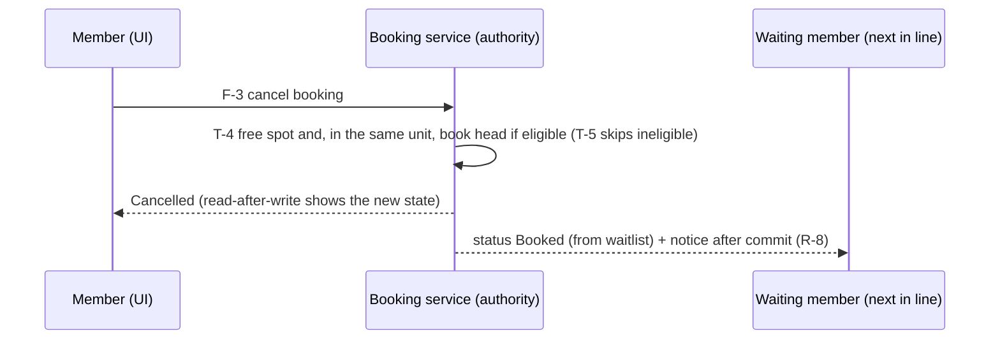
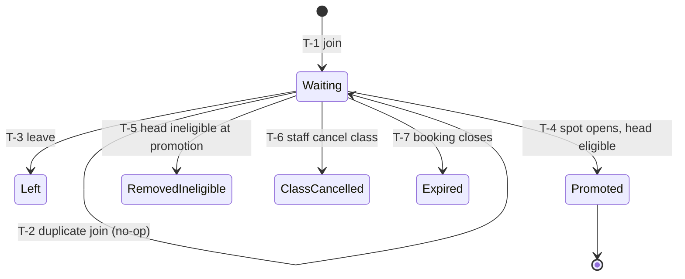

# Class Booking App: Product Requirements

Living specification of what the class booking app must do. Structure and technology choices live in
[architecture.md](architecture.md) as `AD-<n>`; product decisions here are `PD-<n>`; requirements are `R-<n>`.

## Basis and evidence limits

**Request basis (stays true in later runs):** 2026-11-21, user request: "Add a waitlist to our class booking app so
full classes don't turn people away." Every requirement below that cites `Req-2026-11-21` rests on those words; anything
else is a labelled design decision (`PD-<n>`), not a user requirement.

**What was and was not inspected.** This stage ran alone: there is no repository, no discovery or research result, no
earlier specification and no selected baseline. Nothing about the existing app was opened, so:

| Fact | Evidence class |
| --- | --- |
| The app lets members book a class that has a capacity, and refuses when it is full | Inference from the request's words ("full classes ... turn people away"); not observed |
| Existing eligibility rules (credits, passes, membership state, overlap rules), booking-close time, cancellation rules and penalties, staff roles, notification channel, UI identity, platform and storage | **Unknown.** Each is referenced by name below as "the existing rule"; none is described |
| Staff can cancel a class and change its capacity | Unknown; R-5 and R-6 are conditional on these features existing (G-1) |

Missing access is a gap, not evidence that a behaviour is absent. The planner reopens the real app and records the
baseline (G-1) before any dependent item is called ready. Source-section locators for this stage are the request
sentence above and the guide sections listed in `## Submission`.

**Preserved behaviour:** the app has no earlier maintained spec to preserve clause by clause; R-9 preserves existing
booking behaviour as a whole until a baseline enumerates it. **Pending implementation and checks:** everything here is
accepted intent only; nothing is implemented, authored as a test or verified.

## Product decisions (defaults the request leaves open; reversible)

| ID | Decision (default) | Alternative | Revisit when |
| --- | --- | --- | --- |
| PD-1 | A freed spot goes to the first waiting member **automatically** (booked at once, member told). No offer/claim window | Offer a spot for a time window and move on if unclaimed | Studio wants no-show control, or existing late-cancel penalties make a surprise booking harmful |
| PD-2 | Order is first-come-first-served by the order the server commits joins | Priority tiers | A membership-tier requirement appears |
| PD-3 | Joining a class that has a free spot is refused with reason `spots_available`; no entry is created and the UI offers "Book" | Auto-book on join | Races between view and click prove common |
| PD-4 | No waitlist length cap and no "latest promotion time" cutoff. The list is bounded by one entry per member per class (R-1); promotion can happen any time before the class's booking closes | A cap, or a cutoff N minutes before start | Hot classes show unmanageable lists, or promoted members cannot reasonably attend |
| PD-5 | An ineligible head entry is skipped, removed with a notice, and the next entry is tried | Keep it waiting | Studio wants ineligible members kept in line |
| PD-6 | The waitlist closes at the **same instant the existing booking closes**; the working assumption is the class start instant (G-1) | n/a | Baseline shows another close time |
| PD-7 | In-app status is the mandatory notice; the existing notification channel, if any, is used additionally | A new channel | Studio asks for a channel the app lacks |
| PD-8 | Members see their own position and the number waiting; staff waitlist viewing or editing is out of scope | Staff roster of the waitlist | Staff request it |
| PD-9 | Leaving the waitlist and re-joining puts the member at the back; a promoted member who later cancels is not re-queued | Keep the original place | n/a |

## Requirements

### R-1 Join the waitlist when a class is full (primary)

Basis: `Req-2026-11-21` ("waitlist ... full classes don't turn people away"). Changed: a full class stops being a
dead end; **preserved:** booking a class with a free spot (R-9). Behaviour: a signed-in member viewing a full, still
bookable class they are neither booked in nor waiting for is offered "Join waitlist" in place of a refusal, and joining
appends them to that class's waitlist. Boundaries: one entry per member per class; closed at the existing booking-close
instant (PD-6); no length cap (PD-4). Error behaviour: each refusal names its reason and creates no entry. Consumer
outcome: the member sees they are on the waitlist and at which position.

| AC | Expectation | Surface | Confirmed by |
| --- | --- | --- | --- |
| AC-1.1 positive | SC-1.4: C1 is full (Ana, Ben booked, cap 2); Cy joins; result `waiting` at position 1; C1's card shows Cy "You're #1 on the waitlist" | Member UI; booking API | Browser check + API test |
| AC-1.2 failure | SC-1.7: Ana (already booked) joins C1: refused `already_booked`, no entry. SC-1.8: Cy (waiting) books C1 directly: refused `on_waitlist`. SC-1.3: Eli books C1 directly: refused `full` and the UI offers "Join waitlist" | Member UI; API | Browser + API |
| AC-1.3 failure | PD-3: C with a free spot (cap 2, only Ana booked): Ben joins: refused `spots_available`, no entry, UI offers "Book" | API; UI | API test; browser check |
| AC-1.4 boundary | SC-4.1/4.2 (class start 18:00; booking closes at start, PD-6/G-1): join at 17:59 succeeds at position 1; join at 18:00 refused `closed`; a join on a staff-cancelled class (SC-3) refused `closed` | API with controllable clock | Domain-rule test (clock injected, AD-3) |
| AC-1.5 boundary | SC-1.6: Cy joins C1 a second time (double click): returns the existing entry, position 1 unchanged, no second entry, no error | API; UI | API test; browser (double click) |
| AC-1.6 boundary | No cap (PD-4): n/a for a count bound; the effective bound is one entry per member per class, covered by AC-1.5 and AC-7.3 | n/a | n/a: bound is the uniqueness rule |

### R-2 Order, position and count

Basis: `Req-2026-11-21` (waitlist implies an order); PD-2, PD-8. New. Behaviour: entries are ordered by committed join
order; positions are 1-based and contiguous; leaving or promotion moves later entries up by one. A member sees only their
own position and the count waiting.

| AC | Expectation | Surface | Confirmed by |
| --- | --- | --- | --- |
| AC-2.1 positive | SC-1.4/1.5: Cy joins then Dee: Cy #1, Dee #2; C1 shows "Full · 2 on the waitlist" | UI; API | Browser + API |
| AC-2.2 positive | SC-1.10..1.13: after Ana cancels and Cy is promoted, Dee is #1 | UI; API | API test; browser |
| AC-2.3 boundary | Position never repeats or skips: after SC-1.17 (Dee leaves) then SC-1.18 (Dee rejoins), Dee is #1 (list empty, PD-9) | API | API test |
| AC-2.4 failure | n/a: no failing input exists for a read; unauthorized reads are R-11 | n/a | n/a |

### R-3 Leave the waitlist

Basis: PD-9; lifecycle need (a member must be able to withdraw). New. Behaviour: a waiting member can leave at any time
before promotion; later entries move up. Leaving never cancels a booking.

| AC | Expectation | Surface | Confirmed by |
| --- | --- | --- | --- |
| AC-3.1 positive | SC-1.17: Dee (waiting #1) leaves: result `left`; no entry; Dee not in the waitlist count | UI; API | Browser + API |
| AC-3.2 failure | SC-1.15: Cy's page is stale and still shows "Leave" although Cy was promoted: leave returns `already_booked`; Cy's booking is **unchanged**; UI refreshes to "Booked" | API; UI | API test; browser with stale page |
| AC-3.3 failure | A member with no entry on that class leaves: `not_on_waitlist`, nothing changes | API | API test |
| AC-3.4 boundary | Leave after class start or after class cancel (entry already ended): `not_on_waitlist`, no change | API with clock | Domain-rule test |

### R-4 Automatic promotion when a member cancels (primary)

Basis: `Req-2026-11-21` ("full classes don't turn people away"); PD-1, PD-2. New. Behaviour: when a booked member's
cancellation frees a spot on a still-bookable class and members are waiting, the first eligible waiting member is booked
into that spot **as part of the same operation** (R-7). Consumer outcome: the promoted member sees a confirmed booking
and is told (R-8); the others move up.

| AC | Expectation | Surface | Confirmed by |
| --- | --- | --- | --- |
| AC-4.1 positive | SC-1.10..1.14: C1 cap 2 booked [Ana, Ben], waiting [Cy, Dee]; Ana cancels: booked [Ben, Cy], waiting [Dee], 2/2. Cy's "My bookings" shows C1 confirmed (from waitlist) | API; member UI | API test; browser as Cy |
| AC-4.2 positive | SC-6: C6 cap 2 booked [Ana, Ben], waiting [Cy, Dee, Eli]; Ana and Ben cancel simultaneously (either order): booked [Cy, Dee], waiting [Eli]; each promoted exactly once | API | Concurrency test, both orders |
| AC-4.3 boundary | SC-4.4: cancellation at or after the booking-close instant (where the existing rules allow it) promotes nobody | API with clock | Domain-rule test |
| AC-4.4 boundary | Cancellation with an empty waitlist leaves the spot free and visible as bookable (R-9) | API; UI | API test |
| AC-4.5 failure | If the cancellation itself is refused by the existing rules, no promotion occurs and nothing changes | API | API test (fixture from baseline, G-1) |

### R-5 Promotion when capacity is raised (conditional on G-1: staff can change capacity)

Basis: PD-1; `Req-2026-11-21`. New. Behaviour: raising a class's capacity promotes waiting members in order, one per new
spot, until spots or the list run out.

| AC | Expectation | Surface | Confirmed by |
| --- | --- | --- | --- |
| AC-5.1 positive | SC-2: cap 1 booked [Ana], waiting [Ben, Cy, Dee]; capacity set to 3: booked [Ana, Ben, Cy], waiting [Dee] | Staff surface; API | API test |
| AC-5.2 positive | SC-1.19..1.21: cap 2 to 4 with only Dee waiting: Dee promoted, waitlist empty, 1 spot free; Eli's direct booking then succeeds (R-9) | API; UI | API test |
| AC-5.3 boundary | Capacity lowered or unchanged: no promotion and no removal of anyone (existing behaviour for over-capacity stays as is) | API | API test |

### R-6 Class cancelled or started ends the waitlist

Basis: lifecycle consequence of `Req-2026-11-21`; PD-6. New. Behaviour: when staff cancel a class, every waiting entry
ends as `class_cancelled`, the members are told, and no booking is created for them. When the booking-close instant
passes, remaining entries end as `expired` (no notice beyond the status). Ended entries are never promoted.

| AC | Expectation | Surface | Confirmed by |
| --- | --- | --- | --- |
| AC-6.1 positive | SC-3: cap 1 booked [Ana], waiting [Ben, Cy]; staff cancel the class: Ben and Cy entries `class_cancelled`, no bookings created, both notified | Staff surface; API; member UI | API test; browser as Ben |
| AC-6.2 positive | SC-4.3: Ben waiting at 17:59; at 18:00 Ben's entry is `expired` and the class shows no waitlist | API with clock; UI | Domain-rule test |
| AC-6.3 failure | A join or promotion attempted after the entry ended or the class cancelled changes nothing (SC-3 join `closed`; SC-4.4) | API | API test |

### R-7 Capacity integrity and fairness under concurrent actions

Basis: `Req-2026-11-21` (a waitlist that lets a spot be taken by someone out of turn or over capacity turns people
away unfairly); PD-2. New. Behaviour: (a) booked members never exceed capacity because of waitlist actions; (b) a spot
freed on a class that has waiting members cannot be taken by a direct booking, in any ordering; (c) each waiting entry is
promoted at most once; (d) join positions are distinct; (e) the freeing of a spot and its promotion are one indivisible
outcome, so no reader sees a free spot on an open class with eligible waiting members. Recovery: if such a state is ever
found (interrupted operation, migration), a repair promotes in order and is safe to repeat.

| AC | Expectation | Surface | Confirmed by |
| --- | --- | --- | --- |
| AC-7.1 positive | SC-5: C5 cap 1, booked [Ana], waiting [Ben, Cy]; Ana's cancel and Dee's direct booking race, **both orders**: Dee refused `full`; final booked [Ben], waiting [Cy] | API | Concurrency test forcing both orders plus a stress run |
| AC-7.2 failure | SC-1.14: right after SC-1.10 Eli books directly: refused `full` (no instant with 1/2 booked and Dee waiting is observable) | API read-after-write | API test |
| AC-7.3 boundary | SC-7: C7 cap 1, booked [Ana]; Cy and Dee join simultaneously: both succeed, positions {1, 2} in either order, 2 entries | API | Concurrency test, both orders |
| AC-7.4 recovery | Seed C with cap 2, booked [Ana], waiting [Ben] (violating the invariant); run the repair: Ben booked, waiting []; run it again: no change | Booking service | Domain-rule test; recovery probe |

### R-8 The member is told what happened

Basis: PD-7; `Req-2026-11-21` (the point of waiting is to get in; the member must learn they did). New. Behaviour: a
member's own status (waiting at #k, booked from waitlist, removed as ineligible, class cancelled) is shown in the app
and is correct on the next read; a notice is also sent through the existing notification channel where one exists
(G-2). A failed notice never undoes a promotion. The UI never shows "booked" or a position before the server
confirms it.

| AC | Expectation | Surface | Confirmed by |
| --- | --- | --- | --- |
| AC-8.1 positive | SC-1.10: after Ana cancels, Cy's status reads "Confirmed (from waitlist)" and a notice for Cy is recorded; Dee's reads "#1" | Member UI; notification record | Browser + API |
| AC-8.2 failure | Notification delivery fails: Cy remains booked and the status still shows it; the failure is logged (NFR-7) | Booking service | Domain-rule test with failing notifier |
| AC-8.3 boundary | While "Join waitlist" is in flight the card shows a pending state ("Joining..."), no position; on refusal it shows the reason and restores the button | Member UI | Browser with a held response |

### R-9 Existing booking behaviour is preserved

Basis: `Req-2026-11-21` is an addition; silence retires nothing. Preserved: booking a class with a free spot, direct
cancellation, all existing eligibility and cancellation rules, and the experience of clients that know nothing of
waitlists. Not enumerated (G-1).

| AC | Expectation | Surface | Confirmed by |
| --- | --- | --- | --- |
| AC-9.1 positive | A class with a free spot books exactly as before and shows no waitlist controls | UI; API | Existing booking checks re-run |
| AC-9.2 boundary | A client that does not know the waitlist still sees a full class refused as full, with no error type it cannot handle | API (older client fixture) | Compatibility check (G-1: whether such clients exist) |
| AC-9.3 failure | Direct booking of a full class by a non-waiting member is still refused (SC-1.3) | API | API test |

### R-10 Eligibility at join and at promotion

Basis: PD-5; `Req-2026-11-21`. New. Behaviour: joining requires everything the existing rules require for booking
except free capacity, and that check comes first, so an ineligible member sees the eligibility reason, not `full`.
At promotion eligibility is checked again; an ineligible head entry is skipped, ends as `removed_ineligible`, the member
is told, and the next entry is tried. Whatever the existing booking charges (credit, pass, payment) is applied at
promotion, not at joining; a failed charge counts as ineligible.

| AC | Expectation | Surface | Confirmed by |
| --- | --- | --- | --- |
| AC-10.1 failure | SC-8: Cy is refused by the existing rules for a non-capacity reason (fixture reason chosen from the baseline). Cy's join on a full class: refused `ineligible` | API | API test. **NOT-REPLAYED: concrete reason needs G-1** |
| AC-10.2 positive | SC-8: C8 cap 1 booked [Ana]; waiting [Cy, Dee]; Cy becomes ineligible; Ana cancels: Cy `removed_ineligible` and told; Dee booked; waitlist empty | API | API test. **NOT-REPLAYED: same prerequisite** |
| AC-10.3 boundary | Joining costs nothing; if the existing booking charges, exactly one charge occurs at promotion, none at join, none at leave | API; ledger | API test (G-1) |

### R-11 Access control and privacy

Basis: lifecycle/privacy assessment; PD-8. New. Behaviour: a member can create, read and remove only their own entries;
the member is taken from the signed-in identity, never from request input; other members' identities on a waitlist are
never returned to a member; unauthenticated requests are refused.

| AC | Expectation | Surface | Confirmed by |
| --- | --- | --- | --- |
| AC-11.1 failure | Unauthenticated join/leave/read: refused, no change | API | API test |
| AC-11.2 failure | Ben sends a leave or join naming Cy as the member: acted on as Ben only (or refused); Cy's entry is unchanged | API | API test |
| AC-11.3 boundary | Responses to a member (and the UI's data) contain own position and the count, but no other member's name or id; verified on SC-1 responses for Dee while Cy is waiting | API payload; UI | API payload assertion; browser DOM |

## Domain rules the request leaves out

Bound to the requirement they limit; none is introduced:

- R-1: no per-member limit on simultaneous waitlists, no overlap rule beyond the existing booking rules, no waitlist
  fee, no paid priority.
- R-4: no offer/claim window or timeout, no "latest promotion time", no re-queue after a promoted member cancels.
- R-2/R-11: no staff waitlist view or editing, no member-to-member visibility.
- R-8: no new notification channel, no reminders.
- R-6: no waitlist history screen for members.

## Behaviour model

### Flows

| F | Journey | Requirements |
| --- | --- | --- |
| F-1 | Member joins the waitlist of a full class; alternative branches: refused (closed, already booked, ineligible, spots available); duplicate | R-1, R-2, R-10, R-11 |
| F-2 | Member leaves the waitlist; stale leave on a promoted entry | R-3 |
| F-3 | Member cancels, spot freed, head promoted (skip ineligible); notice | R-4, R-7, R-8, R-10 |
| F-4 | Staff raise capacity; promotions | R-5, R-7 |
| F-5 | Staff cancel the class or booking closes; entries end | R-6 |

### Waitlist entry states

All of Left, Promoted, RemovedIneligible, ClassCancelled and Expired are terminal and ignore every further event (no
data change). Owner: booking service; durable (it must survive restart, R-7 recovery). Invariants: at most one Waiting
entry per (class, member); a member is never Waiting and booked in the same class; an open class with a Waiting entry
has no free spot (after any operation completes).

### Transition ledger

| T | R | Before | Trigger and guard | After and observation | Failure and recovery | Cases |
| --- | --- | --- | --- | --- | --- | --- |
| T-1 | R-1, R-2, R-10, R-11 | No entry; class open and full; member eligible, not booked | Member join, authenticated | Waiting at position n+1; response and UI show position | Not committed => no entry; retry safe because T-2 | AC-1.1, AC-7.3 |
| T-2 | R-1 | Waiting | Same member joins again | Unchanged; same position returned | n/a | AC-1.5 |
| T-3 | R-3 | Waiting | Member leave | Left; later entries move up; booking untouched | Retry returns `not_on_waitlist`, no change | AC-3.1 |
| T-4 | R-4, R-5, R-7 | Waiting head; a spot free on an open class | Cancel, capacity raise | Promoted; member booked; notice | Atomic with the freeing event; repair re-evaluates (AC-7.4) | AC-4.1, 4.2, 5.1, 7.1 |
| T-5 | R-10 | Waiting head, now ineligible | Promotion attempt | RemovedIneligible; next entry tried; notice | Repeat-safe | AC-10.2 |
| T-6 | R-6 | Waiting | Staff cancel class | ClassCancelled; no booking | Repeat-safe | AC-6.1 |
| T-7 | R-6 | Waiting | Booking close instant passes | Expired | Applied lazily or by schedule; reads must already treat closed classes as ended | AC-6.2 |
| T-8 | R-1, R-10, R-11 | No entry | Join refused: `closed`, `already_booked`, `ineligible`, `spots_available`, unauthenticated | Unchanged; reason returned | n/a | AC-1.2..1.4, 10.1, 11.1 |
| T-9 | R-3 | Entry Promoted or terminal, or none | Leave | Unchanged; `already_booked` or `not_on_waitlist`; booking untouched | n/a | AC-3.2, 3.3, 3.4 |
| T-10 | R-7, R-9 | Class full with waiting members | Direct booking by anyone | Refused `full` (or `on_waitlist` for a waiting member); no change | n/a | AC-1.2, 7.1, 7.2 |

### Replayable scenarios (fixtures)

Members Ana, Ben, Cy, Dee, Eli; all eligible unless stated; classes are in the future with booking closing at start
(PD-6 working assumption). SC-1: C1 cap 2, start 18:00. SC-2: cap 1 raised to 3. SC-3: cap 1, staff cancel. SC-4: cap 1,
start 18:00, clock at 17:59, 18:00, 18:01. SC-5: cap 1, booked [Ana], waiting [Ben, Cy], race of Ana's cancel and Dee's
booking. SC-6: cap 2, booked [Ana, Ben], waiting [Cy, Dee, Eli], two cancels. SC-7: cap 1, booked [Ana], two joins.
SC-8: eligibility fixture (G-1). Step sequences and expected values are written in the acceptance lines above.

## Non-functional requirements

| NFR | Assessment | Verification |
| --- | --- | --- |
| NFR-1 Correctness under concurrency (R-7) | Bound: booked never exceeds capacity through waitlist actions; no out-of-turn spot; exactly-once promotion. Operating condition: simultaneous cancels, joins and direct bookings on one class (hot-record contention) | Forced-ordering tests for every ordering in SC-5..SC-7 plus a stress run (iteration count set in test strategy) |
| NFR-2 Performance and capacity | **Unresolved**: no existing latency or load figure is known and none is invented. Observable pass/fail instead: a promotion is visible on the first read after the cancel returns. Missing evidence: the app's current booking latency and class sizes (G-1) | Read-after-write API test; timing target added only after baseline |
| NFR-3 Reliability and recovery | A crash or restart between operations leaves no state with a free spot and eligible waiting entries on an open class that a repair cannot fix; repair is idempotent | AC-7.4 |
| NFR-4 Security and privacy | Own-entries only; no other member's identity exposed; logs carry class id and member id only, no names or contact details; waitlist records follow the existing booking-record retention and removal (no new retention period) | AC-11.1..11.3; log inspection |
| NFR-5 Accessibility | Every waitlist action reachable and operable by keyboard; visible focus; focus returns to the card's action after join or leave; status changes announced politely to assistive technology; text contrast at least 4.5:1 (3:1 large text and controls) per WCAG AA | Browser check with keyboard and an accessibility scan; manual contrast check |
| NFR-6 Designed interface | See below | Browser check at 360 px and 1280 px, light and dark |
| NFR-7 Observability | Join, leave, promote, skip-ineligible, expire, class-cancel and notice-failure each produce one log event with class id and member id | Log assertion in AC-8.2, AC-4.1 |
| NFR-8 Compatibility | New response fields are additive; clients unaware of waitlists keep working (AC-9.2) | Compatibility check |
| NFR-9 Testability | Time must be controllable so the booking-close boundary is testable without waiting (AD-3) | AC-1.4 |
| Excluded | Scale/cost targets (no figure, no evidence); localization (follows existing); new retention period (follows existing) | n/a |

### NFR-6 Designed interface (waitlist UI)

The waitlist is added inside an existing app, so it **inherits the existing visual identity, components and
conventions**; that identity has not been inspected (G-4). Named visual reference and starting appearance **only if
the app has no established identity**: the light Google Gemini look and feel with Material 3 Expressive principles
from the UI visual-direction guide, light first with a dark option, adapted to the app's own name and content. The plan
chooses the concrete tokens. Observable criteria:

- One visual system: a spacing scale, a type scale, a palette with a light and a dark theme; the same tokens as the
  rest of the app.
- Designed states for the class card: open (Book), full (Join waitlist with "Full · N on the waitlist"), pending
  ("Joining..." with the control disabled), waiting (position chip "You're #k" with Leave), booked from the waitlist,
  refused (reason and a recovery action), closed; a designed empty state where a member has no waitlist entries ("You're
  not on any waitlists"), a loading state, and an error state with retry.
- The primary action on a full class is the strongest element on the card; supporting counts are quieter.
- Layout works at 360 px and 1280 px wide with no horizontal overflow.
- Visible focus states; WCAG AA contrast in both themes.
- Motion only where it explains a change (position change, promotion), and none when the user prefers reduced motion.
- One icon set, shared with the rest of the app.

## State and data assessment

| Carrier | Owner and location | Target identity | Change | Before / after invariant | Recovery |
| --- | --- | --- | --- | --- | --- |
| Waitlist entry (new): class, member, join order, status | Booking service's store (AD-2) | (class id, member id) | Created by T-1, ended by T-3..T-7 | At most one Waiting per pair; ended entries immutable | Repair (AC-7.4); retries safe (T-2, T-9) |
| Booking record (existing) | Existing store | (class id, member id) | Created by promotion (T-4), flagged as from the waitlist for display | Booked count <= capacity (R-7a) | Same atomic unit as the freeing event |
| Class capacity (existing) | Existing store | class id | Read (and raised by staff) | Unchanged by waitlist | n/a |
| Notices (existing channel plus in-app status) | Notification mechanism | member id | Created after commit | A lost notice never changes state | Status view is the source of truth |
| Member-visible view | Derived on read | member id | none | Never shows another member's data | Refetch |

Existing data: no migration or backfill; existing classes start with an empty waitlist; existing bookings are
untouched. Rollback limit: if the feature is switched off after entries exist, entries stay unpromoted until the
feature returns or they expire; the platform's staged-release options and the promotion/stop condition are unknown (G-5).
Unknowns: store type, transaction capability, existing retention (G-1, G-5).

## Service boundaries

No remote service is introduced. Contracts at the boundaries that may exist, one line each:

- Authority: the booking service is the only authority for capacity and the waitlist; clients hold stale views at most.
- Freshness versus revocation: a view may be stale; every action is decided on current server state, and eligibility is
  re-checked at promotion (R-10), so a revoked eligibility needs no data edit to take effect.
- Async completion: promotion completes within the freeing operation (R-7e); only notice delivery is asynchronous, runs
  after commit, and its failure never reverts state (AC-8.2).
- Owned event coverage: the events listed in NFR-7.
- Incremental state, cache, new schema compatibility and queues: not applicable; none is added.

## State and information lifecycle

| State | Owner and location | Who may read | Simultaneous changes | Ends / removed | Runtime quotas |
| --- | --- | --- | --- | --- | --- |
| Waitlist entry | Booking store | The member (own position); the service. No other member | Serialized per class (R-7); one winner per spot | Terminal on leave, promotion, ineligibility, class cancel, close; record kept as long as the existing booking records | Unknown platform limits (G-5); no number invented |
| Position and count | Derived on read | Any signed-in member sees the count; only the owner sees the position | Recomputed each read | With the entry | n/a |
| Pending join (UI) | Client memory only | The member | A newer response never overwritten by an older one; the last server response wins | On response, navigation away or reload | n/a |
| Draft or persisted client state | None | n/a | n/a | n/a | No identity, sharing or persistence added beyond the signed-in member |

Personal data: a member id appears in entries and logs; it is shown only to its owner, kept as long as the existing
booking record, removed when the member's other records are removed (G-1 for the actual account-removal rule). The UI
refreshes status on load, on return to the foreground and after each own action; it does not claim live updates, and
the action path always re-validates (AC-3.2).

## Request-outcome traceability

| Outcome in the request | Acceptance lines |
| --- | --- |
| "Add a waitlist": members can queue for a class | R-1 (AC-1.1..1.5), R-2 (AC-2.1..2.3), R-3 (AC-3.1..3.4) |
| "full classes don't turn people away": a full class offers the waitlist instead of a refusal | AC-1.1, AC-1.2 (offer), AC-1.3 |
| ...and the waiting member gets in when a spot opens, fairly | R-4, R-5, R-7, R-10; AC-4.1, 4.2, 5.1, 7.1 |
| ...and knows it | R-8 (AC-8.1..8.3) |
| Consequential states of a waitlist (class ends, privacy, existing behaviour) | R-6, R-11, R-9 |

Non-functional and lifecycle lines map through NFR-1..NFR-9 above.

## Open gaps

- **G-1 (R-9, R-10, R-6, R-1, NFR-2)**: the existing app was not available. Unknown: eligibility rules and charging,
  booking-close time, cancellation rules and penalties, staff features (capacity edit, class cancel), account-removal
  and retention, older clients, platform and store. Interim: rules are referenced by name, PD-6 assumes close at start.
  Confirming observation: read the app's booking module, README and tests at plan time and record a baseline. Unready:
  AC-10.1..10.3, AC-4.5, AC-9.2, NFR-2 target. Independent work (R-2, R-3, R-7 logic) may proceed.
- **G-2 (R-8)**: whether the app already has a notification channel. Interim: in-app status only is mandatory (PD-7).
- **G-3 (R-5)**: whether staff can change capacity. If not, R-5 is not applicable and is retired through the
  existing route.
- **G-4 (NFR-6)**: existing UI identity unknown; the fallback starting point is named above.
- **G-5 (state and data)**: release and rollback options, store transaction capability and runtime quotas are unknown;
  AD-1 states the constraint to be proven against the actual store before dependent items are ready.

No decision here needs the user before work can proceed; PD-1..PD-9 are reversible defaults.

## Replay evidence (duty 10)

- Every scenario SC-1..SC-8 was hand-walked from its stated start under the rules above: each action was checked
  against the permitting rule (R-1 guards, T-8..T-10) in the state the earlier actions leave, and every expected value
  recomputed. Results: SC-1 ends booked [Ben, Cy, Dee, Eli], waiting [], capacity 4 (steps 1.10 to 1.21 as written);
  SC-2 booked [Ana, Ben, Cy], waiting [Dee]; SC-3 no bookings, two `class_cancelled`; SC-4 join at 17:59 ok, 18:00
  `closed`, entry `expired`, no promotion at 18:01; SC-5 and SC-7 give the same final state in both orders; SC-6 gives
  booked [Cy, Dee], waiting [Eli] in both orders; SC-8 Dee booked, Cy `removed_ineligible`.
- An executable reference model of these rules (permission checks per operation, every ordering of the atomic
  concurrent actions) was written to the session scratchpad as `walk.py`, but running it was not approved in this
  session, so **NOT-REPLAYED (execution): the walk is by hand only** and this stays open until a test run replays it.
- No documented command exists in this spec. No claim about a runtime or library capability is relied on; the
  transaction capability the design needs is recorded as unproven in G-5 and AD-1.

## Retired

None.

## Submission

**summary:** Waitlist added for full classes, specified as R-1..R-11 (join, order, leave, automatic promotion on cancel and
on capacity increase, end on class cancel or start, concurrency and fairness, member notice, preservation of existing
booking, eligibility, privacy), with NFR-1..NFR-9, state and data assessment, lifecycle and traceability. The existing
app was not available, so every rule about it is referenced by name and tracked in G-1..G-5.

Assumptions (default, basis, alternatives, revalidation), each under its R-n:
- R-4 (PD-1): automatic promotion, no claim window. Basis: simplest behaviour that satisfies "don't turn people away"
  and is reversible. Alternative: offer with a timeout. Revalidate: late-cancel penalties or no-show control are needed.
- R-4/R-5 (PD-4): no promotion cutoff and no waitlist cap; the list is bounded by one entry per member per class. Beyond
  that bound nothing is refused, because no bound is needed for correct or safe behaviour. Revalidate: hot classes or
  promoted members who cannot attend.
- R-1 (PD-3): joining a class with a free spot is refused with `spots_available`. Alternative: auto-book.
- R-1/R-6 (PD-6): the waitlist closes when the existing booking closes, assumed to be the class start instant. Revalidate:
  baseline shows another close time.
- R-2 (PD-2, PD-9): first-come order; leaving and re-joining goes to the back.
- R-8 (PD-7): in-app status mandatory, existing channel additional. Revalidate: baseline channel found.
- R-10 (PD-5): ineligible head entries are skipped and removed with a notice; charging happens at promotion.
- R-11/NFR-4: waitlist records follow existing booking retention; no new retention period.
- NFR-6: inherit the existing UI identity; fallback is the light expressive starting point with a dark option.
- Verification viewports 360 px and 1280 px are test conditions, not product bounds.

Open: G-1 (baseline of the existing app, blocks AC-10.1..10.3, AC-4.5, AC-9.2 and the NFR-2 target), G-2, G-3, G-4, G-5.
No material requirement conflict. NOT-REPLAYED: the SC-1..SC-8 walk was by hand only (see Replay evidence).

**primary:** R-1, R-4

**evidence_refs:** KNOWLEDGE/spec.md (all requirement sections R-1..R-11, NFR-1..NFR-9, State and data assessment, Service
boundaries, State and information lifecycle); KNOWLEDGE/architecture.md (AD-1..AD-6); the request sentence of
2026-11-21; GUIDES/behavioral-requirements.md#behavior-model and #traceability-and-review and
#actors-channels-and-state-ownership; GUIDES/requirements-definition.md (non-functional requirements; state and data
change assessment); GUIDES/service-discovery.md#verification; GUIDES/platforms/ui.md#light-expressive-starting-point;
GUIDES/current-system-baseline.md#planning-and-review-handoff; GUIDES/project-knowledge.md#maintained-product-requirements.
No backchain graph was written, so no receipt is cited.
