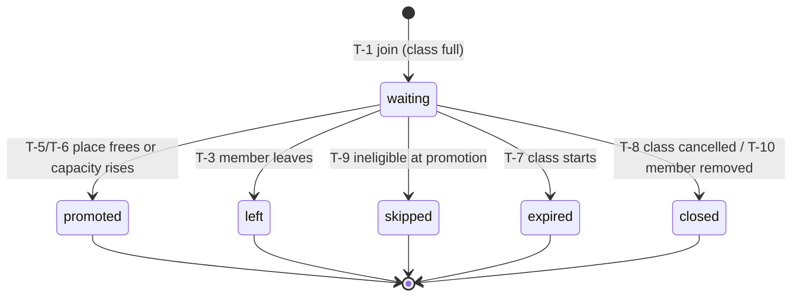

# Class Booking App — Product Requirements

Living specification of what the class booking app must do. How it is built is in `architecture.md` (AD-<n>), never here.
Product decisions use `PD-<n>`, open gaps `G-<n>`, flows `F-<n>`, transitions `T-<n>`, cases `TC-<n>`.

## Source and baseline status

| Item | Status |
| --- | --- |
| Request (source of all R-1…R-11 and their NFR counterparts) | `2026-11-21: "Add a waitlist to our class booking app so full classes don't turn people away."` Cited below as **REQ-2026-11-21**. |
| Prior `KNOWLEDGE/spec.md`, research result, discovery result, selected baseline | **None existed** when this was written. No requirement was kept, changed or retired; `## Retired` is empty. |
| Repository / running app | **Not available to this stage.** Nothing about the current booking app (stack, data model, capacity rule, cancellation rules, payments or credits, notification channels, roles, UI identity) was observed. Every statement about "the existing app" below is an *assumption to be confirmed* (G-1), not an observation. |
| Consequence | Requirements below are written so they hold for any booking app with a per-class capacity, a member who books and cancels, and a member-facing UI. Behaviour that depends on the unknown baseline is marked as an open gap under the R-<n> it affects. Work independent of those gaps (waitlist rules, ordering, atomicity, visibility) is ready; work that depends on them stays unready. |

Evidence grades used below: **Observed** (seen in the system — none), **Inferred** (derived from the request's words), **Decided** (a PD-<n> default chosen here, to be overridden by the user), **Unknown** (a G-<n>).

## Request-outcome map

| Outcome | Wording in the request | Covered by |
| --- | --- | --- |
| O-1 | "a waitlist" exists for classes | R-1, R-3, R-4, R-10, R-11 |
| O-2 | "full classes don't turn people away": a member who meets a full class can queue instead of being refused | R-1, R-2 |
| O-3 | (implied by the purpose) a queued member actually gets the freed place | R-5, R-6, R-7, R-8 |
| O-4 | (implied) the waitlist never causes overbooking or lost places | R-5, R-9 |

Primary outcomes (what the user asked for directly): O-1, O-2 → see `primary` in `## Submission`.

## Product decisions and assumptions (defaults, overridable)

| ID | Decision (Decided, not requested) | Rationale |
| --- | --- | --- |
| PD-1 | Promotion is **automatic**: when a place frees, the first eligible waiting member is booked without a further confirmation step. | Smallest design that satisfies "don't turn people away"; needs no timers or hold windows. The alternative (offer + claim window) is G-4. |
| PD-2 | Order is **first-come-first-served** by the moment the join was accepted. No priority tiers. | Request names no priority rule. |
| PD-3 | A member has **at most one active relationship per class**: booked or waiting, never both. | Prevents double holds. |
| PD-4 | The waitlist has **no product-imposed length cap**. | Request names none; an invented bound is forbidden. Platform limits still apply (G-6). |
| PD-5 | Waiting members are removed when the class starts (or is cancelled); no promotion after start. | A place after start is useless; cutoff before start is G-5. |
| PD-6 | A member sees **their own** position and the **count** of people waiting, never another member's identity. | Information-lifecycle rule (see R-10). |
| PD-7 | Promotion applies the **same eligibility rules as an ordinary booking** in the existing app (membership, credits, limits). An ineligible waiting member is skipped (entry closed, member informed) and the next is tried. | Avoids inventing new rules; baseline unknown (G-3). |
| PD-8 | Notification reuses **whatever channel the app already has**; the in-app status is the guaranteed channel. No new notification infrastructure is added. | "Add no service to fill a template." |

## Domain model

- **Class session**: capacity `C`, start time, status (scheduled | cancelled | started/ended). *Full* means `booked count = C`.
- **Booking**: member × class session, status booked | cancelled. (Existing; preserved.)
- **Waitlist entry**: member × class session, `sequence` (monotonic per class, assigned at accept time), status `waiting | promoted | left | skipped | expired | closed`. New.
- **Position** of a waiting entry = 1 + number of `waiting` entries with a smaller sequence. Derived, never stored independently, so it always shifts when earlier entries leave.

Invariants (checked after every committed operation, on one class session):

- I-1 `booked count ≤ C`.
- I-2 a member has at most one of {booked booking, waiting entry} per class (PD-3).
- I-3 if any entry is `waiting`, then `booked count = C` (a free place is never left beside a non-empty waitlist), except while an entry is being skipped under PD-7, which completes inside the same operation.
- I-4 positions of waiting entries are exactly 1..N with no gaps or ties.
- I-5 an entry is `promoted` iff a booking was created for it in the same committed operation.

### Entry lifecycle



### Flow F-2/F-3 (leave, promotion) — sequence

```mermaid
sequenceDiagram
  participant M1 as Member A (booked)
  participant UI as Member UI
  participant S as Booking service (authority)
  participant M2 as Member C (waiting #1)
  M1->>UI: Cancel booking
  UI->>S: cancel(class, A)
  S->>S: one atomic unit: T-4a booking cancelled; T-5 first eligible waiting entry -> promoted + booking created
  S-->>UI: cancelled (A's view)
  S-->>M2: T-11 notify "you are booked" (after commit, best effort)
  M2->>UI: open class / my bookings
  UI->>S: read status
  S-->>UI: booked (authoritative read)
```

## Requirements

### R-1 Join the waitlist of a full class
- **Basis:** REQ-2026-11-21 (O-1, O-2). **Change type:** add. **Preserved:** existing booking of a class that has free places is unchanged (see R-2). **Source-section locators:** none (no baseline, G-1). **Evidence limit:** Inferred from the request; no system observed. **Pending:** implementation and all checks (status: not run).
- **Behaviour:** an authenticated member viewing a *full*, *scheduled*, *not-yet-started* class, in which they hold neither a booking nor a waiting entry, can join its waitlist. The entry is appended with the next sequence number and the member is told their position.
- **Boundaries:** joining when `booked = C` and the class starts in the future; the entry at position 1 when the list is empty.
- **Error behaviour (each leaves all data unchanged unless stated):**
  - class not full at the moment of the request → outcome `CLASS_NOT_FULL`; no entry; the UI offers the ordinary booking action instead (no silent auto-book).
  - member already booked → `ALREADY_BOOKED`.
  - member already waiting → **idempotent**: returns the existing entry and position, no second entry (`ALREADY_WAITING`, success-shaped).
  - class started, ended or cancelled → `CLASS_CLOSED`.
  - unauthenticated → existing authentication-required behaviour; no entry.
  - unknown class → existing not-found behaviour.
- **Consumer outcome:** on a full class the member sees a "Join waitlist" action where the app today would refuse; after joining they see "You're #k on the waitlist".
- **Acceptance lines**
  - AC-1.1 positive: S-1 step 3 — class `CL-SPIN-1800` (capacity 2, ana+ben booked), cy joins → entry created, cy's position = 1, class booked count still 2. Surface: member UI; service interface. Confirm: UI test + service-level test (TC-1.1).
  - AC-1.2 positive: S-1 step 4 — dee joins next → position 2, cy still 1 (TC-1.2).
  - AC-1.3 failure: ana (already booked) joins → `ALREADY_BOOKED`, entries unchanged (TC-1.3). With the join request racing a cancel so the class is no longer full → `CLASS_NOT_FULL`, no entry (TC-1.4).
  - AC-1.4 failure: class with start time in the past or status cancelled → `CLASS_CLOSED`, no entry (TC-1.5).
  - AC-1.5 boundary (idempotence): cy joins twice (double-click / retry) → one entry, position 1 both times (TC-1.6).
  - AC-1.6 boundary: class with capacity 2 and booked 1 → no join offered; join request returns `CLASS_NOT_FULL` (TC-1.7).
- **Left out (domain rules the request does not state):** waitlisting for several overlapping classes; recurring-series waitlists; guests / group joins; per-member waitlist limits; membership-tier priority; join fees. None is implemented.
- **Open gaps:** G-1 (baseline: what "full" means in the existing app, e.g. does it count holds or pending payments), G-3.

### R-2 A class with free places still books normally
- **Basis:** REQ-2026-11-21 ("full classes" only). **Change type:** preserve + add boundary. **Preserved:** all current booking behaviour for non-full classes (exact content unknown, G-1). **Pending:** baseline recovery then checks.
- **Behaviour:** the waitlist action appears only when a class is full; otherwise the unchanged booking action is shown. Booking a class that is not full never creates a waiting entry.
- **Boundaries:** booked = C−1 → booking allowed; booked = C → waitlist allowed, booking refused as today (refusal replaced by the waitlist offer in the UI, but the service still refuses a direct booking of a full class and never overbooks).
- **Error behaviour:** a direct booking request on a full class (stale UI) → existing "class full" refusal, unchanged data, response lets the UI offer the waitlist.
- **Consumer outcome:** members of non-full classes see no change.
- **Acceptance lines**
  - AC-2.1 positive: ana books `CL-SPIN-1800` with 0 booked → booked, no waitlist UI shown (TC-2.1).
  - AC-2.2 boundary: with ben the 2nd booking filling the class, the next visitor sees "Join waitlist" and no "Book" (TC-2.2).
  - AC-2.3 failure: direct booking call on a full class → refused, booked count unchanged at 2 (TC-2.3).
  - AC-2.4 regression of preserved behaviour: the pre-existing booking test set still passes unmodified (TC-2.4; set unknown until G-1 resolves).
- **Left out:** changing what the existing app does for double booking, payment or credit deduction.
- **Open gaps:** G-1, G-3.

### R-3 Ordering and position
- **Basis:** REQ-2026-11-21 (O-1); order rule is PD-2 (Decided). **Change type:** add.
- **Behaviour:** entries are ordered by the sequence assigned at accept time (first accepted, first served). Position is derived: when an earlier entry leaves, is promoted or is skipped, every later position drops by one. Two joins arriving together get distinct sequences, decided by the order the service commits them.
- **Boundaries:** position 1 is the next to be promoted; the last position equals the number waiting.
- **Error behaviour:** n/a: ordering has no input to reject; invalid joins are R-1.
- **Consumer outcome:** the member's displayed position is the authoritative value at the last read and is refreshed on screen load and after any action by that member (see R-10 for refresh).
- **Acceptance lines**
  - AC-3.1 positive: after S-1 step 4 positions are cy=1, dee=2; after cy leaves (S-2) dee=1 (TC-3.1).
  - AC-3.2 boundary: 20 members join one full class concurrently → sequences 1..20 unique, positions 1..20 gapless (I-4), none duplicated (TC-3.2). (20 is a test parameter, not a product limit.)
  - AC-3.3 failure: n/a: covered by AC-1.3–1.5.
- **Left out:** priority/tier ordering, manual reordering by staff.
- **Open gaps:** none for ordering itself.

### R-4 Leave the waitlist
- **Basis:** inferred from O-1 (a waitlist a member cannot leave would trap them); Decided as a product necessity, not asked directly. **Change type:** add.
- **Behaviour:** a member can remove their own waiting entry at any time while it is `waiting`. Later members move up.
- **Boundaries:** leaving from position 1; leaving as the only entry.
- **Error behaviour:**
  - entry no longer `waiting` because the member was just promoted → no change; outcome `NOW_BOOKED`, the UI shows the booking and its normal cancel action (leave is not silently turned into a cancellation).
  - entry already left/expired/closed → `NOT_WAITING`, no change.
  - a member trying to remove **another member's** entry → authorization refusal, no change, no disclosure whether that entry exists.
- **Consumer outcome:** the member returns to the full-class view with "Join waitlist" available again.
- **Acceptance lines**
  - AC-4.1 positive: S-2 — cy leaves → entry `left`, dee position 1 (TC-4.1).
  - AC-4.2 boundary: sole entry leaves → waitlist empty, class remains full (TC-4.2).
  - AC-4.3 failure: leave racing a promotion → exactly one of {left, promoted}; never both, never neither (I-5); if promoted, `NOW_BOOKED` (TC-4.3).
  - AC-4.4 failure: eli calls leave on cy's entry → refused, cy's entry intact (TC-4.4).
  - AC-4.5 failure: leave twice → second is `NOT_WAITING`, no change (TC-4.5).
- **Left out:** staff removing a member from the waitlist (not requested; G-7).
- **Open gaps:** none.

### R-5 Automatic promotion when a place frees
- **Basis:** REQ-2026-11-21 (O-3, O-4: "don't turn people away"); auto-versus-offer is PD-1 (Decided; G-4 asks the user). **Change type:** add.
- **Behaviour:** when a booked place on a class with waiting entries becomes free because the booking is cancelled, the service, **in the same atomic unit as the cancellation**, books the lowest-sequence eligible waiting member and marks their entry `promoted`. Exactly one waiting member is promoted per freed place. No window exists in which the place is free and bookable by a non-waiting member (I-3).
- **Boundaries:** cancel with one waiter (waitlist empties); cancel with no waiters (place just becomes free; ordinary booking resumes); two cancels freeing two places with one waiter (one promotion, one free place); cancel when the class has started (no promotion, PD-5).
- **Error behaviour:**
  - promotion fails for the first waiter under PD-7 (ineligible) → that entry becomes `skipped`, the next is tried in the same unit; if none is eligible the place stays free and ordinary booking opens.
  - the whole unit fails (storage error) → the cancellation **and** promotion both roll back; neither is visible; the cancelling member gets the existing failure behaviour and may retry. A cancellation never succeeds while leaving the place free beside a waiting entry.
  - a repeated cancel request for the same booking (retry) → existing idempotence/refusal; **must not** promote a second member.
- **Consumer outcome:** the promoted member's status in "My bookings" is "Booked"; the waitlist view shows them no longer waiting; remaining members' positions drop by one.
- **Acceptance lines**
  - AC-5.1 positive: S-1 step 7 — ana cancels with W=[cy,dee] → cy booked, dee position 1, booked count 2 (TC-5.1).
  - AC-5.2 positive: chain S-1 steps 7–10 ends with booked {dee, eli}, W empty, count 2 (TC-5.2).
  - AC-5.3 boundary: S-4 — ana and ben cancel at the same time with W=[cy] → start booked {ana, ben}, W=[cy]; after both cancels cy is promoted exactly once, booked {cy}, count 1, one place free, W empty, I-1…I-5 hold (TC-5.3; see S-4a).
  - AC-5.4 boundary: cancel with no waiters → count 1 below capacity, no entries created (TC-5.4).
  - AC-5.5 failure: injected failure after cancel but before promotion commit → both rolled back; ana still booked; cy still waiting position 1 (TC-5.5).
  - AC-5.6 failure: duplicate cancel request for ana's booking → one promotion total (TC-5.6).
  - AC-5.7 boundary: cancel at or after class start → no promotion; entries already `expired` (TC-5.7).
- **Left out:** offer/claim window, a "decline this offer" step (G-4); penalties or fees for late cancellation (existing rule, preserved, unknown).
- **Open gaps:** G-3 (eligibility/credits/payment at promotion), G-4 (auto vs offer), G-5 (cutoff before start).

### R-6 The promoted member is told
- **Basis:** inferred from O-3: a member promoted without knowing may miss the class; PD-8 (Decided). **Change type:** add.
- **Behaviour:** after the promotion commits, the member is informed they are now booked, class name and start. At minimum the in-app status changes (guaranteed, read from authority). If the app already has an outbound channel (email/push/SMS), the same message goes through it, once per promotion.
- **Boundaries:** one notification per promotion even if the service retries dispatch.
- **Error behaviour:** notification delivery failure never reverses the promotion and is not reported to the cancelling member; the failure is logged (see R-14) and the in-app status remains the source of truth. Acceptance of a send request is not evidence of delivery or display, so the in-app state, not the message, confirms the outcome.
- **Consumer outcome:** promoted member sees "Booked" on next load; where a channel exists, receives one message.
- **Acceptance lines**
  - AC-6.1 positive: after S-1 step 7, cy's in-app view shows booked; one notification record for cy/class exists if a channel exists (TC-6.1).
  - AC-6.2 failure: channel stub fails → cy still booked; failure logged; ana's cancel result unaffected (TC-6.2).
  - AC-6.3 boundary: dispatch retried twice → still one message (TC-6.3).
  - AC-6.4 boundary: no existing channel → only in-app status, no new channel created (TC-6.4; applicability unknown until G-2).
- **Left out:** reminders, "you moved up" messages, waitlist-expiry messages beyond R-8, user notification preferences.
- **Open gaps:** G-2 (which channels exist, quiet hours, opt-out).

### R-7 Capacity increase promotes waiting members
- **Basis:** inferred from O-3/O-4; **conditional** on the existing app letting staff raise a class's capacity (G-1, unknown). **Change type:** add if the capability exists, otherwise `n/a`.
- **Behaviour:** if capacity rises from C to C′, then in the same atomic unit the first (C′−booked) eligible waiting members are promoted, one place each, in order.
- **Boundaries:** C′−booked greater than waiters → all promoted, extra places open for booking; equal to zero → none.
- **Error behaviour:** failure rolls back the capacity change and all promotions together. Lowering capacity below the current booked count keeps the existing rule of the app (unknown); it never creates or removes waiting entries.
- **Consumer outcome:** promoted members see booked; others' positions shift.
- **Acceptance lines**
  - AC-7.1 positive: S-3 — capacity 2→4, W=[cy,dee,eli], booked 2 → cy, dee promoted, eli position 1, booked 4 (TC-7.1).
  - AC-7.2 boundary: capacity 2→5 with W=[cy] → cy promoted, 2 places free, W empty (TC-7.2).
  - AC-7.3 failure: injected failure mid-way → capacity still 2, entries unchanged (TC-7.3).
  - Surface/confirmation: staff capacity interface; service-level test. If the app has no capacity edit: `n/a: capability absent (to be confirmed by G-1)`.
- **Left out:** adding capacity-editing if the app lacks it.
- **Open gaps:** G-1.

### R-8 Class ends or is cancelled: the waitlist closes
- **Basis:** PD-5 (Decided) + lifecycle rule; staff cancellation is conditional on G-1. **Change type:** add.
- **Behaviour:** at the class start time every `waiting` entry becomes `expired` and nothing is promoted afterwards. If the class is cancelled by staff (when the app supports that), entries become `closed` and each waiting member is informed using the R-6 channel rules; existing bookings are handled by the app's existing cancellation behaviour (preserved).
- **Boundaries:** an operation at exactly the start instant counts as started (inclusive); the start time is interpreted in the class's own time zone as the app already does (G-1).
- **Error behaviour:** the expiry job being late must not allow a promotion after start: promotion itself checks `now < start` (the check is on the promotion, not on the cleanup).
- **Consumer outcome:** a member does not see "waiting" for a class that has begun; no surprise booking occurs after start.
- **Acceptance lines**
  - AC-8.1 positive: class start passes with W=[cy] → cy `expired`; not booked (TC-8.1).
  - AC-8.2 boundary: ana cancels at exactly 18:00:00 (start) → no promotion (TC-8.2).
  - AC-8.3 positive: staff cancels class with W=[cy,dee] → both `closed`, both informed (TC-8.3); `n/a` if the app has no staff class cancellation.
  - AC-8.4 failure: cleanup has not run yet and ana cancels at 18:00:01 → still no promotion (TC-8.4).
- **Left out:** rescheduling a class (what happens to waiting entries when a class moves) — G-8.
- **Open gaps:** G-5, G-8, G-1.

### R-9 Concurrency and integrity
- **Basis:** O-4; the request's purpose cannot be met by a waitlist that overbooks. **Change type:** add. Bundled behaviours kept visible: (a) no overbook, (b) no lost place, (c) idempotent retries.
- **Behaviour:** all state-changing operations on one class (book, cancel, join, leave, promote, capacity change, expiry) are serialised so that I-1…I-5 hold after each commit, regardless of arrival order. Different classes do not block each other's correctness.
- **Boundaries:** two cancels at once; join racing cancel; leave racing promotion; two joins by the same member; book racing join on the last place.
- **Error behaviour:** the loser of a race receives the defined outcome of the state it finds (e.g. `CLASS_NOT_FULL`, `NOW_BOOKED`), never an internal error, and never a partial effect. Client retries after an unknown outcome are safe: repeat join → same entry; repeat leave → `NOT_WAITING`; repeat cancel → no second promotion.
- **Consumer outcome:** the UI re-reads authority after a conflict and shows the true state.
- **Acceptance lines**
  - AC-9.1 positive/boundary: S-4 both orderings produce a state satisfying I-1…I-5 (TC-9.1, TC-9.2).
  - AC-9.2 boundary: 10 concurrent joins by 10 different members and 2 concurrent cancels on one class → booked count ≤ C throughout, positions gapless at the end (TC-9.3).
  - AC-9.3 failure: join and last-place booking race (class has 1 free place): the service commits one order; either the booking gets the place and the joiner gets `CLASS_NOT_FULL`-then-fails-to-book or joins as waiting #1, or the joiner is refused first; in every order booked count ≤ C and a member is never both booked and waiting (TC-9.4).
  - AC-9.4 boundary: same member joins from two devices at once → one entry (TC-9.5).
  - Surface: service interface under concurrent calls; confirmed by a concurrency test with controlled interleavings and a final invariant check. A UI test alone cannot establish this.
- **Left out:** distributed/multi-region consistency (not applicable unless G-1 shows multiple writers).
- **Open gaps:** G-1 (the existing store's transaction/locking capability — see architecture AD-1).

### R-10 What each member can see and change
- **Basis:** information-lifecycle assessment (Decided, PD-6); not asked directly. **Change type:** add.
- **Behaviour:** a member can read only their own waiting entry (status, position) and the **number** of people waiting on a class. They cannot read another member's identity, sequence or status. They can create/remove only their own entry (R-1, R-4). A member's identity data is not exposed in the waitlist count or in any error text.
- **Boundaries:** a class with exactly one waiter: that waiter sees "1 waiting, you are #1"; other members see "1 waiting" only.
- **Error behaviour:** requests naming another member's entry or id → same refusal whether or not it exists (no existence oracle).
- **Consumer outcome:** the class view shows count and own position; "My bookings" lists the member's waiting classes with positions.
- **Freshness (UI):** position and status are read from the service on view load and after every action by the member; a member's open view may be stale between reads. Staleness is **accepted** (no live push required) provided every action is checked against authority (R-9). Live updating is not required; a visible "Refresh"/refresh-on-focus is enough. Pending actions show a truthful pending state, then the confirmed outcome from the response; a pending/failed state never claims success.
- **Acceptance lines**
  - AC-10.1 positive: cy's view of `CL-SPIN-1800` shows "2 waiting, you are #1"; dee's shows "2 waiting, you are #2" (TC-10.1).
  - AC-10.2 failure: dee's payload for the class contains no cy identifier (inspect service response, not only the rendered UI) (TC-10.2).
  - AC-10.3 failure: eli requests/leaves cy's entry → refused identically to a non-existent id (TC-10.3).
  - AC-10.4 boundary: stale view — cy's screen still says #2 after dee's earlier leave; cy presses refresh/any action → position corrected from authority (TC-10.4).
- **Left out:** staff roster of the waitlist (G-7).
- **Open gaps:** G-7.

### R-11 Lifecycle, retention and removal of waitlist data
- **Basis:** state/information-lifecycle assessment (Decided). **Change type:** add.
- **Behaviour:** waitlist entries (member id, class id, sequence, status, timestamps) live in the same authority as bookings. An entry ends (R-4, R-5, R-8) in a terminal status. Terminal entries are retained only for as long as and in the same manner as the existing app retains booking history for that class; no longer. If a member's account is removed, their active entries are closed and their personal data in entries is removed or de-identified in the same manner the app already applies to their bookings.
- **Boundaries:** a member removed while at position 1 → promotion proceeds to the next eligible entry (I-3 preserved).
- **Error behaviour:** n/a: lifecycle is not input-driven; failure of purge follows the existing purge behaviour (G-1).
- **Consumer outcome:** no stale "waiting" for deleted accounts or finished classes anywhere (member views, counts).
- **Acceptance lines**
  - AC-11.1 positive: member removed while waiting #1 with W=[cy,dee] → entry `closed`, dee becomes #1 and, if a place is free, is promoted (TC-11.1; conditional on account removal existing).
  - AC-11.2 boundary: after the class ended, counts and views show zero waiting (TC-11.2).
  - AC-11.3 failure: n/a: no distinct failure expectation beyond existing purge behaviour.
- **Left out:** new retention periods, export of waitlist data, analytics on waitlist demand.
- **Open gaps:** G-1 (existing retention and account removal rules), G-6.

## State and data assessment (duty 7)

| Carrier | Owner / location | Changed? | Before → after invariant | Recovery | Check |
| --- | --- | --- | --- | --- | --- |
| Class session capacity & booking count | existing booking authority (location unknown, G-1) | **Changed** by promotion/capacity rises (via bookings) | I-1, I-3 | whole-unit rollback (R-5) | TC-5.x, TC-9.x |
| Booking records | existing | **Changed** — new bookings created by promotion | I-5 | rollback | TC-5.1 |
| Waitlist entry records | same authority as bookings (AD-1) | **New** | I-2, I-4 | rollback; no manual repair expected | TC-3.2 |
| Notification records / sent messages | existing channel or none | **Observed**: dispatched after commit | one per promotion | retry safe by idempotence key = entry id | TC-6.3 |
| Client-side view state (position, pending) | browser memory only | transient presentation | derived from authority | refresh | TC-10.4 |
| Logs | existing logging | extended by R-14 | no PII beyond ids | n/a | TC-14.x |
| Persisted client data (local storage etc.) | none | **Out of scope**: no client persistence is added; the waitlist is not stored on the client | — | — | — |

Unknowns: location and transactional capability of the booking store (G-1); existing retention/purge (G-1, G-6).
Quota awareness: platform limits (rows/queries/request rate) are unknown (G-6); PD-4 imposes no product cap and no number is invented.

## Service boundary assessment (duty 8)

- **Authority:** the booking service/store that owns bookings is the only authority for entries, positions and promotion. Clients hold no authoritative waitlist state and never compute promotion. Applies if the app is client-server (assumed; G-1). If the app is a single-user local app, R-9/R-10 reduce to local invariants.
- **Freshness vs revocation:** member/class reads are only as fresh as the last read (R-10); **every state-changing call re-checks current authority** (membership/authentication, class state). Revoked or suspended members cannot join or be promoted (PD-7). If the app already has a cache or a CDN in front of availability, a full↔not-full change must not be served stale to the *action* path; a stale display only affects which button the UI shows, and the service outcomes (`CLASS_NOT_FULL`, "full") remain correct. Cache details: n/a until G-1 shows a cache exists.
- **Incremental state:** n/a — no replication or sync protocol is added; the UI refetches the class/member state.
- **Async completion and recovery:** promotion is **synchronous with the cancellation** (committed together), so no queue, worker or outbox is introduced (AD-2). The only asynchronous step is notification dispatch after commit; its failure does not change domain state; recovery is "retry with the entry id as the idempotence key" or accept loss with in-app status as the fallback. Accepted ≠ delivered ≠ displayed (R-6).
- **Owned event coverage:** log outcome events `waitlist.joined`, `waitlist.left`, `waitlist.promoted`, `waitlist.skipped`, `waitlist.expired`, `waitlist.closed`, `notification.failed` with class id, entry id, timestamp; no member name/email/free text (R-14).
- **Other concerns:** webhooks, third-party callbacks, cross-system transactions: n/a — none exist or are introduced.

## Behaviour traceability

| Req | Flow | Transitions | Cases |
| --- | --- | --- | --- |
| R-1 | F-1 join | T-1, T-2 | TC-1.1…1.7 |
| R-2 | F-1 / existing booking | (existing) | TC-2.1…2.4 |
| R-3 | F-1, F-2, F-3 | T-1, T-3, T-5 | TC-3.1, 3.2 |
| R-4 | F-2 leave | T-3, T-4 | TC-4.1…4.5 |
| R-5 | F-3 promotion | T-5, T-9 | TC-5.1…5.7 |
| R-6 | F-3 | T-11 | TC-6.1…6.4 |
| R-7 | F-4 capacity | T-6 | TC-7.1…7.3 |
| R-8 | F-5 class end | T-7, T-8 | TC-8.1…8.4 |
| R-9 | all | all | TC-9.1…9.5 |
| R-10 | F-6 view | (read only) | TC-10.1…10.4 |
| R-11 | F-5 | T-8, T-10 | TC-11.1, 11.2 |
| R-12…R-16 | non-functional | — | TC-12.x … TC-16.x |

### Transition ledger

| ID | Req / flow | Before | Trigger and guard | Operation (atomic where noted) | After and observation | Failure/recovery | Cases |
| --- | --- | --- | --- | --- | --- | --- | --- |
| T-1 | R-1,R-3 / F-1 | class full, scheduled, member neither booked nor waiting | member join; `now<start` | append entry seq=next, status waiting | position returned | rollback, no entry | TC-1.1,1.2 |
| T-2 | R-1,R-9 / F-1 | any not matching T-1 | join | reject with `CLASS_NOT_FULL` / `ALREADY_BOOKED` / `CLASS_CLOSED`; `ALREADY_WAITING` returns the existing entry (no-op) | data unchanged | n/a | TC-1.3–1.7 |
| T-3 | R-4 / F-2 | entry waiting | owner leaves | status left; positions recomputed | later members −1 | rollback | TC-4.1,4.2 |
| T-4 | R-4 / F-2 | entry not waiting, or not owner | leave | reject `NOW_BOOKED` / `NOT_WAITING` / refusal; no change | unchanged | n/a | TC-4.3–4.5 |
| T-5 | R-5 / F-3 | class not started; booking B booked; ≥1 waiting entry | cancel(B) | **atomic:** B cancelled; first eligible waiting entry → promoted + booking created | booked count unchanged; I-3 holds | whole-unit rollback | TC-5.1–5.7 |
| T-6 | R-7 / F-4 | capacity C→C′, waiting entries | staff raises capacity | **atomic:** capacity set; first min(C′−booked, waiting) eligible entries promoted | as T-5 | whole-unit rollback | TC-7.x |
| T-7 | R-8 / F-5 | entry waiting | `now ≥ start` | status expired (promotion guard `now<start` enforces regardless of cleanup timing) | no waiting after start | cleanup retry, guard holds | TC-8.1,8.2,8.4 |
| T-8 | R-8,R-11 / F-5 | entry waiting | class cancelled (staff) | status closed; notify | none waiting | retry notify | TC-8.3 |
| T-9 | R-5 / F-3 | first waiting entry ineligible (PD-7) | during T-5/T-6 | entry skipped, member informed, next candidate | place goes to next eligible or stays free | same unit | TC-5.x (NOT-REPLAYED: depends on G-3) |
| T-10 | R-11 | entry waiting | member account removed | status closed; data de-identified | positions shift; promotion continues if place free | follows existing purge | TC-11.1 |
| T-11 | R-6 / F-3 | entry promoted | after T-5/T-6/T-9 commit | dispatch message keyed by entry id | one message | retry; failure logged only | TC-6.x |

State × event audit: forbidden or ignored events are covered (join on non-full, join twice, join when booked, leave when not waiting, cancel with no waiters, promotion after start, duplicate cancel). Event families excluded with reasons: *timeout/bounded retries* only for notification dispatch (policy left to the existing channel); *migration* n/a (new records only, no existing data changed, but see G-1 for schema change in the existing store); *shutdown/restart* — all authoritative state is durable in the booking store, nothing waitlist-specific is held in process memory.

## Replayable scenarios

Setup common to S-1…S-4: class `CL-SPIN-1800`, "Spin", start **2026-12-01 18:00** (class time zone), capacity **2**, scheduled, members `ana`, `ben`, `cy`, `dee`, `eli` all authenticated and eligible (PD-7), `now` = 2026-11-25 09:00. Each case is recomputed by hand from the rules cited; **none has been executed against a product** (no product available) → status **NOT-REPLAYED: no runnable system at this stage**, the hand walk below is the recomputation, and it uses no helper that skips permission checks.

**S-1 (main flow)**
1. ana books → permitted (R-2: booked 0 < 2). booked {ana}.
2. ben books → permitted (1 < 2). booked {ana, ben}, count 2 = C, class full.
3. cy joins → permitted by R-1 (full, scheduled, cy neither booked nor waiting). W=[cy], cy #1.
4. dee joins → permitted. W=[cy, dee]; cy #1, dee #2.
5. cy joins again → permitted as idempotent (R-1). W unchanged; cy #1.
6. ana joins → refused `ALREADY_BOOKED` (R-1). W unchanged.
7. ana cancels → permitted (existing cancel, assumed, G-1). T-5: ana's booking cancelled, cy promoted. booked {ben, cy}, count 2; W=[dee]; dee #1.
8. cy cancels → permitted. T-5: dee promoted. booked {ben, dee}; W=[].
9. eli joins → class full (count 2) → permitted. W=[eli], #1.
10. ben cancels → T-5: eli promoted. booked {dee, eli}; W=[]. Final count 2 ≤ 2; I-1…I-5 hold.

**S-2 (leave)** start from S-1 after step 4 (booked {ana, ben}, W=[cy, dee]). cy leaves (permitted: cy's entry is `waiting`, R-4) → W=[dee], dee #1. ana cancels → dee promoted; booked {ben, dee}; W=[].

**S-3 (capacity)** booked {ana, ben}, capacity 2, W=[cy, dee, eli] (joins as step 3–4 plus eli). Staff raises capacity to 4 (permitted only if the app has staff capacity editing, G-1). T-6: free = 4−2 = 2 → cy, dee promoted; booked {ana, ben, cy, dee}; W=[eli], #1; count 4 = C′.

**S-4 (race)** booked {ana, ben}, W=[cy]. ana and ben cancel simultaneously; dee tries to join at the same time. Serialisation orders (any is valid):
- (a) cancel-ana, cancel-ben, join-dee: after both cancels cy promoted at the first; second cancel finds W empty → no promotion; booked {cy}, count 1; join-dee: class not full → `CLASS_NOT_FULL`. Final: booked {cy}, W=[], 1 place free.
- (b) join-dee, cancel-ana, cancel-ben: W=[cy, dee]; cancel-ana promotes cy; cancel-ben promotes dee. Final booked {cy, dee}, W=[], count 2.
- Recomputed result: in no ordering is a place free while W non-empty, count never exceeds 2.

**S-5 (ineligible waiter)** `NOT-REPLAYED: eligibility rules unknown (G-3)`; stays open.

## Non-functional requirements

Operating conditions are **unknown** (no baseline): number of members, classes per day, peak booking time (for example a release time with a burst of joins), device mix. Bounds below are therefore observable acceptance lines or marked unresolved; **no SLA number is invented**.

### R-12 Responsiveness of waitlist actions
- **Basis:** REQ-2026-11-21 (no stated target) + quality screen. **Change type:** add.
- **Criterion:** join, leave and the cancel-with-promotion call must complete within the same bound the existing app already meets for a plain booking/cancel call; they must not make an existing action measurably slower for classes with no waiters. **Bound:** *unresolved* — needs the existing measured baseline (G-9). Until then only an observable check exists: the UI shows a pending state within one interaction frame of the click and a final outcome that reflects the service's response; it never shows success before the response.
- **Acceptance:** AC-12.1 positive: with the service held (controlled response), pending state shows, no success text; releasing the response shows the confirmed outcome (TC-12.1, UI test). AC-12.2 failure: service error → error state with retry, no false success (TC-12.2). AC-12.3 boundary: the measured p95 comparison to baseline — **unrunnable until G-9**; owner: spec owner, due phase: test-strategy.

### R-13 Reliability and integrity
- **Basis:** O-4. **Criterion:** R-9 invariants hold under the interleavings in S-4 and TC-9.x, and whole-unit rollback holds under injected failure (TC-5.5, TC-7.3). Availability or RPO/RTO targets: *unresolved, no user target given* (G-9).
- **Acceptance:** AC-13.1 positive: invariant check after each test (a shared post-condition); AC-13.2 failure: kill the process between cancel and promotion → after restart no state has the cancel without the promotion (TC-13.2, needs a store that supports a crash probe; **NOT-REPLAYED** until the store is known). Surface: service/test environment.

### R-14 Security, privacy and logging
- **Basis:** R-10, PD-6. **Criterion:** every waitlist mutation is authorised against the authenticated member's own identity server-side (a client-supplied member id is never trusted); responses disclose no other member's identity; logs carry class id, entry id, outcome and timestamp, never name, email or free text, and notification payloads contain only what the message needs; log failure never changes the business outcome.
- **Acceptance:** AC-14.1 positive: authorised join logged with ids only (TC-14.1). AC-14.2 failure: spoofed `memberId` in the request body is ignored in favour of the session identity (TC-14.2). AC-14.3 boundary: logging sink down → join still succeeds (TC-14.3).

### R-15 Accessibility, usability and interface quality (waitlist UI surfaces)
- **Basis:** the deliverable has a user interface. **Visual reference:** the existing app's design identity is **not inspected** (G-1) and, as an addition to an existing product, the waitlist UI **inherits** that identity (tokens, type, components). Only where the existing app leaves a choice unspecified does the "light expressive starting point" apply: light-first Gemini-like / Material 3 Expressive appearance — airy light canvas, tonal rounded surfaces, friendly sans-serif from local fonts, one restrained saturated accent — **with a dark option**. Explicit existing identity and platform conventions take precedence; the plan picks the concrete treatment (AD-3 slot reserved).
- **Criteria (observable):**
  - a consistent system: one spacing scale, one type scale, palette tokens with both a light and a dark theme, one icon set;
  - designed **empty** (no waiters: "Be the first on the waitlist" style message), **loading** (skeleton/pending that keeps layout), **error** (message + retry, not a toast alone) and **success** states for join, leave and promotion;
  - the primary action ("Join waitlist" on a full class) has the strongest visual weight on the class card; the member's own position is the focal point of the waiting state; supporting count is quieter but still AA-contrast;
  - layout works at **narrow (360 px) and wide (1280 px)** with no horizontal overflow;
  - visible keyboard focus on every new control; WCAG 2.2 AA contrast (4.5:1 text, 3:1 non-text) in both themes; status changes (joined, left, promoted) announced to assistive technology via a live region; controls reachable and operable by keyboard; names accessible (e.g. "Join waitlist for Spin, 18:00");
  - motion only where it explains a change (a position changing, a promotion confirmed), and honours `prefers-reduced-motion` with a non-animated equivalent; no success animation replays from stale state after returning to the tab.
- **Acceptance:**
  - AC-15.1 positive: for a full class a screenshot at 360 px and 1280 px in light and dark shows no horizontal scroll (TC-15.1, browser check);
  - AC-15.2 positive: tab order reaches Join/Leave; focus ring visible; after Join the focus moves to the status message (TC-15.2);
  - AC-15.3 boundary: contrast checks of the new tokens in both themes ≥ AA (TC-15.3, automated plus manual);
  - AC-15.4 failure: injected service error shows the designed error state with Retry (TC-15.4);
  - AC-15.5 boundary: with reduced motion set, no animation runs on a position change (TC-15.5).
  - Evidence note: a DOM/ARIA assertion is not a complete audit; a screenshot cannot prove animation timing or reconciliation.
- **Open:** G-1 (existing identity and UI toolkit), G-10 (which client surfaces exist: web, native, both).

### R-16 Compatibility and operability
- **Basis:** preservation. **Criterion:** no change to existing booking/cancel API or UI behaviour for classes without waiters (TC-2.4); additive data change only, deployable and roll-back-able without losing bookings (existing bookings unaffected by rolling the waitlist back; waiting entries are discarded with a notice); older clients that know nothing of the waitlist continue to work and, on a full class, see the unchanged refusal (they simply cannot join). Exact runtime/browser matrix: unknown (G-1). Platform-specific operating limits: unknown (G-6).
- **Acceptance:** AC-16.1 positive: pre-existing booking test suite passes unchanged (TC-16.1); AC-16.2 failure/boundary: old client call on a full class still receives the existing refusal (TC-16.2); AC-16.3 boundary: rollback script/step leaves all bookings intact (TC-16.3, pending plan).

Excluded NFRs with reason: *Throughput/capacity targets* — not requested; unresolved rather than N/A (G-9). *Internationalisation* — the request names none; the new strings follow the app's existing mechanism (unknown, G-1).

## Open gaps

| ID | Under | Gap (what is missing) | Safe interim behaviour | Dependent work (unready until resolved) | Smallest confirming step |
| --- | --- | --- | --- | --- | --- |
| G-1 | R-1,2,7,8,9,11,15,16 | The current app was not inspected: stack, data model and transaction ability, definition of "full", cancel rules, staff capacity/class cancel/reschedule, account removal and retention, UI identity and toolkit, client surfaces | Assumptions stated in R-bodies | Plan/test strategy for anything touching the existing store or UI | A discovery run: current-system baseline per `current-system-baseline.md` of booking, cancellation, capacity and UI |
| G-2 | R-6 | Which notification channels exist; opt-out rules | In-app status only | Outbound notification work | Inspect existing notifications |
| G-3 | R-1,2,5 | Eligibility at promotion: credits/payments/limits/late-cancel fees. Does promotion charge the member? | PD-7: reuse ordinary booking rules; skip ineligible | Promotion eligibility implementation; TC for T-9 | User decision on charging at promotion + baseline |
| G-4 | R-5 | **User decision:** auto-promote (PD-1) or offer with a claim window? | Auto-promote | Only if user picks offer: timer, decline, expiry transitions | Ask the owner |
| G-5 | R-5,8 | **User decision:** latest moment before start at which promotion is allowed (e.g. N minutes before) | Until start (PD-5) | Cutoff transition | Ask the owner |
| G-6 | R-11 + NFR | Platform limits/quotas, retention periods | No product cap, reuse existing retention | Capacity planning | Platform discovery |
| G-7 | R-4,10 | Do staff need a waitlist roster or removal capability? | Not provided | Staff UI | Ask the owner |
| G-8 | R-8 | Class reschedule / time change effect on waiters | Entries preserved; promotion guard uses the new time | Reschedule handling | Baseline + owner |
| G-9 | R-12,13 | No measured baseline or user targets for latency, availability, recovery | Observable pass/fail lines only | Numeric tests | Measure existing |
| G-10 | R-15 | Which client surfaces exist | Assume one member-facing UI | Per-client UI work | Baseline |

## Retired

None.

## Submission

- **summary:** Spec for a waitlist on full classes. 11 functional requirements (R-1…R-11: join, free-place booking preserved, FIFO position, leave, automatic atomic promotion, promotion notice, capacity increase, class end/cancel, concurrency integrity, member visibility, lifecycle) and 5 non-functional (R-12…R-16: responsiveness, reliability, security/privacy/logging, accessible polished UI, compatibility). Stage ran with **no repository, discovery, research or prior spec**; the booking app was not inspected, so every claim about it is an assumption (G-1) and dependent work is marked unready. **Open (not decided by the user):** G-3 charging/eligibility at promotion, G-4 auto-promote versus offer window, G-5 promotion cutoff before start; G-1 baseline; G-2, G-6…G-10. **Assumptions recorded:** PD-1…PD-8. Replayable scenarios S-1…S-4 were walked by hand and are **NOT-REPLAYED** against a product; S-5 NOT-REPLAYED pending G-3. No material requirement conflict found. Architecture choices are AD-1…AD-3 in `architecture.md`, all proposed, pending G-1.
- **primary:** R-1, R-2, R-5 (the request's own words: a waitlist, full classes do not turn people away; R-5 delivers the place). R-3 and R-4 are necessary parts of a usable waitlist and are verified together with R-1.
- **evidence_refs:** `KNOWLEDGE/spec.md` (all sections above: Source and baseline status, Product decisions, Domain model, R-1…R-16, State and data assessment, Service boundary assessment, Behaviour traceability, Replayable scenarios, Non-functional requirements, Open gaps); `KNOWLEDGE/architecture.md` (AD-1…AD-3); guides read: `GUIDES/behavioral-requirements.md` (Behavior model, Traceability and review, Actors/channels/state ownership), `GUIDES/requirements-definition.md`, `GUIDES/service-discovery.md` (Runtime state placement, Asynchronous cooperation, Observability coverage, Verification), `GUIDES/platforms/ui.md` (Light expressive starting point), `GUIDES/current-system-baseline.md` (Planning and review handoff), `GUIDES/project-knowledge.md` (Maintained product requirements). Source of intent: REQ-2026-11-21. Duty 11 (`backchain-check`) left out as instructed; no plan graph was written.
