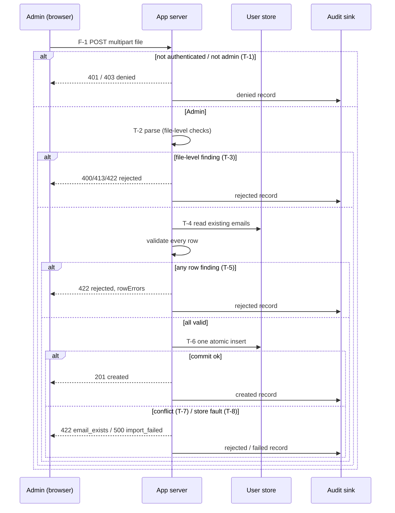

# User Administration: Product Specification

Living product specification for admin-side user management. Product-level title; the first change recorded here
is bulk user creation from a CSV upload (R-1 to R-13). Structure and technology decisions are AD-<n> in
`architecture.md`, never here. Product decisions are PD-<n>, assumptions A-<n>, open gaps G-<n>, fixtures FX-<n>,
flows F-<n>, transitions T-<n>, cases TC-<n.k> (one per acceptance line AC-<n.k>).

## Source and basis

- **Request (2026-11-20, verbatim):** "Let admins upload a CSV to bulk-create users."
  Every R-<n> below cites it as `Req-2026-11-20`. Nothing else in this spec comes from the user; everything beyond
  those words is a recorded decision (PD), assumption (A) or open gap (G).
- **Request outcomes** (atomic split of the sentence):
  - O-1 an *admin* is the actor, and only an admin;
  - O-2 the admin *uploads a CSV file* as the input channel;
  - O-3 the file's rows *create users*, in bulk (many users from one action).
  Outcomes implied by any honest implementation of O-1..O-3: O-4 an invalid file or row is handled and reported
  instead of corrupting data; O-5 the admin learns what happened.
- **Evidence limits.** This stage ran with no repository, no discovery result, no research result, no earlier
  spec, no baseline and no runtime. Nothing about the host product (stack, user model, authentication, admin role,
  UI, mail, audit) was observed. Those are *unknowns* (section "Open gaps"), not evidence of absence. Every
  statement about the host is labelled unknown, an assumption, or a requirement stated against an abstraction.

## Current-system baseline

- Classification: **unknown / no adequate baseline available** (guide: Current-system baseline, "Existing
  without an adequate baseline" and "Remote-only systems": missing access is a gap, not absence).
- Preserved requirements: none (no prior `spec.md`). Retired: none. See `## Retired`.
- Abstractions used so the spec is stack-neutral: **User store** (the host's authoritative user records, with a
  uniqueness guarantee on email), **Admin** (an authenticated principal holding the host's admin role),
  **Default role** (the host's lowest-privilege non-admin role), **Audit sink** (the host's audit/event log).
- Reopen at plan time: the host's user model, auth/admin role, HTTP conventions, UI stack and audit sink, then
  reconcile G-1, G-2, G-4, G-6, G-7 below. Any difference found there is a correction, not a silent edit.

## Assumptions and product decisions

Unattended run: each open choice took the best default below. A-<n> is an assumption about the host; PD-<n> is a
product decision made for lack of one. Each can be overturned by the requester; the dependent R-<n> is named.

| ID | Default taken | Why | Affects |
|----|---------------|-----|---------|
| PD-1 | **All-or-nothing.** If any file or row error exists, no user is created. | A partially applied bulk import leaves an admin unsure which rows landed; a re-upload then collides with its own earlier rows. | R-4, R-5, R-6 |
| PD-2 | CSV columns are exactly `email` and `name`, both required; header row required; column order free; header names matched trimmed and case-insensitively. | Minimum to identify a person. No other attribute was requested. | R-2, R-3 |
| PD-3 | Unknown columns reject the file (`unknown_column`). | Silently ignoring e.g. a `role` column would let the admin believe roles were applied. | R-2, R-4 |
| PD-4 | Created users get the **Default role** only. Setting a role, and creating admins, via CSV is out of scope. | Privilege escalation through a bulk file is a security decision the request did not make. | R-4 |
| PD-5 | Created users have **no credential** and **no message is sent**. | The request says nothing about passwords or invitations; a password column would put secrets in a file, and mail infrastructure is unknown. Consequence: users cannot sign in until a separate activation path exists (G-2). | R-9 |
| PD-6 | An existing user is never updated or skipped: an email that already exists is a row error. | "Create" was requested, not "upsert". | R-3, R-4 |
| PD-7 | Email canonical form is trimmed and lower-cased; uniqueness and storage use it. Name is trimmed. | Prevents `ADA@x` and `ada@x` becoming two accounts. | R-3, R-4, R-6 |
| PD-8 | Email is valid when it has no whitespace or control characters, exactly one `@`, a non-empty local part, a domain with at least one `.` and no empty label, and at most 254 characters. No deliverability or domain checks. | A deterministic, testable product rule; host rule wins if stricter (G-4). | R-3 |
| PD-9 | Name is valid when non-empty after trimming and at most 100 characters. | Same; host user-model constraint wins (G-4). | R-3 |
| PD-10 | Validation is server-side only; the UI does not preview or pre-validate rows. | One rule owner; no duplicated rules to drift. | R-3, R-8 |
| PD-11 | Result is shown once in the response and not stored: no import history, no downloadable error file. | Not requested; avoids retaining personal data. | R-5, R-7 |
| PD-12 | `row` in an error means the 1-based **file line on which the record starts** (header = line 1). | Matches what a text editor or spreadsheet shows, including records with quoted newlines. | R-2, R-3, R-5 |
| PD-13 | Content is judged by bytes, not by file extension or declared MIME type. | Extension and MIME are client-supplied. | R-2 |
| A-1 | The consumer surface is an admin web page that calls an HTTP endpoint (AD-3). | "Upload" implies an interface; a web admin console is the common reading. Overturned if the host has no web UI (then R-8 and R-12 are inapplicable and R-1..R-7, R-9 stand on the API alone). | R-8, R-12 |
| A-2 | The host's admin role is evaluated from authoritative state on every request. | Needed for revocation to be observable (R-1). | R-1 |
| A-3 | Messages are English only. | No i18n requested. | R-5, R-8 |

## Open gaps

Each is also marked under its R-<n>. A gap keeps **only the named work unready**; the rest may proceed.

| Gap | Missing | Safe interim behaviour | Unready work | Owner / due |
|-----|---------|------------------------|--------------|-------------|
| G-1 | Host authentication mechanism and the definition of "admin" role; whether role changes take effect on the next request or only when a session/token expires | Spec requires per-request evaluation (A-2) | Binding R-1 / R-10 to the host (the 403 and revocation cases); parsing, validation and atomic-creation work may proceed | Requester, before `plan` |
| G-2 | How a created user obtains a credential (invite mail, admin-triggered reset, SSO first login) | PD-5: no credential, no mail | R-9 acceptance and any "users can sign in" claim; creation itself may proceed | Requester, before `plan` |
| G-3 | Numeric maximum file size (bytes) and maximum data rows **M** | None invented. The limits are configured values; the spec fixes their *behaviour* (R-2) | The numeric bound in R-2/R-11 and the timed check; not the rest | Requester, before `plan` |
| G-4 | Host user-model constraints: email/name length limits, case rules, default role name | PD-8, PD-9; host constraint wins if stricter and the spec is then corrected | Boundary cases AC-3.5, AC-3.6 and the default-role assertion AC-4.1 | Planner at baseline recovery |
| G-5 | Whether partial success (create valid rows) is wanted instead of PD-1 | PD-1 | Nothing if PD-1 stands; R-4/R-5 would change otherwise | Requester, optional confirmation |
| G-6 | Host audit sink and its retention period | R-7 requires an audit record; retention follows the host's existing audit policy, none invented | Retention clause of R-7 | Requester / host owner |
| G-7 | Host UI stack and established visual identity | R-12 start (light, dark option) | Concrete UI treatment in plan, not behaviour | Planner at baseline recovery |

## State, ownership and lifecycle

Proportionate design: one synchronous request/response hop (AD-1); no queue, cache, broker or external service.

| State | Owner and location | Who may read it | Simultaneous changes | Ends / removed | Runtime quota |
|-------|--------------------|-----------------|----------------------|----------------|---------------|
| Uploaded file bytes | Server, request memory or request-scoped temp storage | Only the handling request; never another admin, never logs | One request = one copy; no sharing | Discarded when the request ends by success, rejection, failure or client abort (R-7 AC-7.3) | Byte limit and row limit M (G-3) |
| Parsed rows and validation findings | Server, request memory | Same | Same | Same | Row limit M |
| Import result (created list or error list) | Response to the uploading admin; UI component memory | The uploading admin only | Superseded by the next upload in the same page | Lost on reload or navigation (PD-11); never in localStorage/sessionStorage | none |
| User records created | User store (host) | Whoever the host already allows to read users | Email uniqueness enforced by the store (R-6) | Host's existing user deletion; this feature has no undo | host's |
| Audit record | Audit sink (host) | Per host audit access | Append-only per attempt | Per host retention (G-6) | host's |
| UI draft: chosen file, pending flag | Page component memory | The viewing admin | Latest selection wins; pending locks the form | Page lifetime | none |

Personal data (emails, names): **shown** only to the uploading admin in the success list and nowhere else; **stored**
only in the User store; **logged** never (R-7 AC-7.2); **kept** by the User store per the host; **removed** by the host's
user removal. The uploaded file is never persisted.

## Service boundaries

- Browser to app server: synchronous multipart upload, one response. Acknowledgement meaning: `201` = committed and
  durable; `422/400/413` = nothing committed; `401/403` = nothing read or committed; `500` = nothing committed;
  **no response at all = outcome unknown** (R-8 AC-8.7, R-6 AC-6.2).
- App server to User store: one atomic unit for the whole import (R-4).
- App server to Audit sink: one record per attempt (R-7).
- **Current authority:** admin status comes from the host's authoritative record at request time (A-2, G-1).
  **Freshness versus revocation:** a demotion must take effect on the next request (AC-1.4).
- Inapplicable, one line each: cache (none exists; a cache would need its own freshness rule); incremental
  state / sync tokens (none); async completion and recovery (none: AD-1 is synchronous, a crash before commit leaves
  nothing, after commit the work is already done); owned event coverage beyond the audit record (no events
  published); outbound mail or webhooks (PD-5).

## Requirements

### R-1 Only admins may use bulk import
- **Basis:** `Req-2026-11-20` "Let admins upload": O-1. Preserved: n/a (new). Changed: added. Locators: request
  words; guides Behavior model (invalid/unauthorized actors). Evidence limit: host auth unknown (G-1). Pending:
  implementation and TC-1.1..1.5.
- **Behaviour:** the import capability (endpoint and page) is available to an Admin only. Authorization is decided
  **before** the body is read or parsed.
- **Boundaries:** role is evaluated per request (A-2). A rejected caller learns nothing about file validity.
- **Error behaviour:** unauthenticated `401`, authenticated non-admin `403`; both `{"outcome":"denied","created":0}`;
  no user created, no validation detail, file not parsed.
- **Consumer outcome:** non-admins are neither offered the page nor able to import by calling the endpoint.
- **Out of scope (domain rules left out):** finer permission tiers, per-department admins, rate limiting.
- **Open gap G-1.**
- AC-1.1 [positive] Seed SD-1; Admin A posts FX-1 (`valid.csv`) → `201`. Surface: API. Confirmation: integration case TC-1.1 (test phase).
- AC-1.2 [failure] No session, posts FX-1 → `401`, body `{"outcome":"denied","created":0}`, User store count unchanged. Surface: API + STORE. TC-1.2.
- AC-1.3 [failure] Member M (non-admin) posts FX-1 → `403`, same body, count unchanged. Also M posts FX-3 (invalid file): still `403`, body identical (no row or file errors leak). Surface: API + STORE. TC-1.3.
- AC-1.4 [boundary] A posts FX-19 (`valid-1row.csv`) → `201`; then A's admin role is removed in the User store (test-author action); A posts FX-1' → `403`, nothing created. Surface: API + STORE. TC-1.4 (conditional on G-1: if the host evaluates role only at session issue, this case marks the revocation bound as unresolved, not failed).
- AC-1.5 [positive/failure] UI: signed in as A the page is reachable from admin navigation; signed in as M the navigation entry is absent and opening the page URL directly shows the forbidden state, with no upload control. Server enforcement (AC-1.3) remains the guard. Surface: UI. TC-1.5.

### R-2 File intake and file-level validation
- **Basis:** `Req-2026-11-20` "upload a CSV": O-2, O-4; decisions PD-2, PD-3, PD-12, PD-13. Added. Locators: request words; PD table. Evidence limit: limits M and byte bound unresolved (G-3). Pending: implementation, TC-2.1..2.7.
- **Behaviour:** one file part is accepted. Format: UTF-8 with or without BOM; `,` delimiter; RFC 4180-style quoting
  (quoted fields may contain commas, doubled quotes and newlines); LF or CRLF line ends; a header row; blank lines skipped
  silently. Header names trimmed, case-insensitive, must be exactly {`email`,`name`}, any order.
- **Boundaries:** at most M data rows and at most B bytes (G-3, configured; behaviour fixed here). Exactly M rows
  and exactly B bytes are accepted; M+1 rows is `too_many_rows`; B+1 bytes is `file_too_large`.
- **Error behaviour:** a file-level error rejects the whole file, returns `422` (`413` for `file_too_large`,
  `400` for `missing_file`/`multiple_files`) with `fileErrors` populated, `rowErrors` empty, `created` 0, nothing written. Codes:
  `missing_file`, `multiple_files`, `empty_file` (zero bytes or whitespace only), `no_data_rows` (header only,
  blank lines don't count), `invalid_encoding` (not valid UTF-8, e.g. Windows-1252 or binary), `malformed_csv`
  (e.g. unterminated quote; `row` = line where it starts), `missing_column`, `unknown_column`, `duplicate_column`
  (each with `column`), `too_many_rows`, `file_too_large`. All file-level findings are reported together.
- **Consumer outcome:** the admin sees which file-level problem exists and fixes the file; nothing was created.
- **Out of scope:** `.xlsx`/`.xls`, other delimiters, other encodings, gzip/zip, multiple files per request, extension checks, an optional `role` or `password` column.
- **Open gap G-3** (numeric M, B).
- AC-2.1 [positive] FX-1 with LF accepted (`201`, 3 created). FX-4 (UTF-8 BOM, CRLF, header `Email, Name`) accepted (`201`, 1 created `ada@example.test` / `Ada`). FX-5 (columns `name,email`) accepted. Surface: API + STORE. TC-2.1.
- AC-2.2 [positive/boundary] FX-6: a record `ada@example.test,"Ada` newline `Lovelace"` is one record with name `Ada` + newline + `Lovelace` (name shown trimmed, inner newline preserved), then blank line, then `bad,Grace` reported as **row 5** (not 4 or 3). Surface: API. TC-2.2.
- AC-2.3 [failure] FX-7 (`email,full_name`) → `422`, `fileErrors` = [`missing_column`/`name`, `unknown_column`/`full_name`], `rowErrors` []; FX-8 (header only) → `no_data_rows`; FX-9 (0 bytes) → `empty_file`; FX-10 (Windows-1252 `é` byte 0xE9) → `invalid_encoding`; FX-11 (`email,email`) → `duplicate_column` plus `missing_column`/`name`. Each: created 0, count unchanged. Surface: API + STORE. TC-2.3.
- AC-2.4 [failure] no file part → `400` `missing_file`; two file parts → `400` `multiple_files`; unterminated quote (`email,name` newline `a@x.test,"Ada`) → `422` `malformed_csv`, `row` 2. Surface: API. TC-2.4.
- AC-2.5 [boundary] with M configured to 5 for the test (value is a test setting, not the product bound): 5 valid rows → `201`; 6 valid rows → `422` `too_many_rows`, created 0. With B configured at the byte length of the 5-row file: that file passes; the same file plus one byte → `413` `file_too_large`. Surface: API + STORE. TC-2.5. Pending G-3 for the product values.
- AC-2.6 [boundary] a `.png` file renamed `users.csv` → `422` `invalid_encoding`; a valid CSV named `users.txt` with MIME `application/octet-stream` → accepted (PD-13). Surface: API. TC-2.6.
- AC-2.7 [consumer] the UI renders each `fileErrors` code in plain words (no raw code only) and, for `invalid_encoding`, tells the admin to save as "CSV UTF-8". Surface: UI. TC-2.7.

### R-3 Row validation
- **Basis:** `Req-2026-11-20` "create users" requires valid users: O-3, O-4; PD-6..PD-10. Added. Locators: PD table. Evidence limit: host user-model constraints unknown (G-4). Pending: TC-3.1..3.7.
- **Behaviour:** every data row is validated; **all** findings in the file are collected and reported, not just the first.
  Canonical email = trimmed, lower-cased. Per row, one email finding at most, by precedence: `required` (empty) →
  `invalid_email` (PD-8) → `duplicate_in_file` (same canonical email as an earlier row that passed the format check;
  the **earlier** row is not flagged) → `email_exists` (canonical email already in the User store). Name findings are
  independent: `required` (empty after trim), `name_too_long` (> 100 after trim). A row whose field count differs from
  the header is `wrong_field_count` (column null) and gets no other finding.
- **Boundaries:** name 100 chars valid, 101 invalid. Email 254 chars valid, 255 invalid. `a@b` invalid (no dot); `a@@b.test` invalid. Leading/trailing spaces ignored.
- **Error behaviour:** any row finding makes the file rejected (R-4). Findings ordered by `row` ascending then header column order.
- **Consumer outcome:** the admin sees row number, column and reason for each problem.
- **Out of scope:** deliverability/MX checks, domain allow- or deny-lists, name format beyond length, matching users by name, updating an existing user, role or password columns.
- **Open gap G-4.**
- AC-3.1 [failure] FX-2 (`mixed.csv`, lines: 1 header; 2 `ada@example.test,Ada Lovelace`; 3 `not-an-email,Grace Hopper`; 4 `existing@example.test,Existing Person`; 5 `ADA@example.test,Ada Again`; 6 `,Nameless Email`; 7 `alan@example.test,`) with SD-1 → `422`, created 0, `rowErrors` exactly [(3,email,invalid_email),(4,email,email_exists),(5,email,duplicate_in_file),(6,email,required),(7,name,required)]; row 2 has no finding and is **not** created. Surface: API + STORE. TC-3.1. Recomputed by hand from PD-7/PD-8, see "Verification evidence".
- AC-3.2 [failure] `ada@example.test` row with one field → (2,null,wrong_field_count). Surface: API. TC-3.2.
- AC-3.3 [boundary] FX-12 name 100 × `n` → accepted; FX-13 name 101 → (2,name,name_too_long). Surface: API. TC-3.3.
- AC-3.4 [boundary] FX-14 email of 241 `u` + `@example.test` (254 chars) → accepted; FX-15 242 `u` (255) → (2,email,invalid_email); `a@b` → invalid_email; `a@@b.test` → invalid_email. Surface: API. TC-3.4. (Pending G-4: host limits may be tighter.)
- AC-3.5 [boundary] FX-16 ` Existing@Example.TEST ,Dup` → (2,email,email_exists): trimming and case-folding apply before comparison. Surface: API. TC-3.5.
- AC-3.6 [failure] a file whose two rows are `ada@example.test` and `ADA@example.test` plus a valid third row → only the second row flagged `duplicate_in_file`; first row and third are not flagged and (by R-4) nothing is created. Surface: API + STORE. TC-3.6.
- AC-3.7 [positive] a row whose email is invalid is not used as the "earlier row" for duplicate detection. File `email,name` / `bad,One` / `bad,Two` → rows 2 and 3 both `invalid_email`, neither `duplicate_in_file`. Surface: API. TC-3.7.

### R-4 Bulk creation is atomic
- **Basis:** `Req-2026-11-20` "bulk-create users": O-3; PD-1, PD-4, PD-6, PD-7. Added. Locators: PD table. Evidence limit: persistence mechanism unknown; atomicity is required, how is AD-2. Pending: TC-4.1..4.5.
- **Behaviour:** when the file has no file-level and no row findings, every row becomes one user in **one atomic unit**
  (all or none). Each created user: canonical email, trimmed name, Default role (PD-4), no credential (R-9).
  Existing users are never modified.
- **Boundaries:** a 1-row file creates 1 user; an M-row file creates M.
- **Error behaviour:** any finding → zero users created and no existing user changed. A persistence failure during
  commit → rollback, zero users, `500` `{"outcome":"failed","created":0,"code":"import_failed"}`; retrying the same
  file is safe because nothing was written.
- **Consumer outcome:** after `201`, all N users exist; after anything else, the User store is as before.
- **Out of scope:** setting a role (PD-4), creating admins, updating or skipping existing users (PD-6), partial import (G-5), undo of a committed import.
- AC-4.1 [positive] SD-1, A posts FX-1 → `201`, User store gains exactly `ada@example.test`/`Ada Lovelace`, `grace@example.test`/`Grace Hopper`, `alan@example.test`/`Alan Turing`; each has the Default role (not admin); none has a credential. Surface: STORE. TC-4.1.
- AC-4.2 [failure] FX-2 posted → store count unchanged and `ada@example.test` absent; the pre-existing `existing@example.test` keeps its seeded name (not `Existing Person`). Surface: STORE. TC-4.2.
- AC-4.3 [failure] with a fault injected on the store write of row 3 of FX-1 (test-only) → `500` `import_failed`, `ada@` and `grace@` **absent**, count unchanged; the same file then posted with the fault removed → `201`, 3 created. Surface: API + STORE. TC-4.3. (Fault-injection hook is a test-environment prerequisite owned by the test author.)
- AC-4.4 [boundary] a 1-row valid file → `201`, 1 created. Surface: API + STORE. TC-4.4. (M-row creation is covered by AC-2.5.)
- AC-4.5 [failure] a file containing a column `role` with value `admin` → `422` `unknown_column`/`role`, no user created. Surface: API + STORE. TC-4.5.

### R-5 Result reporting
- **Basis:** `Req-2026-11-20` implied O-5; PD-11, PD-12. Added. Pending: TC-5.1..5.4.
- **Behaviour:** success is `201` `{"outcome":"created","created":N,"users":[{"row":<line>,"id":"<host id>","email":"<canonical>","name":"<trimmed>"}]}` in file order.
  Any rejection is `{"outcome":"rejected","created":0,"fileErrors":[{"code","message","column"?,"row"?}],"rowErrors":[{"row","column","code","message"}]}`, both arrays always present. `message` is human-readable English (A-3); `code` is stable and machine-readable.
  `201` is returned only **after** the atomic commit; it means durable.
- **Boundaries:** no response echoes cell values from rejected rows (row and column locate them).
- **Error behaviour:** `401/403` bodies per R-1; `500` per R-4.
- **Consumer outcome:** an API client can branch on `outcome` and `code`; the UI shows exactly what the response says and never success before `201`.
- AC-5.1 [positive] AC-4.1 response body equals: `outcome` `created`, `created` 3, `users` three entries with `row` 2, 3, 4 and canonical emails in file order. Surface: API. TC-5.1.
- AC-5.2 [failure] AC-3.1 response body has `outcome` `rejected`, `created` 0, `fileErrors` `[]`, and `rowErrors` of length 5 in the order given. Surface: API. TC-5.2.
- AC-5.3 [failure] AC-2.3 FX-7 body has `rowErrors` `[]`, and a `fileErrors` entry per finding. Surface: API. TC-5.3.
- AC-5.4 [boundary] the string `not-an-email` does not appear in the AC-3.1 response body (no cell echo). Surface: API. TC-5.4.

### R-6 Concurrent and repeated imports
- **Basis:** `Req-2026-11-20` "bulk-create users" by possibly several admins; PD-1, PD-6, PD-7. Added. Pending: TC-6.1, TC-6.2.
- **Behaviour:** an email can exist at most once however many imports run at once; uniqueness is guaranteed by the User store, not only by the pre-check. Of two overlapping imports that share an email, **at most one** commits; the other is rejected as a whole.
- **Error behaviour:** the loser gets `422` with `email_exists` on the conflicting row (at least the first conflicting row is named), created 0, nothing written.
- **Consumer outcome:** no duplicate accounts, no half-applied import.
- AC-6.1 [failure] SD-1. Admin A and a second admin B, released together by a barrier, post FX-17 (`ada@example.test`, `grace@example.test`) and FX-18 (`grace@example.test`, `alan@example.test`). Expected (recomputed from PD-1/PD-6/PD-7 by walking both serial orders): exactly one response `201` and one `422`; if FX-17 wins, users added = ada, grace and FX-18's `email_exists` names row 2; if FX-18 wins, users added = grace, alan and FX-17's names row 3; in both, `grace@example.test` exists once and the loser's other email is absent. Repeat 20 times; every run satisfies the invariant. Surface: API + STORE. TC-6.1.
- AC-6.2 [failure] A posts FX-1 and gets `201`; A posts FX-1 again → `422`, `email_exists` on rows 2, 3, 4, created 0, count unchanged (the double-submit and "retry after unknown outcome" case). Surface: API + STORE. TC-6.2.

### R-7 Audit, privacy and data lifecycle
- **Basis:** `Req-2026-11-20` creates accounts, a security-relevant outcome; personal data handling per lifecycle section. Added. Evidence limit: audit sink and retention unknown (G-6). Pending: TC-7.1..7.3.
- **Behaviour:** every attempt (created, rejected, failed, denied) writes one audit record: actor id (absent when unauthenticated), UTC timestamp, outcome, number of rows seen, number of file and row findings with their codes, and on success the new user ids. The record holds **no email, no name, no file content**. No application log line contains a cell value. The uploaded file is not retained anywhere after the request ends.
- **Boundaries:** an aborted upload writes no `created` record and no users; retention is the host's (G-6).
- **Error behaviour:** if the audit sink is unavailable the import still follows PD-1 semantics and the failure itself is logged without personal data. (Whether a sink outage should block the import is unresolved: G-6.)
- AC-7.1 [positive/failure] after AC-4.1 there is one record with outcome `created`, 3 ids; after AC-3.1 one `rejected` with codes {invalid_email, email_exists, duplicate_in_file, required, required} and no ids; after AC-1.3 one `denied` with M's id. Surface: AUDIT. TC-7.1.
- AC-7.2 [failure] capture all log output while posting FX-1, FX-2, FX-10: none of `ada@example.test`, `Ada Lovelace`, `grace@example.test`, `existing@example.test`, `not-an-email` appears. Surface: LOG. TC-7.2.
- AC-7.3 [boundary] after a success, a rejection, an injected `500` and a client abort mid-upload, the request-scoped temp storage holds no remnant of the file. Surface: filesystem listing of the temp location. TC-7.3.

### R-8 Admin upload page
- **Basis:** `Req-2026-11-20` "upload a CSV" read as a web admin page (A-1); PD-10, PD-11. Added. Evidence limit: host UI stack/identity unknown (G-7). Pending: TC-8.1..8.8.
- **Behaviour:** one page, reachable by admins only (AC-1.5), with: a file chooser (keyboard-operable; drag-and-drop optional enhancement), inline format help naming the `email` and `name` columns with a two-row example, a submit action ("Create users"), and a result area.
  States: **idle** (no file, submit disabled); **ready** (file name and size shown, option to remove or replace, submit enabled); **uploading** (submit disabled, visible and announced progress status, the file cannot be changed); **created** (count and list of created users, "Upload another"); **rejected-file** (file-level messages); **rejected-rows** (summary "No users were created. N problems found." and a table of row, column, problem); **forbidden**; **failed-unknown** (no response/timeout/5xx).
- **Interaction model:** choosing a new file after any result clears that result and returns to ready. Submit sends exactly one request per click (double-click safe). The UI claims creation only on `201`. For `failed-unknown` it says it **cannot confirm** whether users were created and tells the admin to check the user list before retrying; a retry is offered (a repeated successful import appears as `email_exists`, R-6). Focus moves to the result summary when a result appears and returns to the chooser on "Upload another". Server-supplied values are rendered as text, never as markup.
- **Components (premise):** file chooser/dropzone, import summary, problems table, live status region. **Skin:** per R-12.
- **Out of scope:** row preview, inline editing of rows, import history, downloadable error report (PD-10, PD-11).
- AC-8.1 [positive] A selects FX-1 → state ready showing `valid.csv` and its size; submit enabled; submitting shows uploading, then created with "3 users created" and the three emails. Surface: UI (browser) + STORE. TC-8.1.
- AC-8.2 [failure] A submits FX-2 → rejected-rows: heading text contains "No users were created" and "5 problems"; the table has 5 lines in row order: row 3 email invalid, row 4 email already exists, row 5 email duplicated in the file, row 6 email required, row 7 name required. Surface: UI. TC-8.2.
- AC-8.3 [failure] A submits FX-7 → rejected-file states which column is missing and which is unknown. Surface: UI. TC-8.3.
- AC-8.4 [boundary] while a held (test-controlled, not sleep-based) response is pending, a second click on submit sends no second request and the file control is disabled; releasing the response shows the outcome. Surface: UI with network stub. TC-8.4.
- AC-8.5 [boundary] after rejected-rows, choosing FX-1 clears the table and shows ready; a late response for the earlier upload does not replace the newer state. Surface: UI with controlled responses. TC-8.5.
- AC-8.6 [failure] a `403` response shows forbidden, not a generic error. Surface: UI with stub. TC-8.6.
- AC-8.7 [failure] the connection drops with no response → failed-unknown wording above; no "created" is ever shown. Surface: UI with network fault. TC-8.7.
- AC-8.8 [positive] keyboard only: Tab reaches chooser, Enter/Space opens the file dialog (dialog selection simulated), Tab reaches submit, Enter submits; the status region announces uploading and the result; focus lands on the result summary. Surface: UI. TC-8.8.

### R-9 New users have no credential and receive no message
- **Basis:** PD-5. Added. Evidence limit: activation path unknown (**open gap G-2**). Pending: TC-9.1, TC-9.2.
- **Behaviour:** creating a user through import does not set a password or token and does not send mail, SMS or any notification.
- **Consumer outcome:** the admin is told in the success state: "Users were created without a sign-in. Send invitations or password setup separately." (The wording may change; the fact must be stated.)
- **Out of scope:** the activation, invitation and reset flows themselves.
- AC-9.1 [failure] after AC-4.1, an authentication attempt as `ada@example.test` with an empty, a random and a common password string each fails; the store row has no credential value. Surface: API + STORE. TC-9.1. (Conditional on G-2/G-1: host's credential model.)
- AC-9.2 [positive] after AC-4.1, the test mail outbox / outbound network capture has no message. Surface: outbox or egress capture. TC-9.2.
- AC-9.3 [consumer] the created state in the UI shows the no-sign-in notice. Surface: UI. TC-9.3.

## Non-functional requirements

Operating conditions: low-frequency admin action; one file per request; file up to B bytes / M rows (G-3).

### R-10 Security
- **Basis:** `Req-2026-11-20` (account creation by file); requirements definition guide (security, access). Added.
- Authorization: R-1. Admin check precedes parsing (AC-1.3).
- Browser-originated upload must be protected against cross-site request forgery according to the host's session
  mechanism (G-1): when the host authenticates by cookie, a cross-origin form post lacking the host's anti-forgery
  proof creates nothing and returns `403`/`400` (AC-10.1). If the host uses header tokens only, mark `n/a: not cookie-authenticated`.
- File content is data: no cell is ever evaluated, executed, expanded as a template or inserted into markup (AC-10.2).
- AC-10.1 [failure] cookie-authenticated A, request from a different origin without the anti-forgery proof, body FX-1 → rejected, count unchanged. Surface: API. TC-10.1 (conditional on G-1).
- AC-10.2 [failure] row `@example.test,` → `invalid_email` for email; and a valid email with name `` is created as that literal text; the created-state list and any later error table render it as inert text (no element or script appears in the DOM). Surface: UI + STORE. TC-10.2.
- No rate limit: excluded, because the endpoint is admin-only and bounded by B and M; revisit if admin accounts are ever delegated broadly.

### R-11 Performance and capacity
- **Basis:** requirements definition guide (performance, capacity). **Unresolved bound: no number invented.**
- Missing: B and M (G-3) and a latency target; the host's request time limit is unknown. Owner: requester; due: before `plan`.
- Interim acceptance line, observable once M is set: a valid M-row file returns `201` within the host's request time limit and a file of M+1 rows is rejected without being committed; plus the memory held per request is bounded by B. Verification method: timed run of a generated M-row file on the target runtime. Status: unresolved, **NOT-REPLAYED: M unknown**. Dependent work ready: everything except this check; AD-1 (synchronous) must be revisited if M cannot be processed inside the request limit.
- Excluded: availability/SLA (not requested; admin tool); throughput for concurrent imports beyond correctness (R-6).

### R-12 Compatibility (CSV producers)
- **Basis:** guide NFR (compatibility). Added.
- Files exported by Excel ("CSV UTF-8": BOM, CRLF), Google Sheets/LibreOffice (LF, no BOM) are accepted (AC-2.1). Legacy Windows-1252 exports are rejected with a hint (AC-2.7), never mangled into wrong characters. Verification: fixtures FX-1, FX-4, FX-10. Status: planned.

### R-13 Polished, accessible interface (applies if A-1 holds)
- **Basis:** deliverable with a UI; guide UI visual-direction; R-8. Added. Established product identity: **unknown** (G-7), so it takes precedence once found; otherwise the starting point below.
- **Named visual reference and starting appearance:** light-first web UI with a dark option, the "light Gemini look and feel using Material 3 Expressive principles" (UI visual-direction guide, light expressive starting point): luminous light canvas, tonal rounded surfaces with a shape hierarchy, friendly geometric or humanist sans-serif from local fonts with fallbacks, one restrained saturated accent, purposeful short motion. Focal point: the drop/choose area and the result summary. Visual signature: the dropzone that visibly transitions idle, ready, uploading and result. Concrete tokens belong to the plan/AD, not this spec.
- Observable criteria (each verified by UI check TC-13.n, status planned):
  - AC-13.1 consistent system: one spacing scale, one type scale, colour tokens with a light and a dark theme, one icon set.
  - AC-13.2 designed empty (idle), loading (uploading), error (file, rows, forbidden, unknown) and success states, all of R-8, none unstyled.
  - AC-13.3 layout works at 360 px and 1440 px wide with no horizontal page overflow, including a 5-row and a long problems table (table scrolls inside its own container, or reflows).
  - AC-13.4 visible keyboard focus on every control; text and control contrast at least WCAG 2.2 AA (4.5:1 body, 3:1 large text and UI components) in both themes.
  - AC-13.5 motion only to explain change (state transitions, progress); with `prefers-reduced-motion` the same changes occur without movement.
  - AC-13.6 status and results are exposed to assistive technology (live region, accessible names on chooser, submit, table headers). A DOM/ARIA assertion alone is not the accessibility audit; an axe-style automated scan plus the keyboard run in AC-8.8.

## Flows and transitions

F-1 Import (flow for R-1..R-7, R-9):

State inventory. *ImportAttempt* (transient, owner server, request-scoped; initial Received; terminals Created, Rejected, Failed, Denied). *User* (durable, owner User store; this feature only moves Absent to Present; never modifies or removes).

| T | Before | Trigger and guard | Operation | After and observation | Failure and recovery | Cases |
|---|--------|-------------------|-----------|-----------------------|----------------------|-------|
| T-1 | Received | caller unauthenticated or not admin | decide before reading body | Denied; 401/403; store unchanged | audit record; none to recover | TC-1.2, 1.3, 1.4 |
| T-2 | Received | caller is Admin | read and parse file | Parsed or file finding | abort discards bytes | TC-2.1..2.6 |
| T-3 | Parsed-attempt | any file-level finding | stop; collect all file findings | Rejected; 400/413/422; store unchanged | file discarded | TC-2.3..2.5 |
| T-4 | Parsed | no file-level finding | read existing emails, validate all rows | Validated with findings set | store read failure becomes T-8 | TC-3.x |
| T-5 | Validated | findings nonempty | no write | Rejected; 422 rowErrors; store unchanged | none needed | TC-3.1, 4.2 |
| T-6 | Validated | findings empty | one atomic insert of N users, then audit and respond | Created; 201; User Absent to Present for N | crash before commit: nothing; after commit: durable, response lost (outcome unknown to client, see TC-6.2, 8.7) | TC-4.1, 4.4, 2.5 |
| T-7 | Validated | store uniqueness violation at commit (concurrent import) | roll back whole unit | Rejected; 422 `email_exists`; store unchanged | admin re-checks and retries | TC-6.1 |
| T-8 | any non-terminal | store or other fault | roll back whole unit | Failed; 500 `import_failed`; store unchanged | retry is safe | TC-4.3 |

Invalid/forbidden events: a second POST of the same file after Created is a **new attempt** and is rejected by T-5 (`email_exists`, TC-6.2); there is no cancel, resume, update or delete event on a committed import (out of scope). Timeout/retry/restart: n/a beyond T-6/T-8, because there is no accepted-but-unprocessed work (synchronous, AD-1).

## Traceability (request outcome to acceptance lines)

| Outcome | R | Acceptance lines |
|---------|---|------------------|
| O-1 admins only | R-1, R-10 | AC-1.1..1.5, AC-10.1 |
| O-2 upload a CSV | R-2, R-8, R-12, R-13 | AC-2.1..2.7, AC-8.1..8.8, AC-13.1..13.6 |
| O-3 bulk-create users | R-3, R-4, R-6, R-9 | AC-3.1..3.7, AC-4.1..4.5, AC-6.1..6.2, AC-9.1..9.3 |
| O-4 invalid input handled | R-2, R-3, R-4 | AC-2.3..2.6, AC-3.1..3.7, AC-4.2, AC-4.3 |
| O-5 admin learns the outcome | R-5, R-8 | AC-5.1..5.4, AC-8.2, AC-8.7 |
| Data/privacy handling (derived) | R-7, R-10, R-11 | AC-7.1..7.3, AC-10.2, R-11 interim line |

Unmapped outcomes: none. Domain rules left out are listed under each R-<n>. Seed and fixtures follow.

## Fixtures (exact inputs)

- **SD-1 seed:** admin A `admin@example.test` (admin role, authenticated); member M `member@example.test` (non-admin); user `existing@example.test` named `Existing`. No other users.
- **FX-1** `valid.csv`: `email,name` / `ada@example.test,Ada Lovelace` / `grace@example.test,Grace Hopper` / `alan@example.test,Alan Turing`, LF, trailing newline.
- **FX-2** `mixed.csv`: AC-3.1 lines 1..7. **FX-3** = FX-2 content (used as the "invalid file" for the 403 case).
- **FX-4** bytes `EF BB BF` + `Email, Name` CRLF `ada@example.test,Ada` CRLF. **FX-5** `name,email` / `Ada,ada@example.test`.
- **FX-6** `email,name` / `ada@example.test,"Ada` newline `Lovelace"` / blank line / `bad,Grace`.
- **FX-7** `email,full_name` / `ada@example.test,Ada`. **FX-8** `email,name` only. **FX-9** zero bytes. **FX-10** `email,name` / `ren` 0xE9 `@example.test,Ren` 0xE9 (not UTF-8). **FX-11** header `email,email`.
- **FX-12/13** `ada@example.test` with a name of 100 / 101 `n`. **FX-14/15** `u`×241 / `u`×242 then `@example.test`, name `Ada`. **FX-16** ` Existing@Example.TEST ,Dup`.
- **FX-17** `email,name` / `ada@example.test,Ada` / `grace@example.test,Grace`. **FX-18** `email,name` / `grace@example.test,Grace` / `alan@example.test,Alan`.
- **FX-19** `valid-1row.csv`: `email,name` / `solo@example.test,Solo`; **FX-1'** = FX-1 with `.test` emails changed to `ada2@`, `grace2@`, `alan2@`.

## Verification evidence and replay status

- **Hand walk of the ordered procedures** against stated spec rules (no runtime exists): AC-1.4 start is reachable
  (SD-1 gives A the admin role; A's first request is permitted by R-1; the role removal is a store action by the test
  author, not a product action; the second request in the state "A not admin" is rejected by R-1). AC-6.2: after
  the first request creates ada/grace/alan, the second request's rows 2, 3, 4 each hit PD-6, so `email_exists` on 2, 3, 4. AC-6.1: serial orders recomputed as above. AC-4.3 needs a test-only fault hook (prerequisite, not yet existing).
  AC-8.4/8.5 need a controllable network stub (test prerequisite).
- **Recomputed expected results by hand** from PD-7..PD-12: FX-2 yields the five findings at lines 3, 4, 5, 6, 7 (line 5 canonicalises to `ada@example.test`, equal to line 2's; line 6 has an empty email, line 7 an empty name); FX-6's last record starts on line 5 (header 1; record 2 to 3; blank 4); FX-14 is 241 + 13 = 254 characters (`@example.test` is 13), FX-15 is 255; FX-10's byte 0xE9 followed by `@` is invalid UTF-8; FX-4 canonicalises header to `email`,`name`.
- **Scratch reference checker** `refcheck.py` (written to the session scratchpad: parsing/validation rules only, no authorization, commit or UI) was **not executed**: running Python required approval that was not available. Result: `NOT-REPLAYED: execution of refcheck.py not approved in this stage`. The hand recomputation above stands as the only check; it leaves AC-2.2, AC-3.1, AC-3.4 open until a runtime parses the fixtures.
- **All TC-*:** status **not run** (planned only; no product, no runtime, no test code exists). Due phase: `test`. Owner: test author.
- **Claims about platform or library capability:** none relied on. Parsing library, atomic transaction mechanism and multipart handling are deferred to AD-2/AD-3 and must cite primary documentation or a probe before they are relied on.

## Retired

None. No earlier `spec.md`, so no R-<n> existed to retire.

## Submission

- **summary:** Specified bulk user creation from an admin-uploaded CSV (R-1..R-9 functional, R-10..R-13 non-functional), mapped from the single request sentence; no prior spec, baseline, repository or research existed, so every statement about the host product is an assumption or open gap. **Open and decision-bearing:** (1) G-2 / PD-5: imported users have no credential and get no message, so they cannot sign in until an activation path is decided; (2) G-3: the maximum file size and row count are unresolved and no number was invented (R-11 unresolved); (3) G-1: admin role definition and revocation latency of the host; (4) G-5: all-or-nothing import (PD-1) was chosen over partial import. Other defaults (assumptions): columns `email`,`name` only; created users get the Default role; existing emails are errors, never updates; case-insensitive trimmed emails; name 1..100 chars, email ≤254 chars; no import history or error download; web admin page (A-1) with light-first UI and dark option; synchronous processing (AD-1). **Not replayed:** no test or fixture was executed; `refcheck.py` was written but not run; expected results were recomputed by hand. No requirement conflict found; independent work (parsing, validation, atomic creation) is ready; work tied to G-1, G-2, G-3 is not.
- **primary:** R-1, R-2, R-4, R-8
- **evidence_refs:** `KNOWLEDGE/spec.md` (Requirements R-1..R-9, Non-functional requirements R-10..R-13, State/ownership, Service boundaries, Flows and transitions, Traceability, Fixtures, Verification evidence); `KNOWLEDGE/architecture.md` (AD-1..AD-3); source: request `Req-2026-11-20`; guides read: `GUIDES/behavioral-requirements.md` (Behavior model, Traceability and review, Actors/channels/state ownership), `GUIDES/requirements-definition.md`, `GUIDES/current-system-baseline.md` (Planning and review handoff), `GUIDES/service-discovery.md` (Select scope, Verification), `GUIDES/platforms/ui.md` (Light expressive starting point), `GUIDES/project-knowledge.md` (Maintained product requirements). `backchain-check`: not available, duty 11 left out.
