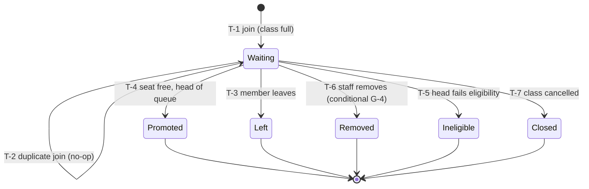

# Class Booking App: product specification

Living specification of what the class booking app must do. Structure and technology choices live in
`architecture.md` (AD-<n>), never here. Product decisions in this file are D-<n>, assumptions A-<n>,
open gaps G-<n>, flows F-<n>, transitions T-<n>, acceptance lines AC-<n>.<m>.

## Basis and evidence limits

- **Request basis (2026-11-20):** "Add a waitlist to our class booking app so full classes don't turn
  people away." Cited below as *REQ-2026-11-20*.
- **Request outcomes** (each maps to acceptance lines in the traceability table):
  - O-1: a member who finds a class full can queue for it instead of being turned away.
  - O-2: a queued member gets the seat when one opens, without having to keep checking.
  - O-3: the member knows where they stand and can change their mind.
- **Baseline:** none. This stage ran with no repository, no discovery result, no research result, no
  earlier specification and no selected baseline. Nothing about the existing booking app is observed
  here. "Existing booking behaviour" below means *whatever the app does today*, to be recovered by
  discovery (G-1, G-2). Every statement about today's app is therefore an assumption (A-n) or an
  open gap (G-n), not an observation. No SLA, retention period, capacity figure or timing bound is
  invented; where one would be needed it is an open gap.
- **Maintained requirements home:** this file. No earlier R-<n> exists, so nothing is preserved by ID,
  changed or retired (`## Retired` is empty). Existing booking behaviour is preserved by R-13.
- Status of a requirement: *accepted intent* = traceable to REQ-2026-11-20; *design decision* = a
  default chosen here and labelled D-<n>, which a later run must not treat as user-approved.

## Domain model (behavior model index)

Actors: **Member** (signed-in person who books classes); **Staff** (studio staff, only if the app has
them: G-4); **System** (the booking authority acting on a seat release; there is no scheduled actor in
the default design).

Entities and states (owner: the booking authority, durable; clients hold only a presentation copy):

| Entity | State | Meaning / invariant | Terminal |
|---|---|---|---|
| Class session | `capacity` (int ≥ 0), `bookable` (per the app's existing booking-window rule) | `booked ≤ capacity` at rest except after a staff capacity cut (AC-5.2 boundary) | n/a |
| Booking | existing states (booked, cancelled) | unchanged; one extra way to be created: promotion | existing |
| Waitlist entry | `Waiting` | queued; counts for position; at most one Waiting entry per (member, session) | no |
| | `Promoted` | converted to a booking by T-4; keeps a link to that booking | yes |
| | `Left` | member removed themselves (T-3) | yes |
| | `Removed` | staff removed it (T-6, only if G-4 resolves yes) | yes |
| | `Ineligible` | head of queue failed the booking eligibility check at promotion (T-5) | yes |
| | `Closed` | the class was cancelled by the studio while the entry was Waiting (T-7) | yes |

Derived values (never stored as authority): **position** of a Waiting entry = 1 + number of Waiting
entries for the same session with an earlier join order; **full** = `booked ≥ capacity`.

**Cross-entity invariants** (checked by R-8):
- I-1: `booked ≤ capacity` after every waitlist operation (no overbooking).
- I-2: at rest, a session with at least one Waiting entry and `bookable` has `booked ≥ capacity`
  (a free seat is never left idle while someone waits).
- I-3: at most one Waiting entry per (member, session); a member never has both a booking and a
  Waiting entry for the same session.
- I-4: each Promoted entry corresponds to exactly one booking, and each seat release promotes at most
  one entry per free seat.

### Flows

- **F-1 Join:** Member → booking authority: join(session). Guard: class full and bookable, no booking,
  no Waiting entry. Result: entry Waiting + position. (R-1, R-2, R-3; T-1, T-2)
- **F-2 Leave:** Member → authority: leave(session). Result: entry Left; positions behind close up. (R-4; T-3)
- **F-3 Seat release → promotion:** any seat-freeing event (member cancels booking, staff removes a
  booking, staff raises capacity) → authority frees the seat and, in the same atomic operation,
  promotes head entries while `booked < capacity` and `bookable`, skipping ineligible heads →
  notification dispatched after commit. (R-5, R-6, R-8, R-9; T-4, T-5)
- **F-4 Direct booking against a queue:** Member → authority: book(session) when full or when Waiting
  entries exist → rejected with CLASS_FULL, with a path to join. (R-7)
- **F-5 Class cancelled:** Staff cancels a session → Waiting entries Closed, members told. (R-11; T-7)
- **F-6 Staff view:** Staff → authority: list/remove entries. (R-12; T-6)

### Transition ledger

| ID | Req / Flow | Before | Trigger + guard | Operation (atomic unit) | After / observable | Failure / recovery |
|---|---|---|---|---|---|---|
| T-1 | R-1,R-2 / F-1 | no Waiting entry; not booked; full; bookable | Member join | create entry with next join order | Waiting, position = 1 + earlier Waiting | store failure → no entry, error shown, retry safe (idempotent via T-2) |
| T-2 | R-2 / F-1 | Waiting entry exists | Member join again | none | same entry, same position, reported as success, no new entry | none needed |
| T-3 | R-4 / F-2 | Waiting | Member leave (own entry only) | mark Left | Left; later entries' positions each drop by 1 | repeat leave → rejected NOT_WAITING, unchanged |
| T-4 | R-5 / F-3 | Waiting head; `booked < capacity`; bookable; eligible | seat released | seat release + mark Promoted + create booking in ONE atomic unit | booking exists, entry Promoted, `booked` +1 | crash mid-way → either nothing or all (I-2/I-4 restored by recovery, AC-8.3) |
| T-5 | R-6 / F-3 | Waiting head fails existing eligibility check | seat released | mark Ineligible; continue to next entry | Ineligible; next entry evaluated for the same seat | unchanged seat count; member notified (R-9) |
| T-6 | R-12 / F-6 | Waiting | Staff remove (conditional G-4) | mark Removed | Removed; positions close up | as T-3 |
| T-7 | R-11 / F-5 | Waiting | studio cancels class | mark every Waiting entry Closed | Closed; no booking | partial failure → remaining entries stay Waiting but are never promotable because class not bookable |
| T-8 | R-2,R-4 | any terminal state | leave / promote attempt on a non-Waiting entry | none | rejected NOT_WAITING; entry and counts unchanged | n/a |

---

## Requirements

### R-1 Join the waitlist of a full class (primary)

**Basis:** REQ-2026-11-20 "full classes don't turn people away". **Change:** add. **Preserved:** the
existing behaviour that a full class rejects a direct booking (R-13). **Source locator:** request
sentence, whole. **Evidence limit:** how the existing app shows "full" is unknown (G-1). **Pending:**
implementation, tests.

Behaviour: a signed-in member viewing a full, bookable class can join its waitlist; the system records
the entry with the next join order and tells the member their position.
Boundaries: "full" means `booked ≥ capacity` read from the booking authority at the moment of the
join. Error behaviour: see R-2. Consumer outcome: the member sees "On the waitlist, position n".

- **AC-1.1 Join a full class.** Surface: member booking UI (class list and class detail) and the
  booking API the UI uses. Confirmed by: browser check of the UI plus API test of the join endpoint.
  - Positive: Session S1 "Spin 18:00", capacity 2, booked Ana and Ben, no entries. Cara joins →
    Cara has a Waiting entry, position 1, S1 `booked` still 2. Dev joins next → position 2.
  - Failure: join request while the store is unavailable → member sees an error, no entry is created,
    and the control returns to "Join waitlist" (no false "on the waitlist" state).
  - Boundary: capacity 1 and booked 1, or capacity 0 (nobody can book): join is accepted when
    `booked ≥ capacity`, so a capacity-0 class is joinable. (Whether capacity 0 exists is G-1;
    if it does, the rule is the same.)
- **AC-1.2 Joined state survives reload.** Surface: member UI after reload, and API read of the
  member's entries. Confirmed by: browser check (reload) and API test.
  - Positive: after AC-1.1, Cara reloads the page or opens the app on another device → still shows
    position 1.
  - Failure: n/a: covered by AC-1.1 failure (no entry means nothing to reload).
  - Boundary: n/a: no further boundary beyond AC-1.1.

Domain rules the request leaves out (bounding R-1): paid or priority waitlist spots; waitlisting a
recurring series at once; joining several overlapping classes' waitlists is allowed only to the extent
the app already allows booking overlapping classes (G-2); a waitlist length cap (G-5, default none).

### R-2 Join guards and repeated joins

**Basis:** REQ-2026-11-20 (a waitlist must behave sensibly for a full class); the specific guards are
design decisions D-2, D-3. **Change:** add. **Pending:** implementation, tests.

Behaviour: a join is accepted only for a signed-in member, for a full and bookable class, when the
member has no booking for it and no Waiting entry. A repeated join is idempotent.
Error behaviour: each rejection names a distinct code and leaves all data unchanged.

- **AC-2.1 Rejections.** Surface: booking API and the member UI message. Confirmed by: API tests,
  one UI check of each message.
  - Positive: n/a: accepted joins are AC-1.1.
  - Failure: (a) class has a free seat and no queue (S2 capacity 3, booked 2): join → CLASS_NOT_FULL,
    UI offers "Book" instead, no entry; (b) member already booked (Ana on S1): ALREADY_BOOKED;
    (c) class not bookable (started or cancelled): CLASS_CLOSED; (d) no sign-in: the app's existing
    unauthenticated response, no entry; (e) join for another member's identity (member A sends
    member B's id): rejected as forbidden, no entry for either; (f) unknown session id: not found.
    All leave bookings and entries unchanged.
  - Boundary: the seat count is judged at commit time, not at page load: a member whose page said
    "full" but whose seat count is now 1 free gets CLASS_NOT_FULL (see R-8 concurrency).
- **AC-2.2 Idempotent repeat.** Surface: booking API (double-click, retry after timeout).
  Confirmed by: API test and a UI double-activation check.
  - Positive: Cara joins S1 twice → one entry, position unchanged (T-2); both calls succeed.
  - Failure: n/a: failures are AC-2.1.
  - Boundary: two simultaneous identical joins → still exactly one entry (I-3).

Left out: a member-visible "waitlist is closed to new joiners" state other than CLASS_CLOSED.

### R-3 Fair order and position visibility

**Basis:** REQ-2026-11-20 (queue); first-come-first-served is design decision D-4. **Change:** add.
**Pending:** implementation, tests.

Behaviour: entries are served strictly in join order. A member sees their own position; they never
see who else is queued.
Consumer outcome: the position is accurate when read and after the member's own actions.

- **AC-3.1 Order and position.** Surface: member UI and API. Confirmed by: API test, UI check.
  - Positive: Cara joins, then Dev (E-1 step 1-2) → positions 1 and 2. After Cara leaves, Dev shows 1.
  - Failure: a request for another member's entry or position → forbidden, no data returned.
  - Boundary: two joins at the same instant get distinct join orders (no tie); the loser's position
    is 2, never a duplicate position 1.
- **AC-3.2 Privacy of the queue.** Surface: member API responses and UI. Confirmed by: API test that
  inspects the whole response body, plus UI check.
  - Positive: Cara's response contains her own entry and an aggregate waiting count at most.
  - Failure: any field carrying another member's name, email, id or avatar is a defect.
  - Boundary: n/a: no further boundary.

Left out: priority by membership tier, by attendance record or by booking history (D-4 default
first-come-first-served); "bump me up" or swapping places.

### R-4 Leave the waitlist

**Basis:** REQ-2026-11-20 (member can act on their own queue); D-5 (leave is always allowed while
Waiting). **Change:** add. **Pending:** implementation, tests.

- **AC-4.1 Leave.** Surface: member UI and API. Confirmed by: API test, UI check.
  - Positive: Dev (position 2) leaves → Left; entries behind Dev each move up by one; Dev can see the
    class as "Join waitlist" again; a later join creates a fresh entry at the back (E-1 step 9).
  - Failure: leave on an entry that is not Waiting (already Promoted, Left, Closed) → NOT_WAITING,
    unchanged (T-8). Leave for someone else's entry → forbidden.
  - Boundary: leave and seat-release racing: either the leave commits first (member never promoted)
    or the promotion commits first (member now booked, leave returns NOT_WAITING and the UI shows the
    booking). Never both a booking and a Left entry (I-3).

### R-5 Automatic promotion when a seat opens (primary)

**Basis:** REQ-2026-11-20 "so full classes don't turn people away"; the *automatic, no claim step*
model is design decision D-1 (an open product choice, G-6). **Change:** add. **Preserved:** existing
cancellation behaviour and any late-cancellation rules (R-13). **Source locator:** request sentence.
**Evidence limit:** the existing cancel flow, cutoffs and charges are unknown (G-2). **Pending:**
implementation, tests.

Behaviour: whenever a seat becomes free in a bookable class that has Waiting entries, the first
eligible entry in join order is turned into a real booking, in the same atomic operation that freed
the seat. Triggers: member cancels their booking; staff removes a booking (if G-4); staff raises
capacity (one promotion per newly free seat). Promotion happens only while `booked < capacity`.
Consumer outcome: the member finds themselves booked, and is told (R-9).

- **AC-5.1 Promotion on cancellation.** Surface: member UI "my bookings", booking API, booking
  record store (read-back). Confirmed by: API test with read-back of bookings and entries, plus a
  browser check that the promoted member sees the booking.
  - Positive: S1 capacity 2, booked [Ana, Ben], waiting [Cara, Dev]. Ben cancels → booked
    [Ana, Cara]; Cara's entry Promoted and linked to her booking; Dev position 1 (E-1 step 5).
  - Failure: if the booking creation inside the promotion fails, the cancel and the promotion both
    roll back (Ben is still booked, Cara still Waiting) or both complete; no state with a lost seat
    (I-2) or two bookings for one seat (I-1). Observable by fault injection at the store.
  - Boundary: the promoted booking is subject to the same rules as a normal booking made at that
    moment, no more (R-6).
- **AC-5.2 Capacity increase.** Surface: staff capacity control (if G-4) and booking API.
  Confirmed by: API test.
  - Positive: S3 capacity 2, booked [Ana, Ben], waiting [Cara, Dev, Eli]; staff sets capacity 4 →
    Cara and Dev promoted in that order; booked 4; Eli position 1 (E-3).
  - Failure: n/a: failure of the unit is AC-5.1 failure; same rule.
  - Boundary: capacity 4 → 3 with booked 4 (staff cut): no booking is removed; Ana cancels →
    booked 3 = capacity 3, no promotion; Ben cancels → booked 2 < 3, Eli promoted.
- **AC-5.3 No seat, no promotion.** Surface: booking API. Confirmed by: API test.
  - Positive: S1 with a free seat but zero Waiting entries → normal direct booking works (R-13).
  - Failure: cancellation in a class whose queue is empty → seat simply becomes free, nothing else
    happens, no error.
  - Boundary: cancellation after the class stops being bookable (E-5: Spin, Ana cancels after
    cutoff) → no promotion; Waiting entries stay not promotable (R-11).

Left out (bounding R-5): offering a seat with an accept/decline step and expiry timer (the claim-window
model; G-6); promoting a member into a different class; automatic waitlist for series; a "keep waiting
even when promoted" option; waiting for a specific spot (bike number, mat position) rather than any seat.

### R-6 Promotion applies the existing booking rules; ineligible members are passed over

**Basis:** REQ-2026-11-20 (a waitlist converts into a booking, not a second booking system); the
skip-and-end treatment is design decision D-6. **Change:** add. **Preserved:** every existing
eligibility, credit/payment, overlap and cutoff rule (R-13). **Evidence limit:** the content of those
rules is unknown (G-2); this requirement is defined relative to "the rule check a normal booking runs".
**Pending:** implementation, tests; concrete eligibility cases await G-2.

- **AC-6.1 Same rule check.** Surface: booking API; any charge or credit ledger the app has.
  Confirmed by: API/integration test comparing a promoted booking with a direct booking of the same
  member and class; ledger read-back if payments exist.
  - Positive: a member who could book directly can be promoted; the resulting booking is
    indistinguishable from a direct one except for its recorded origin ("from waitlist").
  - Failure: head-of-queue Cara fails the check (E-4; concrete trigger depends on G-2, modelled as
    a predicate) → Cara's entry becomes Ineligible, Dev (next) is evaluated for the same seat and
    promoted; Cara is notified (R-9) and may rejoin at the back if she becomes eligible.
  - Boundary: every entry ahead fails → the seat stays free, queue empty, class shows "available".
    I-2 holds because no Waiting entries remain.
  - Status: E-4 is `NOT-REPLAYED` against a product; its concrete ineligibility trigger is open (G-2).

Left out: refunds or credit holds placed at join time (the waitlist takes no payment); partial credit.

### R-7 A direct booking cannot jump the queue

**Basis:** REQ-2026-11-20 (a waitlist is only meaningful if it is fair); design decision D-4.
**Change:** add. **Preserved:** normal booking of a class that has free seats and no queue (R-13).
**Pending:** implementation, tests.

- **AC-7.1 Queue is respected.** Surface: booking API and UI. Confirmed by: API test, UI check.
  - Positive: S1 full with Waiting [Cara, Dev]; Eli books directly → CLASS_FULL, no booking; the UI
    offers "Join waitlist" (E-1 step 3); Eli joins → position 3.
  - Failure: a member with a Waiting entry who books directly gets ON_WAITLIST; entry unchanged.
  - Boundary: the instant a seat frees (E-2): Ana cancels while Eli books. In either serial order
    Cara (head) ends up with the seat and Eli is rejected (E-2, hand-walked, both orders).

### R-8 Integrity under concurrency, duplicates and failure

**Basis:** REQ-2026-11-20 (people trust a waitlist only if the count is right); invariants I-1..I-4.
**Change:** add. **Pending:** implementation, concurrency tests.

Behaviour: all waitlist operations (join, leave, promote, skip, close) and the seat-freeing operations
that trigger them resolve concurrent changes as if run one at a time (serialisable per session), and a
fault between steps leaves a state satisfying I-1 to I-4 after recovery.

- **AC-8.1 No overbooking, no double promotion.** Surface: booking API with concurrent callers; store
  read-back. Confirmed by: a concurrent API test with a fixed script (below) plus store read-back.
  - Positive: capacity 1, booked [Ana], waiting [Cara, Dev, Eli]; Ana cancels and Ben (not queued)
    books at the same time, 20 repeated runs → each run ends with booked [Cara], waiting [Dev, Eli],
    Ben rejected CLASS_FULL. Two different bookings are never created for the one seat.
  - Failure: two simultaneous cancellations free two seats (capacity 2, booked [Ana, Ben], waiting
    [Cara, Dev, Eli]) → exactly Cara and Dev promoted, Eli position 1; no one promoted twice.
  - Boundary: two simultaneous joins, last seat: see AC-3.1 boundary (distinct positions).
- **AC-8.2 Retry and replay safety.** Surface: booking API. Confirmed by: API test with repeated
  calls.
  - Positive: repeating the same leave/join call (timeout retry) never produces a second entry or a
    second booking (T-2, T-8).
  - Failure: n/a: failure covered by AC-8.1.
  - Boundary: a retried seat-release request after a lost response does not promote a second member
    (the release is a no-op when the booking is already cancelled: existing cancel semantics, R-13).
- **AC-8.3 Recovery after a crash.** Surface: store state after restart. Confirmed by: fault-injection
  test that stops the process between the steps of T-4 (if the store is not a single transaction;
  G-1) and checks I-1..I-4 after restart.
  - Positive: after restart, a session with Waiting entries and a free seat is repaired by promotion
    before any new join, direct book or listing is served for that session.
  - Failure: if repair cannot run (store down), the app returns its normal error rather than
    serving a state that shows a free seat to a direct booker ahead of the queue.
  - Boundary: n/a: no further boundary.

### R-9 Tell the member when they get a seat or lose their place

**Basis:** REQ-2026-11-20 (a queued member should not need to keep checking). **Change:** add.
**Evidence limit:** which channel the app has (G-3). **Pending:** implementation, tests; channel
choice awaits G-3.

Behaviour: when an entry becomes Promoted, Ineligible or Closed (or Removed, if G-4), the member gets
one notification through the app's existing notification channel (G-3), stating the class, its time
and the outcome. The result is always visible in the app itself regardless of delivery. Notification
failure never undoes the promotion.

- **AC-9.1 Promotion notice.** Surface: the app's existing notification channel (email, push or
  in-app; G-3) and the "my bookings" list. Confirmed by: integration test capturing the outbound
  message at the real or test-double channel; UI check of "my bookings".
  - Positive: Cara promoted (E-1 step 5) → one message to Cara naming "Spin 18:00" and "you're
    booked"; Dev (still queued) receives none.
  - Failure: channel returns an error → booking and entry stay Promoted, the failure is logged with
    session and entry ids (R-10 NFR observability), no retry storm; Cara still sees the booking in
    the app.
  - Boundary: duplicate delivery guard: a retried promotion request produces no second message
    (a promotion happens once, T-4/T-8).
  - Limit: no retry policy or delivery time bound is stated (G-3).

Left out: SMS or reminder messages not already supported; reminders before class; "you moved up"
messages on each position change (D-7: no position-change notifications).

### R-10 Member-facing surfaces and states

**Basis:** REQ-2026-11-20 (members must be able to see and use the waitlist). **Change:** add.
Visual treatment: NFR-UI below. **Pending:** implementation, browser checks.

Component and interaction premises (design decisions D-8):
- Class card/detail control has one state at a time: *Book* (seats free, no queue), *Join waitlist*
  (full), *Joining…* (request pending), *On waitlist · #n* with *Leave waitlist*, *Leaving…*, and
  *Booked* (after promotion), *Class closed*.
- Async feedback is truthful: "On waitlist" appears only after the authority confirms (no optimistic
  claim of a queue place); after any action or reload the UI reconciles to the server's answer;
  CLASS_NOT_FULL or ON_WAITLIST responses replace the control with the correct state rather than a
  raw error.
- "My bookings" lists Waiting entries (with position) separately from bookings, and shows a promoted
  booking as a booking.
- No live push is required: position and state are read on load and after the member's own actions
  (AD-3); a stale position on an open page is corrected the next time the page reads state.

- **AC-10.1 States.** Surface: member UI at narrow and wide width. Confirmed by: browser checks with
  controlled responses (pending, success, rejection codes of AC-2.1, store error).
  - Positive: full class shows "Join waitlist"; after join "On waitlist · #1"; after promotion
    (reload) "Booked" and the entry gone from the waitlist section.
  - Failure: each rejection code of AC-2.1 renders a plain-language message and a recovery action
    (e.g. "Seats are available now: Book"); a store/network error leaves the control unchanged and
    shows a retry affordance.
  - Boundary: member on waitlist has the page open when promotion happens elsewhere; their next
    action (leave) returns NOT_WAITING and the UI shows "Booked", not an error dead end.
- **AC-10.2 Keyboard and assistive tech.** Surface: member UI. Confirmed by: keyboard-only browser
  check and an automated accessibility scan.
  - Positive: the Join/Leave control is reachable and operable by keyboard, has an accessible name
    including the class, and its pending/confirmed state change is announced.
  - Failure: n/a: error announcement is part of the positive (status text is announced).
  - Boundary: focus returns to the same control after the state change (no focus loss).

### R-11 End of the waitlist

**Basis:** REQ-2026-11-20 (a waitlist must not strand people); lifecycle choices are design
decisions D-9. **Change:** add. **Evidence limit:** existing booking cutoff and class-cancel flow
unknown (G-2). **Pending:** implementation, tests.

Behaviour: when the studio cancels a class, every Waiting entry becomes Closed and the member is told
(R-9). When the class is no longer bookable under the app's existing rule (started or past cutoff), no
join and no promotion happens; entries are shown as "Class closed" and are never turned into bookings
afterwards. No notification is required for this passive closure (D-9).

- **AC-11.1 Class cancelled.** Surface: staff cancel action (existing), member UI, notification.
  Confirmed by: API test and UI check.
  - Positive: Spin 19:00 with waiting [Dev] is cancelled → Dev's entry Closed, one message, UI shows
    "Class cancelled" (E-5, second part).
  - Failure: partial failure while closing → entries not yet closed remain Waiting but are never
    promotable because the class is not bookable (T-7 recovery).
  - Boundary: class cancelled with an empty queue → nothing to close, no message.
- **AC-11.2 Class started or past cutoff.** Surface: booking API and UI. Confirmed by: API test with
  a controllable clock or a session whose bookable flag is set off.
  - Positive: Ana cancels after the class closes → seat is not given to Dev (E-5, first part).
  - Failure: join after close → CLASS_CLOSED (AC-2.1).
  - Boundary: the instant of the cutoff follows the app's existing booking rule exactly; the waitlist
    adds no second clock.

### R-12 Staff view and management (conditional on G-4)

**Basis:** design decision D-10, a default for an unknown. **Status:** conditional: applies only if the
app already has a staff/admin role; otherwise retired from scope by recording G-4's answer.
**Pending:** G-4, then implementation, tests.

- **AC-12.1 Staff visibility.** Surface: staff UI/API. Confirmed by: API role tests, UI check.
  - Positive: a staff member opens S1 and sees the ordered waiting members with their join order and
    can remove one entry (Removed, T-6; positions close up, member notified per R-9).
  - Failure: a non-staff member calling the staff list or remove → forbidden, no data returned.
  - Boundary: staff sees member names only to the extent staff already see booked members' names.

### R-13 Existing booking behaviour is preserved

**Basis:** REQ-2026-11-20 is additive ("add a waitlist"); silence about existing behaviour preserves
it. **Change:** preserve. **Evidence limit:** the existing behaviour is not observed (G-1).
**Pending:** regression baseline capture by discovery before implementation.

- **AC-13.1 No regression.** Surface: the same member and staff booking flows that exist today.
  Confirmed by: the existing booking test suite (if any) run unchanged, plus a characterisation check
  of book, cancel, late-cancel and class-full behaviour captured from the unchanged app.
  - Positive: a class with free seats and no queue is booked and cancelled exactly as before.
  - Failure: a class that is full and has no waitlist feature use still rejects a direct book with
    its existing message (plus the new "Join waitlist" affordance).
  - Boundary: existing clients that know nothing of the waitlist keep working: additive fields only,
    no renamed or removed fields or endpoints (NFR-COMPAT).

---

## Worked examples (replayable inputs)

Concrete sessions and members; used by the acceptance lines above. Expected results were computed by
hand-walking each action against the spec rule that permits it (named in brackets).

**E-1 (R-1..R-5, R-7)**: S1 "Spin 18:00", capacity 2, bookable, booked [Ana, Ben], no entries. Start
reachable: Ana and Ben were booked by the existing direct booking while seats were free (R-13).
1. Cara join → Waiting, position 1 [R-1; class full]. 2. Dev join → position 2 [R-1].
3. Eli book → CLASS_FULL, bookings unchanged [R-7]. 4. Cara join again → same entry, position 1 [R-2,
T-2]. 5. Ben cancels his booking (existing cancel, R-13) → seat freed; Cara Promoted; booked [Ana,
Cara]; Dev position 1 [R-5, T-4]. 6. Dev leaves → Left; no Waiting entries [R-4]. 6b. Dev leaves again →
NOT_WAITING, unchanged [T-8]. 7. Eli join → position 1 [class full: booked 2 = capacity 2]. 8. Ana
cancels → Eli Promoted; booked [Cara, Eli] [R-5]. 9. Dev book → CLASS_FULL (full, queue empty) [R-13];
Dev join → new entry position 1 [R-4 boundary].
**Expected final:** booked [Cara, Eli]; Waiting [Dev] at position 1; entries: Cara Promoted, Dev Left,
Eli Promoted, Dev (new) Waiting.

**E-2 (R-7, R-8)**: S "Yoga 07:00", capacity 1, booked [Ana], waiting [Cara, Dev]. Ana cancels
concurrently with Eli booking. Serial order A (cancel then book): Cara Promoted; Eli's book sees full →
CLASS_FULL. Serial order B (book then cancel): Eli's book is CLASS_FULL (full and queue non-empty);
then cancel promotes Cara. **Expected in both orders:** booked [Cara], waiting [Dev] at position 1, Eli
holds nothing.

**E-3 (R-5)**: S3 "HIIT 12:00", capacity 2, booked [Ana, Ben], waiting [Cara, Dev, Eli]. Staff set
capacity 4 → Cara, Dev Promoted; booked [Ana, Ben, Cara, Dev]; Eli position 1. Then capacity 3 (booked
4: no removal); Ana cancels → booked 3, no promotion, Eli still 1; Ben cancels → booked 2 < 3, Eli
Promoted. **Expected final:** booked [Cara, Dev, Eli].

**E-4 (R-6)**: S "Pilates 09:00", capacity 1, booked [Ana], waiting [Cara, Dev]; Cara fails the
eligibility check (concrete rule G-2). Ana cancels → Cara Ineligible, Dev Promoted. **Expected:** booked
[Dev]; no Waiting entries; messages to Cara (ineligible) and Dev (booked).

**E-5 (R-11)**: S "Spin 18:00", capacity 1, booked [Ana], waiting [Dev], then the class stops being
bookable. Ana cancels → booked [], Dev still Waiting but not promoted; Eli join → CLASS_CLOSED. Second
session "Spin 19:00" capacity 1, booked [Ana], waiting [Dev], studio cancels → Dev Closed.

**Replay status: `NOT-REPLAYED: no product, repository or runtime exists at this stage, so the walks
above are hand-derived from the rules in this file.`** A reference model of E-1..E-5 that checks the
guard of every action (not just applies them) was written at
`<session scratchpad>/waitlist_model.py`, but running it required a command approval that was not
granted, so it has not been executed and no execution is claimed. E-4's concrete ineligibility trigger,
and the existing cancel / cutoff behaviour behind E-1 step 5 and E-5, depend on G-2.

---

## Non-functional requirements

Each NFR names its source, operating condition, pass/fail criterion and verification method. No
numeric bound is invented; unresolved bounds are listed as gaps.

- **NFR-CONSISTENCY (reliability, data integrity).** Basis: REQ-2026-11-20 plus R-8. Operating
  condition: concurrent members on one session. Criterion: invariants I-1..I-4 hold after every
  operation and after crash recovery; AC-8.1 script passes 20 consecutive runs (20 is a run count for
  repeatability, not a performance bound). Verification: concurrent API test and fault-injection test.
- **NFR-LATENCY (performance).** Operating condition: join, leave and the promoting cancel on a session
  with the largest waitlist the product allows. Criterion: not materially slower than the existing
  booking and cancel operations on the same surface, measured on the same environment before and after
  (relative criterion). Absolute target, waitlist size and notification delay: **unresolved, G-5/G-3**.
- **NFR-SECURITY (access control).** Criterion: members can read and change only their own entries;
  staff operations require the staff role; identity is taken from the authenticated session, never from
  a request field (AC-2.1e, AC-3.1). Verification: API authorization tests including cross-member
  attempts. Revocation: a member whose session ends or whose account is disabled cannot join, leave or
  read entries afterwards, and a disabled account is skipped like an ineligible one (R-6).
- **NFR-PRIVACY.** Members never see another member's identity (AC-3.2). Logs and notifications about
  waitlist events carry ids (session, entry, booking) and never names or email addresses beyond the
  notification recipient. Personal data shown only in: the member's own UI, the staff view (R-12, to
  the extent staff already see it), and the notification to that member. Retention and removal of
  terminal entries: **unresolved, G-7**; default D-11 is to follow the existing booking-record
  retention, and entries are deleted with the member's account if the app deletes accounts.
- **NFR-OBSERVABILITY.** Owned events: `waitlist.joined`, `left`, `promoted`, `ineligible`, `closed`,
  `notify_failed`, each with session id, entry id, outcome and correlation id, going to the app's
  existing log destination (G-1). Verification: integration test reading the log sink; redaction check
  (no names or emails). Sink failure must not change the business outcome.
- **NFR-COMPAT (compatibility).** Change is additive (R-13.1 boundary). Existing clients keep working.
- **NFR-TESTABILITY.** Time-dependent behaviour (cutoff) is testable with a controllable clock or
  session flag; notification channel is replaceable by a test double.
- **NFR-UI (deliberately designed interface).** Applies to R-10 surfaces; the waitlist is a new
  surface inside an existing product, so **the existing identity wins**. Existing identity is not
  inspectable here (G-1). Fallback if discovery finds none: the *light expressive starting point*
  (named reference: light Google Gemini look with Material 3 Expressive principles: luminous light
  canvas, tinted layered surfaces, rounded containers over smaller controls, restrained saturated
  accent, humanist sans-serif from available local fonts) starting light with a dark option; the
  plan chooses the concrete tokens. Observable criteria, checked by browser inspection at 360 px and
  1280 px width and in light and dark themes:
  1. one visual system: spacing scale, type scale and palette tokens reused, not ad hoc values;
     light theme default, dark theme available;
  2. designed empty ("no one is waiting yet"), loading (Joining…/Leaving…), error and success states
     for the join/leave control and the waitlist section of "my bookings";
  3. no horizontal overflow at either width; the primary action (join or leave) stays prominent on
     the narrow layout;
  4. visible keyboard focus on every control and text/control contrast at WCAG AA (4.5:1 text,
     3:1 large text and controls);
  5. motion only to explain a change (e.g. position update, promotion), and none when the user
     prefers reduced motion;
  6. one icon set.
  Visual signature suggestion (design decision, not a requirement): a position chip on the class card
  that is the focal point of the waitlist state.

---

## State and data assessment

Per piece of state: owner and location; who may read; how simultaneous changes resolve; what ends and
removes it; runtime quotas. The runtime and store are unknown (G-1); statements are about the contract,
not a store.

| State | Owner / location | Read by | Simultaneous changes | Ends / removed | Quotas |
|---|---|---|---|---|---|
| Waitlist entry (member, session, join order, state, link to booking) | booking authority, durable, same authority as bookings and seat counts (AD-1) | the owning member; staff if G-4; never other members | per-session serialisation (R-8) | terminal states kept per G-7 default D-11; deleted with account if accounts can be deleted | storage/connection quotas of the runtime: unknown (G-1) |
| Booking created by promotion | existing booking store | as bookings today | as T-4 | as bookings today | as today |
| Session capacity / bookable | existing session record | as today | read in the same atomic unit as the promotion | n/a | n/a |
| Position, "full", waiting count | derived, never authority | member (own position, aggregate count) | n/a | n/a | n/a |
| Client presentation state (button state, pending flag) | member's device, transient | the member | reconciled to the server's answer on every response (R-10) | discarded on reload | n/a |
| Notification | the app's channel (G-3) | the recipient | duplicate guard AC-9.1 | per the channel | G-3 |

Affected resources and identities: waitlist entries (new) keyed by member id + session id (and entry
id); bookings (created by T-4); session records (read; staff may change capacity: observed, not owned).
Before/after invariants: I-1..I-4. Recovery: AC-8.3. Checks: AC-8.1..8.3. Unknowns: data model, store
transaction semantics, migration (new entity needs a schema addition; additive, G-1), whether payments
exist (G-2). No migration of existing data is needed: entries start empty.

## Service boundaries

Contract per boundary, one line each where inapplicable. No service is added by this spec.
- **Booking authority (the app's server/store).** Current authority: the single source for capacity,
  bookings and entries; clients never decide fullness. Freshness vs revocation: every join, leave and
  book re-reads state at commit; a client's earlier "full" is only a hint (AC-2.1 boundary). Any cache
  of waitlist data must be keyed by the authenticated member and never serve another member's entry;
  a cache is not assumed (AD-3). Incremental state: the entry is added/updated per member; unrelated
  bookings are untouched. Async completion: promotion is synchronous with the seat release (no
  queue, no worker); acknowledgement of a cancel means the promotion also committed or neither did
  (T-4). Recovery: AC-8.3.
- **Notification channel (external or existing).** Async, best-effort after commit; acknowledgement
  means handed to the channel, not read by the member. Duplicate and failure rules: AC-9.1. Owned event
  coverage: NFR-OBSERVABILITY. Retry policy and delay bound: unresolved, G-3.
- **Payment/credit system (if any).** Not a new boundary; promotion reuses the existing booking rule
  check (R-6). Whether it exists: G-2.
- Identity provider / sign-in: reused unchanged; inapplicable beyond NFR-SECURITY.

## Product decisions (design defaults, not user requirements)

- **D-1** Promotion is automatic, with no accept/decline step. Rationale: smallest design that meets
  "full classes don't turn people away"; no timers, no workers. Risk: a promoted member who cannot attend
  must cancel through the existing cancel flow (late-cancel rules apply as today). Open: G-6.
- **D-2** A join is only valid for a full class (no jumping a free seat via the waitlist).
- **D-3** One Waiting entry per member per session.
- **D-4** First-come-first-served by join order; direct bookings cannot jump the queue.
- **D-5** A member may leave at any time while Waiting, and may rejoin at the back.
- **D-6** An ineligible head of queue is ended (Ineligible) and told, rather than kept waiting.
- **D-7** No notifications on position changes; only on Promoted, Ineligible, Closed, Removed.
- **D-8** UI states and truthful-feedback rules of R-10.
- **D-9** Passive class closure (start/cutoff) sends no message; studio cancellation does.
- **D-10** Staff view/removal exists only if the app already has staff (G-4).
- **D-11** Retention of terminal entries follows existing booking-record retention until G-7 is decided.

## Assumptions (recorded defaults for open choices)

- A-1 The app is a signed-in, multi-member web application with a server-side booking authority and
  a "my bookings" view (G-1).
- A-2 Booking, cancel and a "bookable" window already exist; a full class today rejects a direct booking.
- A-3 Seats are interchangeable (no assigned spots).
- A-4 A member has one identity; no shared or family accounts.
- A-5 Class times use the app's existing time-zone handling; the waitlist adds none.

## Open gaps (unresolved prerequisites and user decisions)

| ID | Under | Gap | Owner / due | Interim default and effect on readiness |
|---|---|---|---|---|
| G-1 | all R | Existing app's stack, client surfaces, data store and its transaction guarantees, log destination, runtime quotas are unknown: no baseline or discovery result exists | discovery, before plan | Assumptions A-1..A-5. Acceptance lines are ready; work items for R-1, R-5, R-8, R-10 are **unready** until discovery names the surface and store |
| G-2 | R-5, R-6, R-11, R-13 | Existing eligibility, overlap, credit/payment, cancel, late-cancel and cutoff rules | discovery/research, before plan | Promotion runs exactly the existing booking rule check; cutoff is the existing booking window. Concrete E-4/E-5 triggers and charge behaviour **unready** |
| G-3 | R-9 | Existing notification channel(s), retry policy, delivery time bound | discovery, before plan | In-app visibility always; message via the existing channel if any, else none. Bound unresolved |
| G-4 | R-5, R-12 | Does a staff role exist, can staff raise capacity or remove bookings | discovery | If no, R-12 and capacity triggers drop out of scope; AC-5.2 and AC-12.1 depend on it |
| G-5 | R-1, NFR-LATENCY | Maximum waitlist length per class; absolute latency target | product owner | No cap; relative latency criterion only |
| G-6 | R-5 | Product choice: automatic promotion (D-1) versus offer with accept window | product owner | Automatic. Changing it modifies R-5, R-6, R-9, R-11 and adds a timer owner |
| G-7 | NFR-PRIVACY | Retention period for terminal entries; account-deletion rule | product owner | D-11 |

## Request-to-acceptance traceability

| Outcome | Requirements | Acceptance lines |
|---|---|---|
| O-1 queue for a full class | R-1, R-2, R-7, R-10 | AC-1.1, AC-1.2, AC-2.1, AC-2.2, AC-7.1, AC-10.1, AC-10.2 |
| O-2 get the seat when it opens | R-5, R-6, R-8, R-9, R-11 | AC-5.1, AC-5.2, AC-5.3, AC-6.1, AC-8.1, AC-8.2, AC-8.3, AC-9.1, AC-11.1, AC-11.2 |
| O-3 know position, change mind | R-3, R-4, R-10, R-12 | AC-3.1, AC-3.2, AC-4.1, AC-10.1, AC-12.1 |
| (guard) existing behaviour | R-13 | AC-13.1 |

Every R-<n> has at least one acceptance line. Transition coverage: T-1 (AC-1.1), T-2 (AC-2.2), T-3 (AC-4.1),
T-4 (AC-5.1), T-5 (AC-6.1), T-6 (AC-12.1), T-7 (AC-11.1), T-8 (AC-4.1 failure, AC-2.2). Event families
audited: duplicate/idempotent (AC-2.2, 8.2), concurrent (8.1), partial failure (5.1, 8.3), expiry/cutoff
(11.2), invalid actor (2.1e, 3.1, 12.1), boundary (5.2, 3.1). Excluded: claim-window timeout and
retries (no timer in D-1); distributed message ordering (no queue).

## Retired

(none)

## Submission

- **summary:** Spec for a waitlist on full classes: members join (R-1, R-2), are served first-come
  (R-3, R-7), can leave (R-4), are automatically booked when a seat frees (R-5, R-6) with atomic
  integrity under concurrency (R-8), are notified (R-9), see truthful UI states (R-10), and queues
  end cleanly (R-11); optional staff view (R-12); existing booking preserved (R-13). Thirteen
  requirements, eight NFR entries, five worked examples. **Assumptions:** A-1..A-5 and design defaults
  D-1..D-11 (notably automatic promotion with no claim window, first-come-first-served, ineligible
  head ended, no waitlist cap). **Open (keeps dependent work unready):** G-1 (no baseline: stack, surface,
  store, transactions, log destination unknown) gates work items for R-1, R-5, R-8, R-10; G-2 (existing
  eligibility, payment, cancel, cutoff rules) gates R-5, R-6, R-11; G-3 (notification channel, retry,
  delay) gates R-9; G-4 (staff role) gates R-12; G-5, G-6, G-7 are product decisions with recorded
  defaults. No material requirement conflict found. Not done: the E-1..E-5 examples were hand-walked,
  and the guarded reference model was not executed (command approval not granted), so
  `NOT-REPLAYED`. Duty 11 (`backchain-check`) is left out as instructed. `spec.md` and
  `architecture.md` were written to the working directory root because no `KNOWLEDGE/` directory
  exists there (creating an alias was not approved).
- **primary:** R-1, R-5 (the request's directly stated outcomes: queue for a full class, and the seat
  is given when it opens). R-2, R-7, R-8, R-9 carry the supporting behaviour.
- **evidence_refs:** `spec.md` (whole); `spec.md#r-1` through `#r-13`; `spec.md#non-functional-requirements`;
  `spec.md#state-and-data-assessment`; `spec.md#service-boundaries`; `architecture.md#decisions`;
  `GUIDES/behavioral-requirements.md#behavior-model`; `#traceability-and-review`;
  `#actors-channels-and-state-ownership`; `GUIDES/requirements-definition.md`;
  `GUIDES/service-discovery.md#verification`; `GUIDES/current-system-baseline.md#planning-and-review-handoff`
  (no baseline exists to reopen); `GUIDES/platforms/ui.md#light-expressive-starting-point`; the
  incoming request text of 2026-11-20.
