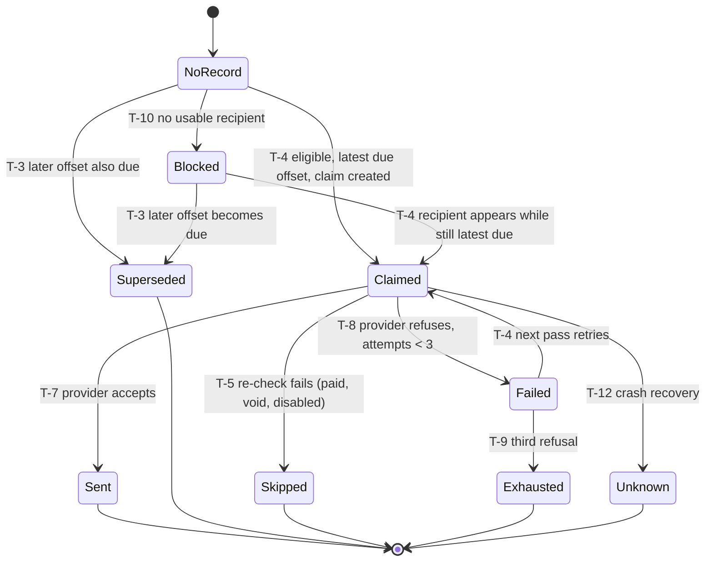

# Invoicing — Unpaid-Invoice Reminders (product specification)

Status: proposed specification, first version. Date of basis: 2026-11-20.
Authority for the delta: the request "Set up automatic reminders for unpaid invoices." (2026-11-20), quoted as **REQ-0**.
Structure and technology choices live in `KNOWLEDGE/architecture.md` (AD-n). Nothing here chooses a technology.

## Evidence limits (read first)

- **Observation:** this run had no repository, no discovery result, no research result, no earlier specification and
  no selected baseline. `KNOWLEDGE/spec.md` did not exist before this stage, so there is no earlier R-<n> to preserve
  or retire. `## Retired` is empty.
- **Unknown:** the existing invoice data model, customer contact fields, payment recording, mail facility, scheduler
  facility, user roles, and whether the product has a UI. Everything that depends on them is stated as a behaviour
  over an abstract "invoice record", "business", "payment", and marked with a gap `G-n` where the answer could change
  the behaviour or its verification surface.
- Nothing in this document has been executed. Every check below is **planned, not run**. Worked examples were
  recomputed by hand (see `## Walk of the worked examples`); no product exists to execute them against.
- No claim is made about what a platform or library can do. Where one would matter (provider idempotency, bounce
  callbacks, time-zone data) it is recorded as an unknown (G-5, G-9), and the spec states the behaviour that holds
  either way.

## Request outcomes (traceability source)

| ID | Words of the request (REQ-0) | Meaning taken | Mapped to |
| --- | --- | --- | --- |
| O-1 | "Set up" | A business can turn reminders on (and off) | R-1 |
| O-2 | "automatic" | Reminders go out with no person triggering each one, including when nobody is logged in | R-2, R-5, R-6, R-9 |
| O-3 | "reminders" | The invoice's customer receives a message that names the invoice, amount and due date | R-3, R-7 |
| O-4 | "unpaid invoices" | Only invoices that still have a balance owing, and only until they are paid | R-2, R-4 |

Primary outcomes (what was asked for directly): O-1..O-4. Requirements carrying them: **R-1, R-2, R-3, R-4**.
R-5..R-9 are supporting behaviour the primary outcomes need to be safe (no duplicates, failure handling, visibility,
data handling, background operation); they add no scope beyond the request.

## Assumptions (defaults taken because the run is unattended; each is open for confirmation)

| ID | Assumption | Why this default | Changes if wrong |
| --- | --- | --- | --- |
| A-1 | Reminders are **off** for every business until an authorised user turns them on. | The system emails a business's customers on its behalf: outward-facing, so opt-in. "Set up" in REQ-0 reads as an act of enabling. | R-1 default value |
| A-2 | The channel is **email** to the invoice's customer billing address. | The only channel that needs no customer-side registration. | R-3, G-2 |
| A-3 | The reminder schedule is **fixed**: day offsets **0, +7, +14** from the invoice due date (due date, 7 days overdue, 14 days overdue); **no** reminders before the due date; no editable schedule in this scope. | Smallest schedule that is more than one nudge and less than harassment; avoids inventing a schedule editor. | R-2 |
| A-4 | "Unpaid" = invoice has been issued to the customer, is not void, and has an outstanding balance greater than zero. | Covers partial payment without a new concept. If the product has no partial payments the balance is the total. | R-2, R-4 |
| A-5 | Days are calendar days in the **business's time zone** (IANA name). Reminders go out on or after **09:00 local** on the due offset date. A business without a time zone uses UTC. | A due date is a date, not an instant; a send hour avoids midnight emails. | R-2, G-4 |
| A-6 | When several offsets are due at once (first enablement, outage recovery, late-issued invoice), **only the latest due offset is sent**; earlier ones are recorded as superseded. | Never send a burst of back-to-back reminders for one invoice. | R-2 |
| A-7 | Delivery failure is retried up to **3 attempts** per (invoice, offset) across successive evaluation passes, then given up. | A finite default so a failing address is not retried forever. | R-6, G-6 |
| A-8 | Evaluation passes happen **at least hourly**. | Gives "on or after 09:00" a concrete worst-case lateness of one pass. | NFR-2 (proposed, not accepted) |
| A-9 | Reminder history is kept as long as its invoice record exists. | No retention period was given; following the invoice avoids inventing one. | R-8, G-7 |

## Open gaps (unresolved prerequisites or decisions)

Each is also repeated under the R-<n> it affects. "Unready" lists the work that must not be called ready until the gap
is closed; independent requirements may proceed.

| ID | Gap | Safe interim behaviour | Smallest confirming step | Unready |
| --- | --- | --- | --- | --- |
| G-1 | Whether the invoice record already has: a due date, an issued/void state, an outstanding balance, a customer billing email. | Spec assumes all four exist. | Discovery of the invoice model | R-2, R-3, R-4 |
| G-2 | Whether email is the wanted channel and whether the business wants a pay-link in the message. | Email, no pay-link line unless the invoice already exposes a payment URL (R-3). | User confirmation | R-3 |
| G-3 | Legal/compliance rules for automated payment-reminder email to customers (unsubscribe, jurisdiction, sender identity). Not researched; no rule is claimed. | Message carries business identity and a reply contact (R-3); no unsubscribe feature. | User/legal decision | R-3 |
| G-4 | Business time-zone field exists? DST behaviour at 09:00 (a zone that skips 09:00 on a date). | Business zone else UTC; if 09:00 does not exist on a date, first pass after the skipped hour. | Discovery; primary tz documentation | R-2 |
| G-5 | Mail facility: sender identity, whether it supports an idempotency key, whether it reports bounces. | R-5/R-6 hold without idempotency or bounces: "Sent" means the provider accepted the message, nothing more. | Discovery of mail facility | R-5, R-6 |
| G-6 | Retry cap and spacing (A-7) are a default, not a user decision. | A-7 | User confirmation | R-6 |
| G-7 | Retention/erasure rules for reminder history and customer email addresses. | A-9 | User/legal decision | R-8 |
| G-8 | Whether the product has a UI, and its identity (tokens, components) if so; which roles may manage settings. | R-1/R-7 define behaviour per surface; surface is "the product's existing settings and invoice-detail surfaces". | Discovery | R-1, R-7, NFR-UI |
| G-9 | Whether a scheduler/background-execution facility exists in the deployed runtime and its limits. | AD-1 records the proposal. | Discovery | R-9, NFR-2 |

## Domain rules the request leaves out (bounded under the R-<n> they limit)

Left **out of scope**: editing the schedule (R-2), per-invoice pause/snooze or "dispute" hold (R-4), a "send now"
button (R-2), customer unsubscribe (R-3, G-3), late fees or interest (R-2), escalation to collections (R-2), SMS or other
channels (R-3), reminders before the due date (R-2), per-customer overrides (R-1), delivery/open tracking and bounce
handling (R-6), localisation of the message (R-3), recurring invoices (R-2).

---

## Requirements

Acceptance-line format: **P** positive, **F** failure, **B** boundary; each only where it says something the others do
not, else `n/a: <reason>`. Each line ends `[surface | confirmation]`. Surfaces: *Settings* (the product's reminder
setting), *Invoice detail* (history/next reminder), *Mailbox* (the customer's inbox, a test mailbox in checks),
*Records* (reminder records, read through the product's data access or API), *Logs*. Confirmation: **auto** =
automated test with controlled clock, mail double and invoice fixtures; **real** = one real send through the
product's real mail facility to a controlled mailbox, planned in test-strategy (not run here).

Basis for every R below: REQ-0 words and date unless a different source is stated. Pending implementation and
checks: all, for every R (nothing exists).

### R-1 Reminders are enabled per business, off by default

Basis: REQ-0 "Set up"; A-1. Preserved: none (new). Changed: none. Source-section locator: this file, `## Assumptions`
A-1. Evidence limit: roles/permissions model unknown (G-8).

Behaviour: each business has one setting, *automatic invoice reminders*: `off` (initial) or `on`. An authorised user of
that business (G-8: the role that may change business settings) can set it. Changing it records who and when. `on` takes
effect for invoices of that business at the next evaluation pass; `off` stops all further sends from the next pass and
from the pre-send re-check (R-4), but does not delete history.

- P: setting a business from `off` to `on` shows `on` on reload, and a record "enabled by <user> at <instant>" exists. [Settings, Records | auto]
- F: a user without settings authority attempts the change → refused, setting unchanged, no record written; a request
  naming another business's id → refused with the same outcome as a missing business (no information about the other
  business). [Settings, Records | auto]
- F: saving fails (store unavailable) → the user sees an error, the control returns to its previous value, nothing is
  enabled. [Settings | auto]
- B: two authorised users change the setting at nearly the same time → last accepted write wins, both writes are in the
  change record; the evaluation uses whichever value is stored when it checks. [Records | auto]
- B: a business that has never touched the setting has no reminders sent and shows `off`. [Settings, Mailbox | auto]

Gaps: G-8.

### R-2 Eligible invoices get the reminder their due date calls for, automatically

Basis: REQ-0 "automatic reminders for unpaid invoices"; A-3, A-4, A-5, A-6. Source-section locator: `## Assumptions`.
Preserved: none. Evidence limit: invoice model unknown (G-1); time zone (G-4).

Behaviour. An invoice is **eligible** at an instant when all hold: its business has reminders `on`; the invoice has been
issued to the customer and is not void; its outstanding balance is greater than zero; it has a due date. The schedule is
the offsets 0, +7, +14 days from the due date. Offset *k* of an invoice is **due** when the business-local date is on or
after *due date + k days* and the business-local time is at or after 09:00 on that date, or any later time. Each evaluation pass
sends, per eligible invoice, **at most one** reminder: for the *latest* offset that is due and has no final record; every
earlier due offset with no final record is recorded `superseded`. After offset +14 no further reminder is ever sent for
that invoice by this feature. Offsets are keyed by (invoice, offset), not by date: moving an invoice's due date later does
not re-send an offset that already has a final record, and does not delay one already sent.

- P: INV-1001 (due 2026-12-01, business America/Chicago, `on`, balance 1,200.00 USD, Sent): at 2026-12-01T15:00Z (09:00
  local) one offset-0 reminder is sent; at 2026-12-08T15:00Z one offset-+7; at 2026-12-15T15:00Z one offset-+14; nothing on
  any other pass, and nothing after 2026-12-15. [Mailbox, Records | auto]
- B (time): at 2026-12-01T14:59Z (08:59 local) nothing is sent; at 2026-12-01T05:30Z (2026-11-30 23:30 local) nothing
  is sent although the UTC date is already 2026-12-01. [Mailbox | auto]
- B (burst): feature enabled 2026-12-10T16:00Z (10:00 local) for INV-1001 with no records: offsets 0 and +7 are due,
  +14 is not → exactly one email (offset +7, "9 days overdue"), offset-0 record is `superseded`, no offset-0 email.
  [Mailbox, Records | auto]
- B (outage): passes missed from 2026-12-01 to 2026-12-03, resumes 2026-12-04T18:00Z → one offset-0 email now
  ("3 days overdue"), none for +7 until 2026-12-08. [Mailbox | auto]
- B (due date moved): INV-1001 offset 0 sent; due date changed to 2026-12-05 afterwards → no second offset-0 email;
  offset +7 now falls on 2026-12-12. [Mailbox | auto]
- F (ineligible): a draft, a void invoice, an invoice with balance 0.00, an invoice of a business with reminders `off`,
  and an invoice with no due date each produce no email and no `sent` record on a due date. [Mailbox, Records | auto]
- F (other tenants): an `on` business's pass never reads or mails another business's invoices. [Records | auto]

Out of scope (bounds this R): editing the schedule, reminders before due date, send-now, late fees, escalation,
recurring invoices. Gaps: G-1, G-4.

### R-3 The reminder tells the customer what is owed, from whom, and by when

Basis: REQ-0 "reminders"; A-2. Evidence limits: no mail facility inspected (G-5); legal requirements unresearched (G-3).

Behaviour. One plain-text email to the invoice's customer billing address, sent from the product's mail facility with the
business's name as the visible sender name and the business's contact email as reply-to. Subject and body are fixed
templates. Fields (all read from the invoice at send time, never from the schedule): business name, invoice number,
outstanding balance with ISO currency code (two decimals, thousands separator `,`), due date as `YYYY-MM-DD`, days
overdue (send-day local date minus due date, integer), and the business contact email. A pay-link line is included only if
the invoice already has a payment URL (G-2). The email names no other invoice and no other customer.

Subject templates: offset 0 → `Reminder: Invoice {number} from {business} is due today`; offsets > 0 →
`Reminder: Invoice {number} from {business} is {n} day(s) overdue` (`1 day`, otherwise `n days`). Body (exact lines):

```
Hello {customer name},

This is a reminder that invoice {number} from {business} has an outstanding balance of {balance} {currency}.
Due date: {due date}
{overdue line}

{pay-link line, only if available}
If you have already paid, please disregard this message. Questions: reply to this email or write to {business contact email}.
```

`{overdue line}` is `Due today.` at offset 0, else `{n} day(s) overdue.`

- P: the INV-1001 offset-+7 email sent 2026-12-10 has subject `Reminder: Invoice INV-1001 from Acme Plumbing is 9 days overdue`,
  body contains `outstanding balance of 1,200.00 USD`, `Due date: 2026-12-01`, `9 days overdue.`, recipient
  `billing@harbor.example`, reply-to the business contact. [Mailbox | auto; one **real** send in test-strategy]
- B: outstanding balance 300.00 on a 500.00 invoice with 200.00 paid → body says `300.00 USD`, not 500.00. Overdue of
  exactly 1 day → subject ends `is 1 day overdue`. [Mailbox | auto]
- F: invoice has no billing address, or an address failing basic address syntax → no send; record `blocked: no recipient`
  (R-6). [Records | auto]
- F: customer name containing `<script>` or a newline → rendered as inert text, single header value, no extra header
  injected. [Mailbox | auto]
- n/a (separate negative for another customer's data): covered by the single-invoice rule in the P/F lines above; no extra
  line says anything new.

Out of scope: unsubscribe, other channels, localisation, delivery/open tracking. Gaps: G-2, G-3, G-5.

### R-4 Reminders stop when the invoice stops being unpaid

Basis: REQ-0 "unpaid invoices". Preserved/changed: none.

Behaviour. Immediately before each send, the system re-reads the invoice and the business setting from their
authoritative store (no cache) and re-applies the R-2 eligibility test. If it now fails, no email is sent and the slot is
recorded `skipped: <reason>` (`paid`, `void`, `disabled`). A payment, void, or switch to `off` committed before that
re-read is always honoured. One committed after the re-read but before the provider has accepted the message cannot be
prevented; at most one such reminder can result per payment, because no later offset is due that fast. This limit is
stated, not hidden.

- P: INV-1001 paid in full 2026-12-05 → no offset-+7 or +14 email, ever. [Mailbox | auto]
- P: a partial payment leaving 300.00 → reminders continue, stating 300.00. [Mailbox | auto]
- F/B (race, before): payment committed between the pass's selection and its pre-send re-read → no email, slot
  `skipped: paid`. [Mailbox, Records | auto, with a controllable hook between selection and re-read]
- B (race, after): payment committed after the re-read, before provider acceptance → the email is sent; the product shows
  both the payment and the reminder in time order; no error. [Records | auto]
- F: invoice voided, or reminders switched `off`, before the due time → no email. [Mailbox | auto]
- B: invoice paid then the payment is reversed (balance > 0 again, still before +14) → eligible again; the next pass
  sends whichever offset is the latest due without a final record. [Mailbox | auto]

Out of scope: per-invoice pause/dispute hold. Gaps: G-1.

### R-5 No duplicate reminders for the same invoice and offset

Basis: REQ-0 "automatic" (a customer must not receive the same reminder twice). Evidence limit: G-5.

Behaviour. At most one `sent` or `unknown` outcome exists per (invoice, offset). Before contacting the mail facility, the
system durably records a **claim** for the slot such that only one claim per (invoice, offset) can ever exist (the
mechanism is AD-2); a pass that cannot create the claim does not send. Overlapping passes, repeated passes, and restarts therefore cannot both send.
If the process stops after the claim and before the outcome is recorded, the slot is `unknown` after recovery: it is **not**
retried automatically (a possible missed reminder is preferred to a possible duplicate), it is visible in history, and later
offsets still proceed.

- P: two evaluation passes started concurrently at 2026-12-08T15:00Z over INV-1001 → one email, one `sent` record, the
  other pass records nothing or a `claim lost` log line. [Mailbox, Records, Logs | auto]
- B: pass repeated 10 minutes later → no second email. [Mailbox | auto]
- F: crash injected after claim, before provider call (and again after provider call, before outcome write) → on restart the
  slot reads `unknown`, no automatic resend, history shows `unknown`, offset +14 still sends on 2026-12-15. [Records,
  Mailbox | auto]
- n/a: provider-side idempotency is not assumed (G-5); if present it may be used in addition, never instead.

### R-6 Delivery failure and missing recipients are handled and visible, not silent

Basis: REQ-0 "automatic". Evidence limits: provider error taxonomy unknown (G-5); retry cap is a default (A-7, G-6).

Behaviour. Slot outcomes: `sent` (the provider accepted the message; this does **not** prove inbox delivery), `failed`
(provider refused or errored; retryable while attempts < 3), `exhausted` (3 failed attempts), `blocked: no recipient`
(re-evaluated at every pass while that offset is still the latest due offset, until it sends or is superseded), `unknown`
(R-5), `superseded` (R-2), `skipped: <reason>` (R-4). A failed attempt is retried on the next evaluation pass. No bounce
or open handling is in scope.

- P: provider fails on attempt 1 and accepts on attempt 2 → one `sent` record with attempts = 2; one email. [Records, Mailbox | auto]
- F: provider fails 3 times → `exhausted`, history shows it, no 4th attempt on later passes, offset +14 still proceeds
  independently. [Records, Mailbox | auto]
- B: customer address added after a `blocked: no recipient` pass but before +7 is due → next pass sends the current
  offset to the new address. [Mailbox | auto]
- B: still blocked when +7 becomes due → offset 0 slot is `superseded`, offset +7 evaluated afresh. [Records | auto]
- F: provider outage across many invoices → each slot fails and retries independently; no invoice's failure stops the
  others in the same pass. [Records | auto]

Out of scope: bounce handling, delivery receipts. Gaps: G-5, G-6.

### R-7 Business users can see what was sent and what is next

Basis: REQ-0 "reminders" (the business must be able to tell what happened); supporting. Evidence limit: UI/surface unknown (G-8).

Behaviour. The invoice-detail view lists reminder history for that invoice, newest first: offset, send-day local date,
outcome (R-6 vocabulary), recipient address as used, attempts. Above it, a *next reminder* line: the date of the next offset
not yet recorded as final, or `No further reminders` when the invoice is not eligible, reminders are off, or offset +14 is
final. Only users who can view that invoice (same business) see it. Reading is truthful about async state: an attempt in
progress shows `Sending…`, never `Sent`, until the outcome is recorded.

- P: INV-1001 after the 2026-12-08 send shows one `sent` row with offset +7 and `Next reminder: 2026-12-15`. [Invoice detail | auto UI test + one visual check]
- B (empty): no reminder ever → `No reminders sent yet` plus the next-reminder line, or `Reminders are off` when off.
  [Invoice detail | auto]
- F: user of another business requests the invoice's history → same response as a nonexistent invoice. [Invoice detail,
  Records | auto]
- B (loading/error): history fails to load → an error state with a retry control, not an empty list. [Invoice detail | auto]

Gaps: G-8.

### R-8 Personal and financial data in reminders is minimised, protected and removable

Basis: REQ-0 (it moves customer email addresses and amounts); the handling rules are agent decisions recorded for
confirmation. Evidence limit: retention/erasure (G-7), compliance (G-3).

State inventory (owner/location in AD-2; behaviour here):

| State | Owner | Who may read | Simultaneous change | Ends/removed | Personal data |
| --- | --- | --- | --- | --- | --- |
| Business reminder setting + change record | the business | users of that business; change record shows who | last write wins, all writes recorded | kept with the business | user ids |
| Reminder slot record (R-5/R-6) | the invoice | users who can view the invoice | uniqueness on (invoice, offset) | follows the invoice (A-9) | recipient address as sent, outcome |
| The email | customer's mailbox (outside the system) | the customer | n/a | customer's control | name, invoice number, amount |
| Operational logs | operators | operators only | append-only | per the product's log policy (unknown) | **none** of: address, name, body |

Behaviour. Logs carry invoice id, business id, offset, outcome, attempt number, pass id; never the recipient address,
customer name, amount or body. Records and mail contain only the fields in R-3. When an invoice record is deleted its
reminder records are deleted with it; the customer's email stays only inside the sent mail.

- P: after a send, the log line for INV-1001 offset +7 contains the invoice id and outcome and none of
  `billing@harbor.example`, `Harbor`, `1,200.00`. [Logs | auto]
- F: a business user reading another business's reminder records is refused (see R-7). [Records | auto]
- B: deleting INV-1001 leaves no reminder record for it. [Records | auto]
- n/a for retention duration: unresolved, G-7, interim A-9.

### R-9 Reminders run without a person or a screen

Basis: REQ-0 "automatic". Evidence limit: runtime scheduler facility unknown (G-9).

Behaviour. Evaluation passes run on their own schedule in the deployed environment, using the product's own service
authority, with no logged-in user and no browser open, and survive a deployment or restart without a person
re-arming them. A pass that fails entirely (cannot read invoices) sends nothing, logs the failure, and the next pass runs
normally and applies R-2's latest-due-offset rule (so the outage recovery case of R-2 holds). A pass touching zero
eligible invoices is a normal outcome, not an error.

- P: with no user session, a controlled clock advanced across 2026-12-08T15:00Z triggers the INV-1001 offset +7 send. [Mailbox | auto]
- F: invoice store unreadable for a pass → no email, one error log line with pass id, next pass succeeds and sends. [Logs, Mailbox | auto]
- B: process restarted between two passes → the next pass runs without any manual step. [Records | **real** in the deployed
  environment during test-strategy]
- B: zero eligible invoices → pass completes, logs `evaluated 0`, no error. [Logs | auto]

Gaps: G-9.

---

## Behaviour model

### Actors, channels, state ownership (Interaction design)

Actors: *business user* (authorised to change settings; any invoice viewer reads history), *system evaluation pass*
(service authority, no user), *mail facility* (external, accepts messages), *customer* (receives mail only; has no account
and no action in this scope). Channels: business user → system by the product's existing request/response; pass →
invoice store by direct read; pass → mail facility by one request per message; mail facility → customer outside the
system. Return path from the mail facility: the synchronous acceptance/refusal only. **Acknowledgment means "accepted by
the provider"**, not delivered or read.

### Flows

- **F-1 enable** (R-1): user opens Settings → changes toggle → system checks authority → stores value + change record → UI
  shows saved value. Alternatives: refusal, store failure (T-1, T-2).
- **F-2 evaluation pass** (R-2, R-4, R-5, R-6, R-9): pass starts → lists `on` businesses → per eligible invoice finds
  latest due offset without final record → marks earlier due offsets superseded (T-3) → claims slot (T-4) → re-reads and
  re-checks (T-5/T-6) → composes message (R-3) → calls mail facility → records outcome (T-7..T-9). Alternatives: no
  recipient (T-10), claim lost (T-11), crash (T-12).
- **F-3 read history** (R-7): user opens invoice detail → authority check → reads records → shows rows + next reminder.



Entity: reminder slot (invoice, offset). Owner: the invoice. Durable. Initial `NoRecord` (implicit, nothing stored).
Terminal: Sent, Superseded, Skipped, Exhausted, Unknown. Non-terminal: Blocked, Claimed, Failed. Cross-entity invariant:
for one invoice at most one slot is in `Claimed` or `Sent` per pass (A-6).

### Transition ledger

| T | R / F | Before | Trigger and guard | Operation | After and observation | Failure and recovery | Cases |
| --- | --- | --- | --- | --- | --- | --- | --- |
| T-1 | R-1 F-1 | setting off/on | authorised user submits a value | write value + change record in one step | new value readable, record present | store failure → error, value unchanged | TC-1, TC-3 |
| T-2 | R-1 F-1 | any | unauthorised or cross-business submit | reject | nothing changed, no record | n/a | TC-2 |
| T-3 | R-2 F-2 | NoRecord or Blocked, a later offset also due | pass | record `superseded` | no email for that offset | durable; repeated pass sees it final | TC-7, TC-15 |
| T-4 | R-2 R-5 F-2 | NoRecord, Blocked or Failed(<3); eligible; latest due | pass | create claim (unique per invoice, offset); attempts+1 | Claimed | claim exists → pass does not send (T-11) | TC-4, TC-9 |
| T-5 | R-4 F-2 | Claimed | re-read fails eligibility | record `skipped: reason`; no provider call | no email | n/a | TC-11 |
| T-6 | R-4 F-2 | Claimed | re-read passes eligibility | continue to compose and send | n/a | n/a | TC-4 |
| T-7 | R-3 R-6 | Claimed | provider accepts | record `sent` | email in mailbox; history row | crash after accept, before write → T-12 | TC-4, TC-5 |
| T-8 | R-6 | Claimed | provider refuses, attempts < 3 | record `failed` | retried next pass | n/a | TC-16 |
| T-9 | R-6 | Failed with attempts = 3 | third refusal | record `exhausted` | no more attempts | n/a | TC-17 |
| T-10 | R-3 R-6 | NoRecord/Blocked | no usable recipient | record `blocked: no recipient`; no claim | re-evaluated next pass | n/a | TC-6 |
| T-11 | R-5 | any | claim cannot be created (exists) | no send | one email total | n/a | TC-13 |
| T-12 | R-5 | Claimed, process lost | recovery on next pass | record `unknown`; no retry | later offsets proceed | operator can see `unknown` | TC-14 |

Invalid/forbidden events: a pass finding a final record (Sent, Superseded, Skipped, Exhausted, Unknown) for the slot is a
documented no-op (nothing written, no email). A user trying to edit a slot record or the schedule has no surface (out of
scope), nothing to reject.

### Service boundary contract (mail facility) — duty 8

- **Current authority:** invoice status, balance, recipient and business setting come from their authoritative stores,
  read at send time (R-4). No cached copy is authoritative.
- **Freshness versus revocation:** a payment, void or switch-off is honoured if committed before the pre-send re-read;
  stated residual window after it (R-4).
- **Incremental state:** only (invoice, offset) slot records; no copy of invoice data beyond the recipient as sent.
- **Async completion and recovery:** provider acceptance is the only completion signal; unknown outcomes are not
  retried (R-5); bounces and delivery receipts are out of scope.
- **Owned event coverage:** pass start/end/failure, claim lost, each slot outcome, setting change; fields per R-8. Reuse any
  existing logger (G-9); add none beyond these.
- Inapplicable: caching and cache invalidation (no cache), message broker (none proposed), cross-service transactions (single store).

---

## Non-functional requirements

- **NFR-1 Security and tenancy.** Operating condition: multiple businesses on one system. Criterion: no read or write of
  another business's setting, invoices, records or history is possible; cross-business requests are answered as
  nonexistent. Verification: cases in R-1, R-2, R-7 (auto). Accepted.
- **NFR-2 Timeliness.** Required observable: a due reminder is sent on the first pass at or after 09:00 local. **Numeric bound
  unresolved**: no latency target was given. Proposed (not accepted): passes at least hourly (A-8), so lateness is at most
  one pass interval plus send time. Verification once accepted: controlled-clock test plus a real run in the deployed
  environment. Depends on G-9.
- **NFR-3 Reliability and integrity.** No duplicate sends (R-5); no silent loss: every due slot ends in a recorded final
  outcome or stays visibly `blocked`/`failed` (R-6); recovery after downtime follows R-2/R-9. Verification: R-5, R-6, R-9 cases.
  No numeric availability target is claimed (none given; not invented).
- **NFR-4 Privacy and data handling.** R-8 rules; retention duration unresolved (G-7), compliance unresearched (G-3).
- **NFR-5 Observability.** Events and redaction in R-8/service boundary contract; retention of logs per existing product
  policy (unknown, G-9). Verification: log assertions in R-5, R-8, R-9.
- **NFR-6 Testability.** Time and the mail facility must be replaceable in tests (no real clock waits, no real email in
  auto checks). This is the verification surface for every `auto` line; the mechanism is AD-3.
- **NFR-7 Compatibility and capacity.** Excluded as a numeric target: no workload size was given and none is invented.
  Interim behaviour: passes must complete a business's invoices without one failure blocking others (R-6). Mail-provider
  rate limits are unknown (G-5); a refusal due to throttling is a `failed` attempt.
- **NFR-UI Interface quality** (applies to the Settings control and the invoice-detail reminder section, G-8).
  Basis: deliverable with a UI. *Identity precedence:* if the product already has a UI, these surfaces inherit its tokens,
  components and appearance policy, and the criteria below are checked against that system. *If no established identity
  exists:* start from the **light expressive starting point** (`GUIDES/platforms/ui.md#light-expressive-starting-point`):
  light Gemini-like, Material 3 Expressive principles — luminous light canvas, tonal rounded surfaces, a restrained accent,
  a humanist sans-serif from local fonts — with a dark option; the plan chooses the concrete treatment and records it in an
  AD. Observable criteria: one consistent visual system (spacing scale, type scale, palette with light and dark themes);
  designed empty (`No reminders sent yet`), loading (skeleton or `Sending…`), error (with retry) and success states;
  layout works at 360 px and 1280 px with no horizontal overflow; visible focus states; WCAG AA contrast (4.5:1 text, 3:1
  large text/controls) in both themes; the toggle is a labelled native switch operable by keyboard; truthful async feedback
  for the toggle (pending → saved, or error with revert), status changes announced to assistive technology; any motion only
  explains a change and honours `prefers-reduced-motion`; one icon set. The chosen visual signature is the next-reminder
  line as a small timeline (0 / +7 / +14) marking sent, current, upcoming. Verification: component tests for states and
  keyboard, rendered checks in both themes at both widths, automated contrast check. Skin/component/interaction premises:
  components = switch, status chip, history row, empty/error panels; interaction = optimistic switch reconciled with the
  confirmed result, never shown `Sent` before recorded; skin = per above. Not applicable if G-8 resolves to "no UI" (then R-1 and R-7
  are observed through the product's API and the criteria move to its response shape).

## State and data assessment

Affected resources and identities: (1) *business setting* — per business id, changed by R-1; (2) *reminder slot records* —
keyed (invoice id, offset), created and changed by the passes, read by R-7; (3) *setting change records* — appended by R-1;
(4) *invoice record* — **read only**, never modified by this feature; (5) *customer email* — read only. Out of scope:
payment recording, invoice creation, customer data editing.

Before/after invariants: setting ∈ {off, on}, initially off; slot states per the state diagram; at most one
`sent`/`unknown` per (invoice, offset); a claim exists before any provider call for that slot; no record references a
deleted invoice. Recovery: crash → `unknown` (no automatic retry); failed attempts retried to the cap; passes are
re-runnable without effect on final slots. Migration: adding the setting defaults every existing business to `off`, so
deploying the feature sends nothing until a business opts in; slot records start empty. Applicable checks: TC-1..TC-20.
Unknowns: whether existing invoice rows need a backfill (none expected: the feature derives from due date and balance);
store capabilities for the uniqueness rule (AD-2, G-9).

## Case mapping

IDs are planned, none run. Expected values are those of the worked examples; `auto` uses a controlled clock, a mail
double that can accept/refuse/stall, invoice fixtures, and a hook to commit a payment between selection and re-read.

| TC | R / T | Setup → event → expected | Surface | Confirm |
| --- | --- | --- | --- | --- |
| TC-1 | R-1 T-1 | B-1 off, admin sets on → setting `on`, change record by admin | Settings, Records | auto |
| TC-2 | R-1 T-2 | non-admin sets on; admin of B-2 targets B-1 → refused, unchanged, no record | Settings, Records | auto |
| TC-3 | R-1 | store write fails → error shown, control reverts to off | Settings | auto |
| TC-4 | R-2 R-3 T-4 T-6 T-7 | INV-1001 on schedule → exactly three emails at 12-01 15:00Z, 12-08 15:00Z, 12-15 15:00Z, none else, none after | Mailbox, Records | auto |
| TC-5 | R-3 | offset +7 email on 12-10: subject `…is 9 days overdue`, body fields per R-3, recipient billing@harbor.example | Mailbox | auto + real |
| TC-6 | R-3 R-6 T-10 | no/invalid address → no send, `blocked: no recipient`; address added later → sends | Records, Mailbox | auto |
| TC-7 | R-2 T-3 | enabled 12-10T16:00Z → one email (+7, 9 days), offset 0 `superseded` | Mailbox, Records | auto |
| TC-8 | R-2 | 12-01T14:59Z and 12-01T05:30Z → no email | Mailbox | auto |
| TC-9 | R-2 R-5 | outage 12-01..12-03, resume 12-04T18:00Z → one offset-0 email, "3 days overdue" | Mailbox | auto |
| TC-10 | R-2 | offset 0 sent, due date moved to 12-05 → no re-send; +7 on 12-12 | Mailbox | auto |
| TC-11 | R-4 T-5 | paid before pre-send re-read (hook) → no email, `skipped: paid`; paid 12-05 → no +7/+14 | Mailbox, Records | auto |
| TC-12 | R-4 | partial payment leaving 300.00 → email says 300.00 USD; payment after re-read → sent, both visible | Mailbox, Records | auto |
| TC-13 | R-5 T-11 | two concurrent passes at 12-08T15:00Z → one email, one record; repeat 10 min later → none | Mailbox, Records, Logs | auto |
| TC-14 | R-5 T-12 | crash after claim / after provider call → `unknown`, no resend, +14 still sends | Records, Mailbox | auto |
| TC-15 | R-2 | draft, void, balance 0, business off, no due date → none | Mailbox | auto |
| TC-16 | R-6 T-8 | refuse once, accept next pass → one `sent`, attempts 2 | Records, Mailbox | auto |
| TC-17 | R-6 T-9 | refuse 3 times → `exhausted`, no 4th attempt, +14 proceeds | Records | auto |
| TC-18 | R-7 | history/next-reminder lines; empty, loading error, cross-business request | Invoice detail | auto UI + visual |
| TC-19 | R-8 | log line for the send has none of the address, name, amount; invoice deletion removes records | Logs, Records | auto |
| TC-20 | R-9 | no session; clock crosses 12-08T15:00Z → send; failing store pass then ok; restart | Mailbox, Logs | auto + real |

## Walk of the worked examples (duty 10)

Start state for every case: business B-1 "Acme Plumbing", zone America/Chicago (UTC−6 in December, no DST change in that
period), setting `on` set by an authorised admin beforehand (R-1 permits the action); INV-1001, customer
`billing@harbor.example` ("Harbor Supply"), issued, balance 1,200.00 USD, due 2026-12-01 (a Tuesday). Offset dates:
0 → 12-01, +7 → 12-08, +14 → 12-15. 09:00 local = 15:00Z. Method: hand walk of F-2 against the transition ledger, each step
checked against the rule that permits it; **no execution**. All entries: `NOT-REPLAYED: no product or harness exists yet`.

- TC-4: 12-01T15:00Z: offset 0 due, no record → T-4 claim, T-6 re-check passes, T-7 `sent`. 12-08T15:00Z same for +7. 12-15T15:00Z
  for +14. Between those, offsets already final → no-op. Result: 3 emails. Recomputed: matches.
- TC-5/TC-7: enabled 12-10T16:00Z = 10:00 local on 12-10. Due offsets: 0 (12-01) and +7 (12-08); +14 (12-15) not. Latest due = +7
  → T-3 supersedes 0; T-4 claim +7; send. Days overdue = 12-10 − 12-01 = 9. Subject `…is 9 days overdue`. Matches.
- TC-8: 12-01T14:59Z = 08:59 local → not ≥ 09:00 → none. 12-01T05:30Z = 11-30 23:30 local → date < due date → none. Matches.
- TC-9: resume 12-04T18:00Z = 12:00 local 12-04. Offset 0 due (12-01), +7 not (12-08). Send offset 0; overdue = 12-04 − 12-01 = 3.
- TC-10: after offset 0 `sent`, due moves to 12-05; offset 0 has a final record → no re-send; +7 is 12-05 + 7 = 12-12. Matches.
- TC-12: invoice 500.00 with payment 200.00 → balance 300.00 > 0 → eligible; email says 300.00 USD.
- TC-14: after the claim at T-4, crash. Recovery pass finds Claimed with no live owner → T-12 `unknown`; +14 on 12-15 unaffected.

Observer check: Mailbox/Records are readable by the test through the mail double and data access; the history/next-reminder
UI is readable at invoice detail. The only start precondition that depends on an unrecorded rule is *who is authorised* (G-8).

## Retired

None. No earlier requirement existed.

## Submission

**summary** — Wrote `KNOWLEDGE/spec.md` (R-1..R-9, NFR-1..7 + NFR-UI, state/data assessment, behaviour model, 20 planned cases) and
`KNOWLEDGE/architecture.md` (AD-1..AD-4). The request was one sentence and no repository, discovery, research or baseline
existed, so nothing was preserved/retired and every system-specific fact is an open gap. **Assumptions recorded (A-1..A-9):**
reminders off until a business enables them; email to the invoice's billing address; fixed schedule of day offsets 0, +7, +14
from the due date; "unpaid" = issued, not void, balance > 0; business-local calendar dates, send at/after 09:00 local, UTC if no
zone; only the latest due offset is sent when several are due; 3 attempts then give up; passes at least hourly (proposed, not
accepted); history kept as long as its invoice. **Open gaps (G-1..G-9)** need a person or discovery: invoice data model (G-1),
channel/pay-link (G-2), legal rules for automated reminder email (G-3), time-zone/DST (G-4), mail facility capabilities (G-5),
retry cap (G-6), retention (G-7), UI existence/identity/roles (G-8), scheduler facility (G-9). They keep the dependent R-<n> unready, not
the others. **Material requirement conflicts: none.** The timeliness bound (NFR-2) is unresolved, and no numeric bound was invented.
Nothing was executed; the backchain check does not exist in this run and was left out.

**primary** — R-1, R-2, R-3, R-4.

**evidence_refs** — KNOWLEDGE/spec.md (whole; requirement sections R-1..R-9, `## Behaviour model`, `## Non-functional requirements`,
`## State and data assessment`, `## Case mapping`, `## Walk of the worked examples`); KNOWLEDGE/architecture.md `## Decisions`;
sources: REQ-0 (request text, 2026-11-20), GUIDES/behavioral-requirements.md (#behavior-model, #traceability-and-review,
#actors-channels-and-state-ownership), GUIDES/requirements-definition.md, GUIDES/service-discovery.md (#verification,
#asynchronous-cooperation), GUIDES/platforms/ui.md (#light-expressive-starting-point), GUIDES/current-system-baseline.md
(#planning-and-review-handoff; no baseline available). No backchain receipt (command absent). No execution evidence.
