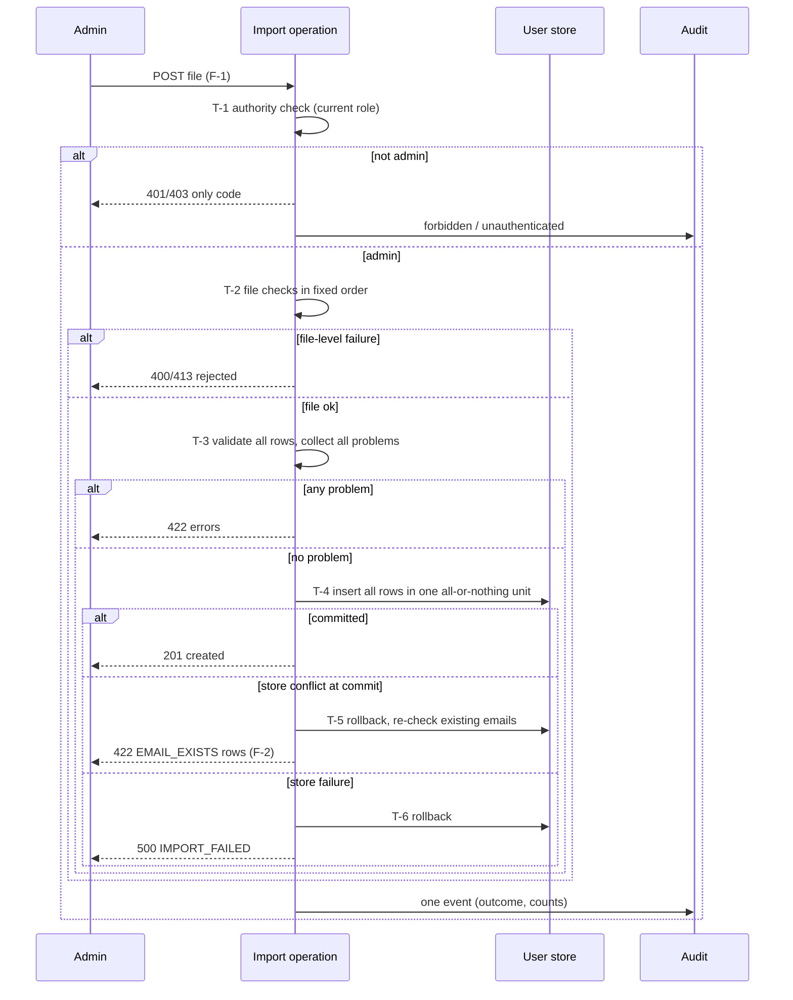

# User Administration — Product Specification

Living specification of what the product must do. Structure and technology choices are `AD-<n>` entries in
`architecture.md`; product choices made here are `D-<n>`; unresolved items are `G-<n>` and sit under the `R-<n>` they
bound. Every statement below is **accepted intent or a labelled default, never an observation of existing code**: no
repository, discovery result, research result or earlier spec existed when this was written, and nothing has been
implemented or run. Verification status of every line is **pending**.

Source of the first requirement set: request of 2026-11-21, "Let admins upload a CSV to bulk-create users." (quoted as
`REQ-0`). Anything beyond those words is a default recorded in D-1…D-11 and open for the product owner to change.

## Retired

None. This is the first specification; there is nothing to preserve, modify or retire.

## Open gaps (index)

| Gap | Kind | Bears on | Effect on readiness |
| --- | --- | --- | --- |
| G-1 | prerequisite | all R, mainly R-1, R-3, R-4, R-7, R-8 | **Plan is unready until discovery has inspected the real repository**: user model, authentication and admin role, user listing, audit facility, UI stack, admin routing. Where the real model differs from the defaults below, the affected line is modified through the correction route, not silently bent to fit. |
| G-2 | user decision | R-4 | Credential/activation path for imported users. Creation work is ready; anything that lets an imported user sign in is **unready**. |
| G-3 | user decision | R-2, R-10 | Production values for max rows and max file size. The limits are configuration; the value is open. |
| G-4 | user decision | R-8 | Audit-sink failure policy and audit retention. |
| G-5 | user decision | R-14 | Supported browser set. |
| G-6 | prerequisite | R-3 | Name length bound and any other field the existing user model requires. |

## Product decisions and defaults

Each is a choice made by the spec author in the absence of an instruction. They are not user requirements; a later run
must not promote them to binding conditions merely because they are written down.

- D-1 **Surface.** An admin web page plus the HTTP operation it calls; the operation is also usable by admin API
  clients. Assumed because "upload" implies a browser; route names `GET`/`POST /admin/users/import` are placeholders to
  map onto the product's admin routing (G-1).
- D-2 **Columns.** Only `email` and `name`. No role, password, group or other column is importable.
- D-3 **All-or-nothing.** One bad row rejects the whole file; nothing is created. Chosen because it makes retry and
  replay trivial to reason about. The user may instead want partial import; changing it modifies R-3/R-4/R-5/R-6.
- D-4 **Create only.** A row whose email already belongs to a user is an error, not a skip or an update.
- D-5 **Email policy.** Trim; lower-case ASCII letters only (other characters kept as written); exactly one `@`; local
  part 1–64 characters; domain has at least one dot and no empty label; no whitespace; total at most 254 characters.
  Aligned with the interoperability limits of RFC 5321 §4.5.3.1 (not re-verified here). `me@localhost` is rejected.
- D-6 **Outcome is known when the response arrives.** No pending server-side state after the response.
- D-7 **No import history.** The report exists only in the response and in the admin's page memory.
- D-8 **Audit is best-effort.** A failed audit write is itself logged and does not undo the import (G-4).
- D-9 **Content decides, not the name.** File extension and declared MIME type are not checked; browsers and operating
  systems report `.csv` files inconsistently.
- D-10 **Imported users** get the product's default non-admin role, no credential, and no email is sent (G-2).
- D-11 **One file per request**, the multipart field named `file`.

## Fixtures and starting state

Every acceptance line below is replayable from these.

**Seed S-0** (the user store before each case unless stated): `root@example.com` (role admin),
`pat@example.com` (role member), `linus@example.com` (role member). Three users. Session identities: "root" is signed
in as `root@example.com`; "pat" as `pat@example.com`. Test role name for the default non-admin role: `member`.

**Limits** (configuration, set per case; these are test values, not production values — see G-3):
LIM-A rows 3, bytes 1024. LIM-B rows 1000, bytes 1024. LIM-C rows 10, bytes 1024.

**Files** (`\n` line ends unless stated; sizes in bytes; row numbers count data rows, header excluded):

| ID | Content | Notes |
| --- | --- | --- |
| FX-1 `valid3.csv` | `email,name` / `ada@example.com,Ada Lovelace` / `grace@example.com,Grace Hopper` / `alan@example.com,Alan Turing` | 100 bytes, 3 rows |
| FX-2 `messy-valid.csv` | UTF-8 BOM, then CRLF lines: `Email , NAME` / ` Ada@Example.com ,"Lovelace, Ada"` / `grace@example.com,"Hopper, Grace"` / empty line | 2 rows |
| FX-3 `swapped.csv` | `name,email` / `Ada Lovelace,ada@example.com` | 1 row |
| FX-4 `mixed-bad.csv` | `email,name` / `ada@example.com,Ada Lovelace` / `not-an-email,Bad Row` / `grace@example.com,` / `ADA@example.com,Ada Again` / `linus@example.com,Linus Torvalds` / `,` | 6 rows |
| FX-5 `header-only.csv` | `email,name` only | 0 data rows |
| FX-6 `empty.csv` | zero bytes | |
| FX-7 `extra-col.csv` | `email,name,password` / `ada@example.com,Ada,hunter2` | |
| FX-8 `missing-col.csv` | `email` / `ada@example.com` | |
| FX-9 `latin1.csv` | `email,name` / `ada@example.com,Ad` followed by the single byte `0xE9`, then `\n` | not valid UTF-8 |
| FX-10 `four-rows.csv` | `email,name` and `u1@example.com,U1` … `u4@example.com,U4` | 4 rows |
| FX-11 `size-1024.csv` | `email,name` then rows `u001@example.com,User 001` … `u038@example.com,User 038`, the last name followed by 25 `x`; total exactly 1024 bytes | 38 rows; use LIM-B |
| FX-12 `size-1025.csv` | same header, rows `u001…` through `u039@example.com,User 039`, no padding; total exactly 1025 bytes | 39 rows; use LIM-B |
| FX-13 `ragged.csv` | `email,name` / `ada@example.com` / `grace@example.com,Grace,extra` | |
| FX-14 `html-name.csv` | `email,name` / `xss@example.com,""` | 1 row |
| FX-15 `newline-name.csv` | `email,name` / `nl@example.com,"Line1` newline `Line2"` (a quoted field containing a line break) | 1 row |
| FX-16 `unterminated.csv` | `email,name` / `ada@example.com,"Ada` and end of file, quote never closed | |
| FX-17 `dup-header.csv` | `email,name,email` / `a@example.com,A,b@example.com` | |
| FX-18 | one row, email = 64 × `a` + `@example.com` (valid); second file, 65 × `a` + `@example.com` (invalid); name `N` | local-part boundary |
| FX-19 | one row, email = 64 × `a` + `@` + 63 × `b` + `.` + 63 × `b` + `.` + 61 × `c` (254 characters, valid); second file, last label 62 × `c` (255, invalid); name `N` | total-length boundary |
| FX-20 | `email,name` / `me@localhost,N` | |
| FX-21 `bad-header-4-rows.csv` | `email,nom` / `a@example.com,A` / `b@example.com,B` / `c@example.com,C` / `d@example.com,D` | |
| FX-22 | `email,name` / `LINUS@Example.com,Linus` | case-insensitive match of seed user |
| FX-23 `role-col.csv` | `email,name,role` / `eve@example.com,Eve,admin` | |

## Requirements

Format of each requirement: **Basis** (source that stays true in later runs), **Delta**, behaviour with boundaries,
error behaviour and consumer outcome, **Left out** (domain rules the request omits that bound this requirement),
**State/data** where state changes, **Open gaps**, **Evidence/pending**, then acceptance lines. An acceptance line gives
Positive / Failure / Boundary (each `n/a: <reason>` where it adds nothing), **Surface** where it is observed, and
**Confirm** how. "API" below means the HTTP operation `POST /admin/users/import` with multipart field `file`. "Store
read-back" means reading the user records through an admin-visible read path (the user listing or the store itself).

### R-1 Only admins can use the import

- **Basis:** REQ-0 "Let admins …". **Delta:** added; nothing preserved or changed (first spec). **Locators:** request
  text; guides `behavioral-requirements.md#actors-channels-and-state-ownership`, `service-discovery.md#cache-and-authorization`.
- **Behaviour.** The import page and the API are available only to a signed-in user whose **current** role is admin.
  The role is evaluated on every request, not remembered from page load. An unauthenticated caller gets 401
  `UNAUTHENTICATED`; a signed-in non-admin gets 403 `FORBIDDEN`. The check happens before the file is read or parsed,
  so a rejected caller learns nothing about the file or about existing users; the body carries only the code.
- **Left out:** a more granular "may import users" permission distinct from admin; per-admin import quotas.
- **Open gap G-1 (prerequisite):** the product must already have authentication, an admin role, and a way to revoke or
  change it. If it has none, building them is outside this request and needs its own decision; this requirement then
  stays unready.
- **Evidence/pending:** none beyond the request. Implementation and every check pending.

**R-1.1 Admin is allowed.**
- Positive: root submits FX-1 under LIM-A to the API → 201 (full report in R-5.1).
- Failure: n/a: covered by R-1.2 and R-1.3.
- Boundary: n/a: one admin role, no gradations (see Left out).
- Surface: API. Confirm: API-level check, then store read-back shows 3 new users (R-4.1).

**R-1.2 Everyone else is refused, and learns nothing.**
- Positive: n/a: see R-1.1.
- Failure: no session → 401 `{"error":{"code":"UNAUTHENTICATED"}}`; pat (member) → 403 `{"error":{"code":"FORBIDDEN"}}`.
  In both, store read-back shows exactly S-0. For the page, pat opening `/admin/users/import` sees an access-denied
  view without the upload form; with no session the visitor is sent to the product's existing sign-in.
- Boundary: pat uploading FX-4 (which would contain an `EMAIL_EXISTS` for `linus@example.com`) and pat uploading FX-1
  get byte-identical status and body — no existence signal. A 401/403 returns before any parsing, so pat uploading
  FX-6 (empty) also gets 403, not `FILE_EMPTY`.
- Surface: API and rendered page. Confirm: API check (three callers × two files), browser check for the page.

**R-1.3 Revocation takes effect on the next request.**
- Positive: n/a: see R-1.1.
- Failure: root loads the import page; root's admin role is then removed (set to member in the store); root submits
  FX-1 → 403 `FORBIDDEN`, no user created, and the page shows the R-7.7 message.
- Boundary: the submit that arrives after revocation but from a page loaded before it is the case; a page loaded after
  revocation is R-1.2.
- Surface: API plus rendered page. Confirm: scripted sequence with a role change at the store seam. Requires G-1.

### R-2 Upload one CSV file and have it checked as a file

- **Basis:** REQ-0 "upload a CSV". **Delta:** added. **Locators:** request text; D-9, D-11.
- **Behaviour.** The operation takes exactly one file in multipart field `file`. Accepted format: comma-separated
  values with RFC 4180 quoting, LF or CRLF line ends, optional UTF-8 BOM (ignored), wholly blank lines ignored.
  First line is a header; after trimming and ASCII case-folding it must be exactly `email` and `name`, each once,
  in either order. Anything else about the header is `HEADER_INVALID`, and its message names the offending or missing
  column names but never any data-row value. File-level checks run in this fixed order and the **first** failure is
  the only one reported; every failure creates nothing:
  1. not exactly one file part → 400 `FILE_REQUIRED`
  2. size over `max_bytes` → 413 `FILE_TOO_LARGE`
  3. zero bytes → 400 `FILE_EMPTY`
  4. not valid UTF-8 → 400 `ENCODING_INVALID`
  5. malformed quoting (unterminated quoted field, or characters after a closing quote) → 400 `CSV_MALFORMED`
  6. header not as above (missing, extra, duplicate or unknown column) → 400 `HEADER_INVALID`
  7. no data rows after ignoring blank lines → 400 `NO_ROWS`
  8. more data rows than `max_rows` → 413 `ROW_LIMIT_EXCEEDED`
- **Limits.** `max_bytes` counts the raw file bytes including a BOM; `max_rows` counts data rows. Both are
  configuration, not constants in code. **Open gap G-3 (user decision):** the production values; until decided, no value
  is assumed and the plan reports it unresolved at handoff.
- **Left out:** other delimiters (semicolon, tab), other encodings, spreadsheet formats (`.xlsx`), compressed files,
  more than one file, header-less files, column mapping UI, preview/dry-run mode.
- **Evidence/pending:** the order of checks and the code names are defaults (D-9, D-11); pending.

**R-2.1 Well-formed files are accepted.**
- Positive: under LIM-A, FX-1 → 201 with 3 users; FX-2 (BOM, CRLF, spaced and upper-case header, quoted commas,
  trailing blank line) → 201 with 2 users `ada@example.com` / `Lovelace, Ada` and `grace@example.com` / `Hopper, Grace`;
  FX-3 (columns swapped) → 201 with 1 user `ada@example.com` / `Ada Lovelace`.
- Failure: n/a: rejections are R-2.2.
- Boundary: FX-11 (exactly 1024 bytes, 38 rows) under LIM-B → 201; FX-1 (exactly 3 rows) under LIM-A → 201.
- Surface: API. Confirm: API check with store read-back of email and name for each created user.

**R-2.2 File-level problems are rejected with the right code and create nothing.**
- Positive: n/a: see R-2.1.
- Failure (each leaves the store exactly S-0 and returns `{"status":"rejected","created_count":0,"error":{"code":…}}`):
  no file part, or two file parts → 400 `FILE_REQUIRED`; FX-6 → 400 `FILE_EMPTY`; FX-9 → 400 `ENCODING_INVALID`;
  FX-16 → 400 `CSV_MALFORMED`; FX-7, FX-8, FX-17, FX-23 → 400 `HEADER_INVALID`; FX-5 → 400 `NO_ROWS`;
  FX-10 under LIM-A → 413 `ROW_LIMIT_EXCEEDED`.
- Boundary: FX-12 (1025 bytes) under LIM-B → 413 `FILE_TOO_LARGE`; FX-21 (bad header **and** 4 rows over LIM-A) →
  400 `HEADER_INVALID`, proving the header check precedes the row limit; a file containing only blank lines → 400
  `NO_ROWS` (not `FILE_EMPTY`, which is for zero bytes).
- Surface: API. Confirm: API check per fixture asserting status, code and unchanged store.

### R-3 Every row is checked, and all problems are reported together

- **Basis:** REQ-0 "bulk-create users"; D-3, D-4, D-5. **Delta:** added. **Locators:** D-5, `behavioral-requirements.md#states-and-transitions`.
- **Behaviour.** If the file passes R-2, each data row is normalized (trim both fields; ASCII-lowercase the email) and
  validated independently. **All** problems in **all** rows are collected and reported in one response; validation does
  not stop at the first. Rows are numbered from 1 over data rows (header and blank lines not counted). Problems, in the
  order they are reported for one row:
  - field count differs from the header → `COLUMN_COUNT_MISMATCH` (field `row`; the row's other checks are skipped)
  - email empty → `EMAIL_REQUIRED`; email not valid per D-5 → `EMAIL_INVALID`
  - name empty after trim → `NAME_REQUIRED`; name contains a control character (U+0000–U+001F, U+007F, so also an
    embedded line break) → `NAME_INVALID`
  - email already used earlier in this file (by normalized value) → `EMAIL_DUPLICATE_IN_FILE`, carrying `first_row`
  - email equal to an existing user's, any role or status → `EMAIL_EXISTS`
  The last two apply only to rows with a valid email; only the first occurrence of an email is checked against the
  store. Results sort by row ascending, then by the order above.
- **Left out:** deliverability/MX checks, email verification, uniqueness of names, IDN/punycode or Unicode
  normalization of emails (non-ASCII is kept as written), disposable-domain filtering, row-level updates.
- **Open gap G-6 (prerequisite):** a maximum name length (code would be `NAME_TOO_LONG`) and any further field the
  existing user model requires are unknown. No bound is invented; the plan adds the line from the real model.
- **Evidence/pending:** pending. Expected results for the fixtures were recomputed by hand against these rules (see
  Replay evidence).

**R-3.1 A mixed file yields the complete, ordered problem list.**
- Positive: n/a: a clean file is R-2.1/R-4.1.
- Failure: root submits FX-4 under LIM-C → 422 `{"status":"rejected","total_rows":6,"created_count":0,"errors":[…]}`
  with exactly these six entries, in this order: row 2 `email` `EMAIL_INVALID`; row 3 `name` `NAME_REQUIRED`; row 4
  `email` `EMAIL_DUPLICATE_IN_FILE` with `first_row` 1; row 5 `email` `EMAIL_EXISTS`; row 6 `email` `EMAIL_REQUIRED`;
  row 6 `name` `NAME_REQUIRED`. Row 1 is valid and produces no entry, yet `ada@example.com` is **not** created
  (all-or-nothing, R-4.2). Store read-back is exactly S-0.
- Boundary: the same FX-4 under LIM-A (3 rows) is `ROW_LIMIT_EXCEEDED` (413), not row problems, because R-2 check 8
  precedes row validation.
- Surface: API. Confirm: API check with deep equality on `row`, `field`, `code`, `first_row`; `message` only
  non-empty.

**R-3.2 Normalization and email boundaries.**
- Positive: FX-2 row 1 ` Ada@Example.com ` is stored as `ada@example.com`; FX-18 (64-character local part) and FX-19
  (254 characters total) are accepted.
- Failure: FX-18 second file (65-character local part) and FX-19 second file (255 characters) → 422, row 1
  `EMAIL_INVALID`; FX-20 `me@localhost` → 422, row 1 `EMAIL_INVALID`; FX-22 `LINUS@Example.com` → 422, row 1
  `EMAIL_EXISTS` (match is case-insensitive).
- Boundary: the pairs 64/65 and 254/255 above.
- Surface: API. Confirm: API check per fixture.

**R-3.3 Structure inside rows.**
- Positive: a quoted comma in a name (FX-2) and markup in a name (FX-14, accepted verbatim) are valid.
- Failure: FX-13 → 422 with row 1 and row 2 `COLUMN_COUNT_MISMATCH`; FX-15 (line break inside a quoted name) → 422,
  row 1 `NAME_INVALID`.
- Boundary: n/a: boundaries of fields are in R-3.2; name length awaits G-6.
- Surface: API. Confirm: API check per fixture.

### R-4 Valid files create the users, all together or not at all

- **Basis:** REQ-0 "bulk-create users"; D-3, D-10. **Delta:** added.
- **Behaviour.** When a file has zero problems, one user is created per data row with the normalized email, the trimmed
  name, the default non-admin role, a store-assigned id, and **no credential**. Either every row's user exists
  afterwards or none does. Immediately after a 201, an admin reading the user records sees the new users (read your
  writes). If creation fails for a store reason, nothing is created and the response is 500 `IMPORT_FAILED` with
  `created_count` 0.
- **Left out:** updating or deactivating existing users, role or group assignment, sending invitations or welcome
  emails, generating or displaying passwords, bulk delete, undo/rollback of a finished import.
- **State/data.** Affected resource: the user records (owner: the product's user store). Target identity: the user,
  keyed by normalized email (unique). Before: set U with unique emails. After success: U plus N new users,
  |N| = data-row count, no email repeated. After any failure: U exactly, unchanged, including no partially created user
  and no orphan side records. Recovery: rollback is the recovery; after an unknown outcome the user records are the
  authority (R-6.3). Authorized actor: admin only (R-1). Check: store read-back before and after. Unknown: whether the
  existing store can do this atomically (architecture AD-2) — G-1.
- **Open gap G-2 (user decision):** how imported users obtain credentials (invitation email, set-password link,
  temporary password, SSO-only). Default D-10: none; imported users cannot sign in until that path exists, and the page
  tells the admin so (R-7.4). Anything beyond creation of the record is unready.
- **Open gap G-1 (prerequisite):** name of the default non-admin role and whether other fields (status, created-by)
  exist on the user record.
- **Evidence/pending:** pending.

**R-4.1 Successful import creates exactly the rows' users.**
- Positive: root imports FX-1 under LIM-A on S-0 → store read-back: 6 users; the three new records are
  `ada@example.com`/`Ada Lovelace`, `grace@example.com`/`Grace Hopper`, `alan@example.com`/`Alan Turing`, each role
  `member`, ids distinct and non-empty; S-0's three users unchanged.
- Failure: n/a: see R-4.2.
- Boundary: a one-row file (FX-3) creates exactly one user; FX-11 creates 38.
- Surface: API response and store read-back. Confirm: API check plus store read.

**R-4.2 Nothing is created on any failure.**
- Positive: n/a: see R-4.1.
- Failure: FX-4 (one valid row among invalid ones) → store exactly S-0. Fault injection: the store is made to fail on
  the third insert while importing FX-1 → 500 `IMPORT_FAILED`, `created_count` 0, and store read-back shows none of
  `ada@`, `grace@`, `alan@` (zero of three, not two).
- Boundary: failure on the first insert and on the last insert behave the same (store exactly S-0).
- Surface: API plus store read-back. Confirm: real-store check with an injected failure at the store boundary (a mock
  that does not roll back would not satisfy it).

**R-4.3 A CSV can never make an admin.**
- Positive: every user created by an import has role `member` (FX-1, FX-2, FX-3).
- Failure: FX-23 (extra `role` column naming `admin`) → 400 `HEADER_INVALID`; store exactly S-0.
- Boundary: n/a: there is no role input to bound.
- Surface: API plus store read-back. Confirm: API check.

### R-5 The admin gets a precise, machine-readable report of every attempt

- **Basis:** REQ-0 "bulk-create users" (an admin acting on many users needs to know what happened); D-6, D-7.
  **Delta:** added.
- **Behaviour.** Every import attempt that passes R-1 returns a JSON body (`Content-Type: application/json`) with one of
  these shapes, and the HTTP status decides the class:
  - 201 `{"status":"created","total_rows":N,"created_count":N,"created":[{"row":1,"id":"…","email":"…","name":"…"},…]}`
  - 422 `{"status":"rejected","total_rows":N,"created_count":0,"errors":[{"row":R,"field":"email|name|row","code":"…","message":"…"},…]}`
    (`EMAIL_DUPLICATE_IN_FILE` entries add `first_row`)
  - 400/413 `{"status":"rejected","created_count":0,"error":{"code":"…","message":"…"}}`
  - 500 `{"status":"failed","created_count":0,"error":{"code":"IMPORT_FAILED","message":"…"}}`
  - 401/403 `{"error":{"code":"UNAUTHENTICATED"|"FORBIDDEN"}}` only.
  `created_count` always equals the number of users that exist because of this request. Codes are the stable contract;
  `message` is human-readable text and may be reworded. Report content (emails, names the admin uploaded) is returned to
  that admin only and is not stored (D-7).
- **Left out:** a way to fetch a past report; downloading the error list as a CSV; localised messages.
- **Evidence/pending:** pending.

**R-5.1 Shapes are exact.**
- Positive: FX-1 → 201 body with `status` `created`, `total_rows` 3, `created_count` 3, `created` three entries with
  `row` 1, 2, 3 and the stored email and name, each with a non-empty distinct `id`.
- Failure: FX-4 under LIM-C → the 422 body of R-3.1; FX-5 → `{"status":"rejected","created_count":0,"error":{"code":"NO_ROWS",…}}`
  (no `total_rows`); the injected failure of R-4.2 → the 500 body above.
- Boundary: unexpected extra top-level keys are a failure (the key set is asserted, not only the values asserted).
- Surface: API. Confirm: API contract check with deep equality except `id` and `message` values.

**R-5.2 The count never lies.**
- Positive: after FX-1, `created_count` 3 and store read-back shows 3 new users.
- Failure: after each rejection or failure above, `created_count` is 0 and read-back shows 0 new users.
- Boundary: n/a: the count is 0 or N by R-4's invariant.
- Surface: API plus store read-back. Confirm: assert response count equals store difference in every API check.

### R-6 Concurrent, repeated and interrupted imports cannot corrupt the user set

- **Basis:** REQ-0 "bulk-create users" (bulk operations are retried and run side by side); D-3. **Delta:** added.
- **Behaviour.** The normalized email stays unique across all users no matter how many imports (or other creations)
  run at once. Two imports that share an email: each completes whole or is rejected whole. When a creation is
  refused at commit because a concurrent import got there first, the loser returns 422 whose `errors` is the R-3 list
  of every row that conflicts with the store at that moment (not a bare 500). A request that is interrupted by a client
  disconnect leaves the store at S-0 or at S-0 plus every row, never between. Re-uploading a file that already
  succeeded creates nothing and reports `EMAIL_EXISTS` for every row.
- **Left out:** import idempotency keys or "skip existing" retries (D-4); deletion or edit of existing users running
  concurrently with an import (only all-or-nothing is guaranteed there).
- **State/data.** Same resource and keys as R-4. Simultaneous changes resolve so that exactly one writer gets a shared
  email, decided at commit and not by a prior check (mechanism: architecture AD-2). Contention is on shared records (the same email), not independent-user load.
- **Evidence/pending:** pending; needs real concurrency, not sequential calls.

**R-6.1 Overlapping concurrent imports.**
- Positive: n/a: single-import success is R-4.1.
- Failure: on S-0 plus a second admin `root2@example.com` (role admin; added to the seed for this case only, since S-0
  has one admin), A = `email,name` / `x@example.com,X` / `y@example.com,Y` and B = `email,name` / `y@example.com,Y2` /
  `z@example.com,Z`, submitted at the same time, A by root and B by root2. Exactly one of: A 201 and B 422 with
  `[row 1 email EMAIL_EXISTS]`, leaving S-0 + {x, y}; or B 201 and A 422 with `[row 2 email EMAIL_EXISTS]`, leaving
  S-0 + {y, z}. Never S-0 + {x, y, z}, never two `y@example.com`, never a state that lacks a row of the winning file.
- Boundary: repeated 20 times with a fresh S-0 each time (a test design, not a product bound) so interleavings vary;
  every repetition must satisfy the either/or.
- Surface: API plus store read-back. Confirm: concurrent API check with a start barrier.

**R-6.2 Replaying a finished import.**
- Positive: n/a.
- Failure: after R-4.1 (6 users), root submits FX-1 again → 422, `errors` rows 1, 2, 3 each `EMAIL_EXISTS`,
  `created_count` 0, store still 6 users.
- Boundary: two identical FX-1 requests sent concurrently on S-0 plus `root2@example.com`, one by root and one by root2
  → exactly one 201 and the other 422 with three `EMAIL_EXISTS`; the store holds S-0, root2 and the 3 new users (7).
- Surface: API plus store read-back. Confirm: API check.

**R-6.3 Interrupted requests.**
- Positive: n/a: no interruption, no new behaviour.
- Failure: the client aborts the connection (a) while uploading FX-1 (body incompletely sent) → store exactly S-0;
  (b) after the whole body has been sent, before the response is read → store read-back is S-0 **or** S-0 plus all
  three users, never one or two; if all three exist, a resubmit gives the R-6.2 result. This is how an admin recovers
  from not knowing the outcome: look at the users, then retry safely.
- Boundary: (a) and (b) are the two ends; mid-commit is covered by R-4.2 fault injection.
- Surface: API plus store read-back. Confirm: scripted client abort; NOT-REPLAYED here (no product).

### R-7 Admin upload page

- **Basis:** REQ-0 "upload a CSV" in a browser product (D-1). **Delta:** added. **Locators:** guides
  `behavioral-requirements.md#ui-specific-planning`, `platforms/ui.md`; architecture AD-5.
- **Behaviour.** One page lets an admin choose a CSV, see what was chosen, send it, and understand the outcome in the
  report's terms (R-5). It shows only what the server confirmed: never success from a timer or an animation. Without
  the page the API (R-1…R-6) is the whole feature.
- **Left out:** client-side validation of file content (the server is the single rule-owner, to avoid two rule sets),
  progress percentage, multi-file upload, import history, sort/filter of problems, downloading the problem list.
- **Open gap G-1 (prerequisite):** whether a user listing page exists to link to ("View users"), the sign-in route, the
  admin navigation entry, and the product's existing visual identity.
- **State/data (UI).** Chosen file and in-flight flag: page memory, one page view. Report: page memory, replaced only
  by the next submit's response. Nothing in browser storage; reload returns to the empty state.
- **Evidence/pending:** pending. Visual criteria are in R-12, accessibility in R-13.

**R-7.1 Empty state.**
- Positive: root opens the page → heading "Import users"; a format guide stating columns `email` and `name` (either
  order), a two-row example, and the configured maximum rows and file size; a drop zone with a "Choose CSV file"
  button; the "Import users" button present but disabled; the note that users are created all together or not at all;
  no result region.
- Failure: pat or a signed-out visitor sees R-1.2's view, not this form.
- Boundary: n/a: no data on the page yet.
- Surface: rendered page at 1280 px width. Confirm: browser check with role/text queries.

**R-7.2 Choosing a file.**
- Positive: choosing FX-1 through the file picker, or dropping it on the zone, shows its name `valid3.csv` and size
  `100 B`, enables "Import users", and sends nothing yet (zero requests observed). Choosing a second file replaces the
  first. The whole flow works by keyboard: Tab reaches the "Choose CSV file" button with a visible focus ring, Enter or
  Space opens the picker.
- Failure: dropping two files shows a message that exactly one CSV is allowed and keeps the earlier choice.
- Boundary: dropping the file over the zone shows a distinct drag-over state that is removed on leave or drop.
- Surface: rendered page. Confirm: browser check (file chooser and drop events, request counter, keyboard-only run).

**R-7.3 Sending.**
- Positive: activating "Import users" with FX-1 chosen (server response held open by the test) → the button shows a busy
  label ("Importing…"), an indeterminate progress indicator appears (no percentage), the picker and drop zone are
  inert, focus stays on the button, a polite status region announces that the file is being imported. Activating the
  button twice quickly results in exactly one request at the server. Under reduced-motion preference the indicator is
  static.
- Failure: n/a: failures are R-7.5…R-7.7.
- Boundary: the busy state ends only when a response arrives or the request fails; no timer ends it.
- Surface: rendered page plus request counter at the API boundary. Confirm: browser check with a controlled response.

**R-7.4 Success.**
- Positive: after 201 for FX-1, a result region with a heading stating that 3 users were created lists the three
  names and emails in row order; the chosen file is cleared and "Import users" disabled again; a note states that
  imported users cannot sign in yet (G-2) and, only if G-1 finds a user listing, a "View users" link; focus moves to the
  result heading and the status region announces the result. Result stays until the next file is chosen or the page is
  left.
- Failure: n/a: see R-7.5.
- Boundary: FX-11 (38 users) renders all 38 in a region that scrolls inside itself without making the page scroll
  sideways.
- Surface: rendered page. Confirm: browser check.

**R-7.5 Rejection by file or by rows.**
- Positive: n/a: see R-7.4.
- Failure: FX-4 under LIM-C → heading and text that say nothing was imported, with the number of problems (6) and
  affected rows (5 of 6); a table "Row / Field / Problem" with six lines in the API's order, each problem in plain
  words (for example the duplicate line says it repeats row 1). FX-7 → one alert naming the unsupported column
  `password` and the allowed columns; the text `hunter2` appears nowhere on the page. The chosen file stays shown so the
  admin may re-send or pick another; "Import users" stays enabled; focus moves to the result heading.
- Boundary: a rejection after an earlier success replaces the success region (never both shown).
- Surface: rendered page. Confirm: browser check against a fixed API response and again end-to-end.

**R-7.6 Unknown or failed outcome.**
- Positive: n/a.
- Failure: the connection drops or the response never arrives → alert "couldn't confirm whether the import finished;
  check the users before importing again", which neither says users were created nor that nothing was imported; the
  button is enabled for retry (retry is safe, R-6.2). A 500 body with `status` `failed` and `created_count` 0 → "The
  import failed. No users were created."
- Boundary: a 5xx without that body gets the unknown-outcome text, not the "No users were created" text.
- Surface: rendered page. Confirm: browser check with aborted and 500 responses.

**R-7.7 Access lost.**
- Positive: n/a.
- Failure: submit answered 403 (R-1.3) → "You no longer have access to import users", form removed; answered 401 →
  "Your session has ended" with a path to sign in. Nothing from the file is shown.
- Boundary: n/a: only two statuses.
- Surface: rendered page. Confirm: browser check at the revocation sequence of R-1.3.

**R-7.8 Nothing survives the page.**
- Positive: after a success or rejection, reloading shows the empty state (R-7.1).
- Failure: n/a.
- Boundary: browser storage keys (local, session, cookies) are identical before and after an import.
- Surface: rendered page. Confirm: browser check comparing storage before and after.

**R-7.9 Uploaded text is shown as text.**
- Positive: after FX-14, the result shows the literal characters `` as the name.
- Failure: no script runs: no dialog, no `script` element in the page from the name.
- Boundary: n/a: other markup is the same case.
- Surface: rendered page. Confirm: browser check observing dialogs and the DOM.

### R-8 Credentials, uploaded content and audit

- **Basis:** REQ-0 (bulk creation of accounts is a privileged, personal-data operation); D-7, D-8, D-10.
  **Delta:** added. **Locators:** `service-discovery.md#observability-coverage`, `service-discovery.md#runtime-state-placement`.
- **Behaviour.** No credential is accepted, generated, shown, stored or logged by the import. The uploaded bytes and the
  parsed rows exist only while the request is handled; afterwards the only durable result is the created user records
  and one audit event. Logs and the audit event hold no row content (no email, name) and no file content. Each import
  attempt that reaches the operation, including refused ones, writes exactly one audit event: actor id (absent if
  unauthenticated), UTC time, outcome (`created`, `rejected`, `failed`, `forbidden`, `unauthenticated`),
  `total_rows` when parsed, `created_count`, file size in bytes, and the file-level or `IMPORT_FAILED` code if any.
- **Left out:** per-row audit of created users beyond the user record itself; audit viewing UI; malware scanning of the
  upload.
- **State/data.** Upload bytes: request lifetime, readable by the handler only, removed on every exit (including temp
  storage). Audit event: owner is the product's audit/log facility, readable by whoever can already read it, retention
  by existing policy. Report: response only.
- **Open gap G-4 (user decision):** if the audit write fails, D-8 lets the import proceed and logs the failure; a
  fail-closed policy may be required. Retention period of audit events is also open and is not invented.
- **Open gap G-1:** the existing audit/log facility, if any.
- **Evidence/pending:** pending.

**R-8.1 No credential handling.**
- Positive: after FX-1, store read-back shows no password or credential on the 3 new users, and the 201 body and the
  log output contain no credential field.
- Failure: FX-7 (a `password` column holding `hunter2`) → 400 `HEADER_INVALID`; the string `hunter2` appears in no
  response, log line or audit event.
- Boundary: n/a: no credential input exists to bound.
- Surface: API, log output, audit store. Confirm: API check plus text search of captured logs and audit events for the
  marker `hunter2`.

**R-8.2 Uploaded content is not retained.**
- Positive: n/a: nothing is retained.
- Failure: after FX-4 and FX-1, a search of captured logs, the audit events and the upload and temp directories for the
  strings `Bad Row`, `not-an-email` and `Grace Hopper` finds nothing beyond the created user records for FX-1.
- Boundary: also true when the request is rejected at R-2 (FX-9) and when it fails mid-way (R-4.2 injection): no
  temp file remains afterwards.
- Surface: log output, audit store, filesystem listing of temp and upload locations. Confirm: scripted search after each
  case.

**R-8.3 One audit event per attempt.**
- Positive: root imports FX-1 → one event: actor root's id, outcome `created`, `total_rows` 3, `created_count` 3, byte
  size 100.
- Failure: root imports FX-4 → one event `rejected`, `total_rows` 6, `created_count` 0; pat imports anything → one
  event `forbidden`, actor pat's id; unauthenticated → one event `unauthenticated`, no actor; FX-7 → `rejected` with
  code `HEADER_INVALID`.
- Boundary: with the audit sink made to fail, FX-1 still returns 201 and the failure is logged (D-8; revisit with G-4).
- Surface: audit/log store. Confirm: API check then event read; retrieval route depends on G-1.

## Non-functional requirements

Assessment of quality attributes for this request. Each entry is a requirement with an `R-` ID. Where a bound is open it
says so; no number is invented.

### R-9 Security of the import surface

- **Basis:** REQ-0 (bulk account creation by admins is high-impact); R-1. **Delta:** added. **Operating condition:**
  admin sessions on a browser; hostile or malformed file content; cross-site requests.
- Cross-site requests: if the product authenticates browser requests by ambient credentials such as a session cookie, a
  `POST` from another origin using root's cookie but lacking the product's anti-forgery proof is refused with 403
  `FORBIDDEN` and creates nothing. If requests are authenticated by a header token the browser does not attach
  automatically, this clause is `n/a` and the plan records that mechanism (G-1).
- File content is data: no field is ever executed, expanded or interpreted as a formula, path or template. Display
  encoding is R-7.9. A name starting with `=`, `+`, `-` or `@` is stored verbatim; neutralizing it for spreadsheet
  export is **excluded**: the product has no export in this request.
- Oversized bodies are not read in full: the application reads at most `max_bytes` + 1 bytes of the file part before
  answering 413.
- **Verification:** API check with a forged cross-origin request (when cookie-based); API check with a generated
  stream of 100 × `max_bytes` and an instrumented read counter at the handler seam; R-7.9 browser check. **Bound:** the
  read cap is `max_bytes` (G-3), no other number.
- **Excluded with reason:** rate limiting and brute-force controls — admin-only, authenticated, low-frequency,
  size-bounded; not requested.
- **Pending:** all checks.

### R-10 Performance and capacity

- **Basis:** REQ-0 (bulk implies many rows) and G-3. **Delta:** added.
- **Unresolved bound (G-3, user decision).** The maximum rows and file size, and with them a latency target, are not
  given and are not invented here. Conditions of any future target: single admin, one import at a time, file at the
  configured maximum, store at a stated size. Required of the system regardless: both limits are enforced from
  configuration (R-2); the pending indicator is honest for as long as the request lasts (R-7.3); the configured
  `max_bytes` must lie inside the hosting platform's request-size limit and `max_rows` must finish inside its request
  timeout, both unknown (G-1) — a value that does not fit is a spec conflict to raise, not a silent clamp.
- **Verification (when G-3 is decided):** measure one import of exactly `max_rows` valid rows on the target and record
  the time; the plan chooses the pass criterion with the owner. **Pending.**
- **Excluded with reason:** throughput and multi-user load — occasional admin use; contention on the same email is
  R-6.

### R-11 Reliability and recovery

- **Basis:** R-4, R-6. **Delta:** added.
- If the application process stops while an import is committing, afterwards the store is S-0 or S-0 plus every row;
  on restart no partial import is visible and no repair step is needed. The admin recovers from any unknown outcome by
  reading the users and re-sending (R-6.2, R-6.3).
- **Verification:** kill the process during the insert phase on the real store, then read back; **NOT-REPLAYED** here
  (no product). Depends on the atomic store (AD-2, G-1).
- **Excluded with reason:** availability target and backup/restore — inherited from the product's existing user store,
  not changed by this feature.

### R-12 Designed, polished interface (the import page)

- **Basis:** REQ-0 (the page is the admin's primary surface; a deliverable with a UI needs a deliberate one).
  **Delta:** added. **Locators:** `platforms/ui.md#light-expressive-starting-point`.
- **Visual reference and starting appearance.** Because no existing product identity could be inspected (G-1), the
  starting reference is the light Google Gemini look with Material 3 Expressive principles from the UI guide: airy
  light canvas, tonally layered rounded surfaces, friendly precise sans-serif type from local fonts with fallbacks, one
  confident accent, purposeful short motion. **An existing product identity, tokens or platform conventions found in
  discovery take precedence and replace this reference**; the page then inherits them. The appearance policy is light
  first with a dark option. The plan records the concrete tokens as an AD.
- **Focal composition.** The drop zone with the primary "Import users" action has the strongest weight; the format guide
  is quieter; the result region sits directly beneath and is visually distinct (success and rejection use different
  tonal surfaces, not colour alone). One memorable detail is expected, for example a file chip that becomes a summary
  band of counts (rows, problems).
- **Observable criteria (each verified in the rendered page):**
  1. A single visual system: spacing and type come from defined scales and colours from tokens; no hard-coded one-off
     values in the page's styles.
  2. A light theme and a dark theme both fully styled; default light unless the product dictates otherwise; text and
     control contrast meets WCAG AA (4.5:1 normal text, 3:1 large text and UI components) in both.
  3. Designed states: empty (R-7.1), file chosen (R-7.2), loading (R-7.3), success (R-7.4), rejection (R-7.5),
     unknown/failed (R-7.6), access lost (R-7.7); none is a bare browser default or a raw JSON dump.
  4. Layout at a narrow (360 px) and a wide (1280 px) viewport has no horizontal scroll on the page
     (`scrollWidth` not greater than `clientWidth`); the problems table reflows to stacked rows at the narrow width and
     long values wrap or scroll inside their own container.
  5. Visible keyboard focus on every interactive element (see R-13).
  6. Motion only to explain a change (pending → result, drag-over); it is removed or replaced by a static change under
     `prefers-reduced-motion: reduce`; no looping decoration.
  7. One icon set used consistently, with icons paired with text or given accessible names.
- **Verification:** browser check at 360 px and 1280 px, in both themes, with and without reduced motion, capturing
  screenshots; a computed-contrast check of the token pairs. **Pending.** A screenshot alone does not prove focus or
  motion criteria.

### R-13 Accessibility of the import page

- **Basis:** R-12 criteria 2 and 5; admin users include keyboard and screen-reader users. **Delta:** added.
- Observable: every control has an accessible name; the file picker is a native file input (or a faithful equivalent);
  the whole flow R-7.1→R-7.5 completes with the keyboard alone; focus is never lost when the button goes busy, and moves
  to the result heading on a result; status changes are announced through a polite live region and errors through an
  alert, not colour alone; the problems table has real headers (row, field, problem); text zoom to 200% does not clip
  or require horizontal scrolling. Scope: WCAG AA as named in R-12.
- **Verification:** automated accessibility scan of every state plus a manual keyboard walk and a screen-reader spot
  check; an automated scan alone is not a complete audit. **Pending.**

### R-14 Compatibility and operability

- **Basis:** REQ-0; G-5. **Delta:** added.
- **Open gap G-5 (user decision):** the supported browser set. Default assumption: the browsers the product already
  supports; the checks above run on at least one current Chromium-based browser. No version bound is invented.
- Operability: `max_rows` and `max_bytes` change by configuration without a code change (R-2); the audit events of R-8.3
  can be retrieved by an operator through the product's existing log/audit access (G-1).
- **Verification:** change the configured limits and repeat R-2.1 boundary checks; retrieve events. **Pending.**
- **Excluded with reason:** internationalisation of page text — the request names no locale.

## Behaviour model

Actors: admin (browser or API client), non-admin or anonymous caller (refused), the product's user store (state owner,
authority for users), the audit facility. External services: none (see Service boundaries).

**F-1 Import (requirements R-1…R-5, R-7):**

**F-2 Concurrent overlap (R-6.1):** two F-1 runs meet at T-4; the store grants the shared email to one; the other takes
T-5. **F-3 Replay (R-6.2):** F-1 on emails already present ends at T-3 with `EMAIL_EXISTS`. **F-4 Interrupted request
(R-6.3):** disconnect before the whole body arrives ends before T-2 with no effect; after T-3 it resolves at T-4/T-6.

Entity state — the user set U (owner: user store; durable): initial S-0; no per-import lifecycle exists (D-6, D-7).
Because an import has no state beyond its request, no import state machine is modelled; the transitions below are those
of U.

| T | Origin | Before | Trigger and guard | Operation | After and observation | Failure/recovery | Validation |
| --- | --- | --- | --- | --- | --- | --- | --- |
| T-1 | R-1 | any | request arrives; caller not admin | refuse before reading file | U unchanged; 401/403; audit event | audit sink failure: D-8 | R-1.2, R-1.3, R-8.3 |
| T-2 | R-2 | any | admin; a file-level check fails | reject, first failure only | U unchanged; 400/413 | none to repair | R-2.2 |
| T-3 | R-3 | any | file ok; ≥1 row problem | reject whole file | U unchanged; 422 all problems | none | R-3.1–R-3.3, R-6.2 |
| T-4 | R-4 | U | file ok, zero problems | insert all rows as one unit | U + N rows; 201 | crash: U or U+N only (R-11) | R-4.1, R-5.1, R-6.1 |
| T-5 | R-6 | U | commit finds email taken by a concurrent writer | roll back; recompute existing-email problems | U (+ the other writer's rows) unchanged by this import; 422 | none | R-6.1 |
| T-6 | R-4 | U | store error during insert | roll back | U unchanged; 500 `IMPORT_FAILED`, count 0 | admin retries (safe, R-6.2) | R-4.2 |

Invalid or repeated events: a repeat of T-4's input is T-3 (R-6.2); an unauthorized event is T-1. No event class is
"ignored": each has a response and a defined effect on U. Cases are stable by acceptance-line ID (`R-n.m`); test case IDs
are assigned later by the test stage and map to those lines.

## Service boundaries

- External services: none. There is no email, queue, storage service or third-party call (D-10 sends no email).
- Current authority: the product's own user record, read on every request (R-1.3). Freshness versus revocation: no cache
  of admin status may outlive a request; a revoked admin is refused on the next submit.
- Incremental state: none; every import is a whole-file request (D-6).
- Async completion and recovery: not applicable — the outcome is the response (D-6); unknown outcome recovery is R-6.3.
- Owned event coverage: the import-attempt audit event (R-8.3); authentication events themselves belong to the existing
  sign-in and are not duplicated here.

## State and information lifecycle

| State | Owner and location | Who may read | Concurrent change | Ends / removed | Quotas met |
| --- | --- | --- | --- | --- | --- |
| Uploaded file bytes, parsed rows | the handling request, memory or removed-on-exit temp | the handler only | none (per request) | when the response is sent, on every path (R-8.2) | `max_bytes`, `max_rows`; platform request limits (R-10, G-1) |
| Report | response body; admin page memory | the importing admin only | replaced by next submit (R-7) | page unload or next submit (R-7.8) | none |
| Created user records | product user store | as the product already governs user records (unchanged by this request) | store uniqueness decides (R-6) | existing user lifecycle; import adds none | store limits (G-1) |
| Chosen file, in-flight flag | admin page memory | that admin | one request in flight (R-7.3) | page unload | none |
| Audit event | audit/log facility | as the facility already governs | append-only | existing retention (G-4) | sink capacity (G-1) |

Personal data (emails, names): shown to the uploading admin in the report; stored only as user records; never logged or
audited (R-8.2); the uploaded file is not kept. Secrets: none are handled (R-8.1). No new identity, sharing or
persistence is added beyond the user records the request asks for.

## Traceability: request outcome → acceptance lines

| Request outcome (REQ-0) | Requirements | Acceptance lines |
| --- | --- | --- |
| "admins" only | R-1, R-9 | R-1.1, R-1.2, R-1.3, R-7.7 |
| "upload a CSV" | R-2, R-7, R-12, R-13 | R-2.1, R-2.2, R-7.1–R-7.9 |
| "bulk-create users" | R-3, R-4, R-5, R-6, R-8, R-11 | R-3.1–R-3.3, R-4.1–R-4.3, R-5.1, R-5.2, R-6.1–R-6.3, R-8.1–R-8.3 |
| (unstated but needed: scale, safety, recovery) | R-9, R-10, R-11, R-14 | per entry; R-10 bound open (G-3) |

Primary outcomes (what the user asked for directly): R-1, R-2, R-4, R-7. Supporting: R-3, R-5, R-6, R-8 and the
quality requirements. Domain rules the request leaves out are listed under **Left out** in the R they bound.

## Replay evidence

Spec-time checks of the ordered procedures and fixture-derived results. **No product exists in this run, so no
procedure was executed against one: every procedure is `NOT-REPLAYED: no product under test`.** What was done instead:

- **Fixture expectations, recomputed by hand against the rules** (method: walk each file through R-2's check order and
  R-3's row rules; the scratch oracle `./.tmp/fixture_check.py` encodes the same walk but its execution was not
  approved in this environment, so **no exit code is claimed**). Recomputed: FX-1 100 bytes (11+29+31+29) and 3 valid
  rows; FX-2 after BOM strip header `email`,`name`, row 1 → `ada@example.com`/`Lovelace, Ada`, trailing blank ignored;
  FX-4 → row 2 invalid (no `@`), row 3 name empty, row 4 equals row 1 after lower-casing (duplicate, `first_row` 1), row
  5 equals seed `linus@example.com`, row 6 both fields empty; hence the six entries of R-3.1; FX-11: each row
  `uNNN@example.com,User NNN` plus its newline is 16+1+8+1 = 26 bytes, 38 rows = 988, plus the 11-byte header = 999,
  plus 25 padding `x` = 1024; FX-12: 11 + 39×26 = 1025;
  FX-19 = 64+1+63+1+63+1+61 = 254 and 255 with one more; FX-21 fails the header check before the row limit; FX-10 and
  FX-4 under LIM-A exceed 3 rows.
- **Procedure walks** (start reachable? each action permitted by which rule? observer sees result?):
  - R-1.1/R-4.1: start needs root as an admin on S-0 — reachable only if G-1 confirms an admin role (**open
    prerequisite**); POST permitted by R-1 (admin); observer is the API response and store read (R-4 guarantees
    read-your-writes). Recomputed: 201, 6 users.
  - R-1.2: pat is a member (S-0), refused by R-1 before parsing; identical bodies for FX-1 and FX-4 follow from "body
    carries only the code". Recomputed: 403 both.
  - R-1.3: the step "role removed" is a fixture action at the store, permitted by the test seam, not by a product rule
    (the product's own revocation path is G-1); the next submit is refused by R-1's per-request check. Recomputed: 403.
  - R-6.1: both sessions must be admins; S-0 has one admin, so the case seeds `root2@example.com` (admin). A and B
    are each valid alone (none of `x`, `y`, `z` in S-0). Allowed outcomes recomputed: A wins → B's row 1 (`y`)
    conflicts; B wins → A's row 2 (`y`) conflicts.
  - R-6.2: after R-4.1 the three emails exist; R-3's existence rule fires on rows 1–3. Recomputed: 422 with three
    `EMAIL_EXISTS`, 6 users.
  - R-6.3: abort steps need a client able to cut the connection at a chosen point; the observer (store read-back) is
    permitted by R-4's read-your-writes. Not walked further.
  - R-7.x: need G-1 (page route, existing UI stack) before any step can be run.

  Correction found by this walk and applied: R-6.1 needs a second admin account, so the line now names
  `root2@example.com` (role admin) instead of relying on S-0. The same applies to R-6.2's concurrent-duplicate boundary
  (two sessions): it uses root and `root2@example.com` too.

## Verification status

Nothing is implemented and no check has been run. Planned surfaces: API (R-1…R-6, R-8, R-9), store read-back (R-4,
R-6), rendered browser page at 360/1280 px and both themes (R-7, R-12, R-13), log/audit/filesystem search (R-8),
real-store fault injection and process kill (R-4.2, R-11). Local unit checks of the parser may support but do not
satisfy the API and browser surfaces.

## Submission

**summary:** First specification for "Let admins upload a CSV to bulk-create users": 8 functional requirements (R-1…R-8)
and 6 quality requirements (R-9…R-14), all added, nothing retired. No repository or prior artefacts existed, so every
detail beyond the request is a recorded default, not an observation. **Assumptions recorded:** D-1 admin web page plus
HTTP operation; D-2 columns `email`,`name` only; D-3 all-or-nothing import; D-4 create-only, existing email is an
error; D-5 email policy; D-6 synchronous outcome; D-7 no import history; D-8 best-effort audit; D-9 content-based file
acceptance; D-10 imported users get the default non-admin role, no credential, no email; D-11 one file per request.
**Open:** G-1 (prerequisite) the real repository must be discovered before planning — user model, authentication and
admin role, audit facility, UI stack and identity; plan is unready until then. G-2 (user decision) how imported users get
credentials; creation is ready, sign-in activation is not. G-3 (user decision) production row/size limits and latency
target; implement limits as configuration. G-4 audit failure policy and retention. G-5 supported browsers. G-6 name
length and other required user fields. No material requirement conflict was found. Replay: all procedures are
`NOT-REPLAYED` (no product); fixture results were recomputed by hand and the scratch oracle was not run. Decisions about
structure and technology are AD-1…AD-6 in `architecture.md`, all proposed.

**primary:** R-1, R-2, R-4, R-7

**evidence_refs:** `spec.md` (all sections: Requirements R-1…R-8, Non-functional requirements R-9…R-14, Behaviour
model, Service boundaries, State and information lifecycle, Traceability, Replay evidence); `architecture.md`
(AD-1…AD-6); request text REQ-0 of 2026-11-21; guides `GUIDES/requirements-definition.md`, `behavioral-requirements.md`
(#behavior-model, #traceability-and-review, #actors-channels-and-state-ownership, #ui-specific-planning),
`service-discovery.md` (#runtime-state-placement, #cache-and-authorization, #asynchronous-cooperation,
#observability-coverage), `platforms/ui.md#light-expressive-starting-point`, `project-knowledge.md#maintained-product-requirements`,
`current-system-baseline.md#planning-and-review-handoff` (no baseline existed to reopen); scratch oracle
`./.tmp/fixture_check.py` (written, not executed). Not applicable: `backchain-check` (not available here, duty 11 left out).
