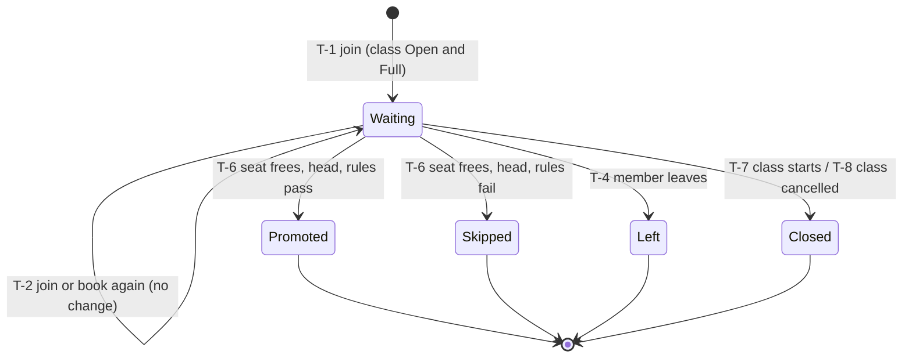

# Class Booking App: Product Specification

Living specification of what the class booking app must do. Structure and technology choices are not here; they are
`AD-<n>` decisions in `architecture.md`. Product defaults chosen where the request is silent are `D-<n>` below and are
labelled as design decisions, not user requirements.

## Sources, status and baseline

| Source | Scope / status | Used for |
| --- | --- | --- |
| Incoming request, 2026-11-20: "Add a waitlist to our class booking app so full classes don't turn people away." | Explicit user instruction, accepted | The whole delta (R-1 to R-9) |
| `KNOWLEDGE/spec.md` before this run | Absent. No earlier requirements exist, so every R-n here is new | Nothing to preserve or retire |
| Repository, discovery result, research result, current-system baseline | **Not available to this stage** | See baseline gaps |
| `GUIDES/behavioral-requirements.md#behavior-model`, `#traceability-and-review`, `#actors-channels-and-state-ownership`; `GUIDES/requirements-definition.md`; `GUIDES/platforms/ui.md#light-expressive-starting-point`; `GUIDES/service-discovery.md#verification` | Method guides | How this spec is shaped |

**Baseline (current system).** Nothing about the existing app was inspected. The only observation is the request's own
wording, which implies (inference, not inspection): classes have a capacity; members book and cancel; a booking attempt on
a full class is refused today. Everything else is unknown. Unknowns that could change required behaviour are open gaps
under the R-n they affect (G-1 to G-8). They keep only the affected work unready. R-1 to R-5 can be planned against the
stated assumptions in parallel with discovery, but cannot be called ready until the baseline confirms P-1.

**P-1 (open prerequisite, affects every R).** The existing app has classes with a capacity, a member-initiated booking,
a member-initiated cancellation, and a rejection when a class is full. Needed from discovery: the booking and
cancellation operations, the capacity field, the booking rules a booking must satisfy (credits, membership, overlapping
classes, cutoff time), how members are authenticated, and the notification channel if any.

## Vocabulary

- **Member**: a signed-in person who books classes. **Staff**: a gym employee who runs classes (staff-facing behaviour
  is not requested; see R-9 exclusions).
- **Class**: a scheduled session with a capacity and a start time. **Booking**: a confirmed seat for one member.
- **Full**: confirmed bookings are at least the capacity. **Open**: the app would still accept a booking for the class
  (before its booking cutoff and before it starts, and not cancelled).
- **Waitlist entry**: a member's queued request for a seat in one class. **Position**: 1 plus the number of Waiting
  entries ahead of it for that class.
- Outcome names used below (`WAITLISTED(n)`, `BOOKED`, `REJECTED(reason)`) name product outcomes for tests. They are not
  wire formats or UI copy. On the Member UI each outcome must be conveyed in words and not by colour alone.

## Product decisions and assumptions (design decisions, not user requirements)

| ID | Decision (default taken, unattended) | Why | Revisit if |
| --- | --- | --- | --- |
| D-1 | **Automatic promotion.** When a seat frees, the first Waiting member is booked at once. There is no offer or claim window. | Smallest behaviour that satisfies "don't turn people away"; no timers or expiry. | A claim window is wanted (G-1) |
| D-2 | Waitlist is open exactly while the class is Open and Full, so it follows the existing booking cutoff and never extends past class start. | Avoids a second time rule. | The existing cutoff is unclear (G-2) |
| D-3 | Order is first-come, first-served by join time, per class. No priority tiers. | The request names none. | A priority rule is requested |
| D-4 | At promotion the existing booking rules for that member are applied. A member who fails them is Skipped (entry ends, member is told) and the next entry is considered. | Never bypass existing rules; never block the queue behind one member. | Existing rules are discovered to forbid skipping (G-2) |
| D-5 | A member sees only their own entry and position; never who else is waiting. | Another person's record must stay off the client. | Staff or members need a count (G-5) |
| D-6 | A member's cancellation of a booking is never blocked by a waitlist failure. If promotion cannot complete, the cancellation stands and R-8's recovery rule applies. | A member must be able to give a seat back. | G-6 resolves differently |
| D-7 | No cap on waitlist length and no per-member limit on how many waitlists they join. | The request sets none; none invented. | G-4 |

## State inventory and lifecycle

| State | Meaning and invariant | Owner / location | Who may read | Simultaneous changes | Ends / removed by | Runtime quota |
| --- | --- | --- | --- | --- | --- | --- |
| Class capacity and Booking set | Existing. Bookings never exceed capacity because of this feature (I-1). | The booking authority (AD-1, unresolved) | Existing rules | Existing rules, plus R-8 | Existing | Unknown (G-8) |
| Waitlist entry, states `Waiting`, `Promoted`, `Left`, `Skipped`, `Closed` | `Waiting` is the only live state; others are terminal. At most one live entry per (member, class) (I-2). | The booking authority | The entry's own member only; the server | Resolved per class as if one at a time (R-8) | Leaves `Waiting` on promote, leave, skip, class start, class cancel. Terminal records are kept no longer than the class's booking records (assumption; G-8) | None set by the request |
| Member-screen presentation (pending, shown position) | Transient; never authoritative. | Member UI | The member | A late response must not overwrite a newer confirmed state | Page lifetime | n/a |

Personal data: only the member's existing identifier. It is shown only to that member, stored only in the entry, and in
logs only as the same identifier (NFR-6). No contact details are copied into waitlist records or logs. Removed with
the retention rule above.

**Invariants (checked after every completed operation).**
I-1 Confirmed bookings of a class never exceed its capacity because of a promotion.
I-2 A member never has both a Booking and a `Waiting` entry for the same class, and never two `Waiting` entries.
I-3 A `Waiting` entry exists only while the class is Full. Equivalently, promotion continues until the class is Full or
no `Waiting` entry remains.
I-4 Promotion order equals join order. A Skipped or Left entry does not change the relative order of the others.

## Flows

- **F-1 Book a full class (R-1, R-2).** Member opens a class. If Open and not Full the existing booking flow runs
  unchanged (R-10). If Open and Full, the member is shown that the class is full with a "join waitlist" action instead of
  a dead-end refusal. Join: T-1, or T-2/T-3.
- **F-2 Check and leave (R-3, R-4).** Member sees `Waiting, position n` and a "leave waitlist" action. Leave: T-4 or T-5.
- **F-3 A seat frees (R-5, R-6).** Member A cancels (existing cancel) or capacity is raised. In the same operation T-6
  promotes from the head until Full or empty. Each promoted or skipped member is told (R-6).
- **F-4 The class ends the waitlist (R-7).** Start time passes or staff cancel the class: T-7 or T-8.

## Transition ledger

| ID | R / F | Before (state, guard) | Trigger, actor | Operation | After, observation | Failure / recovery |
| --- | --- | --- | --- | --- | --- | --- |
| T-1 | R-2 / F-1 | Class Open and Full; member has no Booking and no live entry | Member joins | Append `Waiting` entry at tail | `WAITLISTED(n)`, n = previous Waiting count + 1; Bookings unchanged | Write fails: no entry, error shown, member may retry |
| T-2 | R-2 / F-1 | Member already has a live entry | Member joins again, or tries to book | Nothing | `WAITLISTED(current position)`; no new entry, position unchanged | None; safe retry |
| T-3 | R-2 / F-1 | Member already Booked, or class not Full, or class not Open | Member joins | Nothing | `REJECTED(already_booked)`, `REJECTED(not_full)` or `REJECTED(class_closed)`; no state change. For `not_full` the member is shown the normal booking action | None |
| T-4 | R-4 / F-2 | Member has `Waiting` entry | Member leaves | Entry becomes `Left`; later entries move up by one | Position gone; entries behind improve by 1; Bookings unchanged | Retry returns T-5 and is harmless |
| T-5 | R-4 / F-2 | No `Waiting` entry for the member | Member leaves | Nothing | `REJECTED(not_waitlisted)`; no change | None |
| T-6 | R-5, R-6 / F-3 | Class Open; seats free after a cancel or capacity increase; `Waiting` non-empty | Existing cancel by a member, or capacity raised | Cancel applies. Then, while a seat is free and a `Waiting` entry exists: take the head; if existing booking rules pass, create Booking and mark `Promoted`, else mark `Skipped` | Class Full or no `Waiting` entries (I-3); promoted member now Booked; skipped member told | If promotion cannot complete, cancel still stands (D-6); I-3 restored per R-8 |
| T-7 | R-7 / F-4 | Class start time passed, `Waiting` entries exist | Time passes (no actor) | All `Waiting` become `Closed`; no Bookings created | No live entries; join returns `REJECTED(class_closed)` | Applied when next observed if not run at the instant of start (see R-7) |
| T-8 | R-7 / F-4 | Class cancelled by staff | Staff cancel | All `Waiting` become `Closed`; no Bookings created; waiting members told | As above | Existing class-cancel failure behaviour |

Excluded event families, with reasons: capacity decrease below current bookings (existing behaviour, no waitlist effect:
`Waiting` entries stay and I-3 holds because the class is Full); waitlist timeout/expiry before class start (not
requested, D-1 has no claim window); retry exhaustion (no external retry channel owned by this feature).

## Requirements

Surfaces: **Member UI** is the member's screen in the existing app, observed in a browser. **Booking interface** is
the app's server-side booking operations (join, leave, cancel, book, read class), observed by a service-level test.
Both are assumptions until P-1 is resolved.

Fixture **FX-1** is used throughout: class C-100 "Spin Tue 18:00", capacity 2, Open; members Ana, Ben, Cy, Dee, Eve,
each signed in as themselves, with no Bookings and no entries. Setup: Ana and Ben book through the existing booking
operation (precondition P-1). The class is then Full with `Waiting` empty.

### R-1: A full class offers the waitlist instead of turning the member away

- **Basis:** request 2026-11-20, "so full classes don't turn people away." **Change:** add. **Preserved:** booking a
  class that is not Full (R-10). **Source locators:** request sentence; F-1. **Evidence limits:** the existing
  full-class refusal was not inspected (P-1). **Pending:** implementation and all checks below, none run.
- **Behaviour:** when an Open class is Full, the member's attempt to book is answered with "class is full" together with
  an available "join waitlist" action.
- **Boundaries:** applies only to Open and Full classes. A class with one free seat is not Full. A class that is not Open
  gets no waitlist offer (R-7).
- **Error behaviour:** the offer never books the member and never changes the class.
- **Consumer outcome:** the member sees a next step, not a dead end.
- **AC-1.1 (positive):** FX-1, Cy attempts to book. Expect no Booking for Cy, outcome offers the waitlist, Bookings
  still {Ana, Ben}. Surface: Member UI shows the full notice and an enabled "join waitlist" control reachable by
  keyboard; Booking interface returns the full-class offer. Confirmed by a browser check and a service test.
- **AC-1.2 (failure):** n/a: the offer has no failure path of its own; join failures are AC-2.x.
- **AC-1.3 (boundary):** FX-1 with only Ana booked (one free seat). Cy attempts to book. Expect `BOOKED` and no
  waitlist offer. Surface: both. Confirmed by service test, plus a browser check.

### R-2: A member can join the waitlist of a full class

- **Basis:** request 2026-11-20, same sentence; joining is the minimum act that waitlisting needs (inference).
  **Change:** add. **Preserved:** one seat per member per class (R-10). **Source locators:** F-1, T-1 to T-3, D-2, D-7.
  **Evidence limits:** cutoff and eligibility rules unknown (G-2). **Pending:** all checks.
- **Behaviour:** an authenticated member joins; the entry goes to the tail of that class's queue; the member is told
  their position.
- **Boundaries:** join is valid only when the class is Open and Full and the member has no Booking and no live entry.
  Joining twice is a no-op that returns the current position (T-2). Eligible members are those who could book if
  a seat were free; whether ineligibility is checked at join or only at promotion is G-2 (default D-4: at promotion).
- **Error behaviour:** `REJECTED(already_booked)`, `REJECTED(not_full)`, `REJECTED(class_closed)` with no state change.
  A member can join only as themselves.
- **Consumer outcome:** the member sees "Waiting, position n".
- **AC-2.1 (positive):** FX-1, Cy joins then Dee joins. Expect `WAITLISTED(1)` for Cy, `WAITLISTED(2)` for Dee,
  Bookings {Ana, Ben}. Surface: Member UI shows each member's own position; Booking interface returns it. Confirmed by
  service test and browser check.
- **AC-2.2 (failure):** FX-1, Ana (Booked) joins: `REJECTED(already_booked)`, no entry. With only Ana booked, Ben joins:
  `REJECTED(not_full)`, no entry. Join after class start: `REJECTED(class_closed)`. Surface: Booking interface.
  Confirmed by service test; UI shows a plain-language reason.
- **AC-2.3 (boundary):** FX-1 with Cy already Waiting; Cy joins again, then books directly. Both give `WAITLISTED(1)`;
  `Waiting` still has one entry for Cy. Surface: Booking interface. Confirmed by service test.

### R-3: Waitlist order is first-come, first-served and the member can see their position

- **Basis:** request 2026-11-20; fairness of a queue is inferred, order rule is D-3. **Change:** add. **Source
  locators:** I-4, D-3, D-5. **Evidence limits:** no priority rule requested. **Pending:** all checks.
- **Behaviour:** position is 1 plus the Waiting entries ahead. It is shown to the member and updates when entries ahead
  leave, are skipped or are promoted.
- **Boundaries:** two members joining at the same instant still get two different positions (R-8).
- **Error behaviour:** a member without a live entry sees no position.
- **Consumer outcome:** the member can tell how close they are without seeing who else is waiting.
- **AC-3.1 (positive):** FX-1 with Cy at 1 and Dee at 2; Cy leaves. Expect Dee at 1. Surface: Member UI (after a reload
  or the live update, whichever the plan selects) and Booking interface. Confirmed by service test and browser check.
- **AC-3.2 (failure):** Eve, who has no entry, reads the class. Expect no position for Eve and no other member's name
  or position. Surface: Booking interface response contents. Confirmed by service test inspecting the full response.
- **AC-3.3 (boundary):** position 1 with no one ahead is "1", never 0. Confirmed with AC-2.1.

### R-4: A member can leave the waitlist

- **Basis:** request 2026-11-20 (a waitlist the member cannot leave would hold a place the member no longer wants;
  inference). **Change:** add. **Source locators:** F-2, T-4, T-5. **Pending:** all checks.
- **Behaviour:** the member removes their own entry; members behind move up by one.
- **Boundaries:** leaving is available only while the entry is `Waiting`. Leaving does not affect any Booking.
- **Error behaviour:** `REJECTED(not_waitlisted)` without change; a repeated leave is harmless.
- **Consumer outcome:** the member no longer appears waiting and gets no later promotion.
- **AC-4.1 (positive):** FX-1, Cy at 1, Dee at 2, Cy leaves. Expect Cy has no entry, Dee at 1, Bookings
  {Ana, Ben}. Surface: both. Confirmed by service test and browser check. Then Ana cancels: Dee, not Cy, is promoted.
- **AC-4.2 (failure):** Cy leaves again: `REJECTED(not_waitlisted)`, state unchanged. A member cannot remove another
  member's entry (Eve addressing Dee's entry is refused, nothing changes). Surface: Booking interface.
- **AC-4.3 (boundary):** n/a: leaving the only entry is covered by AC-4.1's mechanics and I-3 (nothing else to promote).

### R-5: When a seat frees, the first waiting member is booked automatically

- **Basis:** request 2026-11-20, "so full classes don't turn people away"; a waitlist that never converts into a seat
  would still turn people away (inference). Automatic promotion is D-1, a design decision. **Change:** add.
  **Preserved:** existing cancel behaviour; capacity is never exceeded (I-1). **Source locators:** F-3, T-6, D-1, D-4,
  D-6, I-3. **Evidence limits:** existing booking rules unknown (G-2); whether staff can change capacity unknown (G-7);
  claim-window alternative unresolved (G-1). **Pending:** all checks.
- **Behaviour:** when a member's cancellation, or a capacity increase, leaves seats free and entries are `Waiting`,
  the system books the head of the queue, repeating until the class is Full or the queue is empty. This happens as part
  of the operation that freed the seat.
- **Boundaries:** one freed seat promotes exactly one member; a capacity raise from 2 to 4 with two waiting promotes
  both, in order. Promotion happens only while the class is Open; nothing is promoted once the class has started.
- **Error behaviour:** a head who fails the existing booking rules is `Skipped` and told (D-4); the next entry is tried.
  If every `Waiting` entry is skipped the seat stays free and the queue is empty. If promotion cannot complete, the
  cancel stands (D-6) and R-8's recovery applies.
- **Consumer outcome:** the promoted member holds a normal Booking, indistinguishable from any other.
- **AC-5.1 (positive):** FX-1 with Cy at 1, Dee at 2; Ana cancels. Expect Bookings {Ben, Cy}, Dee at 1, Cy told,
  Ana's cancel confirmed, I-1 and I-3 hold. Then Cy cancels: Bookings {Ben, Dee}, queue empty. Surface: both. Confirmed
  by service test (the lower-layer test for this primary outcome) and a browser check of Cy's screen.
- **AC-5.2 (failure):** Cy fails an existing booking rule at promotion time, Dee eligible; Ana cancels. Expect Cy
  `Skipped` and told, Dee promoted, Bookings {Ben, Dee}. NOT-REPLAYED here: needs a real rule from P-1 (G-2); until
  discovery names one, this line stays open. Surface: Booking interface.
- **AC-5.3 (boundary):** FX-1, Cy and Dee waiting; capacity raised 2 to 3 expects Cy promoted, Dee at 1; raised 2 to 4
  expects both promoted, queue empty. Applies only if capacity can change (G-7). Cancelling when the queue is empty
  just frees the seat: Eve can then book (`BOOKED`). Surface: Booking interface.

### R-6: Members are told what happened to their entry

- **Basis:** request 2026-11-20 (a member who is promoted but never learns of it still loses the seat; inference).
  **Change:** add. **Source locators:** F-3, AD-3. **Evidence limits:** the existing notification channel is unknown
  (G-3). **Pending:** all checks.
- **Behaviour:** a member who is promoted, skipped or closed-out by a class cancellation is told, on the app's
  existing notification channel and also on the member's own class view, where the class now shows as Booked or the
  entry as ended with the reason.
- **Boundaries:** acknowledgement of a join is the position returned immediately; it proves nothing about later
  promotion. A promotion notice is sent once per promotion.
- **Error behaviour:** if notification delivery fails, the Booking still stands and the class view still shows the
  truth; the failure is logged (NFR-6).
- **Consumer outcome:** the member can always find out their real status by opening the class.
- **AC-6.1 (positive):** AC-5.1 flow, Cy's class view shows Booked for C-100 and one notice for Cy is recorded.
  Surface: Member UI (Cy's session) and the notification record. Confirmed by browser check and service test.
- **AC-6.2 (failure):** notification sender fails during AC-5.1: Cy's Booking exists, Cy's class view shows Booked, a
  log record exists, no second promotion occurs. Surface: Booking interface and log. Confirmed by service test with a
  failing sender.
- **AC-6.3 (boundary):** two promotions in one operation (AC-5.3, 2 to 4) produce one notice per member, no duplicates.

### R-7: The waitlist ends with the class

- **Basis:** request 2026-11-20 (the waitlist cannot outlive the class it is for; inference). Cutoff rule D-2.
  **Change:** add. **Source locators:** F-4, T-7, T-8, D-2. **Evidence limits:** booking cutoff and how the app
  notices elapsed time are unknown (G-2). **Pending:** all checks.
- **Behaviour:** at class start every `Waiting` entry becomes `Closed` and no one is booked from it. If staff cancel the
  class, `Waiting` entries become `Closed` and the waiting members are told (R-6).
- **Boundaries:** at and after the start time a join returns `REJECTED(class_closed)`; before it, the rules above apply.
- **Error behaviour:** if no process acts at the instant of start, the entry must still be treated as `Closed` the
  next time it is read, and no promotion may occur after start.
- **Consumer outcome:** no member is left holding a place in a class that already happened.
- **AC-7.1 (positive):** FX-1 with Cy waiting; the start time passes. Expect Cy's entry `Closed`, Bookings
  {Ana, Ben} unchanged. Surface: Booking interface with a controllable clock. Confirmed by service test.
- **AC-7.2 (failure):** FX-1 with Cy waiting; staff cancel C-100. Expect Cy `Closed`, Cy told, Dee's join
  `REJECTED(class_closed)`. Surface: Booking interface; Cy's class view.
- **AC-7.3 (boundary):** at the exact start instant, Ana cancels with Cy waiting: expect no promotion (the class is not
  Open), Cy `Closed`. Surface: Booking interface with a controllable clock.

### R-8: The waitlist stays correct under concurrent and repeated requests

- **Basis:** request 2026-11-20; a booking system that lets two people take one seat has failed. **Change:** add.
  **Source locators:** I-1 to I-4, AD-1. **Evidence limits:** the store's concurrency support is unverified (AD-1).
  **Pending:** all checks; the mechanism is the plan's choice.
- **Behaviour:** operations on one class behave as if applied one at a time. A freed seat is either taken by the head of
  the queue or, with an empty queue, by a direct booking; a direct booking can never take a seat ahead of a waiting
  member.
- **Boundaries:** applies per class. Different classes do not wait on each other.
- **Error behaviour:** a repeated join returns T-2; a repeated cancel is refused by the existing rules and must not
  trigger a second promotion. If promotion fails midway, I-3 is restored the next time any write on that class is
  accepted, and G-6 asks who repairs it sooner.
- **Consumer outcome:** capacity and order always add up, and each seat has one holder.
- **AC-8.1 (positive):** FX-1, Cy, Dee, Eve each send a join at the same time. Expect three entries at positions
  1, 2, 3 in some order, all distinct, no duplicates. Surface: Booking interface under concurrent calls. Confirmed by
  service test.
- **AC-8.2 (failure):** FX-1 with Cy waiting; Ana's cancel and Eve's direct book arrive together. Expect exactly one of:
  (a) Eve's book first, Eve is offered the waitlist and joins at position 2, then Ana's cancel promotes Cy; or
  (b) cancel first, Cy promoted, then Eve is offered the waitlist. Never Eve booked while Cy waits; Bookings never above
  2. Also: Ana's cancel sent twice yields one promotion.
- **AC-8.3 (boundary):** a failure injected after the cancel commits and before the promotion commits leaves Ana
  cancelled and Cy `Waiting`; the next write on C-100 (Dee's join) first promotes Cy and then gives Dee position 1.
  NOT-REPLAYED: needs the mechanism chosen in the plan (AD-1); stays open.

### R-9: Members can only see and change their own entries

- **Basis:** request 2026-11-20 is silent; this is a baseline privacy and authority rule (D-5). **Change:** add.
  **Source locators:** state inventory, D-5. **Evidence limits:** existing authentication unknown (P-1).
  **Pending:** all checks.
- **Behaviour:** join and leave act on the signed-in member's own entry; identity comes from the session, never from a
  field the client supplies. Other members' names, entries and positions are never sent to a client.
- **Boundaries:** applies to every read of a class, including the booking interface's raw response.
- **Error behaviour:** an unauthenticated call or a call for another member is refused with no change.
- **Consumer outcome:** nobody learns who else waits.
- **AC-9.1 (positive):** Cy's own class view and response show Cy's entry and position only.
- **AC-9.2 (failure):** a signed-out join, and Eve joining "as Cy", are both refused; Cy's entry is untouched.
- **AC-9.3 (boundary):** n/a: no staff access is specified (see exclusions).
- Surface for all: Booking interface plus Member UI. Confirmed by service test of the complete response body and a
  browser check.
- **Exclusions (domain rules the request leaves out, bounding this R):** staff view of the waitlist, waitlist counts,
  and any waitlist-specific permissions for staff. **Gap G-5:** whether staff or members need a count.

### R-10: Existing booking behaviour is unchanged for everything the waitlist does not touch

- **Basis:** no maintained spec exists; the request is additive. **Change:** preserve (a placeholder to be filled from
  the baseline). **Evidence limits:** the existing behaviour was not inspected (P-1).
- **Behaviour:** booking a class with free seats, cancelling a booking, class listings and any existing cancellation
  policy behave exactly as before, apart from the extra waitlist state in R-3 and the promotion in R-5.
- **Boundaries:** classes that are not Full and members with no waitlist entries see no difference.
- **Error behaviour:** n/a: no new error path beyond R-2 and R-4.
- **Consumer outcome:** nobody who never uses the waitlist notices any change.
- **AC-10.1 (positive):** AC-1.3's `BOOKED` path and an ordinary cancel with an empty queue behave as in the baseline.
  Confirmed by the existing booking and cancel tests (to be located by discovery) run unchanged, plus a browser check.
- **AC-10.2 / AC-10.3:** n/a: fully covered by existing tests once located. This stays unready until P-1 is resolved.
- **Exclusions:** payments, credits, late-cancel fees, no-show handling, recurring or multi-class bookings, group
  bookings. The request did not mention them. Any existing rule of these kinds still applies at promotion (D-4); the
  waitlist adds none of its own.

### Open gaps (all unresolved, each stays under the R-n it affects)

| Gap | Under | Question | Default recorded / effect |
| --- | --- | --- | --- |
| G-1 | R-5 | Automatic booking, or an offer the member must accept within a time? | D-1 automatic. A claim window would add timers and an expiry owner; R-5, R-6 and AD-2 would change. |
| G-2 | R-2, R-5, R-7 | What booking rules (credits, membership, overlap) and cutoff time apply, and should a member who fails them be skipped or kept? | D-2 and D-4. Blocks AC-5.2; does not block R-1 or R-3. |
| G-3 | R-6 | Does the app have a notification channel? | Reuse it if it exists; otherwise the class view alone satisfies R-6. |
| G-4 | R-2 | Waitlist length cap or per-member limit? | D-7 none. No bound is invented. |
| G-5 | R-9 | Do staff or members need a waitlist count? | None; member sees own position only. |
| G-6 | R-8 | Who repairs a missed promotion sooner than the next write on the class? | Next-write recovery only; owner unresolved. AC-8.3 stays open. |
| G-7 | R-5 | Can capacity be changed after bookings exist, and by whom? | AC-5.3 capacity lines apply only if it can. |
| G-8 | state | Runtime quotas and retention rules of the existing store. | Terminal entries kept no longer than the class's booking records. |

## Non-functional requirements

**NFR-1 (data integrity; R-5, R-8).** Operating condition: any number of concurrent members on one class. Bound: zero
over-capacity bookings and zero duplicate seat holders at rest (I-1, I-2, I-3). Verification: concurrent service test
at the Booking interface using the AC-8.1 and AC-8.2 interleavings on FX-1. The test's call volume is a test input,
not a product bound. Status: accepted, unverified.

**NFR-2 (promotion latency; R-5).** Observable bound: when the cancel call returns, the promotion has already been
applied, so a following read shows the promoted Booking. No numeric time limit is set because the request gives
none and none is invented. Unresolved: a response-time target for join, leave and cancel (missing: the existing
baseline latency and the user's expectation). Verification: AC-5.1 read-after-cancel.

**NFR-3 (accessibility; Member UI).** Keyboard operation of "join waitlist" and "leave waitlist"; visible focus;
accessible names that state the class and action; position and promotion changes announced through a polite live
region; WCAG AA contrast in light and dark; reduced-motion honoured. Verification: browser checks with keyboard-only
operation and a contrast check on both themes. A DOM assertion alone is not a full audit.

**NFR-4 (interface quality; Member UI).** The waitlist screens and states are deliberately designed, not unstyled
scaffolding:
- one visual system: spacing and type scales, a palette with a light and a dark theme;
- designed empty ("nobody waiting"), loading (pending join/leave), error (rejected, failed write) and success
  ("Waiting, position n", "You're in") states; a pending state is shown until the Booking interface confirms, and a
  failed join is shown as failed and not as waiting;
- a layout that works at a narrow (about 360 px) and a wide (about 1280 px) width with no horizontal overflow;
- visible focus states; motion only where it explains a change (position moves up, promoted to Booked) and not under
  reduced motion; one icon set.

*Visual reference and starting appearance.* The app is an existing product (P-1), so the waitlist screens inherit its
established identity, tokens and platform conventions, which are not known to this stage. Where that identity is
missing or does not cover a choice, the named reference is the light Gemini look and feel using Material 3 Expressive
principles (`GUIDES/platforms/ui.md#light-expressive-starting-point`): luminous light canvas, tonal rounded surfaces,
restrained saturated accent, humanist sans-serif from local fonts, and a "your position" indicator as the one
memorable detail. It starts light with a dark option. The plan chooses the concrete treatment and records it as a UI AD.
Verification: rendered browser checks at both widths and both themes. Status: accepted, unverified.

**NFR-5 (privacy and retention; R-9).** Personal data limited to the existing member identifier; shown only to its
owner; terminal entries retained no longer than the class's booking records (G-8); no contact details in waitlist
records. Verification: response-body inspection (AC-3.2) and a data-field review.

**NFR-6 (observability; R-6, R-8).** Each join, leave, promotion, skip and close is logged by the app's existing logger
with class id, member identifier, outcome and time, and no contact details; a failed notification is logged. Reuse the
existing destination. Verification: log retrieval in AC-6.2. If the destination is not accessible that is an evidence
gap, not proof of absence.

**NFR-7 (compatibility and rollback; R-10).** Additive: no change to existing booking data. Removing the feature leaves
all Bookings intact. Entries still `Waiting` at that moment are lost, so those members would lose their queue
position. Release mechanism unknown (P-1). Verification: existing booking tests run unchanged (AC-10.1).

**NFR-8 (excluded).** Scalability targets, availability SLA, load testing: no workload figure exists, and a gym class
roster is small; excluded as not established, not as satisfied.

## Request traceability

| Request outcome | Kind | Acceptance lines |
| --- | --- | --- |
| O-1 A member trying to book a full class is not turned away | Stated | AC-1.1, AC-1.3, AC-2.1 to AC-2.3 |
| O-2 A waiting member actually gets a seat when one frees | Inferred, since without it people would still be turned away | AC-5.1 to AC-5.3, AC-6.1 to AC-6.3 |
| O-3 The member can see and leave their place | Inferred, supporting O-1 | AC-3.1 to AC-3.3, AC-4.1, AC-4.2 |
| O-4 The waitlist cannot double-book seats or outlive the class | Inferred, safety | AC-7.1 to AC-7.3, AC-8.1 to AC-8.3, NFR-1 |
| O-5 Nothing else about booking changes | Inferred, scope guard | AC-10.1 |

Primary outcomes, what the user asked for directly: R-1, R-2, R-5. Product acceptance may accept one left unverified
only with a passed lower-layer test (AC-5.1's service test is that for R-5).

## Replay record

All scenarios were walked by hand against the transition ledger, checking at each step that the rule permits the
action in the state the previous step left. A scratch model in the scratchpad (`walk.py`, outside this directory) was
written to check them mechanically, but its run was not approved, so **no execution is claimed**. Each is
`NOT-REPLAYED: machine run not approved`, which leaves it open:

| Case | Hand-recomputed result |
| --- | --- |
| AC-1.1, AC-2.1 | Ana, Ben booked (2 of 2, Full). Cy attempts: no seat (T-3 guard: Full), offered waitlist. Join: T-1, `WAITLISTED(1)`; Dee `WAITLISTED(2)` |
| AC-5.1 | Ana cancels: seat free, T-6 head is Cy, rules assumed to pass: Cy Booked; Dee now position 1. Cy cancels: seat free, Dee promoted; queue empty. Final Bookings {Ben, Dee} |
| AC-4.1 | Cy leaves (T-4): Dee at 1. Ana cancels: Dee promoted, Bookings {Ben, Dee} |
| AC-5.3 | 2 to 3: one seat free, Cy promoted, class Full again, Dee at 1. 2 to 4: two seats, Cy then Dee |
| AC-2.2 | Ana already Booked: `already_booked`. One free seat: `not_full`. After start: `class_closed` |
| AC-7.1 to 7.3 | At start the entry is `Closed` (T-7); a cancel at the instant of start does not promote because the class is no longer Open |
| AC-8.2 | Order (a): Eve's book hits a Full class, is offered the waitlist, Eve joins at 2 (Cy is 1); Ana cancels and Cy is promoted. Order (b): cancel first promotes Cy, so Eve is offered the waitlist. In neither order is Eve booked while Cy waits |
| AC-5.2, AC-8.3 | Not computable yet: need a real booking rule (G-2) and the chosen mechanism (AD-1) |

The start state of every case (FX-1) needs the existing booking operation (P-1), so the whole record also depends on
P-1.

## Retired

None. No earlier requirements existed.

## Submission

**summary:** Spec for a class-booking waitlist: ten requirements (R-1 to R-10), eight NFRs, a state inventory, ledger
T-1 to T-8, invariants I-1 to I-4, and a hand-walked replay record. No repository, discovery or baseline existed for
this stage, so the existing app's behaviour was never inspected. P-1 (the existing booking, cancel, capacity, rules,
authentication and notification behaviour) is an open prerequisite that keeps R-10 and the existing-rule parts of R-5
unready. **Open items:** G-1 to G-8 above. None is a material conflict between requirements. **Assumptions recorded as
defaults:** D-1 automatic promotion with no claim window; D-2 the waitlist follows the booking cutoff and ends at class
start; D-3 first-come, first-served; D-4 existing booking rules apply at promotion and a failing member is skipped; D-5
members see only their own position; D-6 a cancel is never blocked by waitlist failure; D-7 no waitlist cap. The
Member UI and Booking interface surfaces are assumed, since the app's actual surfaces are unknown. The scenario walk
was not executed by machine (command approval not given): marked NOT-REPLAYED and open. The backchain-check duty does
not apply here and was left out. Nothing in this spec claims implementation or test success.

**primary:** R-1, R-2, R-5

**evidence_refs:** `KNOWLEDGE/spec.md` (all requirement sections R-1 to R-10, state inventory, ledger, replay record);
`KNOWLEDGE/architecture.md` (AD-1 to AD-3); the incoming request text above (2026-11-20);
`GUIDES/behavioral-requirements.md` (#behavior-model, #traceability-and-review, #actors-channels-and-state-ownership);
`GUIDES/requirements-definition.md`; `GUIDES/current-system-baseline.md#planning-and-review-handoff` (no baseline exists
to reopen); `GUIDES/platforms/ui.md#light-expressive-starting-point`; `GUIDES/service-discovery.md#verification`
(service-boundary contracts: single in-app authority, no separate service, so freshness, revocation and async
completion are inapplicable except the cancel-then-promote step, covered by R-8).
