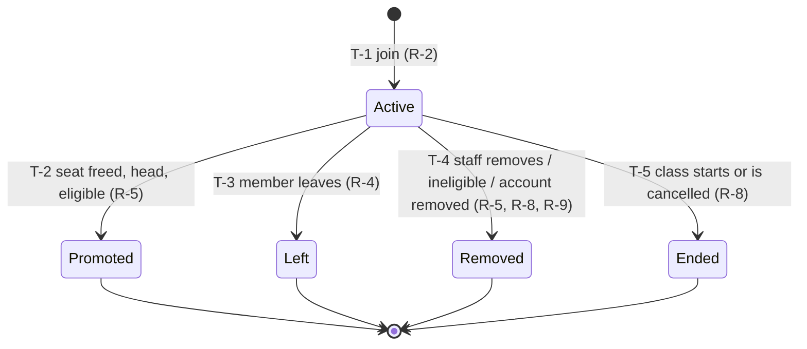

# Class Booking App — Product Specification

Status: first specification of this product in this knowledge home. Written 2026-11-20 by the spec stage.

## Scope, sources and evidence limits

**Request (source S-1, dated 2026-11-20, verbatim):** "Add a waitlist to our class booking app so full classes don't turn people away."

**Request outcomes** (atomic, traced in "Traceability" below):

- O-1: when a class is full, a person who wants it is not turned away; they can wait for it.
- O-2: a person who waits actually gets a seat when one opens (a waitlist that never yields a seat does not meet the intent of O-1).

**Sources inspected:** none beyond S-1 and the ShipLoop guides (`GUIDES/behavioral-requirements.md#behavior-model`, `#traceability-and-review`, `#actors-channels-and-state-ownership`; `requirements-definition.md`; `service-discovery.md#verification`; `platforms/ui.md#light-expressive-starting-point`; `current-system-baseline.md#planning-and-review-handoff`). There is no repository, no earlier spec, no discovery or research result and no selected baseline in this run.

**Consequence (G-1, open):** how the class booking app works today is *unobserved*. Everything below that says "existing" or "today" is an **assumption about a typical class-booking product**, labelled `[assumed]`, and must be reopened against the real baseline before planning. Nothing in this spec is an observation of the real app. Evidence limit for every R-<n>: S-1 plus these guides only.

**Retired requirements:** none (this is the first spec; no earlier R-<n> exist).

### Actors `[assumed]`

- **Member**: signed-in person who books classes for themselves.
- **Staff**: person who runs classes and can cancel classes, change capacity and cancel bookings (G-5: whether a staff role and admin surface exist is unverified).
- **System**: the booking service, including whatever sends notifications (G-4).
- **Operator**: whoever may turn the waitlist on or off; may be the same people as Staff (G-5).

### Vocabulary

- **Class**: a scheduled session with a start instant and a capacity (seats).
- **Booking**: a confirmed seat for one member in one class.
- **Full**: confirmed bookings ≥ capacity.
- **Waitlist entry**: one member's queued request for one class. At most one active entry per (class, member).
- **Promotion**: the System converting the head waitlist entry into a booking.

### Core invariants (must hold after every operation completes, on every path: member UI, staff UI, API, retries)

- **I-1** Confirmed bookings for a class never exceed its capacity because of a waitlist operation.
- **I-2** A member never holds both a confirmed booking and an active waitlist entry for the same class.
- **I-3** While the waitlist is enabled for a class, after any operation completes either the class is full or its waitlist is empty. A freed seat is never left open while someone is queued, and a person who is not queued can never take a seat ahead of the queue.
- **I-4** One freed seat produces at most one promotion; one promotion produces at most one booking and one promotion notification.
- **I-5** A member sees only their own waitlist data; they never see another member's identity or entry.
- **I-6** No waitlist operation silently loses a booking or an entry: every removal has a recorded reason (R-12).

## Requirements

Acceptance-line format: **P** positive, **F** failure, **B** boundary, **Surf** the consumer surface where observed, **Conf** how confirmed. Each of P/F/B appears only where it says something the others do not, else `n/a: <reason>`. Every R-<n> ends with a **Basis** block (source, preserved/changed behaviour, evidence limits, pending work).

### R-1 A full class offers the waitlist instead of a dead end

Behaviour: a member viewing a class that is full, in the future, not cancelled, with the waitlist enabled for it (R-11), and for which they hold neither booking nor entry, is offered "Join waitlist" in place of whatever the app shows today for a full class `[assumed: a disabled/“Class full” state]`. The class card also states that it is full.
Boundaries: the offer appears only in the state above. Shown instead: seats open → today's "Book"; member booked → "Booked"; member queued → "On waitlist · #n" (R-3); class started or cancelled → today's behaviour; waitlist disabled for the class → exactly today's full-class state (R-11).
Error behaviour: if the class state changes between view and action, the action is judged on the state at the moment it is received (R-2), not on what was displayed.
Consumer outcome: a member looking at a full class always sees a path forward.

- AL-1.1 P: Class "Yoga Mon 18:00" (capacity 2, Ana and Ben booked, start in the future), waitlist enabled; Fay (no booking/entry) opens it → sees "Full" and an enabled "Join waitlist" control. Surf: member web UI class detail and class list. Conf: browser check by semantic query (button named "Join waitlist").
- AL-1.2 F: same class with the waitlist disabled for it → no "Join waitlist" control; shows exactly the pre-feature full state. Surf: member UI. Conf: browser check + comparison against baseline screenshot/text once G-1 is closed.
- AL-1.3 B: capacity 2 with exactly 1 booking → shows "Book", not the waitlist; class with 2 bookings and capacity 2 → shows waitlist (full is ≥, not >). Class whose start instant has passed → no waitlist control. Surf: member UI. Conf: browser check, one case per boundary.
- Basis: S-1 "so full classes don't turn people away" (2026-11-20). Preserve: non-full classes and booking flow (R-13). Change: full-class state gains the offer. Sources: S-1; behavior model guide. Evidence limits: today's full-class state is `[assumed]` (G-1). Pending: implementation, browser checks.

### R-2 Joining the waitlist

Behaviour: a member joins the waitlist of a full class by an explicit action. On success an active entry is created for (class, member) and the member sees confirmation with their position (R-3). The refusal conditions, each with a distinct, user-readable message and no state change:

1. class not full (seats are open) → refuse with "seats available — book instead"; the class view refreshes;
2. member already has a confirmed booking for the class → refuse "already booked" (I-2);
3. member already has an active entry → **no refusal and no duplicate**: respond with the existing entry and its current position (idempotent; covers double-click, two devices, client retry after a timeout);
4. class started (now ≥ start instant, absolute instant, not wall-clock text) or cancelled → refuse;
5. waitlist disabled for the class or globally (R-11) → refuse;
6. not signed in → existing sign-in behaviour `[assumed]`, no entry created.

Limits: no maximum waitlist length, per-member limit on concurrent waitlists, or joining fee is in the request, so none is specified. The *absence* of a cap is a decision for the user (G-6, open); until decided the spec does not forbid a plan from enforcing a documented cap, but the acceptance below applies to the uncapped case.
Error behaviour: if the write fails or the outcome is unknown (timeout), the member sees "not confirmed — check My waitlist" and a retry never creates a second entry (rule 3). The UI never shows "On waitlist" before the System confirmed it.
Consumer outcome: exactly one entry exists afterwards, or the member has a clear reason it does not.

- AL-2.1 P: Fay joins the full Yoga class (Ana, Ben booked; empty waitlist) → active entry created; response/UI states "On waitlist · #1". Surf: member UI and the member's "My waitlist" (R-9). Conf: browser check + service-level read of entries (count of active entries for the class = 1).
- AL-2.2 F: for each of refusal rules 1, 2, 4, 5 one case with an assertion that the entry count and booking count are unchanged and the message matches. Surf: API/service response and UI. Conf: service-level tests per rule + one browser check for rule 1.
- AL-2.3 B: Fay joins twice in succession (and by two concurrent requests) → one entry, same position both times, entry count 1. A join at an instant equal to the start instant is refused; one instant earlier succeeds. Surf: service level. Conf: concurrent-request test (two parallel joins), boundary-instant test with a controllable clock.
- Basis: S-1. Preserve: nothing existing is changed except the full-class dead end. Change: new action. Evidence limits: refusal messages and sign-in behaviour `[assumed]`. Pending: G-6; implementation; tests.

### R-3 Queue order and position

Behaviour: entries are served first-come-first-served by the System's own record of when the join was accepted (not a client-supplied time). Two entries accepted at the same instant are ordered by a stable System-assigned tiebreak so the order is total and never changes except by removals ahead. The member's position is 1 + the number of active entries ahead of theirs for that class. A member who leaves and rejoins goes to the end. Positions close up when an entry ahead leaves, is promoted or is removed. There is no priority, no paid priority, no reordering by staff (left out; not in request).
Consumer outcome: a member knows where they stand and why it moved.

- AL-3.1 P: Cy, Dee, Eli join in that order → positions 1, 2, 3; Dee leaves → Eli becomes 2 and Cy stays 1. Surf: member UI per member. Conf: service test of ordering; browser check of displayed position.
- AL-3.2 F: n/a: ordering has no failure path of its own; a failed join is R-2.
- AL-3.3 B: two joins accepted concurrently get distinct positions (no two entries share a position); a lone entry is #1; leaving and rejoining yields last position, not the old one. Surf: service level. Conf: concurrent-join test; rejoin test.
- Basis: S-1 "waitlist" (FIFO is the ordinary meaning of the word; recorded as a default, A-1). Pending: implementation/tests.

### R-4 Leaving the waitlist

Behaviour: a member may remove their own active entry at any time before it ends. Effect: entry removed, positions behind close up, no penalty and no booking consequences. The control states that leaving gives up the position.
Error behaviour: leaving when no active entry exists (never joined, already left, already promoted, class started) is not an error that harms anything: the response reports the member's current state ("not on waitlist" or "you are booked") and changes nothing; in particular **a leave never cancels a booking** (promotion-vs-leave race, S-4 below).
Consumer outcome: a member can undo their join; a repeated or late leave is harmless.

- AL-4.1 P: Dee (position 2) leaves → entry gone; Eli moves up; Dee's "My waitlist" no longer lists the class. Surf: member UI. Conf: browser check + service read.
- AL-4.2 F: Dee leaves a second time → "not on waitlist", entry count unchanged, no booking changed. Surf: service. Conf: service test.
- AL-4.3 B: Cy is promoted (booked) and Cy's stale page sends leave → response says booked; Cy's booking still exists and capacity count unchanged. Surf: service. Conf: sequential test of "promote then leave"; concurrent test in S-4.
- Basis: S-1; "undoing a mistake" lens. Pending: implementation/tests.

### R-5 Promotion: a freed seat goes to the head of the queue

Behaviour: whenever a class goes from full to having an open seat while the waitlist is enabled for it, the System promotes the head entry: it creates a booking for that member in the same operation that freed the seat, removes the entry, and notifies the member (R-7). Triggers that free a seat: a member cancels a booking; staff cancels a booking; capacity is raised (frees *k* = new − old seats; promotes up to *k* heads in order); a member's booking is removed by the account rules in R-8. Promotion is automatic. **Default A-2:** automatic booking, not an "offer with a claim window", because the request wants full classes not to turn people away and a claim window adds timers, expiry and more races; this is a product decision for the user (G-2, open) and, until decided, the plan treats the choice as unready for any claim-window variant.
Eligibility: at promotion time the head member must pass whatever check a direct booking would pass today (G-3: what that check is, including payment or credits, membership validity and overlapping-class rules, is unverified). **Default A-3:** if the head fails the check, that entry is removed with a recorded reason and the member is notified (R-7), and the next entry is tried; this continues until a seat is filled or the queue is empty. Eligibility is judged *now*, not at join time (freshness: authority is the current account/booking state, not a copy taken at join).
Error behaviour: if creating the booking fails for a reason other than eligibility (storage fault), the operation that freed the seat must not leave a state that violates I-3 silently: either the whole freeing operation and promotion fail together and the caller sees an error, or the seat is promoted on recovery (the plan chooses; the acceptance is the invariant). Nothing is half-done: no entry removed without a booking or a recorded skip reason.
Consumer outcome: a waiting member ends up booked without having to be watching.

- AL-5.1 P: capacity 2, Ana and Ben booked, waitlist Cy(1), Dee(2), Eli(3); Ana cancels → in the same operation Cy is booked; bookings = {Ben, Cy}; waitlist Dee(1), Eli(2); Cy notified once. Surf: service state read and Cy's "My bookings". Conf: service-level test then browser check of Cy's view.
- AL-5.2 F: capacity 1, Ben booked, waitlist Cy(1), Dee(2); Cy fails the booking eligibility check (concrete trigger fixed from baseline, G-3); Ben cancels → Cy removed with reason, Cy notified, Dee booked, waitlist empty, bookings = {Dee}. Surf: service state; notification record. Conf: service test. If every queued member fails → seat stays open, waitlist empty (I-3 holds).
- AL-5.3 B: capacity raised 2 → 4 with Eli alone waitlisted and 2 booked → Eli booked, 1 seat open, waitlist empty, a direct "Book" by Gus now succeeds. Capacity raised by 3 with 1 queued → 1 promotion, 2 seats open. Capacity *lowered* (e.g. 4 → 1 below confirmed 3) → no booking is removed by the waitlist and no promotion occurs until confirmed < capacity. Surf: service state. Conf: service tests per case.
- Basis: S-1 "full classes don't turn people away" and O-2. Preserve: cancellation behaviour/refund rules `[assumed]` (G-3). Change: cancellation now triggers promotion. Pending: G-2, G-3; implementation/tests.

### R-6 Concurrency and capacity safety

Behaviour: waitlist operations are correct when they overlap each other and the existing booking operations. Required outcomes (each a hard invariant, I-1…I-4):

- two seats freed at the same time promote the first two heads, each once; no head is promoted twice, no one is skipped except by R-5 eligibility;
- while the queue is non-empty a freed seat can be claimed only through promotion: a direct "Book" request from a person not at the head fails (class remains full) whether it arrives before, during or after the freeing operation, and the same holds on every path (member UI, API, any staff booking-on-behalf that is capacity-bound). A staff action that *deliberately overrides* capacity today `[assumed to exist; G-1]` keeps doing so and still triggers I-2 (member's entry removed once booked);
- a leave racing a promotion: whichever the System commits first wins; the other reports the resulting state without harm (R-4 AL-4.3);
- a duplicate or retried cancel, join or promotion request has no additional effect (I-4); a late-arriving duplicate does not undo a later state.

- AL-6.1 P/B: capacity 2, Ana and Ben booked, waitlist Cy, Dee, Eli; Ana's and Ben's cancels arrive simultaneously → bookings {Cy, Dee}, waitlist Eli(1), each of Cy and Dee notified once, confirmed = 2. Surf: service. Conf: parallel-request test run repeatedly (N≥20 iterations recorded; the plan fixes N as a test parameter, not a product bound).
- AL-6.2 F: capacity 2, Ben booked and Ana booked, queue Cy; Ana cancels while Gus (not queued) submits a direct booking at the same moment → in both orders Gus is refused and Cy is booked. Surf: service. Conf: parallel-request test in both orderings (forced by controllable hooks or repeated runs).
- AL-6.3 B: S-4 (leave vs promote) and a double-submitted cancel → single promotion. Surf: service. Conf: tests listed in the scenarios.
- Basis: S-1; "two at once / arriving twice" lens. Evidence limits: the real concurrency model and storage are unknown (G-8). Pending: implementation/tests.

### R-7 Notifications

Behaviour: the System tells a member (a) they were promoted and are now booked, naming class and start time; (b) their entry was removed by the System or staff with the reason (ineligible at promotion, class cancelled, waitlist turned off and cleared by staff, staff removal). One notification per event: a retry never sends it twice (I-4). A failed delivery never undoes a promotion or removal: the member's "My bookings" is the source of truth and shows the booking regardless. Delivery failure is recorded (R-12) and retried within the notification channel's own rules.
Channel: reuse whatever the app uses for booking confirmations today (G-4: unverified; default A-4 reuse the same channel(s) and template style; add none). Notifications contain class name/time and the member's own first name only; no other member's data.
Consumer outcome: a member who isn't looking still learns they got in.

- AL-7.1 P: S-1 scenario step "Ana cancels" → exactly one notification to Cy with class name and start time. Surf: notification channel record/outbox. Conf: service test inspecting the outbox; real-channel receipt is a separate check once the channel exists (G-4).
- AL-7.2 F: delivery to Cy fails → Cy is still booked, a failure event is recorded, Cy's "My bookings" shows the class. Surf: service state + audit. Conf: test with a failing notifier stub, labelled as simulated.
- AL-7.3 B: promotion request replayed → still one notification. Surf: outbox. Conf: replay test.
- Basis: S-1 (a waitlist that notifies nobody is not usable without watching the page; default A-4). Pending: G-4.

### R-8 Class and member lifecycle effects

Behaviour:

- **Class starts:** waitlist closes at the start instant; remaining active entries end with reason "class started" (no promotion at or after start). Whether to stop promoting some minutes *before* start is not in the request (G-7, open); default A-5: promote until the start instant.
- **Class cancelled** (by staff): all entries end with reason "class cancelled"; each member notified (R-7).
- **Class rescheduled / renamed:** entries are kept in their order; members are told through whatever the app does for rescheduled bookings today `[assumed; G-1]`. The start-instant rule uses the new start.
- **Class deleted:** same as cancelled.
- **Member account deactivated or deleted:** the member's active entries are removed (reason recorded without retaining the member's personal data beyond the id, per R-12/R-17); if this frees nothing no promotion occurs.
- **A member is promoted into a class that overlaps another booking:** governed solely by the existing direct-booking rule (G-3); the waitlist adds no overlap rule.

- AL-8.1 P: class start instant passes with entries → entries end, none promoted, "My waitlist" no longer shows the class. Surf: service state with controllable clock. Conf: clock-controlled test.
- AL-8.2 F: staff cancels the class with 3 queued → 3 removals, 3 notices, no booking created. Surf: service + outbox. Conf: service test.
- AL-8.3 B: cancel of a booking at 1 second before start with a queued member → promotion occurs (A-5); at the start instant → no promotion. Surf: service. Conf: clock-boundary test.
- Basis: S-1 plus "what ends and removes it" lens. Pending: G-7; implementation/tests.

### R-9 What members and staff can see

Behaviour:

- **Member:** a "My waitlist" view (or an equivalent section of the existing "My bookings") listing each active entry with class name, start time, current position and a Leave action; an empty state ("You're not on any waitlists") and error/loading states. Positions are read from authoritative state on each load and after the member's own actions; a live push is not required (default A-6; freshness bound otherwise unresolved, R-16).
- **Staff:** per class, a roster showing the ordered queue (member name, join time, position), the count, and a Remove action with confirmation (R-4's staff counterpart; removal records the actor and notifies the member, R-7). Staff cannot add or reorder entries (left out of scope).
- No pagination bound is specified; for a long queue the roster must remain usable (R-16 criterion).

- AL-9.1 P: Cy and Dee queued → Cy's "My waitlist" shows one row, position 1; staff roster lists Cy(1), Dee(2) with join times. Surf: member UI and staff UI. Conf: browser checks.
- AL-9.2 F: no entries → member sees the designed empty state; the roster request fails → the roster shows an error state with a retry, not an empty list. Surf: UI. Conf: browser check with a forced failing response (simulated, labelled).
- AL-9.3 B: staff removes the head → positions close up; removed member notified once; removing an entry that was just promoted reports "no longer on waitlist" and changes nothing. Surf: staff UI/service. Conf: browser + service test.
- Basis: S-1 plus "the people who run it … seeing what went wrong, undoing a mistake". Pending: G-5; UI implementation.

### R-10 Who may do what

Behaviour: authorization is enforced by the System on every path (UI and direct API), not by hiding controls:

- a member can join, leave and read only their own entries and position; a request naming another member's id/entry is refused with no data revealed (the response does not distinguish "no such entry" from "not yours");
- only Staff can read a class roster or remove another member's entry; only Operators can change the enable switch (R-11);
- the member-facing class view does not show how many people are queued (decision A-9, a product choice for the user to overrule): it shows only the member's own position, never the queue length or other people (I-5; the length is derivable by staff only). This avoids a record-of-others leak and invents no public metric.
- permission revocation (a member loses access, a staff member loses the role) takes effect on the next request, not at the end of a session (authority is current state, not a cached grant).

- AL-10.1 P: Cy reads own entry → allowed. Staff reads roster → allowed. Surf: API + UI. Conf: authorization tests per role.
- AL-10.2 F: Dee requests Cy's entry/removal → refused, nothing disclosed or changed; a member requests the roster → refused; an unauthenticated request → refused. Surf: API (not just UI). Conf: negative API tests per path.
- AL-10.3 B: staff role removed, then roster requested → refused on the next request. Surf: API. Conf: sequence test.
- Basis: S-1; "someone seeing what they may not" lens. Evidence limits: roles are `[assumed]` (G-5).

### R-11 Operator controls: turn on, turn off, know it worked

Behaviour:

- A **global** waitlist switch and a **per-class** override (on/off/inherit) exist. Initial state after release: **off** globally (A-7: safest rollout; default open choice), so shipping the code changes nothing until an Operator turns it on.
- Operator can see the current state of each switch and a count of active entries (so they can tell it is working), and each change is recorded with actor and time (R-12).
- **Off means pre-feature behaviour for that scope:** no "Join waitlist" control, joins refused, **no promotions**, and a full class behaves exactly as before the feature (R-13). Existing entries are retained dormant, not deleted, and not served while off.
- **On again:** existing dormant entries of future classes are reconciled immediately: for each class with open seats and a non-empty queue, promote heads in order (R-5) until full or empty; entries of classes that started or were cancelled while off end per R-8. Promoted members are notified.
- Turning the waitlist off for a class does not cancel any booking.
- Staff may clear a class's queue (each entry removed with notification, reason "removed by staff"), the explicit way to discard dormant entries.

- AL-11.1 P: release state → global off, Fay sees no waitlist control on a full class; Operator switches on → control appears; state and counter visible to the Operator. Surf: operator UI/config view and member UI. Conf: browser check before and after the switch.
- AL-11.2 F: a non-operator tries to change the switch → refused, state unchanged. Surf: API. Conf: negative API test.
- AL-11.3 B: class off, queue Cy(1), Dee(2), capacity 2, Ana and Ben booked; Ana cancels while off → seat open to anyone (walk-in Gus may book directly; this is the pre-feature behaviour); then switched on with seat already taken by Gus → class full, queue untouched; alternatively switched on with seat still open → Cy promoted. Surf: service. Conf: both orderings tested.
- Basis: S-1; "turning it on and knowing it worked … turning it off for everyone or for one case … going back to the version before" lens (a run-it reading of a user-facing feature; inside the request's intent, adds no user feature). Pending: G-5 (where the switch lives: admin UI vs configuration is a plan choice constrained by what exists).

### R-12 Audit and observability

Behaviour: every waitlist event is recorded with timestamp, class id, member id (not name or contact), actor (member/staff/system/operator), event (join, leave, promote, skip-ineligible, staff-remove, class-end, switch-change, notification-failure) and outcome/reason. Staff/Operators can retrieve them for a class. Records are not removed by debug or sampling settings; a failure to write the audit record does not roll back a member's seat but is itself surfaced to the Operator (default A-8). Logs exclude names, emails, tokens and any credential.
Consumer outcome: when someone says "I was bumped" or "I never got in", Staff can see what happened.

- AL-12.1 P: the S-1 scenario produces one record per event, in order, with correct actors. Surf: audit retrieval view/log. Conf: inspect records after the scenario.
- AL-12.2 F: audit sink failing → member operations still succeed, an operator-visible error is raised. Surf: service. Conf: failing-sink stub (simulated).
- AL-12.3 B: log lines are checked for the absence of member names/emails. Surf: log output. Conf: scan of captured logs after the scenario.
- Basis: `service-discovery.md` owned event coverage; S-1 lens "seeing what went wrong". Pending: retention (G-11).

### R-13 What exists today still holds; rollout and rollback

Behaviour: everything the app does today for classes with open seats, for bookings and for cancellations behaves as before (G-1 `[assumed]` list: browse classes; book a seat in a class with space; see own bookings; cancel own booking; staff cancel class/bookings). The only intended differences are those in R-1…R-12.

- **Data carry-on:** existing classes, bookings and members need no migration of their own; after release no waitlist entries exist, and existing full classes show the empty-queue state.
- **Rollback (go back to the version before):** with the switch off, the system is behaviourally the previous version (R-11). Removing the feature entirely leaves all bookings made by promotion intact; unserved entries are discarded (a member who was queued is simply not queued again; no booking is lost). Before discarding, the Operator is told how many members are queued (count from R-11), so a rollback is a decision made knowing who loses their place.
- Concurrent existing features must not regress: capacity-bound booking by any path (I-1/I-3), cancellation refund/credit rules `[assumed]`.

- AL-13.1 P: the baseline regression checks (to be listed once G-1 is closed) pass unchanged with the switch on and off. Surf: member UI + service. Conf: existing suite + browser smoke.
- AL-13.2 F: n/a: preservation has no failure of its own; a regression is a failure of the check.
- AL-13.3 B: rollback case: promoted bookings exist, entries remain; code rolled back → bookings intact and visible, queue gone. Surf: service. Conf: rollback rehearsal against a copy of data.
- Basis: S-1 (a new feature may not break old behaviour). Evidence limits: no baseline (G-1). Pending: baseline recovery.

### R-14 Waitlist rules the request leaves out (bounded, not added)

These are not required and are not designed; each is listed under the R-<n> it bounds. Adding any is a new request.

- R-2: waitlist length cap, per-member cap, fees, waitlist for recurring series, guests/multi-seat entries (G-10: seats-per-booking assumed 1; if the app supports multi-seat bookings the entry is for 1 seat unless decided).
- R-3: VIP/priority tiers, staff reordering, "skip me this time", staff adding someone to the queue.
- R-5: offer-with-claim-window (G-2), partial promotion by seat count, SMS-specific channels.
- R-9: queue-length display to members, live push of position.
- R-10: public sharing, social features.

## State and data assessment

| Piece of state | Owner / location | Readers | Simultaneous change | Ends / removed | Notes |
| --- | --- | --- | --- | --- | --- |
| Waitlist entry (class, member, accepted-at, tiebreak, status, end reason) | the booking service's own store, same authority as bookings | owning member; Staff for the class | serialised per class; uniqueness on (class, member) among active entries; promotion and booking-count change atomic (I-1…I-4) | promoted, left, staff-removed, class start/cancel/delete, account removal | new; no copy in clients except display |
| Booking (existing) | existing | existing | promotion adds a booking under the same capacity rule as direct booking | existing | changed by promotion; target identities: the member and class of the entry |
| Class capacity, start, status (existing) | existing | existing | raised capacity triggers promotions (R-5); start instant is read in the same transaction as promotion | existing | observed, not redefined |
| Waitlist switches (global, per-class) | configuration/settings store `[assumed]` | Operators; System | last write wins, each change audited | persistent until changed | initial value: off |
| Notification record | the notification channel `[assumed]` | member (via channel) | idempotent per (event, member) | per channel's rules | no waitlist-specific channel added |
| Audit event | audit/log destination | Staff/Operators | append-only | per retention (G-11) | ids not names |
| Client display (position, button state) | browser memory only | the member | stale display is corrected by the server on the next action | discarded on reload | never authoritative |

- Before/after invariants: before = I-1…I-6 hold; after any operation they hold. Target identities: (class id, member id).
- Partial failure/recovery: see R-5 (booking failure), R-7 (notification failure), R-12 (audit failure).
- Recovery from a mistake: member can leave (R-4); Staff can remove (R-9); Operator can switch off (R-11); a wrongly removed member rejoins at the end (no restoration of position; this is a deliberate boundary).
- Personal data: member name/contact displayed only to the member themself and to Staff roster; entries store the member id, not a copy; logs and audit events carry ids only; notification text contains the member's own details only; retention of ended entries and audit events = G-11 (open); removal on account deletion: entries removed (R-8), audit events keep ids only.
- Checks: AL-5.x, AL-6.x, AL-8.x, AL-10.x, AL-12.x, AL-13.x. Unknowns: storage engine, transaction support, quotas (G-8).

## Service boundaries (`service-discovery.md#verification`)

- **Booking service ↔ notification channel (G-4):** current authority for "who is booked" is the booking service; the notification is a derived, at-least-once message (acknowledgment from the channel proves only handoff, not display). Async completion: a notification failure does not affect booking state; recovery is retry plus the audit event; owned event coverage: R-12 events.
- **Booking service ↔ payments/credits (G-3, if present):** authority is the payment/credit system, checked at promotion time (not cached from join time); revocation (credits spent, membership expired) between join and promotion is caught by the promotion-time check (R-5).
- **Cache freshness / incremental state / durable polling:** n/a: no cache or polling is required by the behaviour; positions are read from authority (R-9). A plan that adds a cache must satisfy R-9 freshness and R-10 revocation.
- No service is added by this spec.

## Behaviour model

### Entry state machine

### Transition ledger

| ID | R | Before | Trigger / guard | Operation | After / observation | Failure & recovery |
| --- | --- | --- | --- | --- | --- | --- |
| T-1 | R-2 | no active entry, no booking, class full, future, enabled | member joins | create entry at the end of the queue | entry Active; position shown | write failure → no entry, member told "not confirmed"; replay → same entry |
| T-1x | R-2 | any other state (open seats, booked, started, cancelled, disabled) | member joins | none | refusal naming the reason; unchanged | n/a |
| T-1r | R-2 | Active entry | member joins again | none | existing entry returned | n/a |
| T-2 | R-5 | entry is head; a seat is open; enabled | cancel / capacity raise / removal | in one operation: create booking, end entry, queue notification | booked; I-1…I-4 hold | booking write fails → operation fails together or promotes on recovery |
| T-2s | R-5 | head fails eligibility | as T-2 | end entry (reason), notify, try next | next head considered | n/a |
| T-3 | R-4 | Active | member leaves | end entry | positions behind close up | replay → "not on waitlist" |
| T-3x | R-4 | not Active (promoted, ended, none) | member leaves | none | current state reported; booking untouched | n/a |
| T-4 | R-9, R-8 | Active | staff remove / account removed | end entry with actor and reason; notify | positions close up | n/a |
| T-5 | R-8 | Active | start instant reached / class cancelled / deleted | end all entries; notify on cancel | none active | missed scheduling → entries judged by the start instant when next read or acted on (a stale Active entry at/after start is never promotable) |
| T-6 | R-11 | switch off | operator switches on | reconcile: promote heads for classes with open seats | I-3 restored | partial run → resumes; idempotent |

Event families audited: entry/progression (T-1,T-2), invalid input and unauthorized actors (R-10, T-1x), boundary/empty (AL-3.3, AL-5.3, AL-8.3), duplicates (T-1r, T-3x, AL-6.3), timeout/unknown outcome (R-2), partial failure (R-5, R-7, R-12), concurrency (R-6, S-3, S-4), lifecycle (R-8, R-11, R-13). Excluded: timeout/expiry of an offer (no offers, A-2/G-2).

### Flows

- **F-1 (R-1, R-2, R-3):** Member opens full class → sees "Join waitlist" → Join → System judges the class state (T-1 or T-1x/T-1r) → UI shows pending ("Joining…"), then "On waitlist · #n" or the refusal reason; on unknown outcome, "not confirmed".
- **F-2 (R-5, R-6, R-7):** Booking is cancelled (or capacity raised) → System, in one operation, frees seat(s), promotes head(s) (T-2 / T-2s) → notification queued → member sees the booking in "My bookings".
- **F-3 (R-4, R-9):** Member or Staff removes entry → T-3 / T-4 → positions close up.
- **F-4 (R-8):** Start instant or class cancellation → T-5.
- **F-5 (R-11):** Operator switch → T-6 (on) or dormant (off).

### Replayable scenarios

All scenarios are **NOT-REPLAYED: no product exists in this run, so nothing was executed.** Each was walked by hand against the spec's rules: every action was checked as permitted in the state the previous actions left (rule named), and the expected result recomputed from the walk. Ids are inputs the test fixture must use.

**S-1 (R-1…R-5, R-7, R-11).** Fixture: global waitlist on; class "Yoga Mon 18:00", start 2026-12-07 18:00 (instant fixed in fixture), capacity 2; members Ana, Ben, Cy, Dee, Eli, Fay, Gus (all eligible, all signed in); Ana and Ben booked.
1. Cy joins. Permitted: class full (2≥2), future, enabled, no booking/entry (R-2). → Cy #1.
2. Dee joins → #2. Eli joins → #3. Dee joins again → still #2, entries = 3 (R-2 rule 3).
3. Ana (booked) joins → refused "already booked" (R-2 rule 2); entries = 3.
4. Gus books directly → refused, class full (I-3, R-6); bookings {Ana, Ben}.
5. Ana cancels (permitted: she holds a booking). T-2: Cy booked; bookings {Ben, Cy}; waitlist Dee #1, Eli #2; one notification to Cy (R-7).
6. Gus books directly → refused (confirmed 2 = capacity).
7. Dee leaves (permitted: active entry) → Eli #1.
8. Staff raises capacity 2 → 4 (permitted: Staff, R-10). k = 2; only Eli is queued → Eli booked; bookings {Ben, Cy, Eli}; waitlist empty; 1 seat open.
9. Gus books directly → succeeds (class not full, waitlist empty); bookings {Ben, Cy, Eli, Gus}, confirmed 4 = capacity.
10. Fay joins → class is full again (4≥4) → Fay #1. Recomputed final state: bookings 4, waitlist {Fay}, notifications: Cy ×1 and Eli ×1 (promotion); audit events (R-12 event types): 4 joins (Cy, Dee, Eli, Fay; Dee's repeat join and Ana's refused join create no join event), 2 promotions, 1 leave. Capacity changes are existing staff actions and are not waitlist audit events.

**S-2 (R-5 eligibility; depends on G-3).** Fixture: capacity 1; Ben booked; queue Cy #1, Dee #2; Cy then fails the direct-booking check by a concrete trigger to be fixed from the baseline. Ben cancels → Cy removed (reason, notice), Dee booked, waitlist empty, bookings {Dee}. Case stays open until G-3 fixes the trigger.

**S-3 (R-6).** Fixture: capacity 2, Ana and Ben booked, queue Cy, Dee, Eli. Ana and Ben cancel in parallel → bookings {Cy, Dee}, queue Eli #1, one notification each to Cy and Dee. Variant: Ana cancels while Gus (not queued) books → Gus refused in both orderings; Cy booked.

**S-4 (R-4/R-6 leave vs promote).** Fixture: capacity 1, Ben booked, queue Cy. Ben cancels and Cy leaves in parallel. Outcome A (leave commits first): Cy leaves; seat opens with empty queue; Cy not booked. Outcome B (promotion first): Cy booked; Cy's leave answers "you are booked"; the booking remains. Never: Cy neither queued nor booked while a seat is also taken by someone else; never a booking cancelled by a leave.

**S-5 (R-11).** Fixture: as S-1 start; global off. Fay sees no control; Ana cancels (seat open); Gus books it (pre-feature behaviour). Operator switches on → class full, empty queue, nothing promoted.

## Non-functional requirements

Each criterion gives its operating condition, a bound or observable criterion, and verification. No numeric bound is invented; where the request and platform give none the bound is recorded as unresolved.

### R-15 Correctness under concurrency (reliability, data integrity)
Conditions: concurrent cancels, joins, leaves, direct bookings and capacity changes on one class. Criterion: invariants I-1…I-4 hold in every observed interleaving of S-3, S-4 and AL-6.x; no run shows a confirmed count above capacity or a double promotion. Verification: parallel-request tests repeated as recorded runs; a state read after each. Not a throughput target; the number of runs is a test parameter, not a product bound.

### R-16 Freshness and latency
Criterion (observable): after a freeing operation returns success, a subsequent read by the promoted member shows the booking (no eventual-consistency window visible to that member), and positions are never staler than the last page load or the member's last action. Numeric latency targets for promotion, page loads and notification delivery: **unresolved** — the request gives none and no workload is known (G-8); no value is invented. Roster usability for a long queue: the roster must render and be operable (scroll, remove) for the largest queue the system permits; the size is unresolved with G-6.

### R-17 Privacy and security
Criterion: I-5; R-10 negative tests pass on every API path; logs and audit events contain ids only (AL-12.3); ended entries and audit retention period: **unresolved** (G-11); personal data shown only per State and data assessment. Verification: authorization tests, log scan.

### R-18 Compatibility and runtime limits
Criterion: runs on the app's existing runtime and platforms. Platform limits (request timeouts, transaction or batch caps, scheduling, notification quotas) that could force behaviour — for example a capacity raise that promotes many members in one request, or time-based class start handling without a scheduler — are **unresolved** (G-8): no runtime is identified, and no claim about runtime or library capability is made in this spec. Where a limit is found, the plan states the forced behaviour with its source; the observable criterion meanwhile is I-3 after every operation, including a capacity raise that promotes more than one member.

### R-19 Operability
Criterion: R-11 (switch, visibility, off = prior behaviour, reconcile on) and R-12 (events retrievable). Verification: AL-11.x, AL-12.x. Release stop condition: the switch stays off until a post-deploy S-1 pass in the target environment; rollback limit as R-13.

### R-20 Testability
Criterion: tests control the clock (start instant boundary) and can fail the notifier, the audit sink and the booking write independently, and can issue parallel requests; fixtures are the named members/classes above. Simulated stand-ins are labelled as such in results and do not satisfy a requirement that names a real surface (the real notification channel, G-4; the browser UI).

### R-21 Interface quality (applies because the feature has member and staff screens)
Premise: the app already has a UI whose identity is unobserved (G-9). New elements inherit the existing visual system; **only where unspecified** the starting point is the guide's light expressive profile: light first with a dark option (named visual reference: the light Gemini look with Material 3 Expressive principles; airy layout, tonal rounded surfaces, friendly sans-serif from local fonts with fallbacks, one restrained saturated accent; the primary action "Join waitlist" and the member's position state carry the strongest weight on the class card; one memorable signature: a position badge integrated into the class card — the concrete treatment is the plan's decision).
Observable criteria:
- consistent tokens: spacing and type scales; a light and a dark palette; one icon set;
- designed empty ("You're not on any waitlists"), loading ("Joining…", skeletons), error (retryable, not a transient toast only) and success states for join, leave, promotion and staff removal;
- truthful async feedback: pending is shown until the System confirms; "On waitlist" is never shown before confirmation; unknown outcome says so; a superseded response never overwrites the latest state;
- works at narrow (320 px) and wide widths with no horizontal overflow;
- visible keyboard focus; WCAG AA contrast in both themes; state is never conveyed by colour alone; position changes announced politely to assistive technology; focus returns to a sensible control after join/leave/dialog close; native controls where possible;
- motion only to explain a change (e.g. position badge update, promotion), honouring reduced-motion;
- component, interaction and skin premises per the guide: components (waitlist button states, position badge, My-waitlist row, staff roster row, switch), interaction (join/leave/pending/recovery, confirm before leaving and before staff removal), skin (inherited tokens).
Verification: browser checks at both widths and both themes, keyboard-only pass, contrast check, reduced-motion check. Unresolved: the real identity (G-9).

## Open gaps (each also stated under the R-<n> it bounds)

| ID | R | Gap | Effect on readiness |
| --- | --- | --- | --- |
| G-1 | all | Current app baseline unobserved (no repo/discovery) | all `[assumed]` statements and AL-1.2, AL-13.x stay open; everything dependent on existing behaviour is unready until a baseline is opened |
| G-2 | R-5 | Auto-book (default A-2) vs offer-with-claim-window: user decision | claim-window variant unready; auto-promotion proceeds as the default |
| G-3 | R-5, R-8 | Existing booking eligibility rules (credits/payment, membership, overlaps, refund rules) | S-2 and AL-5.2 unready until a concrete trigger is known |
| G-4 | R-7 | Existing notification channel(s) | real-channel acceptance unverified |
| G-5 | R-9–R-11 | Existence of staff/operator roles and an admin surface; where the switch lives | staff/operator ACs unready for a specific surface |
| G-6 | R-2 | Waitlist length / per-member cap: none specified | decision needed; uncapped assumed |
| G-7 | R-8 | Promotion cut-off before class start (A-5: none) | user decision |
| G-8 | R-15–R-18 | Runtime, storage, concurrency primitives, quotas, workload, latency targets | runtime-forced behaviours and numeric bounds unresolved |
| G-9 | R-21 | Existing visual identity | fallback to the guide's starting point |
| G-10 | R-2 | Seats per booking (assumed 1) | multi-seat unspecified |
| G-11 | R-12, R-17 | Retention for ended entries and audit events | unresolved |

## Traceability

| Request outcome | Requirements | Acceptance lines |
| --- | --- | --- |
| O-1 a full class doesn't turn people away | R-1, R-2, R-3, R-4, R-9, R-10, R-11 | AL-1.1–1.3, AL-2.1–2.3, AL-3.1, AL-3.3, AL-4.1–4.3, AL-9.1–9.3, AL-10.1–10.3, AL-11.1–11.3 |
| O-2 people who wait get seats | R-5, R-6, R-7, R-8 | AL-5.1–5.3, AL-6.1–6.3, AL-7.1–7.3, AL-8.1–8.3 |
| Must not break what exists / operability (implied lens, in scope) | R-12, R-13, R-15–R-21 | AL-12.x, AL-13.x and the NFR criteria |

## Submission

**summary:** First spec for the class booking app waitlist. No repository, discovery, research, earlier spec or baseline was available, so current app behaviour is unobserved and is marked `[assumed]` throughout (G-1 open; dependent work unready). 21 requirements (R-1…R-14 behaviour, R-15…R-21 non-functional); invariants I-1…I-6; 5 replayable scenarios, all `NOT-REPLAYED` (nothing exists to run; hand-walked and recomputed). No `backchain-check` graph written (duty 11 does not exist here). No AD-<n> architecture decisions made; structure choices are left to the plan. No command is documented, so no command was run; no runtime or library capability claim is made (G-8). Open items: G-1…G-11. No material requirement conflict found.

Assumptions recorded as defaults: A-1 FIFO order; A-2 automatic promotion (no claim window; G-2 for the user); A-3 ineligible head is removed with notice and the next is tried; A-4 reuse existing notification channel(s), notify on promotion and removal; A-5 promote up to the start instant; A-6 positions refresh on load and on the member's own actions, no live push; A-7 waitlist ships off globally with per-class override; A-8 audit-write failure never rolls back a seat but is surfaced to the Operator; A-9 members never see queue length or other members. Not added: caps, priorities, claim windows, multi-seat entries, queue length shown to members.

**primary:** R-1, R-2, R-5 (the request's direct outcomes: a full class offers a way in, and waiting yields a seat); R-6 is the safety condition for R-5 and is verified with it.

**evidence_refs:** KNOWLEDGE/spec.md (sections R-1…R-21, State and data assessment, Service boundaries, Behaviour model, Open gaps, Traceability); request S-1 (2026-11-20); GUIDES/behavioral-requirements.md#behavior-model, #traceability-and-review, #actors-channels-and-state-ownership; GUIDES/requirements-definition.md; GUIDES/service-discovery.md#verification; GUIDES/platforms/ui.md#light-expressive-starting-point; GUIDES/current-system-baseline.md#planning-and-review-handoff (no baseline available).
