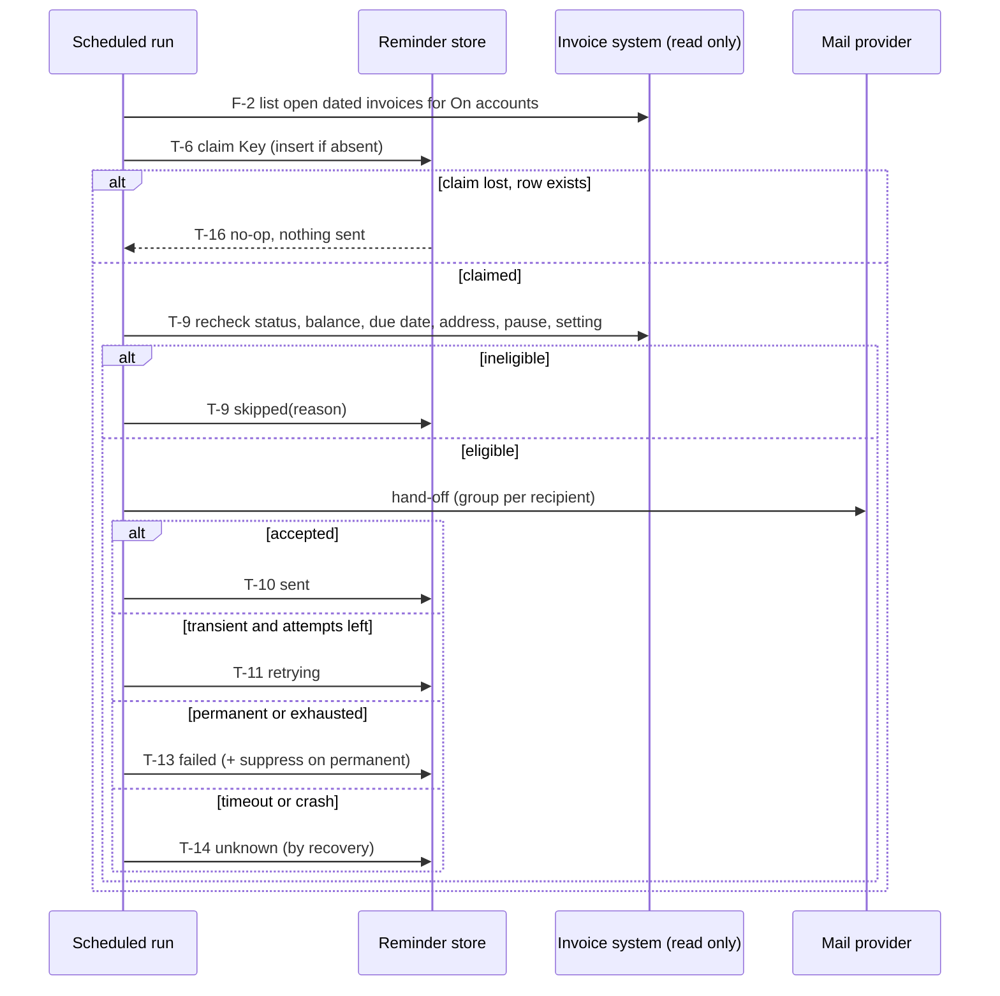
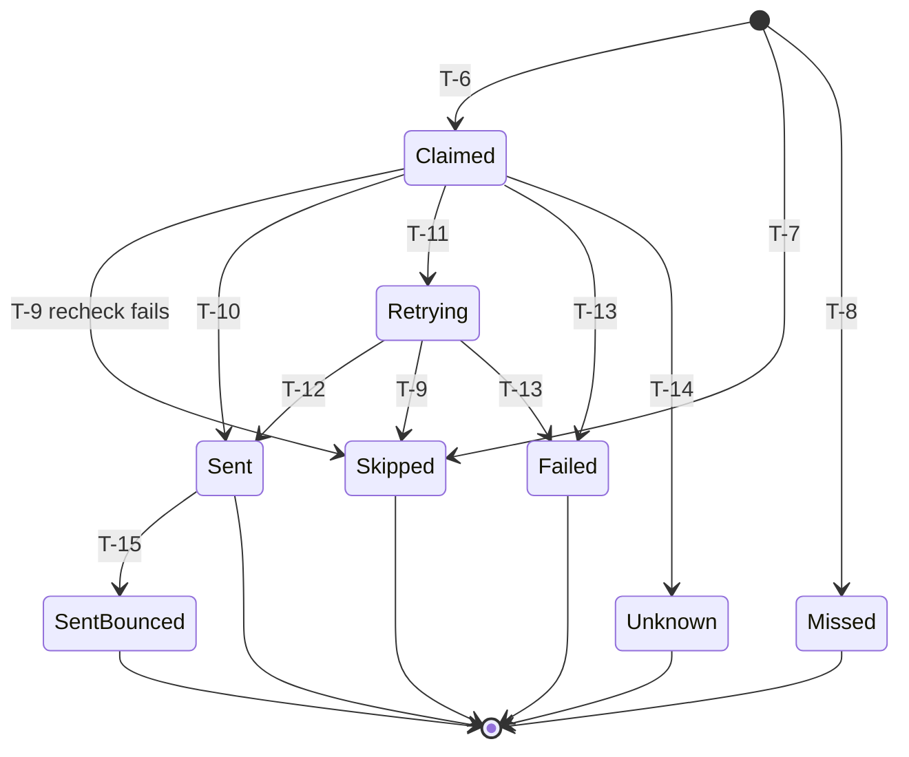

# Invoicing product: requirements

This file holds the product's accepted and proposed requirements. The first section added to it is **Automatic
payment reminders** (R-1 to R-14). It was written from one sentence and no repository, so most prerequisites about the
existing product are open gaps (G-<n>), not facts.

## Basis and baseline

- Source of the request: "Set up automatic reminders for unpaid invoices." (user request, 2026-11-20). Cited below as
  **REQ-2026-11-20**. Every R-<n> in this run has that as its basis unless it says otherwise.
- Current-system baseline: **none available.** No repository, README, discovery result, research result, earlier
  spec or selected baseline reached this stage. Nothing below claims what the product does today. Statements about
  existing invoices are assumptions A-1..A-9 and are tested as prerequisites by G-gaps. Evidence limit: observations,
  inferences and unknowns are separated by using "Assumed" (inference to be confirmed) and "Open gap" (unknown).
- Preserved behaviour: unknown beyond what R-13 states generically (the reminders must not change anything that exists).
- Prior accepted requirements: none. Nothing retired; `## Retired` is empty.
- Approved scope: reminders for unpaid invoices, sent automatically. Out of scope (each with its reason):
  manual "send now" or test send (not asked; the history in R-10 shows that it worked); editable email wording
  (R-8 fixes the wording; editing is a feature, not part of "set up"); several recipient addresses per invoice (A-1);
  SMS or other channels (request says nothing of them); interest, late fees, dunning escalation to collections;
  payment collection itself; multi-language; recipient self-serve preference centre (see G-14.1 for the
  one legal question); reminders for bills the business owes (the request is about invoices the business issued).

### Assumptions (defaults taken because nobody can be asked; each is overridden by a later user decision)

| ID | Assumption | Why this default |
| --- | --- | --- |
| A-1 | The product already has invoices, each with: number, status, issue date, due date (a calendar date, may be empty), currency, outstanding balance, one billing email address, and belongs to one account that has a business name and an IANA timezone. | The request names "unpaid invoices", so invoices and a paid/unpaid notion exist. Field details are not known. |
| A-2 | Default schedule is four steps: 3 days before the due date, on the due date, 7 days after, 14 days after. Default send hour is 09:00 in the account timezone. | A common, modest cadence; finite so nobody is reminded forever. |
| A-3 | One email per recipient per account per local day, listing every invoice that has a step due; at most 25 invoices per email. | Stops a customer with many overdue invoices receiving many emails. |
| A-4 | Up to 3 delivery attempts per reminder, at least 15 minutes apart, all inside the reminder's local day. | Bounded retry; no unbounded loops. |
| A-5 | The feature is off for every account until an authorised person turns it on. | Shipping must not email customers unannounced. |
| A-6 | Turning the feature on does not back-fill reminders for steps already past; the operator may opt in to one catch-up reminder per invoice. | Avoids a surprise burst to every overdue customer. |
| A-7 | One language (English), fixed templates, dates written like "1 Dec 2026". | No localisation was asked for. |
| A-8 | Reminder history is kept as long as its invoice record exists. | No retention rule is known; following the invoice avoids a second lifetime. |
| A-9 | Schedule limits: 1 to 10 steps; each offset is a whole number of days from -30 to +90; offsets are distinct; send hour is a whole hour 0 to 23. | Product defaults, not platform limits; confirmable by the user (G-2.1). |

## Terms

- **Step**: one entry of an account's schedule, with a stable `step id` (never reused) and an `offset` in days from the due date.
- **Key**: (invoice id, step id, due date). The due date is part of the key so a changed due date starts a fresh sequence (R-7.4).
- **Instant**: the moment a step is due: (due date + offset days) at the send hour in the account timezone.
- **Local day**: the calendar day, in the account timezone, containing the instant.
- **Window**: from the instant to the end of its local day.
- **Reference time** of an invoice: the latest of the account's `enabledAt`, the step's creation time, the time the invoice last became open (issued, or reopened after a reversal), and the time its due date was last set. A step whose instant is before the reference time is *not applicable*: it is not sent, not logged and not shown as missed.
- **Open invoice**: status unpaid-and-issued with outstanding balance greater than zero.
- **Reminder row**: the history record for one Key (R-10).
- **Hand-off**: the mail provider accepts the message. It is not delivery.

## Requirements

### R-1: Account-level switch and enabling

- Behaviour: each account has a reminders setting, `Off` or `On`, default `Off` (A-5). Only an account administrator
  may change it (G-1.1). Changing it records `enabledAt` (time of the Off to On change) and an audit event with actor,
  time, old and new value.
- Boundaries: enabling is refused with a named reason when the schedule is invalid (R-2), when no sender identity
  is usable (G-8.1), or when the actor is not an administrator. Enabling an account already `On` changes nothing and
  does **not** move `enabledAt`. Disabling an `Off` account changes nothing. When enabling, the dialog states the
  effective schedule, the send hour and timezone, and how many open invoices are already past one or more steps
  and will therefore not be reminded unless the operator ticks "Also send one reminder now to invoices already past
  due" (A-6). Ticking it creates one catch-up reminder per such invoice: its latest elapsed step, attempted at the
  next send-hour instant after enabling (R-4.5).
- Consumer outcome: after enabling, the settings page shows `On`, who enabled it and when, and the next send instant with the number of
  reminders due then ("Next send: Sat 28 Nov 2026, 09:00 EST, 1 reminder"). That is how the operator knows it worked.
- Basis: REQ-2026-11-20 ("Set up automatic reminders"); A-5, A-6. Changed/preserved: new; nothing preserved. Pending: all.
- Acceptance:
  - R-1.a positive: admin turns `On` with the default schedule; settings show `On`, `enabledAt` and the next send line; an audit event exists. Surface: settings page UI and audit log. Confirm: UI test with fake clock, then audit read-back.
  - R-1.b failure: a non-admin attempts to enable: refused, setting stays `Off`, no audit event of change, no email at any later run. Surface: UI and direct call to the settings route. Confirm: UI test plus route test (same rule on both paths).
  - R-1.c boundary: enable twice (second click or two admins): second is a no-op, `enabledAt` equals the first time. Surface: settings route. Confirm: automated test.
  - R-1.d boundary: enable with catch-up ticked while INV-1002 (see S-1) is past all steps: exactly one reminder row for INV-1002 appears for step `+14` at the next send instant; unticked: zero rows. Surface: reminder history and recipient mailbox. Confirm: automated test with fake clock and capture mail sink; deployed check with a test mailbox.
  - R-1.e failure: enabling with no usable sender identity is refused with the reason shown. Surface: UI. Confirm: UI test with the sender missing.
- Open gaps: G-1.1 role model unknown (who is an administrator; whether finance staff may enable). G-1.2 whether the default of `Off` is wanted for brand-new accounts too (assumed yes).

### R-2: Schedule definition

- Behaviour: an account has one schedule: an ordered list of steps (A-2 default: -3, 0, +7, +14). An administrator may add, remove and change the offset of steps, change the send hour, and reset to the default.
  Validation: 1 to 10 steps, offsets whole numbers from -30 to +90, offsets distinct, send hour 0 to 23 (A-9).
  Editing an offset keeps the step id. Removing a step removes its pending sends; its history rows stay.
  A change applies only to instants not yet attempted; it never re-sends, never recalls, and never creates catch-up
  (the new step's creation time sets the reference time, R-4.4).
- Concurrency: the schedule carries a version. A save with a stale version is refused with "schedule changed, reload"; nothing is written.
- Fields the schedule holds: steps (step id, offset), send hour, version, last-changed-by, last-changed-at.
- Consumer outcome: settings page lists steps with the actual dates they would produce for a sample due date. Prior values remain visible in the audit event.
- Basis: REQ-2026-11-20 ("Set up"); A-2, A-9. Pending: all.
- Acceptance:
  - R-2.a positive: save steps -3,0,+7,+14 at hour 9; reload shows the same four steps. Surface: settings UI. Confirm: UI test.
  - R-2.b failure: offsets -3,-3 refused (duplicate); 11 steps refused; offset +91 refused; send hour 24 refused; 0 steps refused. Each leaves the stored schedule unchanged and names the failing field. Surface: UI and route. Confirm: table-driven route test.
  - R-2.c boundary: exactly 10 steps and offsets -30 and +90 accepted; hour 0 and hour 23 accepted. Confirm: route test.
  - R-2.d failure: two admins save from the same version; the second gets the stale-version refusal. Confirm: route test with two sessions.
  - R-2.e boundary: changing the offset of step `s2` from 0 to +1 after `s2` was sent for INV-1001: no second send for that Key. Confirm: automated test.
- Open gaps: G-2.1 the limits in A-9 are defaults awaiting the user's confirmation. They are not platform limits.

### R-3: Which invoices are reminded (eligibility and stop conditions)

- Behaviour: a step is sent only for an invoice that is an open invoice (defined above), has a due date, has a billing email, whose address is not suppressed (R-6.4, R-14), that is not paused (R-9), in an account that is `On`.
- Conditions that stop reminders (the full list; nothing else stops them): fully paid; balance zero (including fully credited); void or cancelled; draft or not yet issued; written off; no due date; no billing email; address suppressed; invoice paused; account `Off` or platform kill switch (R-11); invoice disputed **only if** the product has such a status (G-3.1).
  Partially paid invoices stay eligible and show the current outstanding balance.
- The same list is shown to the operator for one invoice as a plain-language reason ("No reminders: invoice is paid"), computed live, not stored.
- Consumer outcome: reminders go only to customers who owe money now.
- Basis: REQ-2026-11-20 ("unpaid invoices"). Pending: all.
- Acceptance:
  - R-3.a positive: open INV-1001, due 2026-12-01, balance 1,200.00 USD gets its -3 reminder on 2026-11-28 at 09:00 ET (S-1). Surface: capture mail sink / test mailbox. Confirm: automated test and a deployed check.
  - R-3.b failure: one invoice per stop condition (paid, zero balance, void, draft, written off, no due date, no email, suppressed address, paused, account Off): at its instant, no email is sent for each, and the invoice view shows the matching reason. Surface: mail sink, invoice view. Confirm: table-driven automated test; UI check of the reason text.
  - R-3.c boundary: partial payment of 400.00 leaves INV-1001 open with balance 800.00; the 2026-12-01 reminder states 800.00 (S-4). Confirm: automated test.
  - R-3.d boundary: balance 0.01 USD is still reminded; balance 0.00 is not. Confirm: automated test.
- Open gaps: G-3.1 which statuses exist (disputed, on hold, scheduled-for-autopay, in collections). Autopay invoices that will be charged automatically are an unanswered case: assumed they ARE reminded unless the product marks them otherwise.

### R-4: When a reminder is due

- Behaviour: for each open, dated invoice and each schedule step the instant is (due date + offset) at the send hour in the account timezone. Time rules:
  1. **Window.** A step is attempted when now is inside its window and no row exists for its Key. Reminders go out every calendar day including weekends and holidays; there is no business-day shift (A-2).
  2. **Nonexistent local time** (spring-forward gap): the instant is the first valid moment after the gap. Send hour 2 on 2027-03-14 in America/New_York is 03:00 EDT.
  3. **Ambiguous local time** (fall-back): the first occurrence is used; the step still sends once.
  4. **Not applicable steps.** A step whose instant is before the invoice's reference time is not sent and creates no row. So enabling, editing the schedule, a due-date change, or reopening an invoice never back-fills.
  5. **Catch-up** only when the operator ticked it at enabling (R-1): one reminder for the latest step whose instant is before `enabledAt`, attempted at the next send-hour instant after `enabledAt`, within that local day.
  6. **Missed.** If the window ended with no row and the step was applicable, the next run writes a row `missed` and sends nothing late. A later step is unaffected.
  7. **Same-day collisions.** If two steps of one invoice have instants on the same local day (after a schedule edit), only the one with the later offset is attempted; the other gets `skipped: superseded`.
- Boundary: timezone change on an account affects only instants not yet attempted; existing rows are untouched.
- Consumer outcome: customers get the reminder at the local time the account chose, once, and the operator can see when the next one is.
- Basis: REQ-2026-11-20; A-2, A-6. Pending: all.
- Acceptance:
  - R-4.a positive: S-1 schedule yields instants 2026-11-28 09:00, 2026-12-01 09:00, 2026-12-08 09:00, 2026-12-15 09:00 (all ET, UTC-5; no DST change in that span). Confirm: unit test of the instant function with a fixed table; hand-checked here, see Replay walk.
  - R-4.b boundary: spring-forward: send hour 2 on 2027-03-14 sends at 03:00 EDT (07:00 UTC), once. Confirm: unit test of the instant function.
  - R-4.c boundary: fall-back: send hour 1 on 2026-11-01 sends at the first 01:00 (05:00 UTC), once even if the run executes in the repeated hour. Confirm: unit test plus a two-run test.
  - R-4.d failure: scheduler down from 06:00 to 23:50 on 2026-12-01 and back at 23:50: the step 0 reminder is sent at 23:50 (inside the window). Scheduler back at 00:00 on 2026-12-02: row `missed`, no email. Confirm: automated test with fake clock.
  - R-4.e boundary: INV-1002 (due 2026-11-01), account enabled 2026-11-20 without catch-up: no row ever for steps -3..+14, and the invoice view says "No upcoming reminders: all steps have passed". With catch-up: one row at 2026-11-21 09:00 ET for step +14. Confirm: automated test.
  - R-4.f boundary: invoice created 2026-11-30 with due date 2026-12-01: step -3 (2026-11-28) is not applicable: no row, no email. Confirm: automated test.
  - R-4.g boundary: two steps collide on one local day: only the later offset sends. Confirm: automated test.
- Open gaps: G-4.1 run cadence and retry cadence are unresolved; they depend on the runtime's scheduler (G-0.2). G-4.2 whether the account has a stored timezone; if not, one must be added before this ships (assumed A-1).

### R-5: At most one reminder per Key

- Behaviour: for each Key at most one hand-off to the provider ever occurs, however many times the evaluation runs, however many workers run at once, and across restarts and redeploys. The claim is recorded before the provider call (AD-2).
  1. Concurrent workers: exactly one claims; the others do nothing and show no error to users.
  2. A crash after the claim and before the outcome leaves the row `claimed`; recovery changes a stale `claimed` row to `unknown` and does **not** retry it (a duplicate email is judged worse than a missed one; the next step still runs).
  3. A provider call that times out with unknown outcome becomes `unknown`, not retried.
  4. A run killed by a runtime limit leaves unclaimed steps unclaimed; the next run picks them up while the window is open.
  5. The system does not promise exactly-once delivery; it promises at-most-once hand-off per Key.
- Fields of a reminder row: invoice id, step id, due date (Key); instant; account id; recipient address as of send; state; attempt count; last attempt time; provider message id; failure reason; bounce annotation; email group id.
- Consumer outcome: a customer never gets the same reminder twice.
- Basis: REQ-2026-11-20; "must never be true": a thing done twice that should happen once. Pending: all.
- Acceptance:
  - R-5.a positive: one run at 09:00 sends INV-1001's -3 reminder; a second run at 09:05 sends nothing. Surface: mail sink count = 1; one row. Confirm: automated test.
  - R-5.b failure: two workers started on the same instant for the same Key: mail sink count = 1; one row; one worker's claim is rejected by the store's uniqueness rule. Confirm: automated concurrency test against the real store type (a mock does not prove the constraint).
  - R-5.c failure: worker killed after claim, before provider call; run after recovery age: row `unknown`, mail sink count 0, no retry on later runs, appears in the needs-attention list. Confirm: fault-injection test.
  - R-5.d boundary: provider times out with unknown outcome: row `unknown`, exactly one provider call. Confirm: automated test with a stub that hangs.
  - R-5.e boundary: run killed mid-batch of 3 claimed + 7 unclaimed steps: next run attempts the 7 only. Confirm: automated test.
- Open gaps: G-5.1 the age at which a `claimed` row is declared stale is unresolved; it must exceed the longest legitimate send plus retry wait and depends on the runtime's execution limit (G-0.2).

### R-6: Delivery attempts, failures and bounces

- Behaviour:
  1. A hand-off failure judged transient by the provider's documented classification (G-6.2) is retried up to 3 attempts in total, at least 15 minutes apart, only while the window is open and re-checking eligibility before each attempt (R-7.1). After the third failure, or if the window ends first, the row is `failed` with the reason; it is not retried and the next step proceeds normally (A-4).
  2. A permanent rejection (invalid address) is `failed` at once with no retry, and suppresses that address (see item 4 for clearing it).
  3. Provider rate limiting or quota exhaustion counts as transient. Reminders are paced, never rejected as a batch; a large day (more reminders than the provider allows at once) is spread over the window, in due-date order oldest first, and any not attempted by the window end become `missed` (R-4.6).
  4. A hard bounce or spam complaint reported after hand-off marks the row `sent, bounced`, and adds the address to the account's suppression list with the reason. Soft bounces change nothing. Bounce events are idempotent by provider message id; an event for an unknown message id is ignored and logged. Clearing a suppression: an administrator removes it, or the invoice's billing email is changed to a different address.
  5. The operator sees failed, unknown and bounced rows in a "needs attention" list (R-10). No separate alert channel is added.
- Consumer outcome: failures are visible and bounded; one bad address does not stop other customers.
- Basis: REQ-2026-11-20; unhappy path lens. Pending: all.
- Acceptance:
  - R-6.a failure: stub fails twice transiently then accepts: row `sent`, attempts 3, attempts at 09:00, 09:15, 09:30 (S-5). Confirm: automated test with fake clock.
  - R-6.b failure: stub fails 3 times: row `failed`, attempts 3, no 4th attempt on later runs; the next step (S-1 step 0) still sends. Confirm: automated test.
  - R-6.c failure: stub rejects permanently: `failed` after 1 attempt; address suppressed; INV-1003 for the same address sends nothing at its next step and says "address bounced". Confirm: automated test.
  - R-6.d boundary: a third attempt that would start after local midnight is not made: row `failed` with reason "window ended". Confirm: fake clock at 23:50 with 15-minute wait.
  - R-6.e boundary: the same hard-bounce event delivered twice: one suppression entry, row annotation unchanged. Confirm: automated test.
  - R-6.f failure: bounce event naming an unknown message id: no change; a log entry without the address. Confirm: automated test.
- Open gaps: G-6.1 whether the provider reports bounces and complaints at all, and by webhook or polling; if it does not, 6.4 cannot be built and only synchronous rejection (6.2) is verifiable. G-6.2 the documented transient/permanent classification of the chosen provider (no source consulted in this stage).

### R-7: Races with payments and edits

- Behaviour:
  1. **Recheck before the call.** Immediately after claiming and again before each provider call, the invoice status, balance, due date, billing email, pause flag, suppression and account setting are re-read from their owners (AD-3). If any makes the invoice ineligible the row becomes `skipped` with that reason and nothing is sent. A payment landing after hand-off cannot be recalled: the reminder is delivered; this is a known limit, not a defect.
  2. **Content at send time.** Balance, due date and address in the email are the values read at the recheck.
  3. **Reversal.** A payment reversal that reopens an invoice sets a new reference time (R-4.4): later steps proceed; earlier steps are not repeated.
  4. **Due-date change.** A new due date starts a new Key sequence: steps are recomputed from it; rows made for the old due date stay as history with the old date shown; steps for the new date whose instant is already past are not applicable.
  5. **Group re-check.** In a grouped email (R-8) an invoice that fails the recheck is dropped and the rest are sent; if none are left, no email is sent.
- Consumer outcome: a customer who has just paid is not chased, except by a message already in flight.
- Basis: REQ-2026-11-20 ("unpaid"); lens "one undone while the other runs". Pending: all.
- Acceptance:
  - R-7.a positive: INV-1001 paid in full 2026-11-28 08:59:30 ET: at 09:00 no email and no row (not a candidate). Confirm: automated test (S-3).
  - R-7.b boundary: payment recorded between claim and provider call (hook in the test): row `skipped: invoice_not_open`, mail sink count 0. Confirm: automated test with an injected hook; the product alone does not check this.
  - R-7.c boundary: payment recorded after hand-off: row stays `sent`; email delivered. Confirm: automated test; documented limit.
  - R-7.d boundary: due date changes from 2026-12-01 to 2026-12-20 on 2026-12-09 after step +7 was sent: next reminder is -3 for 2026-12-17; old rows remain with due date 2026-12-01 (S-8). Due date moved to 2026-12-05: steps 2026-12-02 and 2026-12-05 not applicable; next is 2026-12-12 (S-8). Confirm: automated test.
  - R-7.e boundary: reversal on 2026-12-03 reopening INV-1001 after a full payment on 2026-12-02: no reminder for elapsed steps; the +7 step on 2026-12-08 still sends if not previously sent. Confirm: automated test.
  - R-7.f boundary: group of INV-1001 and INV-1003 where INV-1003 is paid after claim: one email listing INV-1001 only; INV-1003 row `skipped`. Confirm: automated test.
- Open gaps: G-7.1 how payments are recorded (synchronous or by bank import) decides how stale the invoice status can be; unresolved. G-7.2 whether the invoice system can take a lock or version check at the instant of the call; not assumed.

### R-8: Reminder email content and grouping

- Behaviour:
  1. One email per (account, recipient address, local day), listing each invoice that has a step due; at most 25 invoices per email, oldest due date first, further invoices in additional emails (A-3). Invoices of different accounts are never in one email.
  2. For each invoice the email shows: invoice number, due date, whole days until due or overdue computed from the send date (not the step's offset), outstanding balance with currency, and a way to view or pay it (G-8.2).
  3. Subject: single invoice: "Invoice INV-1001 is due on 1 Dec 2026" before the due date, "Invoice INV-1001 is due today" on it, "Invoice INV-1001 is 7 days overdue" after; several invoices: "Payment reminder: 2 invoices from Acme Ltd".
  4. From name is the account's business name; reply goes to the account's billing contact (G-8.1). A plain-text part is always present.
  5. Customer-supplied or user-supplied fields (customer name, business name, invoice number) are escaped for HTML, and CR/LF are stripped before use in any header or subject.
  6. The email never contains another recipient's data, secrets, or a link that works for more than that invoice's recipient (the link is unguessable and scoped, G-8.2).
- Consumer outcome: the customer sees what they owe, to whom, by when, and how to pay.
- Basis: REQ-2026-11-20; A-3, A-7. Pending: all.
- Acceptance:
  - R-8.a positive: S-1 -3 reminder subject is exactly "Invoice INV-1001 is due on 1 Dec 2026" and body contains "INV-1001", "1 Dec 2026", "1,200.00 USD" and "due in 3 days"; the same email on 2026-12-01 says "due today"; on 2026-12-08 "7 days overdue" (S-1, S-4). Surface: mail sink and test mailbox. Confirm: automated test and a deployed check reading the received message.
  - R-8.b boundary: INV-1001 and INV-1003 (same recipient, both due 2026-12-01, 1,200.00 and 300.00 USD) produce one email, two rows with one email group id, subject "Payment reminder: 2 invoices from Acme Ltd" (S-2). Confirm: automated test.
  - R-8.c boundary: 25 invoices for one recipient: one email; 26: two emails (25 and 1). Confirm: automated test.
  - R-8.d failure: an invoice number or business name containing `<script>` and a newline is rendered inert in the body and cannot add a header. Confirm: automated test; inspect the HTML and raw headers.
  - R-8.e boundary: two accounts both reminding `billing@globex.example` on the same day send two separate emails. Confirm: automated test.
- Open gaps: G-8.1 the existing outbound email path, sender domain authentication (SPF, DKIM) and reply-to are unknown; sending without an authenticated sender risks rejection. G-8.2 whether a customer-facing invoice page or payment link exists; if not, the email carries the payment instructions the product already prints on invoices, and no link.

### R-9: Pausing one invoice

- Behaviour: a user who may edit the invoice (G-1.1) can pause and resume reminders for it. A pause persists until resumed, across payment and reversal. Pausing is idempotent. While paused, a due step gets `skipped: paused` (final; resuming does not back-fill that step, R-4.4). Pause or resume records actor and time. Pausing a paid or void invoice is refused with "this invoice has no reminders to pause".
- Consumer outcome: staff can stop chasing a customer who has a payment arrangement.
- Basis: REQ-2026-11-20; lens "turning it off for one case". Pending: all.
- Acceptance:
  - R-9.a positive: pause INV-1001 on 2026-11-27; at 2026-11-28 09:00 no email, row `skipped: paused`; resume 2026-11-29: step 0 on 2026-12-01 sends. Confirm: automated test and UI.
  - R-9.b failure: pause a paid invoice: refused, no change. Confirm: route test.
  - R-9.c failure: user without invoice edit rights pauses: refused. Confirm: route test and UI.
  - R-9.d boundary: pause twice: one pause record, no error. Confirm: route test.
- Open gaps: none beyond G-1.1.

### R-10: Reminder history and visibility

- Behaviour: every Key decision is written as a reminder row (fields in R-5) with state: `claimed`, `retrying`, `sent`, `sent, bounced`, `failed`, `unknown`, `missed`, or `skipped` with reason (`paused`, `no_address`, `address_suppressed`, `invoice_not_open` only from a race, `superseded`). The invoice view has a Reminders panel showing the rows newest first, the next scheduled instant or the live no-reminder reason (R-3), and paused state. The account has a "needs attention" list: `failed`, `unknown`, `sent, bounced` and `missed` rows from the last 30 days (window length is a display default, G-10.1). `sent` means hand-off, not delivery, and the panel says so.
- Who may read: users who may view that invoice; nobody else, including through the list.
- Consumer outcome: an operator can tell what was sent, to whom, when, and what went wrong.
- Basis: REQ-2026-11-20; lens "seeing what went wrong". A-8. Pending: all.
- Acceptance:
  - R-10.a positive: after S-1 step -3, the panel shows one row `sent` with recipient, instant and attempt count 1. Confirm: UI test.
  - R-10.b failure: R-6.b shows `failed` in the needs-attention list with the reason. Confirm: UI test.
  - R-10.c failure: a user with no view right on INV-1001 gets a refusal from the panel route and the list omits its rows. Confirm: route test on both paths.
  - R-10.d boundary: an invoice with no rows and no due date shows "No reminders: no due date", not an empty panel. Confirm: UI test.
  - R-10.e boundary: 0 rows in needs attention shows a designed empty state. Confirm: UI test.
- Open gaps: G-10.1 the needs-attention look-back (30 days) is a display default.

### R-11: Turning reminders off, everywhere or for one account

- Behaviour:
  1. An administrator can set the account `Off` at any time. Effective at once: any step not yet handed off is `skipped: account_off` at its recheck; a hand-off already made cannot be recalled. Re-enabling follows R-1 and R-4.4 (no back-fill).
  2. A deployment-level kill switch, separate from account settings and owned by whoever runs the deployment, stops all sends for all accounts when set, with the same effect on in-flight steps. Account settings and history are not modified by the switch.
  3. Turning off, or the switch, never deletes history, pause flags, suppressions or the schedule.
- Consumer outcome: the operator can stop the feature in one action and can rely on it.
- Basis: REQ-2026-11-20; lens "turning it off", "going back to the version before". Pending: all.
- Acceptance:
  - R-11.a positive: `Off` at 08:55; at 09:00 nothing is sent; history unchanged. Confirm: automated test.
  - R-11.b boundary: `Off` set between claim and provider call: `skipped: account_off`, mail sink 0. Confirm: injected-hook test.
  - R-11.c boundary: kill switch set: no account sends; clearing it resumes only steps whose window is still open. Confirm: automated test and a configuration check in the deployed environment.
  - R-11.d boundary: `Off` then `On` on the same day: `enabledAt` moves; a step whose instant is earlier is not sent. Confirm: automated test.
- Open gaps: G-11.1 where the kill switch lives depends on the runtime (environment variable, config store, feature flag).

### R-12: Isolation, privacy and audit

- Behaviour:
  1. Every read and write by this feature is scoped to one account; nothing crosses accounts (settings, rows, suppressions, emails).
  2. Recipient email addresses and amounts are personal and financial data. They appear only in the reminder row, the email itself, and views for users who may view the invoice. Application logs carry invoice id, step id, state and account id, never the address, amount or email body.
  3. History follows the invoice's lifetime (A-8). When the existing process deletes or anonymises an invoice or customer, its reminder rows and any suppression entry for that address are deleted or anonymised in the same process (G-12.1).
  4. Setting changes (on/off, schedule, kill switch, pause/resume, suppression add/remove) always produce an audit event; sampling or debug flags cannot suppress it.
  5. Failure to write a diagnostic log never blocks or fails a send or the business operation.
- Basis: REQ-2026-11-20; lens "never seen by who may not". Pending: all.
- Acceptance:
  - R-12.a failure: user of account B requests account A's rows by id: refused, no data. Confirm: route test with both accounts.
  - R-12.b positive: after S-1 and a failure, application logs contain the invoice id and no `billing@globex.example` and no `1,200.00`. Confirm: automated log capture assertion.
  - R-12.c boundary: deleting INV-1001 removes its rows; a deletion of the customer also removes the suppression for the address. Confirm: automated test against the existing deletion path.
  - R-12.d positive: each setting change produces an audit event with actor and time. Confirm: automated test.
- Open gaps: G-12.1 the existing deletion or erasure process and any legal retention duty are unknown.

### R-13: What must still hold (existing behaviour and failure isolation)

- Behaviour:
  1. Creating, editing, paying, voiding and deleting invoices, and every existing email the product sends, behave exactly as before, in an account with reminders `Off`, `On`, or the feature broken.
  2. The feature adds no required field to an existing invoice; existing invoices without optional new fields keep working.
  3. A failure in the reminder subsystem (provider down, store error, scheduler crash) never makes an invoice or payment operation fail or slow beyond its own timeout, since the subsystem only reads invoices (AD-5).
  4. If the reminder store cannot record a claim, nothing is sent (fail closed): no claim means no email.
- Basis: REQ-2026-11-20; "what exists today and must still hold". Preserved baseline: unknown; see G-0.1. Pending: all.
- Acceptance:
  - R-13.a positive: the existing invoice and payment test suite passes unchanged with the feature `Off`. Confirm: existing suite (not available in this stage).
  - R-13.b failure: provider and reminder store both unreachable: recording a payment still succeeds with unchanged latency class; no email; rows absent or `claimed` only. Confirm: fault-injection test.
  - R-13.c failure: the store refuses the claim write: mail sink 0. Confirm: fault-injection test.
  - R-13.d boundary: an invoice created before the feature (no optional fields) is reminded correctly. Confirm: automated test with a legacy-shaped fixture.
- Open gaps: G-0.1 baseline missing; preserve/modify decisions for existing behaviour cannot be mapped to sections.

### R-14: Recipient opt-out and suppression

- Behaviour: an administrator can suppress reminders for one billing address (added to the account suppression list, with a reason and audit event) and later remove it. Suppression applies to every invoice with that address, stops future steps (`skipped: address_suppressed`), and bounces and complaints use the same list (R-6.4). It does not touch invoices or the customer's other emails.
- Consumer outcome: an operator can honour "please stop emailing me" without editing each invoice.
- Basis: REQ-2026-11-20; lens "turning it off for one case". Pending: all.
- Acceptance:
  - R-14.a positive: suppress `billing@globex.example`; at the next step for INV-1001 and INV-1003: no email, rows `skipped: address_suppressed`. Confirm: automated test.
  - R-14.b boundary: address match is case-insensitive and ignores surrounding whitespace: `Billing@Globex.example ` is suppressed. Confirm: automated test.
  - R-14.c failure: non-admin suppresses: refused. Confirm: route test.
  - R-14.d positive: removing a suppression resumes only steps whose window is still open. Confirm: automated test.
- Open gaps: **G-14.1 (user decision, material)** whether each email must carry a recipient self-serve unsubscribe link (consumer protection and anti-spam rules differ by jurisdiction; invoice reminders may count as transactional but this was not determined). Default recorded: no self-serve link in v1; the email says to reply to the billing contact to stop reminders. Work on a self-serve link stays unready until decided.

## Non-functional requirements

Inputs: no runtime, stack, volume or platform limits are known, so no numeric bound below is invented. Each line is an observable criterion or an unresolved bound with its missing evidence.

| ID | Quality | Operating condition | Requirement | Bound / criterion | Verification |
| --- | --- | --- | --- | --- | --- |
| NFR-1 | Timeliness | A step's window is open | The first attempt for every applicable step starts inside its local day | Observable: R-4.d. Numeric delay from instant to first attempt: **unresolved** (needs G-4.1) | fake-clock tests; deployed observation of one real step |
| NFR-2 | Capacity | Many invoices due on one day | Processing is paced and resumable: progress is recorded per Key; a run cut off by a runtime limit loses and duplicates nothing | Observable: R-5.4. Expected volume and runtime limit: **unresolved** (needs the account sizes and G-0.2) | batch test with injected cut-off; load test only after volume is known |
| NFR-3 | Reliability and integrity | Duplicate runs, crashes, provider outages | At-most-once hand-off per Key; provider outage degrades to `failed`/`missed`, never to duplicates | R-5, R-6 | fault-injection tests |
| NFR-4 | Security and privacy | Always | R-12 plus: unguessable, invoice-scoped links (R-8.6); HTML escaping and header-injection rules (R-8.5); the sender identity is authenticated (G-8.1) | Observable per R-8.d, R-12.a/b | automated tests; review of the email's raw headers in a deployed check |
| NFR-5 | Operability | Operators and support | Audit and state events listed below; stuck work (`claimed`, `unknown`) is visible | see Observability | log and audit read-back |
| NFR-6 | Compatibility and rollback | Deploy, then roll back one version | Data the feature adds is additive; the previous version ignores it and sends nothing; the kill switch (R-11.2) stops sends without a deploy | Observable: R-13.a with the previous version against migrated data | rollback rehearsal in a non-production environment |
| NFR-7 | Testability | Test and CI | The evaluation entry point takes the current time as an input; the mail path has a capture sink; no test waits on real time | Observable: every S-case runs without sleeping | review of the harness; every case above |
| NFR-8 | User interface quality | Settings page, invoice Reminders panel, needs-attention list, the email | See below | See below | UI checks at 2 widths and 2 themes |

Excluded, with reason: an availability target for the reminder service (it is a periodic job; R-4/R-5 define what a missed run costs); a throughput SLA (no volume is known; NFR-2 is the unresolved item); internationalisation (A-7, out of scope); retention beyond A-8 (no rule known, G-12.1).

### NFR-8: designed interface (the request's deliverable has a UI)

Criteria, all observable:
1. One visual system: a spacing scale, a type scale, a palette with a **light theme as the default and a dark theme** that follows the system setting; tokens, not one-off values. The email is readable in both light and dark mail clients.
2. Designed empty, loading and error states: settings before any step is added; Reminders panel with no rows (R-10.d); needs-attention list empty (R-10.e); saving shows progress; a refusal (R-1.b, R-2.b, R-2.d) states the reason next to the control and keeps the user's input.
3. Truthful async feedback: after saving or enabling, the page shows saved only after the server confirmed it; a failed save never shows as saved; after enabling it shows the next-send line from the server (R-1).
4. Layout works at 360 px and 1280 px with no horizontal scroll; the email works at 320 px.
5. Visible keyboard focus on every control; text contrast WCAG AA (4.5:1 body, 3:1 large text and controls); every control reachable and operable by keyboard; state is not conveyed by colour alone (the state text `Sent`, `Failed`, `Skipped` is always written out).
6. Motion only to explain a change (for example a saved confirmation), disabled under reduced-motion.
7. One icon set.
8. **Visual reference and starting appearance:** if the product already has an identity, inherit it (it takes precedence; G-0.3 records that none could be inspected). If these screens are new, use the "light expressive starting point" (`platforms/ui.md#light-expressive-starting-point`): a light, airy canvas with tonal rounded surfaces, a restrained saturated accent, humanist sans-serif with fallbacks, a confident primary action ("Turn on reminders"), and the status of reminders (On/Off, next send) as the focal point of the settings page. A dark theme is retained. The plan chooses the concrete treatment and records it as an AD.

## State and data assessment (R-1, R-2, R-5, R-9, R-10, R-12, R-14)

| State | Owner and location | Who reads | Simultaneous changes | Ends / removed | Runtime quota |
| --- | --- | --- | --- | --- | --- |
| Account reminders setting (`On/Off`, `enabledAt`) | the account configuration, owned by the reminder subsystem | admins; the scheduler | last write wins for on/off; every change audited | persists; never auto-removed | unknown (G-0.2) |
| Schedule (steps, send hour, version) | same | admins; scheduler | version check; stale save refused (R-2.d) | persists; history of changes in audit | unknown |
| Pause flag per invoice | the reminder subsystem, keyed by invoice id (not a column on the invoice, AD-5) | users who may view the invoice | idempotent; last write wins | removed with the invoice | unknown |
| Reminder rows | reminder subsystem store; unique on Key (AD-2) | users who may view the invoice; scheduler | conditional insert and conditional update; terminal states never change except `sent` to `sent, bounced` | removed with the invoice (A-8, R-12.3) | unknown |
| Suppression list | reminder subsystem, per account | admins; scheduler | idempotent by normalised address | removed by admin, by change of billing email, or with the customer | unknown |
| Audit events | existing audit facility if any (G-12.2) | admins | append only | per existing audit retention | unknown |

Before/after invariants: the reminder subsystem never writes an invoice or payment record (AD-5); at most one row per Key; a row leaves `claimed` only by a conditional update from `claimed` or `retrying`; terminal rows are never re-sent; `enabledAt` moves only on an Off to On change.
Partial failure: claim written but no outcome recorded leaves `claimed`, recovery makes it `unknown` (R-5.2); provider accepted but the outcome write failed: the row stays `claimed` and becomes `unknown` rather than being re-sent (never a second hand-off).
Recovery: rows are the only memory; a restarted worker resumes from them. Rollback: see NFR-6.
Unknowns: the actual store and its conditional-write support (G-0.2); whether an existing audit facility exists (G-12.2).

## Service boundaries

| Boundary | Authority | Freshness / revocation | State and async | Owned event coverage |
| --- | --- | --- | --- | --- |
| Invoice and payment system (read only) | it owns status, balance, due date, email | no cache across runs; re-read before each send (AD-3). A permission change takes effect at the next read | n/a: not written | n/a: not owned |
| Mail provider (outbound) | provider owns delivery; accepted is not delivered | provider credentials held by the platform's secret facility, not by this feature | accepted = durable row `sent`; bounce events arrive later, idempotent by message id (R-6.4); unknown outcome becomes `unknown` | events: `reminder.sent`, `.failed`, `.unknown`, `.missed`, `.skipped(reason)`, `.bounced`, each with account id, invoice id, step id, correlation id; no address or amount (R-12.2) |
| Scheduler | runtime owns triggering | none | a trigger can repeat or be late: handled by R-4 and R-5 | `run.started`, `run.finished(counts)`, `run.cut_off` |
| Settings and audit | this feature | n/a | n/a | audit on every change (R-12.4) |

Inapplicable concerns: incremental remote state (nothing remote is edited), delegated authority for workers (the worker acts with service authority and only reads invoices; it never acts as a browser user), cache invalidation (no cache).

## Sequence flows and transitions

Flows: F-1 enable and configure (R-1, R-2); F-2 scheduled send (R-3, R-4, R-5, R-7, R-8); F-3 failure and retry (R-6); F-4 pause, off and kill switch (R-9, R-11, R-14); F-5 bounce arrives (R-6.4).

Account setting: `Off` (initial) to `On` by T-1; `On` to `Off` by T-2; T-3 and T-4 are no-ops. Invoice pause: `Active` (initial) to `Paused` by T-17 and back by T-18.

| T | R / F | Before | Trigger and guard | After and observation | Failure and recovery | Cases |
| --- | --- | --- | --- | --- | --- | --- |
| T-1 | R-1 F-1 | `Off` | admin enables; schedule valid; sender usable | `On`, `enabledAt` set, audit; next-send line shown | refusal names reason; unchanged | R-1.a, R-1.b, R-1.e |
| T-2 | R-11 F-4 | `On` | admin sets Off, or kill switch set | `Off` (or sends stopped); in-flight steps skip at recheck | n/a | R-11.a-c |
| T-3 | R-1 | `On` | enable again | no change; `enabledAt` unchanged | n/a | R-1.c |
| T-4 | R-11 | `Off` | disable again | no change | n/a | R-11 (boundary) |
| T-5 | R-2 | any | admin saves schedule at current version; valid | new version; only future instants affected | stale or invalid: refused, unchanged | R-2.a-e |
| T-6 | R-5 F-2 | no row for Key | run: instant in window, eligible, account `On`, key absent | row `claimed` | store refuses: nothing sent (R-13.c) | R-5.a, R-5.b |
| T-7 | R-10 F-2 | no row | window open and invoice paused, no address, address suppressed, or superseded same day | row `skipped(reason)`, final | n/a | R-9.a, R-14.a, R-4.g |
| T-8 | R-4.6 | no row | window ended, step applicable | row `missed` | n/a | R-4.d |
| T-9 | R-7 | `claimed` or `retrying` | recheck finds ineligible (paid, void, paused, suppressed, account off, kill switch) | `skipped(reason)`, no send | n/a | R-7.b, R-11.b |
| T-10 | R-6 | `claimed` or `retrying` | provider accepts | `sent`, message id, attempts | outcome write fails: becomes `unknown`, not re-sent | R-5.a |
| T-11 | R-6.1 | `claimed` | transient failure, attempts under 3, window open | `retrying`, next attempt at least 15 min later | n/a | R-6.a |
| T-12 | R-6.1 | `retrying` | next attempt accepted | `sent` | n/a | R-6.a |
| T-13 | R-6 | `claimed` or `retrying` | permanent rejection, 3rd failure, or window ended | `failed`, reason; permanent also suppresses | n/a | R-6.b-d |
| T-14 | R-5.2-3 | `claimed` | stale past recovery age, or provider timeout with unknown outcome | `unknown`, never retried | operator sees it in needs-attention | R-5.c, R-5.d |
| T-15 | R-6.4 F-5 | `sent` | hard bounce or complaint with known message id | `sent, bounced`; address suppressed | duplicate event no-op; unknown id ignored | R-6.e, R-6.f |
| T-16 | R-5 | any terminal or existing row | a claim for an existing Key | no-op; nothing sent; no user-visible error | n/a | R-5.a, R-5.b |
| T-17 | R-9 F-4 | `Active` | user with edit right pauses an open invoice | `Paused`, audit | on paid or void: refused; twice: no-op | R-9.a-d |
| T-18 | R-9 | `Paused` | resume | `Active`; later steps proceed, elapsed steps are not back-filled | n/a | R-9.a |

Invalid-event classes: terminal rows never change except `sent` to `sent, bounced`; a pause on a non-open invoice is refused with no change; a bounce for an unknown message id is ignored; a repeated claim, enable, disable or pause is a documented no-op and causes no side effect.

## Worked scenarios and replay walk

All times use account `acct-1`, "Acme Ltd", timezone America/New_York, default schedule (step ids s1 -3, s2 0, s3 +7, s4 +14), send hour 9. Dates are from a calendar check by hand (2026-11-20 is a Friday; 2026-11-28 Sat; 2026-12-01 Tue; 2026-11-01 Sun; 2027-03-14 Sun, the second Sunday of March; 2026-11-01 is the first Sunday of November, the US fall-back date).

- INV-1001: due 2026-12-01, balance 1,200.00 USD, open, billing `billing@globex.example`.
- INV-1002: due 2026-11-01, balance 450.00 USD, open, same address.
- INV-1003: due 2026-12-01, balance 300.00 USD, open, same address.

| Case | Start and actor | Ordered actions | Rule that permits each action | Recomputed result | Replay status |
| --- | --- | --- | --- | --- | --- |
| S-1 | admin Ana (A-1 role, G-1.1), setting `Off` | 1. Fri 2026-11-20 14:00 enable with catch-up unticked 2. runs from then on | R-1 admits an admin to enable, schedule valid (defaults pass R-2), sender usable (G-8.1 prerequisite) | `On`, `enabledAt` 2026-11-20 14:00. INV-1001 instants: Sat 2026-11-28 09:00, Tue 12-01, Tue 12-08, Tue 12-15 (ET, UTC-5). INV-1002 instants 10-29, 11-01, 11-08, 11-15 all before `enabledAt`: not applicable, zero rows, invoice view "all steps have passed" | NOT-REPLAYED: no product or runtime exists in this stage; walked on paper against R-1, R-3, R-4; dates checked by hand because the script run was not approved |
| S-1b | same, with catch-up ticked | enable at 2026-11-20 14:00 | R-1 allows the tick; R-4.5 | one row for INV-1002 step s4 at Sat 2026-11-21 09:00 ET, email "Invoice INV-1002 is 20 days overdue" (2026-11-21 minus 2026-11-01 = 20) | NOT-REPLAYED, same reason |
| S-2 | S-1 `On`; INV-1003 open | run at 2026-11-28 09:00 | R-3 (both eligible), R-8.1 grouping | one email to `billing@globex.example` listing INV-1001 and INV-1003; subject "Payment reminder: 2 invoices from Acme Ltd"; two rows `sent` with one group id | NOT-REPLAYED |
| S-3 | S-1 `On` | 1. 2026-11-28 08:59:30 full payment of INV-1001 2. 09:00 run | the payment makes INV-1001 not open (R-3), so it is not a candidate (R-7.1) | no email for INV-1001, no row | NOT-REPLAYED |
| S-4 | S-1 `On` | 1. 2026-11-30 partial payment 400.00 on INV-1001 2. 2026-12-01 09:00 run | R-3 partial stays eligible; R-7.2 content read at send time | email subject "Invoice INV-1001 is due today", outstanding "800.00 USD" | NOT-REPLAYED |
| S-5 | S-1 `On`, provider stub fails transiently twice | attempts 09:00, 09:15, 09:30 on 2026-11-28 | R-6.1 | row `sent`, attempts 3 | NOT-REPLAYED |
| S-6 | send hour 2 | instant on 2027-03-14 | R-4.2 | 03:00 EDT = 07:00 UTC (02:00 EST would be 07:00 UTC) sends once | NOT-REPLAYED; hand-derived |
| S-7 | S-1 `On`, scheduler down 06:00-23:50 on 2026-12-01 | run at 23:50, or at 2026-12-02 00:00 | R-4.1, R-4.6 | 23:50: sent; 00:00: row `missed`, no email | NOT-REPLAYED |
| S-8 | INV-1001 +7 sent on 2026-12-08 | 2026-12-09 due date set to 2026-12-20, or to 2026-12-05 | R-7.4, R-4.4 | 12-20: new Key sequence 12-17, 12-20, 12-27, 2027-01-03, all future; 12-05: instants 12-02 and 12-05 not applicable, 12-12 and 12-19 pending | NOT-REPLAYED |

A walk on paper does not stand in for execution; every S-case stays open until the plan's tests run it. The product under test is not used to check these results.

## Open gaps (summary)

- G-0.1 no baseline of the current product: existing invoice statuses, fields, email facility, roles, deletion process.
- G-0.2 runtime unknown. Its limits (scheduler cadence and granularity, execution time per run, outbound mail quota and rate, store conditional-write support, secret facility) force these behaviours: R-5.4 and R-6.3 require deferral without loss or duplication whichever limit applies. The numbers are unresolved; no primary documentation was consulted in this stage and no claim about any specific platform is made.
- G-0.3 no existing visual identity could be inspected.
- G-1.1 role model; G-1.2 default for new accounts.
- G-2.1 confirm schedule limits (A-9).
- G-3.1 existing statuses (disputed, on hold, autopay).
- G-4.1 run and retry cadence; G-4.2 timezone stored per account.
- G-5.1 stale-claim age.
- G-6.1 bounce reporting available? G-6.2 provider failure classification.
- G-7.1 payment recording latency; G-7.2 lock or version check at send.
- G-8.1 outbound email path and sender authentication; G-8.2 customer invoice page or payment link.
- G-10.1 needs-attention look-back (30 days default).
- G-11.1 kill-switch home.
- G-12.1 deletion or erasure process and retention duty; G-12.2 audit facility.
- **G-14.1 user decision**: recipient self-serve unsubscribe (default: none in v1).
- User decisions with recorded defaults, not blocking: A-2 cadence, A-3 grouping, A-5 off by default, A-6 no back-fill.

Which work stays unready: R-8 link behaviour (G-8.2), R-6.4 bounce handling (G-6.1), R-4 cadence (G-4.1), R-5.2 recovery age (G-5.1) and the self-serve unsubscribe (G-14.1). Everything else can proceed to planning once the runtime is identified (G-0.2).

## Traceability: request outcome to acceptance

| Request outcome | Where it is accepted |
| --- | --- |
| O-1 "automatic": reminders go out without anyone sending them | R-3.a, R-4.a, R-4.d, R-5.a, R-8.a |
| O-2 "unpaid invoices": only invoices that owe money | R-3.b-d, R-7.a-e |
| O-3 "Set up": an operator turns it on and configures it | R-1.a-e, R-2.a-e |
| O-4 implied: nobody is nagged forever, twice, or after paying | R-2.b, R-4.6, R-5, R-7 |
| O-5 implied: the operator can stop it and see what happened | R-9, R-10, R-11, R-14 |

Domain rules the request leaves out, listed under the requirement they bound: time of day and timezone (R-4); weekends (R-4.1); partial payment (R-3.c); disputed and autopay invoices (R-3, G-3.1); several invoices for one customer (R-8.1); failure of the provider (R-6); duplicate runs (R-5); due-date edits (R-7.4); enabling on existing overdue invoices (R-1, R-4.5); the customer asking to stop (R-14, G-14.1); sender authentication (G-8.1); personal data (R-12).

## Retired

None.

## Submission

- `summary`: Spec for automatic reminders on unpaid invoices: R-1..R-14, NFR-1..NFR-8, AD-1..AD-5 in KNOWLEDGE/architecture.md. No repository, baseline, discovery or research reached this stage, so the product's current behaviour is unknown and is carried as gaps G-0.1..G-12.2, not as fact. Assumptions taken as defaults (A-1..A-9): invoices have a due date, one billing email, an account timezone; default schedule -3, 0, +7, +14 days at 09:00 local; one grouped email per recipient per day, 25 invoices at most; 3 attempts 15 minutes apart; off by default; no back-fill on enabling, opt-in catch-up; fixed English templates; history follows the invoice. Open and blocking only the affected work: G-14.1 (self-serve unsubscribe is a user decision, default none), G-8.2, G-6.1, G-4.1, G-5.1, plus G-0.2 (runtime unknown; no platform limit value is claimed). No material requirement conflict. Every S-case is NOT-REPLAYED (no executable product); results were recomputed on paper and the dates checked by hand, because the script run was not approved. Nothing retired.
- `primary`: R-1, R-2, R-3, R-4, R-5, R-8
- `evidence_refs`: KNOWLEDGE/spec.md (sections R-1 to R-14, NFR, State and data assessment, Service boundaries, Sequence flows and transitions, Worked scenarios and replay walk, Open gaps, Traceability); KNOWLEDGE/architecture.md (AD-1..AD-5); GUIDES/README.md, requirements-definition.md, behavioral-requirements.md#behavior-model and #traceability-and-review, service-discovery.md, platforms/ui.md#light-expressive-starting-point, current-system-baseline.md#planning-and-review-handoff (all read); the request text REQ-2026-11-20. No `backchain-check` receipt: the command does not exist in this run (duty 11 left out).
