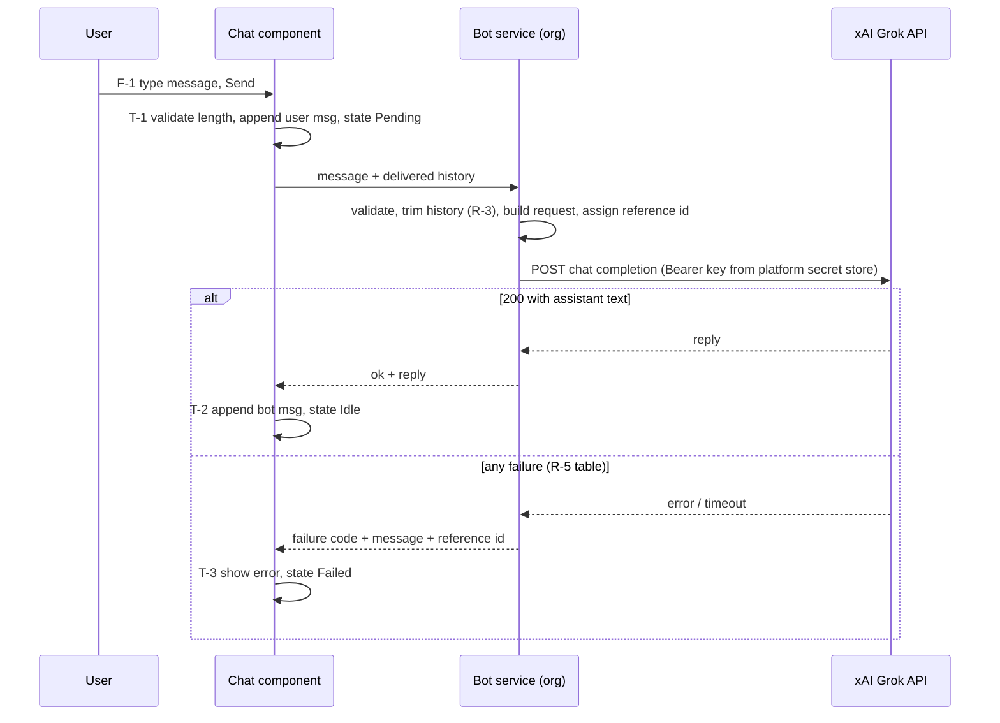

# Grok Bot for Salesforce — Product Specification

Living specification of what the product must do. How it is built is in `architecture.md` (`AD-<n>`), never here.
Requirement IDs are `R-<n>` only; domain/product decisions made here are called *assumptions* (`A-<n>`), flows `F-<n>`,
transitions `T-<n>`, open gaps `G-<n>`.

- **Working location.** This run's working directory plays the role of `KNOWLEDGE/`; this file and `architecture.md`
  sit at its root. (No `KNOWLEDGE/` subfolder exists in the working directory.)
- **Authority and basis.** The only user instruction is the request, received 2026-11-21: *"Create a Grok bot in a
  Salesforce development org."* Everything else is an assumption (A-n) or an evidence-derived constraint, labelled as such.
- **Status of this version.** Definition only: no code, no tests, no org access has been exercised. Every acceptance line
  below is *planned*, none is *passed*.

## Baseline (current system)

| Item | Finding | Evidence class |
| --- | --- | --- |
| Product code / repository | None. The working directory holds only the harness guides. Genuinely new product; no prior behaviour to preserve. | observed (directory listing) |
| Earlier spec, discovery, research, accepted decisions | None exist. | observed |
| Target Salesforce org | **Unknown.** Alias, edition, API version, existing metadata and installed packages not observed. An org-list probe was not permitted in this run, so absence of an org is *not* established (see G-1). | unknown |
| xAI API key / account | **Unknown.** Not provided; never to be read or recorded (G-2). | unknown |
| Salesforce CLI | `sf` is installed on the host (`/opt/homebrew/bin/sf`); version and logged-in orgs not read. | observed |

Because the product is new, every requirement below is **added** by this run (basis: the 2026-11-21 request). Preserved
behaviour: none. Retired: none.

## Interpretation and assumptions

"Grok bot" is ambiguous. The request names no channel, user, data source, or model. Unattended, the best default is
recorded; each is revisable by a later explicit user instruction.

| ID | Assumption (default chosen) | Why |
| --- | --- | --- |
| A-1 | "Grok" means xAI's Grok models reached through the xAI HTTPS API; "bot" means a conversational chat assistant a Salesforce user talks to in the browser. | The only public Grok model access is the xAI API (`https://api.x.ai`, Bearer key; docs.x.ai). |
| A-2 | The consumer is an **internal, licensed Lightning Experience user** of the development org. Not Experience Cloud/community users, not Slack, not Salesforce mobile app, not an Agentforce/Einstein bot channel. | Request says "in a Salesforce development org"; no other channel named. |
| A-3 | The bot is **general-purpose**: it answers what the user types. It does **not** read or write Salesforce records, so no Salesforce record data is ever sent to xAI. | Request names no data grounding; adding it would add sharing/CRUD/FLS scope the request does not need. |
| A-4 | **Conversation history lives only in the open page** (browser memory). Nothing is saved in the org; reload or "New chat" ends it. | Request names no history/audit; "add no persistence the request does not need". |
| A-5 | Tunable defaults (admin-editable configuration, validated at use): model `grok-4.5`; reply cap 2,048 output tokens (allowed 1–4,096); xAI call timeout 60,000 ms (allowed 1,000–120,000); history window 20 messages (allowed 2–50); history character budget 48,000 (allowed 1,000–200,000). Fixed: a single user message is at most 4,000 characters. System prompt: 1–4,000 characters. | Limits left to choice → best default. Model name taken from xAI's published model pages via search summary; **not yet confirmed** against `GET /v1/models` (G-3). The 120,000 ms ceiling is the platform's (see Platform limits). 60 s leaves half the platform ceiling as margin. |
| A-6 | Replies arrive **whole** (no token streaming). While waiting the UI shows a pending state. | Request does not ask for streaming; Apex callout streaming to the browser is not assumed available. |
| A-7 | **No automatic retries.** A failed turn is reported once; the user retries manually. | A blocking callout transaction has a 120 s cumulative callout budget; retrying inside it would silently double latency. |
| A-8 | **Reply text is rendered as inert text**: line breaks preserved, ``` fenced code shown in a monospaced block, nothing interpreted as HTML or markup. Richer markdown is out of scope. | Model output is untrusted. |
| A-9 | Access is granted through one permission set, **"Grok Bot User"**, assigned by an administrator. The xAI API key is entered by an administrator in Setup once (person-only step). | Platform convention; keeps secret custody on the platform (AD-4). |
| A-10 | Visible product names: app **Grok Bot**, tab **Grok Bot**, chat heading **Grok Bot**. Technical API names are chosen in `AD-6` after an org clash check (G-4). | Visible labels are product; API names are structure. |
| A-11 | One shared xAI key serves every user of the org; its rate limit is therefore shared. | Request implies one org-level integration; per-user keys would add identity scope. |
| A-12 | "New chat" acts immediately with no confirmation prompt. | Transcript is disposable by A-4. |

## Actors, channels, state ownership

Trace: **User** (browser, Lightning page) → *request/response* → **Chat component** (owns transcript, pending/failed state)
→ *request/response, sync* → **Server-side bot service in the org** (stateless; validates, rebuilds the xAI request, owns
the secret-bearing call) → *HTTPS request/response, sync, timeout-bounded* → **xAI Grok API** → reply back along the same
path. Acknowledgement means only "xAI returned an answer"; there is no queue, notification, or background work, so no
async-completion contract applies (service-discovery concern 4: not applicable, one line: every turn completes or fails
inside one synchronous request, so there is no accepted-but-unprocessed work).

Other actors: **Administrator** (assigns access, enters the API key, edits configuration; person-only) and the
**development operator** (deploys the metadata; not a runtime actor, and its CLI identity says nothing about a runtime
user's access).



### Flows

| ID | Flow | Requirements |
| --- | --- | --- |
| F-1 | Open entry → ask question → receive reply | R-1, R-2, R-4 |
| F-2 | Follow-up question using earlier turns (incl. trimming) | R-3 |
| F-3 | Failure → retry / dismiss / continue | R-5, R-8 |
| F-4 | Admin: enter key, assign permission set, edit configuration, rotate/revoke | R-6, R-1 |
| F-5 | New chat / leave page while a reply is in flight | R-8 |

### Chat states and transitions (client-owned, transient)

States: **Empty** (no messages; empty state with example prompts), **Idle** (≥1 message, nothing in flight, no
unresolved failure), **Pending** (one request in flight), **Failed** (last send failed; failed message flagged "Not
delivered"; banner with Retry and Dismiss). Initial: Empty. No terminal state (a page lives until reload).

| T | Before | Trigger / guard | After and observation | Failure / recovery | Reqs |
| --- | --- | --- | --- | --- | --- |
| T-1 | Empty, Idle, Failed | Submit; message trimmed is 1–4,000 chars | Pending; user bubble appended; composer cleared; Send disabled; pending indicator shown | n/a | R-2, R-4 |
| T-2 | Pending | Server returns ok | Idle; bot bubble appended; composer focused | n/a | R-2 |
| T-3 | Pending | Server returns failure | Failed; user bubble flagged "Not delivered"; error banner with message + reference id; history unchanged | Retry (T-4) | R-5 |
| T-4 | Failed | Retry | Pending; same message resent with same history; **no** new bubble; flag cleared on success | repeat T-3 on failure | R-5 |
| T-5 | Failed | Dismiss, or a new submit (T-1) | Banner removed; failed bubble stays flagged "Not delivered" and is **excluded** from history sent later | n/a | R-5, R-3 |
| T-6 | Empty, Idle, Pending, Failed | New chat | Empty; transcript cleared; if Pending, the late reply is **discarded** on arrival (no bubble, no error) | n/a | R-8 |
| T-7 | Pending | Submit attempt (Enter or Send) | **Ignored**; composer text preserved; nothing sent | n/a | R-8 |
| T-8 | Pending | Component destroyed (navigate away, reload) | Transcript lost (A-4); late reply has no consumer | n/a | R-8, R-7 |
| T-9 | Empty, Idle, Failed | Submit blank / whitespace-only | Rejected; no state change; Send disabled while blank | n/a | R-4 |
| T-10 | Empty, Idle, Failed | Submit > 4,000 chars | Rejected client side; message "Message is too long (max 4,000 characters)."; text preserved | n/a | R-4 |

Not modelled (reasons): Retry in Idle/Empty/Pending (control not shown/disabled, covered by T-7 style no-op);
multi-tab/multi-user conflicts (no shared state, A-4: each page is independent).

## Requirements

### R-1 Reachable, access-controlled entry

- **Basis:** request 2026-11-21 ("in a Salesforce development org"), A-2, A-9. Added. Preserved: n/a (new product).
- **Behaviour.** An org user who holds the "Grok Bot User" permission set finds **Grok Bot** in the App Launcher and opens the
  chat page at its Lightning URL path. A user without the permission set cannot see the app or tab and cannot invoke the
  server-side bot service.
- **Boundaries.** Two user groups with distinct observable behaviour: **(a)** licensed Lightning user *with* the
  permission set, **(b)** licensed Lightning user *without* it. A System Administrator without the assignment is *not*
  asserted either way (unknown: whether the admin profile implicitly sees new tabs/classes; G-5). Experience Cloud and
  mobile are excluded by A-2.
- **Error behaviour.** Group (b) opening the tab URL gets the platform's "Page does not exist"-style denial; the bot
  service rejects the call (no reply, no xAI call).
- **Consumer outcome.** Group (a) sees the chat heading "Grok Bot", the empty state, and a composer.

Acceptance lines:
- **R-1.1 positive** — As a test user assigned "Grok Bot User", App Launcher search "Grok Bot" lists the app; opening it lands on
  the Grok Bot tab showing the heading and the empty state. Surface: Lightning Experience in a browser as that user.
  Confirmed by: browser check (App Launcher → tab, verifying the destination after redirects) plus
  `sf data query` read of `PermissionSetTabSetting` / `SetupEntityAccess` for the user's permission sets (Salesforce
  platform guide "Consumer entry access"). Needs G-1, G-5.
- **R-1.2 failure** — As a licensed standard user *without* the permission set, App Launcher shows no "Grok Bot" and the tab
  URL path shows the denial; invoking the bot service as that user yields an authorization failure (and, observed on the xAI
  side or in the debug log, no outbound call). Surface: browser/API in the real org as that user. Needs G-1, G-5.
  A `System.runAs` Apex test is **not** accepted as evidence here: that it enforces Apex-class access is unverified, so it
  would be a weaker stand-in.
- **R-1.3 boundary** — Removing the permission-set assignment from an assigned user takes effect on that user's next
  page load/next call without redeploy (verify: unassign, reload, tab hidden). Surface: browser; gated by G-1, G-5.
- **R-1.4 n/a** — Mobile/Experience Cloud entry: n/a, excluded by A-2.

### R-2 Ask Grok a question and read the reply  *(primary)*

- **Basis:** request ("Grok bot"), A-1, A-6, A-8, A-5. Added.
- **Behaviour.** Submitting a valid message (R-4) shows it as the user's bubble, shows a pending indicator "Grok is
  thinking…", sends the conversation to xAI with the configured model, system prompt and reply cap, and appends Grok's
  answer as a bot bubble. User and bot bubbles are visually distinct, in send order, oldest first; the view scrolls to
  the newest message.
- **Reply handling.** Reply text = the assistant message text from xAI's answer. If xAI reports the reply stopped
  because it hit the length cap (`finish_reason` = `length`), the reply is still shown, followed by the note "Reply was cut
  off at the length limit."
- **Default system prompt** (admin-editable): *"You are Grok, a helpful assistant inside Salesforce. Answer concisely and
  clearly. You cannot see or change any Salesforce records."*
- **Error behaviour.** See R-5.
- **Consumer outcome.** A real, relevant answer appears in the chat page within the callout timeout, or an R-5 error does.

Acceptance lines:
- **R-2.1 positive (deterministic)** — Mock xAI returns HTTP 200 body
  `{"choices":[{"message":{"role":"assistant","content":"4"},"finish_reason":"stop"}],"usage":{"prompt_tokens":20,"completion_tokens":1,"total_tokens":21}}`.
  Sending `What is 2+2? Answer with just the number.` yields a bot bubble with exactly `4`, and the mock saw one POST whose
  JSON has `model` = configured model, `max_completion_tokens` = configured cap, `messages[0].role` = `system` with the
  configured prompt, and the final message `{"role":"user","content":"What is 2+2? Answer with just the number."}`.
  Surface: Apex test (request assertions) + Jest (rendered bubble). Both must assert *content*, not mere presence.
- **R-2.2 positive (live)** — With the real key, the same message returns a reply containing `4`; reply text is non-empty
  and visible in the Lightning page. Surface: browser as an assigned user. **Gated by G-2/G-3**; stays *unverified*, owner
  the person who holds the key, due release-verify.
- **R-2.3 boundary** — Mock with `finish_reason":"length"` and content `Partial answer` shows the bubble `Partial answer`
  followed by "Reply was cut off at the length limit."; with `stop` the note is absent. Surface: Jest + Apex test.
- **R-2.4 boundary (rendering safety)** — Reply content `\n```js\nlet a = 1;\n```` renders the
  `` literally as text (no element created, no script executed) and the fence as a monospaced block containing
  `let a = 1;`. Surface: Jest (query DOM for no `img`) + browser.
- **R-2.5 failure** — n/a here: failures are R-5.
- **Out of scope for R-2 (domain rules the request leaves out):** streaming, attachments/images/voice, tool/function
  calling, web/search grounding, answer citation, response regeneration, message editing, copy buttons, markdown beyond
  fences, multilingual UI (the UI is English; Grok replies in whatever language it chooses).

### R-3 Multi-turn context with a bounded history window  *(primary)*

- **Basis:** request ("bot" implies a conversation), A-4, A-5. Added.
- **Behaviour.** Each send carries the earlier **delivered** messages (every user message that received a reply, and
  every bot reply; never a "Not delivered" message) so a follow-up like "and times 3?" is answered in context. The server
  rebuilds the request: system prompt from configuration first, then history, then the new message. **Trimming rule**
  (applied server-side, deterministic): keep the new message plus at most *W − 1* most recent prior messages
  (W = history window, default 20); then drop the oldest prior messages one at a time until the total characters of
  prior messages + new message is ≤ the character budget B (default 48,000). The new message is never dropped (it is
  ≤ 4,000 chars < any allowed B). The server reports how many prior messages were dropped; when > 0 the UI shows
  "Earlier messages are no longer included in Grok's context."
- **Boundaries.** Prior-message count vs W: 0, W−1 (kept whole), W (drops 1). Characters vs B: total exactly B (kept),
  B+1 (drops). Allowed ranges for W (2–50) and B (1,000–200,000); a configured value outside range is NOT_CONFIGURED
  (R-5), not silently clamped.
- **Platform limits that could matter** (source: Salesforce "Execution Governors and Limits"): synchronous heap 6 MB.
  The largest possible request here is B + 4,000 ≤ 204,000 characters and the largest reply is bounded by the 4,096-token
  cap, both orders of magnitude below 6 MB, so the heap limit is *not reachable* by design; no behaviour at that bound
  is specified.
- **Consumer outcome.** Follow-ups are answered in context; long chats keep working and the user is told when old
  messages fell out of context.

Acceptance lines:
- **R-3.1 positive** — Turn 1 `My name is Dana.` (mock reply `Nice to meet you, Dana.`), turn 2 `What is my name?`: the mock
  receives for turn 2 a `messages` array of exactly 4 entries in order: `system`, `user "My name is Dana."`,
  `assistant "Nice to meet you, Dana."`, `user "What is my name?"`. Surface: Apex test + Jest (history passed by component).
- **R-3.2 boundary (window)** — With W = 20, tiny messages: 5 prior → all 5 sent, dropped 0; 19 prior → 19 sent, dropped 0;
  20 prior → 19 sent (the oldest dropped), dropped 1. Surface: Apex test. (Hand-recomputed from the rule above; see Replay
  walks.)
- **R-3.3 boundary (characters)** — W = 20, B = 48,000: 30 prior messages of exactly 3,000 characters and a new message of
  100 characters → 15 prior kept (15 × 3,000 + 100 = 45,100 ≤ 48,000; 16 × 3,000 + 100 = 48,100 > 48,000), dropped 15;
  the UI note appears. Surface: Apex test + Jest for the note.
- **R-3.4 failure** — A "Not delivered" message (T-5) is excluded: after one failed send `A`, then a successful send `B`,
  the history sent with `B` does not contain `A`. Surface: Jest (component) + Apex test (server never sees `A`).
- **R-3.5 failure (integrity)** — A call whose history contains an entry with role `system` (or any role other than `user` /
  `assistant`) is rejected with INPUT_INVALID_HISTORY and **no** xAI call; a caller cannot override the system prompt.
  Surface: Apex test calling the service directly.

### R-4 Input validation

- **Basis:** A-5 (4,000-char limit), request. Added.
- **Behaviour.** A message is valid when, after trimming leading/trailing whitespace, it is 1–4,000 characters. The same
  rule is enforced in the component (prevents sending) and in the server (authoritative; a direct caller can skip the UI).
  The text sent to xAI is the trimmed message.
- **Boundaries.** 0 chars; whitespace-only (`"   \n "`); exactly 1; exactly 4,000; 4,001. Characters are counted as the
  platform string length.
- **Error behaviour.** Blank: Send disabled, no call, no message. Over-length: "Message is too long (max 4,000
  characters)." composer text preserved, no call. Server rejects with INPUT_EMPTY / INPUT_TOO_LONG, zero xAI calls.
- **Consumer outcome.** Bad input never reaches xAI and never loses the user's typed text.

Acceptance lines:
- **R-4.1 failure** — Blank (`""`) and whitespace-only (`"   \n "`) messages: Send is disabled; direct server call returns
  INPUT_EMPTY and the mock saw 0 requests. Surface: Jest + Apex test.
- **R-4.2 boundary** — A message of exactly 1 character `a` and one of exactly 4,000 `a` characters are both accepted (mock
  receives 1 request each); 4,001 `a` characters → INPUT_TOO_LONG, composer text preserved, mock saw 0 requests. Surface:
  Jest + Apex test.
- **R-4.3 positive** — `"  hello  "` is sent as `hello`. Surface: Apex test asserting the mock request body.
- **R-4.4 n/a** — Language/content filtering: n/a, the request asks for none; content policy is xAI's.

### R-5 Failure handling and recovery

- **Basis:** request (a working bot), A-7. Added.
- **Behaviour.** Every failure of a send ends in Failed state (T-3) with an exact message and a **reference id**
  (unique per turn). No stack trace, xAI response body, API key, or Salesforce internals reach the browser. History is not
  changed by a failure; Retry (T-4) resends. Outcome groups with distinct observable behaviour:

| Code | Triggered by | User sees (exact) |
| --- | --- | --- |
| NOT_CONFIGURED | Configuration record missing, or a value outside its allowed range (A-5 / R-3) | "Grok isn't set up correctly. Please contact your Salesforce administrator. (Reference: ‹id›)" |
| AUTH | xAI HTTP 401 or 403 (bad/revoked key, no permission) | same text as NOT_CONFIGURED |
| UPSTREAM_REJECTED | xAI HTTP 400, 404, 422 (e.g. unknown model name) | same text as NOT_CONFIGURED |
| RATE_LIMITED | xAI HTTP 429 | "Grok is receiving too many requests right now. Please wait a moment and try again. (Reference: ‹id›)" |
| TIMEOUT | Callout exceeds the configured timeout | "Grok took too long to respond. Please try again. (Reference: ‹id›)" |
| UNAVAILABLE | xAI HTTP 5xx; any other callout failure (network, platform callout limit/concurrency rejection) | "Grok is unavailable right now. Please try again later. (Reference: ‹id›)" |
| EMPTY_REPLY | HTTP 200 but no assistant text (missing/empty `choices[0].message.content`, unparseable JSON) | "Grok returned an empty reply. Please try again. (Reference: ‹id›)" |

  Input failures (R-4, R-3.5) use their own codes and are not in this table. Retry is shown for every row (for the
  administrator-action group it will keep failing until an administrator acts; harmless).
- **Boundaries / limits.** One callout per turn, so the platform's per-transaction callout count (100) and cumulative
  callout time (120 s) are met by design; the configured timeout (default 60 s) can never exceed 120 s because it is range-checked
  (R-3, A-5). Callouts must happen before any DML in the transaction (platform rule); the bot service performs no DML.
  Concurrent-callout caps are an org-level platform limit (Developer Edition: 20 concurrent outbound callouts per the
  platform documentation) and surface as UNAVAILABLE; the exact exception is unverified (G-8).
- **Observability.** Each turn writes one debug-log line without any message or reply content:
  `GROKBOT ref=<id> outcome=<OK|CODE> status=<http status or -> ms=<elapsed> promptChars=<n>`. The reference id in the UI
  matches the log line. Persistent usage/audit storage is out of scope (no object created).
- **Consumer outcome.** The user always learns that the turn failed, why in plain words, and can retry; an
  administrator can correlate a reported reference id to a log line when a trace flag was active.

Acceptance lines:
- **R-5.1 failure (each row)** — With a mock returning, in turn: 401, 403, 400, 404, 422, 429, 503, 500, a thrown timeout
  `CalloutException`, and `200` with body `{"choices":[]}`: the service returns the code in the table row for each and the exact message
  text, and the component renders that text in an alert region with the reference id. Surface: Apex test (code per case)
  + Jest (message rendering). *Exactly the ten cases listed; any other status falls under UNAVAILABLE unless 4xx
  (treated as UPSTREAM_REJECTED); this grouping is a design choice, A-13 below.*
- **R-5.2 failure (secrecy)** — For every R-5.1 case, the result returned to the browser contains none of: the mock's
  response body text `SECRET-UPSTREAM-DETAIL`, the string `Bearer`, the configured API key sentinel `KEY-SENTINEL-123` (set
  as the mock credential), or an Apex stack trace. Surface: Apex test string assertions.
- **R-5.3 recovery** — After a 429 failure, Retry resends the *same* message with the *same* history; on a mock now
  returning 200 the transcript shows one user bubble (flag cleared) and one bot bubble. Surface: Jest.
- **R-5.4 boundary (configuration)** — Timeout configured 999 or 120,001 → NOT_CONFIGURED with 0 xAI calls; 1,000 and
  120,000 accepted. Likewise window 1/51, budget 999/200,001, reply cap 0/4,097. Surface: Apex test.
- **R-5.5 live failure (real org)** — In the real org with *no* API key entered, an assigned user sending a valid message sees a
  message from the administrator-action or unavailable rows (exact code not asserted: how the platform surfaces an unset
  credential is unverified, G-8). Surface: browser; possible without G-2.
  (Replay: mock 429 for message `ping` → code RATE_LIMITED, ref shown in the banner.)
- **R-5.6 observability** — For one failing (429 mock) and one succeeding (200 mock) turn the org debug log contains exactly one
  `GROKBOT` line each; the failing line's `ref` equals the reference id returned to the caller, `promptChars` equals the characters
  sent, and neither line contains the message text. Surface: the org's debug log retrieved after `sf apex run test` with a trace
  flag active (remote test). Planned; Apex tests cannot read debug logs, so the exact retrieval command is settled at prepare.

### R-6 Credential and configuration custody

- **Basis:** request (integration with an external AI service), platform guidance. Added.
- **Behaviour.** The xAI API key is entered once by an administrator in Setup into the platform's secret facility. It is
  never in source control, deployed metadata values, browser payloads, debug logs, error messages, or the admin-editable
  configuration. Configuration (model, system prompt, reply cap, timeout, history window, history budget) is
  admin-editable **without code change** and contains no secrets. Changing the key or configuration takes effect on the next
  turn with no redeploy. Removing the key or the permission set's access to it makes the next turn fail as AUTH/NOT_CONFIGURED/UNAVAILABLE
  (R-5) and does not expose old data.
- **Authority.** Key entry and configuration edits: administrators only (person-only step, owner: the user's org admin, due
  prepare/release-verify, G-2). Runtime users never see or edit them.
- **Consumer outcome.** An admin can rotate the key or switch the model in Setup and the next chat turn uses it.

Acceptance lines:
- **R-6.1 failure (no secret in source)** — A repository scan of all committed files finds no literal `Bearer ` followed by a
  non-merge-field value, no `xai-` prefixed token, and no secret value in credential metadata. Surface: repo grep script.
  (Whether `xai-` is the real key prefix is unverified; the check also confirms credential metadata carries no value field.)
- **R-6.2 positive (rotation)** — After changing the model in configuration from `grok-4.5` to `grok-4.3`, the very next
  turn's request body carries `grok-4.3` with no deployment. Surface: Apex test (changed config row via test setup) for the
  read path; real-org observation gated by G-1.
- **R-6.3 boundary** — System prompt of 1 character and of 4,000 characters are accepted; blank → NOT_CONFIGURED. (4,000 is the
  default bound for the system prompt, recorded in A-5; not a platform limit.)
- **R-6.4 positive (key never shown)** — After the admin saves the key, no Setup page, API response, or the component's
  payload displays it again. Surface: browser by the admin; **NOT-REPLAYED** (needs the key and org; G-2).
- **R-6.5 failure** — With the permission set missing the credential access, the call fails per R-5 and the transcript shows
  the R-5 message, not a platform stack. Surface: browser in the real org.

### R-7 Privacy, disclosure and retention

- **Basis:** request (sends user text to a third party), A-3, A-4. Added.
- **Behaviour.** The chat page shows a fixed note in its footer at all times: "Messages are sent to xAI's Grok service. Don't
  enter confidential or customer data." Only the text the user typed in this chat (and Grok's earlier replies) plus the
  configured system prompt leave Salesforce; no record data, user name, email, org id, or session id is sent. The org stores
  no chat content (A-4), logs none (R-5), and keeps no copy after reload. xAI's own retention is outside the product's
  control and **not verified** for the chat-completions endpoint (its docs state a 30-day storage for the *Responses*
  endpoint only; G-6).
- **Consumer outcome.** Users know their text goes to xAI; the org leaves no record of it.

Acceptance lines:
- **R-7.1 positive** — The footer note text above is present in the rendered component in Empty, Idle, Pending and Failed
  states. Surface: Jest.
- **R-7.2 failure (outbound payload)** — For the R-2.1 turn the mock-captured request JSON has exactly the keys `model`, `messages`,
  `max_completion_tokens` (and optionally `stream: false`) and contains no user id, username, email, or org id strings
  (the test user's username is asserted absent). Surface: Apex test.
- **R-7.3 boundary (no persistence)** — After sending a message, org record counts for custom objects the product created
  are 0 because it creates none; a reload shows the Empty state. Surface: browser + metadata listing (no custom
  objects in the deployment).
- **R-7.4 n/a** — Data subject export/deletion workflows: n/a, the org stores nothing; xAI-side deletion is outside scope (G-6).

### R-8 Interaction control: one request at a time, new chat, supersession

- **Basis:** A-4, A-12. Added.
- **Behaviour.** At most one request is in flight per open chat. While Pending: Send is disabled, Enter does nothing, the
  typed text in the composer is preserved (T-7). "New chat" (T-6) is always available; if used while Pending, the late reply
  is discarded when it arrives (no bubble, no error banner) — a superseded response never alters the new chat. Leaving the page
  or reloading discards the chat (T-8). Two browser tabs or two users never affect each other's transcript (no shared
  state); they only share the xAI rate limit (R-5 RATE_LIMITED).
- **Server duplication.** The server does not deduplicate; double submits are prevented client-side. Two identical direct
  calls produce two xAI calls (cost implication accepted).
- **Consumer outcome.** No duplicated or crossed-over messages.

Acceptance lines:
- **R-8.1 positive** — Sending while Pending (Enter or click Send) adds no bubble and makes no second server call; the typed text
  remains. Surface: Jest with a controllable (unresolved) server promise, no arbitrary sleeps.
- **R-8.2 failure (supersession)** — Send `A`; before resolution click New chat; resolve `A`'s reply: transcript remains Empty,
  no banner. Same for a rejected `A`. Surface: Jest with controlled promise completion.
- **R-8.3 boundary** — New chat from each of Empty, Idle, Pending, Failed leads to Empty with composer focused and the
  banner removed. Surface: Jest.
- **R-8.4 n/a** — Cross-tab/user conflict resolution: n/a, no shared state (A-4).

### R-9 Additive, repeatable deployment into the development org

- **Basis:** request ("Create … in a Salesforce development org"). Added.
- **Behaviour.** The product ships as source-format Salesforce metadata that deploys to the development org with the
  `sf` CLI, creating only new components: the chat component, the bot service and its tests, the configuration type
  and its default record, the credential definition (without the key), the entry (tab, app), and the "Grok Bot User"
  permission set. No existing org object, field, profile, automation, or component is modified or removed. A second
  deploy of the same source is a no-change success. Deploy, permission-set assignment, and key entry are separate steps,
  each with its own authority (A-9). Server-side behaviour has Apex tests that pass in the org; component behaviour has
  Jest tests that pass locally.
- **Boundaries.** Names must not collide with existing org metadata or installed packages (G-4); on a clash the
  deployment is refused rather than silently altering the existing component (target org's `deploy validate` result is the
  observation).
- **Consumer outcome.** The development org ends with a working, discoverable Grok Bot entry for assigned users and a
  documented set of remaining person-only steps.

Acceptance lines:
- **R-9.1 positive** — `sf project deploy validate` (dry run) against the target org succeeds, then `sf project deploy start` succeeds
  and `sf org list metadata` for LightningComponentBundle, CustomTab, CustomApplication and ApexClass lists the new names. Surface:
  CLI against the org. Needs G-1, G-4.
- **R-9.2 boundary (additive)** — A pre/post metadata listing for CustomObject, Profile, PermissionSet, ApexClass shows only
  additions of the product's own names; nothing pre-existing changes. Surface: CLI listing diff.
- **R-9.3 positive (repeatable)** — Re-running the deploy reports no component changes. Surface: CLI.
- **R-9.4 positive (tests)** — `sf apex run test --class-names <each test class> --synchronous --result-format tap` prints `ok` lines for
  every case and no `not ok`; the Jest suite passes locally. Surface: org (remote test, per the Salesforce platform guide) + local.
- **R-9.5 failure** — If a name clash exists the plan renames before deploy; verified by the listing in R-9.1 before choosing
  names. Surface: CLI.

## Non-functional requirements

Assessed per requirements-definition: no numeric target is invented. A latency SLA, availability target, throughput
target, cost budget, or retention period was not requested: **no bound is set** and the only enforced time bound is the
configured callout timeout (R-5).

### R-10 Designed, accessible chat interface

- **Basis:** deliverable has a user interface; stage rule 6; UI visual-direction guide. Added.
- **Visual reference and starting appearance.** Platform conventions and the host identity take precedence: the component
  lives inside the Lightning Experience shell and uses the **Salesforce Lightning Design System** (SLDS) icon set,
  spacing and typography scale through its styling hooks. Unspecified choices fill from the guide's *light expressive
  starting point*: light first, with a dark option; airy composition, tonal rounded message surfaces (user bubble
  filled accent tint, bot bubble neutral tonal surface), friendly sans-serif (the shell's font), restrained accent, a
  confident primary Send action, short purposeful motion. The memorable signature: a softly luminous composer with an
  integrated "thinking" indicator. The plan (`AD-9`) chooses concrete tokens.
- **Observable criteria.**
  - Consistent visual system: one spacing scale, one type scale and one palette defined as named tokens with a light set and a
    dark set; no hard-coded colour in component rules.
  - Designed states: Empty (heading, one-line description, three example prompts that *fill* the composer when
    clicked, not auto-send: "Summarize this text for me", "Draft a polite follow-up email", "Explain what a Salesforce
    flow is"), Pending ("Grok is thinking…" with animated dots), Failed (banner, R-5), loaded/Idle.
  - Layout: works at 360 px and 1440 px wide, no horizontal page scroll; the composer stays reachable; long unbroken strings and code
    blocks wrap or scroll inside their own bubble.
  - Accessibility: visible focus ring on every interactive control; text contrast ≥ 4.5:1 and component boundaries/icons ≥ 3:1 in
    both token sets (WCAG 2.2 AA); the message list is a live region (polite) so a new reply is announced; the error banner uses
    an alert role; every control has an accessible name; Enter sends, Shift+Enter inserts a newline; focus returns to the composer
    after a reply and after New chat; full flow operable by keyboard alone.
  - Motion only where it explains change (thinking dots, new-bubble fade); disabled under `prefers-reduced-motion: reduce`
    (replaced by a static "Grok is thinking…").
  - One icon set (SLDS utility icons).
- **Dark theme gap.** Whether the target org's Lightning shell exposes a dark theme signal is unverified (G-7). Until
  known the component defines both token sets, honours the host's signal when present, and is contrast-checked on both sets by
  computing token-pair ratios.

Acceptance lines:
- **R-10.1** — Token table has light and dark sets; computed contrast of every text/background and control/background pair meets
  the ratios above in both sets. Surface: contrast script over the tokens (automated) + manual spot-check in the org.
- **R-10.2** — At 360 px and 1440 px viewport widths, with a 4,000-character unbroken string and a long fenced code block
  in the transcript, `document.scrollingElement.scrollWidth <= clientWidth`. Surface: browser check (Playwright-style) in the
  real tab; Jest cannot establish layout.
- **R-10.3** — Keyboard-only run: Tab to composer, type `hello`, Enter, Tab to New chat, activate; focus order, focus rings visible
  (screenshot), focus returns to composer. Surface: browser.
- **R-10.4** — Empty/Pending/Failed states each render as specified (screenshots plus semantic queries for headings, `role=alert`,
  `aria-live`). Surface: Jest + browser.
- **R-10.5** — With reduced motion emulated, no CSS animation runs on the thinking indicator (computed style). Surface: browser.
- **R-10.6 n/a** — Salesforce mobile app rendering: n/a (A-2).

### R-11 Security of the server-side bot service

- **Basis:** platform security guidance (CRUD/FLS/sharing recorded separately), A-3. Added.
- **Behaviour.** Sharing: n/a, the service touches no records. Object CRUD: n/a, no object read or written. Field-level
  security: n/a. These three are recorded as **not applicable because no Salesforce record is read or written** (A-3);
  adding a record read later reopens them. Access to the service is gated by class access in "Grok Bot User" (R-1.2). Inputs from the
  browser are untrusted: validated (R-4, R-3.5); the system prompt, model, and limits come only from configuration; xAI
  output is untrusted and rendered inert (A-8). The service makes calls only to the configured xAI endpoint.
- **Acceptance.**
  - **R-11.1** — A caller who supplies a `system` role or a model name argument cannot change either (R-3.5; the service signature has no model parameter
    — checked by Apex test compilation and a direct-call test). Surface: Apex test.
  - **R-11.2** — The deployed bot service performs no SOQL/DML (grep the source and assert `Limits.getQueries() == 0` and
    `Limits.getDmlStatements() == 0` in a test turn). Surface: Apex test.

### R-12 Reliability within platform limits

- **Basis:** platform limits. Added.
- **Platform limits (sources).** Salesforce *Callout Limits and Limitations*: per-callout timeout 1 ms–120,000 ms (default 10 s),
  cumulative 120 s per transaction, 100 callouts per transaction, no callouts with pending DML, Developer Edition
  20 concurrent outbound callouts (this last figure and the pending-DML rule were seen in older versions of the page and must be
  rechecked against the target org's current release, G-8). *Execution Governors and Limits*: synchronous heap 6 MB, CPU 10,000 ms (callout wait time not counted),
  100 SOQL queries. xAI: HTTP 429 when per-model requests-per-second or tokens-per-minute limits are exceeded (docs.x.ai
  rate-limits).
- **Behaviour at the bounds.** Timeout reached → TIMEOUT; 429 → RATE_LIMITED; platform concurrency rejection → UNAVAILABLE
  (exact exception unverified, G-8); nothing blocks other users beyond those.
- **Acceptance.** R-5.1, R-5.4 cover the bounds. **R-12.1** — a turn performs exactly one callout and zero DML (Apex test asserts
  `Limits.getCallouts() == 1`). Surface: Apex test.
- **Excluded** (justified): load/capacity testing — no volume was requested and the dev org is the stated target; availability
  SLA — depends on xAI, not set by the request.
- **Unknown (G-9).** The browser-side wait for a Salesforce server action may be shorter than the 60 s default callout timeout;
  unverified. Interim safe behaviour: default 60 s; a live slow-response probe settles it. Affects only the default value of A-5's timeout.

### R-13 Maintainability and testability

- **Basis:** platform guidance. Added.
- **Behaviour.** All xAI-specific knowledge (endpoint path, request/response field names, error mapping) lives in one place so a switch
  to xAI's Responses endpoint is a one-class change (AD-2). Callouts are mockable in tests without the key. Tests assert
  content (request bodies, exact messages, state transitions), not presence.
- **Acceptance.** **R-13.1** — The Apex test suite runs to green with no network and no key (mock only). **R-13.2** — a mutation of the
  trimming rule (e.g. `<` for `<=` at the budget boundary) fails R-3.3; mutation of the 401 mapping fails R-5.1. Surface: local
  mutation check / Apex run in the org.

## State and data assessment

| State | Owner and location | Read by | Simultaneous changes | Ends when | Quotas met |
| --- | --- | --- | --- | --- | --- |
| Transcript, pending/failed flags (Changed) | Chat component memory in one browser page | That user only; never sent elsewhere except as the delivered history to xAI | Single writer (UI events, serialized by R-8) | Reload, navigation, New chat | Browser memory; history window caps what is sent |
| Configuration (Observed/Changed by admin) | Org configuration records (new, deployed as metadata) | The bot service at runtime; admins | Admin edits, last write wins; read per turn | Admin deletes/changes | None material |
| API key (Changed by admin only) | Platform secret store attached to the credential definition | Platform when making the call; never any user or code | Admin overwrite, last write wins | Admin removes it | n/a |
| Access grants (Changed by admin) | Permission-set assignments | Platform | Admin | Unassignment | n/a |
| Debug-log line (Written) | Org debug logs, only when a trace flag is active | Administrators | Append-only | Platform log retention | Platform log size limits (unverified, n/a to behaviour) |
| Chat content at xAI (not owned) | xAI | xAI | n/a | xAI policy, unverified (G-6) | xAI rate limits |

Before/after invariants: deploy adds only new components (R-9.2); a turn changes no org data (R-7.3, R-11.2). Recovery: failed
turn → transcript unchanged apart from the flag, Retry (R-5.3); bad deploy → remove the product's own components; no data
to migrate because none is stored. Unknowns: G-1, G-4, G-6, G-8.

## Service boundary contracts

- **xAI Grok API.** Authority: xAI is the source of truth for answers and model availability. Freshness: none cached; every turn calls
  live. Revocation: key revoked at xAI → 401/403 on the next turn → AUTH (R-5). Incremental state: none (stateless endpoint; full window
  sent each turn). Async: none, one synchronous call, timeout-bounded. Owned event coverage: one debug-log line per turn (R-5);
  xAI's own usage dashboard is outside the product. Verified facts (docs.x.ai, read 2026-11-21): `POST /v1/chat/completions`,
  Bearer auth, fields `model`, `messages`, `max_completion_tokens` (`max_tokens` is deprecated), response
  `choices[0].message.content`, `choices[0].finish_reason`, `usage.prompt_tokens/completion_tokens/total_tokens`; 401 = bad or missing
  auth, 429 = rate limit, 400/404/422 documented; error *body* shape and 5xx codes not stated; `GET /v1/models` lists models for the key;
  xAI calls the endpoint the "predecessor" of Responses and says new integrations should use Responses, with no deprecation date.
- **Salesforce platform.** Authority for access and secrets. Runtime principal ≠ deploying operator. A developer's CLI session does
  not prove the end-user's access, so R-1.1 and R-6.5 observe the assigned test user (G-1, G-5).
- **Not applicable (one line each):** cache and invalidation (no cache); incremental sync (no replica); event/notification
  consumers (none).

## Open gaps (prerequisites and decisions)

| ID | Gap | Affects | Owner | Interim behaviour / next observation | Due |
| --- | --- | --- | --- | --- | --- |
| G-1 | Target org: alias, edition, supported API version, a logged-in `sf` session for the intended deploy user. Not probed (org-list read not permitted in this run). | R-1, R-9, R-5.5, R-6, all in-org checks | User | Proceed with local-only work (Jest, mock-based Apex written but not run); read-only `sf org list` then `sf org display`-free probes at prepare | prepare |
| G-2 | xAI API key and who enters it (person-only; never in chat/notes). | R-2.2, R-6.4, release-verify | User / org admin | Everything else proceeds with mocks | release-verify |
| G-3 | Model default `grok-4.5` unconfirmed; reasoning models may spend the reply cap on reasoning and return an empty reply (EMPTY_REPLY) at 2,048. | A-5 defaults, R-2.2, R-5 | User (needs key) | Confirm via `GET /v1/models` and one live reply; adjust the default via configuration, not code | release-verify |
| G-4 | Name clash check against existing metadata/packages (LightningComponentBundle, CustomTab, CustomApplication, ApexClass, PermissionSet, CustomMetadata, ExternalCredential, NamedCredential). | R-9 | Plan/prepare | `sf org list metadata` per type | prepare |
| G-5 | Test user with permission set, and whether admin profiles see the tab/class implicitly. | R-1 | Org admin | Probe per platform guide queries | release-check |
| G-6 | xAI retention for chat-completions requests unverified; Responses stores 30 days per docs. | R-7 | User decision | Footer disclosure stays; no stronger claim | handoff |
| G-7 | Dark-theme signal from the Lightning shell unverified. | R-10 | Plan | Token sets defined, contrast checked on both | step-plan |
| G-8 | Exact platform exception for (a) unset external credential, (b) timeout message, (c) concurrency rejection. | R-5 classification | Plan/prepare probe | Unrecognised callout exceptions → UNAVAILABLE | prepare |
| G-9 | Browser/server-action wait ceiling vs 60 s default timeout. | A-5 timeout default | Plan | Keep 60 s; live slow-response probe | release-verify |

A-13 (design choice referenced in R-5.1): unlisted 4xx statuses → UPSTREAM_REJECTED; unlisted 5xx and non-HTTP failures → UNAVAILABLE; 3xx →
UNAVAILABLE.

## Intended scope and exclusions (request outcome map)

| Request outcome | Mapped to |
| --- | --- |
| "Grok" (xAI model answers) | R-2, R-3, R-5, R-6 |
| "bot" (conversation) | R-2, R-3, R-8, R-10 |
| "in a Salesforce … org" (reachable inside Salesforce) | R-1, R-9, R-11 |
| "development org" (deploy to dev, not production) | R-9, R-12 |

**Primary requirements** (what the user asked for directly): R-1, R-2, R-3, R-9. Excluded from scope: Agentforce/Einstein
bot-builder channels, Salesforce record grounding or actions, saved/exported history, analytics/usage dashboards, multi-model
choice by users, Experience Cloud and mobile, streaming, file/image input, production deployment. Reference-system parity:
none claimed (no other system is the reference).

## Replay walks (item 10)

- **W-1 (R-3.3).** Start: configuration W = 20, B = 48,000; call with 30 prior messages × 3,000 chars + new message 100 chars. Rule: keep
  last 19 prior (57,000 chars) → total 57,100 > 48,000 → drop oldest one at a time → at 15 prior total 45,100 ≤ 48,000 (at 16 it is 48,100 > 48,000).
  Result: 15 kept, 15 dropped. Method: hand-recomputed from the spec rule (the sandbox declined a script run). Status:
  **NOT-REPLAYED against code** (no code exists).
- **W-2 (R-3.2).** 5 prior → 5 kept; 19 prior → 19 kept; 20 prior → 19 kept, 1 dropped (hand-recomputed). Same status.
- **W-3 (R-1.1, R-2.2, R-6.4, R-9.1).** Ordered procedure: deploy → assign permission set → admin enters key → open tab → send. Walk: the actor
  (operator) has no recorded org/authority yet (G-1); each later action is permitted only after the previous one (assignment needs a
  deployed permission set; sending needs the key). **NOT-REPLAYED: no org access in this run; start unreachable → open prerequisite G-1/G-2.**
- **W-4 (R-8.2).** Send `A` → Pending (T-1); New chat → Empty (T-6); reply arrives → ignored. Each action is permitted in the preceding state
  per the transition table. Not executed (no code).

## Retired

None.

## Submission

- **summary.** Spec for a new product: an internal Lightning chat page ("Grok Bot") that sends a user's messages to xAI's Grok
  chat-completions API from a stateless server-side service in the org, with the API key held in the platform secret store.
  13 requirements (R-1 to R-13) with concrete, replayable acceptance lines; chat state model T-1..T-10; error taxonomy with exact messages;
  history trimming with computed boundary examples; no record data sent, no chat stored. **Assumptions** recorded (A-1 to A-13), notably: Grok
  = xAI API; internal Lightning users only; transcript in page memory only; whole replies (no streaming); no auto-retry; 4,000-char message,
  20-message/48,000-char history, 60 s timeout, 2,048-token reply, model `grok-4.5` as admin-editable defaults; platform-conformant
  visual direction (SLDS, light first with dark tokens). **Open** items (keep dependent work unready): G-1 target org/session unconfirmed
  (org probe not permitted), G-2 xAI key (person-only), G-3 model default/empty-reply risk, G-4 name clash check, G-5 test user and admin
  visibility, G-6 xAI retention, G-7 dark theme signal, G-8 platform exception classes, G-9 server-action wait ceiling. No requirement
  conflict found; nothing retired. Not claimed: any test or deployment has run; the `backchain-check` command does not exist in this
  run (duty 11 omitted).
- **primary.** R-1, R-2, R-3, R-9.
- **evidence_refs.** `spec.md` (whole), `architecture.md`; sections R-1…R-13, State and data assessment, Service boundary contracts, Open gaps;
  sources: `GUIDES/platforms/salesforce.md`, `GUIDES/requirements-definition.md`, `GUIDES/behavioral-requirements.md#behavior-model`,
  `GUIDES/service-discovery.md#verification`, `GUIDES/platforms/ui.md#light-expressive-starting-point`,
  `GUIDES/current-system-baseline.md#planning-and-review-handoff`; external primary documentation (read 2026-11-21): docs.x.ai REST reference
  (chat-completions, responses, models), docs.x.ai/developers/debugging, docs.x.ai/developers/rate-limits; Salesforce Apex Developer Guide
  *Callout Limits and Limitations*, *Execution Governors and Limits*, *Custom Headers and Bodies of Apex Callouts That Use Named Credentials*,
  Named Credentials developer guide. Third-party sources (blog posts) were used only as pointers and are not relied on.
