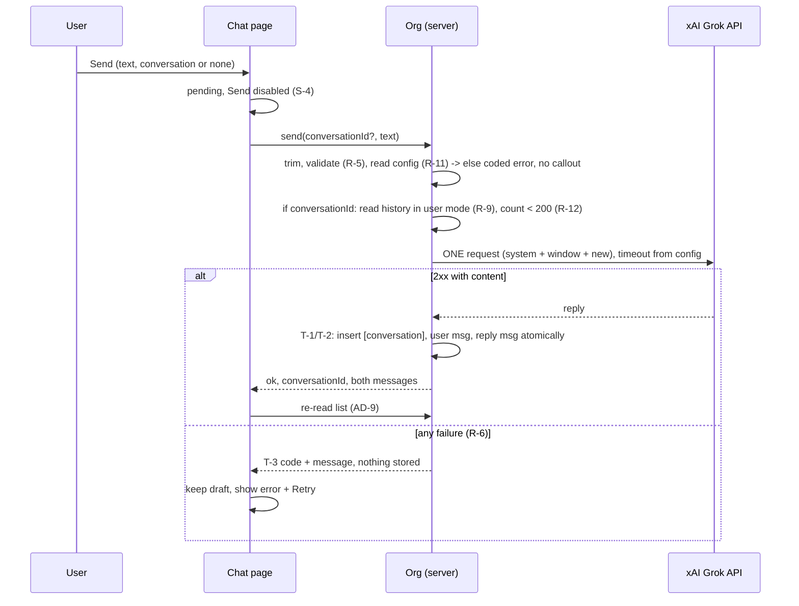
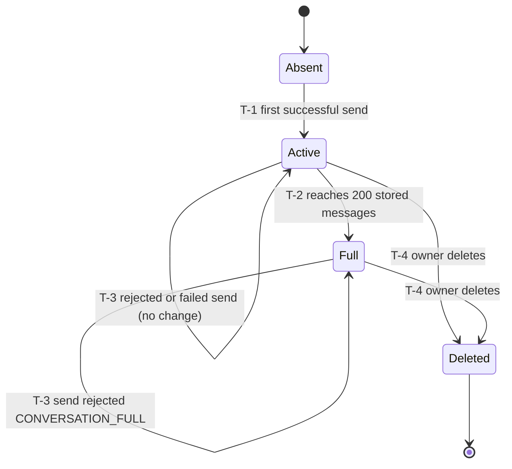

# GrokBot for Salesforce: product specification

**Product:** a chat assistant ("Grok Bot") that lives in a Salesforce development org and answers users with an xAI
Grok model. Structure and technology choices are in `KNOWLEDGE/architecture.md` (AD-n); this file holds behaviour only.

**Basis for every R-n below:** the request "Create a Grok bot in a Salesforce development org." (2026-11-21), plus the
product decisions D-1..D-6 in "Decisions and defaults". No earlier spec, repository, discovery or research result exists:
this is a new product, so each R-n is **added**; nothing is preserved, changed or retired (`## Retired` is empty).
**Current-system baseline:** none. The target org is unobserved (G-1), so no claim here describes existing org state.

## Request outcomes → requirements

| Outcome (from the request) | Requirements |
| --- | --- |
| O-1 A "bot": a user types, a Grok model answers | R-3, R-4, R-5, R-6, R-13 |
| O-2 The bot is "Grok": the answers come from xAI's Grok API using an org-held credential | R-3, R-7, R-11 |
| O-3 "In a Salesforce development org": deployable to and usable in a dev org through a Lightning entry | R-1, R-2 |
| O-4 Implied by being a bot in a shared org: private, durable, removable conversations | R-8, R-9, R-10, R-12 |

**Out of scope (deliberate, bound the R-n they sit under):** grounding answers in Salesforce records, Grok tool or
function calling, web or X search, streaming/token-by-token display, file/image/voice input, Agentforce/Einstein
integration, Experience Cloud/Slack/mobile app surfaces, sharing a conversation with another user, renaming or editing
messages, markdown rendering (D-5), multi-language UI, usage/cost dashboards, automatic retry, background or scheduled
work. Silence here is not retirement: a later request may add any of them.

## Decisions and defaults

Not platform facts; each is a product choice that an administrator may change in configuration (R-11) and that the user
may overrule (G-5). Recorded because acceptance lines need a bound to test.

| ID | Decision / default | Basis |
| --- | --- | --- |
| D-1 | Max user message length 4000 characters after trimming (length counted as Apex `String.length()`, UTF-16 units) | assumption, stored content field holds 32768 |
| D-2 | History window: the 20 most recent stored messages before the new one are sent as context | assumption |
| D-3 | Max messages per conversation: 200 | assumption (bounds transcript size and org storage) |
| D-4 | Grok call timeout 60000 ms; hard platform ceiling 120000 ms per request and per transaction | platform ceiling from Apex callout limits; 60 s is an assumption |
| D-5 | Replies are displayed as plain text, line breaks preserved, no markdown or HTML interpretation | assumption (also the safe default, R-13) |
| D-6 | Conversation list shows the 50 most recent conversations by last activity; max output tokens 1024 | assumption |

## Actors, channels, state ownership (compact trace)

| Actor | Interaction / channel | State owner | Observable outcome |
| --- | --- | --- | --- |
| User (browser, Lightning Experience) | opens tab; types; clicks Send. Request/response to the org; the reply returns on the same response (no push) | org database (conversations); browser memory (draft, pending) | reply bubble appears, conversation appears in list |
| Org runtime (server-side) | one HTTPS request/response to xAI, synchronous; acknowledgment = a complete HTTP response | xAI holds nothing we rely on; the org keeps the transcript | success or a coded error |
| Administrator | deploys, sets the xAI key once, edits configuration, assigns access | credential store, configuration record, access assignments | bot usable or visibly "not configured" |
| xAI Grok API | external system, the reference for answer content (not for parity of behaviour) | xAI | HTTP status and JSON |

Return path: the HTTP response is the only completion signal. A received 2xx is not "saved": saving is a separate
milestone (R-12). The UI shows saved state only after the org confirms the write.

## Requirements

Every acceptance line names its consumer surface and how it is confirmed. Surfaces: **Apex test** (runs in the org,
callout mocked), **Jest** (LWC, local), **UI** (browser on the Lightning entry as a named user), **Live** (UI plus the
real xAI API), **Deploy** (deployment status and metadata read-back). Test users: **U1** and **U2** hold the Grok Bot
user permission set; **U0** holds none. All three exist only after G-1 and G-10 are resolved.

### R-1: Deployable footprint in a development org
The bot's metadata deploys into a Salesforce development org as an additive change: it creates only items whose names
start with `GrokBot`/`grokBot` and alters no existing org item. *Basis: request O-3. Locators: GUIDES/platforms/salesforce.md
(Service discovery, Testing). Evidence limits: org, API version and installed packages unobserved (G-1). Pending: plan,
deploy, read-back.*
- **Positive:** a validate-only deploy then a real deploy of the whole set reach terminal status `Succeeded`, and a
  metadata listing (LightningComponentBundle, CustomTab, CustomApplication, CustomObject, PermissionSet,
  NamedCredential, ExternalCredential) returns each of the names in AD-1..AD-8. Surface: Deploy; confirmed by deploy
  report plus `sf org list metadata` per type.
- **Failure:** if any `GrokBot*` name already exists in the org from another source, deployment is **not** run; the run
  reports the clash and the clashing item (no overwrite). Surface: Deploy (pre-deploy inventory); confirmed by the
  inventory output kept in the run notes.
- **Boundary:** re-deploying the identical set to the same org succeeds and changes nothing (idempotent): second deploy
  reports zero component changes. Surface: Deploy.
- **Consumer outcome:** n/a: covered by R-2.

### R-2: Entry and access
A user holding the user permission set (AD-8) can open the "Grok Bot" tab at `/lightning/n/GrokBot`, inside the Grok Bot
app in App Launcher; a user without it cannot. *Basis: request O-3. Locators: salesforce.md "Consumer entry access".
Evidence limits: access of the target user is unobserved (G-10). Pending: tab/app/permission-set files, assignment.*
- **Positive:** U1 types "Grok Bot" in App Launcher, sees the app, opens it, and lands on `/lightning/n/GrokBot`
  showing the empty state (R-13). Surface: UI as U1; confirmed by final URL and visible heading "Grok Bot".
- **Failure:** U0 opening `/lightning/n/GrokBot` gets Salesforce's "Page does not exist" and App Launcher lists no Grok
  Bot item; no conversation data is returned to U0 even if its Apex method is called directly (that direct call is
  rejected for lack of class access). Surface: UI as U0 plus Apex test running as U0; confirmed by page text and the
  Apex test asserting an exception.
- **Boundary:** a user whose permission-set assignment is removed while on the page: next send returns
  `ACCESS_DENIED` (message in R-9) and the page shows that message; no data returned. Surface: UI as U1 after
  removing assignment (admin step, G-10).
- **Consumer outcome:** the consumer-facing route is a non-secret path `/lightning/n/GrokBot` for the handoff;
  an org home page alone is not acceptance.

### R-3: Send a message and receive Grok's reply (primary)
When a permitted user submits a valid message, the bot sends it to the configured Grok model with the system prompt (R-11)
and shows Grok's reply as a new message in the thread. *Basis: request O-1, O-2. Locators: AD-5, AD-6, F-1, T-1, T-2.
Evidence limits: xAI request/response shape known only from documentation search, not probed (G-2, G-3). Pending:
adapter, controller, tests, a live probe.*
- **Positive:** U1, new conversation, sends `What is the capital of France?`. Expected: the thread shows a User bubble
  with that exact text, then an Assistant bubble with non-empty text; exactly one request to the Grok endpoint was made;
  afterwards the org holds 1 conversation titled `What is the capital of France?` with 2 messages, roles `User`,
  `Assistant`, in that order. With the mock returning content `Paris.`, the Assistant bubble reads `Paris.` exactly.
  Surface: Apex test (mock; asserts one callout, request body's last message, stored rows) and Live (assert non-empty
  reply; the model's wording is not asserted live). Confirmed by test results and UI observation.
- **Failure:** any non-success outcome is R-6; no row is stored and no Assistant bubble appears. Surface: see R-6.
- **Boundary:** a message of exactly the maximum length (R-5) is sent unmodified. n/a otherwise: lengths are R-5, window
  is R-4.
- **Consumer outcome:** the user sees the reply in the same thread that holds their message, without reloading.

### R-4: Conversation context
A follow-up in an existing conversation is sent with earlier messages as context, bounded by the history window (D-2),
oldest dropped first; the system prompt is always sent first. *Basis: request O-1. Locators: AD-6, F-1. Pending:
history assembly, tests.*
- **Positive:** in a conversation holding User `My name is Ada.` and Assistant `Nice to meet you, Ada.`, sending
  `What is my name?` makes the request's `messages` array: system, `My name is Ada.` (user), `Nice to meet you, Ada.`
  (assistant), `What is my name?` (user), in that order, 4 entries. Surface: Apex test (inspects request body);
  Live smoke: the reply mentions `Ada` (probabilistic, recorded as smoke, not a gate).
- **Failure:** n/a: history read failures are access (R-9) or not found (`CONVERSATION_NOT_FOUND`, R-9).
- **Boundary (window, D-2):** with 20 stored messages before the new one, all 20 are sent (request = system + 20 + new =
  22 entries). With 22 stored (11 turns), the oldest 2 are dropped: request = system + stored #3..#22 + new = 22 entries.
  With 0 stored (new conversation) the request is system + new = 2 entries. With History_Window set to 0 the request is
  always 2 entries. Surface: Apex test with seeded rows, mock capturing the body.
- **Consumer outcome:** the transcript on screen still shows **all** stored messages; only the Grok request is windowed.

### R-5: Input validation
The message is validated before anything is sent to Grok. Groups with distinct behaviour: (a) empty or whitespace-only
after trimming; (b) 1..max characters after trimming; (c) more than max after trimming. Leading/trailing whitespace
is trimmed from what is sent and stored; interior newlines are kept. Control: non-text content such as HTML or script
in the message is ordinary text (sent, stored and displayed as text, never interpreted). *Basis: request O-1. Pending:
controller, LWC, tests.*
- **Positive:** `  hello\nworld  ` is sent and stored as `hello\nworld` (2 lines). Surface: Apex test.
- **Failure:** group (a) → code `VALIDATION_EMPTY`, group (c) → `VALIDATION_TOO_LONG`; no Grok request, no row stored,
  draft remains in the composer (R-13). Surface: Apex test asserting zero callouts and zero rows; UI shows the message.
- **Boundary (D-1, max 4000):** 4000 × `a` accepted; 4001 × `a` rejected with the message
  `Message is too long: 4001 of 4000 characters.`; `"  "` + 4000 × `a` accepted (trim first); a single space,
  `\n\n` and a tab rejected as empty; a 4000-character message made of 2000 emoji (each 2 UTF-16 units) accepted,
  2001 emoji rejected (length is UTF-16 units; this is a stated rule, not an accident). Surface: Apex test; Jest
  mirrors the empty/too-long cases for immediate feedback but the server decision is authoritative.
- **Consumer outcome:** the user sees the message text from R-6's table next to the composer.

### R-6: Failure of the Grok call is classified, truthful and leaves no trace
Every failure is mapped to exactly one code and shown to the user with the message below; none stores a row, none returns
a partial reply, and none shows raw provider text, headers or the key. *Basis: request O-1, O-2. Locators: AD-5, AD-10,
F-1, T-3. Evidence limits: real xAI error bodies and the missing-principal-access exception are unobserved (G-2, G-4).
Pending: adapter classification, tests.*

Groups with distinct observable behaviour (members and the exclusion rationale):

| Code | Members | User message (exact) |
| --- | --- | --- |
| `CONFIG_INVALID` | no active configuration record, or a setting blank/out of range (R-11); detected **before** any callout | `Grok Bot is not configured. Ask your administrator.` |
| `AUTH_FAILED` | HTTP 401, 403 | `Grok rejected the credentials. Ask your administrator to check the API key.` |
| `RATE_LIMITED` | HTTP 429 | `Grok is rate limiting requests. Wait a moment and try again.` |
| `REQUEST_REJECTED` | HTTP 400, 404, 413, 422 (bad model, bad payload, endpoint) | `Grok could not accept this request. Ask your administrator to check the model setting.` |
| `UPSTREAM_ERROR` | HTTP 500..599 | `Grok is having trouble right now. Try again.` |
| `TIMEOUT` | a read-timeout `CalloutException` (no response within the configured Timeout_Ms) | `Grok did not answer within {seconds} seconds. Try again.` ({seconds} = Timeout_Ms/1000, so 60 by default) |
| `CALLOUT_FAILED` | any other `CalloutException` (unreachable host, TLS, credential/principal problem; G-4 may split this) | `Could not reach Grok. Try again, or ask your administrator.` |
| `BAD_RESPONSE` | HTTP 200 with unparseable JSON, missing `choices[0].message.content`, or content empty/whitespace | `Grok sent a reply Grok Bot could not read. Try again.` |
| `UNEXPECTED_STATUS` | any other status: 1xx, 3xx, other 4xx (408, 409, ...) | `Grok returned an unexpected response (HTTP {status}). Try again.` |
| `SAVE_FAILED` | Grok replied 200 with good content but the write failed (storage limit, deleted conversation, lock) | `Grok replied, but the conversation could not be saved. Nothing was recorded; try again.` |

Exclusion reasons: 3xx and the long tail of 4xx share `UNEXPECTED_STATUS` because the API contract gives no
user-actionable distinction; 400/404/413/422 share `REQUEST_REJECTED` because all mean "request shape or model is wrong",
an administrator concern. Validation, access and not-found codes belong to R-5 and R-9.
- **Positive:** n/a: the success path is R-3.
- **Failure:** for each row above a mock returns/raises the member; expected: the code, the exact message, zero rows
  stored (conversation and message counts unchanged), one callout only (no automatic retry), and in the UI the draft
  text is still in the composer with an inline error and a Retry control (R-13). `SAVE_FAILED` is provoked by a
  mock reply plus a forced DML failure (a validation/test hook that must fail the insert, or a deleted parent).
  Surface: Apex test per member (at least one HTTP status per group, plus 200-empty, 200-invalid-JSON, 200-no-choices);
  UI as U1 against a stub for TIMEOUT/AUTH_FAILED to show message text; Live: one negative probe with a deliberately
  invalid key is allowed only on a throw-away credential (G-2).
- **Boundary:** a response at exactly the timeout is a `TIMEOUT` (platform maximum timeout is 120000 ms: a configured
  value above that is `CONFIG_INVALID`, never passed through). A 200 whose content is a single space is `BAD_RESPONSE`.
  A 200 with content of 1 character is a success.
- **Consumer outcome:** the user can tell whether the problem is theirs (validation), the administrator's (config/key),
  or transient (retry), and is never told a message was saved when it was not.

### R-7: The xAI credential is held only by the platform credential store
The API key is entered once by an administrator, stored only in the platform's credential facility, and is never visible
to users, the browser, deployed metadata, source control, stored records, configuration, or logs. *Basis: request O-2.
Locators: AD-2, state S-1. Evidence limits: whether an unprivileged user could read it in any org UI is unprobed (G-4).
Pending: credential metadata, admin step, scans.*
- **Positive:** after the admin enters the key, a send by U1 succeeds (R-3) while the key text appears in none of: the
  repository (search), deployed source retrieved back from the org, the LWC bundle, any row of the two conversation
  objects, the configuration record, or debug log lines of a send. Surface: repo grep (run at test), Deploy retrieve,
  Apex test reading rows, debug-log capture during Live send.
- **Failure:** with no key set (credential present, secret empty), a send gives `AUTH_FAILED` or `CALLOUT_FAILED`
  (whichever the platform produces; G-4 decides) and the key-missing case never sends a bogus `Authorization` value
  to xAI that includes another user's data. Surface: Live with an unset credential in a scratch org state.
- **Boundary:** key rotation: the admin replaces the key; the next send uses the new key with no redeploy and no change
  to stored conversations. Surface: Live (needs two keys; G-2).
- **Consumer outcome:** users never see or type a key; only an administrator can.

### R-8: Conversations are stored and can be listed and reopened
Each successful send stores the user message and the reply together; a user can see their conversations most recent
first and reopen one to see its full transcript. *Basis: request O-4. Locators: AD-3, AD-9, F-2, F-3, T-1, T-2, state
S-2. Pending: objects, list/load methods, LWC.*
- **Positive:** after R-3's example, reloading the page shows `What is the capital of France?` in the list; clicking it
  shows 2 bubbles in order. A second send in that conversation makes 4 stored messages with the same Id for the
  conversation and `Last activity` moved forward; the list order puts it first. Surface: UI as U1; Apex test.
- **Failure:** a transcript or list read error leaves the previous screen content intact and shows an inline error with
  retry; no empty-state is displayed for an error (an error is not "no conversations"). Surface: Jest with a rejected
  call; UI.
- **Boundary (list, D-6):** with 0 conversations: empty state; with 50: all shown; with 51: the 50 with the latest
  activity are shown and the oldest is absent, with the visible note `Showing the 50 most recent`. Title: the first
  user message, trimmed, line breaks replaced by a space, first 80 characters (a 100-character first message gives a
  title of its first 80 characters; a message of 80 gives the whole message). Messages in a conversation are shown
  in stored order; a pair is never split or interleaved with another pair (T-2 stores it atomically).
  Surface: Apex test (51 seeded conversations, titles); UI.
- **Unknown outcome:** after any send that ends in a browser-side/transport error with no coded response (for
  example connection loss after the server ran), the UI re-reads the list and the open transcript from the org and shows
  what is stored; it shows no success bubble it has not read back. Surface: Jest with a rejected-without-code call; UI.
- **Consumer outcome:** history survives navigation, refresh and sign-out/sign-in of the same user.

### R-9: Privacy and enforcement of the user's own rights
A user can read, create and delete only their own conversations and messages; sharing, object permission and field
permission are each enforced (not only one of them), and an inaccessible conversation looks the same as a missing one.
*Basis: request O-4. Locators: AD-1, AD-3, AD-8, salesforce.md "Salesforce development", state S-2. Evidence limits:
org-wide default, role hierarchy and admin "View All/Modify All" overrides unobserved (G-1). Pending: permission set,
Apex tests per user.*
- **Positive:** U1's list contains only U1's conversations; U2's, in a conversation Id U1 knows, is never returned.
  Surface: Apex test running as U1 and U2 (`System.runAs`); UI as each.
- **Failure:** U1 calling load or send or delete with U2's conversation Id gets `CONVERSATION_NOT_FOUND` with the message
  `That conversation is no longer available.`, same as for a deleted Id; no row changed, no callout made. A user lacking
  the Apex class or object permission gets `ACCESS_DENIED` (`You do not have access to Grok Bot.`). A user without FLS
  on a field never receives that field's value (the call fails with `ACCESS_DENIED` rather than returning blanks that
  look valid). Surface: Apex test as U1, U0, and as a user with object read but no FLS on `Content`.
- **Boundary:** a user holding View All / Modify All on the objects through their profile sees all conversations: this
  is the platform's administrative override, accepted and documented, not prevented. Excluded from acceptance as it needs
  such a user (G-1).
- **Consumer outcome:** no UI path reveals another user's conversation title, content, count or existence.

### R-10: Delete a conversation
The owner can delete a conversation, removing it and all its messages; deletion needs an explicit confirmation.
*Basis: request O-4 (removal). Locators: AD-3, F-4, T-4, state S-2. Pending.*
- **Positive:** U1 deletes `What is the capital of France?` after confirming: the list no longer shows it, and the org
  holds 0 messages for that conversation. Surface: UI; Apex test counting rows.
- **Failure:** declining the confirmation changes nothing. Deleting an already-deleted or foreign conversation shows
  `That conversation is no longer available.` and refreshes the list, changing no other data.
  Surface: UI; Apex test (as U2 and for a deleted Id).
- **Boundary:** deleting the conversation currently open returns the page to the empty state with the composer enabled; a
  send in flight when the conversation is deleted elsewhere ends in `SAVE_FAILED` (R-6) and no resurrected rows.
  Deleting a 200-message conversation succeeds (cascade within one transaction). Surface: UI; Apex test.
- **Consumer outcome:** after delete the data is gone from the org; no copy remains on our side (xAI's own retention is
  G-7).

### R-11: Behaviour is configured by one administrator-editable record
The model, system prompt, timeout, message and window bounds, conversation size, output cap and list size (D-1..D-6) are
read from configuration on every send and take effect without redeploying code. *Basis: request O-2; decisions D-1..D-6.
Locators: AD-4. Evidence limits: no default model chosen (G-3). Pending.*
- **Positive:** changing Max_User_Chars from 4000 to 100 makes a 101-character message fail with `Message is too long: 101 of
  100 characters.` on the next send, and a 100-character one succeed. Changing the system prompt to `Answer in one word.`
  makes the request's first message that text. Surface: Apex test setting the value through the test-visible
  configuration hook, plus UI after an admin edit.
- **Failure:** configuration states and behaviour: (a) active record present and valid → normal; (b) record missing →
  `CONFIG_INVALID`; (c) a numeric setting blank, ≤ 0 (History_Window may be 0), or Timeout_Ms > 120000, or Max_User_Chars
  above the stored-content capacity of 32768 → `CONFIG_INVALID`; (d) Model blank → `CONFIG_INVALID`; (e) System_Prompt
  blank → valid, no system message is sent. All of (b)-(d) make no callout. Surface: Apex test, one case each.
- **Boundary:** Timeout_Ms 120000 accepted, 120001 `CONFIG_INVALID`, 1 accepted; History_Window 0 accepted (R-4).
- **Consumer outcome:** the configuration is changed by the administrator in Setup (custom metadata), never by an end user.

### R-12: Consistency, concurrency and bulk-safety of a send
A send is one Grok request and one all-or-nothing save; concurrent sends cannot corrupt a transcript; and the org's
transaction limits are respected. *Basis: request O-4; platform limits. Locators: AD-5, T-1..T-3, state S-2, F-1.
Evidence limits: row-lock behaviour under concurrency unobserved (G-9). Pending.*
- **Positive:** a successful send writes the conversation (if new), the user message and the reply in one transaction:
  either 3 (or 2) new rows exist or none. A 200-message conversation still sends with the 20-message window using 1 callout
  and a bounded number of queries independent of history length. Surface: Apex test with limits assertions
  (`Limits.getCallouts() == 1`, queries counted for 0, 20 and 198 stored messages being equal).
- **Failure:** a failure between the callout and the write (SAVE_FAILED) leaves zero new rows. A conversation
  with 200 stored messages rejects a send with `CONVERSATION_FULL` and
  `This conversation has reached its 200-message limit. Start a new conversation.`, **before** the Grok call (no callout).
  Surface: Apex test.
- **Boundary (D-3):** a conversation with 198 stored messages accepts a send (it becomes 200); with 200 it rejects; stored counts
  are always even because a pair is written atomically. Two sends racing on the same conversation (U1 in two tabs):
  both succeed, each pair adjacent and in save order, each computed its request from the history it read (neither sees the
  other's reply: documented, acceptable), and on next load both pairs appear. Two clicks on Send in one tab produce one
  request (the control is disabled while pending, R-13). A bulk or governor case: no loop contains a callout, a query or
  a DML. Surface: Apex test (limits), UI two tabs (manual or scripted), Jest (disabled while pending).
- **Consumer outcome:** the user never sees half a pair or a reply whose question is missing.

### R-13: Chat interface behaviour
The chat page presents the thread, a composer and the conversation list with truthful state feedback. *Basis: request
O-1. Locators: AD-7, AD-9, F-1, NFR-8, state S-3/S-4. Pending: LWC, Jest.*
- **Positive:** Enter sends, Shift+Enter inserts a newline (not while an IME composition is active); on success the
  draft is cleared, the thread scrolls to the new reply, focus returns to the composer; the Assistant bubble is
  labelled `Grok`, the User bubble `You`. Reply text containing `` or `**bold**` is shown
  literally (D-5), with line breaks preserved. Surface: Jest and UI.
- **Failure:** on a coded error the draft stays in the composer, an inline error (role `alert`) shows the R-6 message with a
  Retry control that re-sends the same text; the Send control is enabled again. Surface: Jest, UI.
- **Boundary (states):** exactly one request can be in flight per component instance; while pending, Send is disabled, a
  `Grok is thinking` status (role `status`, `aria-live`) is shown and the draft is retained; empty list → empty state with
  the heading and the composer; very long unbroken reply text wraps without horizontal scroll. Navigating away or
  refreshing during a pending send abandons the browser-side draft (accepted, S-3) but not the server-side effect (R-8
  unknown outcome).
- **Consumer outcome:** every asynchronous state in the thread is visible as it happens.

## Flows (F-n) and transitions (T-n)

**F-1 Send** (R-3..R-6, R-8, R-12): U1 → LWC → Apex → xAI → Apex → LWC.

**F-2 Open and list** (R-2, R-8): open tab → list read → rendered list or empty/error state.
**F-3 Reopen** (R-8, R-9): click conversation → transcript read in user mode → bubbles; inaccessible → `CONVERSATION_NOT_FOUND`.
**F-4 Delete** (R-10): Delete → confirm → server delete in user mode → re-read list; open conversation cleared if it was the target.
**F-5 Set up** (R-1, R-2, R-7, R-11): validate → deploy → admin sets key → admin assigns permission set → verify as U1.

State machine for one conversation (owner = creating user; durable, org database):

| T | Before | Trigger / guard | Operation | After and observation | Failure / recovery | Case |
| --- | --- | --- | --- | --- | --- | --- |
| T-1 | Absent | send by permitted user; valid; config valid; Grok 2xx with content | callout, then insert conversation (title per R-8) + user msg + reply msg in one DML section | Active, 2 messages; ok result | DML fails → rollback, `SAVE_FAILED`, Absent | R-3 positive, R-6 SAVE_FAILED |
| T-2 | Active (count even, < 200) | as T-1; conversation readable by the caller | callout, insert 2 msgs, update last activity | Active (or Full at 200); 2 more messages | as T-1, state unchanged | R-4, R-8, R-12 |
| T-3 | Absent/Active/Full | invalid input, config, access, full, or any R-6 failure | none stored | unchanged; coded error | draft kept; user retries | R-5, R-6, R-12 |
| T-4 | Active/Full | owner confirms delete | delete conversation (cascade) | Deleted; list refreshed | foreign/deleted → `CONVERSATION_NOT_FOUND`, no change | R-10 |
| T-5 | Deleted/foreign | any read, send or delete | none | `CONVERSATION_NOT_FOUND` | n/a | R-9, R-10 |

UI request state (per component instance, transient): **Idle** → (Send) **Pending** → (ok) **Idle**, draft cleared; →
(coded error) **Errored** (draft kept, Retry) → (Retry) **Pending** or (edit) **Idle**; → (transport error without code)
**Reconciling** (re-read list and transcript) → **Idle**. Send is accepted only from Idle/Errored.

## State and data assessment (items 7 and 9)

| ID | State | Owner and location | Who may read | Simultaneous changes | Ends / removed by | Quotas and limits | Check |
| --- | --- | --- | --- | --- | --- | --- | --- |
| S-1 | xAI API key (secret) | org admin; platform credential store (AD-2) | nobody (used by the callout runtime for permitted users) | admin overwrite wins; next send uses it | admin removes credential | n/a | R-7 |
| S-2 | Conversations and messages (personal data: user text and Grok replies) | the creating user; org database | owner only (+ platform admin override, R-9) | pair-atomic insert; races interleave whole pairs; delete wins over in-flight send (`SAVE_FAILED`) | owner delete (cascade); no expiry (none requested) | dev-org data-storage allocation (small; value unverified, G-9); 200 msgs per conversation | R-8, R-9, R-10, R-12 |
| S-3 | Draft text | browser memory of the page | the user | n/a (single page) | cleared on success, navigation, refresh; never in browser storage | n/a | R-13 |
| S-4 | Pending/error UI state | browser memory | the user | single in flight | on completion | n/a | R-13 |
| S-5 | Configuration | org, deployable metadata | everyone with Apex access; contains nothing secret | admin edit; read fresh each send | admin | n/a | R-11 |
| S-6 | Request and response bodies in flight | server memory for one transaction | nobody; not persisted, not logged (AD-10) | n/a | end of transaction | callout 120 s cumulative, heap | R-6, NFR-3 |

**Personal data:** message text is shown to the owner, stored in S-2, **sent to xAI** for every send (G-7: whether the
org's policy and xAI's retention allow that is the owner's decision), never logged. Removal: R-10; deleting a conversation
does not recall what xAI already received. Target identities: the running user (owner), the org, xAI account behind the key.
Recovery: a failed send leaves nothing; a transport-unknown send is reconciled by re-read (R-8). Before/after invariant
for every send: `stored message count = before + 2` or `unchanged`, never `+1`.

## Service boundary contract: xAI Grok API (item 8)

- **Current authority:** xAI authenticates each call by the bearer key (S-1); the org's runtime user authorises use of
  the principal. Authority is checked per call; there is no session to expire. Revocation by the admin takes effect on the
  next call (R-7 boundary).
- **Freshness vs revocation:** nothing from xAI is cached; each send reads current content. Salesforce access is evaluated per call
  in user mode (R-9), so a removed assignment takes effect on the next call (R-2 boundary).
- **Incremental state:** none held by xAI that we rely on (stateless endpoint, AD-6); history is resent from S-2.
- **Async completion and recovery:** synchronous request/response; no job id. Unknown outcome (timeout, loss) → no retry, user
  retries; a timed-out request may still have been processed and billed by xAI (accepted).
- **Owned event coverage:** failures categorised in R-6 and logged per AD-10; successful sends are visible as stored rows. Provider-side
  logs/billing belong to xAI. No new log store.
- **Inapplicable:** event subscriptions, cursors, webhooks, caches, workers (no async work promised).

## Non-functional requirements

- **NFR-1 Latency/limits (bound):** total wait is bounded by Timeout_Ms (default 60000, config max 120000, the platform's
  per-transaction cumulative cap). No numeric target for the org's own overhead or for typical Grok response time is set
  (unresolved: G-8). Verify: Apex test for timeout classification; Live elapsed-time observation recorded, not gated.
- **NFR-2 Reliability:** no automatic retry (avoids duplicate charges and duplicate pairs); manual retry only. Availability
  inherits from Salesforce and xAI; no uptime target (not requested; excluded, nothing to verify).
- **NFR-3 Security:** secret handling R-7; user-mode enforcement R-9; the browser calls only the org (no cross-origin
  call, so no browser-side allow-list entry is needed); output is rendered as text (R-13) so no markup injection; prompts and
  replies are never logged (AD-10). Verify: grep, Apex tests, Jest assertion that no `innerHTML`/`lwc:dom=manual` renders a reply.
- **NFR-4 Privacy and compliance:** message text leaves the org to xAI. No retention period set by us (none requested);
  data stays until the owner deletes it. Applicable regulation is not identified: unresolved (G-7).
- **NFR-5 Operability and observability:** coded failures visible to users (R-6) and one debug-log line per failure (AD-10). No
  dashboards, alerts or audit trail (not requested); platform audit is not claimed.
- **NFR-6 Compatibility:** Lightning Experience in a current desktop browser (Chrome, Edge, Firefox, Safari) and a narrow
  viewport of 360 CSS px. Salesforce mobile app and Experience Cloud are excluded (out of scope). API version is whatever the
  target org supports (G-1).
- **NFR-7 Maintainability/testability:** every changed Apex method has an Apex test with the Grok call mocked (a test class
  never makes a real callout); LWC has Jest tests. Apex coverage is verified against the org's actual deploy-test gate (a
  production deploy requires 75% overall; whether the dev org enforces it is read from the deploy command, not assumed). All
  names `GrokBot*` (R-1).
- **NFR-8 Interface quality (applies, UI deliverable):** Observable criteria, each checked in the UI at 360 px and 1440 px wide:
  1. **Visual system:** spacing and type scales from SLDS tokens/styling hooks; a palette with a light appearance first and
     the org's dark appearance honoured through the same tokens (no hard-coded colours except a single accent); dark appearance is
     verified only if the dev org offers it (G-1).
  2. **States designed:** empty (heading, one sentence of help, composer), loading (`Grok is thinking` row plus skeleton list),
     error (inline alert with Retry), saved/disabled composer states, all visible in a screenshot set.
  3. **Layout:** at 360 px the list collapses behind a "Conversations" button above the thread; at 1440 px list and thread sit
     side by side; no horizontal overflow at either width including a 500-character unbroken string.
  4. **Accessibility:** WCAG AA contrast (≥ 4.5:1 for text, 3:1 for UI components) in light and dark; visible keyboard focus on
     every control; focus returns to the composer after send and to the trigger after closing the delete confirmation;
     accessible names on Send, Retry, Delete, list items; `status`/`alert` roles as in R-13.
  5. **Motion:** only the thinking indicator and the thread scroll to new content; both off or static under
     `prefers-reduced-motion`.
  6. **One icon set:** SLDS utility icons only.
  - **Recorded visual reference (starting appearance):** the light Google Gemini look with Material 3 Expressive principles
    (airy composition, tonal rounded surfaces, a confident primary Send action, a restrained luminous accent), **adapted within**
    the Lightning Experience/SLDS convention, which takes precedence. Concrete choices belong to the plan and AD-7; the focal point is
    the message thread with the composer anchored beneath it; the signature is a tonal rounded bubble pair (You: accent tint; Grok:
    neutral surface with a small Grok label) and the inline thinking indicator. Verify: UI screenshots at both widths with an
    axe-core or equivalent contrast scan and a manual keyboard pass; Jest cannot establish contrast or focus.

## Open gaps (unresolved prerequisites and user decisions)

| ID | Under | Gap | Owner | Interim behaviour and what it blocks | Smallest confirming observation |
| --- | --- | --- | --- | --- | --- |
| G-1 | R-1, R-2, R-9, NFR-6/8 | Target dev org alias, API version, org-wide defaults, installed packages and name-clash inventory are unobserved. `sf` was not run in this stage. **NOT-RUN** | user supplies the alias; the prepare step observes | plan may proceed on source; deploy and all org checks wait | `sf org list`, `sf org list metadata --metadata-type <type> --target-org <alias>` for each type in R-1; read-only |
| G-2 | R-3, R-6, R-7 | A valid xAI API key and account with API access/credit. Person-only step | user | unit/Apex/Jest work proceeds with mocks; **Live acceptance of R-3 is unverified** until the key is set | one Live send as U1 |
| G-3 | R-3, R-11 | Default Grok model id (docs show several names across pages), and the output-cap parameter name for the chosen endpoint | user decides model; probe confirms | configuration holds an empty Model (so a deploy without a decision yields `CONFIG_INVALID`, not a guess) | list models in the xAI console; one probe call |
| G-4 | R-6, R-7 | Exact exception when the running user lacks principal access or the secret is empty; whether Apex needs extra read access | probe | classification `CALLOUT_FAILED` covers it; may split into a new code (new R-6 row, not a silent change) | send as U0-like user with assignment but no principal access |
| G-5 | R-4, R-5, R-8, R-11, D-1..D-6 | Defaults D-1..D-6 are assumptions | user | defaults used | user confirmation |
| G-6 | R-13 | Whether replies should render markdown (code blocks, lists). Default: plain text (D-5) | user | plain text | user decision |
| G-7 | NFR-4, S-2 | Whether sending message text to xAI is permitted by the org owner's data policy; xAI retention of API requests is unverified | user | proceed in a development org only; do not load real customer data | user statement |
| G-8 | NFR-1, R-6 | End-to-end browser behaviour for replies near the 60/120 s bound (framework request limits) and numeric overhead target | probe; user for a target | timeouts per config | one slow-mock request through the UI |
| G-9 | R-12, S-2 | Dev-org storage allocation and row-lock behaviour under concurrent sends | probe | `SAVE_FAILED` covers both | Setup storage usage; two-tab send |
| G-10 | R-2 | The org admin must assign the permission set to the target user and U0/U1/U2 must exist. Deploy and assignment are separate authorisations | org admin | blocks R-2 UI acceptance | `PermissionSetAssignment` read-only query for the user |

## Replay notes (item 10)

- **Walk of F-1 from its start (R-3 example):** start requires U1 to hold the permission set (G-10), a stored key (G-2) and a valid
  configuration (G-3). Step order: validate (length 30 ≤ 4000, R-5) → settings read (SOQL, allowed) → no conversation, no history
  read → callout (permitted: no uncommitted DML yet, AD-5/platform rule) → insert conversation then messages (DML after the
  callout is permitted) → return. Recomputed result: 1 conversation, 2 messages, roles User then Assistant. **NOT-REPLAYED:**
  no org, key or `sf` run was available in this stage; recompute again when G-1/G-2 close. The ordering rule's source is the Apex
  callout limits page (a search-result rendering of it; confirm with the first Apex test run).
- **Window arithmetic (R-4):** 22 stored messages, window 20 → dropped 2 (#1, #2), request = 1 system + 20 + 1 new = 22. 20 stored →
  1 + 20 + 1 = 22. 0 stored → 2. Window 0 → 2. Recomputed by hand; no code ran.
- **Length arithmetic (R-5):** 2000 emoji × 2 UTF-16 units = 4000 accepted; 2001 × 2 = 4002 rejected. Pair counts: 198 + 2 = 200
  accepted; 200 rejected.
- **Weaker stand-ins to refuse:** a mock that returns canned text proves no live path (R-3 live is a separate line); a test that
  asserts only "no exception" does not prove "zero rows" (R-6 asserts counts); a hard-coded user message does not prove the
  messages array order (R-4 asserts the whole array).
- **Documented commands run in this stage:** none (`sf` approval not available). Every command named in G-1 is
  **NOT-RUN**; the exit code and cases run must be recorded when first used.

## Retired

None.

## Submission

- **summary:** Specified a Grok chat bot for a Salesforce dev org: 13 requirements (R-1..R-13) covering deployable footprint,
  Lightning entry and access, send/reply, windowed context, input validation (named input groups and bounds), a 10-code classified
  failure model for the Grok call with exact messages, credential secrecy, durable per-user conversations with list/reopen/delete,
  per-user privacy with sharing/CRUD/FLS enforced separately, configuration, atomic save and concurrency, and UI behaviour; eight
  non-functional areas including a designed-interface criterion (light-first Gemini/M3-Expressive reference adapted within the SLDS
  convention). 10 AD decisions in `KNOWLEDGE/architecture.md`. **Open (keeps dependent work unready):** G-1 target org
  unobserved, G-2 no xAI key (Live acceptance of R-3 unverified), G-3 no default model, G-10 permission-set assignment. Assumptions
  recorded as defaults: D-1..D-6 (4000 chars, 20-message window, 200 messages/conversation, 60 s timeout, plain-text rendering,
  50 listed conversations, 1024 output tokens); chat-completions endpoint family (AD-6); one permission set (AD-8). No material
  requirement conflict found.
- **primary:** R-1, R-2, R-3 (the request directly: a Grok bot, in a Salesforce dev org, reachable by a user). R-4..R-13 support them.
- **evidence_refs:** `KNOWLEDGE/spec.md` (R-1..R-13, NFR-1..8, G-1..G-10); `KNOWLEDGE/architecture.md` (AD-1..AD-10);
  `GUIDES/platforms/salesforce.md`, `GUIDES/behavioral-requirements.md#behavior-model`, `#traceability-and-review`,
  `GUIDES/requirements-definition.md`, `GUIDES/service-discovery.md`, `GUIDES/platforms/ui.md#light-expressive-starting-point`;
  external (searched 2026-11-21): Salesforce Apex callout limits, Named/External Credential docs, xAI Chat Completions and Responses
  reference pages (see `architecture.md` sources). No backchain graph written; `backchain-check` does not exist in this run
  (duty 11 left out). No org, key or command was executed.
