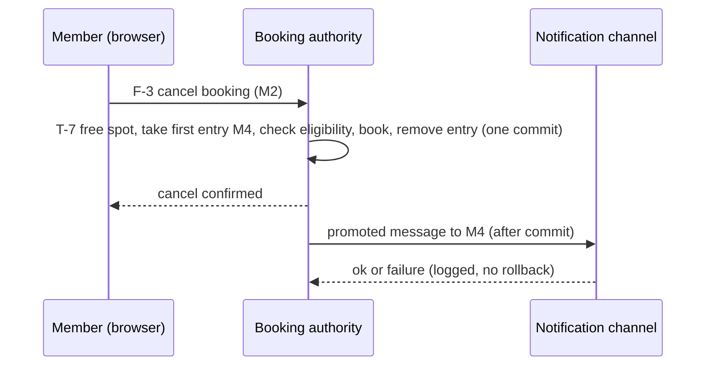
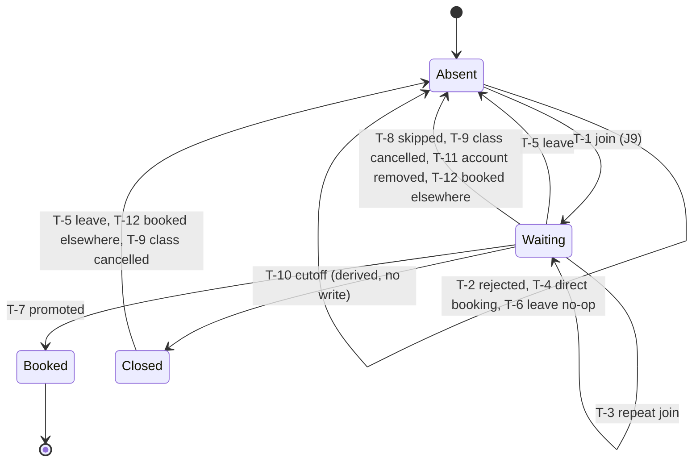

# Class Booking App: product specification

Living contract for the class booking app's member-facing behaviour. This revision adds the **class waitlist**.
Status of this revision: spec stage, run on its own. Acceptance lines are definitions; nothing has been implemented
or executed, and no product was observed (see "Current-system baseline").

## Request, outcomes and basis

Request, 2026-11-21: "Add a waitlist to our class booking app so full classes don't turn people away."

| ID | Outcome | Kind | Carried by |
| --- | --- | --- | --- |
| O-1 | A member who finds a class full can join its waitlist instead of being turned away | Stated | R-1, R-3 |
| O-2 | When a spot opens, a waitlisted member gets it, so the class refills without the member re-checking | Stated (the point of "don't turn people away") | R-5, R-6, R-2, R-8 |
| O-3 | A waitlisted member can see their place and withdraw | Inferred (needed to make O-1 usable) | R-3, R-4 |
| O-4 | The waitlist ends cleanly and exposes nothing about other members | Inferred (lifecycle and privacy of the new state) | R-7, R-9 |

Observation versus inference: the request text is the only observation. O-3, O-4 and every default in
"Assumptions" are inferences, labelled so that a later run does not read them as the user's words.

## Current-system baseline

**None available.** No repository, discovery result, research result or earlier spec exists for this stage. The
booking app's capacity enforcement, cancellation rules and cutoff, eligibility rules, identity and sign-in, class
and time model, notification channels, UI identity and retention policy are all **unobserved** (gap G-1). This spec
therefore:

- states every requirement as a delta in domain terms ("existing booking", "existing eligibility rules") and
  preserves those behaviours by reference, not by description (R-14);
- keeps each unknown that could change behaviour as a named gap that makes only the affected work unready
  ("Readiness" below); independent work may proceed;
- never treats the absence of an observation as evidence that behaviour is absent.

Guide applied: `GUIDES/current-system-baseline.md#planning-and-review-handoff` (reopen the baseline at spec; an
uncertain consequential existing behaviour is a discovery prerequisite, not a licence to guess).

## Conventions

`R-n` requirement (acceptance lines are `R-n.m`, functional and non-functional alike); `F-n` flow; `T-n`
transition; `PD-n` product decision; `A-n` assumption; `G-n` open gap; `O-n` request outcome; `J1..J9` join guards.
`AD-n` decisions live only in `KNOWLEDGE/architecture.md`. "Server clock" is the one authoritative time source.

Fixture used by every example (replayable values):

- Class **C1** "Spin", Tuesday 2026-12-01 18:00 UTC, capacity 3, waitlist cutoff 17:00 UTC the same day (A-3).
- Members M1..M13, all signed in and eligible under the existing booking rules unless stated. Unique name tokens
  "Member-M1" .. "Member-M13" so a payload search can detect leakage.
- Test clock 2026-12-01 09:00 UTC unless an example gives another time. Needs a controllable clock (G-8).
- "Full" means booked members >= capacity. Waitlist entries are never counted as booked.

## Product decisions

- **PD-1 Automatic promotion, no claim window.** A freed spot books the first eligible waitlisted member directly
  and notifies them; the member may cancel under the existing rules. Basis: the request's goal ("don't turn people
  away") is met without a timer; a claim window needs an expiry owner, a held-spot state and a second race.
  Rejected: offer-then-claim with a timeout. Revisit if cancelling a promoted booking carries a penalty (G-3).
- **PD-2 First come, first served.** Order is join order; leaving and rejoining goes to the end; no priority tier.
- **PD-3 The waitlist freezes at the cutoff.** From the cutoff instant no one can join and no one is promoted. Spots
  freed later are ordinary spots under the existing booking rules. Rationale: never auto-book a member inside the
  window where late cancellation may cost them (G-3). Consequence accepted: a member who joined earlier is not
  promoted after the cutoff even if a stranger can then book the spot directly. **Flag for the user** if promotion
  until class start is preferred.
- **PD-4 Members see their own position and an aggregate count only**, never who else is waiting (R-9).
- **PD-5 No notice at the cutoff.** The member sees the closed state when they next look (R-3); no message is sent.

## Assumptions

Each is the best default for a choice the request leaves open. Change by editing the value and re-running affected
checks.

| ID | Default | Used by |
| --- | --- | --- |
| A-1 | Waitlist holds at most **10** entries per class; the 11th join is refused | R-1.3 |
| A-2 | One spot per member per class; no group or multi-spot booking | R-1, R-2 |
| A-3 | Cutoff is **60 minutes** before the class start instant; closed at and after that instant | R-1.3, R-5, R-7 |
| A-4 | Eligibility for join and promotion is the existing booking eligibility, re-checked at promotion time | R-1, R-5 |
| A-5 | Notifications use the app's existing booking-confirmation channel; promoted bookings also carry a visible "Booked from waitlist" tag in My bookings | R-6 |
| A-6 | Waitlist entries follow the retention of the class's booking records; no new purge | R-13 |
| A-7 | Instants compare in UTC; display follows the app's existing time-zone convention | R-1.3, R-3 |
| A-8 | The waitlist is free: no fee, penalty or no-show rule | scope |
| A-9 | No per-member cap on how many classes' waitlists one member may be on | R-2 |
| A-10 | Logs hold opaque member and class IDs and event names only | R-13, R-14 |
| A-11 | Guests (not signed in) cannot join; the UI sends them to the existing sign-in | R-1.2 |
| A-12 | Views load current state on open and after each action; no live push | R-3 |

## Open gaps

| ID | Gap | Affects | Owner and due |
| --- | --- | --- | --- |
| G-1 | The existing app is unseen (see baseline). Discovery of the booking code must confirm: capacity enforcement, eligibility rules, cancel path, class-cancel and capacity-edit paths, account deletion, UI identity, notification channels | R-1, R-5, R-6, R-7, R-10, R-14 | Plan-stage discovery, before any work item that touches existing code |
| G-2 | Which notification channels exist (email, push, in-app). A-5 assumes at least one | R-6 | Discovery, before R-6 work |
| G-3 | Existing late-cancellation cutoff or penalty. If it is longer than 60 minutes, A-3 should equal it | R-5, R-7, PD-1, PD-3 | Product owner or discovery, before R-5 work |
| G-4 | Existing retention of booking records (A-6 inherits it) | R-13 | Discovery |
| G-5 | Whether staff need to see or edit waitlists. Left out, not decided | scope | Product owner, later request |
| G-6 | The datastore can make promotion atomic (AD-1). Unverified | R-5, R-8 | Plan-stage probe |
| G-7 | Notification retry policy and the number of attempts | R-6.2 | Product owner |
| G-8 | A way to control the server clock in tests | R-1.3, R-5.3, R-7.3 | Test strategy |

## Readiness

| Group | State | Why |
| --- | --- | --- |
| R-2, R-3 (labels), R-4, R-8, R-9 | Ready, with A-1, A-3 | Defined without an unknown |
| R-1, R-5 | Ready for acceptance; integration work unready until G-1, G-6 | Eligibility and atomicity depend on existing code |
| R-6 | Unready until G-2 | Channel unknown |
| R-7 (cancel, account removal) | Unready until G-1 | Needs the app's class-cancel and account paths |
| R-10..R-14 | Ready as criteria; R-10 identity unready until G-1 | |

## Requirements

### R-1 Join the waitlist of a full class (primary)

**Behaviour.** A signed-in member can join the waitlist of a class that is full, upcoming and before its cutoff.
The entry is appended to the end and the member is told their position.

**Join guards, evaluated in this order; the first that applies decides:**

| Guard | Condition | Result |
| --- | --- | --- |
| J1 | Not signed in | `NOT_SIGNED_IN`: "Sign in to join the waitlist." |
| J2 | Class missing, cancelled or already started | `CLASS_UNAVAILABLE`: "This class is no longer available." |
| J3 | Member already booked in this class | `ALREADY_BOOKED`: "You're already booked into this class." |
| J4 | Member fails the existing booking eligibility rules | The existing booking rejection, unchanged |
| J5 | Class has a free spot | Not a waitlist join: handled by the existing booking path, no entry created |
| J6 | Class full and now >= cutoff | `WAITLIST_CLOSED`: "The waitlist for this class has closed." |
| J7 | Member already waiting | Success, nothing changed: "You're #p on the waitlist." (current position) |
| J8 | Class full, open, waitlist already has 10 entries | `WAITLIST_FULL`: "The waitlist for this class is full (10 of 10)." |
| J9 | Otherwise | Joined: "You're #p on the waitlist." with p = size + 1 |

Error behaviour: J1 to J4, J6, J8 change nothing. Consumer outcome: the full-class card shows a primary "Join
waitlist" action in place of the dead "Full" state; the action shows "Joining..." and is disabled while pending;
the position chip appears only after the server confirms.

- **Basis:** request 2026-11-21; A-1, A-3, A-4, A-11. **Change:** add. **Preserved:** booking of a class with a free
  spot, existing eligibility and sign-in (R-14). **Sources:** `GUIDES/behavioral-requirements.md#behavior-model`.
  **Evidence limits:** existing booking and eligibility unobserved (G-1). **Pending:** implementation and checks.
- **Left out (domain rules the request omits):** priority tiers, paid or premium waitlists, joining on behalf of
  another member, multi-spot joins, recurring-series waitlists.

**R-1.1 Positive.** Fixture C1: M1, M2, M3 booked (3/3), waitlist empty, clock 09:00 UTC. M4 joins: result "You're
#1 on the waitlist."; waitlist is exactly [M4]; booked set is exactly {M1, M2, M3}; M4 is not booked. Then M5 joins:
"You're #2 on the waitlist."; waitlist [M4, M5]. Surface: member web UI, class card for C1 (and the booking API the
UI calls). Confirm: browser-driven check reading the chip text, plus a read-back of the booking records.

**R-1.2 Failure.** One case per guard, same C1 state as R-1.1 unless noted; each leaves booked set and waitlist
unchanged. J1: a request with no session gets `NOT_SIGNED_IN`. J2: staff-cancelled class C9 gets `CLASS_UNAVAILABLE`.
J3: M1 joins C1 and gets `ALREADY_BOOKED`. J4: M13 (rejected by the existing eligibility rules, for example a lapsed
membership) gets that rule's existing message and no entry. J6, J8: see R-1.3. Surface and confirm as R-1.1.

**R-1.3 Boundary.** Size bound (A-1): fixture C2 capacity 1, booked {M1}, M2..M11 join in order and get #1..#10;
M12 joins and gets `WAITLIST_FULL`; waitlist stays [M2..M11]. Then M2 leaves and M12 joins: M12 gets #10. Time bound
(A-3): fixture C8 (as C1, capacity 3, booked {M1, M2, M3}); at 16:59:59 UTC M8 joins and gets "You're #1"; at
17:00:00 UTC M9 joins and gets `WAITLIST_CLOSED`; waitlist stays [M8]. Surface: API and UI. Confirm: controllable
clock (G-8) plus record read-back.

**R-1.4 Duplicate.** M4 (already #1 on C1) joins again, for example a double click or retry: J7 applies; result
"You're #1 on the waitlist."; exactly one entry for M4; M5 stays #2. Surface: API and UI. Confirm: count entries.

**R-1.5 Free spot.** C1 with booked {M1, M3} (2/3) and empty waitlist: M6 joins. J5 applies: M6 is booked by the
existing path with the existing confirmation; no waitlist entry exists for M6. Failure and boundary: n/a, covered by
R-1.2 and R-1.3. Surface: API (the UI shows "Book" here, not "Join waitlist"). Confirm: read-back.

### R-2 Ordering and per-member invariants

**Behaviour.** Entries are ordered first come, first served by join order, with no ties. Positions are contiguous
from 1. When an entry ahead leaves, is promoted or is skipped, those behind move up by one and keep their relative
order. A member has at most one entry per class and is never both booked and waiting in the same class. Whenever the
waitlist of a class is non-empty and open, the class is full (invariant I-1). A member who becomes booked in a class
by any path has that class's entry removed.

- **Basis:** PD-2, A-2, A-9. **Change:** add. **Preserved:** n/a (new state). **Sources:** behavior-model
  guidance. **Evidence limits:** none beyond R-1. **Pending:** implementation and checks.
- **Left out:** moving a member up, swapping places, priority by membership age.

**R-2.1 Positive.** Waitlist [M4, M5, M6] on C1 (booked {M1, M2, M3}); M4 leaves: M5 is #1 and M6 is #2, in that
order. Surface: UI position chips and API. Confirm: read positions for M5 and M6.
**R-2.2 Failure.** n/a: an ordering rule has no failure input; rejected joins are R-1.2.
**R-2.3 Boundary.** M4 left above and joins again: waitlist [M5, M6, M4], M4 is #3. Last entry leaves: waitlist
empty, class still full, no error. Surface and confirm as R-2.1.
**R-2.4 Invariants.** After every step of the walk-throughs W-1 and W-2, assert: booked <= capacity; positions are
1..n with no gaps or repeats; waitlist non-empty implies booked = capacity (I-1); no member both booked and waiting.
Surface: API read-back after each step. Confirm: an assertion after every step, not only at the end.
**R-2.5 Entry removed when booked elsewhere.** Walk W-3b below: after the cutoff, M8's inert entry is removed when
M8 books the freed spot directly. Conditional on the existing rules allowing booking in the last hour (G-1); until
then `NOT-REPLAYED`.

### R-3 Waitlist visibility for the member

**Behaviour.** Each full class card and detail view shows the viewer one of these states; "My bookings" gains a
"Waitlisted" section listing the member's entries (class, time, position, "Leave waitlist"). Counts are aggregate
only.

| Viewer and class state | Label | Action |
| --- | --- | --- |
| Class has a free spot | Existing | Existing "Book" |
| Full, open, 0 waiting | "Full · be the first on the waitlist" | Join waitlist |
| Full, open, n waiting (1 to 9), viewer not waiting | "Full · n waiting" ("1 waiting" singular) | Join waitlist |
| Full, 10 waiting | "Full · Waitlist full" | None; reason shown as text |
| Full, at or after cutoff, viewer not waiting | "Full · Waitlist closed" | None |
| Viewer waiting at position p, before cutoff | "You're #p on the waitlist" and "n waiting" | Leave waitlist |
| Viewer waiting, at or after cutoff | "Waitlist closed. You weren't booked." | None (an inert entry may still be left, R-4) |
| Viewer booked (including from waitlist) | Existing "Booked"; promoted ones add "Booked from waitlist" | Existing cancel |

States and exclusions: the table names every combination of {free, full} x {viewer: none, waiting, booked} x
{open, full list, closed}; a cancelled or started class is shown by the existing class states and has no waitlist
label. A viewer who is booked and sees a full list sees only "Booked". Position is as of the last load (A-12); a
stale action is settled by the server guards (R-1, R-4).

- **Basis:** request 2026-11-21; PD-4, PD-5, A-12. **Change:** add to class card, detail and My bookings.
  **Preserved:** existing card layout and states for classes with a free spot. **Sources:** behavior-model
  guidance. **Evidence limits:** existing card unseen (G-1). **Pending:** implementation and checks.

**R-3.1 Positive.** Using C1 states from W-1: after step 2 M4's card reads "You're #1 on the waitlist" and "1 waiting";
M6 (not waiting) sees "Full · 2 waiting"; M5's My bookings "Waitlisted" lists "Spin, Tue 1 Dec 18:00 - #2". Surface:
member web UI. Confirm: browser-driven read of text per viewer.
**R-3.2 Failure.** The waitlist state request fails: the card shows an error state "Couldn't load waitlist info" with a
"Try again" control and shows no position or count; no stale position is presented as current. Surface: UI with the
request forced to fail. Confirm: browser-driven check.
**R-3.3 Boundary.** 0, 1, 9 and 10 waiting render "be the first", "1 waiting", "9 waiting" with Join, and "Waitlist full"
without Join. 16:59:59 UTC shows Join; 17:00:00 UTC shows "Waitlist closed". Confirm: browser-driven check with a
controllable clock.
**R-3.4 Empty.** A member with no entries sees in "Waitlisted": "You're not on any waitlists. When a class is full, join
its waitlist and we'll book you in if a spot opens."

### R-4 Leave the waitlist

**Behaviour.** A member can remove their own entry. Success: "You've left the waitlist." and those behind move up.
Leaving never cancels a booking. If the member has no entry (never joined, already left, already promoted):
"You're not on this waitlist." with nothing changed. Leave is allowed before or after the cutoff and the class
start, since it only removes the member's own data. A request can only ever affect the caller's own entry.

- **Basis:** O-3 (inferred). **Change:** add. **Preserved:** n/a. **Sources:** behavior-model guidance.
  **Evidence limits:** none. **Pending:** implementation and checks.

**R-4.1 Positive.** W-1 step 7: waitlist [M5, M6], M5 leaves: "You've left the waitlist."; waitlist [M6]; M6 is #1.
**R-4.2 Failure.** No session: `NOT_SIGNED_IN`, nothing changed. M2 (no entry) leaves C1: "You're not on this waitlist.",
nothing changed. M5 submits a leave aimed at M6's entry (any identifier the API accepts): M6's entry is untouched and
M5 gets "You're not on this waitlist." or a not-found/forbidden error; never M6 removed.
**R-4.3 Boundary.** The last entry leaves: waitlist empty. Leaving at 17:00:00 UTC or later removes the inert entry
and shows no promotion.
**R-4.4 Race with promotion.** M4 (#1) presses Leave while M2's cancellation promotes M4. Exactly one outcome holds:
(a) leave first: M4 not booked, M5 promoted by the same cancellation; (b) promotion first: leave returns "You're not
on this waitlist.", M4 stays booked, the UI refreshes to show the booking. Never: both, or neither with M4 half-booked.
Surface for R-4: UI and API. Confirm: read-back plus a forced interleaving test.

### R-5 Automatic promotion when a spot is freed (primary)

**Behaviour.** A spot is freed when a booked member cancels, when staff cancel or remove a booking (where the app
supports it), or when capacity is raised (the number freed is new capacity minus booked, if positive). While the
waitlist is open, spots are free and entries exist: take the first entry; if the member passes the existing
eligibility rules now, book them (an ordinary booking, tagged "Booked from waitlist"), remove the entry and notify
(R-6); if not, remove the entry, notify, and take the next. Remaining spots are ordinary free spots. No observer ever
sees a free spot together with a non-empty open waitlist. If the waitlist is closed or empty, nothing is promoted.

- **Basis:** request 2026-11-21 ("full classes don't turn people away"); PD-1, PD-3, A-3, A-4. **Change:** add.
  **Preserved:** the existing cancel behaviour and its own outcome for the cancelling member (R-14). **Sources:**
  behavior-model guidance, state and data assessment. **Evidence limits:** cancel, capacity-edit and staff paths
  unseen (G-1, G-3, G-6). **Pending:** implementation and checks.
- **Left out:** offer and claim windows, auto-decline, partial-group promotion, promotion by priority, staff manual
  promote or reorder (G-5).

**R-5.1 Positive.** W-1 step 5: C1 booked {M1, M2, M3}, waitlist [M4, M5], M2 cancels at 09:00 UTC. After the cancel
returns: booked set exactly {M1, M3, M4}; waitlist exactly [M5]; M5 is #1; M4's My bookings lists C1 tagged "Booked
from waitlist" and no longer lists it under "Waitlisted"; M4 receives one notification (R-6). Surface: member web UI
for M4 and M5, plus API read-back. Confirm: read after the cancel response, no waiting or polling.
**R-5.2 Failure (ineligible first entry).** W-4: class C3 capacity 1, booked {M1}, waitlist [M13, M5]; M13 was eligible
at join and fails the existing rules when promotion is attempted. M1 cancels: M13's entry is removed and M13 is
notified; M5 is promoted; booked exactly {M5}; waitlist empty. Conditional on a way to change eligibility between
join and promotion (G-1); until then `NOT-REPLAYED`.
**R-5.3 Boundary.** (a) Two spots, one entry: W-1 step 8, M1 and M3 cancel together with waitlist [M6]: M6 promoted once;
booked {M4, M6}; one spot left free; waitlist empty. (b) Capacity raise: W-5, class C5 capacity 2, booked {M1, M2},
waitlist [M3, M4, M5], staff raise capacity to 4: M3 and M4 promoted in that order; M5 is #1; booked {M1, M2, M3, M4}
(conditional on staff capacity edit existing, G-1). (c) Cutoff: W-3a and W-3b, class C8 booked {M1, M2, M3}, M8 joined
at 16:59:00 UTC; if M1's booking is removed at 16:59:59 UTC M8 is promoted; if removed at 17:00:00 UTC nobody is
promoted, booked {M2, M3}, M8's entry stays inert and M8 is not booked. The removal uses whichever existing path is
permitted at that instant (self-cancel or staff removal, G-3).
**R-5.4 Consumer outcome and queue order.** At the moment M1's booking is cancelled, M9 asks to book C1 directly while
the waitlist is [M3, M4, M5] (booked {M1, M2}, capacity 2): M9 is never booked ahead of M3; M9 joins the end of the
list (#4 or, once M3 is promoted, #3). Confirm: forced-interleaving test, read-back.

### R-6 Notifications for promotion and removal

**Behaviour.** Three events send one message each to the affected member through the existing booking channel (A-5):
promoted, skipped as ineligible, and class cancelled while waiting. Joining, leaving, position changes and the cutoff
send nothing (PD-5). Text:

- Promoted: subject "You're in: Spin, Tue 1 Dec 18:00"; body "A spot opened up and you've been booked into Spin on Tue 1
  Dec at 18:00. Can't make it? Cancel from My bookings."
- Skipped: "We couldn't book you into Spin, Tue 1 Dec 18:00 from the waitlist: <existing rejection reason>. You've been
  removed from the waitlist."
- Class cancelled: "Spin, Tue 1 Dec 18:00 has been cancelled. You've been removed from its waitlist."

A notification failure never undoes a booking or a removal (AD-4). The state stays visible without the message:
"Booked from waitlist" in My bookings, entry gone from "Waitlisted".

- **Basis:** O-2; PD-1, A-5. **Change:** add. **Preserved:** existing confirmation messages. **Sources:** service
  discovery guidance. **Evidence limits:** channels unseen (G-2); retry policy open (G-7). **Pending:** implementation,
  checks, and a real-boundary delivery check.

**R-6.1 Positive.** R-5.1: M4 receives exactly one message with the promoted text, naming Spin and Tue 1 Dec 18:00.
Surface: the channel's sink (sandbox inbox or a captured outbound call). Confirm: inspect the sink, not the app log.
**R-6.2 Failure.** The channel is down during R-5.1: the booking and removal still commit (M4 booked, M5 #1); My bookings
shows "Booked from waitlist"; a `notify_failed` event with M4's ID and class ID is logged. Retry is open (G-7).
**R-6.3 Boundary.** A retried cancel request after R-5.1 finds no booking for M2, so promotes no one and sends no second
message: exactly one message in total for M4.

### R-7 Waitlist closing and removal

**Behaviour.** An entry ends by leaving (R-4), promotion or skip (R-5), or the events here. (a) At and after the cutoff
instant the waitlist freezes (PD-3, AD-2): joins return `WAITLIST_CLOSED`, no promotion occurs, existing entries stay
visible as closed and may be left. (b) When a class is cancelled, every entry is removed and each member notified
(R-6). (c) When the class start passes, the class has no waitlist label (R-3). (d) When a member's account is deleted,
their entries are removed and those behind move up. (e) A capacity decrease below the booked count does not touch
entries.

- **Basis:** O-4 (inferred); PD-3, PD-5, A-3. **Change:** add. **Preserved:** existing class-cancel and account behaviour
  for bookings. **Sources:** state and data assessment. **Evidence limits:** class-cancel and account paths unseen
  (G-1). **Pending:** implementation and checks.

**R-7.1 Positive.** W-5b: class C4, waitlist [M5, M6], staff cancel the class: both entries removed, M5 and M6 each get one
"Class cancelled" message, M5 and M6 see no "Waitlisted" row for C4.
**R-7.2 Failure.** Messages fail during R-7.1: entries are still removed; `notify_failed` logged per member.
**R-7.3 Boundary.** The cutoff instant, as R-1.3 and R-5.3(c): 16:59:59 UTC open, 17:00:00 UTC closed.
**R-7.4 Account removal.** C1 waitlist [M5, M6], M5's account deleted: waitlist [M6], M6 is #1. Conditional on account
deletion existing (G-1); else `NOT-REPLAYED`.

### R-8 Capacity safety and concurrency

**Behaviour.** At all times booked <= capacity; each entry is promoted at most once; each freed spot goes to at most one
member; a direct booking cannot take a spot ahead of an open waitlist; concurrent joins respect the size bound with
distinct contiguous positions; concurrent identical requests from one member leave one entry. Shared contention on
one hot class is distinct from independent load across many classes; this requirement covers the first.

- **Basis:** PD-1, PD-2; A-1. **Change:** add. **Preserved:** existing no-overbooking. **Sources:** state and data
  assessment. **Evidence limits:** datastore isolation unverified (G-6). **Pending:** implementation and a real-datastore
  check (architecture.md "Real-boundary checks").

**R-8.1** C7 capacity 2, booked {M1, M2}, waitlist [M3, M4, M5]; M1 and M2 cancel concurrently: exactly M3 and M4 booked
(each once); booked {M3, M4}; waitlist [M5] with M5 #1; two promotion messages in total.
**R-8.2** C2-like class capacity 1, booked {M1}, empty waitlist; 25 members (M2..M26) join concurrently: exactly 10 get a
position, the positions are exactly 1..10 with no repeat, and exactly 15 get `WAITLIST_FULL`. (25 is the test input,
not a product bound.)
**R-8.3** One member sends two identical join requests in parallel: exactly one entry, and both responses report the same
position.
**R-8.4** Class capacity 1 with one free spot and an empty waitlist; M2, M3, M4 request to book at once: exactly one is booked;
the other two are placed on the waitlist as #1 and #2 (not turned away), in server order.
**R-8.5** Failure: if promotion cannot complete (store error mid-way), none of {spot assigned, entry removed, booking
created} persists, and the entry stays first in line for the next freeing event. Surface for R-8: API and real
datastore. Confirm: concurrent load harness plus read-back of the final records.

### R-9 Privacy and access control

**Behaviour.** A member can see and change only their own waitlist entries. No payload, page or message sent to a member
includes another member's name, email or ID; the only information about others is the aggregate count and own position.
Identity comes from the signed-in session, never from a request parameter. Staff views are left out (G-5).

- **Basis:** O-4 (inferred); PD-4. **Change:** add. **Preserved:** existing sign-in and sessions. **Sources:**
  interaction design guide (state ownership). **Evidence limits:** identity layer unseen (G-1). **Pending:** implementation
  and checks.

**R-9.1 Positive.** M5 loads C1 (waitlist [M4, M5, M6]): the response and page text contain M5's position and "3 waiting", and
none of the tokens "Member-M4", "Member-M6" nor their IDs or emails.
**R-9.2 Failure.** Unauthenticated join, leave and status requests are refused and change nothing.
**R-9.3 Boundary.** M5 signs out; M6 signs in on the same browser profile: no M5 position, entry or message is shown to M6,
including from any client-side cache. Surface: real browser. Confirm: browser-driven check.

## Non-functional requirements

Applies to a deliverable with a user interface. Priority: accessibility and correctness over visual flourish.

### R-10 Designed interface (non-functional)

- **Visual reference and starting appearance.** The app's established identity is inherited by all new waitlist surfaces
  (class card state, position chip, "Waitlisted" section, notices). It is unseen (G-1). If the app has no established
  identity or is unstyled scaffolding, the starting point is the light Gemini look with Material 3 Expressive
  principles from `GUIDES/platforms/ui.md#light-expressive-starting-point`: light first with a dark option, tonal rounded
  surfaces, restrained saturated accent. The plan chooses the concrete treatment.
- **Signature element.** The position chip ("#2") is the focal point of a waitlisted card; it animates only when
  its number changes and when the entry is promoted.
- **R-10.1** Spacing, type and colour come from one set of tokens shared with the existing UI; a light and a dark theme
  both pass R-11.2. Check: stylesheet/token inspection and screenshots in both themes.
- **R-10.2** Designed states exist for: loading (placeholder in the card's footprint, no layout jump), empty (R-3.4), error
  with retry (R-3.2), pending ("Joining..." and "Leaving..." disabled controls), and success (chip appears only after
  server confirmation, never optimistically). Check: browser-driven, with requests delayed and failed.
- **R-10.3** At 360 px and 1280 px viewport widths: no horizontal scroll, controls reachable, chip and label not clipped.
  Check: browser at both widths.
- **R-10.4** One icon set for any new icon. Check: inspection.
- **Evidence limits:** existing identity and toolkit unseen. **Pending:** plan chooses the treatment; acceptance verifies
  rendering. Do not read this as a request to rebuild the existing UI.

### R-11 Accessibility and motion (non-functional)

- **R-11.1** Join, Leave and retry are keyboard operable with a visible focus indicator; focus stays on the control or moves
  to the result text, never lost to the page top. Check: keyboard-only run.
- **R-11.2** WCAG 2.2 AA contrast: 4.5:1 for text, 3:1 for the chip border and focus indicator, in both themes. Check:
  automated contrast scan plus manual review of the chip.
- **R-11.3** Outcomes (joined with position, left, promoted, closed, errors) are announced through a polite live region and
  never by colour or motion alone. Check: accessibility-tree inspection.
- **R-11.4** Motion appears only to explain a change (chip number change, promotion) and is off when the user prefers reduced
  motion. Check: browser with reduced motion emulated.

### R-12 Performance and capacity (non-functional)

No latency, throughput or capacity target was given and none is invented. **Unresolved bound** (owner: product owner;
missing: expected members and classes per day). Observable criteria that do apply: **R-12.1** after any join, leave or
cancel response returns, the next read by any client reflects it (read-your-write; no delayed promotion); **R-12.2** the
per-class waitlist size is bounded at 10 (A-1), so list size is not a scaling concern. Contention is covered by R-8.
Exclusion: availability target and offline use, none requested and nothing in the request implies them.

### R-13 Data protection and lifecycle (non-functional)

Per-piece details are in "Information lifecycle". **R-13.1** An entry holds only the member ID, class ID and join order.
**R-13.2** Logs hold IDs and event names only (A-10): a log search for "Member-M4" after R-1.1 finds nothing, and the ID
may appear. **R-13.3** Entries are deleted with the class's booking records under the existing retention (A-6, G-4) and
immediately on account deletion (R-7.4). Check: read-back and log search.

### R-14 Compatibility and preservation (non-functional)

**R-14.1** For a class with a free spot, booking, cancelling and viewing behave exactly as before this change, including the
existing eligibility and cancellation rules: the existing booking tests pass unmodified and a before/after capture of the
class card for a non-full class is identical. Pending until G-1. **R-14.2** No new scheduled job or service is required
(AD-2). **R-14.3** Observability: events `waitlist_joined`, `waitlist_left`, `waitlist_promoted`, `waitlist_skipped`,
`waitlist_class_cancelled`, `notify_failed` are recorded through the app's existing logging with member and class IDs.
Check: trigger each event once and find exactly one record.

## Behavior model

### Flows

- **F-1 Join** (R-1, R-2): member -> Join -> server evaluates J1..J9 -> T-1, T-2, T-3 or T-4 -> response and card update.
- **F-2 Leave** (R-4): member -> Leave -> T-5 or T-6 -> response and card update.
- **F-3 Promotion** (R-5, R-6, R-8): booked member cancels, staff removes a booking, or capacity rises -> spot freed ->
  waitlist open? -> loop T-7 / T-8 -> notify -> remaining spots ordinary.
- **F-4 Removal** (R-7): staff cancel class (T-9), account deleted (T-11), cutoff reached (T-10, no write).
- **F-5 View** (R-3, R-9): member opens card or My bookings -> server returns own state and aggregate -> UI renders.

### State inventory

| Entity and state | Meaning and invariant | Owner | Durable | Role |
| --- | --- | --- | --- | --- |
| Entry: Absent | No entry for (member, class) | Booking authority | n/a | Initial and terminal |
| Entry: Waiting | Member in line, class full, before cutoff, position p in 1..10 | Booking authority | Durable | Active |
| Entry: Closed | A Waiting entry at or after cutoff: inert, never promoted, may be left | Derived from clock | Same record, no write | Terminal-ish, leave allowed |
| Booking: Booked | Ordinary booking; may carry "from waitlist" | Booking authority | Durable | Existing, extended by one tag |
| Class waitlist view | Open (full, n<10, before cutoff), Full list (n=10), Closed, or not applicable (free spot) | Derived | n/a | Display only |

Cross-entity invariants: I-1 (R-2); booked <= capacity; no member both booked and waiting; positions contiguous.

### Transition ledger

| ID | R, F | Before | Trigger and guard | Operation | After and observation | Failure and recovery | Cases |
| --- | --- | --- | --- | --- | --- | --- | --- |
| T-1 | R-1, F-1 | Absent, class full, open, size < 10 | Member join; J1..J8 pass | Append at the end, position = size + 1 | Waiting; "You're #p on the waitlist." | Store error: no entry, "Couldn't join the waitlist. Try again."; retry is safe (J7) | R-1.1, R-1.3, R-8.2 |
| T-2 | R-1, F-1 | Any | Join; J1, J2, J3, J4, J6 or J8 applies | None | Unchanged; the guard's message | n/a: nothing partial | R-1.2, R-1.3 |
| T-3 | R-1, F-1 | Waiting | Join; J7 | None | Unchanged; current position | n/a | R-1.4, R-8.3 |
| T-4 | R-1, F-1 | Absent, free spot | Join; J5 | Existing booking path | Booked, no entry | As existing booking | R-1.5, R-8.4 |
| T-5 | R-4, F-2 | Waiting or Closed | Leave by the owner | Remove entry; entries behind move up | Absent; "You've left the waitlist." | Store error: entry stays, error shown, retry safe (T-6) | R-4.1, R-4.3 |
| T-6 | R-4, F-2 | Absent | Leave | None | "You're not on this waitlist."; unchanged | n/a | R-4.2, R-4.4 |
| T-7 | R-5, F-3 | Waiting, first in line, spot free, before cutoff | Spot freed; member eligible now | One commit: assign spot, remove entry, create tagged booking; then notify | Booked; entries behind move up | Commit fails: nothing persists, entry stays first (R-8.5); notify fails: logged, no rollback | R-5.1, R-5.3, R-6, R-8.1 |
| T-8 | R-5, F-3 | Waiting, first | Spot freed; member fails eligibility now | Remove entry, notify, continue with next | Absent; spot still free for the next entry | Notify fails: logged | R-5.2 |
| T-9 | R-7, F-4 | Waiting or Closed | Class cancelled by staff | Remove all entries, notify | Absent | Notify fails: removal stands | R-7.1, R-7.2 |
| T-10 | R-7, F-4 | Waiting | Server clock reaches cutoff | None (derived) | Closed; joins return `WAITLIST_CLOSED` | n/a | R-1.3, R-5.3(c), R-7.3 |
| T-11 | R-7, F-4 | Waiting or Closed | Account deleted | Remove entries | Absent; those behind move up | As T-5 | R-7.4 |
| T-12 | R-2, F-1 | Waiting or Closed | Member becomes booked in this class by any path | Remove entry | Absent | As T-5 | R-2.5 |
| T-13 | R-5, F-3 | Any | Spot freed, waitlist empty or closed | None for entries | Spot is an ordinary free spot | n/a | R-5.3(a), R-5.3(c) |

Invalid or forbidden events: join while booked (T-2, J3); join of a started or cancelled class (T-2, J2); leave without an
entry (T-6); promotion when the list is closed or empty (T-13); every rejection leaves data and external effects
unchanged. Event families audited: normal progression (T-1, T-5, T-7); invalid and unauthorised (T-2, R-9.2);
boundary values (R-1.3, R-3.3); duplicates and replay (T-3, T-6, R-6.3); retries and exhaustion (G-7, no retry on
join: client retry is idempotent); concurrency (R-8); partial effects (R-6.2, R-8.5); lifecycle expiry and deletion
(T-9..T-12). Exclusions: restart of an in-flight promotion needs no extra case, because it is one commit (AD-1, G-6);
cancellation of an offer does not exist (PD-1).

## State and data assessment

| Resource | Target identity | Before and after | Authorised actor and effect | Recovery and check | Unknowns |
| --- | --- | --- | --- | --- | --- |
| Waitlist entry (member ID, class ID, join order) | (member, class), at most one | Before: none. After: R-2 invariants hold | Owner joins and leaves their own; the booking authority promotes and removes | Atomic promotion (R-8.5); read-back after each step | Datastore atomicity G-6 |
| Booking | (member, class) | Gains a "from waitlist" tag only; all other fields as existing | Booking authority on promotion; existing cancel by owner or staff | Existing cancel rules; tag does not change them | Existing model G-1 |
| Class capacity and booked count | class | Booked <= capacity at all times | Existing paths | R-8 checks | Existing paths G-1 |
| Notification record | message to member | One per event (R-6) | Booking authority via channel | Failure logged, no rollback | Channel G-2, G-7 |
| Client display state | tab or session | Transient; discarded on navigation or sign-out | Member | R-9.3 | none |

Out of scope: staff views, reports, migration of historical data (no entries exist before this change), reset of existing
bookings.

## Service boundary contracts

One boundary matters: the booking authority and the notification channel. No new service is added.

- **Current authority.** The booking authority alone decides position, eligibility, promotion and cutoff; a client never
  computes them. Verified by R-3 and R-9.3.
- **Freshness versus revocation.** No client cache is trusted for a decision; every action is re-evaluated server-side
  against current state, eligibility and the server clock. A member whose eligibility lapses while waiting is skipped
  at promotion (T-8). Verified by R-5.2.
- **Incremental state.** n/a: no change feed or delta; each view loads full own state (A-12).
- **Async completion and recovery.** Promotion completes inside the freeing request; only the message is asynchronous,
  after commit. The booking stands if the message fails. Retry policy is open (G-7). Verified by R-6.2, R-6.3.
- **Owned event coverage.** The six events in R-14.3 are owned by this feature and must each produce one record. The
  notification channel's own delivery logs are the provider's, not this feature's; R-6.1 inspects the sink.

## Information lifecycle

| State | Owner and location | Who may read | Simultaneous changes | Ends and removal | Quotas |
| --- | --- | --- | --- | --- | --- |
| Waitlist entry | Booking authority datastore | The owning member (own entry only) and the aggregate count to any member; no one else (G-5) | Serialised per class (R-8, AD-1, AD-3) | Leave, promote, skip, class cancel, account deletion, or the class's booking retention | 10 per class (A-1); none per member (A-9) |
| Position chip and card text | Browser, transient | The viewing member | Replaced by each server response | Navigation, sign-out | none |
| Message to member | Notification channel | The recipient | One per event | The channel's own policy | Channel limits unknown (G-2) |
| Log event | App logging | Operators | Append-only | App log retention (unknown) | none |

Personal data: the member ID is shown only to its owner, stored only in the entry, logged as an opaque ID, kept per A-6,
removed on leave, class end retention, or account deletion. Display name and email are not stored in the entry.
Affected UI: premises are component (class card state, position chip, "Waitlisted" section), interaction (join, leave and
retry with truthful pending, success and failure feedback; unresolved failures stay on screen, not only in a toast), and
skin (R-10). Async feedback maps trigger -> "Joining..." -> confirmed chip or error with recovery.

## Walk-throughs (replay checks, item 10)

Method: each step was walked by hand from the stated start against the named rule, and the resulting state recomputed.
The start is reachable: C1 is created, M1..M3 book through the existing booking path (preserved, free spot, J5 route).
No product exists, so none of these ran: status **NOT-REPLAYED on a product**; they are valid inputs and oracles to replay.

**W-1 (C1, capacity 3, clock 09:00 UTC).**

| Step | Action | Rule that permits it | State after |
| --- | --- | --- | --- |
| 1 | M1, M2, M3 book | J5, existing booking | booked {M1, M2, M3} 3/3; list [] |
| 2 | M4 joins | J1..J8 pass: signed in, class live, not booked, eligible, no free spot, 09:00 < 17:00, not waiting, 0 < 10; J9 | list [M4]; "#1" |
| 3 | M5 joins | same, 1 < 10 | list [M4, M5]; "#2" |
| 4 | M4 joins again | J7 | list unchanged; "#1" |
| 5 | M2 cancels (existing cancel; 09:00 is far from 18:00) | R-5, T-7 | booked {M1, M3, M4}; list [M5], M5 #1; M4 notified |
| 6 | M6 joins | class full again, J9 | list [M5, M6]; M6 #2 |
| 7 | M5 leaves | R-4, T-5 | list [M6]; M6 #1 |
| 8 | M1 and M3 cancel together | R-5, T-7 then T-13 | booked {M4, M6} 2/3; list []; M6 notified once |
| 9 | M7 books | free spot, J5 | booked {M4, M6, M7} 3/3; list [] |

I-1 holds after each step (steps 2 to 7 are 3/3 with a non-empty list).

**W-2 (C2, capacity 1).** Booked {M1}; M2..M11 join (J8 sees sizes 0..9 so passes) and are #1..#10; M12 gets `WAITLIST_FULL`
at size 10; M2 leaves, giving [M3..M11] size 9; M12 joins as #10. Recomputed: positions 1..10 contiguous.

**W-3 (C8, capacity 3, booked {M1, M2, M3}, cutoff 17:00 UTC).** W-3a: M8 joins at 16:59:59 (accepted, #1); at 17:00:00 M9 is
refused with `WAITLIST_CLOSED`; the removal of M1's booking at 17:00:00 promotes no one, booked {M2, M3}, M8 inert. W-3b:
M8 books the free spot directly (existing booking rules, G-1; permitted only if they allow booking in the last hour):
booked {M2, M3, M8}, M8's entry removed (T-12). Whether M1's removal at 17:00:00 is possible depends on G-3; if not, the
removal is by staff.

**W-4 (C3 ineligible skip)** and **W-5 (C5 capacity raise, C4 class cancel)** are as R-5.2, R-5.3(b), R-7.1. They need
eligibility change (W-4), staff capacity edit (W-5a) and staff class cancel (W-5b) to exist (G-1); until confirmed they
are `NOT-REPLAYED: unreachable start unconfirmed` and remain open prerequisites.

Weaker stand-ins excluded: every positive case asserts the exact booked set, exact list order and exact message text; a
check that only sees "no error" or a non-empty response fails. Commands: none documented here (no product, so no command
was run; exit code n/a).

## Traceability and scope

| Outcome | Acceptance lines |
| --- | --- |
| O-1 | R-1.1..R-1.5, R-3.1..R-3.4, R-8.4 |
| O-2 | R-5.1..R-5.4, R-6.1..R-6.3, R-2.1..R-2.5, R-8.1..R-8.5 |
| O-3 | R-3.1, R-3.4, R-4.1..R-4.4 |
| O-4 | R-7.1..R-7.4, R-9.1..R-9.3, R-13.1..R-13.3 |

Every R has acceptance lines; every modelled feature traces to the request or to a labelled inference. Not in scope: staff
waitlist views or edits (G-5), fees or penalties (A-8), priority tiers, offer and claim windows, multi-spot joins, SMS or
push-specific work, a notification centre, reporting, migration. Each is listed under the R it bounds. Primary: R-1, R-5.

## Retired

None.

## Submission

**summary.** Spec for a class waitlist on the existing booking app, written with no repository, discovery or research
(baseline absent: gap G-1). Requirements R-1..R-9 (behaviour) and R-10..R-14 (non-functional) with concrete acceptance
lines, flows F-1..F-5, transitions T-1..T-13, and replayable walk-throughs W-1..W-5. Defaults recorded as assumptions: A-1
waitlist holds at most 10 per class and the 11th join is refused; A-3 the waitlist freezes 60 minutes before start
(closed at and after that instant); PD-1 a freed spot books the first eligible waitlisted member automatically with a
notification (no claim window); PD-2 first come first served; PD-4 members see only their own position and an aggregate
count; PD-5 no cutoff notice; A-5 existing booking channel; A-6 retention follows booking records. Open: G-1 existing app
unseen (integration work for R-1, R-5, R-6, R-7, R-10 and R-14 stays unready until discovery); G-2 channels; G-3 existing
late-cancel cutoff (PD-3 may need A-3 raised, and PD-3 is flagged for the user); G-4 retention; G-5 staff views left out;
G-6 atomic promotion unverified; G-7 notification retry; G-8 controllable test clock. R-12 has no numeric bound: none was
given and none was invented. W-3, W-4 and W-5 starts are unconfirmed (`NOT-REPLAYED`). No requirement conflict found.
Duty 11 left out (no `backchain-check` here). Decisions AD-1..AD-4 are in `KNOWLEDGE/architecture.md`, all Proposed.

**primary.** R-1, R-5.

**evidence_refs.** `KNOWLEDGE/spec.md`; `KNOWLEDGE/architecture.md`; requirement sections R-1 to R-14 in this file;
`GUIDES/behavioral-requirements.md#behavior-model`; `GUIDES/behavioral-requirements.md#traceability-and-review`;
`GUIDES/behavioral-requirements.md#actors-channels-and-state-ownership`;
`GUIDES/requirements-definition.md` (state and data assessment; non-functional requirements);
`GUIDES/service-discovery.md#verification`; `GUIDES/platforms/ui.md#light-expressive-starting-point`;
`GUIDES/current-system-baseline.md#planning-and-review-handoff`; the request text of 2026-11-21 quoted at the top.
No repository file, discovery result or research result was available or read.
