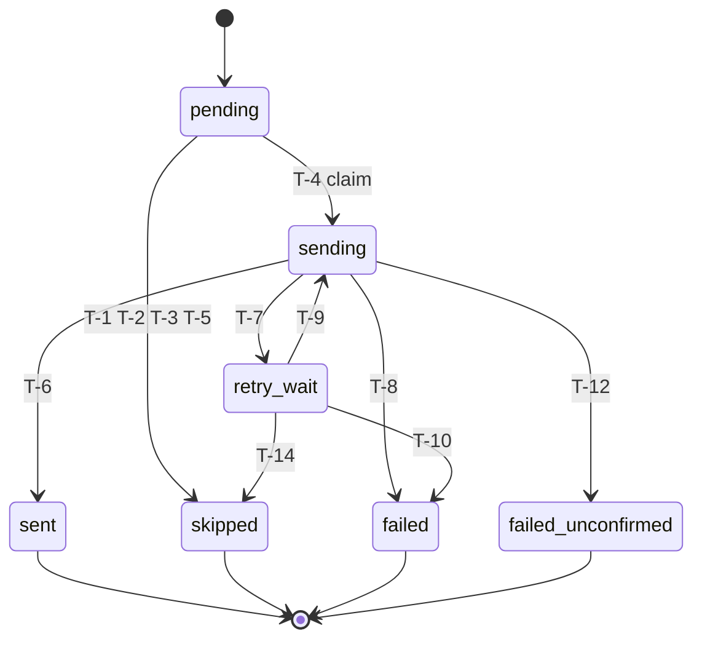

# Invoicing Product Specification

Status: proposed, first specification. Nothing was implemented, run or tested at this stage; every case below is a
plan (`NOT-REPLAYED` where stated).

Request basis, quoted once and cited elsewhere as **REQ-2026-11-21**: "Set up automatic reminders for unpaid invoices."
(received 2026-11-21).

## Baseline and evidence limits

- No repository, earlier spec, discovery or research result was provided. The invoicing system that owns invoices,
  accounts, users, e-mail sending and settings is **not inspected**. Its existing behaviour is unknown, not absent.
- This spec therefore states the **delta the request asks for** (reminders) against an *assumed* host model
  (section "Assumed host model"). Each assumed host fact is an open prerequisite (G-1, G-2, G-3, G-8), not an observation.
- Guides used: behavioral-requirements.md (Behavior model, Traceability, Actors/state ownership),
  requirements-definition.md (State and data assessment, NFR), service-discovery.md (Verification),
  platforms/ui.md (Light expressive starting point), current-system-baseline.md (Planning and review handoff).
- External fact checked: RFC 5321 section 4.5.3.1 limits (fetched from rfc-editor.org during this stage): local-part 64
  octets (4.5.3.1.1), domain 255 octets (4.5.3.1.2), forward-/reverse-path 256 octets including the punctuation
  (4.5.3.1.3). An address inside `<...>` is therefore at most 254 octets (derived: 256 minus the two angle brackets).

### Assumed host model (open prerequisite G-1)

An **account** (one business using the product, with a display name, a contact e-mail, an IANA time zone that may be
unset) issues **invoices** to customers. An invoice has: id, human number (e.g. `INV-1001`), customer name, customer
e-mail (may be empty), currency (ISO 4217), total and outstanding balance in minor units, issue instant, due date (a
calendar date, no time), a status in {draft, open, paid, void, other host statuses}, and optionally a customer-facing
payment/view link. **Users** belong to one account; the host has a permission that allows managing account settings and
a permission that allows viewing/editing invoices.

## Requirements

Surfaces named in acceptance lines:
**S-set** owner settings surface (UI screen or API, G-2); **S-hist** reminder history surface (same medium);
**S-mail** the customer's mailbox, observed in tests through a capture sink that records every message handed to the mail
provider; **S-run** an evaluation run triggered once with an injected clock at a stated UTC instant (test seam, NFR-8).
Times are UTC (`Z`) unless "local" is written. Default fixture time zone: `America/New_York` (EST, UTC-5, in December, so
09:00 local = 14:00Z).

### R-1 Reminder policy setup

Behaviour: each account has one reminder policy: `enabled` (default **off**), `offsets` (default `[-3, 0, 7, 14]`, days
relative to the invoice due date; negative = before), a fixed send time of 09:00 in the account time zone (UTC when the
account has none, A-3), and a `version`. The owner can view it, edit offsets, enable and disable. Enabling is the
"set up": until enabled nothing is sent (D-4).
Boundaries: 1 to 5 offsets, each a distinct integer from -30 to +90 inclusive (A-1, A-2). Error behaviour: an invalid or
unauthorised save changes nothing and returns an error naming the field and rule. Consumer outcome: the owner sees the
saved policy and its effective state.
Basis: REQ-2026-11-21 ("set up ... automatic"); A-1..A-3, D-4. Preserved: none known (no baseline). Changed: adds the
policy. Locators: behavioral-requirements.md#actors-channels-and-state-ownership. Pending: implementation, S-set checks.

- **R-1 L1 defaults and enabling.**
  Positive: a new account (acct-1) reads `enabled=false, offsets=[-3,0,7,14]`; saving `enabled=true` with those offsets
  persists them, returns version+1, and sets `effective_from` = the save instant on every step (R-3 L3).
  Failure: n/a: invalid saves are R-1 L2. Boundary: with `enabled=false`, S-run at any instant sends 0 messages and
  creates 0 records (case C-1).
  Surface: S-set, S-mail. Confirmed by: automated service test with injected clock; UI check of S-set.
- **R-1 L2 offset validation.**
  Positive: `[-30]`, `[90]`, `[-30,90]`, `[-3,0,7,14,30]` (5 entries) and unsorted `[14,0,-3]` are accepted; the policy is
  stored and shown sorted ascending (`[-3,0,14]`).
  Failure: `[]`, `[0,0]` (duplicate), `[2.5]`, `["abc"]`, `null` and a missing field are rejected, each naming `offsets`.
  Boundary: `[-31]` and `[91]` rejected, `[-30]` and `[90]` accepted; 5 entries accepted, 6 (`[-3,0,1,2,3,4]`) rejected;
  1 entry accepted, 0 rejected. After any rejection the stored policy and `version` are unchanged.
  Surface: S-set. Confirmed by: unit tests on the validator plus an API/UI test of the error message (C-2, C-3).
- **R-1 L3 authorisation and isolation.**
  Positive: a user with the manage-settings permission in acct-1 saves acct-1's policy.
  Failure: a user without that permission in acct-1 is rejected and nothing changes; a user of acct-2 can neither read nor
  save acct-1's policy (rejected, no data from acct-1 in the response).
  Boundary: n/a: permission is binary. Surface: S-set. Confirmed by: API test with three seeded users (C-4).
- **R-1 L4 simultaneous edits.**
  Positive: editors X and Y both load `version=7`; X saves and gets `version=8`.
  Failure: Y then saves with `version=7`: rejected as a conflict, `version=8` content is retained, no field merging, the
  message tells Y to reload. Boundary: n/a: a stale version is the only conflict. Surface: S-set.
  Confirmed by: API test with two sequential saves (C-5).
- **R-1 L5 disable, re-enable and offset edits.**
  Positive: disabling stops sending (R-5 L3); re-enabling sets every step's `effective_from` to the re-enable instant;
  adding an offset sets only that step's `effective_from` to the save instant; existing steps keep theirs.
  Failure: n/a: covered by R-1 L2. Boundary: removing an offset prevents any not-yet-sent reminder for that step, and
  already-sent history stays. Surface: S-set, S-hist. Confirmed by: service test (C-6).

### R-2 Which invoices are reminded

Behaviour: only an invoice that is **issued, not void, not paused (R-9), with outstanding balance greater than zero**
receives reminders. Evaluated at every run, from the host's current data (no cached status).
States and groups with distinct behaviour: draft; open with balance > 0 (including partially paid); paid / balance 0; void;
any other host status (e.g. `in_collections`). Only "open with balance > 0" qualifies. Exclusion reasons: draft was never
sent to the customer; paid and void owe nothing; unknown statuses are excluded as the safe default until G-1 maps them.
Basis: REQ-2026-11-21 ("unpaid invoices"); G-1. Preserved: none known. Pending: host status mapping.

- **R-2 L1 qualifying and excluded statuses.**
  Positive: INV-1001 (open, balance 50000 minor units = 500.00 USD) receives reminders (case W-1).
  Failure: INV-2001 (draft, due 2026-12-15), INV-2002 (void) and INV-2003 (status `in_collections`) each yield 0 messages
  and 0 records at every target instant of their schedule.
  Boundary: balance 1 (0.01 USD) qualifies; balance 0 on an `open` invoice does not. Surface: S-mail, S-hist.
  Confirmed by: service test with a fake invoice source (C-7, C-8).
- **R-2 L2 partially paid.**
  Positive: INV-2004 total 500.00, paid 200.00 so balance 300.00, receives reminders and the message states 300.00.
  Failure: n/a: covered by L1. Boundary: paid in full at 500.00 means balance 0 and no further reminders.
  Surface: S-mail. Confirmed by: service test (C-9).

### R-3 Schedule and timing

Behaviour: for each policy offset `k` the **target instant** of invoice `I` is 09:00 local (account time zone, read at each
run) on `I.due_date + k` calendar days. A step is **due** at a run when `now >= target`. A step is **eligible** only when
`target >= floor`, where `floor = max(step.effective_from, I.eligible_from)` and `I.eligible_from` is the latest of the
invoice's issue instant, its last resume (R-9) and its last due-date change. A due step that is not eligible is recorded
`skipped` / `before-eligibility` and never sent (D-1: no retroactive reminders). Runs happen at least once every 60
minutes (A-4), so on a healthy system a due, eligible step is handed to the mail provider by the first run at or after its
target, at most 60 minutes late.
Basis: REQ-2026-11-21 ("automatic"); A-3, A-4, D-1. Preserved: none known. Pending: scheduler, time-zone handling.

- **R-3 L1 target instants.**
  Positive: INV-1001 due 2026-12-15, offsets `[-3,0,7,14]`, acct-1 (`America/New_York`): targets 2026-12-12T14:00Z,
  2026-12-15T14:00Z, 2026-12-22T14:00Z, 2026-12-29T14:00Z.
  Failure: n/a: invalid time zones are a host concern (G-1); an unset zone means UTC (A-3).
  Boundary: S-run at 2026-12-12T13:59Z sends nothing for INV-1001; at 2026-12-12T14:00Z it sends step -3.
  Surface: S-mail. Confirmed by: service test with injected clock (C-10).
- **R-3 L2 calendar arithmetic.**
  Positive: due 2028-02-28 with offset +1 has target date 2028-02-29 (leap year); due 2026-12-29 with +7 has target date
  2027-01-05 (year boundary).
  Failure: n/a: offsets are validated by R-1 L2. Boundary: DST start 2027-03-14 in `America/New_York`: due 2027-03-14,
  offset 0 has target 2027-03-14T13:00Z (EDT), not 14:00Z; a run at 12:59Z sends nothing, one at 13:00Z sends.
  Surface: S-mail. Confirmed by: unit test of the target function plus a service test (C-11).
- **R-3 L3 no retroactive reminders.**
  Positive: policy enabled at 2026-12-01T10:00Z; INV-1004 (issued 2026-10-01, due 2026-11-01, unpaid) has all four
  targets before the floor, so the first run after enabling records 4 `skipped/before-eligibility` and sends 0; INV-1002
  (issued 2026-12-10T15:00Z, due 2026-12-12) has step -3 (target 2026-12-09T14:00Z) before its floor, so that step is
  skipped and steps 0, +7, +14 are not.
  Failure: n/a: skipping is the specified behaviour. Boundary: a step whose target equals the floor exactly is eligible
  (`>=`): in a separate fixture the policy is enabled at 2026-12-15T14:00Z and a run at that same instant sends
  INV-1001's step 0 (steps -3 is skipped `before-eligibility`).
  Surface: S-mail, S-hist. Confirmed by: service test (C-12, C-13, W-1).
- **R-3 L4 due date changed.**
  Positive: INV-1001's step -3 is sent on 2026-12-12; at 2026-12-13T10:00Z its due date becomes 2027-01-15. The reminder
  key includes the due date (R-4), so the new schedule is a fresh set: targets 2027-01-12, 01-15, 01-22, 01-29 (each
  14:00Z), all after `I.eligible_from`; the old record stays in history under due date 2026-12-15.
  Failure: n/a. Boundary: due date moved *earlier*: in a separate fixture the due date of INV-1001 becomes 2026-12-14 at
  2026-12-13T10:00Z; the new step -3 (target 2026-12-11T14:00Z, before `I.eligible_from`) is recorded
  `skipped/before-eligibility` and not sent, while step 0 (target 2026-12-14T14:00Z) is eligible.
  Surface: S-mail, S-hist. Confirmed by: service test (C-14).

### R-4 At most one reminder per step, and catch-up

Behaviour: the reminder key is `(invoice id, due date, offset)`. At most one message is ever handed to the mail provider
per key, across repeated runs, parallel runs and restarts. When several steps of one invoice are due and unrecorded at the
same run, only the one with the greatest offset is sent; the others are recorded `skipped` / `superseded` (D-2).
A sending claim that never resolves is not retried automatically (D-3).
Basis: REQ-2026-11-21 ("automatic" implies no manual de-duplication); D-2, D-3, A-5. Pending: durable claim mechanism (AD-2).

- **R-4 L1 replay is idempotent.**
  Positive: after Run B of W-1 sent 3 messages, running again with the same clock instant sends 0 and adds 0 records.
  Failure: n/a: replay has no error path. Boundary: running at 2026-12-12T14:01Z also sends 0 for the same keys.
  Surface: S-mail, S-hist. Confirmed by: service test (C-15).
- **R-4 L2 parallel runs.**
  Positive: two runs started at once at 2026-12-12T14:00Z yield 3 messages in S-mail in total and exactly 1 record per key.
  Failure: the loser of a claim does not send and does not error visibly. Boundary: n/a: two is the representative case of
  N parallel runs. Surface: S-mail, S-hist. Confirmed by: concurrency test with two workers against one store; if the
  chosen store cannot be exercised in parallel at test time, mark the case unverified with owner = test phase (C-16).
- **R-4 L3 catch-up sends only the latest due step.**
  Positive: no run from 2026-12-13 to 2026-12-22 inclusive; Run C at 2026-12-23T14:00Z sends INV-1001 step +7 (message says
  "8 days overdue") and records step 0 `skipped/superseded`; sends INV-1002 step +7 ("11 days overdue").
  Failure: n/a. Boundary: when exactly one step is due, nothing is superseded.
  Surface: S-mail, S-hist. Confirmed by: service test (W-1, C-17).
- **R-4 L4 unresolved claim.**
  Positive: a claim older than 15 minutes with no outcome is resolved to `failed-unconfirmed`, no resend, and shows in
  S-hist (D-3).
  Failure: a claim aged 14 minutes 59 seconds is left alone: no resolution, no resend by another run.
  Boundary: 15 minutes 0 seconds resolves (A-5). Surface: S-hist, S-mail. Confirmed by: service test with a fake provider
  that never returns and an advanced clock (C-18).

### R-5 Re-check immediately before sending (stop when paid)

Behaviour: immediately before each claim the run re-reads, from authority and not from the selection snapshot: policy
`enabled`, invoice status and balance, invoice pause flag, due date, customer e-mail. A change to any of them is honoured
for every send not yet claimed (revocation is immediate, not cached). A payment recorded after the claim cannot recall a
message already handed off (accepted residual window, stated in the owner-facing help text of S-set).
Basis: REQ-2026-11-21 ("unpaid"); Service discovery guidance (freshness versus revocation). Pending: authority reads (G-1).

- **R-5 L1 paid or voided before the target.**
  Positive: INV-1003 is paid at 2026-12-14T20:00Z; Run C and Run D send it nothing and create no records for it.
  Failure: n/a. Boundary: paid at 2026-12-12T13:59:59Z, one second before step -3's target, gets no step -3 message.
  Surface: S-mail. Confirmed by: service test (W-1, C-19).
- **R-5 L2 paid between selection and send.**
  Positive: the fake invoice source returns `open` on the selection read and `paid` on the pre-claim read: no message,
  record `skipped/no-longer-unpaid`.
  Failure: n/a. Boundary: a payment recorded after the claim: the message is sent and the record is `sent`.
  Surface: S-mail, S-hist. Confirmed by: lower-layer test with a scripted invoice source (C-20); not reproducible end to end
  without a hook between read and claim.
- **R-5 L3 disabled or paused between selection and send.**
  Positive: policy disabled (or invoice paused) after selection and before the claim: no message and no record; the step
  stays pending (a later re-enable or resume applies the floor, R-3 L3, so it is then skipped, not sent late).
  Failure: n/a. Boundary: disabled after the claim: that one message is sent. Surface: S-mail. Confirmed by: scripted
  test (C-21).
- **R-5 L4 recipient.**
  Positive: `ap@globex.example` is used; surrounding whitespace is trimmed first.
  Failure: empty, no `@`, more than one `@`, or empty local part: record `skipped/no-recipient`, owner sees it in S-hist,
  no message. Boundary: local part 64 octets and total 254 octets accepted; local part 65 octets or total 255 octets
  rejected as `no-recipient` (RFC 5321 4.5.3.1; full RFC grammar is not required, A-6).
  Surface: S-hist, S-mail. Confirmed by: validator unit tests with generated 254- and 255-octet addresses (C-22).

### R-6 Reminder content

Behaviour: one message per reminder, to the invoice's customer e-mail only, from the account's sending identity (G-3),
with reply-to set to the account contact e-mail. The wording is chosen from the **actual send date** in account local time
against the due date, not from the offset: `d = local send date - due date` in days.
`d <= -2` "due in {-d} days"; `d = -1` "due tomorrow"; `d = 0` "due today"; `d = 1` "1 day overdue"; `d >= 2`
"{d} days overdue". Subject: `Reminder: invoice {number} is {phrase}` when `d <= 0`, `Overdue: invoice {number} is
{phrase}` when `d >= 1`. Body: customer name, invoice number, outstanding balance as `{CURRENCY} {amount}` using the ISO
4217 minor-unit count, due date as `YYYY-MM-DD`, the account display name, the payment/view link only when the invoice has
one, and a plain-text alternative. The text is fixed; no per-account template editing (out of scope).
Basis: REQ-2026-11-21; A-9. Pending: template implementation.

- **R-6 L1 wording by phase.**
  Positive (W-1): INV-1001 at Run B, subject `Reminder: invoice INV-1001 is due in 3 days`; INV-1002 at Run B,
  `Reminder: invoice INV-1002 is due today`; INV-1001 at Run C, `Overdue: invoice INV-1001 is 8 days overdue`; INV-1002 at
  Run C, `Overdue: invoice INV-1002 is 11 days overdue`; body of INV-1001 contains `USD 500.00` and `2026-12-15`.
  Failure: n/a. Boundary: `d=-1` gives `... is due tomorrow`, `d=1` gives `Overdue: invoice X is 1 day overdue`.
  Surface: S-mail. Confirmed by: assertions on captured subject and both body parts (C-23).
- **R-6 L2 amount and scope.**
  Positive: INV-2004 shows `USD 300.00`, not 500.00; a customer with INV-1001 and INV-1005 both due gets two separate
  messages, each naming only its own invoice (no digest, A-10).
  Failure: n/a. Boundary: a zero-decimal currency (`JPY`, balance 5000) shows `JPY 5000`, not `JPY 50.00`.
  Surface: S-mail. Confirmed by: captured-message assertions (C-24).
- **R-6 L3 hostile text.**
  Positive: customer name `<b>Bob & "Sons"</b>` appears as the literal characters in the HTML part (escaped) and as-is in
  the plain-text part.
  Failure: an invoice number containing `\r\nBcc: x@evil.example` produces no `Bcc` header and no extra recipient (CR and LF
  removed from every header value). Boundary: n/a: the hostile cases above are the boundary.
  Surface: S-mail. Confirmed by: header and body assertions on the capture sink (C-25).

### R-7 Delivery failure handling

Behaviour: a **transient** failure (timeout, provider rate-limit or quota refusal, provider-side error) moves the record
to `retry-wait`; the next runs retry it while `target <= now < window_end`, with `window_end = min(target + 24 hours,
target of the next offset's step)` (A-7). At or after `window_end` the record becomes `failed` / `retry-window-expired`.
A **permanent** rejection of the recipient (provider says the address is invalid) becomes `failed` /
`recipient-rejected` at once. Provider acceptance is recorded as `sent`; later bounces are not tracked (G-5). A failure
never blocks later steps.
Basis: Service discovery guidance (async completion and recovery); A-7. Pending: provider choice (AD-4, G-3).

- **R-7 L1 transient then success.**
  Positive: the fake provider fails the first attempt for INV-1001 step -3 at 2026-12-12T14:00Z and accepts at the
  2026-12-12T15:00Z run: exactly 1 message in S-mail, record `sent` with `attempts=2`.
  Failure: failure on every attempt: at 2026-12-13T14:00Z the record is `failed/retry-window-expired` with `attempts` equal
  to the number of runs in the window, and the S-hist shows it. Boundary: a failure at 2026-12-13T13:00Z is retried; a run
  at 2026-12-13T14:00Z does not attempt and resolves to failed. Surface: S-hist, S-mail.
  Confirmed by: scripted fake provider (C-26).
- **R-7 L2 permanent rejection.**
  Positive: the fake provider rejects `ap@globex.example` as invalid: record `failed/recipient-rejected`, `attempts=1`,
  no retry on later runs, and step 0 on 2026-12-15 is still attempted.
  Failure: n/a. Boundary: n/a: one attempt is the only count. Surface: S-hist, S-mail. Confirmed by: scripted fake
  provider (C-27).

### R-8 Reminder history for the owner

Behaviour: users who may view invoices in an account can list that account's reminder records: invoice number, due date,
offset, scheduled local date, status, reason, attempts, recipient, last change instant. Newest first, 50 per page (A-8),
on an account-wide list and on each invoice. Records of other accounts are never returned.
Basis: REQ-2026-11-21 ("automatic"): unattended customer-facing sends need an owner-visible record of what was sent or why
not (derived requirement, not asked for directly). Pending: S-hist design.

- **R-8 L1 content and paging.**
  Positive: after W-1 the account list shows 13 records: 7 `sent`, 6 `skipped` (4 INV-1004 `before-eligibility`, 1 INV-1002
  `before-eligibility`, 1 INV-1001 `superseded`).
  Failure: a request for another account's invoice history returns nothing from it and an authorisation error.
  Boundary: exactly 50 records is one page with no next page; 51 is two pages (50 then 1). Surface: S-hist.
  Confirmed by: API/UI test with a seeded 51-record account (C-28).
- **R-8 L2 empty, loading, error.**
  Positive: with no records the list shows an empty state that says whether the policy is off or simply nothing is due yet;
  while loading it shows a loading state; when the read fails it shows an error with a retry action and no stale rows.
  Failure/Boundary: n/a: the three states above are the failure coverage. Surface: S-hist. Confirmed by: UI check of each
  state (C-29).

### R-9 Pause and resume reminders for one invoice

Behaviour: a user who may edit invoices can pause reminders on an invoice (for example a disputed one) and resume them.
Pausing stops all sends for it (R-5 L3). Resuming sets `I.eligible_from` to the resume instant (R-3), so steps whose
target passed during the pause are `skipped/before-eligibility`, not sent late.
Basis: REQ-2026-11-21 ("automatic" needs an off switch per invoice, a customer-facing risk); A-11. Pending: S-set/invoice UI.

- **R-9 L1 pause and resume.**
  Positive: INV-1001 paused at 2026-12-13T10:00Z and resumed at 2026-12-20T10:00Z; a run at 2026-12-22T14:00Z sends step
  +7; step 0 (2026-12-15) is recorded `skipped/before-eligibility` when first evaluated after resume.
  Failure: a user without invoice-edit permission is rejected and the flag is unchanged. Boundary: pausing an already paid
  invoice is accepted and has no effect. Surface: S-mail, S-hist. Confirmed by: service test (C-30).

### R-10 Data handling and privacy

Behaviour: reminder records hold invoice id, due date, offset, status, reason, attempts, recipient address (snapshot),
subject and timestamps; the message body is not stored. Logs hold account id, invoice id, step, status and run counts, never
the recipient address, customer name, amount or body. Records live exactly as long as their invoice and are removed with it;
no separate retention period is introduced (A-12). Provider credentials never reach a client and never appear in logs.
Each message reveals only its own invoice.
Basis: state-lifecycle duty of the spec stage; A-12. Pending: logging and deletion hooks (G-1).

- **R-10 L1 logs are redacted.**
  Positive: after the failure cases C-26 and C-27, captured logs contain `INV-1001`, the status and counts.
  Failure: the strings `ap@globex.example`, `Globex` and `500.00` are absent from all captured log output.
  Boundary: n/a. Surface: logs. Confirmed by: test that greps captured logs (C-31).
- **R-10 L2 deletion.**
  Positive: deleting INV-1001 removes its records and S-hist no longer lists them. Failure: records of other invoices of the
  same customer remain. Boundary: n/a. Surface: S-hist. Confirmed by: service test (C-32).

## Retired

None. First specification; there is no earlier R-<n> to retire.

## Non-functional requirements

Operating conditions: unknown host (G-1, G-7). Only what the request and defaults support is bounded; nothing else is invented.

- **NFR-1 Timing.** Observable pass line in R-3: due and eligible step is handed to the provider by the first run at or after
  its target; runs at least every 60 minutes (A-4). Verified by injected-clock service tests and, in the target
  environment, by inspecting the scheduler configuration. No stricter latency bound is claimed.
- **NFR-2 Throughput and capacity.** Unresolved (G-7): invoices per account, accounts per run, provider rate/daily quota
  are unknown. Not invented. A run that meets a provider quota treats it as a transient failure (R-7). Owner: plan phase.
- **NFR-3 Reliability.** At most one message per key (R-4); unresolved claims are never auto-resent (D-3); a failed step never
  blocks later steps (R-7). Verified by C-15..C-18, C-26, C-27.
- **NFR-4 Security.** Authorisation per R-1 L3, R-8, R-9; output escaping and header-injection defence per R-6 L3;
  credentials per R-10. Verified by tests and a credentials-in-logs grep.
- **NFR-5 Privacy.** R-10; legal and jurisdictional review of automated payment-reminder e-mail is **not assessed** (G-4).
- **NFR-6 Observability.** S-hist is the owner-visible record. Operationally each run logs counts of sent, skipped, failed
  and unresolved. Alerting thresholds are unresolved (G-7).
- **NFR-7 Compatibility.** Host stack, runtime and mail provider unknown (G-1, G-3): unresolved, blocks implementation
  planning only.
- **NFR-8 Testability.** The evaluation takes an injected clock; the invoice source and mail provider are replaceable by
  fakes; the capture sink records every message. Without this, R-3/R-4/R-7 cannot be verified. Verified by the existence of
  the seam in the first plan item.
- **NFR-9 Interface quality (applies to S-set and S-hist if they are a graphical UI, G-2; also the e-mail).**
  Established host identity takes precedence over any visual default. If the host has none, the named reference and starting
  appearance are the light Gemini-style look with Material 3 Expressive principles from `platforms/ui.md` "Light expressive
  starting point", presented **light first with a dark option**; the plan records concrete choices as an AD.
  Observable criteria: one visual system (spacing and type scale, palette with light and dark themes); designed empty,
  loading and error states (R-8 L2, plus saving, saved, and conflict states for the policy form, R-1 L4); no horizontal
  overflow at 360 px and at 1280 px wide; visible keyboard focus; WCAG AA contrast (4.5:1 text, 3:1 large text and
  controls); motion only to explain a change, off under `prefers-reduced-motion`; one icon set; truthful async feedback
  (no "Saved" until the save returned success; a failed save keeps the edits and shows the error). Component premises:
  an enable switch, an ordered list of offset rows with add/remove, a read-only send-time/time-zone line, a save button
  with `version` conflict handling. The e-mail has a plain-text alternative, a single column that fits a 360 px
  viewport, AA contrast, and carries no information only in colour or images. Verified by rendered checks at both widths
  in light and dark, a contrast check, a keyboard walk, and a reduced-motion check.

## State and data assessment

| State | Owner and location | Who reads | Simultaneous change | Ends and is removed by | Quota / runtime limit |
| --- | --- | --- | --- | --- | --- |
| Reminder policy (`enabled`, `offsets`, per-step `effective_from`, `version`) | the account; durable store of the host | settings-managers of that account; the run | versioned save; stale save rejected (R-1 L4); run reads a snapshot per run but re-reads `enabled` before each claim | removed with the account | none known |
| Invoice fields added: `paused`, `eligible_from` | the invoice, host store | invoice viewers; the run | last writer wins on `paused`; `eligible_from` only moves forward (max rule) | removed with the invoice | none |
| Reminder record (key `(invoice, due date, offset)`) | durable store, written by the run | viewers of that account's invoices | unique key claim: one winner (R-4 L2) | removed with the invoice (R-10) | page size 50 for reads |
| Sending claim / `sending` state | inside the record | the run | stale at 15 min, then `failed-unconfirmed` (R-4 L4) | becomes terminal | none |
| Logs | host logging | operators | append only | host log retention (outside this spec) | none |

Before and after: no existing resource is modified except two additive invoice fields and the new policy and record
stores; if the host cannot add fields, `paused`/`eligible_from` move to the record store keyed by invoice (AD-3). Recovery:
a crash before the claim leaves the step pending and it is picked up by the next run; a crash after the claim is
`failed-unconfirmed` (D-3). Unknown: whether the host store supports a unique-key insert (G-1).

## Service boundaries

- **Invoice system (current authority).** Reminder code reads status, balance, due date, e-mail and pause flag at selection
  and again before every claim (R-5); no cached copy is trusted. Revocation (paid, void, pause, disable) applies to every
  unclaimed send. Incremental state: not applicable; each run reads current values.
- **Mail provider (async completion and recovery).** Acceptance by the provider is the only completion signal this spec
  uses; delivery and bounces are out of scope (G-5). A provider call that never returns is handled by R-4 L4; transient
  refusals by R-7. Provider quota exhaustion is a transient failure. Which provider exists is open (G-3).
- **Scheduler.** Triggers a run at least every 60 minutes; a missed run is recovered by the catch-up rule (R-4 L3).
- **Owned event coverage.** Each decision (sent, skipped with reason, failed, failed-unconfirmed) is a record in S-hist;
  run counts go to logs (NFR-6). No other event stream is owned. Login/auth events remain the host's.

## Behaviour model

Actors: account owner/admin (configures, pauses), invoice viewer (reads history), scheduler (system), invoice system,
mail provider, customer (receives). Channels: owner to settings via S-set (request/response); scheduler to run (local
call, periodic); run to invoice system (read); run to mail provider (request/response, acceptance only); provider to
customer (outside the product).

### Flows

- **F-1 Setup** (R-1): owner opens S-set, edits offsets, saves with `version`; service validates (the policy is not a reminder
  record, so no T- transition applies), persists, returns `version+1`; owner enables; `effective_from` set. Alternatives: validation error,
  conflict, unauthorised.
- **F-2 Run** (R-2..R-7, R-9): run starts with a clock reading `now`; reads policy (stop if disabled); selects open invoices
  with balance > 0 and not paused; for each: computes steps not yet recorded and due; applies the floor (T-1); among
  eligible due steps keeps the greatest offset (T-2); re-reads authority (T-5); claims (T-4); renders and calls the provider;
  records the outcome (T-6..T-8); retries `retry-wait` records in window (T-9, T-10); resolves stale claims (T-12).
- **F-3 Review and pause** (R-8, R-9): viewer lists history; user pauses or resumes an invoice.

### Reminder record states

`pending` has no stored record. Terminal states: sent, skipped, failed, failed-unconfirmed.

### Transition ledger

| ID | R / F | Before | Trigger and guard | After and observation | Failure and recovery | Cases |
| --- | --- | --- | --- | --- | --- | --- |
| T-1 | R-3 L3 / F-2 | pending | run; step due; `target < floor` | skipped/before-eligibility; no message | crash before write: redone next run | C-12 C-13 C-14 |
| T-2 | R-4 L3 / F-2 | pending | run; two or more due eligible steps; not the greatest offset | skipped/superseded | as T-1 | C-17 |
| T-3 | R-5 L4 / F-2 | pending | run; chosen step; recipient invalid | skipped/no-recipient | as T-1 | C-22 |
| T-4 | R-4 / F-2 | pending | run; chosen step; re-check passes; key claim wins | sending (claim stored) | lost claim: no effect; crash: T-12 | C-15 C-16 |
| T-5 | R-5 L2 / F-2 | pending or retry-wait | pre-claim re-read shows paid or void | skipped/no-longer-unpaid | as T-1 | C-20 |
| T-6 | R-6 / F-2 | sending | provider accepted | sent; message in S-mail | crash after accept before write: T-12, no resend | C-23 |
| T-7 | R-7 L1 / F-2 | sending | transient provider failure | retry-wait; attempts+1 | next run retries (T-9) | C-26 |
| T-8 | R-7 L2 / F-2 | sending | provider rejects recipient | failed/recipient-rejected | none: terminal | C-27 |
| T-9 | R-7 L1 / F-2 | retry-wait | run; `now < window_end`; re-check passes | sending | as T-4 | C-26 |
| T-10 | R-7 L1 / F-2 | retry-wait | run; `now >= window_end` | failed/retry-window-expired | none: terminal | C-26 |
| T-12 | R-4 L4 / F-2 | sending | claim age >= 15 min | failed-unconfirmed | owner may see it; no auto resend | C-18 |
| T-14 | R-5 L2 / F-2 | retry-wait | re-read shows paid or void | skipped/no-longer-unpaid | as T-1 | C-20 |

Forbidden or ignored events: any run touching a terminal record is a documented no-op with no data or external effect
(R-4 L1); disabled policy and paused invoice create no record and leave steps pending (R-5 L3); an unqualified invoice
creates none (R-2). Interaction audit: invalid input (R-1 L2, R-5 L4, R-6 L3), unauthorised actors (R-1 L3, R-8, R-9),
boundary (all lines), duplicate (R-4 L1), timeout and retry exhaustion (R-4 L4, R-7), partial effect (R-4 L4), concurrency
(R-1 L4, R-4 L2), lifecycle/deletion (R-10 L2). Exclusions: bounce handling and unsubscribe (G-4, G-5).

## Worked scenario W-1 (replayable fixture)

Setup: acct-1, time zone `America/New_York`, contact `billing@acme.example`, display name `Acme Studio`. User `olga`
(manage-settings permission). Invoices, all USD, all customer `ap@globex.example`, customer name `Globex`:

| Invoice | Issued | Due | Balance | Notes |
| --- | --- | --- | --- | --- |
| INV-1001 | 2026-11-20T15:00Z | 2026-12-15 | 50000 | open |
| INV-1002 | 2026-12-10T15:00Z | 2026-12-12 | 12000 | open; created before Run A |
| INV-1003 | 2026-11-20T15:00Z | 2026-12-15 | 50000 | paid at 2026-12-14T20:00Z |
| INV-1004 | 2026-10-01T15:00Z | 2026-11-01 | 9900 | open, already overdue |

Only the listed runs occur; no other run happens between the listed instants (the 60-minute cadence of A-4 is not
simulated here). INV-1002 does not exist at Run 0 (issued 2026-12-10). Steps: `olga` saves `enabled=true, offsets=[-3,0,7,14]` at 2026-12-01T10:00Z (permitted: R-1 L3; the start state is reachable
because a new account holds the default policy, R-1 L1). Then S-run at each instant; each action is permitted by the rule
named in the last column, each observation is on S-mail and S-hist.

| Run | Instant | Expected messages | Expected records created | Rule |
| --- | --- | --- | --- | --- |
| 0 | 2026-12-01T10:05Z | none | INV-1004 steps -3, 0, +7, +14: skipped/before-eligibility (4) | R-3 L3 |
| A | 2026-12-12T13:59Z | none | INV-1002 step -3: skipped/before-eligibility (1) | R-3 L1, L3 |
| B | 2026-12-12T14:00Z | INV-1001 `Reminder: invoice INV-1001 is due in 3 days`; INV-1003 same wording with INV-1003; INV-1002 `Reminder: invoice INV-1002 is due today` (3) | sent: 1001/-3, 1003/-3, 1002/0 | R-3, R-6 |
| B' | 2026-12-12T14:00Z (repeat) | none | none | R-4 L1 |
| C | 2026-12-23T14:00Z | INV-1001 `Overdue: invoice INV-1001 is 8 days overdue`; INV-1002 `Overdue: invoice INV-1002 is 11 days overdue` (2); none for INV-1003 (paid 2026-12-14T20:00Z) | 1001/0 skipped/superseded; 1001/+7 sent; 1002/+7 sent | R-4 L3, R-5 L1 |
| C' | 2026-12-23T14:00Z (repeat) | none | none | R-4 L1 |
| D | 2026-12-29T14:00Z | INV-1001 `... 14 days overdue`; INV-1002 `... 17 days overdue` (2) | 1001/+14 sent; 1002/+14 sent | R-3, R-6 |

Totals: 7 messages; 13 records (7 sent, 6 skipped). Recomputation method: hand walk of the rules above, one invoice and one
step at a time (targets from R-3 L1, floors from R-3, day counts as local send date minus due date: 12-23 minus 12-15 is 8,
12-23 minus 12-12 is 11, 12-29 minus 12-15 is 14, 12-29 minus 12-12 is 17; 2028 is a leap year; 2027-03-14 is the second
Sunday of March). A script `RUN/scratch/model.py` was written but **not executed** (command approval was not granted) and has
a known flaw (it evaluates INV-1002 before it is issued), so it is not evidence. **All of W-1 is `NOT-REPLAYED`: no run, no
test executed at this stage**; the section is a plan whose expected results were derived by hand.

## Case mapping

| Case | Covers | Setup and instant | Expected |
| --- | --- | --- | --- |
| C-1 | R-1 L1 | account default, policy disabled, runs at any instant | 0 messages, 0 records |
| C-2 | R-1 L2 | accepted lists in L2 | stored sorted, `version`+1 |
| C-3 | R-1 L2 | rejected lists in L2 | error names `offsets`; policy and version unchanged |
| C-4 | R-1 L3 | users: acct-1 admin, acct-1 viewer, acct-2 admin | only the admin saves; others rejected |
| C-5 | R-1 L4 | two saves with `version=7` | second rejected, v8 content kept |
| C-6 | R-1 L5 | disable, re-enable, add and remove offsets | `effective_from` as specified; history kept |
| C-7, C-8 | R-2 L1 | INV-2001..2003; balance 1 and 0 | as L1 |
| C-9 | R-2 L2 | INV-2004 200.00 of 500.00 paid | message shows 300.00 |
| C-10 | R-3 L1 | INV-1001 at 13:59Z and 14:00Z | none, then step -3 |
| C-11 | R-3 L2 | 2028-02-28 +1; 2026-12-29 +7; DST 2027-03-14 | dates and 13:00Z as stated |
| C-12, C-13 | R-3 L3 | INV-1004, INV-1002; enable at exactly 2026-12-15T14:00Z | as L3 |
| C-14 | R-3 L4 | due-date change at 2026-12-13T10:00Z (later and earlier) | as L4 |
| C-15..C-18 | R-4 | W-1 runs B', C, a two-worker run, a hung provider | as L1..L4 |
| C-19..C-22 | R-5 | paid before target, scripted race, disable/pause race, address lengths | as L1..L4 |
| C-23..C-25 | R-6 | W-1 messages, partial payment, JPY, hostile text | as L1..L3 |
| C-26, C-27 | R-7 | scripted fake provider | as L1, L2 |
| C-28, C-29 | R-8 | 51 records; empty, loading, error | as L1, L2 |
| C-30 | R-9 | pause 12-13 and resume 12-20 | as L1 |
| C-31, C-32 | R-10 | log grep; invoice deletion | as L1, L2 |
| W-1 | R-2..R-6, R-8 | the table above | 7 messages, 13 records |

## Traceability: request outcome to acceptance lines

| Request outcome (REQ-2026-11-21) | Acceptance lines |
| --- | --- |
| "Set up": an owner can configure and turn it on | R-1 L1..L5 |
| Reminders are sent **automatically**, no manual trigger | R-3 L1..L4, R-4 L1..L4, R-6 L1 |
| Only for **unpaid** invoices; stops once paid | R-2 L1, L2; R-5 L1..L3; R-9 L1 |
| The customer actually receives a usable reminder | R-6 L1..L3, R-7 L1, L2 |
| (derived, risk) Owner can see what happened | R-8 L1, L2; R-10 L1 |

Domain rules the request leaves out and the R they bound: custom templates and wording (R-6, A-9); per-customer digests
(R-6, A-10); channels other than e-mail, such as SMS (R-6, A-13); bounce and delivery tracking (R-7, G-5); late fees,
payment links creation and payment collection (R-2); unsubscribe and legal compliance (R-10, G-4); per-customer schedules
(R-1, A-14); send-time configuration (R-1, A-3); retroactive backfill (R-3, D-1).

## Product decisions (not architecture)

- **D-1** No retroactive reminders: steps whose target precedes the floor are skipped. Why: a mass send to customers when
  the owner flips a switch is outward-facing and irreversible. Revisitable by the owner (G-6).
- **D-2** Catch-up sends only the latest due step. Why: after an outage or late issue a customer should not receive a burst.
- **D-3** An unresolved claim is never auto-resent. Why: a duplicate customer e-mail costs more than one missed reminder.
- **D-4** Opt-in: default policy is off until the owner enables it.

## Assumptions (best default for choices the request leaves open)

| ID | Default | Bound and behaviour at it | Why |
| --- | --- | --- | --- |
| A-1 | 1 to 5 offsets per policy | 5 accepted, 6 rejected; 0 rejected | keeps message count per invoice modest |
| A-2 | offset range -30..+90 days | -30 and 90 accepted; -31 and 91 rejected | covers net-30/net-60 follow-up cycles |
| A-3 | fixed send time 09:00 account local; unset zone = UTC | fixed; target instant at or after the first instant local time is 09:00 | business hours; no setting needed |
| A-4 | runs at least every 60 minutes | a due step is handed off at most 60 minutes late | reminders are day-granular |
| A-5 | claim timeout 15 minutes | 14:59 left alone; 15:00 resolved | longer than a normal provider call; short enough to surface |
| A-6 | address validated by simple form plus RFC 5321 length limits | 254 total / 64 local accepted; 255 / 65 rejected | full grammar is not needed for a reminder |
| A-7 | retry window 24 hours or until the next step's target, whichever is earlier | `now < window_end` retries; `now >= window_end` fails | rides out a provider outage without repeating forever |
| A-8 | history page size 50 | 50 is one page, 51 is two | readable lists |
| A-9 | fixed message text, no template editing | n/a | request does not ask for customisation |
| A-10 | one message per invoice, no digest | n/a | simplest correct behaviour |
| A-11 | per-invoice pause exists | n/a | needed to stop a dispute from being chased |
| A-12 | records live with the invoice; no extra retention period | n/a | no retention period was given and none is invented |
| A-13 | e-mail is the only channel | n/a | invoices already carry an e-mail address |
| A-14 | one policy per account | n/a | request names no per-customer rules |

## Open gaps and unresolved items

- **G-1 (prerequisite)** The host invoicing system is not available: invoice fields, status names, a unique-key store, the
  customer e-mail field and deletion hooks are assumed. Keeps implementation planning of the integration unready; R-1..R-10
  behaviour stays specified. Owner: discovery of the host, before plan.
- **G-2 (decision)** Medium of S-set and S-hist (web UI, API, other). Default: a web settings screen and list; NFR-9 applies if so.
- **G-3 (prerequisite)** Mail provider and a verified sending identity (domain authentication). Keeps real-delivery checks
  unready; fakes cover everything else. Owner: operator before release.
- **G-4 (decision)** Legal and compliance review of automated payment-reminder e-mail per jurisdiction (unsubscribe, timing,
  wording). Not assessed here; not invented.
- **G-5 (decision)** Bounce and delivery-status ingestion. Default out of scope: `sent` means provider acceptance only.
- **G-6 (decision)** Backfill of existing overdue invoices at enablement. Default none (D-1).
- **G-7 (unresolved NFR)** Workload sizes, throughput, provider quota and alert thresholds.
- **G-8 (prerequisite)** Which host roles hold the manage-settings and invoice-view/edit permissions.

## Unverified known obligations

| Item | Owner | Due phase |
| --- | --- | --- |
| Parallel-run claim behaviour against the real store (C-16) | implement/test | test |
| Real provider acceptance, rate limits, bounces | operator | before release |
| Rendered UI and e-mail checks at both widths and themes (NFR-9) | test | test |

## Submission

- **summary**: First spec for automatic reminders on unpaid invoices, specified against an assumed host model because no
  repository or earlier artefact existed. 10 requirements (R-1..R-10), 14 assumptions with numeric defaults and the behaviour at
  each bound, 4 product decisions, 8 open gaps. Open material items: G-1 (host invoicing system unavailable; keeps
  integration planning unready), G-3 (mail provider), G-7 (workload NFRs not invented). No material requirement conflict
  was found. Worked scenario W-1 was derived by hand; nothing was executed (`NOT-REPLAYED`). The `backchain-check` step
  (duty 11) does not exist here and was left out. Technology/structure choices are AD-1..AD-5 in `architecture.md` (AD-6 is reserved for the plan's UI treatment).
- **primary**: R-1, R-2, R-3, R-4, R-5, R-6
- **evidence_refs**: KNOWLEDGE/spec.md (sections R-1..R-10, Non-functional requirements, State and data assessment, Service
  boundaries, Worked scenario W-1); KNOWLEDGE/architecture.md; the REQ-2026-11-21 request text; RFC 5321 section 4.5.3.1
  (rfc-editor.org, fetched this stage); GUIDES/behavioral-requirements.md; GUIDES/requirements-definition.md;
  GUIDES/service-discovery.md; GUIDES/platforms/ui.md; GUIDES/current-system-baseline.md. No discovery, research result,
  selected baseline or backchain receipt exists.
