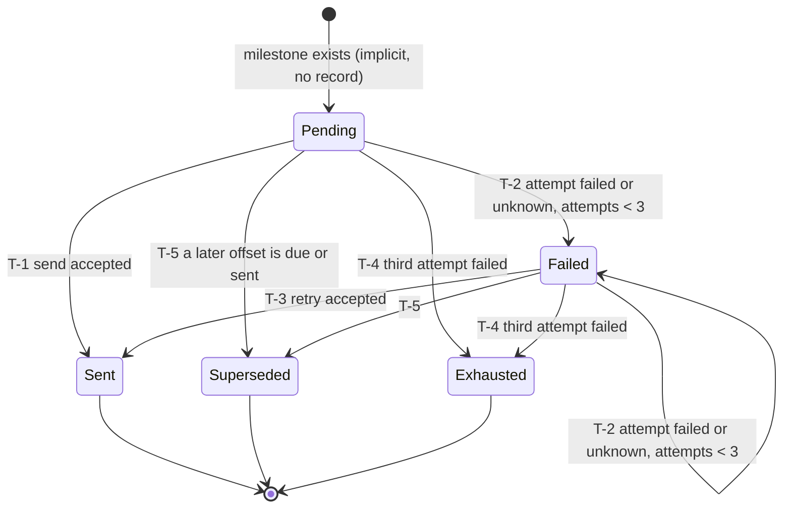

# Invoice Reminders: product specification

Living specification of what the product must do. Structure and technology choices are AD-<n> decisions in
`architecture.md` (same folder); nothing here is a technology choice. Product defaults chosen by the spec author
rather than stated by the user are PD-<n> (product decision), open prerequisites are G-<n> (gap), and assumptions
recorded for the submission are AS-<n>.

## Basis and evidence limits

- **Request (source for every R-<n> below):** "Set up automatic reminders for unpaid invoices." (user request,
  2026-11-21). Cited as *Request 2026-11-21*.
- **Starting point: genuinely new.** No repository, README, earlier spec, discovery result, research result or
  baseline exists for this run. There is no observed implementation; every behaviour below is *proposed intent*
  derived from the request plus the PD-n defaults. Nothing has been implemented, executed or verified.
- **Request outcomes.** The request names four things; each is mapped to requirements:

| Outcome | Words in the request | Requirements |
| --- | --- | --- |
| O-1 | "Set up" (the owner can configure when reminders go out and turn them on) | R-1, R-9 |
| O-2 | "automatic" (no person triggers each reminder) | R-3, R-6, R-7, R-8 |
| O-3 | "reminders" (a message reaches the customer) | R-5, R-10 |
| O-4 | "unpaid invoices" (only unpaid ones, and stop when paid) | R-2, R-4 |

- **Not stated by the request, therefore decided here as defaults (PD-n) and flagged for confirmation:**
  - PD-1 Channel is email to one billing contact per invoice.
  - PD-2 Schedule is relative to the invoice due date; default offsets in days are `-3, 0, 7, 14`.
  - PD-3 The product is a scheduled batch (an operator command run by an external scheduler), with an operator
    command-line surface; it has no web or graphical interface.
  - PD-4 The product never modifies invoices; invoices belong to an external invoice source.
  - PD-5 At most one reminder is sent per invoice per run, and the **latest** due milestone is the one sent
    (older missed milestones are skipped, not sent in a burst).
  - PD-6 A delivery that may or may not have happened (crash or timeout) is retried, i.e. at-least-once; a rare
    duplicate reminder is preferred over a silently missed one.
  - PD-7 At most 3 send attempts per milestone.
  - PD-8 Configuration bounds: 1 to 10 offsets, each an integer from -30 to 365, all distinct.
  - PD-9 Command names: `invoice-reminders run`, `invoice-reminders history`, `invoice-reminders check-config`.
- **Domain rules the request leaves out** (each is listed again under the R-<n> it bounds): disputes or holds on an
  invoice, late fees, payment plans, credit notes, customer opt-out lists, per-customer or per-invoice schedules,
  multiple recipients or escalation to another contact, other channels (SMS, post), localisation or custom
  templates, currency conversion, delivery or bounce tracking, and a graphical or web interface.
- **Preserved / changed / retired:** none preserved (no prior spec); all R-1 to R-10 are *added* by Request
  2026-11-21. Nothing retired.

## Behaviour model

### Vocabulary

- **Invoice source:** external system of record. Per invoice it provides: `invoice_id`, `status` (one of `draft`,
  `issued`, `paid`, `void`), `due_date` (calendar date, may be absent), `currency` (ISO 4217 code), `total` and
  `amount_paid` (decimals with two places), `contact_email` (may be absent), `customer_name` (optional),
  `payment_url` (optional). The product reads it and never writes to it (PD-4).
- **Outstanding amount** = `total` − `amount_paid`.
- **Milestone:** one configured offset applied to one invoice. Its date = `due_date` + offset days (calendar days in
  the configured timezone). Milestone identity is `(invoice_id, offset)`; the date is not part of the identity.
- **Due milestone:** milestone date ≤ **as-of date** (today in the configured timezone, or the `--as-of` value).
- **Consumed milestone:** one whose state is Sent, Superseded or Exhausted.
- **Run:** one execution of `invoice-reminders run`.

### Flows

- **F-1 Scheduled run (R-3, R-4, R-5, R-6, R-7, R-8):** scheduler starts `run` → acquire the single-run lock →
  load configuration → read the invoice list → for each eligible invoice select the milestone (T-5 supersede, T-1
  send) → re-read the invoice (R-4) → record attempt, submit to the email sender, record the result → print per
  invoice outcomes and the summary line → release the lock → exit code.
- **F-2 Setup and preview (R-1, R-9):** operator edits configuration → `check-config` → `run --dry-run` reads the
  same sources and prints what a real run would send, changing nothing.
- **F-3 Review (R-10):** operator runs `history` to see what was sent, skipped or failed.
- **F-4 Payment arrives (R-4):** the customer pays in the invoice source; the next evaluation (including the
  re-read just before a send) finds the invoice no longer eligible and sends nothing.

### Transition ledger (milestone state; owner: the reminder ledger, durable)

| ID | Req / flow | Before | Trigger and guard | Operation | After and observation | Failure and recovery |
| --- | --- | --- | --- | --- | --- | --- |
| T-1 | R-5, R-6 / F-1 | Pending, no attempt | Run; invoice eligible (R-2); milestone is the highest due unconsumed offset (R-3); no consumed Sent offset on this invoice is higher; recipient valid; re-read still eligible (R-4) | Record attempt 1 durably, submit, record Sent | Sent; one email; history entry `sent` | Crash after submit and before the Sent record: see T-8 |
| T-2 | R-7 / F-1 | Pending or Failed, attempts = n < 3 after this attempt | As T-1 guards; sender rejects, times out or the outcome is unknown | Record attempt n+1, result failed | Failed(n+1); run exit code 1; entry `failed` | Retried on the next run that finds it due (one attempt per run) |
| T-3 | R-7 / F-1 | Failed | As T-1 guards; sender accepts | Record attempt, Sent | Sent; entry `sent` with attempts = n | none |
| T-4 | R-7 / F-1 | Pending or Failed | The attempt just made is the 3rd and failed | Record Exhausted | Exhausted (consumed); exit code 1; entry `exhausted`; no further attempts for this offset | Operator sees it in `history`; no automatic resend (G-5) |
| T-5 | R-3 / F-1 | Pending or Failed | Another offset on the same invoice is due and higher, or a higher offset is already Sent | Record Superseded, no email | Superseded (consumed); entry `superseded` | none |
| T-6 | R-2, R-5, R-4 / F-1 | Pending or Failed | Highest due milestone but a skip guard holds (R-5 recipient missing or invalid, due date missing, R-4 no longer eligible or status unreadable) | No email, no state change; history entry once per (invoice, offset, reason) | State unchanged; reported as `skipped` with reason | Re-evaluated on every later run, so fixing the data lets it send |
| T-7 | R-6 / F-1 | Sent, Superseded or Exhausted | Any later run | None (documented no-op) | Unchanged; no email, no new entry | none |
| T-8 | R-6, R-7 / F-1 | Attempt recorded, result not recorded (crash) | Next run finds the in-flight attempt | Treat the attempt as failed with unknown outcome; apply T-2 or T-4 on the attempt count | Failed(n) or Exhausted | Possible duplicate email (PD-6, AS-3) |

## Requirements

### R-1 Reminder configuration

**Behaviour.** The owner configures: `enabled` (default `true`), `timezone` (IANA name, default `UTC`),
`offsets_days` (default `[-3, 0, 7, 14]`), the sender address `from_address` (required, no default) and an optional
`display_name`, plus the locations of the invoice source and the ledger. Credentials are never part of the
configuration document (NFR-2). `check-config` validates the configuration and prints the effective values.
**Boundaries (PD-8).** `offsets_days` holds 1 to 10 entries; each is an integer from -30 to 365 inclusive; entries are
distinct. **Error behaviour.** An invalid configuration makes `run`, `run --dry-run` and `check-config` exit 2, name
each offending key and the rule broken, send nothing and write nothing. **Consumer outcome.** The owner can state
exactly when reminders go out and turn them off. Offsets are applied to every invoice (per-invoice schedules are out
of scope). Changing offsets never re-sends a consumed milestone (identity is the offset, T-7).

- Basis: Request 2026-11-21 "Set up"; PD-2, PD-8. Preserved: none. Changed: added. Source locator: none (new product).
- Evidence limits: defaults are proposals, not user-approved (G-3). Pending: implementation and checks.
- State/data: configuration document is read-only to the product; owner = operator; unchanged by any command.

Acceptance lines (surface: operator CLI; confirmation: automated CLI test with fixture configuration unless noted):
- AC-1.1 Positive: with `offsets_days = [-3, 0, 7, 14]`, `timezone = "UTC"`, `from_address = "billing@example.test"`,
  `check-config` exits 0 and prints those four effective values and `enabled = true`.
- AC-1.2 Defaults: with only `from_address` set, `check-config` exits 0 and prints offsets `-3, 0, 7, 14`,
  timezone `UTC`, enabled `true`.
- AC-1.3 Failure: `offsets_days = [7, 7]` exits 2 and the output names `offsets_days` and "distinct"; `[]` exits 2
  naming "at least 1"; `[3.5]` and `["x"]` exit 2 naming "integer"; missing `from_address` exits 2 naming it;
  `timezone = "Mars/Base"` exits 2 naming `timezone`; in each case the ledger and the sender are untouched.
- AC-1.4 Boundary: 10 offsets (`[-30, -3, 0, 1, 2, 3, 7, 14, 30, 365]`) exits 0; the same list plus `60` (11 entries)
  exits 2; offset `-30` accepted, `-31` rejected; `365` accepted, `366` rejected. Group coverage: count (1, 10, 0, 11),
  low end, high end, distinctness.
- AC-1.5 Disabled: `enabled = false` makes `run` exit 0, print `reminders disabled`, send nothing and leave the
  ledger unchanged, even with due milestones present.
- AC-1.6 Offset change: after a run has sent milestone `0` for INV-1001, adding offset `-7` and running again
  sends nothing for INV-1001 for offset `-7` (see AC-3.4, T-5).
- Not applicable: concurrent edits of the configuration file during a run (n/a: the configuration is read once
  at run start; a run never re-reads it).

Open gap G-3: the owner has not confirmed the default offsets or bounds; implementation may proceed on the defaults.

### R-2 Which invoices are reminded

**Behaviour.** An invoice is *eligible* when `status = issued` and its outstanding amount > 0.00. Status groups with
distinct observable behaviour: `issued` with outstanding > 0 (eligible); `issued` with outstanding ≤ 0 (ignored:
fully paid or overpaid despite the status); `paid`, `draft`, `void` (ignored); any other status value (ignored, with
a warning line naming the invoice and the value). Partially paid invoices are eligible and are reminded for the
outstanding amount only. An eligible invoice without `due_date` cannot be scheduled: it is skipped with reason
`no-due-date` (T-6). **Consumer outcome.** Customers are reminded only about money they still owe. Ignored invoices
appear only in the `ignored` count of the summary. Out of scope (bound the rule): disputes and holds, credit notes,
payment plans, late fees, customers flagged do-not-contact.

- Basis: Request 2026-11-21 "unpaid invoices"; PD-4. Preserved: none. Changed: added.
- Evidence limits: status vocabulary and field names are the spec author's proposal pending G-1.
- Pending: implementation and checks.

Acceptance lines (surface: operator CLI summary and per-invoice lines; confirmation: automated CLI test against the
fixture in S-0):
- AC-2.1 Positive: S-0 run as-of 2026-03-07 reports INV-1001 and INV-1002 as `sent`; the summary shows `ignored=3`
  (INV-1003 `paid`, INV-1004 `draft`, INV-1005 `void`).
- AC-2.2 Partial payment: INV-1002 (total 800.00, paid 300.00) is eligible and its email states outstanding
  `500.00 USD`, not 800.00.
- AC-2.3 Boundary: an `issued` invoice with total 100.00 and paid 99.99 is eligible and states `0.01`; with paid
  100.00 (outstanding 0.00) it is ignored; with paid 120.00 (overpaid) it is ignored.
- AC-2.4 Failure: an `issued` invoice with no `due_date` is reported `skipped no-due-date`, no email, counted in
  `skipped`. An invoice with status `pending-review` is ignored and a warning line names `pending-review`.
- Not applicable: unauthorised access to invoices (n/a: the product runs with the operator's own source
  credentials and exposes no per-user view).

Open gap G-1: which real invoicing system and data format is the invoice source. Blocks wiring a production source
only (AD-3 keeps the core independent); the file-based reference source and fixtures allow all R-2 checks.

### R-3 Milestone selection and catch-up

**Behaviour.** For each eligible invoice, a run computes its due, unconsumed milestones (Pending or Failed). If there
are none, the invoice is `not_due`. Otherwise only the milestone with the **highest offset** is acted on (PD-5); every
other due unconsumed milestone becomes Superseded (T-5) and sends nothing. If the highest due offset is lower than
an offset already Sent for the invoice, it too is Superseded and nothing is sent. After the last configured offset
has been consumed, the invoice is never reminded again. Date rule: milestone date = `due_date` + offset days;
due when date ≤ as-of date; as-of = today in the configured timezone unless `--as-of YYYY-MM-DD` is given.
**Consumer outcome.** A run after downtime, or the first run on an installation with overdue invoices, sends one
reminder per invoice, never a burst, and never a "due in 3 days" message once the due date has passed. A run on an
installation with a long-overdue invoice sends its latest due milestone once (AS-2).

- Basis: Request 2026-11-21 "automatic"; PD-2, PD-5. Preserved: none. Changed: added. Pending: implementation, checks.
- Offsets and dates use calendar dates only; no time of day is configured (G-3 covers the send time).

Acceptance lines (surface: CLI summary, per-invoice lines, `history`; confirmation: automated CLI test with a
controllable `--as-of`; expected results hand-walked, see Evidence):
- AC-3.1 Before the first milestone: S-1 (empty ledger, as-of 2026-03-06): nothing sent; summary
  `considered=4 sent=0 skipped=0 failed=0 not_due=4 superseded=0 ignored=3`.
- AC-3.2 Boundary on the date: as-of 2026-03-17 on an empty ledger sends INV-1001 milestone `7` ("7 days overdue");
  as-of 2026-03-16 on an empty ledger sends milestone `0` ("6 days overdue") and no other.
- AC-3.3 Catch-up: S-5 (empty ledger, as-of 2026-03-20): INV-1001 and INV-1002 each receive exactly one email for
  milestone `7` ("10 days overdue"); milestones `-3` and `0` of each are recorded Superseded; summary
  `considered=4 sent=2 skipped=2 failed=0 not_due=0 superseded=8 ignored=3` (superseded counts all four
  considered invoices, two milestones each, INV-1006/1007 included because supersession depends on dueness, not on
  sending).
- AC-3.4 Late offset: ledger has INV-1001 offset `0` Sent; configuration is changed to `[-7, -3, 0, 7, 14]`;
  as-of 2026-03-12: nothing is sent for INV-1001; offsets `-7` and `-3` are Superseded; summary for an
  INV-1001-only source `considered=1 sent=0 skipped=0 failed=0 not_due=1 superseded=2 ignored=0`.
- AC-3.5 End of schedule: with offsets `[-3, 0, 7, 14]` all consumed, as-of 2026-12-31 sends nothing and the invoice
  counts `not_due`.
- AC-3.6 Timezone boundary: configuration `timezone = "Pacific/Auckland"`, real clock at 2026-03-06T12:30:00Z
  (which is 2026-03-07 01:30 in Auckland, UTC+13 in March 2026): as-of resolves to 2026-03-07 and milestone `-3`
  of an invoice due 2026-03-10 is due; with `timezone = "UTC"` and the same instant, as-of is 2026-03-06 and it is
  not. (Check with an injected clock.)
- Not applicable: changed due date after sending: milestone identity is the offset, so a consumed offset is not
  re-sent when the due date moves; later offsets use the new date (recorded behaviour, covered by AC-6.4).

### R-4 Payment freshness and stopping on payment

**Behaviour.** An invoice that becomes `paid` (or `void`, or fully paid) stops receiving reminders: the product
holds no copy of invoice status between runs and decides from a fresh read each run. Immediately before each send it
re-reads that one invoice from the invoice source and sends only if it is still eligible with the freshly read
outstanding amount (the email shows the re-read amount). If the re-read shows it is no longer eligible: no email,
`skipped no-longer-eligible` (T-6), no consumption. If the re-read fails: no email, `skipped status-unavailable`,
retried next run. Limit stated honestly: a payment made after the re-read and before the customer opens the email
cannot be prevented, hence the "if you have already paid" line (R-5). If the initial invoice list cannot be read
completely, the run aborts before any send (exit 2, nothing recorded); a partial list is treated as a failed read.
**Consumer outcome.** A customer who has paid is not chased on later runs.

- Basis: Request 2026-11-21 "unpaid"; PD-4. Preserved: none. Changed: added. Pending: implementation, checks.
- Service boundary B-1 in the contracts section carries the authority and freshness rule.

Acceptance lines (surface: CLI plus recording fake email sender; confirmation: automated, source fake that changes
status between its list and its per-invoice read):
- AC-4.1 Positive (race): INV-1001 is `issued` in the list read and `paid` in the re-read at as-of 2026-03-07:
  the sender receives no message for INV-1001; its line is `skipped no-longer-eligible`; its milestone `-3` stays
  Pending in the ledger.
- AC-4.2 Stops after payment: INV-1001 sent at as-of 2026-03-07; it becomes `paid`; runs at 2026-03-10, 03-17 and
  03-24 send nothing for it and count it in `ignored`.
- AC-4.3 Failure (re-read): the re-read throws; no message; line `skipped status-unavailable`; next run with a working
  source sends the due milestone.
- AC-4.4 Failure (list read): the list read fails on page 2 of 3: exit 2, message names the source, no message sent
  for any invoice, ledger unchanged.
- AC-4.5 Amount freshness: list shows INV-1002 outstanding 500.00, re-read shows 300.00 (a second payment): the email
  states `300.00 USD`.
- Not applicable: partial refund after payment (n/a: out of scope; the status in the source decides).

### R-5 Reminder message and recipient

**Behaviour.** The reminder is a plain-text email sent from the configured `from_address` (with `display_name` when
set) to the invoice's `contact_email`. A valid contact is exactly one address with a non-empty local part, exactly one
`@`, a domain containing a dot that neither starts nor ends with a dot, and no whitespace or comma. Missing
contact: skip `no-recipient`. Invalid contact: skip `invalid-recipient` (T-6; milestone not consumed, so fixing
the data later lets it send). **Subject** by actual days relative to the as-of date: `Reminder: invoice <id> is due in
<n> day(s)` (n ≥ 1), `Reminder: invoice <id> is due today` (n = 0), `Invoice <id> is <n> day(s) overdue` (n ≥ 1);
"day" is singular for exactly 1. The wording follows the real day count, not the milestone offset. **Body**, in this
order: greeting `Hello <customer_name>,` (or `Hello,` when no name); invoice number; due date as `YYYY-MM-DD`;
outstanding amount as `<amount with two decimals> <currency>`; the payment URL line only when `payment_url` exists;
the sentence `If you have already paid, please disregard this reminder.`; the sender display name or address.
Consumer outcome: the customer receives a clear, single, correct reminder. Out of scope: localisation, templates,
HTML, attachments, copies of the invoice document, other languages (G-4).

- Basis: Request 2026-11-21 "reminders"; PD-1. Preserved: none. Changed: added. Pending: implementation, checks.
- Evidence limits: wording is a proposal pending G-4; the real provider is unresolved (G-2).

Acceptance lines (surface: recording fake email sender (AD-3) for content and recipient; real-provider delivery is
the open prerequisite G-2; confirmation: automated):
- AC-5.1 Positive (S-2, as-of 2026-03-07): INV-1001 message goes to `ap@acme.example`, from `billing@example.test`,
  subject `Reminder: invoice INV-1001 is due in 3 days`, body containing `INV-1001`, `2026-03-10`, `500.00 USD`, and
  the disregard sentence, no payment-URL line when `payment_url` is absent, and no other invoice id, address or
  customer name (each message mentions only its own invoice).
- AC-5.2 Day-count wording: due today -> `is due today`; due in 1 day -> `is due in 1 day`; 1 day past -> `is 1 day
  overdue`; 10 days past -> `is 10 days overdue`.
- AC-5.3 Payment URL: with `payment_url = https://pay.example.test/INV-1001` the body contains that exact URL on its
  own line; absent: no URL line and no placeholder text.
- AC-5.4 Failure: INV-1006 (no contact) -> `skipped no-recipient`; INV-1007 (`not-an-email`) -> `skipped
  invalid-recipient`; no message for either; both counted in `skipped`. Boundary: `a@b.co` valid; `a@b` invalid;
  `a@b.` invalid; `a b@c.example` invalid; `a@x.example,b@y.example` invalid; `@c.example` invalid.
- AC-5.5 Data fixed later: after AC-5.4, INV-1006 gets contact `fin@dune.example`; the next run (as-of 2026-03-07)
  sends milestone `-3` to it.
- AC-5.6 No name: invoice without `customer_name` greets `Hello,`.
- Out of scope domain rules: delivery receipts, opt-out, language.

Open gap G-4: wording and sender identity confirmation by the owner. Open gap G-2: which email provider and sender
domain authentication (SPF/DKIM) is used; needed before real customers receive mail, not for the checks above.

### R-6 One reminder per milestone, safe repetition

**Behaviour.** A consumed milestone is never sent again (T-7). Running the command repeatedly the same day, or
several times a day, sends nothing beyond the first successful send per milestone. The attempt is recorded durably
*before* the email is submitted, and the result is recorded after, so a crash between the two is detectable (T-8).
After a crash with an unknown outcome the attempt counts as failed and is retried (at-least-once, PD-6); a duplicate
email is therefore possible only in the window between the provider accepting the message and the ledger recording
Sent. Ledger identity is `(invoice_id, offset)`. **Consumer outcome.** Customers receive each milestone reminder once
in normal operation, however the scheduler is configured.

- Basis: Request 2026-11-21 "automatic"; PD-5, PD-6. Preserved: none. Changed: added. Pending: implementation, checks.
- Recovery: after a crash the ledger is the sole source of truth; the next run reconstructs state from it.

Acceptance lines (surface: CLI, ledger via `history`, recording sender, kill hook in the fake sender; confirmation:
automated):
- AC-6.1 Repeat (S-3): after S-2 (as-of 2026-03-07), a second run at the same as-of sends no message; summary
  `considered=4 sent=0 skipped=2 failed=0 not_due=2 superseded=0 ignored=3`; `history` still shows exactly two
  `sent` entries and no new `skipped` entries (skip entries are written once per (invoice, offset, reason)).
- AC-6.2 Later day, nothing new (S-4): as-of 2026-03-08 sends nothing; same summary as AC-6.1.
- AC-6.3 Crash (S-9): the fake sender accepts the message for INV-1001 and the process is killed before the Sent
  record is written. Next run at as-of 2026-03-07: the in-flight attempt is treated as failed (attempt 1), a retry is
  made (attempt 2), the sender receives a second message for INV-1001 `-3`, the ledger ends `Sent, attempts = 2`.
  This duplicate is the documented, accepted behaviour. Crash *before* submit: next run sends once, attempts = 2.
- AC-6.4 Due date change: INV-1001 `-3` Sent; the source changes the due date to 2026-03-31; the run at 2026-03-08
  sends nothing for offset `-3` again; offset `0` is then due on 2026-03-31.
- AC-6.5 Failure: ledger store unavailable at run start: exit 2, nothing sent (a send that cannot be recorded is not
  made).
- Not applicable: ordering across invoices (n/a: invoices are independent; no ordering guarantee is required).

### R-7 Failure handling and retries

**Behaviour.** If the email sender rejects the message, times out, or the outcome is unknown, the attempt is
recorded Failed (T-2) and the run continues with other invoices. One attempt per milestone per run; the next run that
finds the milestone still due tries again. After 3 attempts (PD-7) without success the milestone is Exhausted (T-4)
and is never retried; later milestones of the invoice still apply (R-3). Exit code is 1 when any attempt in the run
failed or ended Exhausted. Retries consume attempts even when they are unknown-outcome (T-8). The failure reason
appears on the invoice's line and in `history`, without the message body. Out of scope: delivery and bounce tracking
(G-5): "accepted by the sender" is the success the product records, which is not proof of delivery.

- Basis: Request 2026-11-21 "automatic"; PD-6, PD-7. Preserved: none. Changed: added. Pending: implementation, checks.

Acceptance lines (surface: CLI exit code, lines, `history`; fake sender scripted to fail; confirmation: automated):
- AC-7.1 Retry success (S-8a): sender rejects INV-1001 at 2026-03-07, accepts on 2026-03-08. Run 1: line `failed
  attempt 1/3`, exit 1. Run 2: line `sent` (attempts 2), exit 0.
- AC-7.2 Exhaustion (S-8): sender rejects INV-1001 at 2026-03-07, 03-08 and 03-09: run 3 prints `exhausted` and exits
  1; at 2026-03-10 (sender healthy) the run sends milestone `0` ("due today") and exits 0; no run ever contacts the
  sender again for offset `-3`.
- AC-7.3 Isolation: with INV-1001 failing, INV-1002 at the same run is still sent; the summary counts `sent=1
  failed=1`; exit 1.
- AC-7.4 Missed runs while failed (S-8b): failure at 2026-03-07, no runs on 03-08 and 03-09, run at 2026-03-10:
  offset `-3` Superseded, offset `0` sent once; summary for INV-1001 only `considered=1 sent=1 skipped=0 failed=0
  not_due=0 superseded=1 ignored=0`.
- AC-7.5 Boundary: attempt 2 failing leaves the milestone Failed (not Exhausted); attempt 3 failing makes it
  Exhausted. A crash with an in-flight attempt number 3 makes it Exhausted without a fourth send.

Open gap G-5: whether the owner wants delivery/bounce tracking or an alert on Exhausted; excluded for now.

### R-8 Unattended running

**Behaviour.** `invoice-reminders run` performs one full pass and exits; an external scheduler starts it (PD-3, AD-1).
It needs no human input and no terminal. The recommended cadence is at least once per calendar day; more frequent
runs are safe (R-6) and missed runs are caught up (R-3). Only one run may be active: a second `run` started while one
holds the lock exits 2 with `another run is in progress`, sends nothing and leaves the first run unaffected; a
crashed run leaves no lock that blocks later runs. Output: one line per non-ignored, non-`not_due` invoice
(`<invoice_id>  <outcome>  <milestone>  <detail>`), then exactly one summary line:
`summary: considered=<n> sent=<n> skipped=<n> failed=<n> not_due=<n> superseded=<n> ignored=<n>`. Exit codes: 0 =
completed with no failed or exhausted attempt (skips are not failures); 1 = completed with at least one failed or
exhausted attempt; 2 = refused or aborted before sending anything (invalid configuration, source or ledger
unavailable, lock held). `--as-of YYYY-MM-DD` overrides today's date; an invalid date exits 2.

- Basis: Request 2026-11-21 "automatic"; PD-3, AS-1. Preserved: none. Changed: added. Pending: implementation, checks.
- Limits: the product does not install or manage the scheduler; scheduling is an operator prerequisite (G-6).

Acceptance lines (surface: CLI, process exit code; confirmation: automated CLI tests; the concurrency case with two
real processes):
- AC-8.1 Positive: S-2 run completes with no input, prints `INV-1001  sent  -3`, `INV-1002  sent  -3`,
  `INV-1006  skipped  -3  no-recipient`, `INV-1007  skipped  -3  invalid-recipient` and `summary: considered=4
  sent=2 skipped=2 failed=0 not_due=0 superseded=0 ignored=3`; exit 0.
- AC-8.2 Concurrency: a second `run` started while the first is blocked in the sender exits 2 with `another run is in
  progress`; after the first finishes, the recording sender holds exactly one message per milestone.
- AC-8.3 Crash recovery: kill a run mid-send; start another run: it acquires the lock and proceeds (no manual unlock).
- AC-8.4 Exit codes: invalid configuration exits 2; a run with one failed attempt exits 1; a run with only skips exits
  0; `--as-of 2026-02-30` exits 2.
- AC-8.5 Empty source: zero invoices: summary all zeros, exit 0, message `no invoices to consider`.
- Not applicable: running without a scheduler (n/a: manual `run` is the same command).

Open gap G-6: who installs the scheduler (for example cron) and its cadence; an operator prerequisite.

### R-9 Preview before activation

**Behaviour.** `invoice-reminders run --dry-run` evaluates exactly as a real run, including the invoice list and
re-read, but sends no email, takes no attempt, and writes nothing to the ledger (no Sent, Superseded or skip
entries). It prints the same per-invoice lines with outcome `would-send` in place of `sent` (skip reasons unchanged), and the
summary line with `sent=0`, `superseded=0` (nothing is recorded) plus `would_send=<n>`. Exit codes follow R-8, except that failed attempts cannot occur.
Why it exists: the first real run on a system with overdue invoices will send reminders to every one of them (R-3),
and the owner needs to see that before enabling. A dry run does not take the run lock.

- Basis: Request 2026-11-21 "Set up" (safe activation); PD-3. Preserved: none. Changed: added. Pending: implementation.

Acceptance lines (surface: CLI plus recording sender and ledger inspection; confirmation: automated):
- AC-9.1 Positive: S-5 fixture, as-of 2026-03-20, `--dry-run`: lines `INV-1001  would-send  7`, `INV-1002  would-send  7`;
  summary `considered=4 sent=0 skipped=2 failed=0 not_due=0 superseded=0 ignored=3 would_send=2`; the recording
  sender holds 0 messages; the ledger is byte-identical before and after.
- AC-9.2 Equivalence: the set of invoices that `--dry-run` lists as `would-send` equals the set a real run then sends
  for the same ledger, source and as-of.
- AC-9.3 Failure: invalid configuration with `--dry-run` exits 2, as in AC-1.3.
- Not applicable: a dry run's effect on retries (n/a: it takes no attempts).

### R-10 History

**Behaviour.** `invoice-reminders history` prints ledger entries, oldest first, one per line: recorded time (UTC,
ISO 8601), as-of date, invoice id, offset, outcome (`sent`, `failed`, `exhausted`, `superseded`, `skipped`), reason
or attempt count, and for sent or failed entries the recipient address. `--invoice <id>` filters to one invoice.
Empty ledger: `No reminders recorded yet.` Unknown invoice: `No history for <id>.` with exit 0. The message body is
never stored or shown. Read-only: it changes nothing.

- Basis: Request 2026-11-21 "reminders" (the owner must be able to see what went out); PD-9. Pending: implementation.
- Retention of history is unresolved (NFR-2, G-7).

Acceptance lines (surface: CLI; confirmation: automated):
- AC-10.1 Positive: after S-2, `history` prints two `sent` entries (INV-1001 and INV-1002, offset -3, recipient shown)
  and two `skipped` entries (INV-1006 `no-recipient`, INV-1007 `invalid-recipient`); `history --invoice INV-1001`
  prints exactly the one `sent` line.
- AC-10.2 Empty and unknown: empty ledger prints `No reminders recorded yet.`; `--invoice INV-9999` prints `No
  history for INV-9999.`; both exit 0.
- AC-10.3 No body: no ledger entry or history output contains the email body text.
- AC-10.4 Read-only: the ledger is unchanged after `history`.

## Scenario fixtures (replayable)

Configuration C-1: `enabled = true`, `timezone = "UTC"`, `offsets_days = [-3, 0, 7, 14]`, `from_address =
"billing@example.test"`, empty ledger unless stated.

S-0 invoice source (all amounts in USD):

| invoice_id | status | due_date | total | amount_paid | contact_email |
| --- | --- | --- | --- | --- | --- |
| INV-1001 | issued | 2026-03-10 | 500.00 | 0.00 | ap@acme.example |
| INV-1002 | issued | 2026-03-10 | 800.00 | 300.00 | pay@birch.example |
| INV-1003 | paid | 2026-03-10 | 200.00 | 200.00 | ar@cedar.example |
| INV-1004 | draft | 2026-03-10 | 150.00 | 0.00 | ar@dune.example |
| INV-1005 | void | 2026-03-10 | 75.00 | 0.00 | ar@elm.example |
| INV-1006 | issued | 2026-03-10 | 120.00 | 0.00 | (absent) |
| INV-1007 | issued | 2026-03-10 | 90.00 | 0.00 | not-an-email |

Scenario list: S-1 (AC-3.1), S-2 (AC-2.1, AC-5.1, AC-8.1, AC-10.1), S-3 (AC-6.1), S-4 (AC-6.2), S-5 (AC-3.3, AC-9.1),
S-7 (AC-4.1), S-8 (AC-7.2), S-8a (AC-7.1), S-8b (AC-7.4), S-9 (AC-6.3), S-12 (AC-3.4).

## Non-functional requirements

Basis for all: Request 2026-11-21 (implied by "automatic" unattended operation and invoice and email data); PD-n as
cited. None of these is user-stated, so each is a proposal for confirmation; no number below is invented.

- **NFR-1 Reliability and data integrity (accepted as part of R-6, R-7).** Ledger writes are durable before a send is
  attempted; a consumed milestone is never reverted; one ledger record exists per `(invoice_id, offset)`. Operating
  condition: process killed at any point. Verification: AC-6.3, AC-8.3 (crash tests).
- **NFR-2 Security and privacy.** Personal data is the customer name and contact address. Shown: only in the email, and
  in `history` (recipient). Stored: the ledger stores recipient address, invoice id and offset only; never the body
  or the name. Logged: run output and logs name invoice ids and reasons only, never addresses, names, amounts or bodies.
  Credentials for the invoice source and the email sender come from the process environment or the host's secret
  store, never from the configuration document, the ledger or any output. Removal: no automatic removal;
  **retention period unresolved (G-7)**, so no period is claimed; until decided, records stay until the operator
  deletes the ledger. Access: whoever can run the command and read the ledger file, equal to the operator trust
  boundary. Verification: AC-10.3; a redaction test scanning run output, error output and ledger for the fixture
  addresses and names (addresses allowed only in `history` and the ledger), and for a planted secret value.
- **NFR-3 Operability and observability.** Every run ends with the one-line summary and an exit code (R-8); each
  skip, failure, exhaustion and abort states its reason. Owned events: send attempted/succeeded/failed/exhausted/
  superseded/skipped, all in `history`. Verification: AC-8.1, AC-8.4, AC-10.1.
- **NFR-4 Performance and capacity: unresolved bound.** The invoice count per run, run duration limit, and the email
  provider's rate limit are unknown (missing: owner's expected volume and chosen provider, G-2). No latency or
  throughput number is invented. Until set, the product processes invoices sequentially and makes no capacity claim;
  at plan time a volume check is selected once the owner supplies a figure. Hard platform limits: none known.
- **NFR-5 Compatibility and testability.** Runtime/language unspecified (AD-4, open). The invoice source, email
  sender and clock must be replaceable by fakes so that every S-n scenario above replays exactly. Verification: the
  S-n scenarios run through the real CLI with fakes (AD-3).
- **NFR-6 Operator interface quality (terminal surface and plain-text email).** There is no graphical or web UI, so the
  graphical visual-direction starting point (light/dark themes, responsive layout) does not apply; the terminal
  medium keeps its own conventions, using the terminal's own palette so it reads in light and dark terminals.
  Observable criteria: (a) consistent output: fixed column order and alignment for per-invoice lines and `history`,
  one marker vocabulary (`sent`, `skipped`, `failed`, `exhausted`, `superseded`, `would-send`) and no mixed icon
  sets; (b) designed states: empty (`No reminders recorded yet.`, `no invoices to consider`), error (one line naming
  the cause and the key or source, never a stack trace), disabled (`reminders disabled`), and aborted states; (c)
  layout: readable at 80 columns without wrapped table rows breaking the columns, and at wider terminals without
  stretching; (d) meaning is never carried by colour alone, colour is off when `NO_COLOR` is set or output is not a
  terminal; (e) no animation or spinner when output is not a terminal; motion-free by default; (f) the email is plain
  text so it is readable with any client, screen reader or font size. Verification: CLI tests at 80 and 120 columns,
  with and without `NO_COLOR`, and a non-terminal run; manual read of one email sample.
- **Justified exclusions:** availability SLA (a batch run, no standing service); internationalisation (G-4);
  accessibility conformance level for a web UI (no web UI).

## State and data assessment

| Resource | Owner and location | Access | Identity | Before / after invariant | Recovery | Check |
| --- | --- | --- | --- | --- | --- | --- |
| Configuration document | Operator, local file | Read by the product, never written | the one document | Unchanged by every command | n/a: read-only | AC-1.x |
| Invoice source | External system (G-1) | Read only | `invoice_id` | Invoices unchanged by any run (PD-4) | n/a: read-only | AC-4.x with a source fake that records writes (none expected) |
| Reminder ledger | The product, durable, location configured | Read/write by `run`, read by `history` and `--dry-run` | `(invoice_id, offset)` | At most one record per identity; a consumed state never reverts; attempts ≤ 3; `--dry-run` and `history` leave it byte-identical | Crash: in-flight attempt resolved at next run (T-8); store unavailable: run aborts (AC-6.5) | AC-6.x, AC-7.x, AC-9.1, AC-10.4 |
| Run lock | The product, ephemeral | Held for the run's duration | one lock per ledger | At most one real run at a time; released by process exit, even a crash | Crash: next run proceeds (AC-8.3) | AC-8.2, AC-8.3 |
| Emails | External effect via the email sender | Write (submit) | per attempt | Content never stored | Unknown outcome retried (PD-6) | AC-5.x, AC-6.3 |

Unknowns: ledger store size growth is unbounded and retention undecided (G-7); source and sender behaviour under
real load is unverified (NFR-4).

## Service boundary contracts

- **B-1 Invoice source (read).** *Current authority:* the source decides status, amounts, due date and contact on every
  read; the product never caches invoice data across runs. *Freshness versus revocation:* eligibility is re-read per
  invoice immediately before each send (R-4); payment is the revocation event, caught by that re-read or by the next
  run. *Incremental state:* none; every run scans the whole list, which is safe because the ledger makes repeats
  idempotent. A listing that fails partway aborts the run before any send. *Async completion:* n/a (synchronous
  reads). *Owned events:* none emitted by the source are consumed; no notification or webhook is needed.
- **B-2 Email sender (write).** *Authority:* the configured sender identity (G-2). *Acknowledgment meaning:* the
  sender accepted the message; not delivery, not display (delivery tracking out of scope, G-5). *Async completion
  and recovery:* submission is synchronous; a timeout or unknown outcome is handled by T-8 and may duplicate (PD-6).
  Idempotency by the provider is not assumed (the provider is unknown, G-2). *Owned event coverage:* the product's
  own `history` records every attempt and result; the provider's logs are out of scope.
- **B-3 Scheduler (external trigger).** Not owned by the product (G-6). Missed or delayed runs are tolerated by R-3;
  overlapping runs are rejected by R-8. No acknowledgment contract is needed.
- Inapplicable concerns: authentication of end users, caches, cursors and subscriptions, because there is no user
  login, cache or long-lived connection.

## Information lifecycle

| State | Owner and location | Who may read | Simultaneous changes | Ends and removal | Runtime quotas |
| --- | --- | --- | --- | --- | --- |
| Configuration | Operator, file | Operator and the product | Single writer (the operator); read once per run | Operator edits | none |
| Ledger | The product, configured durable store | Operator with access to the store and the CLI | Run lock serialises writers; `history` and dry-run only read | Never removed automatically; retention open (G-7) | Store size unbounded (G-7) |
| Run lock | The product, ephemeral | The product | n/a | Released when the process ends | none |
| Run output | stdout/stderr, scheduler's log capture | Operator | n/a | Per the scheduler's log retention | Provider rate limits unknown (NFR-4) |

No identity, sharing or persistence beyond these is added. Information one customer must not see about another:
emails go only to the invoice's own contact; no message contains another customer's data (verified by AC-5.1's
fixture check that each message mentions only its own invoice id).

## Open gaps (index)

| ID | Under | Gap | Affects readiness of |
| --- | --- | --- | --- |
| G-1 | R-2 | Real invoice source system and data format unknown | Production source adapter only |
| G-2 | R-5, NFR-4 | Email provider, sender-domain authentication, rate limit unknown | Production sender adapter and live send only |
| G-3 | R-1, R-3 | Owner has not confirmed the default offsets, bounds, or send time of day | Nothing; defaults apply |
| G-4 | R-5 | Wording, language, sender identity not confirmed | Nothing; defaults apply |
| G-5 | R-7 | Delivery/bounce tracking and alert on Exhausted excluded | Nothing |
| G-6 | R-8 | Who installs the scheduler and its cadence | Live activation only |
| G-7 | NFR-2 | Ledger retention period, removal policy | Any retention claim |

No material requirement conflict was found. Work on the core engine (R-1 to R-10 against fakes) is ready; only the
production adapters (G-1, G-2) and live activation (G-6) are not.

## Evidence

- **Scenario walks (hand-computed; not executed).** Each expected result above was derived by walking the rules from
  the empty-ledger start, checking at each step the rule that permits the action: eligibility R-2, due milestones R-3,
  recipient R-5, re-read R-4, attempts R-6/R-7. A small independent reference model was drafted in the scratchpad to
  recompute them, but running scripts was not approved in this environment, so no execution took place. Status of
  every scenario: `NOT-REPLAYED: no product exists and the cross-check script could not be run; results hand-derived`.
  This leaves AC-2.1, AC-3.1 to AC-3.4, AC-4.1, AC-6.1 to AC-6.3, AC-7.1, AC-7.2, AC-7.4, AC-8.1 open until
  replayed by the test stage.
- **Recomputation notes.** S-1: all four considered invoices have first milestone 2026-03-07 > 2026-03-06, so
  `not_due=4`. S-2: milestones -3 = 2026-03-07 due; INV-1001/1002 valid contacts, sent; 1006, 1007 skipped.
  S-3: sent milestones are consumed; 1006/1007 still skip, already-recorded skip entries are not duplicated.
  S-5: milestones -3, 0, 7 = 03-07, 03-10, 03-17 due; 14 = 03-24 not due; four considered invoices, two superseded
  each = 8; 1001, 1002 sent milestone 7 (10 days overdue). S-8: attempts 03-07 (1), 03-08 (2), 03-09 (3) -> Exhausted;
  03-10 milestone 0 due and highest -> sent. S-8b: at 03-10 both -3 (Failed, 1 attempt) and 0 are due; 0 is highest;
  -3 Superseded. S-12: offsets `[-7,-3,0,7,14]`, 0 already Sent, as-of 03-12: -7 (03-03) and -3 (03-07) due, 7
  (03-17) not due; highest due offset -3 < Sent offset 0, so both Superseded and nothing sent.
  Timezone case AC-3.6: Auckland observes daylight saving (UTC+13) until early April 2026; this offset is an
  assumption from general knowledge and not probed: `NOT-REPLAYED`; the test must pick a date whose offset is read
  from the platform timezone database rather than relying on this arithmetic.
- **Claims not source-checked.** No platform or library capability claims are made in this spec; AD-2's claim that a
  lock is released when a process dies is marked unverified in `architecture.md`.
- **Documented commands:** none exist yet; no command was run, no exit code recorded.
- **Source sections used:** `GUIDES/behavioral-requirements.md` (Behavior model, Traceability and review, Actors
  channels and state ownership), `GUIDES/requirements-definition.md` (State and data change assessment, Define
  non-functional requirements), `GUIDES/current-system-baseline.md` (genuinely new classification),
  `GUIDES/service-discovery.md` (Verification), `GUIDES/platforms/ui.md` (light expressive starting point, found not
  applicable: no graphical UI), `GUIDES/project-knowledge.md` (Maintained product requirements).

## Retired

None.

## Submission

**summary:** Wrote `KNOWLEDGE/spec.md` and `KNOWLEDGE/architecture.md` for "Set up automatic reminders for unpaid
invoices." (2026-11-21). Genuinely new product: no repository, baseline, discovery or research existed. Ten
requirements (R-1 to R-10), a milestone state model with transitions T-1 to T-8, seven NFRs, state/data assessment,
three service-boundary contracts and a lifecycle table. All behaviour is proposed intent; nothing was implemented or
run, and scenario results are hand-derived and marked NOT-REPLAYED (script execution was not approved).
Assumptions taken as defaults (unattended): AS-1 the product is a scheduled batch command with a CLI and no web UI;
AS-2 an installation or a long outage sends one reminder per invoice (the latest due milestone), including for
already long-overdue invoices (R-9 dry run is the safeguard); AS-3 at-least-once sending, so a crash between provider
acceptance and ledger write can duplicate one email; AS-4 channel is email to one contact; AS-5 offsets `-3, 0, 7, 14`
days around the due date, max 3 attempts, bounds 1 to 10 offsets within -30 to 365; AS-6 reminders about partially
paid invoices state the outstanding balance. Open items: G-1 invoice source, G-2 email provider and domain
authentication, G-3 and G-4 owner confirmation of defaults and wording, G-5 delivery tracking excluded, G-6 scheduler
installation (person-only), G-7 ledger retention, NFR-4 capacity bound unresolved (no figure invented). No material
requirement conflict; only the production adapters (G-1, G-2) and live activation (G-6) are unready, the core engine
is ready against fakes. Duty 11 omitted: no `backchain-check` here.

**primary:** R-1, R-2, R-4, R-5, R-8

**evidence_refs:** `KNOWLEDGE/spec.md` (R-1 to R-10, NFR-1 to NFR-6, State and data assessment, Service boundary
contracts, Information lifecycle, Evidence), `KNOWLEDGE/architecture.md` (AD-1 to AD-4), GUIDES sections listed in
Evidence. No backchain receipt (command does not exist here).
