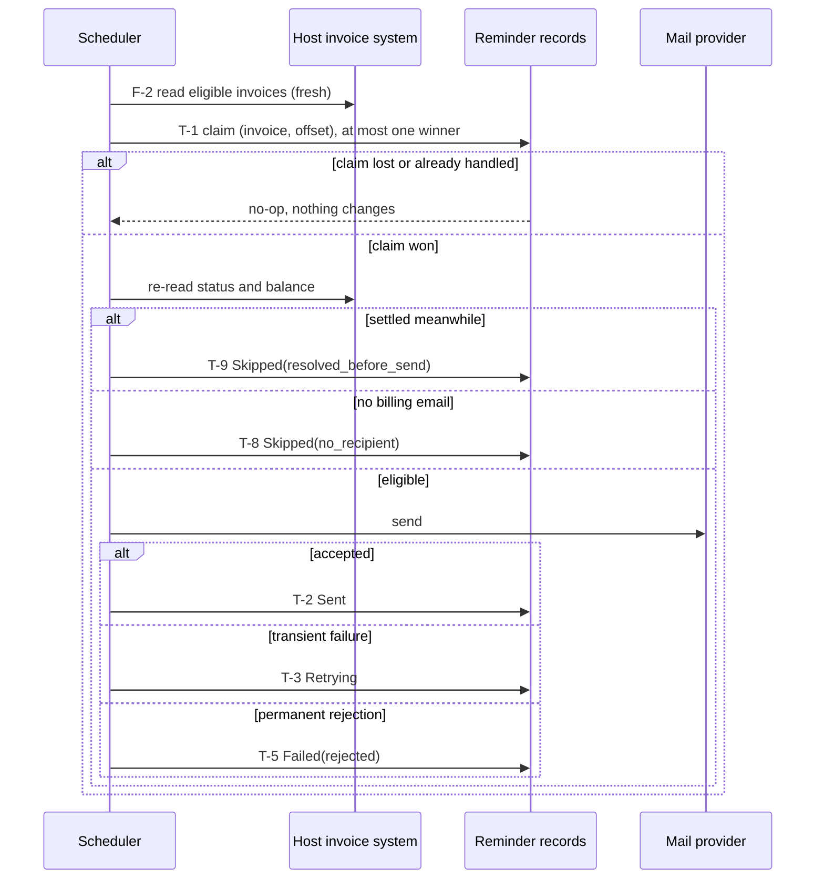
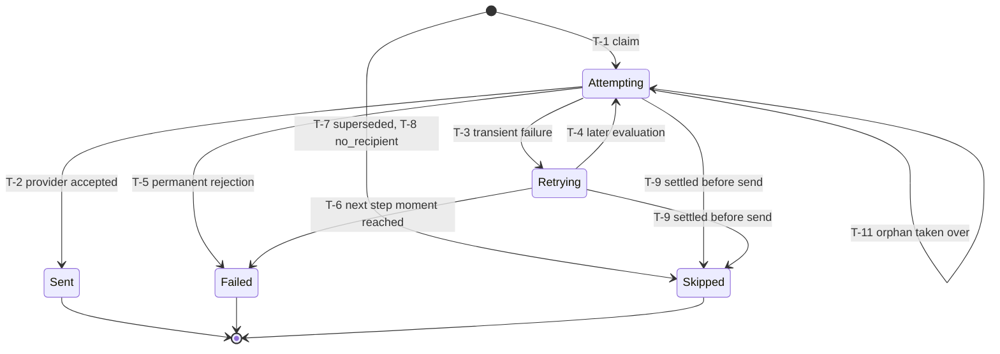

# Invoicing Product Specification

What the product must do, in numbered requirements (`R-<n>`) with their acceptance lines (`AC-<n>.<k>`).
How it is built lives in `architecture.md` (`AD-<n>`). Product defaults chosen without the user's say are
`D-<n>`. Unresolved prerequisites and decisions are `G-<n>` and sit under the R they affect.

Status of everything below: **accepted intent** only where an R's Basis quotes the request. Anything
marked `D-` is a **chosen default**, not a user requirement. Every check is **pending**: nothing is implemented
and nothing has been run.

## Sources and baseline

| Source | Scope and status | Used for |
| --- | --- | --- |
| Incoming request, 2026-11-21: "Set up automatic reminders for unpaid invoices." | Authoritative. The only product instruction. | Every R below |
| `GUIDES/` (behavior-model, requirements-definition, service-discovery, project-knowledge, current-system-baseline, platforms/ui) | ShipLoop policy, not product intent | Structure and duties of this document |

**Absent, and recorded as absent rather than assumed empty:**
- No repository, README, existing spec, architecture record, API contract or quality policy.
- No discovery or research result, no earlier specification, no selected current-system baseline.
- So no current invoice model, status names, customer fields, mail facility, scheduler, settings screen or UI
  toolkit were inspected. **Evidence limit:** every statement about "the host product" below is an
  assumption about a system nobody has seen (G-1).
- Missing access is not evidence of absent behavior. This spec treats the host as unknown, not as lacking
  anything.

**Baseline decision:** no prior requirement exists, so there is nothing to preserve, change or retire. Every R
below is `add`. `## Retired` is empty.

## Actors, channels, state owners

| Actor | Role | Interaction (channel) | Receives |
| --- | --- | --- | --- |
| Operator | A person at the business with billing-settings authority (D-7) | Turns reminders on or off, edits the schedule, reads history (request/response on the host's settings and invoice surfaces, G-5) | Saved configuration, history |
| Customer | The invoiced party | Receives email (asynchronous, one way). Never signs in to this feature. | Reminder email |
| Reminder scheduler | System initiator. Runs with no screen open. | Periodically evaluates which reminders are due (AD-1) | Nothing |
| Host invoice system | Authority for invoice status, balance, due date, billing email, issue time | Read fresh at send time (request/response) | n/a |
| Mail provider | External. Authority for "accepted for delivery" only. | Send request; optional asynchronous bounce reports (G-2) | n/a |

Trace: operator → configuration (owner: reminder settings) → scheduler reads settings and invoices → reminder
record claimed (owner: reminder records) → mail provider → customer mailbox; the outcome is visible to the
operator in history.

## Product decisions and defaults

Each `D-` is a default taken unattended. It is a design choice with a reason, not a user requirement. G-8 asks
the owner to confirm them.

- **D-1 Default Off.** Installing the capability sends nothing until an operator turns it on. Reason: it
  emails the business's customers, which is hard to undo.
- **D-2 Default schedule `[-3, 0, 7, 14]`, send time `09:00`.** Offsets are days from the due date: three days
  before, on the due date, then 7 and 14 days after. Reason: a common dunning shape, and it makes the examples
  concrete. The values are editable (R-2).
- **D-3 Offset range ±365 days.** Reason: a validation boundary so garbage values are rejected. It is
  not a business rule.
- **D-4 No backfill (the "floor").** A step is sendable only if its scheduled moment is not before the latest of:
  (a) the moment the current configuration was saved, (b) the invoice's issue moment, (c) the most recent time
  the invoice's due date was changed. Reason: switching reminders on must not email every long-overdue
  customer at once.
- **D-5 Catch-up sends only the newest due step.** If several steps are due and unhandled, only the latest is
  sent. Each older one is recorded `Skipped(superseded)`. Reason: a customer must not receive a burst after an
  outage.
- **D-6 Retry rides the evaluation cadence.** A transient failure is retried on later evaluations until the next
  step's moment, so no retry count or delay is invented.
- **D-7 Operator authority = whoever the host already lets manage billing settings.** No new roles.
- **D-8 A step is handled once per invoice.** It is keyed by its offset, so moving the due date or reordering
  the schedule never re-sends a step already handled.
- **D-9 Wording and format.** Subjects and dates follow the exact strings in R-7. Dates are ISO `YYYY-MM-DD`.
  Amounts are `1,250.00 USD`.
- **D-10 Settings use a version check.** A save made from a stale copy is rejected, not merged. Reason:
  last-write-wins silently loses an operator's edit.
- **D-11 History lives and dies with the invoice.** It is deleted when the invoice is deleted. No other
  retention period is set (G-7).
- **D-12 The address actually used is kept in the history row.** Reason: support can answer "where did it go?".
- **D-13 Local send time that does not exist or repeats (daylight-saving change).** The scheduled moment is the
  first instant at or after that local time.

## Requirements

Common to every R: **Surface** names where the result is observed. **Confirmed by** names how. The
verification harness controls the clock and replaces the mail provider with a capture sink (AD-3, AD-4, N-6).
`n/a:` marks a line that would repeat another. Locators `Req` point to the request, `Dn` to a default above.

### Fixtures used by the acceptance lines

- **Business:** "Northwind Studio", business timezone `UTC` unless a line says otherwise.
- **Default configuration** (D-2): offsets `[-3, 0, 7, 14]`, send time `09:00`, enabled at `2026-11-25T00:00Z`.
- **FX-1 INV-1001:** customer "Acme Ltd", billing email `ap@acme.example`, issued `2026-11-01`, due `2026-12-10`,
  total 1,250.00 USD, no payments, status open.
- **Step moments for INV-1001 (UTC):** offset -3 → 2026-12-07 09:00. Offset 0 → 2026-12-10 09:00. Offset 7 →
  2026-12-17 09:00. Offset 14 → 2026-12-24 09:00. (Hand-computed.)
- Other invoices are defined where used. "Evaluate at T" means the harness triggers one evaluation with clock T.

### R-1: An operator turns automatic reminders on and off

- **Basis:** Req, 2026-11-21, "Set up automatic reminders" (the "set up" part). D-1, D-4, D-7.
- **Preserved / changed:** add. Nothing existed.
- **Behaviour:** an authorised operator can turn automatic reminders On or Off. The product starts Off. Saving
  On or Off takes effect from the moment of the save. Turning Off stops every new send from that moment.
  Records already made stay. Turning On does not send anything for scheduled moments earlier than the save
  (D-4).
- **Boundaries:** a send already accepted by the mail provider cannot be recalled by turning Off. Out of scope:
  a "send backlog now" action, and per-customer or per-invoice switches (the request does not ask for them).
- **Error behaviour:** a user without the authority is refused and the state is unchanged.
- **Consumer outcome:** the operator sees the current On/Off state and its effective-from time; customers
  receive mail only while On.
- **State and data:** resource = reminder settings (one per business). Target = the whole business. Before:
  Off or On with effective-from E. After: the opposite, with E = save moment. Recovery: a failed save leaves the
  prior state. Unknown: the host's settings store (G-1).
- **Open gaps:** G-1 (host), G-5 (where the settings surface lives).
- **Pending:** implementation, checks AC-1.1 to AC-1.4.
- **Acceptance**
  - **AC-1.1 (positive).** Given a fresh install, Off, and the default configuration, when the operator turns On
    at 2026-11-25T00:00Z, the settings surface shows "On", effective from `2026-11-25T00:00Z`, offsets
    `[-3, 0, 7, 14]`, 09:00 UTC. Surface: settings surface (G-5). Confirmed by: end-to-end check through that
    surface, then a read-back after reload.
  - **AC-1.2 (positive, default).** Given a fresh install and INV-1001 open, Evaluate at 2026-12-07T09:00Z sends
    nothing and writes no record. Surface: capture sink and history. Confirmed by: end-to-end check.
  - **AC-1.3 (failure).** Given a user without billing-settings authority, when they try to turn On, they get a
    permission error, the state stays Off, and no configuration change is recorded. Surface: settings surface.
    Confirmed by: end-to-end check as that user.
  - **AC-1.4 (boundary, no backfill).** Given INV-1001 on the default configuration with step -3 sent on
    2026-12-07, the operator turns Off at 2026-12-08T12:00Z. Evaluate at 2026-12-10T09:00Z sends nothing. The
    operator turns On at 2026-12-11T00:00Z. The offset-0 moment (2026-12-10 09:00) is before that save, so
    Evaluate at 2026-12-11T09:00Z sends nothing for it. Evaluate at 2026-12-17T09:00Z sends exactly one mail
    (offset 7). Surface: capture sink and history. Confirmed by: end-to-end check.

### R-2: An operator sets the schedule, send time and timezone

- **Basis:** Req, 2026-11-21, "Set up automatic reminders". D-2, D-3, D-8, D-10, D-13. The request fixes no
  cadence, so the defaults are design choices (G-8).
- **Preserved / changed:** add.
- **Behaviour:** the schedule is a set of whole-number day offsets from the invoice due date (negative = before,
  0 = due date, positive = after). There is also a send time of day (24-hour `HH:MM`) and a timezone (IANA name).
  The due date is a calendar date, so it is never shifted by the timezone. A step's moment is its date at the
  send time in that timezone. A saved change applies to moments from the save onward (D-4). Steps already
  handled are never re-sent (D-8).
- **Boundaries:** at least one offset. No duplicates. Whole numbers from -365 to 365 inclusive (D-3). Offset
  order does not matter. Out of scope: per-customer or per-invoice schedules, editable message templates.
- **Error behaviour:** an invalid value is refused with a message naming the field, and nothing is saved. A
  save from a stale copy is refused (D-10).
- **Consumer outcome:** the operator reads back what they saved. Customers get mail at the moments it implies.
- **State and data:** resource = reminder settings with a version. Before: version v. After: version v+1 on a
  valid save from v only. Concurrent writers: the later save from an outdated copy is rejected. Unknown: the
  business-timezone source for the default (G-9).
- **Open gaps:** G-9.
- **Pending:** implementation, checks AC-2.1 to AC-2.6.
- **Acceptance**
  - **AC-2.1 (positive).** When the operator saves offsets `[-5, 0, 7]`, send time `08:30`, timezone
    `Pacific/Auckland`, a reload shows exactly those values and a new effective-from equal to the save moment.
    Surface: settings surface. Confirmed by: end-to-end read-back.
  - **AC-2.2 (failure).** Each of these is refused, names the offending field, and leaves the stored settings
    unchanged: offsets `[]`; `[3, 3]`; `[1.5]`; `["x"]`; send time `25:00`; send time `9am`; timezone
    `Mars/Base`. Surface: settings surface. Confirmed by: end-to-end check per input plus read-back.
  - **AC-2.3 (boundary).** `[-365, 365]` is accepted. `[-366]` and `[366]` are each refused. Surface: settings
    surface. Confirmed by: end-to-end check.
  - **AC-2.4 (failure, concurrent change).** Operators A and B both load version v1. A saves `[-3, 0]`. B then
    saves `[0, 14]` from v1. B is refused with a "settings changed since you loaded them" message and stored
    settings are A's `[-3, 0]`. Surface: settings surface. Confirmed by: two sessions in an end-to-end check.
  - **AC-2.5 (boundary, schedule change after a send).** Given INV-1001 on the default configuration with
    offset -3 sent on 2026-12-07, the operator saves `[-5, 0, 7]` at 2026-12-08T00:00Z. Offset -5's moment
    (2026-12-05 09:00) is before the save, so it is not sent. Evaluate at 2026-12-10T09:00Z sends exactly one
    mail, "due today". History shows offset -3 Sent and offset 0 Sent. Surface: capture sink and history.
    Confirmed by: end-to-end check.
  - **AC-2.6 (boundary, timezone).** Given timezone `Pacific/Auckland` (UTC+13 on 2026-12-07; hand-computed
    from NZ daylight time) and INV-1001, the offset -3 moment is 2026-12-06T20:00Z. Evaluate at
    2026-12-06T19:59:59Z sends nothing. Evaluate at 2026-12-06T20:00:00Z sends exactly one mail. Surface: capture
    sink. Confirmed by: end-to-end check.

### R-3: Only unpaid, issued invoices with a due date are reminded

- **Basis:** Req, 2026-11-21, "unpaid invoices". The host's status names are unknown (G-3).
- **Preserved / changed:** add.
- **Behaviour:** an invoice is eligible when it has been issued to the customer, has an outstanding balance
  above zero, has a due date, and is not void, cancelled or written off. A partly paid invoice is eligible for
  its outstanding balance.
- **Boundaries:** drafts, fully paid, void, cancelled, written-off, zero-balance and no-due-date invoices are
  ineligible and get no record. Out of scope: late fees or interest, and any dispute or hold status (G-3).
- **Error behaviour:** n/a: ineligible invoices are skipped silently, which is the specified behaviour.
- **Consumer outcome:** customers are reminded only about money they still owe.
- **State and data:** read only. The host owns status, balance, due date and issue time; no copy is trusted
  past the moment of use (R-5).
- **Open gaps:** G-3 (status names, any dispute or hold state).
- **Pending:** implementation, checks AC-3.1 to AC-3.4.
- **Acceptance**
  - **AC-3.1 (positive).** INV-1001 (open, balance 1,250.00 USD) is reminded at the offset -3 moment. Surface:
    capture sink. Confirmed by: end-to-end check (AC-4.1 covers the full walk).
  - **AC-3.2 (failure, ineligible).** With all invoices due 2026-12-10, Evaluate at 2026-12-10T09:00Z sends nothing
    and writes no record for: a draft, a fully paid invoice, a void invoice, a written-off invoice, an invoice
    with balance 0.00. Surface: capture sink and history. Confirmed by: end-to-end check.
  - **AC-3.3 (boundary, partial payment).** INV-1005 has total 1,250.00 USD, payments 400.00 USD, due 2026-12-10.
    The offset 0 mail states an outstanding balance of `850.00 USD`, not 1,250.00. Surface: capture sink.
    Confirmed by: end-to-end check reading the mail.
  - **AC-3.4 (boundary, no due date).** INV-1006 has no due date, so before one is set it gets no mail and no
    record, however many evaluations run (for example at 2026-11-30T09:00Z). On 2026-12-01T10:00Z the operator
    sets its due date to 2026-12-20. The step moments are then offset -3 at 2026-12-17 09:00 and offset 0 at
    2026-12-20 09:00. Both are after the due-date change (D-4), so both are sent. Evaluate at 2026-12-17T09:00Z
    sends one mail, `Reminder: Invoice INV-1006 is due in 3 days`. Evaluate at 2026-12-20T09:00Z sends one mail,
    `Reminder: Invoice INV-1006 is due today`. Surface: capture sink and history. Confirmed by: end-to-end check.

### R-4: Due reminders are sent automatically

- **Basis:** Req, 2026-11-21, "automatic reminders". D-2, D-4, D-5, D-8.
- **Preserved / changed:** add.
- **Behaviour:** with reminders On, once a step's moment arrives, one reminder is sent for each eligible
  invoice with no action by anyone. One evaluation sends at most one reminder per invoice. If several steps are
  due and unhandled (for example after downtime), only the latest is sent. Older ones are recorded
  `Skipped(superseded)` (D-5). A step before the floor (D-4) is ignored with no record. A step is handled once
  per invoice (D-8): moving the due date does not re-send a step already handled.
- **Boundaries:** a moment counts as arrived at exactly that instant (not-before). Out of scope: a manual "send
  now", escalation to internal staff, other channels, and any action beyond the email.
- **Error behaviour:** see R-5 (invoice resolved), R-6 (duplicates) and R-8 (delivery failures).
- **Consumer outcome:** the customer's mailbox receives the reminder (capture sink in verification).
- **State and data:** creates a reminder record per handled step (see R-6, R-9). Before: no record for
  (invoice, offset). After: one record. Recovery: the next evaluation recomputes what is due from invoice data,
  settings and records alone, so missed runs need no replay.
- **Pending:** implementation, checks AC-4.1 to AC-4.6, plus N-1.
- **Acceptance**
  - **AC-4.1 (positive, full walk).** FX-1, default configuration enabled at 2026-11-25T00:00Z. Evaluate at
    2026-12-06T09:00Z: no mail. At 2026-12-07T09:00Z: one mail, subject
    `Reminder: Invoice INV-1001 is due in 3 days` to `ap@acme.example`. At 2026-12-07T09:05Z: no mail. At
    2026-12-10T09:00Z: one mail, subject `Reminder: Invoice INV-1001 is due today`. Total mails 2. Surface:
    capture sink. Confirmed by: end-to-end check (walk W-A below).
  - **AC-4.2 (boundary, exact moment).** Evaluate at 2026-12-07T08:59:59Z sends nothing. Evaluate at
    2026-12-07T09:00:00Z sends exactly one. Surface: capture sink. Confirmed by: end-to-end check.
  - **AC-4.3 (boundary, catch-up).** FX-1 with no evaluation between 2026-12-06 and 2026-12-18. Evaluate at
    2026-12-18T09:00Z sends exactly one mail, subject `Overdue: Invoice INV-1001 is 8 days past due`. History
    shows offset -3 `Skipped(superseded)`, offset 0 `Skipped(superseded)`, offset 7 `Sent`. Offset 14 is not
    yet due. Surface: capture sink and history. Confirmed by: end-to-end check (walk W-B below).
  - **AC-4.4 (boundary, issue moment).** INV-1008 is issued 2026-12-09T15:00Z, due 2026-12-10. Offset -3
    (2026-12-07 09:00) is before issue, so nothing is sent for it and no record is written. Evaluate at
    2026-12-10T09:00Z sends one "due today" mail. Surface: capture sink and history. Confirmed by: end-to-end
    check.
  - **AC-4.5 (boundary, floor equality).** Reminders are turned On at exactly 2026-12-07T09:00:00Z with INV-1001
    open. The offset -3 moment equals the save moment, so it is not before it. Evaluate at 2026-12-07T09:00:00Z
    sends exactly one mail. Surface: capture sink. Confirmed by: end-to-end check.
  - **AC-4.6 (boundary, due date moved).** INV-1001 has offset -3 sent on 2026-12-07. On 2026-12-08T10:00Z the
    due date moves to 2026-12-20. Evaluate at 2026-12-17T09:00Z (new offset -3 moment) sends nothing, because
    offset -3 is already handled (D-8). Evaluate at 2026-12-20T09:00Z sends one mail, subject
    `Reminder: Invoice INV-1001 is due today`, stating due date `2026-12-20`. Surface: capture sink and history.
    Confirmed by: end-to-end check.

### R-5: Reminders stop when the invoice is settled

- **Basis:** Req, 2026-11-21, "unpaid invoices" (a reminder for a paid invoice would contradict it). D-4.
- **Preserved / changed:** add.
- **Behaviour:** once an invoice is paid in full, voided, cancelled or written off, no further reminder is sent
  for it. The invoice's status and balance are read from the host immediately before each send. If it became
  ineligible after the step was claimed, no mail is sent and the record becomes `Skipped(resolved_before_send)`.
  A partial payment does not stop reminders.
- **Boundaries:** a reminder already accepted by the mail provider is not recalled. A payment recorded in the
  short window after that final check but before provider acceptance may still be followed by a mail (known
  limit, accepted: the host is the only authority and no cross-system transaction exists).
- **Error behaviour:** if the host cannot be read at that moment, nothing is sent and the step is treated as a
  transient failure (R-8).
- **Consumer outcome:** a customer who has paid does not get dunned.
- **State and data:** reads host status. Writes only the record outcome. Before: Attempting. After:
  `Skipped(resolved_before_send)`. Freshness: no cached copy is used (service boundary table below).
- **Pending:** implementation, checks AC-5.1 to AC-5.4.
- **Acceptance**
  - **AC-5.1 (positive).** Walk W-A: INV-1001 is paid in full at 2026-12-12T10:00Z. Evaluate at
    2026-12-17T09:00Z sends nothing. History still shows only offset -3 Sent and offset 0 Sent. Surface: capture
    sink and history. Confirmed by: end-to-end check.
  - **AC-5.2 (boundary, settled mid-send).** The harness holds the provider send for INV-1001's offset 0 step
    after the record is claimed. The operator records full payment. The harness releases the send. No mail goes
    out and the record is `Skipped(resolved_before_send)`. Surface: capture sink and history. Confirmed by:
    end-to-end check with a controllable provider seam (AD-3).
  - **AC-5.3 (boundary, partial then full).** INV-1005 (outstanding 850.00 USD, see AC-3.3) receives a further
    partial payment of 100.00 USD on 2026-12-08. The offset 0 mail still goes out, stating `750.00 USD`. After
    a payment of 750.00 USD on 2026-12-11, Evaluate at 2026-12-17T09:00Z sends nothing. Surface: capture sink.
    Confirmed by: end-to-end check.
  - **AC-5.4 (failure, accepted limit).** A payment recorded after the provider accepted a send does not
    delete or alter the record, which stays `Sent`. Surface: history. Confirmed by: end-to-end check.

### R-6: A step is never sent twice

- **Basis:** Req, 2026-11-21, "automatic reminders": a customer emailed twice for one step is a defect in any
  automatic sender. D-8.
- **Preserved / changed:** add.
- **Behaviour:** for one invoice and one step offset at most one reminder is sent, however many evaluations
  overlap, repeat, restart or retry.
- **Boundaries:** if a crash happens after the provider accepted a send but before the outcome was recorded, the
  retry reuses the same identity for that send. Whether the provider honours it decides if a duplicate is
  possible (G-2). A claimed-but-unfinished attempt may be taken over only after a bound that is not yet set
  (G-6).
- **Error behaviour:** a claim that finds the step already claimed does nothing and changes nothing.
- **Consumer outcome:** exactly one mail per invoice per step in the mailbox.
- **State and data:** resource = reminder record keyed by (invoice, offset). Before: none or non-terminal. After:
  at most one record per key, ever. Concurrent writers: two evaluations race and exactly one claim wins.
  Recovery: an orphaned `Attempting` record is picked up (G-6).
- **Open gaps:** G-2, G-6.
- **Pending:** implementation, checks AC-6.1 to AC-6.4.
- **Acceptance**
  - **AC-6.1 (boundary, concurrent).** Two evaluations are triggered at 2026-12-07T09:00Z for INV-1001. The capture
    sink holds exactly one mail and history has exactly one offset -3 row. Surface: capture sink and history.
    Confirmed by: end-to-end check that starts both evaluations at once.
  - **AC-6.2 (boundary, repeat).** Evaluate again at 2026-12-07T09:05Z: no new mail and no changed or new record.
    Surface: capture sink and history. Confirmed by: end-to-end check.
  - **AC-6.3 (failure, crash window).** The process stops after the provider accepted the send and before the
    record is marked `Sent`. After restart, the next evaluation completes the record. With a provider that
    honours the send identity, exactly one mail exists. With one that does not, at most one duplicate is
    possible and is the documented limit. `NOT-REPLAYED: provider unknown (G-2)`, so this line stays open until
    G-2 is resolved. Surface: capture sink and history. Confirmed by: end-to-end check with a fault-injecting
    provider seam.
  - **AC-6.4 (failure, terminal records).** An evaluation that finds a `Sent`, `Failed` or `Skipped` record for
    the step changes nothing and sends nothing. Surface: history. Confirmed by: end-to-end check on each
    terminal state.

### R-7: What the reminder email says

- **Basis:** Req, 2026-11-21, "reminders for unpaid invoices". Content details are D-9 and G-4.
- **Preserved / changed:** add.
- **Behaviour:** the mail goes to the invoice's billing email and nowhere else. It states the business name,
  customer name, invoice number, outstanding balance with currency, the due date, and how that relates to the send
  day. Subject forms use the current day count at send time: `Reminder: Invoice <no> is due in <n> day(s)`,
  `Reminder: Invoice <no> is due today`, `Overdue: Invoice <no> is <n> day(s) past due`. The word is "day" for
  1 and "days" otherwise. Facts are read at send time. The mail names only this invoice's customer and data.
- **Boundaries:** out of scope: editable templates, attachments, creating a payment link, other languages,
  other channels. If the host's invoice already carries payment instructions or a link, they are included (G-4).
- **Error behaviour:** see R-8.
- **Consumer outcome:** the customer can tell which invoice, how much, and since when.
- **State and data:** read only (the record keeps the address used, D-12).
- **Open gaps:** G-4.
- **Pending:** implementation, checks AC-7.1 to AC-7.4.
- **Acceptance**
  - **AC-7.1 (positive).** For FX-1 the mails on 2026-12-07, 2026-12-10 and 2026-12-17 have subjects
    `Reminder: Invoice INV-1001 is due in 3 days`, `Reminder: Invoice INV-1001 is due today` and
    `Overdue: Invoice INV-1001 is 7 days past due`. Each body contains "Northwind Studio", "Acme Ltd", "INV-1001",
    "1,250.00 USD" and "2026-12-10". Surface: capture sink. Confirmed by: end-to-end check reading subject and body.
  - **AC-7.2 (boundary, singular).** Schedule `[-1, 1]` gives subjects `... is due in 1 day` and
    `... is 1 day past due`. Surface: capture sink. Confirmed by: end-to-end check.
  - **AC-7.3 (boundary, data changed before send).** The total of INV-1001 is edited to 1,300.00 USD on
    2026-12-09. The offset 0 mail states `1,300.00 USD`. Surface: capture sink. Confirmed by: end-to-end check.
  - **AC-7.4 (failure, isolation).** INV-1007 belongs to "Globex Inc" (billing email `ap@globex.example`, 500.00
    USD, due 2026-12-10). With INV-1001 and INV-1007 both due, the Acme mail names only INV-1001 and
    goes only to `ap@acme.example`. The Globex mail names only INV-1007 and goes only to `ap@globex.example`.
    Neither body contains the other's name, number or amount. Surface: capture sink. Confirmed by: end-to-end
    check over both mails.

### R-8: Missing addresses and delivery failures are handled and visible

- **Basis:** Req, 2026-11-21, "automatic reminders" (an unattended sender must have a defined failure
  behaviour). D-6.
- **Preserved / changed:** add.
- **Behaviour:**
  - No billing email → no mail. The record is `Skipped(no_recipient)`. A later step re-reads the address.
  - Transient provider failure or an unreadable host → record `Retrying`. Later evaluations try again while the
    invoice stays eligible and the next step's moment has not arrived.
  - When the next step's moment arrives, a `Retrying` record becomes `Failed(expired)` and that next step is
    handled in the same evaluation.
  - Permanent rejection (invalid address, refused recipient) → `Failed(rejected)`, never retried.
  - One invoice's failure never stops the others in the same evaluation.
- **Boundaries:** "sent" means the provider accepted the message. It does not mean delivered or read (G-2).
  Out of scope: alerts, dashboards, e-mail to the operator about failures.
- **Error behaviour:** each outcome is a visible record (R-9).
- **Consumer outcome:** the operator can see which customers were not reached and why.
- **State and data:** see the transition ledger. Recovery from `Retrying` is automatic.
- **Open gaps:** G-2 (whether bounces are reported later).
- **Pending:** implementation, checks AC-8.1 to AC-8.5.
- **Acceptance**
  - **AC-8.1 (failure, no address).** INV-1010 has no billing email at 2026-12-07T09:00Z. No mail is sent and
    offset -3 is `Skipped(no_recipient)`. On 2026-12-08 an address `ap@initech.example` is added. Evaluate at
    2026-12-10T09:00Z sends the offset 0 mail to it. Offset -3 is not backfilled. Surface: capture sink and
    history. Confirmed by: end-to-end check.
  - **AC-8.2 (failure, transient then success).** The provider fails transiently for INV-1001 at
    2026-12-07T09:00Z, then accepts at 2026-12-07T10:00Z. Between the two the record is `Retrying`. After, exactly
    one mail exists and the record is `Sent` with 2 attempts. Surface: capture sink and history. Confirmed by:
    end-to-end check with a controllable provider seam.
  - **AC-8.3 (boundary, expiry at next step).** The provider keeps failing transiently from 2026-12-07T09:00Z
    through 2026-12-10T08:59Z. At 2026-12-10T09:00Z offset -3 becomes `Failed(expired)` and offset 0 is
    attempted in that same evaluation. Surface: history. Confirmed by: end-to-end check.
  - **AC-8.4 (failure, permanent).** The provider permanently rejects `ap@acme.example`. Offset -3 is
    `Failed(rejected)`. Evaluate at 2026-12-07T10:00Z attempts nothing again. Offset 0 is still attempted on its
    own day. Surface: capture sink and history. Confirmed by: end-to-end check.
  - **AC-8.5 (boundary, isolation).** In one evaluation INV-1001 fails transiently and INV-1007 is healthy. The
    Globex mail is still sent. Surface: capture sink. Confirmed by: end-to-end check.

### R-9: The operator can see what was sent to whom

- **Basis:** derived, not asked for. Without it neither the operator nor a check can observe the outcomes
  R-4 to R-8 promise. Added under D-11 and D-12. Drop it if the owner does not want a surface (G-5).
- **Preserved / changed:** add.
- **Behaviour:** for each invoice an authorised operator can see, one row per handled step: offset, scheduled
  moment, outcome (`Sent`, `Retrying`, `Failed(<reason>)`, `Skipped(<reason>)`), time of last change, attempt count,
  and the address used. Read only. Customers cannot see it. An invoice with no records shows an empty state
  that says no reminders have been sent. Deleting the invoice deletes its rows (D-11).
- **Boundaries:** out of scope: cross-invoice reports, export, filters.
- **Error behaviour:** a user without access gets a refusal that reveals no row.
- **Consumer outcome:** support can answer "did the customer get a reminder, and when?".
- **State and data:** reads records. Who reads: operators only. What ends it: invoice deletion. Personal data:
  the customer's email address and name are shown to operators in this view only (N-3).
- **Open gaps:** G-5 (view or API), G-7 (retention).
- **Pending:** implementation, checks AC-9.1 to AC-9.4.
- **Acceptance**
  - **AC-9.1 (positive).** After walk W-A, INV-1001's history shows exactly two rows: offset -3 `Sent` at
    2026-12-07T09:00Z and offset 0 `Sent` at 2026-12-10T09:00Z, both to `ap@acme.example`. Surface: invoice
    history view (G-5). Confirmed by: end-to-end check on that surface.
  - **AC-9.2 (boundary, empty).** An invoice with no handled steps shows the empty state, not an error and not a
    blank area. Surface: invoice history view. Confirmed by: end-to-end check.
  - **AC-9.3 (failure, access).** A customer-facing session, or a user without billing access, requesting INV-1001's
    history gets a refusal and no row data. Surface: invoice history view and its API. Confirmed by:
    end-to-end check as that user.
  - **AC-9.4 (boundary, deletion).** Deleting INV-1001 removes its rows. No row for it is retrievable afterward
    and no later evaluation sends for it. Surface: history view or API. Confirmed by: end-to-end check.

## Behavior model

### Flows

- **F-1 Configure** (R-1, R-2). Operator opens settings → the product loads current settings with a version → the
  operator edits → save with the loaded version. If the user lacks authority, a field is invalid or the
  version is stale, the save is refused with no change (T-15). Otherwise the settings are stored, the version
  increments, and effective-from becomes the save moment (T-12 to T-14).
- **F-2 Evaluate** (R-3 to R-8). Trigger: the scheduler, or the harness with an explicit time. For each
  eligible invoice: compute the step moments, drop moments before the floor, find due unhandled steps, take the
  newest (T-7 for older ones), claim it (T-1), re-read the invoice, send, record the outcome.
- **F-3 Failure and retry** (R-8). Transient failure → `Retrying` (T-3); a later evaluation retries (T-4) or
  expires it (T-6).
- **F-4 Settle** (R-5). Payment or voiding arrives in the host, either before the evaluation (the invoice is
  ineligible, no record) or between claim and send (T-9).

### Transition ledger

| T | R / F | Before, trigger and guard | Operation, after and observation | Failure and recovery | Cases |
| --- | --- | --- | --- | --- | --- |
| T-1 | R-4, R-6 / F-2 | No record for (invoice, offset). Reminders On. The invoice is eligible. The step moment is due, not before the floor, and the newest due step. | Record created `Attempting`. At most one claimant wins. | A lost claim is a no-op. | AC-4.1, 6.1 |
| T-2 | R-4 / F-2 | `Attempting`. Provider accepts. | `Sent` (terminal). Mail in the mailbox. | A crash before this write is T-11. | AC-4.1, 6.3 |
| T-3 | R-8 / F-3 | `Attempting`. Transient provider failure, or the host unreadable. | `Retrying`. Attempt count +1. | Retried by T-4 or closed by T-6. | AC-8.2 |
| T-4 | R-8 / F-3 | `Retrying`. A later evaluation. Invoice still eligible. Next step moment not reached. | `Attempting`. | As T-3. | AC-8.2 |
| T-5 | R-8 / F-2 | `Attempting`. Permanent rejection. | `Failed(rejected)` (terminal). No retry. | Operator fixes the address. Later steps use it. | AC-8.4 |
| T-6 | R-8 / F-3 | `Retrying`. The next step's moment is reached. | `Failed(expired)` (terminal). The next step is handled in the same evaluation. | n/a | AC-8.3 |
| T-7 | R-4 / F-2 | No record. Two or more steps due. | Each older one gets `Skipped(superseded)` (terminal). Only the newest is claimed. | n/a | AC-4.3 |
| T-8 | R-8 / F-2 | No record, step to be claimed. The invoice has no billing email. | `Skipped(no_recipient)` (terminal). No mail. | Later steps re-read the address. | AC-8.1 |
| T-9 | R-5 / F-4 | `Attempting` or `Retrying`. The re-read shows settled, void or cancelled. | `Skipped(resolved_before_send)` (terminal). No mail. | n/a | AC-5.2 |
| T-10 | R-9 | Any record. The invoice is deleted. | The record is deleted. | n/a | AC-9.4 |
| T-11 | R-6 / F-2 | `Attempting`, orphaned after a crash. Takeover allowed only after the bound in G-6. | Same record continues with the same send identity. | Open: G-2, G-6. | AC-6.3 |
| T-12 | R-1 / F-1 | Settings Off. Authorised operator turns On. | On. Effective-from is the save moment. Version +1. | A failed save leaves Off. | AC-1.1 |
| T-13 | R-1 / F-1 | Settings On. Authorised operator turns Off. | Off. No new claims from that moment. Records stay. | A failed save leaves On. | AC-1.4 |
| T-14 | R-2 / F-1 | Version v. Valid edit made from v. | Version v+1. Effective-from is the save moment. | A failed save leaves v. | AC-2.1, 2.5 |
| T-15 | R-1, R-2 / F-1 | Unauthorised actor, invalid field or stale version. | Refused with a message. No change. | n/a | AC-1.3, 2.2, 2.3, 2.4 |

Invalid or repeated events: re-evaluating a terminal record is a documented no-op with no change and no mail (AC-6.4).
Evaluating while Off is a no-op (AC-1.2). Event families audited: invalid input (T-15); boundary values (AC-2.3,
4.2, 4.5); duplicates and replay (R-6); timeout and retry (R-8); partial failure (R-5, R-8); concurrency (R-6,
AC-2.4); lifecycle (T-10, D-11). Not modeled, with reason: DST-edge behaviour beyond D-13 (the default covers it);
reminder-record migration (nothing exists to migrate).

## State and information lifecycle

| State | Owner and location | Who may read | Simultaneous changes | What ends it | Quotas met |
| --- | --- | --- | --- | --- | --- |
| Reminder settings (On/Off, offsets, send time, timezone, effective-from, version) | The reminder capability's durable store (G-1) | Operators | Version check, stale save refused (D-10) | Never. One per business. | Unknown (G-1) |
| Reminder record per (invoice, offset) | Same store | Operators, per invoice | Atomic single-winner claim | Deleted with the invoice (D-11). No other retention (G-7) | Unknown (G-1) |
| Invoice data (status, balance, due date, issue time, billing email) | Host invoice system. This feature never writes it. | The host's own rules | The host decides | The host decides | n/a |
| Outbound mail | Mail provider, then the customer's mailbox | Customer only | n/a | The provider's own retention (not controlled here) | Provider sending limits, unknown (G-2) |

- **Personal data.** The customer's name and billing email appear in the mail (sent), the history row
  (stored, D-12, shown to operators only) and nowhere else. They must not appear in application logs
  (N-3). Kept until the invoice is deleted, then removed with it (D-11). A separate retention period or a
  customer erasure request is an open owner decision (G-7).
- **Quotas.** The mail provider's rate and daily limits are unknown (G-2). The spec sets none and invents none.
- **Not added, on purpose:** customer accounts or sign-in for this feature, customer-side preferences, sharing, any
  separate secrets store (the host's existing mail credentials are used as they are, AD-3).

## Service boundaries

| Boundary | Authority and freshness | Revocation and unknown outcomes | Async completion and recovery | Events owned |
| --- | --- | --- | --- | --- |
| Host invoice system | Authoritative for status, balance, due date, issue time and email. Read fresh at claim time and again just before send. No cache. | A payment or void is honoured on the next read. The window after the last read is a documented limit (R-5). | n/a: synchronous reads. An unreadable host is a transient failure (R-8). | History rows record each outcome. The host's own events are not consumed. |
| Mail provider | Authoritative only for "accepted". It does not give delivery or read status. | A send with an unknown outcome (timeout, crash) is retried under the same send identity (R-6, G-2). | Bounce reports, if the provider offers them, are optional input (G-2). Not required. | `Sent`, `Failed`, `Skipped` records are the owned coverage. |
| Scheduler to evaluation | Internal. Runs without a UI. Recomputes from stored state each time. | n/a | A missed or late run is recovered by the next one (R-4, D-5). Overlapping runs are made safe by R-6. | Run-level failures: no requirement (see N-7). |

Inapplicable concerns: incremental remote state and cache freshness. No cache or incremental copy of host data
exists by design.

## Non-functional requirements

- **N-1 Timeliness. Unresolved bound.** How late after a step's moment a reminder may be sent is not stated by
  the request. No number is invented. Missing decision: the owner's acceptable lateness (G-8). Until set, AC-4.x
  checks use the injected clock and assert only the not-before rule. Planning proposes an evaluation cadence
  (AD-1) and brings it back.
- **N-2 Reliability and recovery. Accepted.** Records and settings survive a restart. After downtime the next
  evaluation recovers per D-5. Check: AC-4.3, AC-6.3, plus a restart check between W-A steps.
- **N-3 Privacy and access. Accepted.** The mail uses only the invoice's own billing email and data (AC-7.4).
  Customer email addresses and names are not written to application logs. History is readable by billing
  operators only (AC-9.3). Check: AC-7.4, AC-9.3, and a log assertion on a run of W-A (no `acme.example` string in
  captured logs). Unresolved: legal or consent obligations such as an opt-out footer, and a retention period
  (G-7). They are not assumed either way.
- **N-4 Volume. Unresolved bound.** The number of invoices or businesses is not given. No figure is invented.
  Accepted now: one invoice's failure does not stop the others (AC-8.5). Missing: expected volume (G-8).
- **N-5 Interface quality. Applies to any graphical surface this work adds (settings, history).** Whether the
  host already has a UI, and its identity, is unknown (G-5). Where the host has an established look, the new
  surfaces inherit it, and it takes precedence over the lines below. Otherwise:
  - **Visual reference (recorded):** the light Gemini look with Material 3 Expressive principles, per the
    UI visual-direction guide: luminous light canvas, tonal rounded surfaces, a restrained saturated accent, a
    humanist or geometric sans-serif from local fonts. A new web UI starts light and offers a dark theme.
  - **Observable criteria:** one spacing scale and one type scale; a palette with a light and a dark theme.
    Designed empty (AC-9.2), loading and error states, with truthful pending, saved and failed feedback on the
    settings save. No horizontal overflow at 360 px and 1280 px widths. Visible keyboard focus. WCAG AA
    contrast in both themes. Motion only where it explains a change, and off under reduced-motion. One icon set.
  - **Verification:** rendered check at both widths in both themes plus keyboard-only operation of the settings
    form. The plan picks the concrete treatment.
- **N-6 Safe verification. Accepted.** In any non-production environment, mail goes only to a capture sink that
  cannot reach a real address, and the evaluation time is set by the harness. Check: a run of W-A in a
  non-production environment leaves zero mails at the provider.
- **N-7 Operability. Justified exclusion of alerting.** The request asks for none. The history (R-9) is the
  observable record. Run-level failure alerting is out of scope until someone asks for it.
- **N-8 Compatibility. Unresolved.** Supported browsers, runtimes and host versions are unknown (G-1).

## Open gaps

| ID | Under | Gap | Blocks |
| --- | --- | --- | --- |
| G-1 | R-1 to R-9 | The host product, stack and stores are unknown: no repository or discovery was available. Needs the host inspected first. | Integration planning for all R. Not the acceptance lines. |
| G-2 | R-6, R-8 | The mail provider's abilities are unknown: send identity, bounce reports, rate limits. | AC-6.3 and any bounce handling |
| G-3 | R-3 | The host's invoice status names, and whether a dispute or hold state exists. By default none is excluded. | The exact eligibility mapping |
| G-4 | R-7 | Whether and how to include a payment link or instructions. | Only that part of the mail body |
| G-5 | R-1, R-2, R-9, N-5 | Whether a host UI and API exist for settings and history, or must be added. | Settings and history surfaces |
| G-6 | R-6 | How long a claimed, unfinished attempt must be idle before another evaluation takes it over. No value is invented. | AC-6.3 and T-11 |
| G-7 | R-9, N-3 | Legal and consent duties (such as opt-out) and a retention period for history. | Retention and mail footer only |
| G-8 | D-1 to D-13, N-1, N-4 | Owner confirmation of the defaults, acceptable lateness and expected volume. | Nothing is blocked. Defaults stand until changed. |
| G-9 | R-2 | The source of the default timezone (business setting or `UTC`). | Default value only |

No material requirement conflict was found.

## Request outcome trace

| Outcome in the request | Acceptance lines |
| --- | --- |
| O-1 "Set up": a reminder capability can be configured and switched on | AC-1.1, AC-1.2, AC-1.3, AC-2.1 |
| O-2 "automatic": reminders go out with no per-invoice action | AC-4.1, AC-4.3, AC-6.1 |
| O-3 "reminders": the customer receives a useful notice | AC-4.1, AC-7.1 |
| O-4 "unpaid invoices": only owed invoices, and stop once paid | AC-3.1, AC-3.2, AC-3.3, AC-3.4, AC-5.1, AC-5.3 |

Derived, not asked for: R-9 (see its Basis). Defaults D-1 to D-13 are design choices, not outcomes.

## Replay of ordered procedures

Method: each walk starts from a state a stated actor can reach, and each action is one the spec permits in the
state the earlier actions leave. The expected result was recomputed by hand from the step moments above.
**Status: `NOT-REPLAYED`.** No product exists to run them against. A date-arithmetic script was prepared but its
execution was refused, so every date below is hand-computed and unexecuted.

- **W-A (R-4, R-5, R-7, R-9).**
  1. Start: FX-1, with the operator turning On at 2026-11-25T00:00Z. Reachable under R-1 and D-7, and the host
     invoice is open.
  2. Evaluate at 2026-12-06T09:00Z. This is before the 12-07 09:00 moment, so no mail.
  3. Evaluate at 12-07T09:00Z. Offset -3 is due, not before the floor (11-25), and the invoice is eligible
     (R-3), so one mail is sent: "due in 3 days" (12-10 minus 12-07 = 3).
  4. Evaluate at 12-07T09:05Z. The record is terminal, so no mail (AC-6.4).
  5. Evaluate at 12-10T09:00Z. One mail: "due today".
  6. The operator records full payment at 12-12T10:00Z. The invoice is open, so the host permits it.
  7. Evaluate at 12-17T09:00Z. The invoice is ineligible (R-3, R-5), so no mail and no record.
  - **Recomputed result:** 2 mails, 2 history rows (offset -3 `Sent`, offset 0 `Sent`). Observer: capture sink and
    history view.
- **W-B (R-4, catch-up).** Start: FX-1 enabled 2026-11-25, with no evaluation run before 12-18. Evaluate at
  2026-12-18T09:00Z. Due and not before the floor: offsets -3 (12-07), 0 (12-10) and 7 (12-17). Offset 14 (12-24)
  is not due. By D-5 only offset 7 is sent. Days past due = 12-18 minus 12-10 = 8, so the subject is `Overdue:
  Invoice INV-1001 is 8 days past due`. **Recomputed result:** 1 mail, 3 rows (`Skipped(superseded)`,
  `Skipped(superseded)`, `Sent`). A second evaluation at 12-18T09:05Z sends nothing.
- **W-C (R-2, timezone).** Start: FX-1, timezone `Pacific/Auckland`, 09:00. NZ daylight time (UTC+13) is in
  force on 2026-12-07, so 09:00 local on 12-07 is 12-06T20:00Z. This is hand-computed from the daylight-time rule,
  not machine-checked. The due date 2026-12-10 is a calendar date and is not shifted. **Recomputed result:** no
  mail at 19:59:59Z, one mail at 20:00:00Z.

No command is documented here, so no command was run. No claim about a runtime, platform or library is relied on
without a stated limit: the provider's send-identity and bounce abilities are marked unresolved (G-2), not
assumed.

## Retired

None. This is the first specification, so no earlier requirement exists to retire.

## Submission

**summary:** First specification for the invoicing product, from the request "Set up automatic reminders for
unpaid invoices." Nine requirements, R-1 to R-9. R-1 and R-2 are the operator's on/off switch and the schedule,
send time and timezone. R-3 is eligibility and R-4 is automatic sending, with a catch-up rule and no backfill.
R-5 is stopping when the invoice is settled, R-6 is never sending a step twice, R-7 is the email content, R-8 is
missing addresses and delivery failures, and R-9 is operator-visible history. R-9 is derived, not requested, and
can be dropped. There is no repository or host product, so nothing was inspected and every host-related
statement is an assumption. The stack and structure choices are proposed in `architecture.md` (AD-1 to AD-5).
No material requirement conflict was found.
**Assumptions (defaults, unconfirmed by the user):** D-1 default Off; D-2 schedule `[-3, 0, 7, 14]` at 09:00;
D-3 offset range ±365; D-4 no backfill before the configuration, issue or due-date-change moment; D-5 catch-up
sends only the newest due step; D-6 retries ride the evaluation cadence; D-7 operator = the host's existing
billing authority; D-8 one send per (invoice, offset); D-9 exact subject and date formats; D-10 stale settings
saves are refused; D-11 history is deleted with the invoice; D-12 the address used is stored; D-13 daylight-saving
send-time rule.
**Open:** G-1 host and stack unknown; G-2 mail provider abilities; G-3 status model and any dispute state; G-4
payment link; G-5 settings and history surfaces; G-6 takeover bound for crashed attempts; G-7 legal or consent
duties and retention; G-8 owner confirmation of defaults, lateness and volume; G-9 default timezone source. Work
that depends on G-1, G-2, G-5 or G-6 is unready, and the rest may proceed. The ordered procedures are
`NOT-REPLAYED` (no product exists, and the date-check script was refused), so they stay open. AC-6.3 is open on
G-2. No `backchain-check` was run, because that command does not exist in this stage.

**primary:** R-1, R-3, R-4

**evidence_refs:** `KNOWLEDGE/spec.md` (all sections, including R-1 to R-9, the transition ledger, the state and
lifecycle table, the service boundaries and the NFR section); `KNOWLEDGE/architecture.md` (AD-1 to AD-5); the
incoming request text (2026-11-21); `GUIDES/behavioral-requirements.md` (Behavior model, Traceability and review,
Actors, channels and state ownership); `GUIDES/requirements-definition.md`;
`GUIDES/service-discovery.md` (Runtime state placement, Verification); `GUIDES/project-knowledge.md`
(Maintained product requirements); `GUIDES/current-system-baseline.md` (Planning and review handoff);
`GUIDES/platforms/ui.md` (Light expressive starting point). Not available and not cited: any repository,
discovery or research result, earlier specification, selected baseline, or `backchain-check` receipt.
