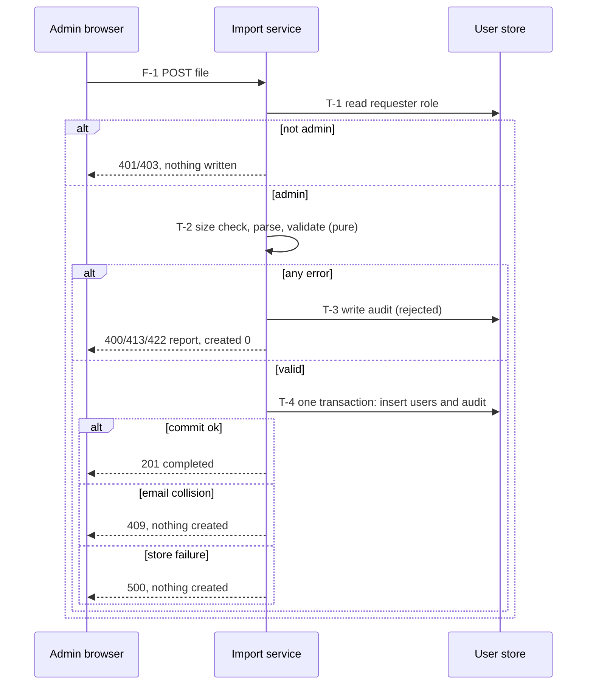

# User administration: product specification

Scope of this document: how administrators create and manage user accounts. This revision adds the first
requirements (R-1 to R-10): **bulk user creation from a CSV upload**.

## Basis and evidence limits

- Request (2026-11-21): "Let admins upload a CSV to bulk-create users." Every R-<n> below derives from these words
  plus the recorded assumptions A-1 to A-9. Nothing else in this document is a user instruction.
- No repository, no discovery or research result, no earlier specification and no baseline exist for this stage. The
  product's user model, authentication, role mechanism, UI toolkit and stack are therefore **unknown**, not absent.
  Wherever a requirement depends on one, it states a default as an assumption and records an open gap (OG-n) under that
  R-<n>. This is a first specification: there is no prior R-<n> to preserve, change or retire.
- Replayability: no runnable product exists. Every expected result below was computed by hand from the stated rules
  (section "Replay walk") and is `NOT-REPLAYED` until a build exists. A check script was written but could not be run
  in this environment (execution needed approval); no execution is claimed.

## Assumptions

| ID | Assumption (default taken because the request is silent) | Revisit if |
|---|---|---|
| A-1 | "Admin" means a signed-in user whose current role in the existing user store is `admin` (see OG-1). | The product defines admin differently. |
| A-2 | The import is **all-or-nothing**: if any row is invalid, no user is created and every problem is reported at once. | The requester wants partial import (valid rows created, invalid rows reported). |
| A-3 | The CSV carries two columns, `email` and `name`. No other attribute (role, password, team) is accepted from the file. | The requester names more columns (OG-3). |
| A-4 | Imported users are created in a `pending` state with no password and cannot sign in until activated by a mechanism outside this spec (OG-4). Nothing is emailed by this feature. | The requester wants invitations sent on import. |
| A-5 | A row whose email already belongs to a user is an error; existing users are never updated or overwritten. | The requester wants upsert behaviour. |
| A-6 | Email is compared and stored case-insensitively (lower-cased, trimmed); a name is trimmed and 1 to 100 characters. The email syntax is: one `@`, no whitespace, a `.` in the domain part, at most 254 characters. | The existing user model has other rules (OG-2). |
| A-7 | Processing is synchronous request/response (AD-1). | OG-6 shows volumes that cannot finish within one request. |
| A-8 | The admin UI is a web page. The request says "upload", which implies a page plus the endpoint behind it. | The product has no web surface. |
| A-9 | No preview/confirm step, no error-report download, no import history screen. | The requester asks for them. |

## Open gaps

Each gap sits under its R-<n> below; this index lists them with what stays unready.

| ID | Gap | Unready until resolved |
|---|---|---|
| OG-1 | How the product identifies an admin (role field, group, flag). | The binding of R-1 to the real user store. R-1's behaviour is specified against A-1 and can be planned. |
| OG-2 | The existing user model's email and name constraints. | Reconciling A-6 with the real model; R-3 limits stay at the A-6 defaults meanwhile. |
| OG-3 | Whether the file may set role or other attributes, including whether import may grant `admin`. | Only an extension of the column set. R-2/R-3 are complete for `email` and `name`. |
| OG-4 | How a `pending` user later gets credentials (invite email, admin-set link, SSO). | Activation work. The creation behaviour in R-5 is independent. |
| OG-5 | Retention period of the import audit record (R-9). | The retention clause of R-9 only. |
| OG-6 | Numeric maximum file size and maximum row count. | R-7's numeric cases and NFR-2. The shape of R-7 (reject whole file at the bound) is ready. |
| OG-7 | Where the page sits in the product's navigation and which identity (name, palette) it inherits. | Final skin only (NFR-6); the UI behaviour of R-8 is ready. |

## Actors and boundaries

- **Admin**: signed-in user passing R-1. **Non-admin / anonymous**: must be refused.
- **Import service**: the product's server. It is the only authority on validation and creation (AD-2).
- **User store**: durable owner of users and the import audit record. Single datastore; no other service boundary.
- Trace: Admin chooses file in browser, then browser sends one multipart request, then the service authorises,
  parses and validates, then commits in one transaction, then the response with the result report is rendered.

## Requirements

Acceptance-line format: **P** positive, **F** failure, **B** boundary; `n/a` where a line would repeat another.
*Surface* is where it is observed; *Confirm* is how. "Endpoint" is the import operation of AD-1.

### Fixtures used in examples (state S0)

Users that exist before each example: `ada.admin@example.com` (role admin), `mia.member@example.com` (role member),
`eve.existing@example.com` (role member). Signed in as Ada unless stated.

`valid.csv`:

```
email,name
alice@example.com,Alice Anderson
bob@example.com,"Bob ""Bobby"" Brown"
carol@example.com,"Carter, Carol"
```

`bad-rows.csv`:

```
email,name
dave@example.com,Dave Doe
not-an-email,Erin Epps
frank@example.com,
DAVE@Example.com ,Dave Again
gina@example.com,Gina Grey
eve.existing@example.com,Eve Existing
```

### R-1 Only admins can import

- Basis: request 2026-11-21, "Let admins". Added.
- Behaviour: the endpoint and the page run only for an authenticated user who is an admin at the time of the request
  (A-1). The decision is made server-side from the current user store on every request and is not cached across
  requests, so a demotion takes effect on the next request. An import already past its authorisation check
  completes.
- Boundaries: authorisation precedes any reading of the file body beyond transport limits. Refusal bodies reveal
  nothing about the file or about other users.
- Error behaviour: anonymous gives 401, signed-in non-admin gives 403; in both, zero users are created and no audit
  record of an import is written.
- Consumer outcome: a non-admin cannot create users through this feature by any route.
- Acceptance:
  - R-1.P: signed in as Ada, upload `valid.csv`; request is processed (see R-5.P). Surface: HTTP API. Confirm: API test.
  - R-1.F1: no session, upload `valid.csv`; 401; users table still has exactly the 3 fixture users. Surface: HTTP API. Confirm: API test.
  - R-1.F2: signed in as Mia (member), upload `valid.csv`; 403; still 3 users; response body has no row data. Surface: HTTP API. Confirm: API test.
  - R-1.B: Ada is changed to role member, then her next upload gets 403 (no stale grant); an upload that passed its check before the change finishes normally. Surface: HTTP API. Confirm: API test (the in-flight half needs a controllable pause point: `NOT-REPLAYED` until the plan supplies one).
- Open gap OG-1 (admin identification), see index.
- State and data: reads the requester's role (owner: user store); changes nothing.
- Pending: implementation and all checks above.

### R-2 The file is accepted only as well-formed CSV with the right header

- Basis: request 2026-11-21, "upload a CSV". Added.
- Behaviour: the endpoint accepts one multipart field `file`. Content is judged by parsing, never by the declared
  MIME type or the file extension. Accepted form: UTF-8 (a leading BOM is ignored), comma-separated, RFC 4180
  quoting (double quote doubles to escape, quoted fields may contain commas), CRLF or LF line ends. Completely empty
  lines are skipped and are not rows. Header: first record; names are trimmed and matched case-insensitively; order is
  free; exactly the columns `email` and `name` are required and no other column is allowed.
- Row numbering for every report: `row` is the 1-based index of a data record after the header, skipped empty lines not
  counted.
- Error behaviour (response codes, with `status: "rejected"` and `created: 0`):
  - 400: no `file` part (`missing_file`); 0-byte file (`empty_file`); not valid UTF-8 or contains NUL
    (`invalid_encoding`); quoting that cannot be parsed, such as an unterminated quoted field at end of file
    (`malformed_csv`).
  - 422: header lacks `email` or `name` (`missing_column`, `column` names it); an unknown column such as `role`
    (`unknown_column`); a repeated column (`duplicate_column`); header only (`no_rows`); a record whose field count
    differs from the header's (`wrong_field_count`, with `row`).
  - File-level errors have `row: null`.
- Consumer outcome: admins learn exactly what is wrong with the file shape before any user is created.
- Acceptance:
  - R-2.P: a file `Email , NAME` header (with leading BOM), CRLF ends, one blank line between header and data, then `hal@example.com,Hal Hill`; accepted, 1 row (Hal) created. Surface: HTTP API. Confirm: API test and parser unit test.
  - R-2.F1: no `file` part gives 400 `missing_file`; a 0-byte file gives 400 `empty_file`; bytes `FF FE 00` give 400 `invalid_encoding`; `email,name` newline `"a@example.com,A` (open quote, no close) gives 400 `malformed_csv`. Each: still 3 users. Surface: HTTP API. Confirm: API test.
  - R-2.F2: `email,name,role` header with row `a@example.com,A,admin` gives 422 `unknown_column` (column `role`); header `email` only gives 422 `missing_column` (column `name`); `email,name,Email` gives 422 `duplicate_column`; `email,name` alone gives 422 `no_rows`; row `a@example.com` under header `email,name` gives 422 `wrong_field_count` row 1. Each: still 3 users. Surface: HTTP API. Confirm: API test.
  - R-2.B: a file named `users.txt` with MIME `application/octet-stream` and valid CSV content is accepted (content decides); a file named `users.csv` containing a PNG is refused 400 `invalid_encoding`. Surface: HTTP API. Confirm: API test.
- Evidence limit: RFC 4180 and the BOM rule are stated by this spec; the chosen parser library's conformance is verified at plan/build with the samples above, not assumed.
- Pending: implementation and checks.

### R-3 Each row is validated field by field

- Basis: request 2026-11-21, "bulk-create users"; field rules are assumptions A-3, A-6. Added.
- Behaviour: for each row, `email` and `name` are trimmed. `email`: required (`required`), valid per A-6
  (`invalid_email`). `name`: required (`required`), at most 100 characters (`too_long`). Every failing field in
  every row is reported, in row order then column order, with `row`, `column`, `code`, `message`; there is no cap on
  how many are listed other than the file limit of R-7.
- Boundaries: name of exactly 100 characters passes, 101 fails; email of exactly 254 characters passes, 255 fails; a
  name containing leading or trailing spaces is stored trimmed; internal spaces and non-ASCII letters are kept.
- Error behaviour: 422, `created: 0`.
- Consumer outcome: an admin can fix every field problem in one pass.
- Acceptance:
  - R-3.P: row `bob@example.com,"Bob ""Bobby"" Brown"` yields stored name `Bob "Bobby" Brown`; `carol@example.com,"Carter, Carol"` yields name `Carter, Carol`. Surface: HTTP API then user store read. Confirm: API test.
  - R-3.F: in `bad-rows.csv`, row 2 reports `email`/`invalid_email` and row 3 reports `name`/`required`; both appear in one response. Surface: HTTP API. Confirm: API test (expected full list in R-6.F).
  - R-3.B: name of 100 chars accepted, 101 gives `too_long`; email of 254 chars (valid syntax) accepted, 255 gives `invalid_email`. Surface: HTTP API. Confirm: API test and validator unit test (a lower-layer pass is acceptable for the length boundaries).
- Open gaps: OG-2 (real model limits), OG-3 (more columns). Excluded domain rules: role, team, phone, password, avatar; none is read from the file.
- Pending: implementation and checks.

### R-4 Duplicates are rejected, never merged or overwritten

- Basis: request 2026-11-21, "bulk-create users" (creation only); A-5. Added.
- Behaviour: emails are compared after trim and lower-casing. A row whose email equals an earlier row's in the same
  file gets `duplicate_in_file` (the first occurrence is not an error; the message names its row). A row whose email
  belongs to an existing user gets `already_exists`. Existing users are never modified.
- Boundaries: `DAVE@Example.com ` equals `dave@example.com`. A within-file duplicate of an email that also exists is
  reported once, as `already_exists`, on the first occurrence and `duplicate_in_file` on later ones.
- Error behaviour: 422, `created: 0`.
- Acceptance:
  - R-4.P: n/a: the positive case, distinct new emails, is R-5.P.
  - R-4.F1: `bad-rows.csv` row 4 gives `duplicate_in_file` pointing at row 1; row 6 gives `already_exists`. Eve's stored record is unchanged. Surface: HTTP API then user store read. Confirm: API test.
  - R-4.F2: `email,name` with `eve.existing@example.com,Eve Renamed` leaves Eve's name as before (no overwrite) and returns `already_exists` row 1. Surface: HTTP API then store. Confirm: API test.
  - R-4.B: case and surrounding-space variants of one email (`Dave@EXAMPLE.com`, ` dave@example.com`) are duplicates of each other. Surface: HTTP API. Confirm: API/validator test.
- Pending: implementation and checks.

### R-5 A valid file creates all its users atomically

- Basis: request 2026-11-21, "bulk-create users"; A-2, A-4. Added.
- Behaviour: when R-1 to R-4 and R-7 find no error, the service creates one user per row, in one transaction. Each
  user has: the normalised email, the trimmed name, state `pending` (A-4), role `member` (the product's non-admin
  default; OG-3), `created_by` = the importing admin, and an `import_id`. Response 201 with
  `{ importId, status: "completed", total, created, errors: [] }`, where `created` equals `total`.
- All-or-nothing: if any row is invalid, or the commit fails, no user exists afterwards (A-2). Visible effects of an
  import are never partial.
- Error behaviour: a commit failure (datastore error, timeout, lost connection) gives 500, `created: 0`, and a state
  identical to before. A concurrent creation of the same email between validation and commit makes the commit fail
  and gives 409 with `already_exists` rows, `created: 0` (R-10).
- Consumer outcome: after a 201, every row's person exists as a pending user; after any other response no row does.
- Acceptance:
  - R-5.P: Ada uploads `valid.csv`; 201, `total: 3`, `created: 3`; user store now holds Alice, Bob, Carol (role member, state pending, created_by Ada, one shared import_id) plus the 3 fixtures (6 users). Surface: HTTP API then user store read. Confirm: API test, and UI check (R-8.P).
  - R-5.F: a commit failure injected after the second of three inserts gives 500 and the store has 3 users (the fixtures only). Surface: user store. Confirm: fault-injection test at the repository layer (`NOT-REPLAYED` until the stack exists).
  - R-5.B: a file with one row (`solo@example.com,Solo Sam`) gives `total: 1`, `created: 1`; a file with exactly L rows (L from OG-6) creates L users. Surface: HTTP API. Confirm: API test.
- State and data (assessment): resources: user records (new rows only), import audit record (R-9). Target identity: new
  users keyed by normalised email; the importing admin keyed by user id. Before: users U. After success: U plus
  the N new users, none existing changed. After any failure: exactly U. Invariants: email unique across users; no
  user without `import_id`. Recovery: nothing to repair after failure; the admin fixes the file and re-uploads.
  Unknown outcome (client timed out): the admin re-uploads and sees `already_exists` for rows that did commit; this
  is the intended, harmless signal. Check: store read before and after each case. Unknown: the datastore's
  unique-constraint and transaction capabilities are not yet checked against the chosen stack (see AD-3).
- Open gap: OG-4 (activation of pending users); not required for creation.
- Pending: implementation and checks.

### R-6 The admin receives a complete, precise result report

- Basis: request 2026-11-21, "bulk-create users" (an admin acting on many rows needs per-row outcomes); A-2. Added.
- Behaviour: every response (any status) is JSON: `{ importId?, status: "completed" | "rejected", total, created,
  errors: [ { row, column, code, message } ] }`. `total` is the number of data rows read (0 when the file could not
  be read as CSV). `errors` is ordered by row then column; file-level errors come first with `row: null`.
  `message` is human-readable and names the offending value's position, never repeats other rows' data, and the
  `code` values are those in R-2, R-3, R-4, R-7.
- Consumer outcome: the admin knows whether users were created, how many, and what to fix.
- Acceptance:
  - R-6.P: `valid.csv` gives `{ status: "completed", total: 3, created: 3, errors: [] }`. Surface: HTTP API. Confirm: API test.
  - R-6.F: `bad-rows.csv` gives 422, `status: "rejected"`, `total: 6`, `created: 0`, errors exactly, in order: `(2,email,invalid_email)`, `(3,name,required)`, `(4,email,duplicate_in_file)`, `(6,email,already_exists)`. Surface: HTTP API. Confirm: API test (exact-equality assertion on the list, not a count).
  - R-6.B: a file with only a header gives `total: 0`, one file-level error `no_rows`; a file with 1 bad row of 1 gives `total: 1`, `created: 0`. Surface: HTTP API. Confirm: API test.
- Pending: implementation and checks.

### R-7 The file has a size and row limit

- Basis: request 2026-11-21 (bulk, so bounded input is a precondition of any promise about it); the numbers are not in the request. Added.
- Behaviour: a maximum file size and a maximum data-row count exist (values: OG-6). A file over the size limit gives
  413 `file_too_large` and is not read beyond the limit. A file within the size limit but with more than the row
  maximum gives 422 `too_many_rows`. In both, the whole file is rejected and nothing is created. Exactly at the limit
  is accepted.
- Boundaries: S bytes and L rows are accepted; S+1 bytes gives 413; L+1 rows gives 422.
- Acceptance:
  - R-7.P: n/a: a file at the limits is R-7.B.
  - R-7.F: L+1 rows gives 422 `too_many_rows`, `created: 0`; a file of S+1 bytes gives 413, `created: 0`. Surface: HTTP API. Confirm: API test using the configured limits.
  - R-7.B: exactly L rows and exactly S bytes are accepted and created. Surface: HTTP API. Confirm: API test.
- **Open gap OG-6**: numeric S and L are not decided. This leaves R-7.F/R-7.B and NFR-2 unready; they are
  parameterised on configured values and must not be given invented numbers. Other work is independent.
- Pending: decision, implementation and checks.

### R-8 Admins use a web page to choose a file and see the outcome

- Basis: request 2026-11-21, "Let admins upload"; A-8. Added.
- Behaviour: an admin-only page "Import users" lets the admin choose or drop one file, states the expected format
  (columns `email`, `name`, one header row, UTF-8) and shows the outcome. Visible states, each a distinct design:
  1. **Empty/idle**: format help, a choose-file button (keyboard operable) and a drop target; Upload disabled.
  2. **File selected**: file name and size; Upload enabled; the admin may replace the file.
  3. **Uploading**: Upload disabled, a progress indicator, a polite live-region message "Uploading"; no success
     wording is shown until a 201 arrives.
  4. **Completed**: "N users created" with N from the response, and a way to import another file.
  5. **Rejected**: a prominent "No users were created" statement and a table of errors (row, column, message) from
     the response; the selected file remains shown so the admin can pick a fixed one. The list stays until
     dismissed or replaced; it is not a transient toast.
  6. **Failure** (network loss, 500): "The import did not complete. Nothing was created." The UI does not claim this
     for a lost connection: for a timeout with unknown outcome it says the result is unknown and that re-uploading
     is safe (R-5 unknown outcome); a retry action is offered.
- Client-side checks (empty selection; file larger than S once OG-6 is set) are conveniences. The server's decision is
  authoritative and the UI always shows the server's report.
- Authorisation: the page and its navigation entry are not offered to non-admins; opening the URL as a non-admin
  shows the product's forbidden or sign-in view (R-1 remains server-enforced).
- Double submit: Upload is disabled while a request is in flight; a second request cannot start from the same page.
- State: the selected file and the last result live only in the page's memory; a reload returns to state 1.
- Acceptance:
  - R-8.P: Ada selects `valid.csv`, presses Upload; sees state 3 then state 4 "3 users created". Surface: browser page. Confirm: browser check; assert the count shown equals the API's `created`.
  - R-8.F1: Ada uploads `bad-rows.csv`; sees "No users were created" and a 4-row table matching R-6.F; the user store is unchanged. Surface: browser page and store. Confirm: browser check plus store read.
  - R-8.F2: request fails with network loss (offline emulation) gives state 6 text with no success wording. Surface: browser page. Confirm: browser check.
  - R-8.F3: Mia opens the page URL; no upload form is shown. Surface: browser page. Confirm: browser check.
  - R-8.B: with nothing selected Upload is disabled; keyboard-only path (Tab to choose-file, Enter, select, Tab to Upload, Enter) completes an import. Surface: browser page. Confirm: browser check.
- Open gap OG-7 (placement, inherited identity).
- Pending: implementation and checks.

### R-9 Import data lifecycle: privacy, audit, logs

- Basis: request 2026-11-21 (the file holds personal data: names and emails); A-6. Added.
- State owners and lifecycle:
  - Uploaded file bytes: held in request memory only; never written to disk or the datastore, deleted when the
    request ends; size bounded by R-7.
  - Created users: user store; durable; removal is governed by the product's existing user deletion (unchanged).
  - Import audit record (one per request that passed R-1): `importId`, admin id, UTC timestamp, sanitised original
    file name (no path, at most 255 characters), `total`, `created`, outcome (`completed`, `rejected`, `failed`).
    No row content. Readable by admins; retention: OG-5.
  - Error report (contains emails from the file): returned only to the admin who uploaded; not stored by the service.
  - Page state: browser memory only (R-8).
  - Logs: record `importId`, admin id, outcome, counts and error codes; never emails, names or file content.
- Concurrency: audit records are append-only; there is no shared mutable import state.
- Acceptance:
  - R-9.P: after R-5.P the audit store holds one record with `total: 3`, `created: 3`, outcome `completed`, admin Ada. Surface: datastore read. Confirm: API/store test.
  - R-9.F: after R-6.F the record shows outcome `rejected`, `created: 0`; a captured log of that request contains none of `dave@`, `Erin`, `Gina`, `eve.existing`. Surface: datastore and log sink. Confirm: store read plus log-capture assertion.
  - R-9.B: after R-1.F2 (refused) no audit record is added; no file bytes remain in the service's temp or data directories after any case. Surface: datastore and filesystem. Confirm: store read; directory listing before/after.
- Open gap OG-5 (retention).
- Pending: implementation and checks.

### R-10 Concurrent and repeated imports stay consistent

- Basis: request 2026-11-21 ("admins" is plural, so overlapping imports occur); A-2, A-5. Added.
- Behaviour: email uniqueness is enforced at commit, not only by the earlier check. Two imports with an overlapping
  email: at most one creates that user; the other is rejected whole with 409 and `already_exists`, creating nothing.
  Repeating a successful upload yields 422 with `already_exists` on every row and creates nothing new.
- Acceptance:
  - R-10.P: n/a: the single-import positive case is R-5.P.
  - R-10.F1: after R-5.P, upload `valid.csv` again; 422, three `already_exists` errors (rows 1 to 3), still 6 users. Surface: HTTP API. Confirm: API test.
  - R-10.F2: two admins upload at the same time `x.csv` (`dup@example.com,Dup One`) and `y.csv` (`dup@example.com,Dup Two` plus `other@example.com,Other`); exactly one of them returns 201 and the other 409 with nothing created (so `other@example.com` exists only if `y.csv` won); exactly one `dup@example.com` user exists. Surface: HTTP API then store. Confirm: API test with a barrier that releases both commits together (`NOT-REPLAYED` until the plan supplies it; needs a second admin fixture).
  - R-10.B: n/a: the boundary here is the single-point email-collision case, covered by F2.
- Pending: implementation and checks.

## Non-functional requirements

Priority: correctness and no partial state over speed.

- **NFR-1 Security.** (Basis: personal data and account creation.) The file is data only: no cell is evaluated or
  executed, and stored values are kept verbatim (a name beginning `=` is stored as typed). Where authentication is
  cookie-based, the endpoint requires the product's CSRF protection; a cross-site request without the token is
  refused. Verification: API tests with `=1+1` as a name (stored unchanged) and a request lacking the CSRF token
  (refused, nothing created). Spreadsheet-formula neutralisation matters on any future export and is out of scope here.
- **NFR-2 Performance and capacity.** Operating condition: one import of up to L rows (OG-6). The bound on response
  time at L rows **is unresolved** (missing decision: L and an acceptable duration). No number is invented. Until
  decided, the plan must not claim a time bound; the check is a timed run at L rows once OG-6 is decided.
- **NFR-3 Reliability and integrity.** No partial state under any failure (R-5); the fault-injection check is R-5.F.
  Availability and durability targets beyond the product's own datastore: excluded, since this feature adds no
  service of its own.
- **NFR-4 Privacy.** R-9: file bytes not retained, logs free of personal data, error report only to the uploader.
- **NFR-5 Accessibility.** The page meets WCAG 2.2 AA contrast and has a visible focus state for every control; the
  full import is possible by keyboard (R-8.B); status changes (uploading, completed, rejected, failed) are
  announced through a live region; the error table has proper header cells. Verification: automated accessibility
  scan of states 1 to 6 plus the keyboard run.
- **NFR-6 Interface quality** (applies because R-8 is a graphical UI). Named visual reference and starting
  appearance: the light Google Gemini look using Material 3 Expressive principles (per the UI visual-direction
  guide), light first with a dark option, adapted to the product's own name and content. Explicit visual
  constraints, an established product identity and platform conventions take precedence (OG-7: none are known);
  the plan chooses the concrete treatment and records it in an AD. Observable criteria: a consistent visual
  system (spacing scale, type scale, a palette in light and dark themes); designed empty, uploading, completed,
  rejected and failure states (R-8 states 1 to 6); a layout that works at 360 px and 1440 px with no horizontal
  overflow, including a long error table (which scrolls inside its own container); visible focus and AA contrast;
  motion only to explain a change (progress, result arrival) and reduced to non-animated alternatives under
  `prefers-reduced-motion`; one icon set. Primary activity (choosing a file and seeing the outcome) holds the
  strongest visual position. Verification: browser screenshots at both widths in both themes, a reduced-motion run, and
  the NFR-5 scan.
- **NFR-7 Compatibility.** Supported browsers: unresolved; default is the product's existing list (OG-7 sibling gap).
  Do not invent one.
- **NFR-8 Operability.** One structured log line per import with the R-9 fields; failures include the error class.
  Verification: log-capture assertion in R-9.F.
- **NFR-9 Maintainability / testability.** Excluded as a separate requirement: parsing/validation is specified as a
  pure input-to-output function (AD-2), which the lower-layer checks above use.

## Service-boundary contracts

One service plus its datastore; no other service boundary is added.

- Current authority: the user store is read at each request for the admin check; no cache (R-1.B).
- Freshness versus revocation: demotion effective on the next request; in-flight imports complete.
- Incremental state: n/a, nothing is synchronised piecewise; one transaction.
- Async completion and recovery: n/a under A-7 (the response is the completion). Recovery for an unknown outcome is
  the re-upload rule in R-5/R-10. If OG-6 forces async, this section reopens.
- Owned event coverage: the audit record and log line of R-9 are the only events.

## Flows and transitions

F-1 Import (R-1 to R-7, R-9, R-10):



| T-ID | R | Before | Trigger and guard | After | Failure and recovery |
|---|---|---|---|---|---|
| T-1 | R-1 | any | request arrives; session present and admin | proceed, or 401/403 | store unreadable gives 500, nothing written |
| T-2 | R-2,3,4,7 | admin authorised | file received; size, format, rows, fields | valid, or error list | none; no state |
| T-3 | R-6,9 | errors found | report built | audit record only; users unchanged | audit write failure is logged; the response still states rejection |
| T-4 | R-5,10 | valid | commit | N new users plus audit, or unchanged | rollback; re-upload is safe |

## Replay walk

Start: state S0, Ada signed in (precondition reachable: Ada is an admin under A-1; each action is permitted by R-1).
Recomputed by hand from the rules (an independent script was written but not executed, so `NOT-REPLAYED`):

| Case | Recomputed expected result |
|---|---|
| `valid.csv` | 3 rows; no errors; 201, `created: 3`; users 3 to 6 |
| `bad-rows.csv` | row1 dave ok (first); row2 `not-an-email` invalid_email; row3 name empty gives `required`; row4 `dave@example.com` after trim and lower-case duplicates row1 gives duplicate_in_file; row5 gina ok; row6 existing gives already_exists. 422, total 6, created 0, 4 errors as in R-6.F |
| BOM + `Email , NAME` + CRLF + blank line + Hal | header normalises to `email`,`name`; blank line skipped; 1 row; 201, created 1 |
| `email,name` only | 422 `no_rows`, total 0 |
| `email,name,role` + one row | 422 `unknown_column` (`role`), file-level |
| `email,name` + `a@example.com` | 422 `wrong_field_count`, row 1 |
| `valid.csv` twice | second gives 422, `already_exists` rows 1 to 3 |

## Retired

None.

## Traceability: request outcomes to acceptance

| Request outcome | Requirements | Acceptance lines |
|---|---|---|
| "admins" | R-1, R-8 (page access) | R-1.P/F1/F2/B, R-8.F3 |
| "upload a CSV" | R-2, R-7, R-8 | R-2.*, R-7.*, R-8.P/F2/B |
| "bulk-create users" | R-3, R-4, R-5, R-6, R-10 | R-3.*, R-4.*, R-5.*, R-6.*, R-10.* |
| Implied: handling personal data | R-9, NFR-1, NFR-4 | R-9.* |

Domain rules the request leaves out and this spec does not add: updating existing users, role or other attributes
from the file, sending invitations, preview/confirm, error-report download, import history screen, scheduled or
background imports, undo of an import.

## Submission

- summary: First specification for CSV bulk user creation by admins. R-1 to R-10 cover authorisation, CSV format,
  field validation, duplicate rules, atomic creation, per-row reporting, limits, the admin page, data lifecycle and
  concurrency; NFR-1 to NFR-9 cover the rest. Assumptions taken because the request is silent: A-1 to A-9 (notably
  A-2 all-or-nothing, A-3 `email`+`name` columns only, A-4 users created `pending` with no invitation email, A-5 no
  updates to existing users, A-7 synchronous processing). Open: OG-1 (admin identification), OG-2 (real
  user-model limits), OG-3 (more columns/role), OG-4 (activation), OG-5 (audit retention), OG-6 (numeric file/row
  limits: keeps R-7 numeric cases and NFR-2 unready), OG-7 (UI placement/identity, supported browsers). No material
  requirement conflict found. All expected results are hand-computed and `NOT-REPLAYED` (no product exists; the
  check script could not be executed here). Duty 11 (`backchain-check`) left out as instructed.
- primary: R-1, R-2, R-3, R-5, R-6, R-8
- evidence_refs: KNOWLEDGE/spec.md; KNOWLEDGE/architecture.md; sections R-1 to R-10 and NFR-1 to NFR-9 of
  KNOWLEDGE/spec.md; GUIDES/behavioral-requirements.md (Behavior model, Traceability and review, Actors channels and
  state ownership); GUIDES/requirements-definition.md (State and data change assessment, Define non-functional
  requirements); GUIDES/service-discovery.md (Verification); GUIDES/platforms/ui.md (Light expressive starting
  point). No discovery, research, baseline or prior spec exists.
