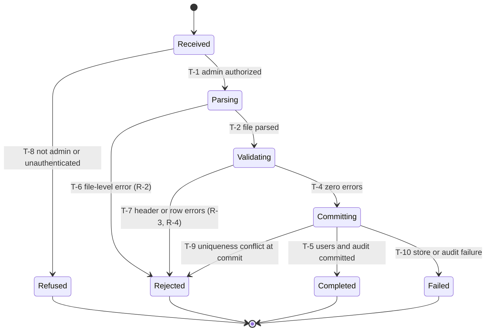
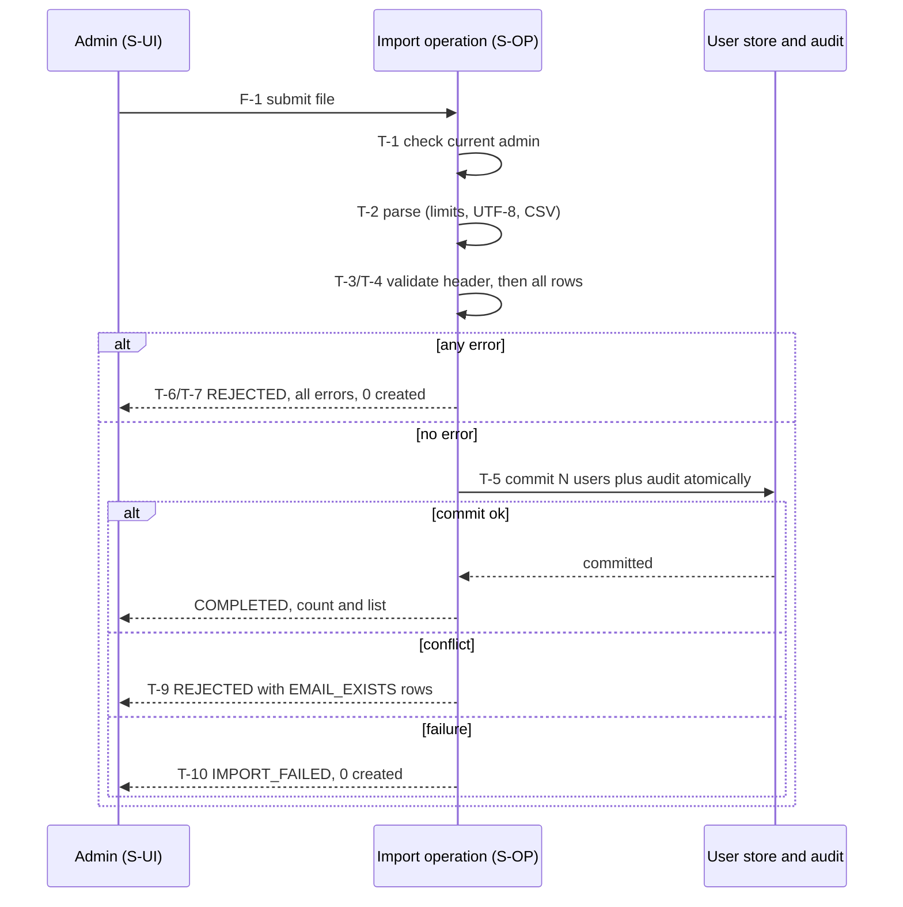

# User Administration: Product Specification

Living specification of the user-administration capability. This revision adds bulk creation of users from a CSV
upload (R-1 to R-15). Structure and technology choices are AD-<n> decisions in `architecture.md`, never here.

## Basis, baseline and conventions

**Request (2026-11-21), verbatim:** "Let admins upload a CSV to bulk-create users."

**Request outcomes** (each mapped to acceptance lines in the traceability table):
- O-1 Only admins can do this.
- O-2 An admin can upload a CSV file.
- O-3 The upload creates many users in one operation.

**Current-system baseline (Current-system baseline guide).** None exists. The run had no repository, no README, no
earlier spec, no discovery or research result and no maintained requirements. Classification: *genuinely new as far
as the evidence shows*. That is a limit of the evidence, not proof the product lacks user administration. The request
says "admins" and "users", so a user store and an admin role plausibly exist. Whether the product already has
single-user creation, and with which validation rules, is **unknown** (gap G-7). Nothing in this spec was derived
from observed code. Every rule marked *assumption* is a default, not an observation.

**Preserved / changed / retired:** preserved: none (no prior requirements). Changed: none. Added: R-1 to R-15.
Retired: none (see `## Retired`).

**Conventions.** `R-<n>` requirements. `AC-<n>.<k>` acceptance lines belonging to R-<n>. `F-`, `T-`, `TC-`, `FX-` are
flows, transitions, cases and fixtures of the behavior model. `A-<n>` assumptions. `G-<n>` open gaps. Surfaces:
- **S-UI**: the admin import screen in a browser.
- **S-OP**: the import operation over the product's request/response interface, as the screen calls it.
- **S-USERS**: read-back of user records through the product's user listing or lookup, or the user store in a test.
- **S-AUDIT**: retrieval of import audit records.
- **S-LOG**: application log output.

### Assumptions (defaults taken unattended; each is overridable by a recorded user decision)

- **A-1** The product is a web application with an authenticated admin area. The upload is a screen (S-UI) backed by
  one operation (S-OP) that any other client calls identically. Gap G-1.
- **A-2** The CSV may assign only non-privileged roles. Initially the only such role is `member`; `admin` is rejected
  with ROLE_NOT_ALLOWED. The role set is `{admin, member}` until G-2 is resolved. Least privilege is the default.
- **A-3** Import sends no email and sets no password. How a created user first obtains a credential is the product's
  existing onboarding mechanism. Gap G-3.
- **A-4** The import is **all-or-nothing**. If any row is invalid, no user is created, and the admin gets every error
  in one report so the file can be fixed and re-uploaded once.
- **A-5** The import only creates. A row whose email already belongs to a user is an error, never an update.
- **A-6** Email is unique case-insensitively. It is trimmed and lower-cased before checking and storing. Email
  validity (until G-7 resolves it to the product's existing rule) is: exactly one `@`, non-empty local part, a domain
  containing a `.`, no whitespace, at most 254 characters. 254 is the usual practical maximum mailbox-address length
  derived from RFC 5321. It was not verified against product limits.
- **A-7** An omitted or blank `role` means `member`.
- **A-8** The uploaded file is never retained. The result report is shown once, in the response, and is not stored.
- **A-9** Auditing is wanted for a privileged bulk effect: one audit record per import attempt (R-9).

### Open gaps (each also sits under its R-<n>)

| ID | Gap | Affects | Missing decision or evidence | Interim behavior (default) | Owner and due phase |
| --- | --- | --- | --- | --- | --- |
| G-1 | Is the upload surface a web screen, an API, or both? | R-10, R-1 | Product owner confirmation | A-1 | Plan author, before plan freeze |
| G-2 | Real role set; may CSV assign `admin`? | R-4 | Product owner decision | A-2 | Product owner, before plan freeze |
| G-3 | How a created user first signs in (invite mail, reset link, admin-set) | R-5 consumer outcome | Product owner decision | A-3: no claim that created users can sign in | Product owner, before plan freeze. Blocks only the sign-in outcome |
| G-4 | Numeric maximum file bytes and rows | R-2, R-11 | Product and platform limit | Limits configurable; behavior specified at the limit; values unset | Product owner and plan author, before plan freeze. Blocks only the numeric defaults |
| G-5 | Completion-time bound and whether the request-time limit of the host fits the row limit | R-12 | Host limits plus G-4 | None invented | Plan author, at architecture decision AD-2 |
| G-6 | Audit record retention and who may read it | R-9 | Policy decision | Readable by admins; retention unset | Product owner, before plan freeze |
| G-7 | Existing user model: email/name rules, name length, uniqueness rule, admin definition, auth/CSRF conventions | R-4, R-5, R-1 | Inspection of the real product (not possible here) | A-6 plus parity rule in R-5 | Plan's first work item (baseline inspection), before any work item that depends on field rules |

---

## Requirements

### R-1 Only admins can use CSV user import

- **Basis:** request 2026-11-21 "Let **admins** upload a CSV…" (O-1). Preserved: none. Changed: none. Added.
- **Source locators:** request sentence above. Authority checks follow the product's existing admin definition (G-7).
- **Evidence limits:** no product code inspected. The definition of "admin" and the session and CSRF conventions are
  unknown (G-7).
- **Pending:** implementation and checks TC-3, TC-3b.
- **Behavior:** the import screen and the import operation are available only to an authenticated user who is
  currently an admin. A non-admin or unauthenticated caller is refused before any file content is read, parsed or
  stored, and no user is created. Authority is read from the authoritative current role at request start. A role
  revocation that takes effect after the request started does not abort that in-flight import. The audit record names
  the acting admin.
- **Boundaries:** a user who was an admin and is demoted gets refusal on the next request. The product's existing
  protections for admin state-changing requests (session, CSRF) apply to the upload (G-7).
- **Error behavior:** refusal reveals nothing about existing users, such as which emails exist. Unauthenticated
  callers get the product's authentication-required outcome. Authenticated non-admins get a forbidden outcome.
- **Consumer outcome:** the admin sees the import entry point. Others never see it as a navigation item and get
  forbidden if they navigate or call directly.
- **Acceptance lines**
  - AC-1.1 positive: an authenticated user whose role is `admin` (S0 `admin@example.com`) submits FX-1 and the import
    runs (outcome COMPLETED). Surface S-OP and S-UI. Confirmed by TC-1.
  - AC-1.2 failure: authenticated non-admin `viewer@example.com` submits FX-1 and receives the forbidden outcome.
    S-USERS still shows 4 users and S-AUDIT shows no import record. In S-UI the import entry point is absent from
    navigation, and navigating to its address shows the forbidden state. Confirmed by TC-3.
  - AC-1.3 failure: an unauthenticated caller submits FX-1 and receives the authentication-required outcome with no
    state change. Surface S-OP. Confirmed by TC-3b.
  - AC-1.4 boundary: n/a: demotion mid-request is a race on external authority whose observable result (in-flight
    import completes, next request is refused) is verified by TC-3c. It is listed as a pending case, not a separate
    clause.
- **Out of scope bounded here:** assigning who is an admin; self-service signup; delegated or per-team import rights.

### R-2 An admin can upload one CSV file and the file is accepted or refused as a whole by format

- **Basis:** request 2026-11-21 "upload a CSV" (O-2). Added.
- **Source locators:** request sentence. CSV dialect follows RFC 4180 (comma separator, double-quote quoting with `""`
  escapes, quoted fields may contain commas and line breaks). That is a stated product choice, not a platform
  capability claim. A-6 and A-7 are assumptions.
- **Evidence limits:** the numeric limits are unresolved (G-4). Which browsers or clients upload is unknown (G-1).
- **Pending:** implementation and checks TC-5, TC-6, TC-7, TC-8.
- **Behavior:** exactly one file per request. Accepted encoding is UTF-8, with or without a leading byte-order mark.
  Line endings may be LF or CRLF. The first record is the header. A trailing line break is allowed. Wholly blank
  trailing lines are ignored. The file-level limits are a configured maximum size in bytes and a configured maximum
  number of data rows. They are checked before row processing, and the size limit is enforced without reading the
  whole body into processing. File-level refusals create no users:

  | Code | When |
  | --- | --- |
  | NO_FILE | no file part supplied |
  | EMPTY_FILE | 0 bytes |
  | FILE_TOO_LARGE | size above the configured byte limit |
  | NOT_UTF8 | bytes are not valid UTF-8 |
  | MALFORMED_CSV | unterminated quote or a stray quote in an unquoted field |
  | NO_DATA_ROWS | header only |
  | TOO_MANY_ROWS | data rows above the configured limit |

  A refusal reports one file-level error with the code and, for MALFORMED_CSV, the line number.
- **Boundaries:** exactly the configured number of rows is accepted for processing; one more is TOO_MANY_ROWS.
  Exactly the configured byte size is accepted; one byte more is FILE_TOO_LARGE. Where the host cuts the body off
  before the limit is reached, the admin still gets FILE_TOO_LARGE rather than a raw transport error (G-5).
- **Error behavior:** every refusal leaves the user set seen through S-USERS unchanged. The audit record notes the
  refusal (R-9).
- **Consumer outcome:** the admin learns which file-level problem occurred and what to change.
- **Acceptance lines**
  - AC-2.1 positive: FX-7 (BOM plus CRLF form of FX-1) is processed exactly like FX-1. Surface S-OP. Confirmed by TC-8.
  - AC-2.2 failure: FX-4a gives EMPTY_FILE and FX-4b gives NO_DATA_ROWS. FX-6 gives MALFORMED_CSV on line 2. A body of
    bytes `email,name\n` followed by `FF FE` gives NOT_UTF8. A request with no file part gives NO_FILE. Confirmed by
    TC-5, TC-7.
  - AC-2.3 boundary: with the test limit of 5 rows, FX-5ok (5 rows) is COMPLETED and FX-5over (6 rows) is TOO_MANY_ROWS
    with 4 users unchanged. With the byte limit set to the exact byte size of FX-5ok, FX-5ok is accepted and a copy
    padded by 1 byte is FILE_TOO_LARGE. Needs injectable limits (R-11). Confirmed by TC-6.
- **Out of scope bounded here:** other formats (XLSX, TSV, JSON), several files per request, compression, URL or
  remote fetch of the CSV, automatic delimiter detection, non-UTF-8 encodings.

### R-3 The header row defines the columns and must match the contract

- **Basis:** request 2026-11-21 "upload a CSV to bulk-create users". The column set is a product decision under A-6,
  A-7 and G-7. Added.
- **Source locators:** none beyond the request. The columns are the minimum needed to create a user.
- **Evidence limits:** the existing user model may require more or other fields (G-7), which would modify this
  requirement before planning.
- **Pending:** implementation and checks TC-4, TC-21.
- **Behavior:** columns are `email` (required), `name` (required) and `role` (optional). Header names are matched after
  trimming whitespace and ignoring case. Column order is free. Header errors are reported with line 1. Any header
  error rejects the whole file and no row is evaluated:

  | Code | When |
  | --- | --- |
  | MISSING_COLUMN | a required column is absent |
  | UNKNOWN_COLUMN | any other header name, including `password` |
  | DUPLICATE_COLUMN | the same column appears twice |

  All header errors are listed together.
- **Boundaries:** `role` may be absent entirely (A-7). Trailing empty header cells (`email,name,`) are UNKNOWN_COLUMN
  with an empty name.
- **Error behavior:** the error names the column. Cell values from data rows are never echoed for header errors.
- **Consumer outcome:** the admin fixes the header and re-uploads.
- **Acceptance lines**
  - AC-3.1 positive: FX-9 (header `Email , NAME`, so mixed case and padded) is accepted. Confirmed by TC-9.
  - AC-3.2 failure: FX-3 (`email,fullname`) gives MISSING_COLUMN `name` and UNKNOWN_COLUMN `fullname`. FX-8
    (`email,name,password`) gives UNKNOWN_COLUMN `password`, and the value `hunter2` appears nowhere in the response,
    audit or logs. A header `email,name,email` gives DUPLICATE_COLUMN `email`. Confirmed by TC-4, TC-21.
  - AC-3.3 boundary: n/a: the only boundaries (absent optional `role`, padded or mixed-case names) are in AC-3.1 and
    AC-5.1 and need no further line.
- **Out of scope bounded here:** custom columns, column mapping in the UI, per-user passwords, setting other profile
  fields, group or team membership.

### R-4 Every row is validated and normalized, and every problem is reported

- **Basis:** request 2026-11-21 "bulk-create users". Validation rules follow A-2, A-6, A-7 and G-7. Added.
- **Source locators:** request. Parity with the product's existing user validation is required (R-5).
- **Evidence limits:** the email, name and role rules are assumptions until G-7 and G-2 are resolved. The name length
  limit is unresolved (G-7).
- **Pending:** implementation and checks TC-2, TC-9, TC-17, TC-20, TC-13.
- **Behavior:** all rows are evaluated even after the first error. Data rows are numbered from 1 (the header is not a
  row). Each error carries: row number, physical line number of the record start, column (or none), code, a message
  and the submitted trimmed value where applicable.

  | Code | Rule |
  | --- | --- |
  | ROW_FIELD_COUNT | the field count differs from the header's |
  | EMAIL_REQUIRED | email blank after trim |
  | INVALID_EMAIL | fails A-6 |
  | EMAIL_EXISTS | normalized email already belongs to a user |
  | DUPLICATE_IN_FILE | normalized email already appeared in an earlier row; the first occurrence is not flagged, and the error names the first row |
  | NAME_REQUIRED | name blank after trim |
  | ROLE_NOT_ALLOWED | role is a known role the CSV may not assign (`admin`) |
  | ROLE_UNKNOWN | role is not in the role set |

  Normalization: email trimmed and lower-cased; name trimmed (inner whitespace kept); role trimmed and lower-cased. A
  row may carry several errors and all are reported. A ROW_FIELD_COUNT row is not evaluated further.
- **Boundaries:** a 254-character valid email is accepted and 255 is INVALID_EMAIL. Case-variant duplicates
  (`ada@example.com`, `ADA@example.com`) are duplicates. An email that differs from an existing user only in case is
  EMAIL_EXISTS.
- **Error behavior:** validation changes nothing in the store. A row that fails and a row that passes alike create no
  user while any row fails (R-5).
- **Consumer outcome:** the report lists every problem with its row, line and column.
- **Acceptance lines**
  - AC-4.1 positive: FX-9 yields one user with email `ada@example.com` and name `Ada Lovelace` (trimmed, lower-cased)
    and role `member`. Surface S-USERS. Confirmed by TC-9.
  - AC-4.2 failure: FX-2 against S0 yields exactly these 6 errors, in row order, and no others:
    (row 2, email, INVALID_EMAIL), (row 3, email, EMAIL_EXISTS), (row 4, email, DUPLICATE_IN_FILE, first row 1),
    (row 5, email, EMAIL_REQUIRED), (row 6, role, ROLE_NOT_ALLOWED), (row 7, name, NAME_REQUIRED). The lines are
    row + 1. Row 1 has no error. Confirmed by TC-2.
  - AC-4.3 failure: FX-13 (`email,name` then `bad,` — one row) yields two errors for row 1: INVALID_EMAIL and
    NAME_REQUIRED. FX-10 (`email,name` then `ada@example.com`) yields one ROW_FIELD_COUNT for row 1. Confirmed by
    TC-17, TC-20.
  - AC-4.4 boundary: a 254-character email (local part of 242 characters + `@example.com`) passes. A 255-character one
    gives INVALID_EMAIL. Confirmed by TC-22.
- **Out of scope bounded here:** MX or deliverability checks, email confirmation, name uniqueness, normalizing Unicode
  beyond trim and lower-casing, any "fix-up" of invalid values.

### R-5 A valid file creates all its users, and an invalid file creates none

- **Basis:** request 2026-11-21 "bulk-create users" (O-3). All-or-nothing is assumption A-4. Added.
- **Source locators:** request. Atomicity is a product decision (A-4), not an observation.
- **Evidence limits:** whether the user store can commit many records atomically is unverified (AD-1, unresolved).
  Parity with single-user creation cannot be checked here (G-7). Whether a created user can sign in is outside this
  requirement (G-3).
- **Pending:** implementation and checks TC-1, TC-2, TC-12, TC-18.
- **Behavior:** if and only if the file passes R-2, R-3 and R-4, one user is created per data row with: normalized email;
  trimmed name; role (A-7). Each created user is indistinguishable from a user created singly by an admin, except for
  an origin marker in the audit record, not on the user (parity, G-7). Creation is atomic: the store afterwards holds
  either all N new users or none, even on a failure partway through. The authoritative uniqueness check runs at commit
  time. A user created by someone else between validation and commit makes the whole import REJECTED with EMAIL_EXISTS
  for the affected rows, and nothing is created. A system failure gives IMPORT_FAILED, nothing created, and a message
  that the file can be retried.
- **Boundaries:** N=1 works. N is the configured row maximum, at the limit. Creating users does not touch existing
  users' data.
- **Error behavior:** no partial effects of any kind survive a rejected or failed import: no user, no role grant, no
  pending invite.
- **Consumer outcome:** on COMPLETED the admin sees the exact count and the list of created users (R-6). S-USERS shows
  the new users.
- **Acceptance lines**
  - AC-5.1 positive: against S0 (4 users), FX-1 as `admin@example.com` creates exactly 3 users:
    (`ada@example.com`, `Ada Lovelace`, `member`), (`grace@example.com`, `Grace Hopper`, `member`) and
    (`alan@example.com`, `Turing, Alan`, `member`). S-USERS then shows 7 users. The 4 S0 users are unchanged.
    Confirmed by TC-1.
  - AC-5.2 failure: FX-2 creates no user. S-USERS still shows 4 users, and `ada@example.com` (row 1, valid) does not
    exist. Confirmed by TC-2.
  - AC-5.3 failure: with a fault injected in the store after 2 of the 3 FX-1 rows, the outcome is IMPORT_FAILED and
    S-USERS shows 4 users. Needs a fault-injection point (R-15). Confirmed by TC-12.
  - AC-5.4 boundary: a file of exactly the configured row maximum creates exactly that many users. A single-row file
    creates 1. Confirmed by TC-6, TC-23.
- **Out of scope bounded here:** updating or upserting users, deleting or deactivating users, a dry-run or preview,
  per-row partial success, undo of a completed import, sending invitations (G-3), group assignment.
- **Open gap G-3:** the sign-in outcome for created users is not specified until the onboarding decision. G-7: parity
  inspection pending.

### R-6 The admin always gets a complete, truthful outcome report

- **Basis:** request 2026-11-21 (O-2, O-3): the admin must be able to tell whether the upload created the users. The
  report shape is a product decision. Added.
- **Source locators:** request.
- **Evidence limits:** none beyond the above.
- **Pending:** implementation and checks TC-1, TC-2, TC-13.
- **Behavior:** every import request ends in exactly one terminal outcome shown to the admin: COMPLETED (with created
  count and the list: email, name, role), REJECTED (with all errors, R-2 to R-4 shapes, and the statement that
  nothing was created), FORBIDDEN or authentication-required (R-1), or IMPORT_FAILED (nothing created). The report is
  complete: it lists all errors, not a first-error subset. Values from the file are rendered as inert text in S-UI and
  encoded as data in S-OP. A value such as `` never executes or renders as markup. The
  report is not stored (A-8); reloading the page loses it.
- **Boundaries:** the number of errors is bounded by the row limit (R-2), so the report has a finite maximum. A report
  with 0 errors is COMPLETED, never an empty REJECTED.
- **Error behavior:** if the response cannot be delivered (connection lost), the outcome is unknown to the client. R-7
  defines how to find out.
- **Consumer outcome:** the admin can fix the file from the report alone.
- **Acceptance lines**
  - AC-6.1 positive: FX-1 returns COMPLETED, created count 3, and the list of the 3 users above. Confirmed by TC-1.
  - AC-6.2 failure: FX-2 returns REJECTED with exactly the 6 errors of AC-4.2 and "0 users created". Confirmed by TC-2.
  - AC-6.3 failure: FX-12 (`email,name` then `"",XSS`) returns INVALID_EMAIL for row 1. In
    S-UI the literal text is visible and no script runs and no element is injected. Confirmed by TC-13.
  - AC-6.4 boundary: n/a: report size is bounded by R-2's row limit; no further boundary.

### R-7 Repeated, concurrent and interrupted submissions never create duplicates or half-imports

- **Basis:** request 2026-11-21 "bulk-create users": a double click, a retry or two admins must not corrupt the user
  set. Added.
- **Source locators:** request. Uses A-4, A-5 and the R-5 uniqueness rule.
- **Evidence limits:** the store's concurrency guarantees are unverified (AD-1, AD-5).
- **Pending:** implementation and checks TC-10, TC-11, TC-19.
- **Behavior:** re-submitting a file that already completed gives REJECTED with EMAIL_EXISTS for every row and creates
  nothing. Two overlapping imports that share an email: exactly one may create that email. The other is REJECTED in
  full (R-5 commit-time rule). Both outcomes are terminal and truthful. An import whose response was lost has either
  fully happened or not at all. The admin can tell which by re-submitting (all rows EMAIL_EXISTS means it happened),
  by S-USERS, or by S-AUDIT. No idempotency key is required (accepted limitation: an unknown outcome is resolved by
  read-back).
- **Boundaries:** the same file submitted twice within the same moment is a concurrent case, with one winner.
- **Error behavior:** the losing import reports which rows conflicted.
- **Consumer outcome:** no duplicate users, ever.
- **Acceptance lines**
  - AC-7.1 positive: n/a: the happy replay is AC-7.2's failure case; a lone success is AC-5.1.
  - AC-7.2 failure: after TC-1, submitting FX-1 again gives REJECTED with 3 EMAIL_EXISTS errors (rows 1 to 3). S-USERS
    still shows 7 users. Confirmed by TC-10.
  - AC-7.3 failure (concurrency): `admin@example.com` submits FX-11a and `admin2@example.com` submits FX-11b
    simultaneously (FX-11a: `race@example.com,Race A,member` and `a1@example.com,A One,member`; FX-11b:
    `race@example.com,Race B,member` and `b1@example.com,B One,member`). Exactly one outcome is COMPLETED. The other
    is REJECTED with EMAIL_EXISTS on row 1, and none of its rows exist. S-USERS shows exactly 6 users
    (4 + 2, never 5 or 7). Confirmed by TC-11 (runs both orders).
  - AC-7.4 boundary (unknown outcome): the connection is cut after commit and before the response (fault injection).
    The users exist, S-AUDIT shows one COMPLETED record, and re-submission gives all EMAIL_EXISTS. Confirmed by TC-19.

### R-8 File contents and credentials are handled as sensitive data

- **Basis:** request 2026-11-21 "bulk-create users". The files contain personal data (emails, names). The retention
  rule is assumption A-8. Added.
- **Source locators:** request. Logging follows the guides' rule of omitting sensitive payloads and sanitizing
  untrusted fields.
- **Evidence limits:** the product's existing logging, retention and privacy policies are unknown (G-7, G-6).
- **Pending:** implementation and checks TC-4, TC-14.
- **Behavior:** the uploaded file is held only for the life of the request and is never written to durable storage or
  retained. Cell values (emails, names, roles) never appear in logs. Logs carry request id, acting admin id, outcome,
  counts and error codes only. A `password`-like column is rejected (R-3), and no credential is ever read from, or
  written from, the file. Values from the file appear only in the response to the uploading admin and, for created
  users, in the user store. The report is visible only to the uploading admin (it goes only to that request's
  response). Control characters in echoed values are neutralized in logs and the report (no log forging).
- **Boundaries:** debug or verbose log settings do not add cell values.
- **Error behavior:** a failure in log or audit output does not change the business outcome unless the audit rule in
  R-9 says so.
- **Consumer outcome:** none directly; it is observable via S-LOG and storage.
- **Acceptance lines**
  - AC-8.1 positive: after TC-1 and TC-2, S-LOG for both requests contains none of the strings `Ada Lovelace`,
    `Dup Existing`, `ada@example.com`, `member@example.com`, `hunter2`. It contains the request id, the actor id, the
    outcome and the counts. Confirmed by TC-14.
  - AC-8.2 failure: n/a: the refusal of credential columns is AC-3.2.
  - AC-8.3 boundary: after TC-1 no copy of FX-1's bytes exists in the application's durable stores or temporary
    directories. Confirmed by TC-14 (storage inspection).
- **Open gap:** retention of the audit record (G-6).

### R-9 Every import attempt leaves an audit record

- **Basis:** request 2026-11-21 "admins … bulk-create users": a bulk, privileged effect needs attributable evidence.
  The need is an assumption (A-9 below), not a stated requirement. Added.
- **Source locators:** request. Observability guidance in the guides: audit events must not disappear under debug
  controls or sampling.
- **Evidence limits:** the product's existing audit facility is unknown (G-7). Retention and readers are open (G-6).
- **Pending:** implementation and checks TC-14.
- **Behavior:** each import request that reaches an admin-authorized state writes one audit record with: acting admin id,
  timestamp, outcome (COMPLETED, REJECTED, IMPORT_FAILED), counts (rows read, users created, errors) and the file-level
  or row-level error codes with their counts. It holds no cell values and no file name. Refused non-admin attempts are
  recorded as authorization denials where the product records those (G-7). The record is committed atomically with
  the created users on COMPLETED. A COMPLETED import with no audit record cannot exist. If the audit write fails on
  COMPLETED the whole import fails (IMPORT_FAILED, nothing created). Audit records are not subject to log sampling.
- **Assumption:** A-9 (auditing is wanted for privileged bulk effects).
- **Boundaries:** one record per attempt: a rejected import is recorded too, with its counts.
- **Error behavior:** see above.
- **Consumer outcome:** an admin or auditor retrieving S-AUDIT sees what was imported, by whom and when.
- **Acceptance lines**
  - AC-9.1 positive: after TC-1 S-AUDIT shows one record: actor `admin@example.com`, outcome COMPLETED, rows 3,
    created 3, errors 0. Confirmed by TC-14.
  - AC-9.2 failure: after TC-2 S-AUDIT shows one REJECTED record with rows 7, created 0, errors 6, and codes with
    counts INVALID_EMAIL 1, EMAIL_EXISTS 1, DUPLICATE_IN_FILE 1, EMAIL_REQUIRED 1, ROLE_NOT_ALLOWED 1, NAME_REQUIRED 1.
    Confirmed by TC-14.
  - AC-9.3 boundary: with the audit sink made to fail (fault injection), an otherwise valid FX-1 gives IMPORT_FAILED and
    creates no users. Confirmed by TC-12b.

### R-10 The admin import screen

- **Basis:** request 2026-11-21 "Let admins upload a CSV": the human surface for O-2 (assumption A-1, gap G-1). Added.
- **Source locators:** request. UI direction from the UI visual-direction guide (see R-14).
- **Evidence limits:** no existing product identity or component set is known. Whether this screen sits inside an
  existing product's design system is unknown (G-1).
- **Pending:** implementation and checks TC-15.
- **Behavior:** the screen offers: choose a file by a native file control, or drop it onto a visible drop zone (the
  native control remains the keyboard path). A selected-file summary (name, size) with a way to replace or clear it. A
  submit control that is disabled until a file is selected. Client-side checks (extension, size) are conveniences
  only, and the server decides (R-2 to R-5). The states, all designed and each with accessible status text:
  - **Empty:** explains the three columns (`email`, `name` required; `role` optional), the rules in short, and that
    the import is all-or-nothing. Shows an example row.
  - **Selected:** file summary and an enabled submit.
  - **Uploading/processing:** truthful pending state. Submit is disabled, so a double-submit is impossible from this
    screen. It shows no invented percentage. Activity is indeterminate unless real progress exists. The pending
    state ends only on a terminal outcome, never on a timer.
  - **Success:** count and list of created users, with a way to start another import.
  - **Rejected:** all errors in a readable list or table (row, line, column, message), the statement "no users were
    created", and the file stays selected for replacement. The errors are not lost to a transient toast.
  - **Forbidden and system failure:** distinct messages, with the retry action for failure.
  - **Unknown outcome** (connection lost, no response): the screen says the result is unknown and that the user list or
    a re-upload shows whether it happened (R-7). It does not claim success or failure.
  Focus moves to the result summary on completion, and input is preserved on failure.
- **Boundaries:** at 320 CSS px width and at 1440 CSS px width there is no horizontal page scroll. A long error list
  scrolls within the page or its container.
- **Error behavior:** a file chosen of the wrong type is refused client-side with an explanation, and is also
  refused server-side if sent.
- **Consumer outcome:** an admin with no prior knowledge completes an import, and recovers from every failure state,
  from the screen alone.
- **Acceptance lines**
  - AC-10.1 positive: signed in as `admin@example.com`, choosing FX-1 with the keyboard alone, activating submit and
    reading the Success state shows "3 users created" and the 3 users. Surface S-UI. Confirmed by TC-15 (browser
    check).
  - AC-10.2 failure: FX-2 shows the Rejected state with 6 listed errors and "0 users created", and the file remains
    selected. With the response held back (controlled delay), the pending state is shown and submit cannot be
    activated a second time. A cut connection shows the Unknown-outcome state. Confirmed by TC-15.
  - AC-10.3 boundary: n/a: layout boundaries are in R-14; the row and size boundaries are server-side (R-2).

### R-11 Limits are configurable and enforced (non-functional: capacity)

- **Basis:** request 2026-11-21 "bulk-create": bulk implies some bound, which the request does not give. Resolved as a
  configured limit, with no value invented. Added.
- **Evidence limits:** G-4 (numeric values) and G-5 (host request limits).
- **Requirement:** the maximum file size in bytes and the maximum data-row count are configuration values with
  documented defaults chosen at planning. They are read at request time, enforced as R-2 states, and testable by
  setting them small. Values are unresolved (G-4). A value above any hard platform request limit is invalid, so the
  limit must be at or below it.
- **Verification:** TC-6 with injected limits. Pending.
- **Acceptance lines**
  - AC-11.1 positive: limits set to 5 rows reject a 6-row file and accept 5 (AC-2.3).
  - AC-11.2 failure/boundary: n/a: covered by AC-2.3.

### R-12 Completion time (non-functional: performance), unresolved

- **Basis:** the request has no time bound. None is invented.
- **Requirement:** the admin never faces an open-ended wait with no truthful state. The screen shows the pending state
  (R-10) and ends in a terminal outcome. A numeric latency target for a file at the row limit is **unresolved**
  (G-5). It needs G-4, a measurement on the target host and a product decision. An import that cannot finish within
  the host's request limit must not leave partial effects (R-5 atomicity covers this) and must end in a terminal
  outcome (IMPORT_FAILED or a documented alternative decided at AD-2).
- **Verification:** deferred until G-4 and G-5 resolve. Marked unready for the numeric bound only.

### R-13 Untrusted file content is treated as data (non-functional: security)

- **Basis:** the file comes from a person and may contain hostile content. Added.
- **Requirement:** cell values never execute, never become markup in S-UI, never forge log lines (R-6, R-8). A cell
  starting with `=`, `+`, `-` or `@` is stored as text. Because the product offers no CSV download of results, no
  formula-injection escaping applies today. If a CSV export of results is ever added it needs its own requirement. The
  upload honors the product's existing admin-request protections (R-1).
- **Verification:** TC-13 (markup), TC-14 (logs). Pending.
- **Acceptance lines**
  - AC-13.1 failure: FX-12 as in AC-6.3.
  - AC-13.2 positive: FX-14 (`email,name` then `hax@example.com,=1+1`) creates a user whose stored name is the literal
    text `=1+1`. Confirmed by TC-13b.

### R-14 A deliberately designed, accessible, polished interface (non-functional: UI quality)

- **Basis:** the deliverable has a user interface (R-10). Standing UI quality requirement. Added.
- **Visual direction (UI visual-direction guide, light expressive starting point).** The screen is new and no product
  identity is known, so the starting point applies: the light Google Gemini look and feel with Material 3
  Expressive principles. That means a luminous light canvas, tinted tonal layered surfaces, softly rounded containers
  with smaller controls, a clear humanist or geometric sans-serif from local fonts with fallbacks, one restrained
  saturated accent, and short purposeful motion. Light theme is the default, with a dark option. If the product has
  an established identity or platform conventions, those take precedence and the screen inherits them (G-1). The
  visual signature to design: the drop zone doubles as the status surface. It morphs between empty, selected,
  working and result without moving the page's layout. The primary activity (the file and its outcome) has the
  strongest weight. The plan chooses the concrete tokens, recorded in the UI AD.
- **Requirement and observable criteria:**
  - Consistent visual system: one spacing scale, one type scale and one palette with token definitions for light and
    dark. The dark theme follows the system preference unless the user chooses.
  - Designed Empty, Selected, Uploading, Success, Rejected, Forbidden, Failure and Unknown-outcome states (R-10).
  - Layout works at 320 and 1440 CSS px with no horizontal page overflow.
  - Visible keyboard focus on every control. WCAG 2.2 AA contrast (4.5:1 normal text, 3:1 large text and UI
    components) in both themes, including error and success colors. Colour is never the only signal.
  - Native or maintained accessible controls. Accessible names on the file control and the drop zone. The result
    status is announced (live region), and focus management follows R-10.
  - Motion only to explain a state change. `prefers-reduced-motion` removes or replaces non-essential motion with
    instant changes. Motion never delays or stands in for the real outcome.
  - One icon set.
- **Verification:** TC-15 in a real browser at both widths and both themes, keyboard-only run, an automated contrast
  and accessibility scan (supporting evidence, not a full audit) and a reduced-motion emulation run. Visual
  conformance to the chosen direction is judged against the UI AD's concrete choices. Pending.
- **Acceptance lines**
  - AC-14.1 positive: at 320 px and 1440 px, light and dark, every R-10 state is rendered with no horizontal page
    scroll and all text and components meeting the contrast ratios. Confirmed by TC-15.
  - AC-14.2 failure: with reduced motion emulated, no transition animates and every state change remains
    perceivable. Confirmed by TC-15.
  - AC-14.3 boundary: n/a: widths between 320 and 1440 behave as the two ends do; no distinct boundary is claimed.

### R-15 Verifiability seams (non-functional: testability and operability)

- **Basis:** AC-2.3, AC-5.3, AC-7.3, AC-7.4 and AC-9.3 cannot be observed without them. Added.
- **Requirement:** the test environment can (a) set the file and row limits, (b) inject a store failure after k rows,
  (c) inject an audit-write failure, (d) drop the response after commit, (e) run two imports concurrently as
  different admins and (f) be seeded with state S0. These seams exist only in test configuration and are not
  reachable in production.
- **Verification:** TC-6, TC-11, TC-12, TC-12b, TC-19 prove their own seams are real. Plan owns the seam work.
  Prerequisite P-1 (S0 seeded, two admins) has no supplier yet: owner is the test-strategy and plan stage.

---

## Non-functional requirements

Assessed per the Requirements definition guide. Accepted requirements are R-11 to R-15 above. Material criteria that
stay unresolved: numeric limits (G-4), latency (G-5), audit retention (G-6).

| Attribute | Disposition |
| --- | --- |
| Capacity and limits | R-11; numeric values open (G-4) |
| Performance / latency | R-12; no bound invented; open (G-5) |
| Reliability, integrity, durability | R-5, R-7 (atomic commit, no partial state); R-9 (audit atomic with commit) |
| Security and privacy | R-1, R-8, R-13 |
| Accessibility and usability | R-14, R-10 |
| Compatibility | Supported browsers are the product's existing matrix. It is unknown, so unresolved with owner the plan author (G-1). Accepted CSV dialect is in R-2. |
| Operability and observability | R-8, R-9, R-15 |
| Excluded, with reasons | Availability SLA, throughput and cost: nothing in the request or evidence supports a target, and a low-volume admin task does not imply one. Not N/A in general, so revisit if the product has existing SLAs (G-7). Retention of user records: the product's existing policy governs, and the import adds none. |

---

## State and data assessment

| Carrier | Owner and location | Target identity | Effect in this change | Before / after invariant | Recovery | Check |
| --- | --- | --- | --- | --- | --- | --- |
| User records | user store (product) | normalized email is the identity | created, never updated or deleted | uniqueness of normalized email holds before and after. Count rises by N or by 0 | atomic commit; no partial state; failure creates nothing | TC-1, TC-2, TC-11, TC-12 |
| Import audit record | audit facility (G-7, G-6) | one per attempt | created | one record per attempt; COMPLETED exists iff users were created | committed with users on COMPLETED; audit failure fails the import | TC-14, TC-12b |
| Uploaded file bytes | request memory or temp only | n/a | read, never kept | no durable copy after the request | discarded on any outcome | TC-14 |
| Parsed rows and report | request-scoped | n/a | built, returned | not stored | lost on reload by design (A-8) | TC-15 |
| Browser selected-file state | client memory | n/a | draft only | lost on reload | admin re-selects | TC-15 |
| Credentials | none touched | n/a | out of scope (G-3) | none written by import | n/a | TC-4 |

Unknowns: whether the user store supports atomic multi-record commit and conditional unique writes (AD-1, AD-5);
existing user creation side effects (welcome mail, default group) that parity might require (G-7).

## Service boundaries

One boundary applies: client to the application's import operation. The user store sits behind the application and is
reached only by it.
- **Current authority:** the authoritative admin role is read at request start (R-1). A revocation afterwards does not
  abort the in-flight import and is visible by the audit actor id.
- **Freshness versus revocation:** no authorization cache is introduced. If the product caches roles, a demotion is
  effective per the product's existing session policy (G-7). The audit record names the actor.
- **Incremental state:** none. The import is a single operation. No cursors and no partial progress are exposed.
- **Async completion and recovery:** the contract is "terminal outcome or unknown outcome resolved by read-back" (R-6,
  R-7). Whether the work runs inside the request or as a background job is AD-2. If it becomes a job, a durable
  operation record, an owner for abandoned work and an authorized status lookup become required and this spec must be
  revised first.
- **Owned event coverage:** audit record per attempt (R-9). Operational logging without file contents (R-8).
- **Not applicable (one line each):** caching and invalidation (nothing cached); external services (none called, no
  email sent, A-3); message broker (none needed); idempotency keys (replay is safe through uniqueness, R-7).

## State and information lifecycle

| State | Owner and location | Who may read | Simultaneous changes | What ends it | Quotas met |
| --- | --- | --- | --- | --- | --- |
| Uploaded file | request memory or temp | the import code only | each request has its own copy | request end | byte limit (R-11); host body limit (G-5) |
| Result report | response to the uploading admin | that admin only | n/a | page reload | row limit bounds size |
| User records | user store | per the product's existing rules | uniqueness decides one winner (R-7) | existing deletion lifecycle | none new |
| Audit record | audit facility | admins (G-6) | append-only | per G-6 retention, unresolved | n/a |
| Selected file in browser | client memory | the admin's own browser | n/a | reload or clear | n/a |

Personal data (emails, names): shown only in the uploading admin's response and in the user store. Never in logs
(R-8). Never retained as a file (A-8). Removal follows the product's existing user-removal process. Identity, sharing
and persistence added: none beyond what the request implies (users must persist, so there is no extra).

## Behavior model

### Flows

- **F-1 successful import:** admin selects file, submits, system authorizes (T-1), reads and parses (T-2), validates
  the header (T-3), validates rows (T-4), commits users and the audit record atomically (T-5), shows COMPLETED (R-6).
- **F-2 rejected import:** as F-1 up to T-2 to T-4, where a refusal ends in REJECTED (T-6 file-level, T-7 header or
  row-level) with the full report. No commit.
- **F-3 unauthorized:** caller is refused at T-1 (T-8).
- **F-4 commit conflict or failure:** at T-5 a uniqueness conflict gives REJECTED (T-9) and a system failure gives
  IMPORT_FAILED (T-10). Nothing is persisted.
- **F-5 replay or concurrency:** a second submission meets existing users and follows F-2 or F-4. See R-7.

### Transition ledger

| T | R / F | Before | Trigger and guard | Operation | After and observation | Failure and recovery | Cases |
| --- | --- | --- | --- | --- | --- | --- | --- |
| T-1 | R-1 / F-1 | Received | authenticated and current role admin | proceed to read the body | Parsing | none | TC-1 |
| T-8 | R-1 / F-3 | Received | not authenticated, or not admin | refuse before reading the body | Refused; no state change, no existence leak | n/a | TC-3, TC-3b |
| T-2 | R-2 / F-1 | Parsing | size and row limits hold; UTF-8; well-formed CSV | parse into records | Validating | n/a | TC-1, TC-8 |
| T-6 | R-2 / F-2 | Parsing | any file-level error | stop and report one error | Rejected; no state change | n/a | TC-5, TC-6, TC-7 |
| T-3 | R-3 / F-1 | Validating | header columns match | map columns | continue to rows | n/a | TC-1, TC-9 |
| T-7 | R-3, R-4 / F-2 | Validating | any header error, else any row error | collect all errors of the stage | Rejected; 0 created; all errors reported | n/a | TC-2, TC-4, TC-17, TC-20, TC-21 |
| T-4 | R-4 / F-1 | Validating | zero errors across all rows | build N normalized users | Committing | n/a | TC-1 |
| T-5 | R-5, R-9 / F-1 | Committing | uniqueness still holds, store and audit writable | create N users and the audit record in one atomic unit | Completed; count rises by N | none needed: atomic | TC-1, TC-14 |
| T-9 | R-5, R-7 / F-4, F-5 | Committing | a normalized email now exists (created concurrently) | abort the unit | Rejected with EMAIL_EXISTS rows; 0 created | admin re-uploads | TC-11 |
| T-10 | R-5, R-9 / F-4 | Committing | store or audit write fails | abort the unit | Failed; 0 created | admin retries the same file | TC-12, TC-12b |

Event families audited: normal progression (T-1 to T-5); invalid input and unauthorized actors (T-6 to T-8); boundary
and empty values (AC-2.3, AC-4.4); duplicate and replay (R-7); timeout or interruption (TC-19, R-12); partial
persistence (T-10); concurrent actors (T-9, TC-11); cancellation: n/a, because the operation has no user cancel and a
client disconnect does not stop a commit already begun (TC-19). Expiry and migration: n/a, because no state is
created that expires and no schema change is specified here.

## Fixtures and starting state

**S0 (seed):** four users. `admin@example.com` (role admin), `admin2@example.com` (role admin),
`member@example.com` (name `Existing Member`, role member), `viewer@example.com` (role member). Prerequisite P-1: the
test environment can be seeded with S0 and two signed-in admins. It has no supplier yet (R-15).

Fixtures (LF line endings unless stated; every file ends with a line break):

- **FX-1:** `email,name,role` / `ada@example.com,Ada Lovelace,member` / `grace@example.com,Grace Hopper,` /
  `alan@example.com,"Turing, Alan",member`
- **FX-2:** `email,name,role` / `ada@example.com,Ada Lovelace,member` / `not-an-email,Bad Row,member` /
  `member@example.com,Dup Existing,member` / `ADA@example.com,Ada Again,member` / `,No Email,member` /
  `root@example.com,Root,admin` / `bob@example.com,,member`
- **FX-3:** `email,fullname` / `ada@example.com,Ada`
- **FX-4a:** 0 bytes. **FX-4b:** `email,name,role` only.
- **FX-5ok:** `email,name` plus rows `u1@example.com,User 1` … `u5@example.com,User 5`. **FX-5over:** the same with a 6th row
  `u6@example.com,User 6`.
- **FX-6:** `email,name` CRLF, then `"a@example.com,Unclosed` CRLF.
- **FX-7:** FX-1 content with a leading UTF-8 BOM and CRLF endings.
- **FX-8:** `email,name,password` / `ada@example.com,Ada,hunter2`
- **FX-9:** `Email , NAME` / `  Ada@Example.com  ,  Ada Lovelace  `
- **FX-10:** `email,name` / `ada@example.com`
- **FX-11a:** `email,name,role` / `race@example.com,Race A,member` / `a1@example.com,A One,member`.
  **FX-11b:** `email,name,role` / `race@example.com,Race B,member` / `b1@example.com,B One,member`.
- **FX-12:** `email,name` / `"",XSS`
- **FX-13:** `email,name` / `bad,`
- **FX-14:** `email,name` / `hax@example.com,=1+1`
- **FX-15:** `email,name,email` / `a@example.com,A,a@example.com`

## Test case mapping

Planned fields only. Status of every case is **not run**; nothing has been executed.

| Case | Covers | Start | Action | Expected | Surface |
| --- | --- | --- | --- | --- | --- |
| TC-1 | R-1, R-2, R-3, R-4, R-5, R-6, R-9 | S0 | admin submits FX-1 | COMPLETED, 3 users as AC-5.1, 7 users total, 1 audit record | S-OP, S-USERS, S-AUDIT |
| TC-2 | R-4, R-5, R-6, R-9 | S0 | admin submits FX-2 | REJECTED, the 6 errors of AC-4.2, 4 users, 1 REJECTED audit record | S-OP, S-USERS |
| TC-3 | R-1 | S0 | `viewer@example.com` submits FX-1 | forbidden, 4 users, no audit import record, no nav item in S-UI | S-OP, S-UI |
| TC-3b | R-1 | S0 | no session submits FX-1 | authentication-required, 4 users | S-OP |
| TC-3c | R-1 | S0 | demote `admin2` while its import is in flight; then submit again | in-flight import completes; next request forbidden | S-OP |
| TC-4 | R-3, R-8 | S0 | FX-3, FX-8 | MISSING_COLUMN name and UNKNOWN_COLUMN fullname; UNKNOWN_COLUMN password; `hunter2` appears nowhere | S-OP, S-LOG |
| TC-5 | R-2 | S0 | FX-4a, FX-4b | EMPTY_FILE, NO_DATA_ROWS; 4 users | S-OP |
| TC-6 | R-2, R-5, R-11 | S0, limits rows=5 and bytes=size(FX-5ok) | FX-5ok, FX-5over, FX-5ok+1 byte | 5 users created; TOO_MANY_ROWS; FILE_TOO_LARGE | S-OP |
| TC-7 | R-2 | S0 | FX-6; invalid-UTF-8 body; no file | MALFORMED_CSV line 2; NOT_UTF8; NO_FILE | S-OP |
| TC-8 | R-2 | S0 | FX-7 | same result as TC-1 | S-OP |
| TC-9 | R-3, R-4 | S0 | FX-9 | 1 user `ada@example.com`, `Ada Lovelace`, member | S-OP, S-USERS |
| TC-10 | R-7 | after TC-1 | FX-1 again | REJECTED, 3 EMAIL_EXISTS (rows 1 to 3), 7 users | S-OP, S-USERS |
| TC-11 | R-7 | S0 | `admin`+FX-11a and `admin2`+FX-11b concurrently, both orders | one COMPLETED, one REJECTED (EMAIL_EXISTS row 1), 6 users | S-OP, S-USERS |
| TC-12 | R-5 | S0 | FX-1 with store fault after 2 rows | IMPORT_FAILED, 4 users | S-OP, S-USERS |
| TC-12b | R-9 | S0 | FX-1 with audit sink failing | IMPORT_FAILED, 4 users | S-OP, S-USERS |
| TC-13 | R-6, R-13 | S0 | FX-12 in S-UI | INVALID_EMAIL shown as literal text, no script, no injected element | S-UI |
| TC-13b | R-13 | S0 | FX-14 | user `hax@example.com` named `=1+1` | S-USERS |
| TC-14 | R-8, R-9 | S0 | after TC-1 and TC-2 | logs hold no cell values; audit as AC-9.1 and AC-9.2; no durable copy of the files | S-LOG, S-AUDIT, storage inspection |
| TC-15 | R-10, R-14 | S0 | browser run: keyboard-only FX-1; FX-2; held response; cut connection; 320 and 1440 px; light and dark; reduced motion | states and criteria of AC-10.1, AC-10.2, AC-14.1, AC-14.2 | S-UI |
| TC-17 | R-4 | S0 | FX-13 | 2 errors on row 1 | S-OP |
| TC-18 | R-5 | S0 | compare an imported user with one created singly | same fields and defaults; blocked on G-7 | S-USERS |
| TC-19 | R-7 | S0 | FX-1, response dropped after commit; resubmit | 3 users exist; 1 COMPLETED audit; resubmit gives 3 EMAIL_EXISTS | S-OP, S-AUDIT |
| TC-20 | R-4 | S0 | FX-10 | 1 ROW_FIELD_COUNT, row 1 | S-OP |
| TC-21 | R-3 | S0 | FX-15 | DUPLICATE_COLUMN `email` | S-OP |
| TC-22 | R-4 | S0 | 254- and 255-character emails | accepted; INVALID_EMAIL | S-OP |
| TC-23 | R-5 | S0 | one-row file | 1 user created | S-OP |

### Traceability: request outcome to acceptance

| Outcome | Requirements | Acceptance lines |
| --- | --- | --- |
| O-1 only admins | R-1 | AC-1.1, 1.2, 1.3 |
| O-2 upload a CSV | R-2, R-3, R-10, R-6 | AC-2.1 to 2.3, 3.1, 3.2, 6.1 to 6.3, 10.1, 10.2 |
| O-3 bulk-create users | R-4, R-5, R-7 | AC-4.1 to 4.4, 5.1 to 5.4, 7.2 to 7.4 |
| Supporting (not stated in the request) | R-8, R-9, R-11 to R-15 | as listed under each |

Domain rules the request leaves out, each bounded under its R: updating existing users, deactivation or deletion,
dry run, undo, sending invitations, passwords, other formats or files, group membership, delegated import rights,
scheduled or automated imports, CSV export. Parity with another system as a reference: only the product's own
single-user creation, and it is unverified here (G-7, TC-18).

Walk of the ordered procedures (step 10): see Evidence.

---

## Retired

None.

## Evidence

- **Sources used:** the request text (2026-11-21); `GUIDES/README.md`, `behavioral-requirements.md` (Behavior model,
  Traceability and review, Actors channels and state ownership), `requirements-definition.md`,
  `current-system-baseline.md` (Planning and review handoff), `service-discovery.md` (Verification and the asynchronous,
  cache, observability sections), `platforms/ui.md` (light expressive starting point).
- **Not available:** repository, discovery and research results, maintained requirements, any prior spec. The
  `backchain-check` command and the plan-graph format are outside this run, so duty 11 is left out.
- **Fixture walk (hand-computed).** Each ordered case was walked from S0 under the spec's rules (admin actor reachable
  by P-1; each action permitted by R-1 to R-5). The expected values in the table above are the recomputed results:
  FX-1 gives 3 created and 7 users; FX-2 gives the 6 errors on rows 2 to 7 and 4 users; FX-3 gives MISSING_COLUMN and
  UNKNOWN_COLUMN; FX-4a EMPTY_FILE; FX-4b NO_DATA_ROWS; FX-5ok 5 created and FX-5over TOO_MANY_ROWS; FX-6 MALFORMED_CSV;
  FX-7 equals FX-1; FX-8 UNKNOWN_COLUMN; FX-9 one normalized user; FX-10 ROW_FIELD_COUNT; FX-13 two errors; replay of
  FX-1 gives 3 EMAIL_EXISTS and 7 users. Concurrent TC-11: the winner adds 2 users, giving 6.
- **NOT-REPLAYED: mechanical check.** A script that applies the rules to the fixtures was written
  (`walk.py` in the session scratchpad), but running it needed an approval that was not granted. It was **not
  executed**, so the walk above is manual only, and TC-11 and TC-19 depend on seams that do not exist yet. Treat the
  recomputed values as unconfirmed until a plan-stage check runs them.
- **Claims depending on platform or library capability:** none relied on. CSV rules are a product choice following RFC
  4180. The 254-character email bound is a recalled RFC 5321 figure and is an assumption (A-6), not verified.
- **Documented commands:** none documented, so none to run.
- **No weaker stand-ins:** every expected result names concrete counts, codes and rows. No case is title-only.
- **Prior accepted version:** none, so nothing dropped or weakened.

## Submission

**summary:** specification of CSV bulk user creation by admins: 15 requirements (R-1 to R-10 functional, R-11 to R-15
non-functional), a behavior model with 10 transitions and 5 flows, 26 planned cases (none run), fixtures FX-1 to FX-15. There was no
repository, no baseline and no earlier spec, so the product is treated as new in the evidence and nothing was observed.
Assumptions taken unattended: A-1 web admin screen backed by one operation; A-2 CSV may assign only `member`, never
`admin`; A-3 no email or password set by import; A-4 all-or-nothing; A-5 create-only; A-6 email normalization and
validity rule; A-7 blank role means member; A-8 no retention of the file or the report; A-9 an audit record per attempt.
Open gaps that keep only the affected work unready: G-1 upload surface, G-2 role set, G-3 onboarding of created users,
G-4 numeric limits, G-5 latency bound, G-6 audit retention and readers, G-7 existing user model (parity, validation
rules) which cannot be inspected here. No material requirement conflict. The rule walk of the fixtures was manual
(NOT-REPLAYED mechanically). Nothing has been implemented or run.

**primary:** R-1, R-2, R-5, R-10

**evidence_refs:** KNOWLEDGE/spec.md (sections R-1 to R-15, Non-functional requirements, State and data assessment,
Service boundaries, State and information lifecycle, Behavior model, Fixtures, Test case mapping, Evidence);
KNOWLEDGE/architecture.md (AD-1 to AD-6); the request of 2026-11-21; GUIDES/behavioral-requirements.md;
GUIDES/requirements-definition.md; GUIDES/current-system-baseline.md; GUIDES/service-discovery.md;
GUIDES/platforms/ui.md. No backchain receipt (duty 11 left out).
