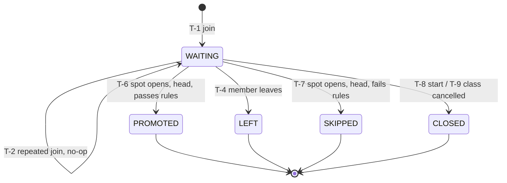

# Class Booking App — Product Specification

Living specification for the class booking app. This revision adds the class **waitlist**. Requirements are numbered
`R-<n>`; flows `F-<n>`; transitions `T-<n>`; scenarios `S<n>`; assumptions `A-<n>`; open gaps `G-<n>`.
Structure and technology choices live in `KNOWLEDGE/architecture.md` as `AD-<n>`; none are made here.

## 1. Basis, baseline and evidence limits

**Incoming request (2026-11-21):** "Add a waitlist to our class booking app so full classes don't turn people away."

**Request outcomes** (traced in §9):

- O-1: the app has a waitlist for classes.
- O-2: a full class no longer turns a member away: the member can queue, and gets the spot when one opens.

**Baseline.** This stage had no repository, no discovery or research result, no earlier spec and no selected baseline.
The existing app's code, stack, data model, booking rules, cancellation rules, notification channel and visual system
were **not inspected**. Nothing in this spec is an observation of the current system. Statements about existing
behaviour are *premises* (P-n below) the plan must confirm by discovery before dependent work; this spec asserts no
runtime, platform or library capability, so it has no platform limit to cite.

**Premises about the existing app** (each is an open gap until confirmed, §8):

- P-1: members are authenticated; each member can book one seat in a class session and cancel their own confirmed booking.
- P-2: a class session has a start instant and a capacity; a session is *full* when confirmed bookings = capacity.
- P-3: direct booking of a full session is refused with a "session full" error; this is preserved (R-11).
- P-4: booking applies eligibility rules (e.g. active membership, credits, overlap); this spec calls them "the booking rules".
- P-5: a notification mechanism exists, or the app can show an in-app notice.
- P-6: staff can cancel a booking, change a session's capacity and cancel a session.

**Existing requirements:** none were available, so no earlier `R-<n>` is preserved, changed or retired. See `## Retired`.

## 2. Assumptions (defaults taken because the request leaves them to choice)

| ID | Assumption (best default) | Why | If wrong |
| --- | --- | --- | --- |
| A-1 | Waitlist capacity is **10 waiting entries per session**, one named constant. | Bounds work per event and a member's wait; small gyms rarely queue deeper. | Change the constant; boundary cases S3 move with it. |
| A-2 | Promotion is **automatic**: the head of the queue is booked at once when a spot opens. No accept/decline step and no hold timer. | Fewest states; no unclaimed spots; the request wants people in, not offered. | An offer-with-claim-window model is a new requirement set (see out of scope). |
| A-3 | The waitlist follows the **booking window**: join and promotion are allowed only while a direct booking of that session would be allowed by time, i.e. the session is not cancelled and `now < start`. | One rule, no second cutoff. | If the existing app has an earlier booking cutoff (G-3) the waitlist uses it. |
| A-4 | Order is **first-come-first-served** by the server's join time; ties break by entry creation order. | Predictable and explainable to members. | — |
| A-5 | Promotion **re-applies the booking rules** at promotion time. A head entry that fails them is skipped (state SKIPPED) and the next entry is tried. | Membership or credits can change while waiting. | — |
| A-6 | Promotion notifications use the **channel the app already uses for booking confirmations**, else an in-app notice. Delivery is best effort; the member's bookings view is the authority. | No new channel invented. | G-4. |
| A-7 | Terminal waitlist entries (PROMOTED, LEFT, SKIPPED, CLOSED) are kept **90 days after the session start**, then deleted. | Short history for support questions; limits personal data. | G-7: owner may set another period; follow the app's booking-history retention if stricter. |
| A-8 | A member sees **only their own position** and the **count** of waiting entries; never another member's identity. | Privacy; the count is not personal. | — |
| A-9 | A member has **at most one active (WAITING) entry per session**, with no limit on the number of sessions waited for. | Keeps the rule simple; overlap is handled by the booking rules at promotion. | — |
| A-10 | A member who leaves and rejoins goes to the **back** of the queue. | Prevents queue gaming. | — |
| A-11 | The spot-opening change and its promotions are **all-or-nothing** (a technical failure rolls the whole change back and returns a retryable error). A rule-based failure (ineligible member) is not a technical failure: it is a skip. | A cancel must never leave a free spot next to a waiting member. | — |
| A-12 | Member-initiated cancellation of a confirmed booking is allowed only by the existing app's rules; the default used in walks is "before the session start". | Existing behaviour is preserved, not redefined. | G-3. |

## 3. Requirements

Notation. Each acceptance line gives **Positive / Failure / Boundary** expectations (`n/a: reason` when a kind adds
nothing), the **Surface** where it is observed and **Confirmed by**. "API" means the app's member-facing request
interface; the HTTP or RPC mapping is the plan's choice. Error names are symbolic. A listed S-scenario is a concrete
replay in §10. Each requirement carries its basis: *Request* = the request quoted in §1 (2026-11-21).

### Entity states used below

- **Session relation to a member** (the groups with distinct behaviour): `none` (no booking, no entry); `confirmed`;
  `waiting`; `left` (entry LEFT); `skipped` (entry SKIPPED); `promoted-then-cancelled` (booking cancelled after
  promotion; treated as `none`). `closed` entries behave as `none` for a still-bookable session and are irrelevant otherwise.
- **Session condition:** `open-not-full`; `open-full, waitlist < 10`; `open-full, waitlist = 10`; `closed`
  (cancelled, or `now >= start`).
- **Waitlist entry state:** WAITING, PROMOTED, LEFT, SKIPPED, CLOSED (diagram in §4).
- *Material exclusions:* the `promoted-then-cancelled` and `closed` relations are folded into `none` because the join and
  promotion rules read only "confirmed / waiting / otherwise"; a member whose class overlaps another booking is covered
  by the booking rules (P-4), not separately enumerated.

---

### R-1 Full classes offer the waitlist

- **Basis:** Request. **Preserved:** the existing class list/detail, capacity display and Book action for classes that
  are not full (R-11). **Changed:** for a full, bookable class the dead end ("session full") is replaced by a waitlist
  action. **Source locators:** none (no baseline, §1). **Evidence limit:** existing screens not inspected (G-1).
  **Pending:** implementation and checks.
- **Behaviour:** wherever a class is shown with its booking action (list and detail), the action depends on the
  session condition and the viewing member's relation:

  | Session condition / relation | Label and state | Count text |
  | --- | --- | --- |
  | open-not-full | `Book` (unchanged) | existing |
  | open-full, waitlist < 10, relation none/left/skipped | `Join waitlist` enabled | `Class full · {n} on waitlist` (`Class full · no waitlist yet` when n = 0) |
  | open-full, waitlist = 10 | `Waitlist full` disabled | `Class full · 10 on waitlist` |
  | relation confirmed | existing "booked" state | existing |
  | relation waiting | `On waitlist · #{p} of {n}` and `Leave waitlist` | — |
  | closed | no booking or waitlist action (existing behaviour) | — |

- **Error behaviour:** if the displayed state is stale (e.g. the class stopped being full), the action's request returns
  the matching error of R-2 and the screen reloads the current state; it never shows a false position.
- **Consumer outcome:** a member looking at a full class can see that a waitlist exists, how long it is, and how to join.
- **Acceptance:**
  - R-1.a Positive: session SES-100 (capacity 2, Alice and Bob confirmed), viewed by Carol (relation none) shows
    `Join waitlist` and `Class full · no waitlist yet`. Failure: n/a: a read raises no failure not covered by R-1.c.
    Boundary: with 10 waiting entries the label is `Waitlist full`, disabled, count `10`; with 9 it is `Join waitlist`.
    Surface: class list and class detail screens; Confirmed by: browser check on S1/S3 data.
  - R-1.b Positive: a member in relation waiting sees `On waitlist · #1 of 3` with `Leave waitlist`. Failure: n/a: see
    R-1.a. Boundary: after the member is promoted the same screen shows the existing booked state and no waitlist label.
    Surface: class detail; Confirmed by: browser check on S1.
  - R-1.c Positive: n/a: covered by R-1.a. Failure: a stale `Join waitlist` pressed after a spot opened gets
    SESSION_NOT_FULL (S8); the screen reloads and shows `Book`. Boundary: n/a: see R-2.d. Surface: class detail;
    Confirmed by: browser check with a controlled response (UI) plus API test (S8).

### R-2 A member joins the waitlist of a full class

- **Basis:** Request ("full classes don't turn people away"). **Preserved:** direct booking rules (R-11). **Changed:**
  new join action. **Source locators:** none (§1). **Evidence limit:** booking rules P-4 not inspected. **Pending:** implementation and checks.
- **Behaviour:** an authenticated member joins the waitlist of a session when all hold: the session is bookable by time
  (A-3); the member has no confirmed booking in it; the member has no WAITING entry in it (else idempotent, below);
  the session is full; the member passes the booking rules (A-5, so they can later be promoted); and fewer than 10
  entries are WAITING (A-1). A successful join creates a WAITING entry at the back of the queue and returns the member's
  position (1-based) and the waiting count.
- **Boundaries:** the 10th entry is accepted; the 11th is refused (A-1). The join at `now = start − 1 minute` is accepted;
  at `now = start` it is refused (A-3).
- **Error behaviour** (state unchanged in every case; checks run in this order): NOT_AUTHENTICATED;
  SESSION_NOT_FOUND; SESSION_NOT_BOOKABLE (cancelled or started); ALREADY_BOOKED; *already waiting → success with the
  existing position, no second entry*; SESSION_NOT_FULL; NOT_ELIGIBLE (carries the booking rule's reason);
  WAITLIST_FULL.
- **Consumer outcome:** the member sees `On waitlist · #p of n` and the entry appears in their waitlist view (R-7).
- **Domain rules the request leaves out (not built):** priority tiers or paid skip-the-line; limit on how many sessions a
  member may wait for; waiting for a whole recurring series; guest joins; taking payment or a credit at join time.
- **Acceptance:**
  - R-2.a Positive: SES-100 (cap 2; Alice, Bob confirmed): Carol joins → position 1; Dan → 2; Erin → 3 (S1). Failure:
    Carol's direct `book` still returns SESSION_FULL (preserved, S1). Boundary: n/a: see R-2.c. Surface: API and class
    detail screen; Confirmed by: API test + browser check.
  - R-2.b Positive: a repeated join by Bob returns position 1 both times and leaves exactly one entry (S6). Failure:
    Alice (confirmed) joining returns ALREADY_BOOKED (S6); joining an open-not-full session returns SESSION_NOT_FULL (S8);
    a member failing the booking rules returns NOT_ELIGIBLE with the rule's reason (S2 setup, run at join time);
    unauthenticated returns NOT_AUTHENTICATED; unknown session ID returns SESSION_NOT_FOUND. Boundary: n/a: see R-2.c.
    Surface: API; Confirmed by: API tests with exact error names and unchanged-state assertions.
  - R-2.c Positive: SES-300 (cap 2, full): W1…W10 join and receive positions 1…10 (S3). Failure: W11 gets
    WAITLIST_FULL (S3). Boundary: after W4 leaves, W11's join is accepted at position 10 (S3); join at 17:59 accepted
    and at 18:00 refused with SESSION_NOT_BOOKABLE for a session starting 18:00 (S5). Surface: API; Confirmed by: API
    tests that assert the count of stored WAITING entries never exceeds 10.
  - R-2.d Positive: n/a: see R-2.a. Failure: when two members join the last free waitlist place at once, exactly one
    succeeds and the other gets WAITLIST_FULL; no more than 10 are WAITING. Boundary: n/a: the race is the boundary.
    Surface: API; Confirmed by: concurrent API test (see R-9).

### R-3 Queue order and position

- **Basis:** Request; A-4, A-8, A-10. **Preserved:** n/a: new. **Source locators:** none. **Evidence limit:** none beyond §1. **Pending:** implementation and checks.
- **Behaviour:** WAITING entries are ordered by join time (A-4). Position = 1 + the number of WAITING entries ahead.
  Position is recomputed on every read from current WAITING entries; it is never stale-cached beyond one reload (R-7).
  When an entry ahead leaves, is promoted, skipped or closed, entries behind move up by one per departed entry and keep
  their relative order. A member can read their own position and the waiting count only (A-8).
- **Error behaviour:** asking for the position of a session where the member has no WAITING entry returns NOT_ON_WAITLIST
  (no data about other members).
- **Consumer outcome:** the member sees how close they are to a spot.
- **Acceptance:**
  - R-3.a Positive: after Alice's cancel in S1, Dan's position is 1 and Erin's 2. Failure: Frank (no entry) reading a
    position gets NOT_ON_WAITLIST. Boundary: after W4 leaves in S3, W5 moves from 5 to 4 and W6…W10 from 6…10 to 5…9.
    Surface: API and class detail; Confirmed by: API test on S1/S3.
  - R-3.b Positive: a member who left and rejoins (S3 variant: W4 leaves and rejoins) is placed behind every WAITING
    entry (A-10). Failure: n/a: no failure path beyond R-2. Boundary: n/a: see R-3.a. Surface: API; Confirmed by: API test.
  - R-3.c Positive: n/a: see R-3.a. Failure: no response contains another member's name, ID or email, only the
    caller's position and the count. Boundary: n/a: the count is the only aggregate. Surface: API response bodies and
    screen; Confirmed by: assertion over S1 responses for non-caller member identifiers.

### R-4 A member leaves the waitlist

- **Basis:** Request (a waitlist implies leaving); A-10. **Preserved:** n/a: new. **Source locators:** none. **Evidence limit:** none beyond §1. **Pending:** implementation and checks.
- **Behaviour:** a member with a WAITING entry can leave at any time while the session is bookable. The entry becomes
  LEFT; later entries move up (R-3). Leaving does not touch any booking.
- **Error behaviour:** leaving with no WAITING entry returns NOT_ON_WAITLIST and changes nothing. If the member was
  just promoted, the response is NOT_ON_WAITLIST with a hint that the member now holds a booking and can cancel it
  from their bookings (the existing cancel releases the spot and promotes the next entry).
- **Consumer outcome:** the member is no longer in the queue, with no booking and no notification beyond the screen update.
- **Acceptance:**
  - R-4.a Positive: W4 leaves SES-300 → the entry is LEFT, W5 is position 4 (S3). Failure: W4 leaving again returns
    NOT_ON_WAITLIST (S3); a member leaving a session they never joined returns NOT_ON_WAITLIST. Boundary: leaving at
    `start − 1 minute` is accepted; at or after `start` the entry is already CLOSED and the response is NOT_ON_WAITLIST.
    Surface: API and `Leave waitlist` action; Confirmed by: API test + browser check.
  - R-4.b Positive: n/a: see R-4.a. Failure: leave and promotion race for the same entry: exactly one wins; either the
    entry is LEFT and the next entry is promoted, or the member is PROMOTED and the leave returns NOT_ON_WAITLIST with the
    hint. Boundary: n/a: the race is the boundary. Surface: API; Confirmed by: concurrent API test (R-9).

### R-5 Automatic promotion when a spot opens

- **Basis:** Request ("so full classes don't turn people away"); A-2, A-5, A-11. **Preserved:** cancellation itself
  (R-11). **Changed:** a cancellation now fills the freed spot from the queue. **Source locators:** none.
  **Evidence limit:** how the existing app cancels and re-counts capacity is unknown (G-2, G-5). **Pending:** implementation and checks.
- **Behaviour — triggers:** any change that leaves a bookable session with confirmed bookings < capacity: a member
  cancels a confirmed booking; staff remove a booking; staff raise the capacity (opens k = new − old spots). A reduced
  capacity or a raised one that leaves the session still full opens nothing.
- **Behaviour — procedure** (inside the triggering change, A-11): while confirmed < capacity and a WAITING entry exists:
  take the head (R-3); if the member passes the booking rules, create a normal confirmed booking, mark the entry
  PROMOTED and record a PROMOTED notification (R-6); otherwise mark it SKIPPED and record a SKIPPED notification, then
  try the next entry. Stop when no spot or no WAITING entry remains.
- **Invariant at rest (after every change):** `confirmed ≤ capacity`; and *if confirmed < capacity on a bookable
  session, no WAITING entry exists*. A spot therefore never goes to a direct booker ahead of a waiting member.
- **Boundaries:** promotion runs only while the session is bookable by time (A-3): a spot opened at `now >= start`
  promotes nobody. One spot promotes at most one member; k spots promote at most k members.
- **Error behaviour:** a technical failure during promotion rolls back the triggering change and returns a retryable
  error (A-11): the cancel is not half done, the member who cancelled may retry. Repeating a cancel that already
  succeeded returns the existing "already cancelled" behaviour and promotes no one further.
- **Domain rules the request leaves out (not built):** claim windows and accept/decline offers; skipping the queue for
  premium members; promoting two members who want to attend together; auto-rebooking after a lapse; priority for
  members who were SKIPPED earlier.
- **Consumer outcome:** the head member is confirmed in the class without doing anything, the queue shifts up, and the
  class is full again if more members were waiting.
- **Acceptance:**
  - R-5.a Positive: S1: Alice cancels in SES-100 → Carol is PROMOTED and confirmed (confirmed = Bob, Carol); Dan is
    position 1, Erin 2; Frank's direct booking is refused SESSION_FULL. Failure: n/a: see R-5.b/R-5.c. Boundary:
    n/a: see R-5.c. Surface: API (booking list, waitlist read) and member screens (Carol's My bookings, Dan's class
    detail); Confirmed by: API test and browser check on S1.
  - R-5.b Positive: S4: staff raise SES-400 capacity 2 → 4 with Carol, Dan, Erin waiting → Carol and Dan are
    PROMOTED; Erin is position 1. Failure: S2: head Bob no longer passes the booking rules → Bob SKIPPED (notified),
    Carol PROMOTED, Dan position 1. Boundary: capacity raised 2 → 2 or lowered promotes nobody. Surface: API;
    Confirmed by: API tests S2/S4 (S2 needs a way to make a member ineligible, G-2).
  - R-5.c Positive: S5: member cancel at 17:59 promotes (SES-503: Bob confirmed). Failure: S5: a staff removal at 18:00
    in SES-502 promotes nobody; Bob's entry reads CLOSED and he is not confirmed. Boundary: 17:59 vs 18:00 at start
    18:00. Surface: API; Confirmed by: API test with a controllable clock (S5; the staff action depends on G-5).
  - R-5.d Positive: S6: Alice's cancel promotes Bob once; a second cancel returns the existing already-cancelled
    result and promotes no one (Carol stays position 1). Failure: an injected technical failure mid-promotion leaves
    Alice still confirmed, no entry changed, and a retryable error. Boundary: n/a: see R-5.c. Surface: API;
    Confirmed by: API test with fault injection at the booking-creation step.

### R-6 Waitlist notifications

- **Basis:** Request (a waitlisted member must learn they got in); A-6. **Preserved:** existing booking notices.
  **Changed:** new notice kinds. **Source locators:** none. **Evidence limit:** channel unknown (G-4). **Pending:** implementation and checks.
- **Behaviour:** one notice per event, to the member concerned only:
  - PROMOTED: "You're in: {class name}" / "A spot opened and you've been booked into {class name} on {date} at {time}. Can't make it? Cancel from My bookings."
  - SKIPPED: "Couldn't book you from the waitlist: {class name}" / "{reason from the booking rules}. You've been removed from the waitlist."
  - CLOSED by class cancellation: "Class cancelled: {class name}" / "{class name} on {date} was cancelled, so you've been removed from the waitlist."
  - Entries closed because the class started produce **no** notice (the status is visible, R-7).
- **Rules:** a notice is recorded in the same change as its state transition and delivered afterwards, so a delivery
  failure never undoes a promotion; the member's bookings view is authoritative. A notice is created at most once per
  entry transition (retrying delivery does not create a second). A notice contains no other member's data.
- **Consumer outcome:** the promoted member is told, and in any case sees the booking.
- **Acceptance:**
  - R-6.a Positive: S1: exactly one PROMOTED notice for Carol, none for Bob, Dan, Erin; its text equals the PROMOTED
    copy with SES-100's name, date and time. Failure: S2: Bob gets one SKIPPED notice, Carol one PROMOTED. Boundary:
    n/a: no numeric boundary. Surface: notification sink/outbox record and the in-app notice; Confirmed by: API test
    reading the notice records.
  - R-6.b Positive: n/a: see R-6.a. Failure: with the delivery channel failing, Carol is still PROMOTED and confirmed,
    the notice record exists in an undelivered state, and a delivery retry does not create a second record (duplicate
    count = 1). Boundary: n/a: retry count is G-8. Surface: notice records and My bookings; Confirmed by: API test with
    a failing channel double (a stand-in for the real channel, so real delivery stays unverified until G-4).
  - R-6.c Positive: S9: class cancellation closes Bob and Carol and sends each one CLOSED copy. Failure: a class that
    starts with entries still WAITING sends none (S5). Boundary: n/a: see R-8. Surface: notice records; Confirmed by: API test.

### R-7 Members see waitlist status

- **Basis:** Request; A-8. **Preserved:** the existing My bookings view. **Changed:** adds waitlist status to it and a
  waitlist list. **Source locators:** none. **Evidence limit:** screens not inspected (G-1). **Pending:** implementation and checks.
- **Behaviour:** a member's own view lists: confirmed bookings (promoted bookings are ordinary bookings, labelled
  `From waitlist`); active waitlist entries as `On waitlist · #p of n` with `Leave waitlist`; and recent ended entries
  (SKIPPED, CLOSED) with a reason line, for as long as retained (A-7), newest first. LEFT and PROMOTED entries are not
  listed as waitlist rows (a promoted entry shows as the booking). Status is read from the server on open, after the
  member's own action, and when the tab regains focus; no push channel is required. A change made elsewhere (a
  promotion) therefore appears at the next of those reads.
- **Empty / loading / error:** no entries → "You're not on any waitlists." with a link to the class list; loading →
  placeholder rows with a busy status; load error → inline message "Couldn't load your waitlists." with `Try again`.
  Pending actions show `Joining…` / `Leaving…` on the action, disabled, and show a position only after the server confirms.
- **Consumer outcome:** the member always knows whether they are in, waiting or out, and why.
- **Acceptance:**
  - R-7.a Positive: after S1, Carol's My bookings lists SES-100 labelled `From waitlist`; Dan's shows
    `On waitlist · #1 of 2`. Failure: with the list request failing, the error text above and `Try again` appear and a
    retry succeeding replaces it. Boundary: with zero entries the empty text appears. Surface: member screens;
    Confirmed by: browser check with controlled responses.
  - R-7.b Positive: S2: Bob's list shows the SKIPPED row with the booking-rule reason. Failure: n/a: see R-7.a.
    Boundary: an entry older than the retention period (A-7, 90 days after start) is absent. Surface: member screens
    and API; Confirmed by: browser check (S2) and API test with a controllable clock.

### R-8 Waitlist closes with the class

- **Basis:** Request; A-3. **Preserved:** existing cancelled/started class behaviour. **Changed:** WAITING entries are
  ended. **Source locators:** none. **Evidence limit:** G-3. **Pending:** implementation and checks.
- **Behaviour:** when a session is cancelled, all its WAITING entries become CLOSED(class_cancelled) with the CLOSED
  notice (R-6). At and after the session start instant every WAITING entry is reported CLOSED(class_started), whether or
  not a background step has stored that yet. In a closed session no join and no promotion happens.
- **Error behaviour:** join, leave and promotion attempts on a closed session return SESSION_NOT_BOOKABLE (join) or
  NOT_ON_WAITLIST (leave) and change nothing.
- **Consumer outcome:** no member is left "waiting" for a class that cannot happen.
- **Acceptance:**
  - R-8.a Positive: S9: cancelling SES-900 closes Bob and Carol (CLOSED, class_cancelled) and Dan's join returns
    SESSION_NOT_BOOKABLE. Failure: n/a: see R-8.b. Boundary: n/a: see R-8.b. Surface: API and My waitlists;
    Confirmed by: API test.
  - R-8.b Positive: n/a: see R-8.a. Failure: S5: at 18:00 for an 18:00 session, join returns SESSION_NOT_BOOKABLE and
    a WAITING entry reads CLOSED(class_started). Boundary: 17:59 still accepts; 18:00 does not. Surface: API;
    Confirmed by: API test with a controllable clock.

### R-9 Consistency under simultaneous actions

- **Basis:** Request (a waitlist that overbooks or skips people fails its purpose). **Preserved:** capacity is never
  exceeded (P-2). **Source locators:** none. **Evidence limit:** whether the existing datastore can serialise per
  session is unknown (G-6). **Pending:** implementation and checks.
- **Behaviour:** the changes to one session (book, cancel, join, leave, capacity change, close) behave as if executed
  one at a time. Hence: confirmed never exceeds capacity; each opened spot goes to exactly one member; no member holds two
  entries or an entry plus a booking for the same session; promotion order is queue order.
- **Error behaviour:** a change that loses a race gets the error it would get if run second (R-2, R-4); no change is
  lost silently.
- **Consumer outcome:** no double booking, no skipped queue position, no phantom spot.
- **Acceptance:**
  - R-9.a Positive: S7 (SES-700, cap 1, Alice confirmed, Bob waiting): in both orders of "Alice cancels" and "Dan books
    directly", the end state is Bob confirmed and Dan refused SESSION_FULL. Failure: n/a: S7 is the failure race.
    Boundary: n/a: the race is the boundary. Surface: API; Confirmed by: concurrent API test run ≥ 1 time per order with
    both interleavings forced by a barrier, plus an invariant query after every run (`confirmed ≤ capacity`; no
    WAITING entry while a free spot exists).
  - R-9.b Positive: cap 2, W1…W2 waiting, Alice and Bob cancel simultaneously → W1 and W2 promoted, each once.
    Failure: n/a: no failure path distinct from R-9.a. Boundary: simultaneous join of the 10th and 11th entry (R-2.d).
    Surface: API; Confirmed by: concurrent API test and invariant query.

### R-10 Waitlist data: visibility, retention, removal

- **Basis:** Request (new personal records); A-7, A-8. **Preserved:** existing privacy rules for booking records
  (G-7). **Changed:** new record kind. **Source locators:** none. **Evidence limit:** existing retention, logging and
  account-deletion rules unknown. **Pending:** implementation and checks.
- **Behaviour:** a waitlist entry holds member ID, session ID, state, join time, state-change time and reason. Who may
  read: the member reads their own entries; no member reads another's; any viewer of a class sees only the count
  (R-1); staff access follows the existing staff access to bookings (no new staff view is added, out of scope).
  Logs and notices carry member and session IDs but no email, phone or name. Terminal entries are deleted 90 days after
  session start (A-7). If the app deletes a member, that member's entries are removed without promoting anyone, and
  entries behind them move up; an entry removed this way while WAITING is not a spot-opening event.
- **Error behaviour:** a member requesting another member's entry gets SESSION_NOT_FOUND or NOT_ON_WAITLIST, the same
  as for a non-existent entry (no existence leak).
- **Consumer outcome:** members' queue activity stays private; stale records disappear.
- **Acceptance:**
  - R-10.a Positive: Dan reading SES-100 sees `n` and his own position only. Failure: Dan requesting Carol's entry by
    its ID gets NOT_ON_WAITLIST, identical to a random ID. Boundary: n/a: no numeric bound. Surface: API; Confirmed by:
    API test and response-body assertion.
  - R-10.b Positive: log lines for S1 contain member and session IDs and contain none of the test members' names or
    emails. Failure: n/a: see R-10.a. Boundary: a terminal entry at 90 days after start is deleted and one at 89 days
    remains. Surface: log output and stored records; Confirmed by: log grep over S1 plus retention test with a
    controllable clock.
  - R-10.c Positive: deleting member Erin while WAITING removes her entry and moves later entries up with no
    promotion and no notice. Failure: n/a: see R-10.a. Boundary: n/a: no numeric bound. Surface: API; Confirmed by: API
    test. Applies only if the app can delete members (G-2); otherwise n/a.

### R-11 Existing booking behaviour is preserved

- **Basis:** Request is additive ("add a waitlist"); silence preserves (requirements guide). **Preserved:** everything
  in this requirement. **Changed:** none. **Source locators:** none (baseline not inspected, G-1/G-2).
  **Evidence limit:** the preserved behaviour is a premise until discovery records it. **Pending:** discovery, then checks.
- **Behaviour:** for sessions with an empty waitlist, booking, cancelling, capacity display and notices behave exactly as
  before. Direct booking of a full session is still refused with the existing "session full" error. The existing
  eligibility, credit and cancellation-window rules stay authoritative and are not redefined.
- **Error behaviour:** n/a: nothing new; existing error behaviour is preserved.
- **Consumer outcome:** members and staff who never use the waitlist see no change.
- **Acceptance:**
  - R-11.a Positive: with no waitlist entries, `book` and `cancel` produce the same responses and state as before the
    change (compared with the pre-change test suite or recorded responses). Failure: Carol's direct `book` on full
    SES-100 returns SESSION_FULL (S1). Boundary: n/a: no new bound. Surface: API and screens; Confirmed by: the existing
    booking suite run unchanged, plus S1.

## 4. Flows, states and transitions

**Entry state diagram** (owner: server; durable).

All five end states are terminal for the entry. A member may afterwards create a **new** entry (T-1) if the session is
still bookable. Entries are deleted per T-11.

| Flow | Journey | Requirements |
| --- | --- | --- |
| F-1 | Member views a full class → joins → sees position (T-1; alternatives T-2, T-3) | R-1, R-2, R-3, R-7 |
| F-2 | Spot opens (cancel / staff removal / capacity raise) → promotion procedure → notices → member sees booking (T-6, T-7, T-10) | R-5, R-6, R-7, R-9 |
| F-3 | Member leaves (T-4, T-5) | R-4, R-3 |
| F-4 | Class cancelled or starts → entries closed (T-8, T-9) | R-8, R-6 |

F-2 sequence (actors: Cancelling member or staff, Server, Waiting member, Notifier): Cancelling member → Server `cancel`;
Server serialises on the session, removes the booking, runs the promotion procedure (head → booking + PROMOTED, or
SKIPPED), records notices, commits, and answers the canceller (synchronous). Notifier delivers notices afterwards
(asynchronous; failure does not affect the committed state). Waiting member sees the booking at next read (R-7).

| T | Trigger and actor | Guard | Before → after | Failure / unchanged | Cases |
| --- | --- | --- | --- | --- | --- |
| T-1 | join, member | R-2 conditions all hold | none/LEFT/SKIPPED/CLOSED → WAITING, back of queue | any guard fails → named error, unchanged (T-3) | R-2.a, R-2.c, S1, S3 |
| T-2 | join, member with WAITING entry | — | WAITING → WAITING | no second entry, same position | R-2.b, S6 |
| T-3 | join rejected | NOT_AUTHENTICATED, SESSION_NOT_FOUND, SESSION_NOT_BOOKABLE, ALREADY_BOOKED, SESSION_NOT_FULL, NOT_ELIGIBLE, WAITLIST_FULL (in this order) | unchanged | n/a | R-2.b, R-2.c, S3, S5, S6, S8 |
| T-4 | leave, member | WAITING entry, session bookable | WAITING → LEFT; later entries −1 position | — | R-4.a |
| T-5 | leave rejected | no WAITING entry | unchanged | NOT_ON_WAITLIST | R-4.a, R-4.b |
| T-6 | spot opened, system | head WAITING, session bookable, member passes rules | WAITING → PROMOTED; booking confirmed; PROMOTED notice recorded | technical failure: whole change rolled back | R-5.a, R-5.b, S1, S4 |
| T-7 | spot opened, system | head WAITING, fails rules | WAITING → SKIPPED; SKIPPED notice; next entry tried | as T-6 | R-5.b, S2 |
| T-8 | session start instant reached | WAITING entry | WAITING → CLOSED(class_started); no notice | reported CLOSED even before stored | R-8.b, S5 |
| T-9 | session cancelled, staff | WAITING entry | WAITING → CLOSED(class_cancelled); CLOSED notice | — | R-8.a, R-6.c, S9 |
| T-10 | capacity raised, staff | new > old, bookable | k = new − old spots → T-6/T-7 repeated | — | R-5.b, S4 |
| T-11 | retention, system | terminal entry, now ≥ start + 90 days | entry deleted | — | R-10.b |
| T-12 | member deleted (only if the app does this) | WAITING entry | entry removed, no promotion | — | R-10.c |

Event-family audit: normal/invalid/unauthorised — T-1, T-3; boundary values — A-1 cap, A-3 start instant; duplicates —
T-2, repeated cancel (R-5.d); timeout/retry — not applicable: there is no hold timer (A-2); notification retry — R-6.b;
partial failure and recovery — A-11 all-or-nothing, R-5.d; concurrency — R-9; lifecycle/expiry — T-8, T-9, T-11, T-12.

## 5. Non-functional requirements

Operating conditions: a class booking app for a studio or gym; no workload figures were supplied. Unknown figures are
listed as unresolved rather than invented. The only derived scale bound is A-1: at most 10 WAITING entries per session,
so the promotion procedure examines at most 10 entries per spot opened (observable by counting booking-rule
evaluations in a fault-free S2-style run).

- **NFR-1 Correctness under concurrency.** Is R-9. Verified by concurrent tests with invariant queries.
- **NFR-2 Performance.** *Unresolved:* no latency, throughput or capacity target was supplied and no baseline exists
  (G-8). Interim observable condition: the cancel response already includes the promotion result, so the promoted
  booking is visible on the next read after the cancel response (consistency, not a speed number). Does not block
  functional work; blocks any performance acceptance claim.
- **NFR-3 Notification delivery.** Notice creation is part of the committed change (R-6). Delivery latency and retry
  count are *unresolved* (G-8, G-4) and the real channel is unverified until G-4 is closed; delivery failure never alters booking state.
- **NFR-4 Privacy and security.** R-10; authorisation is by the authenticated member on every waitlist request; entry
  lookups for another member's entry reveal nothing. Rate limiting beyond A-1 and A-9 is excluded: the queue is capped
  at 10 entries per session and one per member, so unbounded growth is not possible through this feature; revisit if
  the platform shows abuse.
- **NFR-5 Reliability and recovery.** A-11: promotion is atomic with the spot-opening change; recovery is by retrying the
  change. Durability follows the existing datastore (G-6).
- **NFR-6 Compatibility and rollout.** The change is additive: existing booking records and flows are unchanged
  (R-11). Rollback limit: removing the feature discards WAITING entries and their notices; bookings already created by
  promotion are normal bookings and remain valid. Staged release: not applicable: no platform capability is claimed.
- **NFR-7 Observability.** Each transition T-1, T-4, T-6, T-7, T-8, T-9, T-11 emits one structured event with member ID,
  session ID, entry ID, from/to state and reason, and no name, email or phone (R-10). Verified by asserting the event
  stream for S1/S2.
- **NFR-8 Testability.** The clock and the notification channel are replaceable in tests (needed for S5, R-6.b, R-10.b);
  a way to make a member ineligible exists in test setup (S2).
- **NFR-9 Interface quality** (applies: the feature adds screens and states to an app with a user interface).
  - *Visual system:* the waitlist UI **inherits the existing app's tokens and components** (G-1; established product
    identity takes precedence). Where the app defines no token for a choice, fill it from the **light expressive
    starting point**: named visual reference "light Google Gemini look with Material 3 Expressive principles", light
    appearance first with a dark option. The plan records concrete treatments (palette, type scale, spacing scale, shapes)
    as an AD.
  - *Observable criteria:* (1) one consistent spacing and type scale and one palette with light and dark themes across
    the new states; (2) designed empty, loading and error states for the waitlist views as specified in R-7, and
    designed pending states for the join and leave actions (R-7); (3) the class list, class detail and My bookings
    waitlist rows render without horizontal overflow at 360 px and 1280 px widths; (4) visible keyboard focus on `Join
    waitlist`, `Leave waitlist` and `Try again`, and text and control contrast at WCAG 2.x AA (4.5:1 text, 3:1
    large text and controls) in both themes; (5) status changes (joined, promoted) are announced to assistive
    technology and every action has an accessible name; (6) motion only to explain a change (e.g. a position moving up) and
    removed under `prefers-reduced-motion`; (7) one icon set, the app's own.
  - *Primary visual weight:* on the class card the next action (`Join waitlist` / `Leave waitlist`) is the strongest
    element; the count and position are quieter supporting text.
  - *Verification:* browser checks at both widths in both themes with controlled responses; an automated contrast check;
    a keyboard-only walk of join → leave; a reduced-motion check. An automated check alone does not prove accessibility.
- **Excluded with reasons:** availability target, data-residency and compliance regimes — none stated and none implied by
  a class waitlist; revisit if G-1 discovery finds a regulated context.

## 6. State and data assessment

| Carrier | Owner and location | Change | Reader | Lifetime / removal |
| --- | --- | --- | --- | --- |
| Waitlist entry (member, session, state, times, reason) | server datastore (G-6), new | created T-1, ended T-4/6/7/8/9, deleted T-11/T-12 | owning member; counts to all (R-10) | until 90 days after session start (A-7) |
| Booking | existing datastore | created by T-6 as an ordinary booking; removal triggers T-6/T-7 | as today | as today |
| Session capacity, start, cancelled flag | existing | read; staff change triggers T-10 | as today | as today |
| Notice record | server | created with the transition (R-6) | the addressed member | as the app's notices |
| Position, waiting count | **derived**, never stored | recomputed on read | per A-8 | n/a |
| Screen state (pending, error, loaded list) | client memory | per R-7 | the member | page lifetime; the server is authoritative |

Target identities: entry by (session ID, member ID), at most one WAITING per pair (A-9). Before/after invariants: R-5
invariant at rest. Authorised actor: the member for T-1/T-4; the system for T-6/T-7/T-8/T-11; staff for T-9/T-10 and
staff removals. Partial failure: A-11. Recovery: retry the change; entries are never half-promoted. Checks: R-5.d, R-9.
**Unknowns:** the datastore and its transaction capability (G-6) and the migration mechanism (G-6) are unconfirmed; they
may change the verification surface of R-9 but not the required behaviour.

## 7. Service boundary contracts

The app is presumed to have a member client, a server with a datastore, and a notification mechanism (P-5); no extra
service is added.

- **Current authority:** the server datastore for entries, bookings and capacity. The client never decides a promotion or
  a position; it shows what the server last returned.
- **Freshness versus revocation:** eligibility (membership, credits) is re-read at promotion time (A-5), so a membership
  revoked after joining is honoured at promotion without any data edit to the entry. Session cancellation and start
  are checked at each write, not cached.
- **Incremental state:** the waitlist adds records; it does not rewrite bookings or sessions (NFR-6). A promotion adds one
  booking and changes one entry and leaves other entries' order untouched.
- **Async completion and recovery:** notice delivery is asynchronous to the transition (R-6); a failed delivery is
  retried without a second notice record; the bookings view is the fallback for a missed notice. Retry bound: G-8.
- **Owned event coverage:** the transition events of NFR-7 are owned by this feature. The app's existing login/booking
  audit coverage is reused unchanged.
- **Inapplicable:** cross-service caching and shared-cache authorisation — no cache is introduced; third-party webhooks
  — none.

## 8. Open gaps

| ID | Gap | Affects | Owner / due | Effect |
| --- | --- | --- | --- | --- |
| G-1 | No repository or baseline was available: existing screens, tokens, stack and conventions unseen. | all R; R-1, R-7, NFR-9 | plan discovery, before planning | Blocks implementation planning of every R. This spec is the proposed delta, not a verified diff. |
| G-2 | Existing booking rules (eligibility, credits on cancel/rebook, overlap), member-deletion behaviour and the way to make a member ineligible in tests (P-4) unconfirmed. | R-2, R-5, R-10, R-11 | discovery | Affects the SKIPPED path and R-10.c only; R-1, R-4 can proceed. |
| G-3 | Existing booking and cancellation cutoff (A-3, A-12) unconfirmed. | R-2, R-5, R-8 | discovery | Shifts the boundary instant of S5; behaviour keeps the same shape. |
| G-4 | Existing notification channel and its failure behaviour (A-6). | R-6, NFR-3 | discovery | Real delivery unverified until closed; the failing-channel double covers only the state contract. |
| G-5 | Staff actions (cancel a booking, change capacity, cancel a session) exist and are permitted at any time (P-6). | R-5, R-8 | discovery | If absent, T-9/T-10 and the staff cases of S4/S5 drop out; member-cancel cases remain. |
| G-6 | The datastore's ability to serialise changes per session and apply a migration (R-9, AD-1). | R-9, NFR-5 | plan, before implementation | Could change how R-9 is verified, not what it requires. |
| G-7 | Retention (A-7) and logging/deletion policy of the existing app unconfirmed. | R-10 | product owner | Default applies until decided. |
| G-8 | No numeric performance, notification-latency or retry-count target. | NFR-2, NFR-3 | product owner | No performance or delivery-speed claim can be accepted; functional work unaffected. |

## 9. Request traceability

| Request outcome | Acceptance lines |
| --- | --- |
| O-1 a waitlist exists | R-1.a, R-1.b, R-2.a, R-2.b, R-2.c, R-3.a, R-3.b, R-4.a, R-7.a, R-7.b |
| O-2 full classes don't turn people away | R-1.a, R-1.c, R-2.a, R-5.a, R-5.b, R-5.c, R-5.d, R-6.a, R-6.b, R-7.a, R-8.a, R-8.b, R-9.a, R-9.b |
| Preserved scope | R-11.a |

**Primary requirements** (asked for directly): R-1, R-2, R-5. Each is observed at the API **and** on a member screen;
a unit check of the promotion rule alone does not satisfy R-5.a, which needs the booking and waitlist reads of S1.
R-3, R-4, R-6, R-7, R-8, R-9 are consequences that make the primary outcome usable and correct. R-10 and R-11 bound it.

Domain rules the request leaves out are listed under R-2, R-5, R-6 (channel choice beyond A-6, reminders, digests) and
R-10 (a new staff roster/reordering view). They are out of scope until requested.

## 10. Replay scenarios (concrete, with recomputed expected results)

Common set-up: members Alice, Bob, Carol, Dan, Erin, Frank, W1…W11 all pass the booking rules unless stated. Sessions
start at 18:00 on 2026-12-01 (`start`); `book`, `cancel` (by the member), `join`, `leave` are the actions of R-2/R-4 and
P-1; `now` is before 17:59 unless stated. Alice's and Bob's bookings come from the existing booking path (P-1) and are
legal because each session has a free seat when they book. Each action below occurs in a state the previous actions
leave and is permitted by the rule named.

| ID | Steps (permitting rule) | Recomputed expected result |
| --- | --- | --- |
| S1 | SES-100 cap 2. Alice, Bob book (P-1). Carol `book` → refused (P-3). Carol, Dan, Erin `join` in order (R-2). Alice `cancel` (A-12). Frank `book` (P-3). | Joins return positions 1, 2, 3. Carol's booking refused SESSION_FULL. After cancel: confirmed {Bob, Carol}; Carol PROMOTED with one notice; waiting Dan #1, Erin #2. Frank refused SESSION_FULL. |
| S2 | SES-200 cap 1. Alice books. Bob, Carol, Dan join (all pass rules, positions 1, 2, 3). Bob's membership lapses (G-2). Alice cancels. | Bob SKIPPED (one notice), Carol PROMOTED (one notice), confirmed {Carol}, Dan waiting #1. |
| S3 | SES-300 cap 2, Alice, Bob booked. W1…W10 join. W11 joins. W4 leaves. W11 joins. W4 leaves again. | Positions 1…10. W11 first: WAITLIST_FULL. After W4 leaves: W5 at #4 … W10 at #9. W11 now joins at #10. W4's second leave: NOT_ON_WAITLIST. |
| S4 | SES-400 cap 2, Alice, Bob booked, Carol, Dan, Erin waiting (1, 2, 3). Staff set capacity 4 (P-6). | Carol, Dan PROMOTED; confirmed {Alice, Bob, Carol, Dan}; Erin waiting #1. |
| S5 | `start` 18:00. SES-501 cap 1, Alice booked: Carol joins at 17:59 then Dan joins at 18:00. SES-502 cap 1, Alice booked, Bob waiting: staff remove Alice's booking at 18:00. SES-503 cap 1, Alice booked, Bob waiting: Alice cancels at 17:59 (A-12). | Carol position 1; Dan SESSION_NOT_BOOKABLE. SES-502: nobody promoted, Bob reads CLOSED(class_started), no notice. SES-503: Bob PROMOTED. |
| S6 | SES-600 cap 1, Alice booked. Bob joins twice. Alice joins. Carol joins. Alice cancels twice. | Bob #1 both times, one entry. Alice: ALREADY_BOOKED. Carol #2. First cancel: Bob PROMOTED, Carol #1. Second cancel: existing already-cancelled result, no further promotion; confirmed {Bob}. |
| S7 | SES-700 cap 1, Alice booked, Bob waiting. Order A: Alice cancels, then Dan books. Order B: Dan books, then Alice cancels. | Both orders: confirmed {Bob}; Dan refused SESSION_FULL; one PROMOTED notice for Bob. |
| S8 | SES-800 cap 2, only Alice booked. Bob joins. | SESSION_NOT_FULL; no entry created. |
| S9 | SES-900 cap 1, Alice booked, Bob and Carol waiting. Staff cancel the session. Dan joins. | Bob, Carol CLOSED(class_cancelled), one CLOSED notice each; Dan: SESSION_NOT_BOOKABLE. |

**Walk method and status.** The expected results above were recomputed by hand-walking each scenario from its start
state through the rules R-2, R-4, R-5, R-8 and A-1…A-12 in the order listed: reachable start (the booking path P-1 and
the booking rule P-3 are premises; the actors are ordinary members/staff), each action permitted in the state the
preceding actions leave, and the observer (API read of the booking list, waitlist read, notice records) able to see the
result. A scripted reference model of these rules was written for the walk but **its execution was not approved in
this stage, so it did not run: every S-scenario is `NOT-REPLAYED: no execution (hand-walked only)`.** No execution is
claimed, and they stay open until run against the product. The staff-dependent steps (S4; S5's SES-502; S9) additionally
depend on G-5; S2's lapse step depends on G-2.

## Retired

None. No earlier requirements existed to retire (§1).

## Submission

- **summary:** Specification for a class waitlist added to the existing booking app (11 requirements, 9 non-functional
  items). Automatic first-come-first-served promotion when a spot opens, cap of 10 waiting entries per session, waitlist
  follows the booking window, promotion re-checks the booking rules and skips ineligible members, notices to the member
  concerned, closure when the class starts or is cancelled, per-session consistency, privacy and retention.
  **Assumptions taken as defaults (A-1…A-12):** waitlist cap 10; automatic promotion with no claim window; waitlist
  window = booking window; FIFO order; promotion re-applies booking rules; notices through the existing confirmation
  channel; terminal entries kept 90 days after start; members see their own position and the count only; one active
  entry per member per session; rejoining goes to the back; all-or-nothing promotion; member cancel allowed before start.
  **Open:** G-1 (no repository or baseline here, so nothing about the existing app was inspected and implementation
  planning is not ready), G-2…G-5 (existing booking rules, cutoffs, notification channel, staff actions), G-6 (datastore
  serialisation and migration), G-7 (retention confirmation), G-8 (no performance or delivery targets). No material
  requirement conflict was found. All scenarios S1–S9 are hand-walked and marked NOT-REPLAYED; `backchain-check` does
  not exist here and was left out.
- **primary:** R-1, R-2, R-5
- **evidence_refs:** KNOWLEDGE/spec.md; KNOWLEDGE/architecture.md; sections R-1 … R-11 and §4–§10 of KNOWLEDGE/spec.md;
  sources used: the incoming request (2026-11-21); GUIDES/requirements-definition.md; GUIDES/behavioral-requirements.md
  (Behavior model, Traceability, Actors/channels/state ownership); GUIDES/service-discovery.md (Verification);
  GUIDES/current-system-baseline.md (Planning and review handoff, baseline absent); GUIDES/platforms/ui.md (Light
  expressive starting point).
