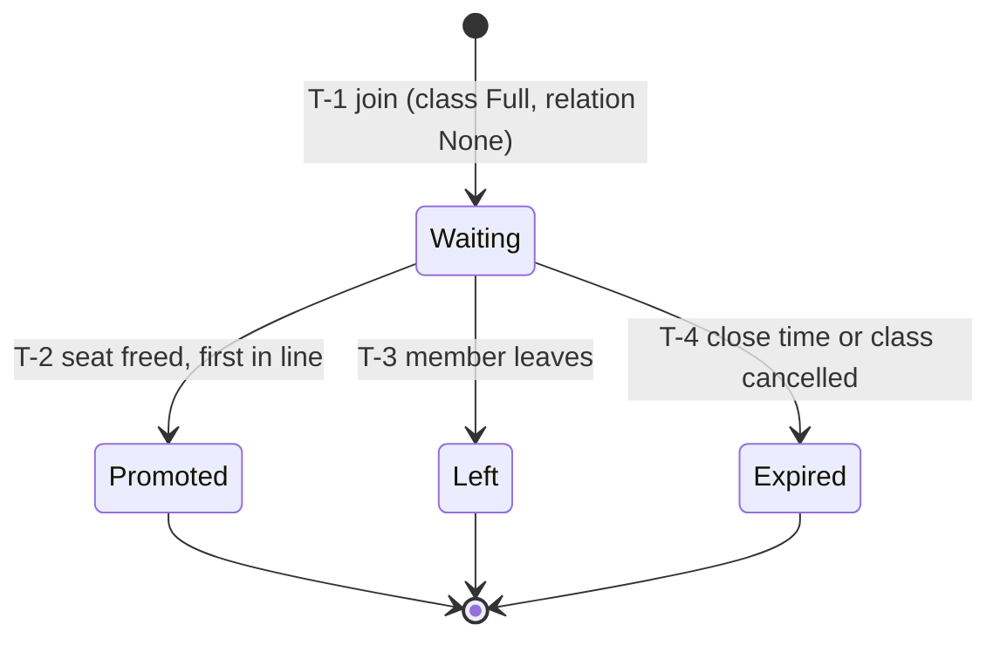
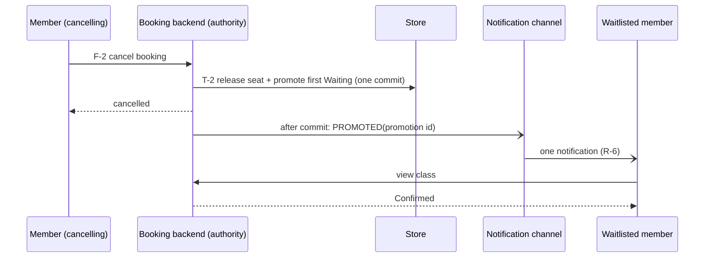

# Class Booking App: product specification

Maintained product spec. The first entry below is the waitlist feature (request dated 2026-11-21). No earlier spec,
repository, discovery or research result existed when this was written, so there is no prior R-<n> to preserve and
nothing under `## Retired`.

## Basis and evidence limits

- **Request, 2026-11-21 (verbatim):** "Add a waitlist to our class booking app so full classes don't turn people away."
  Cited below as `REQ-2026-11-21`.
- **Evidence available:** the request text and the ShipLoop guides (`GUIDES/behavioral-requirements.md#behavior-model`,
  `#traceability-and-review`, `#actors-channels-and-state-ownership`, `requirements-definition.md`,
  `service-discovery.md#verification`, `platforms/ui.md#light-expressive-starting-point`).
- **Not available:** the booking app's code, data model, UI, tests, deployment, existing notification channel, existing
  booking/cancellation rules. Every statement about the existing app below is therefore an **unknown or an assumption**,
  never an observation. Rules marked `Assumption A-n` are defaults taken unattended; rules marked `OG-n` are open gaps
  that keep only the dependent work unready (independent requirements proceed).
- **Existing behaviour assumed present (A-1):** the app lets an authenticated member book a seat in a scheduled class
  that has a fixed seat capacity, cancel their own booking, and see their bookings. The waitlist extends exactly these
  and changes nothing else.

## Actors, vocabulary, and the state sets used by the acceptance lines

- **Member** (authenticated person using the booking app). **Studio staff** (see R-9 exclusions: no staff waitlist
  features are requested).
- **Class**: identified e.g. `CL-100`, with `capacity` (seats) and a time at which booking stops (`close time`, OG-5).
- **Seat states of a class** (the groups with distinct observable behaviour; exact exclusions in R-1..R-8):
  - `Open`: confirmed < capacity, before close time.
  - `Full`: confirmed == capacity, before close time.
  - `Closed`: close time reached or class cancelled by the studio (waitlist behaviour identical for the two, except the
    notification text in R-7).
  - Partitions *not* separately modelled: classes with capacity 1 (same rules as capacity ≥ 2, covered by S-4 where
    two seats free at once); past classes (a subset of `Closed`).
- **Member-to-class relation** (distinct observable behaviour): `None`, `Confirmed`, `Waitlisted`. `Confirmed` and
  `Waitlisted` are mutually exclusive for one member and class (invariant I-3).
- **Waitlist entry lifecycle:** `Waiting` → `Promoted` | `Left` | `Expired` (terminal states; see ledger).

### Invariants (hold at every committed state, observable through the booking surface)
- **I-1** confirmed bookings of a class never exceed its capacity.
- **I-2** a class before close time never has both a free seat and a non-empty waitlist.
- **I-3** a member is never both `Confirmed` and `Waitlisted` for the same class.
- **I-4** waitlist order is first-in-first-out by successful join; position = 1 + number of `Waiting` entries ahead.

## Requirements

### R-1 A full class offers the waitlist instead of a dead end
- **Basis:** `REQ-2026-11-21` "full classes don't turn people away". Changed behaviour: today a booking attempt on a
  full class is assumed to be refused with an error (A-1, unobserved); after: the refusal carries a waitlist offer.
  Preserved: booking of an `Open` class is unchanged (R-8).
- **Behaviour:** when a member attempts to book, or views, a `Full` class they have no relation to, the app shows
  the class as "Full" with a single "Join waitlist" action instead of a terminal error. The offer never books a seat.
- **Boundaries:** applies exactly when confirmed == capacity before close time. At confirmed == capacity − 1 the
  class is `Open` and books normally. A `Full` class the member is already `Confirmed` in shows their booking; one the
  member is `Waitlisted` in shows their position (R-5), with no second offer.
- **Error behaviour:** attempt on a `Closed` class: no offer; "Booking closed" (R-7). Unauthenticated: the app's existing
  sign-in route (preserved).
- **Consumer outcome:** the member can always take a next step on a full class.
- **Acceptance lines**
  - A-R1.1 positive: `CL-100` capacity 2 with `m-alice`, `m-bob` confirmed; `m-cara` attempts to book → response
    `CLASS_FULL_WAITLIST_AVAILABLE`, no booking created, no waitlist entry created, UI shows "Join waitlist".
    Surface: booking API + member UI. Confirm: API test asserting status/code and unchanged counts; browser check of the
    action.
  - A-R1.2 failure: same attempt by `m-alice` (already `Confirmed`) → `ALREADY_BOOKED` shown, no waitlist offer.
    Surface: API. Confirm: API test.
  - A-R1.3 boundary: `CL-200` capacity 2 with 1 confirmed → class is `Open`, `m-cara`'s booking succeeds and no
    waitlist is offered. Surface: API. Confirm: API test.
- **Open gaps:** OG-1 (existing full-class UI/response unknown; offer wording and placement decided at plan against the
  baseline).
- **Left out (domain rules the request omits):** automatic joining without an explicit action; offering the waitlist
  across a recurring series; suggesting alternative classes.
- **Pending:** implementation and all checks above are unimplemented/unrun.

### R-2 A member can join a full class's waitlist
- **Basis:** `REQ-2026-11-21` "Add a waitlist". Added behaviour.
- **Behaviour:** an authenticated member with relation `None` to a `Full` class may join; the system appends an entry
  at the end (I-4) and returns the member's position.
- **Boundaries:** join is idempotent: repeating it returns the existing position and changes nothing. A member who
  leaves and rejoins goes to the back (scenario S-6). One member may be waitlisted for several classes (A-2).
  Maximum waitlist length: **unresolved bound, OG-3.** If a cap C exists, a join at length C is rejected
  `WAITLIST_FULL` with no change; value of C and whether it is per class are product decisions not in the request.
- **Error behaviour (each leaves state unchanged):** class `Open` → `SEATS_AVAILABLE` (the member should book; closes
  the race where a seat freed between view and click); member `Confirmed` → `ALREADY_BOOKED`; class `Closed` →
  `WAITLIST_CLOSED`; unauthenticated → existing sign-in route; unknown class → the app's existing not-found behaviour.
- **Consumer outcome:** "You're #N on the waitlist" appears and persists across reload and devices.
- **Acceptance lines**
  - A-R2.1 positive: `CL-100` full as in A-R1.1; `m-cara` joins → position 1; `m-dan` joins → position 2. Surface: API +
    UI. Confirm: API test on returned position and a fresh read; browser check after reload.
  - A-R2.2 failure: `m-bob` (`Confirmed`) joins → `ALREADY_BOOKED`; on `CL-200` (`Open`, 1 of 2) `m-alice` joins →
    `SEATS_AVAILABLE`; in both, waitlist length unchanged. Surface: API. Confirm: API tests asserting length.
  - A-R2.3 boundary: `m-cara` joins twice → position 1 both times, length 1 (idempotent); `m-cara` leaves then joins
    behind `m-dan` → position 2 (S-6). Surface: API. Confirm: API test.
  - A-R2.4 boundary (cap): n/a until OG-3 is resolved; then at length C−1 a join succeeds, at length C it returns
    `WAITLIST_FULL` unchanged.
- **Open gaps:** OG-3 (cap), OG-6 (time-overlap and per-member limits across classes: default A-2 allows any).
- **Left out:** priority tiers/membership levels, paid waitlist spots, joining on behalf of another member.
- **Pending:** implementation, checks.

### R-3 A freed seat goes to the first waitlisted member automatically
- **Basis:** `REQ-2026-11-21` ("so full classes don't turn people away" is only met if a waitlist converts into
  seats). Decision D-1 (product, taken unattended, recorded as Assumption A-3): **automatic promotion**, no timed
  claim window, so no claim-window bound needs inventing.
- **Behaviour:** whenever a seat of a `Full` class becomes free, the first `Waiting` entry is turned into a
  `Confirmed` booking for that member and its entry becomes `Promoted`; repeat per free seat until the class is full
  again or the waitlist is empty. Seat release and promotion are one indivisible outcome (I-2).
- **Seat-freeing events (the members of the set):** (a) the member cancels their own booking through the existing
  cancel action; (b) staff or the system removes a booking *if the existing app can* (OG-9); (c) capacity is raised
  *if the existing app can* (OG-9). Not seat-freeing: a waitlist leave (R-4), a seat freed on a `Closed` class (R-7),
  a no-show (no no-show concept requested).
- **Boundaries:** k seats freed at once promote the first k entries in order; fewer entries than seats leaves the
  remaining seats `Open` and the class `Open`. Two cancellations racing for the same class yield the same final
  state in either order (S-4) and never overbook (I-1).
- **Error behaviour:** if creating the booking for the first entry fails an existing booking rule (e.g. insufficient
  credits, OG-2), that rule's treatment is unresolved; until OG-2 is resolved this requirement is unready for apps
  with such a rule, and promotion must not overbook or silently drop the entry. A notification failure does not undo
  a promotion (R-6).
- **Consumer outcome:** the promoted member's class view changes from "#N on waitlist" to "Confirmed", and the
  waitlist ahead-count of everyone behind drops by one.
- **Acceptance lines**
  - A-R3.1 positive: S-1 (below): `m-alice` cancels on full `CL-100` with waitlist [`m-cara`, `m-dan`] → confirmed =
    {`m-bob`,`m-cara`}, waitlist = [`m-dan`] (position 1), 1 promotion record. Surface: API + UI of cara and dan.
    Confirm: API test, plus browser check of both members' views.
  - A-R3.2 failure: a cancellation of a booking the actor does not own, or already cancelled → rejected by existing
    behaviour (preserved, R-8); waitlist and confirmed set unchanged. Surface: API. Confirm: API test.
  - A-R3.3 boundary: two seats freed (S-4) with waitlist [`m-cara`,`m-dan`,`m-eve`] → `m-cara`, `m-dan` confirmed,
    `m-eve` position 1, in both cancellation orders; and waitlist empty → freed seat shows the class `Open` (no
    promotion). Surface: API. Confirm: API test run in both orders plus a concurrent run (N parallel cancellations,
    N = 2) asserting I-1, I-2 after each.
- **Open gaps:** OG-2 (payment/credits), OG-7 (atomicity capability of the datastore), OG-9 (staff and capacity paths).
- **Left out:** timed offer/claim windows; skipping an entry that conflicts in time with another booking; priority
  order other than join order; promotion notifications with accept/decline.
- **Pending:** implementation, concurrency check.

### R-4 A member can leave the waitlist
- **Basis:** necessary counterpart of R-2 (a join a member cannot undo is not a waitlist); decision D-2.
- **Behaviour:** a `Waitlisted` member removes their own entry (`Left`); everyone behind moves up one position and keeps
  their relative order.
- **Boundaries:** leaving as the only entry leaves an empty waitlist; leave never frees a seat (a waitlist entry holds
  none) so no promotion occurs.
- **Error behaviour:** not on the waitlist (including already left) → `NOT_ON_WAITLIST`, no change; attempt to remove
  another member's entry → rejected as unauthorised, no change; `Closed` class → `WAITLIST_CLOSED`.
- **Consumer outcome:** the class returns to showing the "Join waitlist" offer for that member.
- **Acceptance lines**
  - A-R4.1 positive: waitlist [`m-dan`,`m-eve`]; `m-dan` leaves → [`m-eve`] and `m-eve` position 1. Surface: API + UI.
    Confirm: API test and browser check.
  - A-R4.2 failure: `m-dan` leaves again → `NOT_ON_WAITLIST`, list unchanged; `m-eve` tries to remove `m-dan`'s entry
    → unauthorised, unchanged. Surface: API. Confirm: API test.
  - A-R4.3 boundary: n/a: removing the last entry is covered by A-R4.1 plus the empty-list check in A-R3.3.
- **Open gaps:** none. **Left out:** staff removing members from a waitlist (OG-9).
- **Pending:** implementation, checks.

### R-5 A member sees their own waitlist status, and only theirs
- **Basis:** `REQ-2026-11-21` outcome "full classes don't turn people away" requires the member to know where they
  stand; decision D-3 on information exposure.
- **Behaviour:** the class view and "my bookings" show, for the viewing member: `Confirmed`, or `Waitlisted: #N`, or the
  join offer. Position is computed from the authoritative waitlist at read time.
- **Boundaries:** the app shows no other member's identity, position or count of waitlisted people (the total length is
  not shown; avoids leaking demand and other members' data). Whether a staff view exists is OG-9.
- **Error behaviour:** if status cannot be loaded the view shows an error with a retry action and never shows a guessed
  position or "Confirmed".
- **Consumer outcome:** the status is the same on every device the member uses and after reload.
- **Acceptance lines**
  - A-R5.1 positive: after A-R2.1, `m-dan`'s "my bookings" shows `CL-100 Waitlisted: #2`; after A-R3.1 it shows `#1`.
    Surface: UI. Confirm: browser check with two signed-in contexts.
  - A-R5.2 failure: the response/page for `m-dan` contains no `m-cara` identifier and no waitlist total. Surface:
    API payload and rendered page. Confirm: API test inspecting the payload; DOM text check.
  - A-R5.3 boundary: status read fails (service returns an error) → error state with retry, no position text. Surface:
    UI. Confirm: browser check with the request forced to fail.
- **Open gaps:** OG-9. **Left out:** estimated chance of getting a seat; showing position to staff.
- **Pending:** implementation, checks.

### R-6 A promoted member is told
- **Basis:** `REQ-2026-11-21`; a seat the member does not learn about is turned away in effect. Decision D-4.
- **Behaviour:** on promotion the member receives one notification through the app's existing notification channel
  stating class and time and that they are now confirmed. The in-app status (R-5) is authoritative regardless of
  notification delivery.
- **Boundaries:** exactly one notification per promotion even if dispatch is retried; none for join or leave
  (expiry and class cancellation notifications belong to R-7).
- **Error behaviour:** dispatch failure never rolls back or delays the promotion; it is retried by the owning
  component and, if finally undeliverable, is logged with the promotion identifier (no personal data beyond IDs).
- **Consumer outcome:** the member can learn of the seat without opening the app; if they never receive it, opening
  the app still shows `Confirmed`.
- **Acceptance lines**
  - A-R6.1 positive: A-R3.1 → exactly one notification addressed to `m-cara` for `CL-100`, none to `m-dan`. Surface:
    notification channel (test double or sandbox of the existing channel). Confirm: assert on recorded notifications.
  - A-R6.2 failure: channel forced to fail → `m-cara` still `Confirmed` in API/UI, a failure log with the promotion ID.
    Surface: API + logs. Confirm: API test with an injected failing channel.
  - A-R6.3 boundary: a retried dispatch of the same promotion → still one notification delivered (dedupe by
    promotion ID). Surface: channel double. Confirm: test delivering the same dispatch twice.
- **Open gaps:** OG-4 (what the existing channel is: email, push, in-app; until known, the surface for A-R6.x is the
  channel's own recorded outbound messages).
- **Left out:** notifying on position changes; reminders; SMS unless already the existing channel.
- **Pending:** implementation, checks.

### R-7 The waitlist ends when booking for the class ends
- **Basis:** a waitlist for a class that has started or been cancelled is meaningless; decision D-5. Close time is the
  existing booking cutoff (A-4), unresolved value OG-5.
- **Behaviour:** at close time, or when the studio cancels the class, every `Waiting` entry becomes `Expired`, joins
  are refused, and no promotion occurs afterwards even if a seat frees.
- **Boundaries:** at exactly close time the class is `Closed` (inclusive), consistent with the existing booking rule
  whichever it is. Class cancelled by the studio: confirmed members are handled by existing behaviour; waitlisted
  members are notified "class cancelled" (one message each) in addition to expiry.
- **Error behaviour:** join/leave/book after close → `WAITLIST_CLOSED` / `CLASS_CLOSED`, no change.
- **Consumer outcome:** the member sees "Waitlist closed", never a position that can no longer be honoured.
- **Acceptance lines**
  - A-R7.1 positive: `CL-100` full with waitlist [`m-eve`]; close time passes → `m-eve` status "Waitlist closed";
    `m-dan` joining gets `WAITLIST_CLOSED`. Surface: API + UI with a controllable clock. Confirm: API test with an
    injected clock; browser check.
  - A-R7.2 failure: after close, a confirmed member cancels (only if the existing app permits it, OG-5) → no promotion,
    no new notification. Surface: API. Confirm: API test.
  - A-R7.3 boundary: seat freed at close time − 1 s promotes; at close time does not (S-5). Surface: API with injected
    clock. Confirm: API test. Studio cancel: waitlisted members each get one "class cancelled" message (A-R6 channel).
- **Open gaps:** OG-5 (close time value and whether cancelling after close is allowed).
- **Left out:** carrying the waitlist to the next occurrence of a recurring class; late-cancel penalties.
- **Pending:** implementation, checks.

### R-8 Existing booking behaviour is preserved
- **Basis:** `REQ-2026-11-21` asks to *add* a waitlist; unaffected accepted conditions remain the product contract.
  Preservation decision D-6. Evidence limit: existing behaviour is unobserved (OG-1); the list below is the assumed
  minimum and is reconciled against the baseline at plan time.
- **Behaviour:** booking an `Open` class, cancelling a booking, viewing bookings, authentication and class listings
  behave as before, except where R-1..R-7 explicitly change them; a cancellation by a member of a class with an empty
  waitlist behaves exactly as before.
- **Boundaries/Error behaviour:** existing validation and error responses for non-waitlist paths are unchanged;
  I-1 is preserved under the new concurrent promotion path.
- **Consumer outcome:** members and any existing API clients that do not use the waitlist see no difference.
- **Acceptance lines**
  - A-R8.1 positive: the existing booking/cancel test suite (once located) passes unchanged. Surface: existing tests.
    Confirm: run the existing suite; NOT-RUN until a repository exists.
  - A-R8.2 failure: n/a: error behaviour of preserved paths is covered by A-R8.1.
  - A-R8.3 boundary: booking the last seat of `CL-200` (capacity 2, 1 confirmed) makes the class `Full` and the next
    attempt returns `CLASS_FULL_WAITLIST_AVAILABLE` (R-1). Surface: API. Confirm: API test.
- **Open gaps:** OG-1. **Left out:** nothing beyond R-1..R-7.
- **Pending:** baseline recovery, suite run.

## Flows, states, and transitions

Flows: **F-1** join (R-1, R-2, R-5); **F-2** seat freed and promotion (R-3, R-6, R-8); **F-3** leave (R-4);
**F-4** close/cancel (R-7).

| T | R / F | Before | Trigger and guard | After and output | Failure / recovery | Case |
|---|---|---|---|---|---|---|
| T-1 | R-2 F-1 | class `Full`, member `None` | join by authenticated member, not at cap (OG-3), before close | entry `Waiting` at end; returns position | rejection codes in R-2 leave state unchanged; duplicate = idempotent | A-R2.1-3 |
| T-2 | R-3 F-2 | entry first `Waiting`; seat freed (set in R-3) before close | seat-freeing event | member `Confirmed`, entry `Promoted`, followers advance; one PROMOTED record | atomic with seat release (AD-1); notification failure independent (AD-2) | A-R3.1, A-R3.3, A-R6.x |
| T-3 | R-4 F-3 | entry `Waiting`, actor is owner | leave | entry `Left`, followers advance | not owner / not waiting: rejection, unchanged | A-R4.1-2 |
| T-4 | R-7 F-4 | entries `Waiting` | close time or studio cancel | entries `Expired`; joins refused; no promotions | retried by the closing owner until applied; late seat free does not promote | A-R7.1-3 |
| T-5 | R-1 F-1 | class `Full`, relation `None` | book attempt | `CLASS_FULL_WAITLIST_AVAILABLE`, no state change | n/a | A-R1.1 |
| T-6 | R-1/R-2 | any invalid event (booked member joins, `Open` class join, `Closed` class, duplicate leave) | event | defined error code, no data or external effect | n/a | A-R1.2, A-R2.2, A-R4.2 |

Event families audited: normal progression (T-1, T-2); invalid/unauthorised (T-6, R-4); boundary/empty (R-3 empty
waitlist, capacity−1, cap OG-3); duplicate/idempotent (R-2, R-6); timeout/close (T-4); partial failure (R-6
notification, R-3 booking rule OG-2); concurrent/stale (S-4, R-2 `SEATS_AVAILABLE` race); lifecycle/deletion
(member account deletion: entries removed with the member, OG-8). Excluded with reason: cancellation/resumption of
a promotion offer (no offer step by D-1); retry exhaustion of promotion (promotion is part of one commit, not retried).

## Worked scenarios (replayable)

All use class `CL-100` "Spin 18:00" capacity 2, close time = class start, members `m-alice`, `m-bob`, `m-cara`,
`m-dan`, `m-eve`, all authenticated, all starting with relation `None`. Close-time = start is this example's
assumption standing in for OG-5.

| ID | Steps (each permitted by the cited rule) | Expected result recomputed from the steps |
|---|---|---|
| S-1 | alice books (Open, R-8), bob books (Open) → Full. cara books → `CLASS_FULL_WAITLIST_AVAILABLE` (R-1). cara joins (R-2) → #1; dan joins → #2; cara joins again → #1 (idempotent). alice cancels (own booking, R-8/R-3) | confirmed {bob, cara}; waitlist [dan]; dan #1; 1 PROMOTED for cara; 1 notification to cara |
| S-2 | continue S-1: eve joins → #2 (dan #1). dan leaves (R-4) → eve #1. dan leaves again → `NOT_ON_WAITLIST` | waitlist [eve]; confirmed {bob, cara}; second leave changed nothing |
| S-3 | bob, cara booked, `CL-100` Full: bob joins → `ALREADY_BOOKED`. `CL-200` capacity 2, only bob booked (Open): alice joins → `SEATS_AVAILABLE` | both rejected; waitlists empty |
| S-4 | alice, bob booked; cara, dan, eve join (#1,#2,#3). alice and bob cancel concurrently, tried in both serial orders | both orders: confirmed {cara, dan}, waitlist [eve] #1; 2 PROMOTED (cara, dan); confirmed ≤ 2 throughout |
| S-5 | bob, cara booked; eve joins (#1); close time passes (eve `Expired`); bob cancels (only if existing app allows cancel after close, OG-5); dan joins | confirmed {cara}; no promotion, no notification to eve; dan → `WAITLIST_CLOSED` |
| S-6 | alice, bob booked; cara joins #1, dan #2; cara leaves → dan #1; cara joins → #2 | waitlist [dan, cara] |

**Check method and status.** I derived each expected result by hand-walking the steps against the cited rules
(starting state reachable: S-1..S-6 start from an empty class and only use actions the rules permit in the
state the previous steps leave). A rule-enforcing reference model of S-1..S-6 was written to
`.tmp/model.py` in the run directory, but running it was not approved in this environment, so **no scenario was
executed: S-1..S-6 are `NOT-REPLAYED: execution of the reference model was not permitted`**, which keeps them open.
They are plans, not evidence. They also need re-checking against the real app once its cancel-after-close and booking
rules are known (OG-5, OG-2).

## Non-functional requirements

Operating conditions are unknown (no baseline): class size, member count, request rates, platform, hosting. No
numeric bound below is invented.

- **NFR-1 Integrity (accepted).** I-1..I-4 hold under concurrency. Verification: concurrent test (≥2 parallel
  cancellations/joins on one class, A-R3.3) asserting the invariants after every committed state. Bound: capacity of
  the class (hard, from data). Status: unverified.
- **NFR-2 Reliability/recovery (accepted, bound unresolved).** A crash between seat release and promotion must not
  leave a seat free with waiters (I-2). Whether the store supports the needed atomicity is unknown (OG-7); if it does
  not, a reconciliation sweep is required and its maximum delay is an **unresolved bound** (missing: store
  capabilities, operator tolerance).
- **NFR-3 Performance/latency/throughput/capacity: unresolved.** Missing evidence: current latency targets, peak
  simultaneous class sales, member base. No SLA is set. Hot-record contention (everyone booking a popular class at
  once) is distinct from independent-user load and needs its own target when known.
- **NFR-4 Privacy and data lifecycle (accepted).** The waitlist entry holds: member id, class id, join sequence, join
  time, status. Shown: only to the owning member, as their own position (R-5). Stored: with booking data, in the app's
  existing store, access controls inherited. Logged: ids and event type only; no names, emails or other members'
  identities. Kept: `Waiting` entries until promoted, left, or expired; terminal-entry retention matches the
  existing booking-record retention (period unresolved, OG-8). Removed: when the member's account is removed, per the
  existing account-removal behaviour.
- **NFR-5 Security.** Join, leave and status reads act only on the authenticated member's own relation; client-supplied
  member ids are not trusted. Verified by A-R4.2 and A-R5.2.
- **NFR-6 Observability.** Each promotion, expiry and notification failure is recorded with class id, member id,
  and promotion id, retrievable by operators in whatever logging the app already has (OG-1). Verification: assert the
  log record in A-R6.2.
- **NFR-7 Compatibility.** Runtime, framework, supported browsers/devices: unresolved (OG-1); the feature must run in
  the app's current runtime without new infrastructure unless AD-1/AD-2 justify it.
- **NFR-8 Interface quality (applies because members use a UI).** Visual reference and starting appearance: the
  existing app's identity governs wherever it defines tokens or components (inherit; baseline not inspected, OG-1);
  where it is silent, the **light expressive starting point**: the light Google Gemini look with Material 3
  Expressive principles, a light default with a dark option (`GUIDES/platforms/ui.md#light-expressive-starting-point`).
  The plan chooses the concrete treatment. Observable criteria:
  1. a single visual system: spacing and type scales, one palette with light and dark themes, tonal rounded surfaces;
  2. designed states: *empty* (no waitlist/"my bookings" without waitlist), *loading* (joining/leaving show a pending
     state and never a guessed position), *error* (retryable, remains until dismissed or resolved), *success*
     (confirmation announced accessibly);
  3. layouts work at 360 px and 1280 px wide with no horizontal overflow;
  4. visible keyboard focus on every waitlist control; text/controls meet WCAG AA contrast (4.5:1 body text, 3:1 large
     text and UI components) in both themes;
  5. motion only to explain a change (a position changing, promotion to Confirmed), honours reduced-motion;
  6. one icon set, consistent with the app's.
  The primary activity, knowing and changing waitlist status on the class view, gets the strongest weight.
  Verification: browser checks at both widths, both themes, with reduced motion on, an automated accessibility scan,
  and a rendered visual check against these criteria.
- **Interaction truthfulness:** "Join waitlist" shows a pending state until the server answers; position and
  `Confirmed` are shown only from server responses (never optimistic). Component, interaction and skin premises
  are decided at plan from the existing UI (OG-1). Excluded: offline use/queued joins (not requested; a join that cannot
  reach the server shows the error state).

## State and data assessment

| State | Owner/location | Readers | Concurrent change rule | Ends | Quotas / unknowns |
|---|---|---|---|---|---|
| Waitlist entry (member, class, sequence, status) | booking backend's store (authority, AD-3) | owning member only (own position); operators via logs without personal data | serialised per class: all changes to one class's confirmed set and waitlist apply in one order (AD-1) | Promoted, Left, Expired, member removed | store quotas unknown (OG-7) |
| Confirmed booking created by promotion | same store as existing bookings | existing readers | same per-class order | existing cancel | existing |
| Client view of position/status | transient on the client; not authoritative | the member | refetch after each action and on view; a late response older than the newest action is discarded | on navigation | n/a |
| Notification record / dedupe key (promotion id) | notification component | operators | at-least-once dispatch, deduped by promotion id | per existing channel retention | OG-4 |

Resources affected: new waitlist entries (**added**), the class's confirmed booking set (**changed** by promotion),
the notification channel (**observed/used**); class definitions, capacity, members, credits/payments **not changed**
(except OG-2, OG-9). Target identity: `(class id, member id)`; the sequence is assigned by the backend, never the
client. Before/after: I-1..I-4 (above). Recovery: crash during promotion leaves either the pre-state or the
post-state (AD-1) and the status read always reflects stored state. Applicable checks: A-R3.3, A-R6.2, NFR-1.
Unknown: whether any data migration is needed (OG-1/OG-7): the new entity is additive; existing rows are not
changed, so rollback is dropping the new entity and the new code (no booking is rewritten except promotions made
since release, which stay valid bookings).

## Service boundaries

Assumed boundary (unconfirmed, OG-1): member client ↔ booking backend ↔ store; backend → notification channel.
- **Current authority:** the backend. Clients never decide seat or position (R-5, NFR-5).
- **Freshness vs revocation:** the status view is read live from the backend on view and after each action. If any
  cache exists for class availability, it must not make a `Full` class look `Open` or hide a promotion; invalidated on
  seat release and promotion (unknown whether a cache exists: OG-1). A member whose account is removed loses the
  entry (NFR-4).
- **Incremental state:** n/a: no replication or sync protocol is requested.
- **Async completion and recovery:** promotion completes synchronously with the cancel response; the only async part
  is notification (R-6): at-least-once, deduped by promotion id, retry owned by the notification dispatcher; a
  restarted dispatcher resumes undelivered records (AD-2).
- **Owned event coverage:** promotion, expiry and notification-failure events per NFR-6; login/other provider
  events: n/a.
- No new external service is added.

## Traceability: request outcomes to acceptance lines

| Request outcome (`REQ-2026-11-21`) | Requirements / acceptance lines |
|---|---|
| "Add a waitlist" | R-2 (A-R2.1-4), R-4 (A-R4.1-3), R-5 (A-R5.1-3) |
| "so full classes don't turn people away", at the point of rejection | R-1 (A-R1.1-3), R-2 |
| ...and the waitlist actually yields a seat | R-3 (A-R3.1-3), R-6 (A-R6.1-3) |
| ...without breaking the app | R-8 (A-R8.1-3), R-7 (A-R7.1-3), NFR-1..8 |

No modelled feature lacks a request outcome: R-4 to R-7 are the minimum behaviour a usable waitlist needs; R-8 is
preservation.

## Open gaps

Each gates only its dependent acceptance lines; independent requirements proceed.
- **OG-1 (all R):** existing app's stack, data model, UI, API, tests, notification channel not recovered: no repository
  was provided. Prerequisite: baseline recovery at plan time (`current-system-baseline.md#planning-and-review-handoff`).
  Owner: planning stage; due before plan.
- **OG-2 (R-3):** if booking consumes credits, payments or a membership entitlement, how promotion handles insufficient
  entitlement. User decision. Default A-5: no entitlement step exists; if one does, R-3 is unready.
- **OG-3 (R-2):** waitlist length cap and behaviour at it (decision needed; default A-6: no cap in this spec's accepted
  behaviour, which must be revisited if capacity limits show up in OG-7).
- **OG-4 (R-6):** existing notification channel. Prerequisite from baseline.
- **OG-5 (R-7):** existing booking cutoff and whether cancelling after close is allowed.
- **OG-6 (R-2):** per-member limits and time-overlap across classes (default A-2: none).
- **OG-7 (R-3, NFR-2):** store transaction capability and quotas: needs primary documentation or a probe against the
  real store; no claim is made here.
- **OG-8 (NFR-4):** retention of terminal entries and logs.
- **OG-9 (R-3, R-4, R-5):** staff-initiated seat freeing, capacity changes, staff views of waitlists: do they exist,
  should they promote or show the waitlist.

## Assumptions

- **A-1** existing app basics (book, cancel, view, capacity). **A-2** members may be waitlisted for several classes.
- **A-3 / D-1** automatic promotion with no claim window. **A-4** close time = existing booking cutoff.
- **A-5** no entitlement step. **A-6** no waitlist cap. **D-2..D-6** as stated in R-4..R-8 (leave, own-status-only,
  notify once, expiry at close, preservation).

## Retired

None. (No prior requirements existed.)

## Submission

- **summary:** First spec for the class booking app's waitlist: R-1..R-8, NFR-1..8, F-1..F-4, T-1..T-6, scenarios
  S-1..S-6. Product decision D-1: automatic first-in-first-out promotion with no timed claim window. The existing app
  was not available, so its behaviour is assumption/unknown (OG-1) and the spec is **ready only where it does not
  depend on OG-1..OG-9**; R-3 stays unready for any entitlement rule (OG-2), R-2's cap boundary on OG-3, R-6 on OG-4,
  R-7 on OG-5. No material requirement conflict found. Assumptions A-1..A-6 recorded above. Worked scenarios S-1..S-6
  are `NOT-REPLAYED` (reference model not executed) so they remain open. Duty 11 omitted as instructed. No UI
  decisions made beyond the NFR-8 criteria; no AD choices in this file (see `architecture.md`).
- **primary:** R-1, R-2, R-3
- **evidence_refs:** `KNOWLEDGE/spec.md`; `KNOWLEDGE/architecture.md`; requirement sections R-1..R-8 above;
  request `REQ-2026-11-21`; `GUIDES/behavioral-requirements.md#behavior-model`, `#traceability-and-review`,
  `#actors-channels-and-state-ownership`; `GUIDES/requirements-definition.md#state-and-data-change-assessment`,
  `#define-non-functional-requirements`; `GUIDES/service-discovery.md#verification`;
  `GUIDES/platforms/ui.md#light-expressive-starting-point`; `GUIDES/current-system-baseline.md#planning-and-review-handoff`
  (baseline: none exists). Unexecuted: `.tmp/model.py`.
