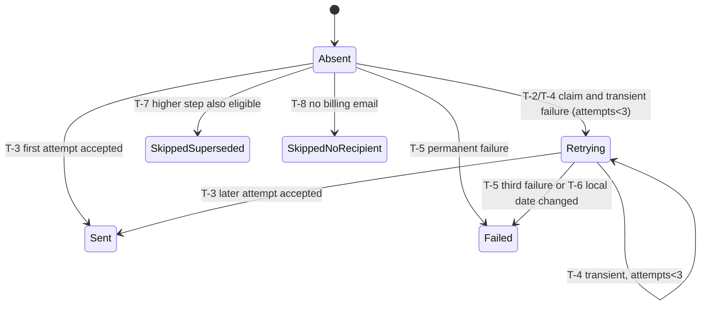

# Invoicing Product: Specification

Status: proposed (spec stage, 2026-11-21). Nothing here is implemented or verified.

## Sources, baseline and evidence limits

| Item | State |
| --- | --- |
| Incoming request | "Set up automatic reminders for unpaid invoices." (request dated 2026-11-21). Hereafter **REQ-0**. |
| Prior `KNOWLEDGE/spec.md` | None existed. No R-<n> to keep; `## Retired` is empty. |
| Discovery / research results | None. |
| Repository / current-system baseline | None. Nothing was inspected: the product's invoice model, roles, account model, email sender, scheduler, persistence, UI stack and visual identity are **unknown**. Every statement about them below is an assumption (A-n), not an observation. |
| Guides used | `GUIDES/requirements-definition.md`, `behavioral-requirements.md#behavior-model` and `#traceability-and-review`, `#actors-channels-and-state-ownership`, `service-discovery.md#verification`, `platforms/ui.md#light-expressive-starting-point`, `current-system-baseline.md#planning-and-review-handoff`. |

Because there is no baseline, every requirement below is **added**; nothing is preserved or modified. If a
baseline later shows an existing reminder, notification or invoice-status behaviour, reconcile it before dependent
work (open gap G-1).

### Request outcomes

| ID | Outcome stated or implied by REQ-0 | Requirements |
| --- | --- | --- |
| O-1 | "Set up": an authorized person can switch reminders on and choose when they go out. | R-1 |
| O-2 | "Reminders for unpaid invoices": only invoices that are actually unpaid get reminders, and a paid invoice stops receiving them. | R-2, R-5 |
| O-3 | "Automatic": reminders go out on schedule with nobody pressing a button, once each, and survive downtime and delivery failure. | R-3, R-4 |
| O-4 | The person who set it up can see what was sent (needed to trust an automatic action). | R-6 |
| O-5 | Quality conditions the request leaves unstated but which the feature needs (UI, privacy, operability, testability, limits). | R-7 to R-11 |

**Primary requirements** (what the user asked for directly): R-1, R-2, R-3, R-4, R-5.

### Assumptions (best defaults; the request leaves these to choice)

| ID | Assumption | Why this default |
| --- | --- | --- |
| A-1 | The product is a multi-user web application used by a business (the **account**) to invoice its customers. The account has users with an **admin** permission (may change account settings) and other users who can view invoices. | The request says nothing else; reminders need a business and a customer. Unverified (G-1). |
| A-2 | A reminder is one **email** to the invoice's single customer billing email address. No SMS, chat or letter. | Email is the cheapest channel that needs no extra customer data. |
| A-3 | Reminders are **off** for an account until an admin turns them on. | Emailing customers is outward-facing; switching it on is the "set up" step and avoids a surprise mass send to existing overdue invoices at release. |
| A-4 | Default schedule: offsets **-3, 0, +7, +14, +30** days relative to the invoice due date (negative = before, 0 = on the due date). | Common dunning cadence: one heads-up, one due-day notice, then escalating overdue notices. |
| A-5 | Reminder time: **09:00 in the account's time zone** (UTC when the account has none). Due dates are calendar dates. The evaluation ("sweep") runs at least once every 60 minutes. | A business-hours send; hourly granularity is enough for day-based offsets. |
| A-6 | A schedule has **1 to 5** steps; each offset is an **integer from -30 to +90**; offsets are distinct. | Bounds the number of emails one invoice can ever cause (at most the schedule length) and keeps dates sane. |
| A-7 | At most **3 attempts** per reminder, at least **60 minutes** apart, only within the account-local date of the first attempt. | Rides out a short provider outage without sending into the next day or looping forever. |
| A-8 | A step is identified by its **offset**; each offset is sent at most once per invoice, even if the due date is later edited. | Keeps the maximum number of reminders per invoice equal to the schedule length. Trade-off: an extended due date does not get a fresh -3 reminder if -3 was already sent (accepted). |
| A-9 | Settings edits by two admins resolve by **last write wins**, showing who saved last and when. | Rare, low-harm conflict; no merge UI. |
| A-10 | Retention: the reminder history lives as long as its invoice and is deleted with it; settings live as long as the account. | No retention period was requested; tying it to the owning record adds no new lifetime. |
| A-11 | English-language email; dates shown as `20 Mar 2026`; money as ISO currency code plus amount, `USD 1,000.00`. | No locale requirement given. |
| A-12 | Reply-To on the reminder is the account's business contact email, if one exists; if none exists the header is omitted. | Customers reply to the business, not to a no-reply sender. |

### Open gaps and decisions

| ID | Gap | Affects | Blocks |
| --- | --- | --- | --- |
| G-1 | No repository or baseline: invoice model, status names, roles, account time zone, email sender, scheduler and persistence facilities, UI stack and visual identity are unknown. Needs discovery before planning. | R-1 to R-11 | Implementation planning of every component that touches those. Acceptance lines here stay valid. |
| G-2 | Product decision: per-invoice pause/opt-out of reminders (e.g. a disputed invoice). Left out of scope (REQ-0 does not ask for it); an admin can turn reminders off account-wide. | R-2 | Nothing. |
| G-3 | Product decision: bounce / delivery-status handling. `sent` here means *accepted by the email provider*, not delivered. | R-4 | Nothing. |
| G-4 | Platform limit: the email provider's send-rate and daily quota are unknown (no provider named). | R-11 | Only the capacity acceptance line. |
| G-5 | Does the product have an invoice payment link or public invoice page to put in the email? | R-4 | Nothing; the link is included only if it exists. |
| G-6 | Does the product have a "disputed" or "on hold" invoice status? If yes, how it affects R-2 is undecided. | R-2 | Only that status's handling. |
| G-7 | Legal/regulatory content for payment reminders in the account's jurisdictions (required wording, frequency limits) is unreviewed. | R-4 | Nothing for the build; flagged for the owner before enabling in production. |
| G-8 | Whether the email provider supports an idempotency key (decides the residual duplicate-on-crash window in R-4). | R-4 | Nothing; the window is documented. |

## Requirements

### R-1 Reminder setup (settings)

- **Basis:** REQ-0 (2026-11-21) "Set up automatic reminders". Change: added. Preserved: none known (G-1).
  Source locators: A-3, A-4, A-6, A-9; `behavioral-requirements.md#states-and-transitions`.
  Evidence limits: account/permission model unobserved. Pending: implementation and all checks.
- **Behaviour:** Each account has one reminder setting: `enabled` (boolean, initially **false**, A-3) and `offsets`
  (ordered list of integers, initially `[-3, 0, 7, 14, 30]`, A-4). An admin can enable or disable, and edit the
  offsets, in a settings screen. A successful save is atomic and takes effect at the next sweep.
  Whenever a save turns `enabled` from false to true, or changes `offsets` while enabled, the setting records
  `effective_from` = the account-local date of the save (used by R-3 so that a save never fires past reminders).
  A save that changes neither value leaves `effective_from` unchanged.
- **Boundaries:** 1 to 5 offsets; each an integer in -30..+90; no duplicates (A-6). The offsets list is stored sorted
  ascending. Account time zone defaults to UTC (A-5).
- **Error behaviour:** An invalid save (reason named per field), a save by a non-admin, or a failed write changes
  nothing; the screen keeps the user's unsaved input and shows the reason. Disabling never deletes history.
- **Consumer outcome:** the settings screen shows the saved state; the next sweep acts on it.

Member sets. Roles: {admin, other account user, customer/unauthenticated}; only admin may save (the other two are
the groups with distinct observable behaviour: other users may view, customers/unauthenticated see nothing). Offset
inputs partition into {valid, empty list, >5 entries, duplicate, non-integer such as `3.5` or `abc`, below -30,
above +90}.

Acceptance (surface = settings screen S-UI, and the stored setting read back through a reload; confirmed by a
browser-driven check):

- **AC-1.1 Positive.** Admin on a fresh account sees `enabled=false` and offsets -3, 0, 7, 14, 30. Admin switches
  on and saves; after reload the screen shows enabled with the same offsets. Admin then saves offsets `[-5, 2]`;
  reload shows `-5, 2`.
- **AC-1.2 Failure.** Each of these saves is rejected, the stored setting is unchanged on reload, and the message
  names the cause: `[]`; six offsets `[-3,0,7,14,30,60]`; `[0, 0]`; `[3.5]`; `["abc"]`; `[-31]`; `[91]`. A
  non-admin user cannot change the setting (control disabled in the UI; the same request sent directly is rejected
  with an authorization error and no change). A save that fails to persist shows an error, keeps the typed input, and
  the reload shows the previous value.
- **AC-1.3 Boundary.** Accepted: exactly five offsets; `[-30]`; `[90]`; `[0]`. Rejected: six offsets; `[-31]`; `[91]`.
  `effective_from` is set to the account-local date on a false→true save and on an offsets change while enabled, and is
  unchanged by a no-op save (observed through R-3 behaviour in AC-3.6, not by reading storage).
- **AC-1.4 Concurrency.** Admin A and admin B load the screen showing `[0]`; A saves `[0, 7]`, then B saves `[0, 14]`.
  Reload shows `[0, 14]` and "last saved by B at <time>" (A-9). No error is shown to either.

### R-2 Which invoices get reminders (eligibility)

- **Basis:** REQ-0 "unpaid invoices". Added. Locators: A-1, G-2, G-6. Limits: invoice statuses unobserved (G-1).
  Pending: implementation and checks.
- **Behaviour:** An invoice is eligible when, **at the moment a reminder would be sent** (not when the schedule was
  computed), all hold: the account has `enabled=true`; the invoice status is `open` (issued, not yet fully paid); its
  remaining balance is greater than zero. Partially paid invoices are eligible and the reminder states the remaining
  balance.
- **Boundaries:** statuses {draft, open, paid, void}: only `open` qualifies. Balance exactly `0.00` is not eligible;
  `0.01` is. Statuses a product adds later (G-6) are ineligible until decided. Material exclusion: credit notes, refunds
  and write-offs are not modelled; a written-off invoice is eligible only if the product still reports it `open` with a
  positive balance.
- **Error behaviour:** An ineligible invoice produces no email, and no history row (its own status explains it).
- **Consumer outcome:** customers with an unpaid invoice receive reminders; customers with draft, void or settled
  invoices do not.

Acceptance (surface = captured outbound mail S-MAIL driven by one sweep at a chosen instant S-SWEEP, per R-11):

- **AC-2.1 Positive.** Setting enabled with default offsets, account tz America/New_York, invoice INV-1001 `open`,
  balance USD 1,250.00, due 2026-03-20: a sweep at 2026-03-17T13:00:00Z sends one email to its billing address
  (walk in F-1).
- **AC-2.2 Failure (negative eligibility).** For each of {draft, paid, void} invoices with a billing address and
  due 2026-03-20, a sweep at 2026-03-17T13:00:00Z sends nothing and writes no history row. With `enabled=false` and an
  otherwise eligible invoice, a sweep sends nothing. An `open` invoice with balance 0.00 sends nothing.
- **AC-2.3 Boundary.** Balance 0.01 on an `open` invoice sends; 0.00 does not. A partial payment of USD 250.00 on the
  USD 1,250.00 invoice leaves it eligible with balance 1,000.00 (AC-5.2).
- **AC-2.4 Freshness.** An invoice that is `open` when the day starts but is marked `paid` at 2026-03-17T12:30:00Z
  receives nothing from the 13:00:00Z sweep (status read at send time).

### R-3 When reminders go out (schedule, catch-up, no retroactive sends)

- **Basis:** REQ-0 "automatic". Added. Locators: A-4, A-5, A-8, `behavioral-requirements.md#states-and-transitions`.
  Limits: scheduler facility unknown (G-1). Pending: implementation and checks.
- **Behaviour:** For an invoice with due date `D` and an offset `k`, the **step date** is `D + k` days and the
  step becomes **due** at 09:00 on that date in the account time zone (inclusive: a sweep at exactly 09:00 sends).
  A step is **eligible to fire** when all hold: it is due; it has no history row yet (A-8); its step date is **after**
  the date the invoice became `open` (a step on the open date, or earlier, never fires); its step date is **on or
  after** the setting's `effective_from` (R-1; a save never fires reminders for dates before it). At each sweep, per
  invoice: if a reminder was already sent today (account-local date) nothing more is sent today; otherwise, among the
  eligible steps only the one with the **highest offset** is sent, and each other eligible step is recorded as
  `skipped-superseded` and is never sent later. Steps beyond the last offset do not exist: after the final step, no more
  automatic reminders are sent for that invoice.
- **Boundaries:** sweep at 08:59 local sends nothing, at 09:00 sends. Account-local date, not UTC date, decides the
  step date; the 09:00 instant follows the zone's UTC offset on that date (DST-aware); if 09:00 does not exist on a
  date in that zone, the earliest later valid instant that date is used. Maximum reminders ever sent for one invoice =
  number of offsets (A-6, A-8).
- **Error behaviour:** If the sweep did not run (downtime), the next sweep applies the catch-up rule above; no step is
  sent twice and no burst of stale reminders is sent.
- **Consumer outcome:** each customer receives at most one reminder per day, on the scheduled day (or the first sweep
  after it), with the most recent applicable step.

Acceptance (S-MAIL + S-SWEEP + history read-back; confirmed by an automated check with a controlled clock, R-11):

- **AC-3.1 Positive (timeline).** F-1 timeline below: -3 on 2026-03-17, 0 on 2026-03-20, +7 on 2026-03-27, each exactly
  one email, nothing between.
- **AC-3.2 Boundary (09:00).** Invoice due 2026-03-20, tz America/New_York (UTC-4 on that date, DST began 2026-03-08):
  sweep at 2026-03-17T12:59:00Z sends nothing; at 2026-03-17T13:00:00Z sends the -3 step; a second sweep at
  2026-03-17T14:00:00Z sends nothing more.
- **AC-3.3 Boundary (zone and DST).** (a) tz Pacific/Auckland (UTC+13 on 2026-03-17), due 2026-03-20: sweep at
  2026-03-16T19:59:00Z sends nothing; at 2026-03-16T20:00:00Z sends -3 (the account-local date is 2026-03-17 although
  the UTC date is 03-16). (b) tz America/New_York, due 2026-03-11, offset -3 (step date 2026-03-08, the DST change
  day, UTC-4 after 02:00): sweep at 2026-03-08T12:59:00Z sends nothing; at 2026-03-08T13:00:00Z sends.
- **AC-3.4 Catch-up.** No sweep ran from 2026-03-16 until 2026-04-03T14:00:00Z (10:00 EDT). Invoice INV-1002 (due
  2026-03-20, opened 2026-03-01, USD 800.00, default offsets, setting effective since 2026-02-15). That sweep sends
  exactly one email, for +14, and records -3, 0 and +7 as `skipped-superseded`; the 15:00:00Z sweep sends nothing; the
  sweep at 2026-04-19T13:00:00Z sends +30; after that, no sweep ever sends again.
- **AC-3.5 Opened late.** INV-1004 opened 2026-03-18, due 2026-03-20: the -3 step date (03-17) precedes the open date
  and never fires (sweep 2026-03-17T13:00:00Z sends nothing); the 0 step sends at 2026-03-20T13:00:00Z. Boundary:
  INV-1005 opened and due 2026-03-20: the 0 step (date equals open date) does not fire at 2026-03-20T13:00:00Z; +7 sends
  at 2026-03-27T13:00:00Z; no `skipped` rows are written for steps that were never eligible.
- **AC-3.6 No retroactive send.** Reminders enabled and saved 2026-03-25 (tz America/New_York); INV-1003 opened
  2026-03-01, due 2026-03-10 (already overdue). Sweep at 2026-03-25T15:30:00Z sends nothing (steps dated 03-07, 03-10,
  03-17, 03-24 are before `effective_from`); sweep at 2026-04-09T13:00:00Z sends the +30 step only. Also: an
  admin who re-saves identical settings on 2026-03-26 does not change this outcome (no-op save keeps `effective_from`).
- **AC-3.7 Failure (one per day).** If a reminder for an invoice was sent at an earlier sweep on the same local date,
  a later sweep that date sends nothing for it even if another step is eligible (that step is reconsidered the next day
  under the catch-up rule).
- **AC-3.8 Failure (disabled).** Disabling at 2026-03-18 and sweeping on 2026-03-20 sends nothing and writes nothing;
  re-enabling on 2026-03-22 sets `effective_from` 03-22, so a 0-step dated 03-20 never fires.

### R-4 Delivery: content, once-only, retry, failure

- **Basis:** REQ-0 "reminders". Added. Locators: A-2, A-7, A-8, A-11, A-12, G-3, G-5, G-7, G-8,
  `service-discovery.md#verification`. Limits: provider unknown. Pending: implementation and checks.
- **Behaviour:** A firing step sends one email: To = the invoice's customer billing email; Reply-To per A-12; subject by
  days relative to the due date **on the send date** (`n = send local date - due date`): `n < 0`: `Reminder: invoice
  INV-1001 is due on 20 Mar 2026`; `n = 0`: `Reminder: invoice INV-1001 is due today`; `n = 1`: `Overdue: invoice
  INV-1001 is 1 day overdue`; `n > 1`: `Overdue: invoice INV-1001 is 7 days overdue`. Body (plain-text alternative
  included): business name, invoice number, remaining balance (`USD 1,000.00`), due date, days relative, and a payment
  link only if the product has one (G-5). No other customer's or invoice's data appears.
  Each `(invoice, offset)` is claimed atomically **before** sending so that two overlapping sweeps send one email.
  History status values: `sent` (accepted by the provider), `retrying`, `failed`, `skipped-superseded`,
  `skipped-no-recipient`.
- **Boundaries:** attempts: at most 3 (A-7), each at least 60 minutes after the last, never into the next account-local
  date; at the local date change an unfinished `retrying` becomes `failed`. Failure kinds {transient (timeout,
  provider 5xx/throttle), permanent (provider rejects the address), no recipient (billing email missing/empty)}: transient
  retries; permanent fails at once with no retry; no recipient records `skipped-no-recipient`, and a later step sends
  normally if an address has been added by then.
- **Error behaviour:** a failure never blocks other invoices' reminders, never sends twice, and is visible in history
  (R-6). Residual risk (G-8): if the process dies after the provider accepted the message and before `sent` is
  recorded, one duplicate is possible on recovery unless the provider supports an idempotency key; this is the only
  allowed duplicate.
- **Consumer outcome:** the customer receives one correct email per firing step; the admin can see failures.

Acceptance (S-MAIL with a controllable fake provider, S-HIST history read-back; confirmed by automated check):

- **AC-4.1 Positive (content).** INV-1001 USD 1,250.00 due 2026-03-20, step -3 sent 2026-03-17: subject exactly
  `Reminder: invoice INV-1001 is due on 20 Mar 2026`; body contains `INV-1001`, `USD 1,250.00`, `20 Mar 2026`; a
  plain-text part exists. Step 0 on 2026-03-20 subject `Reminder: invoice INV-1001 is due today`. Step +7 sent
  2026-03-27 subject `Overdue: invoice INV-1001 is 7 days overdue`. Boundary on wording: sent 2026-03-21 gives `1 day
  overdue` (singular).
- **AC-4.2 Failure (retry).** Provider returns a transient error for INV-1009 (USD 75.00, due 2026-03-20) at sweeps
  2026-03-17T13:00Z, 14:00Z, 15:00Z: three attempts, then history `failed` with 3 attempts; sweep 16:00Z sends
  nothing. A sweep at 13:30Z (30 minutes after attempt 1) makes no attempt. If attempt 2 (14:00Z) succeeds the step is
  `sent`, attempt 3 is never made.
- **AC-4.3 Failure (permanent).** Provider rejects the address permanently: one attempt, `failed`, no retry at the next
  sweep.
- **AC-4.4 Boundary (local-midnight end of retries).** First attempt at 2026-03-18T03:30:00Z (23:30 EDT on 03-17)
  fails transiently; the sweep at 2026-03-18T04:30:00Z (00:30 EDT on 03-18) makes no attempt and the step is `failed`
  with 1 attempt.
- **AC-4.5 No recipient.** INV-1008 has no billing email: sweep 2026-03-17T13:00:00Z sends nothing and records -3
  `skipped-no-recipient`; if an address is added on 2026-03-19, the 0 step on 2026-03-20 sends.
- **AC-4.6 Concurrency.** Two sweeps for the same instant run simultaneously (and, separately, a sweep is restarted
  after a crash that happened before the provider call): INV-1001 step -3 yields exactly one email (crash after the
  provider accepted is the documented G-8 exception, not asserted).
- **AC-4.7 Isolation.** With two accounts and two invoices, every email's body and recipient contain data only of its own
  invoice and account; a failing provider call for one invoice does not stop the other's reminder in the same sweep.

### R-5 Stopping when the invoice is no longer unpaid, and changes to the invoice

- **Basis:** REQ-0 "unpaid invoices" (a paid invoice must stop being chased). Added. Locators: A-8,
  `requirements-definition.md#state-and-data-change-assessment`. Pending: implementation and checks.
- **Behaviour:** Eligibility and the email's balance and due date are read at send time (R-2). Marking the invoice paid
  or void, or its balance reaching 0.00, stops all further reminders; no history row is written for steps that never
  fire. A partial payment changes the balance printed. Changing the due date recomputes remaining step dates from the
  new date; offsets already in history stay consumed (A-8), so no reminder is resent. Reopening a paid invoice
  (becoming `open` again with a positive balance) resumes the schedule: R-3 uses the date the invoice **first** became
  `open`, so steps already in history stay consumed and later unsent steps follow the catch-up rule.
- **Boundaries:** payment at the same instant as a sweep: the status read at the moment of the claim decides; a
  reminder already accepted by the provider is not recalled.
- **Error behaviour:** none beyond R-4.
- **Consumer outcome:** customers who pay stop receiving mail; customers who extend a due date are not nagged on the
  old date.

Acceptance (S-MAIL + S-SWEEP):

- **AC-5.1 Positive (stop).** INV-1001 (F-1): paid in full on 2026-03-30; the sweeps at 2026-04-03T13:00:00Z and
  2026-04-19T13:00:00Z send nothing and add no history rows.
- **AC-5.2 Partial payment.** USD 250.00 paid on 2026-03-25 against USD 1,250.00: the +7 email on 2026-03-27 shows
  `USD 1,000.00`.
- **AC-5.3 Due-date change.** INV-1007 (due 2026-03-20, USD 400.00): -3 sent 2026-03-17T13:00:00Z; due date changed to
  2026-04-10 on 2026-03-18. Sweep 2026-03-20T13:00:00Z sends nothing; 2026-04-07T13:00:00Z sends nothing (-3 already
  consumed, A-8); 2026-04-10T13:00:00Z sends the 0 step (`is due today`). Final history: -3 sent, 0 sent.
- **AC-5.4 Failure/void.** Voiding an invoice between two steps stops later steps: no mail at the next due step.
- **AC-5.5 Boundary (race).** Invoice marked paid one second before the claim: nothing sent; marked paid after the
  provider accepted: the one email stands and no further reminders go out.

### R-6 Reminder history

- **Basis:** O-4, an automatic action must be inspectable. Added; scope kept minimal. Locators: A-10, R-4 status values.
  Pending: implementation and checks.
- **Behaviour:** The invoice detail screen shows a **Reminders** list for that invoice, newest first: offset, step
  date, status, send/attempt time (account time zone), recipient address, and attempt count for `failed`. Visible to
  any account user who may view that invoice; never to customers. Read-only; no resend action (out of scope).
- **Boundaries:** an invoice with no rows shows an empty list; the list shows every row of the invoice (at most one per
  distinct offset ever used, so never more than 5 per schedule version).
- **Error behaviour:** if the history cannot be loaded the panel shows an error with a retry control and the rest of
  the invoice screen still works.
- **Consumer outcome:** an admin can answer "did the customer get a reminder, and why not?".

Acceptance (S-UI invoice detail; browser-driven):

- **AC-6.1 Positive.** After F-1 the INV-1001 panel lists three rows: `+7 / 2026-03-27 / sent`, `0 / 2026-03-20 /
  sent`, `-3 / 2026-03-17 / sent`, with recipient `ar@acme.example`.
- **AC-6.2 Failure.** A history read failure shows the error and retry; retry success shows the rows. An unauthenticated
  or customer request for the history is refused with no data.
- **AC-6.3 Boundary.** An invoice with no reminders shows the designed empty state ("No reminders yet"); an invoice
  with `failed` shows `failed` and `3 attempts`.

### R-7 Interface quality (settings screen, history panel, email)

- **Basis:** deliverable has a UI; REQ-0 needs a surface for "set up" (A-1). Added. Visual reference: the light
  Google Gemini look and Material 3 Expressive principles (`platforms/ui.md#light-expressive-starting-point`) as the
  **starting point** only; an established product identity or platform convention found in discovery (G-1) takes
  precedence. Starting appearance: **light with a dark option**; the plan chooses the concrete treatment (AD later).
  Pending: implementation and checks.
- **Behaviour / criteria (observable):**
  1. One visual system: documented spacing and type scales, a colour palette with a light and a dark theme; the theme
     follows the system setting and can be switched.
  2. Designed empty (AC-6.3), loading (skeleton or progress for the history and settings fetch), error (AC-6.2) and
     saving states; "Saved" appears only after the write is confirmed (truthful async feedback); a failed save keeps input.
  3. The layout works at 360 px and 1440 px widths with no horizontal scrolling.
  4. Visible keyboard focus on every control; text and control contrast meets WCAG 2.2 AA (4.5:1 body, 3:1 large text
     and control boundaries); every control has an accessible name; the offsets editor is operable by keyboard alone.
  5. Motion only to explain a change and disabled under `prefers-reduced-motion`.
  6. One icon set.
  7. The email: a plain-text part plus HTML, body text meets AA contrast in light and dark clients, readable at 320 px.
- **Acceptance:**
  - **AC-7.1 Positive.** Rendered screenshots at 360 px and 1440 px in light and dark show the criteria above; an
    automated check finds no horizontal overflow at 360 px and zero critical contrast violations.
  - **AC-7.2 Failure.** Forced error and slow responses render the designed error and loading states; a rejected save
    shows an inline message, not "Saved".
  - **AC-7.3 Boundary.** Tab order reaches every control with a visible focus ring; with reduced motion enabled no
    non-essential animation runs.
  Surface: browser at both widths; confirmation: Playwright-style semantic queries plus an axe-style scan (DOM and ARIA
  assertions alone are not a full accessibility audit; a manual keyboard pass is recorded).

### R-8 Privacy and access control

- **Basis:** customer email addresses and invoice amounts are personal/commercial data (A-1, A-10). Added.
  Pending: implementation and checks.
- **Behaviour:** Settings: read by users in the account, written only by an admin. History: readable by users who can
  view the invoice. Recipient addresses are stored only in the invoice record and in the history row, shown only in the
  history panel, and are **not** written to application logs, metrics or error reports (use invoice ID and offset).
  Email bodies are not stored. Deleting an invoice deletes its history rows; deleting the account deletes its setting and
  history. A user of account X can never read or change account Y's setting or history.
- **Boundaries:** roles {admin, other user, customer, other account's user}.
- **Error behaviour:** unauthorized requests are rejected without revealing whether the target exists.
- **Acceptance (S-UI/API with two accounts and a log capture):**
  - **AC-8.1 Positive.** Admin of account X saves a setting; another user of X can read but not write it.
  - **AC-8.2 Failure.** Account Y's admin requesting X's setting or an X invoice's history gets the same response as for
    a nonexistent target; no data returned.
  - **AC-8.3 Boundary.** After a sweep that sends, fails (AC-4.2) and skips (AC-4.5), a scan of captured application
    logs finds none of the test billing addresses or the string of any email body; deleting the invoice removes its rows.

### R-9 Operability and observability

- **Basis:** an unattended automatic action must be diagnosable. Added. Locators: `service-discovery.md#verification`.
  Pending: implementation and checks.
- **Behaviour:** every send attempt emits one structured event (invoice ID, offset, attempt number, outcome in
  {sent, transient-failure, permanent-failure, skipped-no-recipient, skipped-superseded}) and every sweep emits a
  summary (instant, invoices considered, sent, skipped, failed). A sweep that raises an unexpected error for one
  invoice records it and continues with the rest.
- **Boundaries:** no personal data in events (R-8).
- **Acceptance:**
  - **AC-9.1 Positive.** AC-4.1/4.2 runs emit the matching events and one summary per sweep.
  - **AC-9.2 Failure.** An injected exception for invoice A leaves invoice B's reminder sent in the same sweep and an
    error event for A.
  - **AC-9.3 Boundary.** A sweep with nothing eligible emits a summary with zeros and no attempt events.
  Surface: captured log/event sink; automated check.
  Excluded with reason: dashboards, paging and alert routing are not requested and no ops tooling is known.

### R-10 Testability of time-dependent behaviour

- **Basis:** R-3's behaviour spans days; it cannot be verified in real time. Added.
- **Behaviour:** the sweep takes the current instant as an input (a controllable clock) and can be invoked for one
  chosen instant; the email provider is replaceable by a fake that can fail transiently, fail permanently and capture
  messages. No test waits for wall-clock time.
- **Acceptance:** **AC-10.1** every R-2..R-5 acceptance line runs in an automated check using this seam, with no sleeps.
  **AC-10.2** (failure) a sweep invoked with the same instant twice yields identical history (idempotent).
  **AC-10.3** (boundary) the instants in AC-3.2 and AC-3.3 (to the minute) are reproducible.
  Surface: automated test harness; confirmation: the check suite passing (status recorded separately when run).
- **Unverified, owned and due:** delivery through the real provider to a real mailbox cannot be checked here
  (no provider/credentials). Owner: the team that supplies provider access (G-1, G-4). Due: product-acceptance phase,
  on a test mailbox. Until then it is unverified, not absent.

### R-11 Capacity and provider limits

- **Basis:** a scheduled bulk action meets provider quotas. Added.
- **Status:** **unresolved**. Account count, invoices per account and the provider's quota/rate limit are unknown (G-4),
  and no target was requested, so no latency, throughput or capacity bound is set. Not invented here.
- **Behaviour that is required regardless:** a sweep processes invoices in bounded batches rather than holding all
  invoices in memory, and when the provider throttles, the R-4 transient-retry rules apply (retry within the A-7 limits,
  no duplicate).
- **Acceptance:** **AC-11.1** (positive) a sweep over 1,000 synthetic eligible invoices with a fake provider sends 1,000
  emails once each and does not exceed a configured per-sweep batch size (the batch size is a plan-time choice, recorded
  as an AD). **AC-11.2** (failure) the fake provider throttles every 10th call: each throttled reminder retries per R-4,
  none is duplicated. **AC-11.3** (boundary) `n/a: the numeric production limit is unresolved (G-4)`; this line stays
  open until a target and quota exist.

## Behaviour model

### Flows

**F-1 Timeline for INV-1001** (R-2, R-3, R-4, R-5, R-6). Actors: scheduler (sweep), invoice store (authority for
status, balance, due date, open date), reminder log (authority for what was sent), email provider, customer, admin.

Fixture: account tz America/New_York; setting enabled, default offsets, `effective_from` 2026-02-15; INV-1001 open
since 2026-03-01, due 2026-03-20, billing `ar@acme.example`, balance USD 1,250.00. Step dates: -3 = 03-17, 0 = 03-20,
+7 = 03-27, +14 = 04-03, +30 = 04-19. On all those dates New York is on EDT (UTC-4), so 09:00 = 13:00Z.

| # | Action (permitted by) | Expected |
| --- | --- | --- |
| 1 | Sweep 2026-03-17T12:59:00Z (R-3 not yet due) | none |
| 2 | Sweep 2026-03-17T13:00:00Z (R-3 due, step date 03-17 > open 03-01, >= 02-15, no row) | email subject `Reminder: invoice INV-1001 is due on 20 Mar 2026`; row -3 `sent` (T-2, T-3) |
| 3 | Sweep 2026-03-17T14:00:00Z | none (row -3 exists; nothing else due) |
| 4 | Sweep 2026-03-20T13:00:00Z | `due today` email; row 0 `sent` |
| 5 | 2026-03-25: payment USD 250.00 recorded (invoice stays `open`, balance 1,000.00) | no email (payments do not send) |
| 6 | Sweep 2026-03-27T13:00:00Z | `7 days overdue` email showing `USD 1,000.00`; row +7 `sent` |
| 7 | 2026-03-30: remaining USD 1,000.00 paid, status `paid` | none |
| 8 | Sweeps 2026-04-03T13:00:00Z and 2026-04-19T13:00:00Z | none, no new rows (R-2 ineligible) |

Final: three emails, three `sent` rows (-3, 0, +7), no rows for +14, +30. Recomputed by hand from the rules above
(see Evidence: replay status).

**F-2 Settings save** (R-1): admin opens screen, edits, saves; the system validates, persists atomically, sets
`effective_from` if required (T-1), confirms; failure keeps input.

**F-3 Delivery with retry** (R-4): claim step (T-2) → provider call → `sent` (T-3) | transient → `retrying` (T-4) →
next sweep at least 60 min later and same local date → attempt | third failure or permanent → `failed` (T-5) |
local date changes → `failed` (T-6).

**F-4 Catch-up** (R-3): the first sweep after downtime finds several eligible steps; sends the highest offset,
records the rest `skipped-superseded` (T-7).

### Step state (entity: reminder step per invoice and offset; owner: reminder log; durable)

States: *absent* (initial, derived, not stored), `retrying`, `sent`, `failed`, `skipped-superseded`,
`skipped-no-recipient`. Terminal: all but `retrying` and *absent*. Invariant: at most one row per
`(invoice, offset)`; at most one `sent` per invoice per account-local date; rows only exist for steps that were
eligible to fire.

### Transition ledger

| T | R / F | Before | Trigger and guard | Operation | After / observation | Failure and recovery | Validation |
| --- | --- | --- | --- | --- | --- | --- | --- |
| T-1 | R-1 F-2 | setting S | admin saves; input valid | persist; set `effective_from` if enabled became true or offsets changed while enabled | S updated, reload shows it | invalid/non-admin/write failure: unchanged, input kept | AC-1.1..1.4, 3.6, 3.8 |
| T-2 | R-3 R-4 F-3 | step absent | sweep; step eligible, highest eligible, nothing sent today; invoice eligible at claim | claim `(invoice, offset)` atomically, then provider call | attempt in progress | crash before provider call: claim treated as an unused attempt and retried per A-7 | AC-3.x, 4.6 |
| T-3 | R-4 | absent or `retrying` | provider accepts | record `sent`, attempt time, recipient | one email; history shows `sent` | crash after accept: G-8 window | AC-4.1, 4.2 |
| T-4 | R-4 | absent/`retrying`, attempts<3 | transient error; later retry needs sweep >= 60 min after last attempt, same local date | record `retrying`, attempt count | no email yet | none | AC-4.2 |
| T-5 | R-4 | absent/`retrying` | permanent error, or 3rd transient error | record `failed`, attempt count | history `failed` | not retried | AC-4.2, 4.3 |
| T-6 | R-4 | `retrying` | account-local date changed | record `failed` | history `failed` | not retried | AC-4.4 |
| T-7 | R-3 F-4 | absent | sweep finds several eligible steps | record all but the highest as `skipped-superseded` | one email for the highest | none | AC-3.4 |
| T-8 | R-4 | absent | chosen step, billing email missing | record `skipped-no-recipient` | no email | next step re-evaluated | AC-4.5 |
| T-9 | R-2 R-5 | any | invoice not `open`, balance 0, or setting disabled at evaluation | no-op: no row, no email | unchanged | n/a | AC-2.2, 5.1, 3.8 |

Invalid/forbidden events: a sweep for a step already having a terminal row is a documented no-op (no email, no row
change; AC-3.2 third sweep, AC-10.2); a settings save by a non-admin is a guarded rejection with no change (AC-1.2).
Audit of event families: *timeout* and *restart* covered by T-2/T-6 and F-4; *concurrent actors* by AC-4.6 and AC-1.4;
*partial effect* by G-8; *expiry/deletion* by R-8; *unauthorized* by AC-1.2/6.2/8.2. Excluded: customer replies and
unsubscribes (no inbound channel, out of scope), cancellation mid-send (a started provider call is not recalled).

## State, data and lifecycle

| State | Owner and location | Readers | Concurrent changes | Ends / removed | Quotas |
| --- | --- | --- | --- | --- | --- |
| Reminder setting (`enabled`, `offsets`, `effective_from`, last-saved-by/at) | account record in the product's primary store (unobserved, G-1) | account users; written by admin | last write wins (A-9) | with the account | none known |
| Reminder log row `(invoice, offset)`: status, attempts, last attempt time, recipient, send time | product's primary store, beside the invoice | users who can view the invoice | unique key on `(invoice, offset)` plus atomic claim (T-2) | with the invoice (A-10) | none known |
| Pending steps | **not stored**; derived each sweep from invoice, setting and log (AD-1) | n/a | n/a | n/a | n/a |
| Invoice status, balance, due date, open date | invoice store (existing, unobserved), read-only here | as the product defines | product's own rules; read at claim time | n/a | n/a |
| Email content | built per send, **not stored**; held by the provider per its policy (unknown) | provider | n/a | n/a | provider quota G-4 |

Personal data: the billing address is shown only in the history panel, stored in the invoice record and log row,
never in application logs (R-8), removed with the invoice or account. This feature adds no identity, sharing or
persistence beyond the two stores above. Before/after invariants and recovery are in the transition ledger.

Service boundaries (inapplicable concerns in one line each): **email provider**: authority = the provider's accept
response, not delivery (G-3); async completion = bounces not consumed (G-3); recovery = A-7 retries and the G-8
window. **Invoice store**: authority read at claim time, no cache, so payment or void takes effect on the next
evaluation without cache invalidation. **Scheduler**: hourly sweep (A-5), missed runs recovered by catch-up (R-3);
incremental state = one log row per step. Owned event coverage = R-9. Remote-capability caching and
provider-login observability: not applicable, no remote cache or identity provider is added.

## Not covered by this request (domain rules left out, with the R they bound)

- R-1/R-4: editable message templates, languages, multiple recipients, CC to staff, SMS or other channels, late fees.
- R-2: per-invoice pause or customer opt-out (G-2), disputed status (G-6), credit notes and write-offs.
- R-3: reminders after the final step (escalation, collections), per-customer schedules, business-day or holiday calendars.
- R-4: bounce processing and delivery receipts (G-3), a manual "send now" or resend.
- R-6: customer-facing history, export.

## Non-functional requirements (summary and index)

| Attribute | Disposition |
| --- | --- |
| Interface/accessibility/usability | R-7 (criteria and checks). |
| Security, privacy, retention | R-8, A-10. |
| Reliability, recovery, data integrity | R-3 (catch-up), R-4 (once-only, retries), State table. |
| Observability, operability | R-9. |
| Testability, maintainability | R-10. |
| Performance, capacity, cost, provider limits | R-11: **unresolved**, no bound invented. Timeliness is stated as the date/09:00/hourly behaviour in R-3 and A-5, not as a latency SLA. |
| Compatibility | Email: plain-text plus HTML (R-7). Supported browsers and mail clients: unresolved with the stack (G-1). |
| Availability SLA, compliance regime | Excluded: none requested; legal wording flagged as G-7. |

## Evidence: replay status (item 10)

- Worked examples (F-1, AC-3.x, 4.x, 5.x) use concrete IDs, instants and values. Dates were computed by hand:
  2026-03-20 minus 3 = 03-17, plus 7 = 03-27, plus 14 = 04-03, plus 30 = 04-19; INV-1003 due 03-10 gives 03-07, 03-10,
  03-17, 03-24, 04-09; due 04-10 minus 3 = 04-07. US DST began Sunday 2026-03-08 (second Sunday of March), so
  09:00 New York is 13:00Z from that date; New Zealand is UTC+13 on 2026-03-17, so 09:00 is 2026-03-16T20:00Z.
- A small reference model of the sweep rules was written in the scratchpad to recompute the cases mechanically.
  **NOT-REPLAYED**: running it needed approval that an unattended run cannot get. Those results stay open: the hand-walk
  above is the only recomputation; each action was checked against the rule that permits it (T-ledger and R-3). The
  zone offsets above come from my knowledge of the tz database, not a probe.
- No documented command was added; no `backchain-check` exists here (duty 11 omitted). No platform-capability claim
  is relied on: scheduler, provider idempotency (G-8) and quotas (G-4) are listed as unknowns, not assumed.
- Requirement weakening vs. a prior version: none (no prior version).

## Retired

None.

## Submission

**summary:** First specification for automatic reminders on unpaid invoices, written without a repository or baseline.
Eleven requirements (R-1..R-11): setup (R-1), eligibility (R-2), schedule/catch-up/no-retroactive sends (R-3), delivery
with once-only and bounded retry (R-4), stopping on payment and due-date change (R-5), history (R-6), interface quality
(R-7), privacy (R-8), observability (R-9), testability (R-10), capacity (R-11, unresolved). Best defaults recorded as
assumptions A-1..A-12: email to one billing address; off until an admin enables; offsets -3, 0, +7, +14, +30 at 09:00
account time; 1-5 steps, offsets -30..+90; 3 attempts 60 min apart within the local date; each offset sent once per
invoice; last-write-wins settings; history kept with the invoice. Open items (none block behaviour, G-1 blocks
implementation planning): G-1 unknown product/stack, G-2 per-invoice pause, G-3 bounces, G-4 provider quota, G-5 pay
link, G-6 disputed status, G-7 legal wording, G-8 provider idempotency; R-11 has no numeric bound. No material
requirement conflict found. Unverified: mechanical replay of examples (NOT-REPLAYED) and real-provider delivery
(owner: provider access owner, due product-acceptance).

**primary:** R-1, R-2, R-3, R-4, R-5

**evidence_refs:** KNOWLEDGE/spec.md (all R-1..R-11 sections, Behaviour model, State, data and lifecycle),
KNOWLEDGE/architecture.md (AD-1..AD-5), GUIDES/requirements-definition.md,
GUIDES/behavioral-requirements.md#behavior-model, GUIDES/behavioral-requirements.md#traceability-and-review,
GUIDES/behavioral-requirements.md#actors-channels-and-state-ownership, GUIDES/service-discovery.md#verification,
GUIDES/platforms/ui.md#light-expressive-starting-point, GUIDES/current-system-baseline.md#planning-and-review-handoff.
Request: REQ-0, 2026-11-21. No repository, discovery, research or backchain receipt exists.
