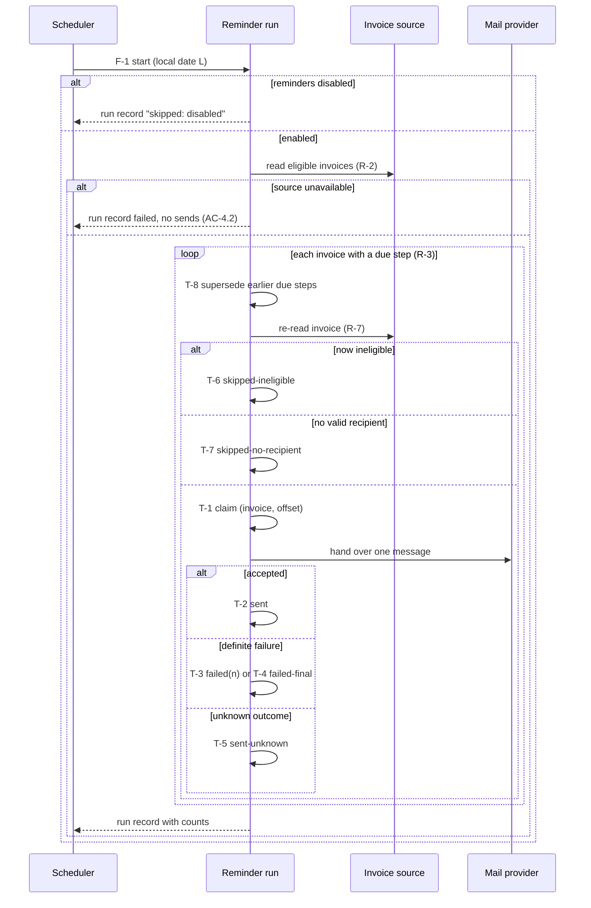
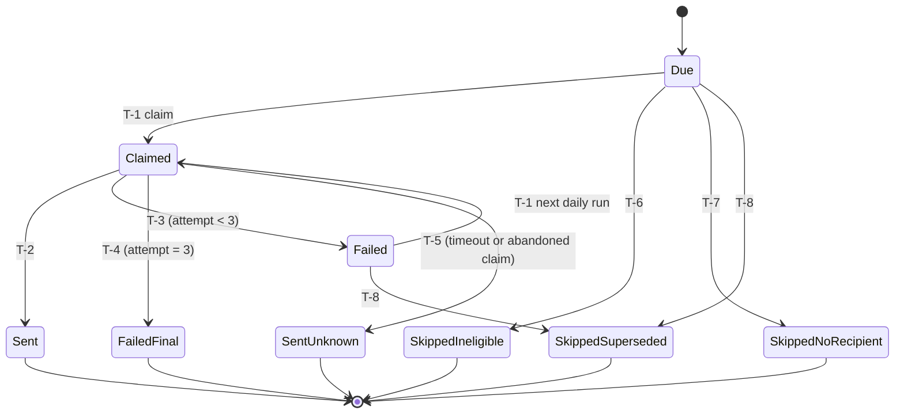

# Invoicing — Payment Reminders: Product Specification

Living specification of what the payment-reminder capability of the invoicing product must do. Structure and technology
choices live in `architecture.md` (`AD-<n>`); this file holds requirements (`R-<n>`), flows (`F-<n>`), transitions
(`T-<n>`), product decisions (`D-<n>`) and open gaps (`G-<n>`).

## 1. Sources, baseline and evidence limits

| Item | Content |
| --- | --- |
| Request (basis for every R-n below) | "Set up automatic reminders for unpaid invoices." — incoming request, 2026-11-21. Quoted as **REQ**. |
| Existing `KNOWLEDGE/spec.md`, research and discovery results | **None existed.** This is the first specification; there is nothing to preserve, change or retire. Every R-n below is *added*. |
| Selected current-system baseline | **None.** No repository, invoice schema, mail integration or scheduler was available to inspect. Current behaviour of the invoicing system is **unknown**, not absent (Current-system baseline guide: a missing read is a gap, not evidence of absence). |
| Guides applied | `requirements-definition.md`, `behavioral-requirements.md#behavior-model`, `#traceability-and-review`, `#actors-channels-and-state-ownership`, `service-discovery.md` (scope, runtime state placement, asynchronous cooperation, verification), `platforms/ui.md#light-expressive-starting-point`, `current-system-baseline.md#planning-and-review-handoff`, `project-knowledge.md#maintained-product-requirements`. |
| Unknown that keeps work unready | **G-1** (where invoices live and their fields) and **G-2** (mail provider and sender identity). R-2, R-5, R-7 and real-delivery verification of R-4/R-5 are unready until they close. Independent work — settings (R-1), the due-step calculator (R-3), the record/ledger logic (R-6, R-8) against fakes, history (R-9) — may proceed. |

Observation / inference / unknown are kept distinct: *Observed* = none (nothing inspected). *Inferred* = the invoice
fields listed in G-1 are needed. *Unknown* = everything about the host system. Where a rule below is a chosen default
rather than something the request states, it is a **D-n decision** with its rationale, not a user requirement.

## 2. Assumptions and product decisions

Defaults taken unattended; each is confirmable through the gap named. None is promoted to user-required.

| ID | Decision (default) | Rationale | Confirm via |
| --- | --- | --- | --- |
| D-1 | Channel is **email only**; one message per (invoice, step) to exactly one recipient; no per-customer digest. | Email is the usual invoice channel; the request names no other. A single-invoice message cannot leak another invoice's data. | G-10 |
| D-2 | Default schedule offsets, in calendar days relative to the invoice due date: **-3, +1, +7, +14** (negative = before due). Weekends are not skipped. | Request gives no cadence; a short pre-due notice plus three overdue notices is a conventional minimum. | G-3 |
| D-3 | A schedule has **1 to 6 entries**; each offset is an integer from **-30 to +90**; offsets are unique. | Needed so validation (R-1) is testable; values are placeholders, not platform limits. | G-3 |
| D-4 | The run executes **once per day at 09:00 in the account time zone** (IANA name, default `UTC`). If 09:00 does not exist or is ambiguous on a date, the run uses the first valid instant at or after it. Send time is not configurable. | One predictable daily pass; configurability is not requested. | G-11 |
| D-5 | Reminders are **off until an administrator enables them**. | Prevents customer email before anyone opted in. | G-3 |
| D-6 | **No backfill.** A schedule entry only produces reminders for step dates on or after the date the entry became effective (`effective_from`). | Enabling the feature must not email every overdue customer at once. | G-4 |
| D-7 | **Catch-up sends one reminder, not a burst:** if several steps of one invoice are due and unsent, only the latest-dated is sent; earlier ones are recorded superseded. | Outage recovery without spamming. | G-4 |
| D-8 | **At most one message per (invoice, offset), ever.** A send with unknown outcome is *not* retried. A definite failure is retried once per later daily run, **max 3 attempts**. | A duplicate dunning email is worse for the business than one missed reminder; a later step still follows. | G-5 |
| D-9 | The message states the **actual** days to/after due at send time, not the step's nominal offset. | Truthful after catch-up/retry. | — |
| D-10 | One business account; settings are account-level; no multi-tenant model. | Request mentions no tenancy. | G-7 |
| D-11 | "Administrator" = a user holding the host product's existing invoicing-admin role. | Request adds no new identity. | G-7 |
| D-12 | Reminder history is kept for the life of its invoice record and removed with it. | No retention period stated; avoids inventing one. | G-6 |

## 3. Actors, channels and state ownership (trace)

| Actor | Interaction / channel | State owner | Observable outcome |
| --- | --- | --- | --- |
| Administrator | Settings surface (request/response) → reminder settings | Reminder component (settings record) | Saved/rejected settings (R-1) |
| Scheduler (non-user initiator) | Daily trigger → reminder run | Reminder component (run + step records) | Run record with counts (R-4) |
| Reminder run | Reads invoices from the **invoice source** (request/response, read-only, fresh at send time) | Invoicing system owns invoice status/balance/recipient | Eligibility (R-2, R-7) |
| Reminder run | Hands one message to the **mail provider** (request/response; acceptance ≠ delivery) | Provider owns delivery; reminder component owns the step record | Email in recipient mailbox, step outcome (R-5, R-6, R-8) |
| Customer (invoice recipient) | Receives email | — | Message content (R-5) |
| Administrator | Reads history (request/response) | Reminder component | History view (R-9) |

Local-only interactions need no queue or broker; the daily run is a batch job, which fits the contract without a message
bus (AD-1). Background work promised here (R-4) is owned by the scheduler, not by any open screen.

## 4. Request-outcome traceability

| Request outcome (REQ words) | Acceptance lines |
| --- | --- |
| "Set up" — an admin can turn reminders on and configure them | AC-1.1 – AC-1.7 |
| "automatic" — reminders go out with no human action | AC-3.1 – AC-3.9, AC-4.1 – AC-4.5 |
| "reminders" — the customer receives a reminder | AC-5.1 – AC-5.7 |
| "for unpaid invoices" — only unpaid invoices; stops when paid | AC-2.1 – AC-2.3 (state changes after selection: AC-7.1 – AC-7.5) |
| Unstated but required for safety of the above (design decisions D-n) | R-6 (no duplicates), R-8 (failures), R-9 (visibility), R-10 (access/privacy) |

**`primary` requirements** (asked for directly): R-1, R-2, R-3, R-4, R-5, R-7.

## 5. Fixture F0 (used by acceptance lines so every step is replayable)

Each scenario starts from a **fresh world** containing only the invoices it names; the clock and mail provider are
injected (fake clock / fake provider that accepts unless stated). Runs are daily at 09:00 UTC on each stated date.

- Account: `timezone=UTC`, reminders enabled by an administrator on **2026-03-01** with schedule **[-3, +1, +7, +14]**; all four entries `effective_from=2026-03-01`.
- Base invoice **INV-1001**: customer "Acme Corp", recipient `ap@acme.example`, USD, status open, issued 2026-02-20, **due 2026-03-20**, total 500.00, paid 0.00.
  Step dates for a 2026-03-20 due date: -3 → **2026-03-17**; +1 → **2026-03-21**; +7 → **2026-03-27**; +14 → **2026-04-03**.
- Variants: **INV-1002** = base, paid in full (500.00) on 2026-03-18, recorded before that day's run (so the 2026-03-17 run still saw it unpaid). **INV-1003** = total 1000.00, paid 400.00 on 2026-03-19 before the run. **INV-1004** = base but no recipient email; `billing@globex.example` added on 2026-03-20 before the run. **INV-1005** = base, status void. **INV-1006** = issued 2026-02-01, due 2026-02-25, total 300.00. **INV-1007** = issued 2026-03-19, due 2026-03-20, total 80.00. **INV-1008** = base, status draft. **INV-1009** = total 100.00, paid 99.99 (balance 0.01). **INV-1010** = total 100.00, paid 120.00 (balance -20.00, status open). **INV-1011** = base, paid 500.00 from the start.
- Calendar facts used: 2026-03-01 is a Sunday; US daylight time began 2026-03-08, so on 2026-03-17 `America/New_York` is UTC-4.

## 6. Requirements

Each R-n states basis, preserved/changed behaviour, source locators, evidence limits, pending work, behaviour, bounds,
error behaviour, consumer outcome, then acceptance lines (**AC-n.k**: *positive / failure / boundary*, surface, confirmation).
"Lower-layer" confirmation = automated domain/API test with fake clock, fake provider and fake invoice source; "deployed"
confirmation = observation on the real runtime. Every acceptance line is **pending implementation and checks** unless stated.

### R-1 Administrator enables and configures reminders  *(primary)*

- **Basis:** REQ "Set up automatic reminders" (2026-11-21); decisions D-2, D-3, D-4, D-5, D-10, D-11.
- **Preserved / changed:** added; nothing preserved (no baseline). **Source locators:** REQ; `requirements-definition.md` (assess before planning).
- **Evidence limits:** no host settings surface inspected (G-8); role model unknown (G-7). **Pending:** implementation and checks.
- **Behaviour:** an administrator can turn reminders on/off, edit the schedule (list of day offsets) and the account time zone. Initial state: disabled, schedule [-3, +1, +7, +14], time zone UTC, settings `version=1`. A save carries the `version` it was based on; success increments it and sets `effective_from` = save date (account-time-zone date) for **new or re-enabled entries only** (kept entries keep theirs; removed entries' unsent steps are never sent; disabling then re-enabling resets all `effective_from` to the re-enable date).
- **Bounds:** 1–6 entries; offsets integers -30…+90, unique (D-3); time zone must be a valid IANA name.
- **Error behaviour:** any invalid or unauthorised save leaves stored settings and `version` unchanged and returns a field-level error; a stale `version` returns a conflict.
- **Consumer outcome:** the administrator sees the saved state; later runs (R-4) use it.
- **Out of scope (bounded by this R):** per-invoice or per-customer schedules, editable message templates, configurable send time, other channels, business-day calendars.
- **Open gaps:** G-3 (confirm defaults/bounds), G-7 (admin role), G-8 (settings surface), G-11 (default time zone).

| ID | Positive | Failure | Boundary | Surface · confirmation |
| --- | --- | --- | --- | --- |
| AC-1.1 | Admin saves `enabled=true`, schedule [-3,1,7,14], `tz=UTC`, `version=1` on 2026-03-01 → stored `enabled=true`, `version=2`, all entries `effective_from=2026-03-01`. | n/a: covered by AC-1.2/1.4/1.5 | n/a: covered by AC-1.3 | Settings page + settings read API · lower-layer, then browser |
| AC-1.2 | n/a: covered by AC-1.1 | Each save below is rejected with a field error naming the field and **no change** to settings/version: `[]`; `[1,1]`; `[2.5]`; `["abc"]`; seven entries `[-3,-2,-1,0,1,2,3]`; `[-31]`; `[91]`. | Accepted: `[0]` (1 entry), `[-30]`, `[90]`, and six entries `[-30,-3,0,1,7,90]`. | Settings API/page · lower-layer |
| AC-1.3 | `tz=America/New_York` accepted. | `tz=Mars/Olympus` rejected, settings unchanged. | n/a: no numeric bound | Settings API · lower-layer |
| AC-1.4 | n/a | Two admins load `version=2`; A saves (→3); B saves based on `version=2` → conflict error, stored state is A's, B's unsaved draft stays visible and editable, B can reload and re-apply. | n/a | Settings page + API · lower-layer + browser |
| AC-1.5 | n/a | A user without the admin role cannot read or save settings: request rejected as not permitted, settings unchanged. | n/a | Settings API · lower-layer (role model G-7) |
| AC-1.6 | With INV-1001 (state of F0), admin disables on 2026-03-05 → runs on 2026-03-17 send nothing and the run record says `skipped: disabled`; history already recorded is retained. Admin re-enables on 2026-03-18 → every entry `effective_from=2026-03-18`, so only steps dated ≥ 2026-03-18 can send (+1 on 2026-03-21 sends; -3 never sends). | n/a | Disable/enable on the same day as a step date: step dated the re-enable date is eligible (S ≥ `effective_from`). | Settings API, outbox, history · lower-layer |
| AC-1.7 | On 2026-03-10 admin adds offset 0 → INV-1001 receives a "due today" message on 2026-03-20; on 2026-03-30 admin removes +14 → no message on 2026-04-03. | n/a | Removing and re-adding offset +1 after it was sent does not resend it (key is invoice+offset, R-6). | Settings API, outbox · lower-layer |

### R-2 Only unpaid invoices are eligible  *(primary)*

- **Basis:** REQ "unpaid invoices" (2026-11-21). **Preserved/changed:** added. **Locators:** REQ; G-1 field list.
- **Evidence limits:** the host's status vocabulary is unknown (G-1); this R is written against five *logical* states (open, partially paid, paid, void, draft). **Pending:** mapping to host states; checks.
- **Behaviour:** an invoice is **eligible** iff status is open (issued, not void/draft/paid), has a due date, and remaining balance **> 0**. Groups with distinct behaviour: open full balance (eligible); partially paid (eligible, remaining balance used); paid / balance = 0 (not); balance < 0 (not); void (not); draft (not); open with **no due date** (not — offsets are relative to due date; due-on-receipt policy is G-12). Ineligible invoices produce **no message and no history record**.
- **Excluded by scope (bounded by this R):** disputed/on-hold invoices, late fees, collections escalation, interest, customer-level credit balances.
- **Consumer outcome:** only recipients of eligible invoices receive email.
- **Open gaps:** G-1, G-12.

| ID | Positive | Failure | Boundary | Surface · confirmation |
| --- | --- | --- | --- | --- |
| AC-2.1 | World {INV-1001, INV-1003 (unpaid at this date), INV-1004, INV-1005, INV-1008, INV-1009, INV-1010, INV-1011}, run on **2026-03-17**: messages to INV-1001 (balance USD 500.00), INV-1003 (USD 1000.00), INV-1009 (USD 0.01); one `skipped-no-recipient` record for INV-1004 step -3; **nothing** (no message, no record) for INV-1005, INV-1008, INV-1010, INV-1011. Run counts: considered 4, sent 3, skipped 1, failed 0, unknown 0. | Void/draft/paid/credit invoices never email (same run). | Balance `0.01` eligible (INV-1009); balance `0.00` (INV-1011) and `-20.00` (INV-1010) not. | Outbox + history API · lower-layer |
| AC-2.2 | n/a | Open invoice with no due date: no message, no record (G-12). | n/a | Outbox · lower-layer |
| AC-2.3 | Currency formatting follows the invoice currency's minor unit: a JPY invoice with balance 500 shows "JPY 500" (not "JPY 500.00"). | n/a | n/a | Message body · lower-layer |

### R-3 Which reminder is due on a given day  *(primary)*

- **Basis:** REQ "automatic reminders" (2026-11-21); D-2, D-6, D-7, D-9. **Preserved/changed:** added.
- **Evidence limits:** schedule semantics are a chosen default (G-3, G-4). **Pending:** calculator and checks. Hand-recomputed expected results: see §10.
- **Behaviour:** for invoice *I* and schedule entry with offset *o*, the **step date** is `S = due_date + o` (calendar days). The run's **local date** `L` is the calendar date of the run instant in the account time zone. Step (I, o) is **due** iff all hold: `S ≤ L`; `S ≥ entry.effective_from`; `S ≥ I.issue_date`; the step has no terminal record (terminal = sent, sent-unknown, skipped-*, failed-final); and no step of *I* dated later than `S` is already sent/sent-unknown. If several steps are due, **only the latest-dated one proceeds**; the others are recorded `skipped-superseded`. At most one message per invoice per run.
- **Bounds:** `S = L` is due (send on the day); `S = L+1` is not.
- **Error behaviour:** a step that is not due is not an error and leaves no record.
- **Consumer outcome:** the customer gets reminders on the schedule dates and at most one after any gap.

All expected results below use F0 (schedule [-3,+1,+7,+14], runs daily 2026-03-01 … 2026-04-10 unless stated).

| ID | Positive | Failure | Boundary | Surface · confirmation |
| --- | --- | --- | --- | --- |
| AC-3.1 | **INV-1001**: exactly four messages: 03-17 "Reminder: Invoice INV-1001 is due in 3 days", 03-21 "…is 1 day overdue", 03-27 "…is 7 days overdue", 04-03 "…is 14 days overdue", each stating USD 500.00; none on any other date, none after 04-03. | n/a | Run on 03-16: nothing (`S = L+1`); run on 03-17: message (`S = L`). | Outbox · lower-layer |
| AC-3.2 | **Time zone:** account `America/New_York`; run instant `2026-03-17T01:30:00Z` (local 03-16 21:30) → no message for INV-1001; run instant `2026-03-17T13:00:00Z` (local 09:00, 03-17) → "due in 3 days" message. | n/a | The local-date rule, not UTC date, decides. | Outbox · lower-layer |
| AC-3.3 | **Outage:** no runs 03-21 … 03-27; first run 03-28 → one message "Invoice INV-1001 is **8 days overdue**" (step +7, actual days per D-9); step +1 recorded `skipped-superseded` on 03-28; 04-03 still sends +14. Messages in total: 03-17, 03-28, 04-03. | n/a | Exactly one message, not two, on 03-28. | Outbox + history · lower-layer |
| AC-3.4 | **Enablement, no backfill:** **INV-1006** (due 02-25), enabled 03-01 → **no message on 03-01**; messages on 03-04 ("7 days overdue") and 03-11 ("14 days overdue") only; steps dated 02-22 and 02-26 never send. | n/a | S = 03-01 would be eligible; first S ≥ effective_from is +7 (03-04). | Outbox · lower-layer |
| AC-3.5 | **Issued after first step date:** **INV-1007** (issued 03-19, due 03-20) → no -3 message (S=03-17 < issue date); first message 03-21 "1 day overdue". | n/a | S = issue date counts as due. | Outbox · lower-layer |
| AC-3.6 | Schedule edit effects: see AC-1.7 (offset 0 added 03-10 → "due today" on 03-20; +14 removed 03-30 → none on 04-03). Messages for that world: 03-17, 03-20, 03-21, 03-27. | n/a | New entry only affects step dates ≥ its save date. | Outbox · lower-layer |
| AC-3.7 | **Partial payment between steps:** **INV-1003** → 03-17 message states USD 1000.00; 03-21 message states **USD 600.00**. | n/a | n/a | Message body · lower-layer |
| AC-3.8 | **Day wording:** 1 day → "1 day" (singular), 0 → "due today", 2 → "2 days". | n/a | n/a | Subject · lower-layer |
| AC-3.9 | **Reinstated invoice:** INV-1002 (paid 03-18 after the 03-17 message) has its payment reversed on 03-30 → run 03-30 sends one message "10 days overdue" (step +7) and records +1 superseded; no -3 resend; +14 sends 04-03 if still unpaid. | n/a | Ineligible days leave no records, so steps skipped while paid are caught up once (D-7). | Outbox + history · lower-layer |

### R-4 Reminders run automatically, without a person or a screen  *(primary)*

- **Basis:** REQ "automatic" (2026-11-21); D-4. **Preserved/changed:** added. **Evidence limits:** scheduler platform unknown (G-11). **Pending:** scheduler wiring; deployed check (owner: delivery, due: product-acceptance — currently **unverified**).
- **Behaviour:** a **run** is started by the scheduler once per day (D-4) with no user action and no UI open. A run evaluates **all** eligible invoices (no truncation), applies R-3/R-6/R-7/R-8, and writes a **run record**: `date`, `started`, `finished`, `status` ∈ {completed, completed-with-failures, failed}, counts {considered, sent, skipped, failed, unknown}. With reminders disabled the run does nothing except a run record `skipped: disabled`.
- **Bounds:** zero eligible invoices → `completed` with all counts 0. Run duration / invoice volume bound: unresolved (R-11).
- **Error behaviour:** if the invoice source cannot be read at all, the run is `failed`, sends nothing, and the next day's run recovers via R-3 catch-up. If one invoice cannot be read, that invoice is skipped for this run (no step record), counted `failed`, and other invoices proceed; status `completed-with-failures`.
- **Consumer outcome:** reminders arrive on schedule with nobody triggering them; admins can see each run (R-9).
- **Open gaps:** G-11.

| ID | Positive | Failure | Boundary | Surface · confirmation |
| --- | --- | --- | --- | --- |
| AC-4.1 | Fake scheduler fires at 2026-03-17 09:00 UTC with no UI session → INV-1001's -3 message is sent; run record `completed`, counts considered 1, sent 1, skipped 0, failed 0, unknown 0. | n/a | n/a | Outbox + run history · lower-layer; real scheduler: **deployed, unverified** |
| AC-4.2 | n/a | Invoice source unavailable for the whole 03-17 run → run `failed`, outbox empty; 03-18 run (source back) sends INV-1001 "due in 2 days" (step -3 still due, S ≤ L). | n/a | Outbox + run history · lower-layer |
| AC-4.3 | n/a | Source read fails for INV-1003 only on 03-17 (INV-1001 also present) → INV-1001 sent; INV-1003 no message, no step record; run `completed-with-failures`, failed 1. | n/a | Run history · lower-layer |
| AC-4.4 | n/a | n/a | 0 eligible invoices → run `completed`, counts all 0. | Run history · lower-layer |
| AC-4.5 | A day with 300 eligible invoices due the same step date processes all 300 (each exactly one message). | n/a | 300 is an arbitrary lower-layer volume to show *no truncation*, not a product bound. | Outbox count · lower-layer |

### R-5 The customer receives a clear reminder  *(primary)*

- **Basis:** REQ "reminders" (2026-11-21); D-1, D-9. **Preserved/changed:** added. **Evidence limits:** mail provider/sender unknown (G-2); payment link/instructions source unknown (G-9). **Pending:** template, provider adapter; real-delivery check (**unverified**, owner: delivery/ops, due: product-acceptance).
- **Behaviour:** one message per (invoice, step) to the invoice's **single** billing-contact address: exactly one `To`, **no Cc/Bcc**. Subject is `Reminder: Invoice <number> ` + phrase, where phrase = `is due in <n> day(s)` (n ≥ 1), `is due today`, or `is <n> day(s) overdue`, computed from send date vs due date (D-9). Body (plain-text part always present) contains: customer name, invoice number, remaining balance as `<CURRENCY> <amount>` in the currency's minor units, due date as `20 March 2026`, and how to pay: the invoice's payment link if the source provides one, otherwise the business contact line from the source (G-9). English only.
- **Bounds:** singular "1 day". Customer name is data, never markup or header text: it appears only in the body, HTML-escaped if an HTML part exists, UTF-8 encoded.
- **Error behaviour:** invalid or missing recipient → no send, `skipped-no-recipient` (R-8). Provider outcomes → R-8.
- **Out of scope (bounded by this R):** attachments (PDF invoice), tracking pixels / open tracking, localisation, per-customer digests, unsubscribe/reply handling (G-10), bounce processing.
- **Open gaps:** G-2, G-9, G-10.

| ID | Positive | Failure | Boundary | Surface · confirmation |
| --- | --- | --- | --- | --- |
| AC-5.1 | INV-1001 step -3 on 03-17 → subject exactly `Reminder: Invoice INV-1001 is due in 3 days`; body contains `Acme Corp`, `INV-1001`, `USD 500.00`, `20 March 2026`; `To` = `ap@acme.example` only; no Cc/Bcc headers. | n/a | n/a | Captured message in sandbox mailbox · lower-layer; real provider: **deployed, unverified** |
| AC-5.2 | Step +1 on 03-21 → subject `Reminder: Invoice INV-1001 is 1 day overdue`; step 0 on 03-20 (AC-1.7 world) → `Reminder: Invoice INV-1001 is due today`. | n/a | Singular/plural per AC-3.8. | Captured message · lower-layer |
| AC-5.3 | A recipient of `ap@acme.example` with two eligible invoices due the same step date gets **two separate messages**, each about one invoice only. | n/a | n/a | Outbox · lower-layer |
| AC-5.4 | n/a | Customer name `Zoë <b>& Sons\r\nBcc: x@evil.example` → subject has no customer name; body shows the name literally (escaped in any HTML part); no extra header is produced. | Non-ASCII `ë` is preserved. | Captured raw message · lower-layer |
| AC-5.5 | Plain-text part exists on every message; invoice with a payment link shows it, one without shows the business contact line instead. | Neither link nor contact line available → message still sends, how-to-pay line omitted (G-9 open). | n/a | Captured message · lower-layer |
| AC-5.6 | n/a | Recipient `not-an-email` → no message; `skipped-no-recipient`. | n/a | Outbox + history · lower-layer |
| AC-5.7 | Real-provider delivery of AC-5.1 to a controlled test mailbox with the verified sender domain. | n/a | n/a | Real mailbox · **NOT-REPLAYED here: no provider (G-2); owner delivery/ops, due product-acceptance** |

### R-6 No duplicate reminders  *(supporting)*

- **Basis:** D-8 (design decision) supporting REQ "automatic reminders". **Preserved/changed:** added. **Evidence limits:** provider idempotency features unknown (G-2). **Pending:** claim mechanism (AD-2), checks.
- **Behaviour:** for each (invoice, offset) at most one message is ever handed to the provider. The step record is created (`claimed`) **before** the provider call, uniquely per (invoice, offset). Repeated runs, overlapping runs, restarts and schedule edits cannot create a second message. A `claimed` record whose run has ended without recording an outcome (crash) is resolved by the next run as `sent-unknown` and **never re-sent**. Cost: a crash can lose that one reminder; the next scheduled step still follows. Abandonment-detection bound is unresolved (R-12).
- **Out of scope:** exactly-once delivery guarantee (not promised; provider acceptance ≠ delivery).

| ID | Positive | Failure | Boundary | Surface · confirmation |
| --- | --- | --- | --- | --- |
| AC-6.1 | Run for 03-17 executed twice sequentially → exactly one message for INV-1001, one `sent` record. | n/a | n/a | Outbox + history · lower-layer |
| AC-6.2 | n/a | Two runs for 03-17 started concurrently → exactly one message, one record; the loser records nothing and sends nothing. | n/a | Outbox · lower-layer with parallel execution |
| AC-6.3 | n/a | Fault injected after claim, before provider call; next run (03-18) → step -3 shown `unknown`, **no** message for step -3 on 03-18; step +1 still sends 03-21. | n/a | Outbox + history · lower-layer fault injection |
| AC-6.4 | n/a | n/a | Remove then re-add offset +1 after it was sent → no second +1 message (AC-1.7). | Outbox · lower-layer |

### R-7 Reminders stop when an invoice is no longer unpaid  *(primary)*

- **Basis:** REQ "unpaid invoices" (2026-11-21). **Preserved/changed:** added. **Evidence limits:** how/when the host records payments is unknown (G-1). **Pending:** checks.
- **Behaviour:** the invoice is re-read from the invoice source **immediately before** the claim; if it is no longer eligible (paid, void, balance ≤ 0), no message is sent and the step is recorded `skipped-ineligible`. (If it was ineligible already at selection, R-2 applies: no record.) Partial payment keeps reminding with the remaining balance. **Known limit:** a payment recorded after the pre-send re-read cannot be recalled; the message states the balance as read.
- **Consumer outcome:** a customer who has paid does not get a further reminder except in that narrow window.

| ID | Positive | Failure | Boundary | Surface · confirmation |
| --- | --- | --- | --- | --- |
| AC-7.1 | **INV-1002** (paid before the 03-18 run): 03-17 message sent; **no** message on 03-21, 03-27, 04-03; no records after the first. | n/a | n/a | Outbox + history · lower-layer |
| AC-7.2 | **INV-1003** partial payment: reminders continue; 03-21 states USD 600.00 (AC-3.7). | n/a | n/a | Message body · lower-layer |
| AC-7.3 | n/a | Invoice selected eligible on 03-17, source returns `paid` at the pre-send re-read → no message; record `skipped-ineligible`. | n/a | Outbox + history · lower-layer (fake source flips state between reads) |
| AC-7.4 | n/a | **INV-1005** (void) never messaged. | n/a | Outbox · lower-layer |
| AC-7.5 | n/a | Payment lands after the re-read → message already handed to provider is not recalled (documented limit). | n/a | **NOT-REPLAYED here: needs the real source/provider timing; owner delivery, due product-acceptance** |

### R-8 Delivery failures are handled and visible  *(supporting)*

- **Basis:** D-8 supporting REQ; **Preserved/changed:** added. **Evidence limits:** provider error taxonomy unknown (G-2). **Pending:** classification of provider errors into "definite failure" vs "unknown outcome" (needs provider docs).
- **Step outcomes (the complete set):** `sent` (provider accepted — not proof of delivery), `sent-unknown`, `failed` (attempt *n* of 3), `failed-final`, `skipped-no-recipient`, `skipped-ineligible`, `skipped-superseded`.
- **Behaviour:** a **definite failure** (provider rejected, or error before acceptance) leaves the step due; each later daily run retries it once, up to **3 attempts** total; the third failure → `failed-final` (never retried; later steps unaffected). **Unknown outcome** (e.g. timeout after the request was sent) → `sent-unknown`, **not** retried (D-8). Missing/invalid recipient → `skipped-no-recipient`, terminal for that step; later steps re-read the recipient. A pending retry is superseded if a later step becomes due (R-3).
- **Consumer outcome:** administrators see each outcome (R-9); customers see at most one message per step.
- **Open gaps:** G-2, G-5.

| ID | Positive | Failure | Boundary | Surface · confirmation |
| --- | --- | --- | --- | --- |
| AC-8.1 | Provider fails step -3 attempt 1 on 03-17, accepts on 03-18 → one message 03-18 `Reminder: Invoice INV-1001 is due in 2 days`; history shows `sent`. | n/a | Second attempt is the retry. | Outbox + history · lower-layer |
| AC-8.2 | n/a | Provider rejects step -3 on 03-17, 03-18 and 03-19 → history `failed` (1), `failed` (2), `failed-final` (3 of 3); no attempt 03-20; step +1 sends 03-21. | n/a | Outbox + history · lower-layer |
| AC-8.3 | n/a | Provider times out on step -3 (03-17) → `sent-unknown`; **no** retry on 03-18…03-20; step +1 sends 03-21. | n/a | History + outbox · lower-layer |
| AC-8.4 | n/a | Step -3 fails on 03-17 and 03-18 (attempts 1–2), no run 03-19/03-20; 03-21 run → step -3 `skipped-superseded`, step +1 sent. | Third attempt never happens. | History · lower-layer |
| AC-8.5 | **INV-1004:** step -3 on 03-17 → `skipped-no-recipient`; after the address is added on 03-20, 03-21 sends +1 ("1 day overdue") to `billing@globex.example`; -3 is not retried. | n/a | n/a | History + outbox · lower-layer |

### R-9 Administrators can see what was sent  *(supporting)*

- **Basis:** D-1/D-8 support; REQ "set up" implies being able to confirm it works. **Preserved/changed:** added. **Evidence limits:** host UI unknown (G-8). **Pending:** UI and read API.
- **Behaviour:** an administrator can list (a) per-invoice step history — invoice number, offset, step date, outcome (R-8 set), attempts, handled date, recipient address as used — filterable by invoice number, and (b) run records (R-4). History is paginated; page size is a plan-level UI choice. Read-only.
- **States of the view:** *loading* (indicator, no stale data presented as current), *empty* ("No reminders sent yet" with the current enabled/disabled state), *error* (message with retry; no partial rows presented as complete), *populated*.
- **Access:** admins only (R-10).

| ID | Positive | Failure | Boundary | Surface · confirmation |
| --- | --- | --- | --- | --- |
| AC-9.1 | After AC-3.1's run history, filter "INV-1001" → four `sent` rows with step dates 03-17, 03-21, 03-27, 04-03 and their sent dates. | History request fails → error state with retry; rows previously shown are not claimed current. | New world, no runs → empty state naming enabled/disabled. | History page/API · lower-layer + browser |
| AC-9.2 | Run list shows 03-17 `completed` counts as in AC-4.1. | n/a | n/a | Run history · lower-layer |
| AC-9.3 | n/a | Non-admin opens history → not permitted, no data returned. | n/a | API · lower-layer |

### R-10 Access control and personal data  *(supporting)*

- **Basis:** D-10/D-11/D-12 (design decisions); no privacy rules in REQ. **Preserved/changed:** added. **Evidence limits:** role model, retention rule, legal constraints on dunning email unknown (G-6, G-7, G-10). **Pending:** checks.
- **Behaviour:** only administrators read/change settings and read history. Personal data handled: customer name, recipient email, invoice amounts. **Shown** only in the message to its recipient and to administrators in history. **Stored** only as step-record recipient snapshot and in the invoicing system. **Logged**: operational logs never contain a message body or a full address; recipient appears masked (`a***@acme.example`). **Shared** only with the mail provider as needed to deliver. **Kept** for the life of the invoice record (D-12, G-6 open). **Removed** when its invoice record is deleted. A message contains only its own invoice's data.
- **Out of scope:** customer self-service preferences, data-subject export (G-10).

| ID | Positive | Failure | Boundary | Surface · confirmation |
| --- | --- | --- | --- | --- |
| AC-10.1 | After the AC-3.1 run, the captured operational log lines contain no `Acme Corp` body text and no `ap@acme.example`; a masked `a***@acme.example` may appear. | n/a | n/a | Log sink · lower-layer |
| AC-10.2 | Deleting INV-1001 removes its step records; history filter "INV-1001" is empty. | n/a | n/a | History API · lower-layer |
| AC-10.3 | n/a | Non-admin attempts: see AC-1.5, AC-9.3. | n/a | — |

## 7. Flows, states and transitions

**F-1 Daily run** (R-3, R-4, R-5, R-6, R-7, R-8). **F-2 Settings change** (R-1). **F-3 History view** (R-9).

**State inventory** — *StepRecord* (per invoice+offset; owner: reminder component; durable). Initial: none/`Due` (not yet persisted). Terminal: Sent, SentUnknown, FailedFinal, Skipped*. Terminal states accept only read events; a repeated claim, send or retry event on a terminal record is a **no-op: no message, no state change**. *Settings* (account; durable; version integer). *RunRecord* (per run; durable; running → completed / completed-with-failures / failed).

| T-ID | R / F | Before → trigger/guard → After | Operation, failure and recovery | Cases |
| --- | --- | --- | --- | --- |
| T-1 | R-6, R-8 / F-1 | Due or Failed → run claims, guard: not terminal, not superseded, invoice eligible, recipient valid → Claimed | Insert unique (invoice, offset) record before provider call; second claimant fails the uniqueness check and does nothing | AC-6.1, 6.2, 8.1 |
| T-2 | R-5 / F-1 | Claimed → provider accepts → Sent | Persist outcome; if persisting fails after acceptance, the next run resolves the claim as unknown (T-5), never re-sends | AC-3.1, 5.1 |
| T-3 | R-8 | Claimed → definite failure, attempt < 3 → Failed(n) | Retried by next daily run | AC-8.1, 8.2 |
| T-4 | R-8 | Claimed → definite failure, attempt = 3 → FailedFinal | No further attempts | AC-8.2 |
| T-5 | R-6, R-8 | Claimed → timeout, or claiming run ended without outcome → SentUnknown | No retry (D-8) | AC-6.3, 8.3 |
| T-6 | R-7 | Due → pre-send re-read shows paid/void/balance ≤ 0 → SkippedIneligible | No message | AC-7.3 |
| T-7 | R-8 | Due → recipient missing/invalid → SkippedNoRecipient | Terminal for this step only | AC-2.1, 5.6, 8.5 |
| T-8 | R-3 | Due or Failed → a later-dated step also due → SkippedSuperseded | Only the latest proceeds | AC-3.3, 8.4 |
| T-9 | R-1 / F-2 | Settings vN → valid save by admin with current version → Settings vN+1 | Atomic replace | AC-1.1, 1.6, 1.7 |
| T-10 | R-1 | Settings vN → invalid, stale or unauthorised save → unchanged | Error returned, no partial write | AC-1.2, 1.4, 1.5 |

Invalid/forbidden event audit: boundary values (R-1 AC-1.2), duplicate/repeat (R-6), timeout/retry exhaustion (R-8), partial persistence (T-2 note, AC-6.3), concurrency (AC-1.4, AC-6.2), restart (AC-6.3, AC-4.2), expiry/deletion (AC-10.2). Excluded: cancellation of an in-flight run (no user-cancel is requested).

## 8. Non-functional requirements

The numeric/quality bounds below are accepted only where stated; none is invented. These are R-numbered requirements.

### R-11 Timeliness and capacity — **unresolved bound**
- **Basis:** REQ "automatic". Behaviour already required: a step due on `L` is attempted by `L`'s run, all eligible invoices are processed (R-4, AC-4.5).
- **Unresolved:** acceptable maximum run duration / time of last send after 09:00, expected invoice volume per run, provider rate limits. **Missing evidence:** invoice volume (G-1), provider limits (G-2). Affects planning of batching only; no numeric bound is asserted.

### R-12 Reliability and recovery — partly unresolved
- **Accepted (observable):** a missed or failed day is recovered by the next run (AC-3.3, AC-4.2); no restart, retry or concurrency path creates a second message (R-6); a run-failure leaves a run record (R-4). **Verification:** fault-injection lower-layer tests (AC-6.3, AC-4.2, AC-6.2); restart-without-workstation on the deployed runtime — **unverified**, owner delivery, due product-acceptance.
- **Unresolved:** how long before a `claimed` step whose run has not reported is declared abandoned (T-5). Missing evidence: expected run duration (R-11).

### R-13 Security and privacy — partly resolved
- **Accepted:** R-10 access and logging rules; messages contain no tracking pixel/beacon (R-5); no credentials or secrets appear in history, logs or messages; provider credentials are held in the platform's secret facility, never in the settings record (AD-4). **Verification:** AC-1.5, AC-9.3, AC-10.1, an inspection of captured messages for AC-5.4.
- **Unresolved:** transport security to the provider (depends on provider, G-2); retention period (G-6); legal requirements for collection emails in the operating jurisdiction (G-10).

### R-14 Operability and observability — partly unresolved
- **Accepted:** each run leaves a run record with counts (R-4); each step attempt leaves a history record (R-9) and one structured log event containing run date, invoice number, offset, outcome and masked recipient — and no body/address. **Verification:** AC-4.1, AC-9.1, AC-10.1.
- **Unresolved:** whether and where an administrator is alerted when a run is `failed` or `completed-with-failures` (destination and owner). Missing decision: G-13.

### R-15 Interface quality (web settings and history surface)  *(applies if a web UI is built — G-8)*
- **Basis:** stage rule for any deliverable with a user interface; `platforms/ui.md#light-expressive-starting-point`.
- **Visual reference and starting appearance (recorded):** the light Google Gemini look and feel using Material 3 Expressive principles — airy composition, tonal rounded surfaces, friendly precise sans-serif (local fonts with fallbacks), a restrained saturated accent, purposeful short transitions. **Starts light with a dark option** (visible theme control, persisted per viewer in browser storage as a convenience only). **Precedence:** if the host product has an established identity or platform conventions (G-8), they win over this starting point; this reference then applies only to unspecified choices. The plan chooses the concrete treatment and records it in an AD.
- **Premises.** *Components:* settings form (enable switch, schedule editor with add/remove entry rows and offset fields, time-zone select), outcome status chips (one per R-8 outcome), history list with filter, run list. *Interaction model:* edit draft is local until saved; save states are truthful — idle → saving (control disabled, "Saving…") → saved / error / conflict; a timer or animation never confirms a save; on conflict (AC-1.4) the draft is preserved; an unresolved error stays on screen beyond any toast; late responses never overwrite a newer draft; full keyboard operation. *Skin:* semantic spacing/type/colour/motion tokens with light and dark values.
- **Observable criteria:** (1) consistent spacing and type scales and one palette in light and dark; (2) designed loading, empty, error and success states for settings and history (R-9 states); (3) no horizontal page overflow at 360 px and 1280 px viewport widths (`scrollWidth ≤ clientWidth`) and a usable layout at both; (4) visible keyboard focus on every control, WCAG 2.x AA contrast (4.5:1 text, 3:1 large text/controls) in both themes; (5) motion only to explain a change and none beyond opacity-level change when `prefers-reduced-motion: reduce`; (6) one icon set; (7) status changes announced to assistive tech (live region). **Verification:** browser checks at both widths in both themes, keyboard walkthrough, contrast measurement; DOM/ARIA assertions alone are not an accessibility audit. Real-device/screen-reader pass: **unverified** until a UI exists.

### R-16 Compatibility and portability — **unresolved**
- Scheduler runtime, mail provider and invoice store are unknown (G-1, G-2, G-11), so supported runtimes cannot be bounded. Requirement that stands: the message has a plain-text part readable without HTML (AC-5.5). Email-client rendering matrix: unresolved, no evidence.

**Cost / budget:** unresolved — provider per-message pricing unknown (G-2); no budget is invented.

## 9. State and data assessment, service boundaries, lifecycle

| Carrier | Owner / location | Change / observe | Readers | Concurrency | Ends | Quotas / limits |
| --- | --- | --- | --- | --- | --- | --- |
| Invoice (status, balance, due date, recipient, currency, issue date, payment link) | **Invoicing system** (G-1) | **Observed only**; the reminder component never writes it | Run | n/a — read fresh each time (R-7) | n/a | unknown |
| Settings record (enabled, tz, entries with `effective_from`, version) | Reminder component, durable store (AD-2/AD-5 pending G-1) | Changed by admin | Admins | Optimistic `version` check, loser gets conflict (AC-1.4) | Persists; removed only with account | ≤ 6 entries (D-3) |
| StepRecord (invoice, offset, outcome, attempts, dates, recipient snapshot) | Reminder component, durable | Created/updated by run | Admins | Unique (invoice, offset) (R-6) | Removed with its invoice (D-12) | one per invoice per schedule entry |
| RunRecord | Reminder component, durable | Created by run | Admins | One per run; overlap safe by R-6 | Retention unresolved (G-6) | unbounded growth — retention pending |
| Draft form state | Browser, transient | UI only | Editing admin | Not shared; stale save rejected | Discarded on leave/save | — |
| Message content | Mail provider (in flight) and recipient mailbox | Created by run | Recipient | — | Outside this product after hand-over | — |

**Invariants.** Before/after a run: no (invoice, offset) has more than one provider hand-over; the invoice source is unchanged; settings unchanged. After a failed save: settings/version unchanged. **Recovery:** R-3 catch-up, R-8 retries, T-5 resolution. **Unknowns:** durable store and transactional guarantees (G-1, AD-2).

**Service-boundary contracts (service discovery verification).** *Invoice source* — authority: the invoicing system is authoritative for status/balance/recipient; freshness vs revocation: read at selection and again immediately before claim; **no cache** (cache concerns n/a: nothing cached); incremental state: selection reads unpaid invoices whose due date and schedule could make a step due (query shape is an implementation choice); the unknown connection mode (in-process vs remote API) is G-1. *Mail provider* — async completion: hand-over acceptance is the only completion known (`sent`); delivery, bounce and spam outcomes are **out of scope** (G-10), unknown outcomes follow R-8; provider idempotency keys, if offered, may be used but are not relied on (R-6 holds without them); operation identity = (invoice, offset); worker authority = service authority of the scheduled job, not a user session; revocation of an admin after acceptance does not affect an already-claimed step. *Scheduler* — owner of the trigger; independent of any UI. *Owned observability* — step-attempt and run events per R-14 with redaction; sink failure must not stop sending (a logging error never changes a step outcome). Authentication/session events: n/a (no new authentication).

## 10. Replay evidence (item 10)

Every expected result above was derived by walking the rules from F0, applying each action only where the spec rule permits it (R-2 eligibility → R-3 due test → R-7 re-read → R-8 outcome), and checking date arithmetic: 03-20 − 03-17 = 3 days; 03-28 − 03-20 = 8 days (March has 31 days, so 03-20 → 04-03 = 14); 02-25 → 03-04 = 7 days (February 2026 has 28 days); 03-30 − 03-20 = 10; 2026-03-01 is a Sunday so US DST began 2026-03-08.

| Case | Method | Result |
| --- | --- | --- |
| AC-3.1–3.9, 2.1, 4.2, 6.3, 7.1, 8.1–8.5, 1.6, 1.7 | Hand walk of the rules over F0 (a reference simulator, `scratchpad/walk.py`, was written from the spec text with the permitting rule asserted at each action, but **its execution was not approved in this environment, so it did not run**) | **NOT-REPLAYED (mechanically)**: values above are hand-recomputed only; the step stays open until a lower-layer test executes them against the product |
| AC-3.2 (time zone) | Hand arithmetic: 2026-03-17T01:30Z − 4 h = 03-16 21:30 local; 13:00Z − 4 h = 09:00 on 03-17 | hand-checked, not executed |
| AC-5.7, AC-7.5, real-scheduler AC-4.1, real-provider AC-5.1 | Need the real provider/scheduler/source | **NOT-REPLAYED: prerequisite G-1/G-2/G-11 unavailable**; remains open |

No documented command exists in this spec. No library or platform capability claim is relied on: AC wording assumes only that the provider returns accepted / rejected / no-response (to be confirmed against provider documentation under G-2 before R-8's classification is built).
A weaker stand-in check: AC-3.1 asserts exact subjects, dates and the absence of messages on other dates, so a hardcoded single send does not satisfy it; AC-6.2 requires parallel execution, so a sequential-only test does not satisfy it.

## 11. Open gaps (consolidated; each is also named under its R-n)

| ID | Gap / decision needed | R-n | Blocks | Smallest confirming step |
| --- | --- | --- | --- | --- |
| G-1 | Where invoices live and their fields: id/number, customer name, recipient email, currency, total, paid/balance, due date, issue date, status vocabulary, payment link; local vs remote access; invoice volume | R-2, R-5, R-7, R-11 | Selection, send-time re-read, state placement | Inspect the host invoicing code/schema (discovery) |
| G-2 | Mail provider, sender identity/domain authentication, error taxonomy, rate limits, pricing | R-5, R-8, R-11, R-13 | Real delivery, failure classification | Owner (user/ops) names the provider; read its docs |
| G-3 | Confirm default schedule, bounds (D-2, D-3) and off-by-default (D-5) | R-1 | — (default applies) | User confirmation |
| G-4 | Confirm no-backfill and catch-up policy (D-6, D-7) | R-1, R-3 | — | User confirmation |
| G-5 | Confirm at-most-once with unknown outcomes not retried (D-8) | R-6, R-8 | — | User confirmation |
| G-6 | Retention period for history, runs and recipient snapshot | R-10, R-13 | Retention behaviour only | User/legal decision |
| G-7 | Role model: who is "administrator"; single vs multiple accounts | R-1, R-10 | Access checks | Inspect host auth |
| G-8 | Host UI surface and established visual identity (precedence over R-15 reference) | R-1, R-9, R-15 | UI treatment | Inspect host UI |
| G-9 | Source of payment link / how-to-pay text | R-5 | Message completeness | Inspect host data / user |
| G-10 | Customer opt-out/unsubscribe, bounce handling, legal rules for collection emails | R-5, R-10, R-13 | Excluded from this spec; flagged as a possible compliance requirement | User/legal |
| G-11 | Scheduler runtime and default time zone | R-4, R-16 | Real scheduling | Inspect deployment target |
| G-12 | Policy for invoices with no due date (due on receipt) | R-2 | Those invoices only | User decision |
| G-13 | Who is alerted on failed runs and how | R-14 | Alerting only | User/ops decision |

No **material requirement conflict** was found.

## 12. Retired

None. (First specification; nothing was dropped.)

## Submission

**summary:** First specification for the invoice payment-reminder capability, written from the one-line request with no repository, discovery, research or baseline available (current system **unknown**, not absent). 16 requirements: R-1 setup/configuration, R-2 eligibility, R-3 due-step timing (with catch-up and no-backfill), R-4 unattended daily run, R-5 message content/recipient, R-6 no duplicates, R-7 stop when paid, R-8 failure handling, R-9 admin history, R-10 access/privacy, R-11–R-16 non-functional (R-15 is the UI-quality requirement with light-first Gemini / Material 3 Expressive starting point and a dark option, host identity taking precedence). **Assumptions recorded as defaults D-1…D-12** (email only; schedule −3/+1/+7/+14 with bounds 1–6 entries and −30…+90; off until enabled; daily 09:00 account-time-zone run; no backfill; one reminder after a gap; at-most-once with ≤3 attempts; history kept with its invoice). **Open (kept as gaps G-1…G-13):** G-1 invoice source/fields and G-2 mail provider are prerequisites that keep R-2, R-5, R-7 and real-delivery verification unready; independent work may proceed. No material requirement conflict. **Not replayed:** expected results were hand-recomputed because the reference simulator could not be executed here; real-provider, real-scheduler and payment-race cases are NOT-REPLAYED with owner and due phase (delivery/ops, product-acceptance). `backchain-check` omitted (duty 11 does not apply).

**primary:** R-1, R-2, R-3, R-4, R-5, R-7

**evidence_refs:** `KNOWLEDGE/spec.md` (§1 sources, §6 R-1…R-10, §7 flows/ledger, §8 R-11…R-16, §9 state/data and service boundaries, §10 replay evidence, §11 gaps); `KNOWLEDGE/architecture.md` (AD-1…AD-5); guides: `GUIDES/requirements-definition.md`, `GUIDES/behavioral-requirements.md` (#behavior-model, #traceability-and-review, #actors-channels-and-state-ownership), `GUIDES/service-discovery.md` (#select-scope, #runtime-state-placement, #asynchronous-cooperation, #verification), `GUIDES/platforms/ui.md#light-expressive-starting-point`, `GUIDES/current-system-baseline.md#planning-and-review-handoff`, `GUIDES/project-knowledge.md#maintained-product-requirements`; the incoming request (2026-11-21).
