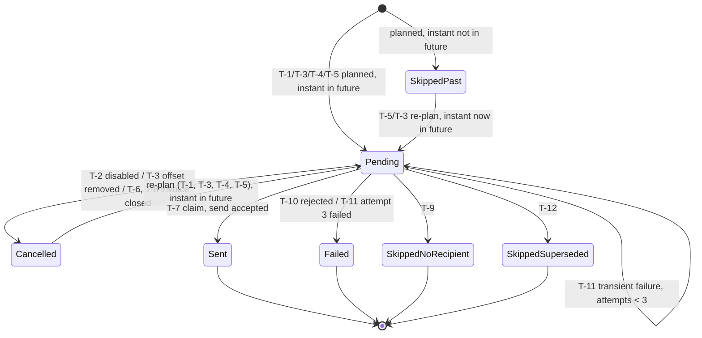

# Invoicing product: living specification

Scope of this document: the accepted, testable behaviour of the invoicing product. This revision adds **automatic
payment reminders for unpaid invoices**. Structure and technology choices are AD-<n> decisions in
`architecture.md` (this directory), never here.

## Status, baseline and evidence limits

- **Source of intent.** The request of 2026-11-21: "Set up automatic reminders for unpaid invoices." That is the only
  user instruction. Nothing else was provided.
- **Current-system baseline: none.** No repository, discovery result, research result, earlier specification or selected
  baseline existed for this run. Nothing about the existing invoice model, customer contacts, email capability,
  scheduling facility, roles or UI was observed.
  - Observations: none.
  - Inferences: none are relied on as fact.
  - Unknowns: G-1 to G-11 below. Each one that can change required behaviour, its verification surface or a dependent
    prerequisite keeps only the affected requirement's work unready. Independent work may proceed.
- **Preserved behaviour.** No prior requirement exists, so none is retired or changed. One cross-cutting condition is
  stated for whatever the existing product does: reminders only read invoice and payment data and never write it (R-2).
- **Authority of this text.** R-1 to R-4 restate what the request says. R-5 to R-9 are derived by the spec stage from the
  behaviour-model event families (duplicates, failure, authorization, restart, concurrency). They are proposals, not
  user instructions. The business defaults in A-1 to A-12 are assumptions the owner can overturn.
- Acceptance lines assert outcomes; they do not claim implementation or test success. Every status below is
  *specified, not run*.

## Assumptions (defaults taken because the run is unattended)

| ID | Assumption | Overturned by |
| --- | --- | --- |
| A-1 | The channel is email, sent to the customer's billing contact already stored on the invoice's customer record. | G-2, G-3 |
| A-2 | Default schedule is offsets **-3, 0, +7, +14** calendar days from the invoice due date, sent at **09:00** account-local time. The feature ships **Disabled**: no customer receives mail until an authorized user enables it. | G-7 |
| A-3 | An invoice is *open* (eligible) when it is issued (not draft), not void or cancelled, has outstanding balance > 0 and has a due date. Not-yet-due invoices count, because they are unpaid. | G-1 |
| A-4 | Validation bounds on the schedule: 1 to 6 offsets, each an integer from -30 to +90, no duplicates. Send time is any HH:MM from 00:00 to 23:59. | G-7 |
| A-5 | Timeliness is day-level: a reminder is sent on its scheduled local calendar date once its time has passed, while processing is running. No sub-minute or sub-hour bound is promised. | G-11 |
| A-6 | The account timezone (an IANA name) is read from the existing product. If none exists, the reminder settings carry a required timezone field. | G-5 |
| A-7 | Roles: a user who can manage invoices may read and change reminder settings. A view-only user may read history but not change settings. | G-6 |
| A-8 | Each occurrence has at most **3** send attempts. | G-7 |
| A-9 | Enabling, editing or re-planning does **not** backfill occurrences whose date has already passed; they are skipped. No "send an immediate first reminder to overdue invoices". | G-7 |
| A-10 | Offsets are plain calendar days: no business-day or holiday calendar. Message templates are fixed English text with ISO `YYYY-MM-DD` dates and the invoice's own currency code. Templates are not customizable. | G-7 |
| A-11 | "Sent" means the outbound mail provider accepted the message. Delivery or bounce notifications arriving later are not consumed. | G-3 |
| A-12 | An occurrence record stores the recipient address used at send time and the outcome, but not the message body. | G-9 |

## Open gaps (unresolved prerequisites and decisions)

Each gap states the safe interim behaviour, who owns it and the smallest observation that closes it.

| ID | Gap | Affects | Interim behaviour | Owner and closing observation |
| --- | --- | --- | --- | --- |
| G-1 | Existing invoice model: status values, due-date field, outstanding balance and partial payments, currency, whether paid invoices can be reopened or payments reversed. | R-2, R-3, R-4 | A-3 applies. The reopen clause (R-4 line 5) stays conditional. | Discovery of the repository: read the invoice schema and payment code. |
| G-2 | Where the billing contact lives and whether there can be several. | R-3, R-6 | One address per invoice. None means Skipped(no-recipient). | Discovery: read the customer record. |
| G-3 | Outbound email: existing capability or provider, sender identity and domain authentication, sending quota, a sandbox or capture mailbox for checks. | R-3, R-6, R-11 | R-3 acceptance runs against a recording fake at the mail boundary. The real send (R-3 line 6) stays **unverified**. | Delivery owner: one real send to a controlled mailbox. Due phase: `release-verify`. |
| G-4 | Which runtime facility runs background work with no user session and no workstation, and its cadence limits. | R-3, R-9, R-11 | AD-1 is proposed, not accepted. | Platform discovery in the deployed runtime. |
| G-5 | Source of the account timezone. | R-1, R-2 | A-6. | Discovery. |
| G-6 | Existing role and permission model. | R-1, R-8 | A-7. | Discovery. |
| G-7 | Owner confirmation of the business defaults A-2, A-4, A-8, A-9 and A-10. | R-1, R-2, R-3, R-6 | Defaults apply. | Product owner, before release. |
| G-8 | Compliance and legal content rules for payment-reminder email (identification, opt-out, jurisdiction). | R-3, R-6 | None assumed. Nothing is claimed compliant. | Product owner or legal. May add content or opt-out requirements. |
| G-9 | Retention period for occurrence records and the stored recipient address. | R-13 | Retained with the invoice. No period is invented. | Product owner. |
| G-10 | Surface kind (graphical UI, API, CLI) and the existing visual identity. | R-1, R-7, R-10 | Surfaces are named by role: *settings surface*, *history surface*. R-10 applies only if the surface is graphical. | Discovery. |
| G-11 | Processing cadence, claim lease length, expected invoice volume and any provider rate limit. | R-11, R-12, R-16 | No numeric bound is stated. | Platform discovery plus product owner. |

## Request-to-requirement traceability

| Words of the request (2026-11-21) | Outcome | Requirements | Primary |
| --- | --- | --- | --- |
| "Set up … reminders" | An authorized user turns reminders on and chooses when they are sent. | R-1 | yes |
| "unpaid invoices" | Reminders concern exactly the invoices that are still owed, and stop when they are not. | R-2, R-4 | yes |
| "reminders" | The customer receives a reminder email with the facts needed to pay. | R-3 | yes |
| "automatic" | No person triggers them and no user session is needed. | R-3, R-9, R-11, R-12 | R-3 is primary |
| derived, not requested | Safe operation: no duplicates, defined failures, visibility, access control, catch-up after downtime. | R-5, R-6, R-7, R-8, R-9 | no |

Domain rules the request leaves out. The bound sits under the R-<n> it limits:

- R-1: no per-customer or per-invoice opt-out or snooze, no template editing or localization, no second channel (SMS or
  other).
- R-2: no business-day or holiday calendar, no recurring reminders after the last offset.
- R-3: no "send now" button, no payment-link generation, no late fees or escalation tone, no reminders to internal staff.
- R-6: no bounce or delivery-notification ingestion (A-11).

## Requirements

### R-1: Reminder settings *(primary)*

- **Basis:** the request's words "Set up … reminders" (2026-11-21); decisions A-2, A-4, A-6, A-7.
- **Change:** adds. Nothing preserved (no prior spec).
- **Evidence limits:** no existing settings surface was inspected (G-10).
- **Pending:** implementation and every check below.
- **Behaviour.** An authorized user of an account can enable or disable reminders for the account and set the schedule.
  The schedule is an ascending list of integer day offsets from each invoice's due date (negative is before, 0 is on,
  positive is after) plus one send time in the account's timezone. Defaults are in A-2, and the feature starts Disabled.
  Disabling cancels all Pending occurrences with reason `reminders-disabled` (T-2). Enabling and edits re-plan (R-2).
- **Boundaries.** Offsets and send time follow A-4. The saved schedule reads back sorted ascending.
- **Error behaviour.** Invalid input, an unauthorized actor or a stale version is rejected with a named reason and leaves
  settings and occurrences unchanged (T-14).
- **Consumer outcome.** The settings surface shows the current state, and a read after save returns exactly what was saved.
- **State and data.**
  - Resource: account reminder settings, owned by the account.
  - Before and after invariant: always a valid schedule, a valid time, and a version number that rises by 1 on every
    accepted save.
  - Concurrency: a save carrying a version other than the current one is rejected as a conflict.
  - Recovery: a rejected save changes nothing, so no recovery step is needed.
  - Unknown: where the account record lives (G-5).

Acceptance lines (each: positive, failure, boundary where it says something new; surface; confirmation):

1. *Positive, enable.* Given account `acme` (America/New_York), Disabled with defaults, version 1, when an authorized
   user saves `enabled=true` with the defaults, then a read returns `enabled=true`, offsets `[-3,0,7,14]`, time `09:00`,
   version 2. Surface: settings surface or API. Confirmed by: automated API or UI test, then a read after a process
   restart.
2. *Positive, edit.* Saving offsets `[14,-1,5]` reads back as `[-1,5,14]`. Same surface and confirmation.
3. *Positive, disable.* Disabling with 3 Pending occurrences leaves 0 Pending and 3 Cancelled(`reminders-disabled`).
   Surface: history surface (R-7).
4. *Failure, invalid values.* Each of these is rejected, names its reason, and leaves version and data unchanged:
   `[]` (at least one offset needed), `[3,3]` (duplicate), `[1.5]` (not an integer), `[91]` and `[-31]` (out of range),
   7 offsets, time `25:00`, time `9am` (malformed). Confirmed by: parameterized automated test that asserts the
   specific reason and the unchanged version.
5. *Boundary.* `[-30,90]` is accepted. 6 offsets are accepted and 7 are rejected. Times `00:00` and `23:59` are accepted.
6. *Failure, concurrency.* Two users load version 5. User A saves `[0,7]` and the version becomes 6. User B then saves
   `[1]` with version 5 and is rejected as a conflict. Settings stay `[0,7]`, and B's surface shows the current values and
   keeps B's unsaved edit visible. Confirmed by: automated test.
7. *Failure, unauthorized.* See R-8.

### R-2: Which invoices get reminders, and when *(primary)*

- **Basis:** the request's words "unpaid invoices" (2026-11-21); decisions A-3, A-6, A-9, A-10.
- **Change:** adds.
- **Evidence limits:** the invoice model, due-date field and status values are unobserved (G-1).
- **Pending:** implementation and every check below.
- **Behaviour.** While reminders are Enabled, every *open* invoice (A-3) has one **occurrence** per configured offset.
  - Scheduled instant = (due date + offset, in calendar days) at the send time in the account timezone.
  - When a planning moment (T-1, T-3, T-4, T-5) finds the instant strictly later than the moment, the occurrence is
    Pending. Otherwise it is Skipped(`date-passed`).
  - Re-planning may touch only occurrences in a *re-plannable* state: Cancelled(any reason) or Skipped(`date-passed`).
  - Sent, Failed, Skipped(`no-recipient`) and Skipped(`superseded`) are terminal and are never recreated for the same
    (invoice, offset).
  - An invoice with no due date gets no occurrences.
  - Local time that does not exist (spring-forward gap) is shifted forward by the gap length. Ambiguous local time
    (fall-back overlap) uses the first occurrence.
- **Boundaries.** Planning reads invoice and payment data and never writes it.
- **Error behaviour.** If the authoritative invoice read fails during planning, no occurrences are changed, the failure is
  surfaced to the caller of that planning event (e.g. the save of settings), and planning is retried by the next run.
- **Consumer outcome.** The history surface shows the planned occurrences with their dates.
- **State and data.**
  - Resource: occurrences, keyed by (invoice, offset), owned by the reminder subsystem.
  - Invariant: at most one occurrence per key.
  - Recovery: planning is idempotent, so re-running it yields the same set.
  - Out of scope: the invoice record itself.

Acceptance lines:

1. *Positive, planning on enable.* Given the defaults, account `acme`, invoice INV-1001 (issued, due 2026-12-10,
   outstanding 500.00 USD, customer Ada Lovelace `ada@example.test`) and the feature enabled at 2026-12-01 10:00
   America/New_York, then four Pending occurrences exist with instants 2026-12-07 09:00, 2026-12-10 09:00,
   2026-12-17 09:00 and 2026-12-24 09:00 (each 14:00Z, since December is UTC-5). Surface: history surface or API.
   Confirmed by: automated test with an injected clock.
2. *Boundary, dates already past.* Enabling at 2026-12-12 10:00 with INV-1003 (due 2026-12-10, outstanding 500.00 USD):
   offsets -3 (12-07) and 0 (12-10) are Skipped(`date-passed`), and 7 (12-17) and 14 (12-24) are Pending. A second case
   enables at exactly 2026-12-17 09:00:00 with INV-1003 and the 12-17 occurrence is Skipped, because the instant must be
   strictly later.
3. *Failure and boundary, not eligible.* A draft invoice, a void invoice, an invoice with outstanding 0.00 and an
   invoice with no due date each get zero occurrences, and the history surface says why in one phrase (e.g. "No due date").
4. *Positive, due date changes.* INV-1001 enabled 2026-12-01. -3 is sent on 12-07. On 2026-12-08 the due date moves to
   2026-12-20. Then -3 stays Sent, and 0, 7 and 14 re-plan to Pending at 2026-12-20, 2026-12-27 and 2027-01-03, each 09:00.
   A second case: a re-plannable occurrence whose new date is already past becomes Skipped(`date-passed`). A third case:
   INV-1003 from line 2 (the -3 and 0 occurrences Skipped(`date-passed`)) has its due date moved to 2026-12-24 on
   2026-12-12, and the -3 (12-21) and 0 (12-24) occurrences become Pending. Skipped(`date-passed`) is re-plannable.
5. *Positive, new invoice after enable.* INV-1004 is issued on 2026-12-14, due 2026-12-30. Then the Pending instants are
   2026-12-27, 2026-12-30, 2027-01-06 and 2027-01-13 at 09:00 (the year boundary is covered).
6. *Positive, schedule edit.* With defaults and -3 Sent, changing offsets to `[0,7]` leaves -3 Sent (kept in history),
   leaves 0 and 7 Pending and sets 14 to Cancelled(`schedule-changed`). Adding offset 3 afterwards creates a new Pending
   occurrence. Re-adding -3 does not resend it.
7. *Boundary, timezone and DST.* For send time 02:30 on a scheduled date of 2027-03-14 in America/New_York the instant is
   03:30 EDT (07:30Z). For send time 01:30 on 2027-11-07 the instant is the first 01:30 (EDT, 05:30Z).
   Confirmed by: automated test with a fixed zone database. *NOT-REPLAYED, see Replay evidence.*
8. *Boundary, read-only.* After every planning event, a snapshot of the invoice and payment tables is byte-identical to
   the one before it.

### R-3: Automatic delivery of due reminders *(primary)*

- **Basis:** the request's words "automatic reminders" (2026-11-21); decisions A-1, A-5, A-10, A-11.
- **Change:** adds.
- **Evidence limits:** no email capability was inspected (G-3).
- **Pending:** implementation and every check below, plus the real-provider check in line 6.
- **Behaviour.** When a Pending occurrence's instant has passed, reminders are Enabled and the invoice is still open
  (R-4), the system sends **one** email to the invoice customer's billing contact. No person triggers it and no user
  session needs to exist. The message states the business name, the invoice number, the **current outstanding amount**
  with its currency, the due date and the relative timing.
  - Subject: `Reminder: Invoice <number> is due in <N> day(s)`, `Reminder: Invoice <number> is due today`, or
    `Reminder: Invoice <number> is <N> day(s) overdue`. N is the number of local calendar days between the send date
    and the due date. N=1 reads "1 day".
  - Customer-controlled text (customer name, memo) is inserted as data. It cannot add headers or recipients.
  - On acceptance by the provider the occurrence becomes Sent with a timestamp and the recipient used (T-7).
  - If the product has a payment link or payment instructions today, they are included as-is (G-1). Generating a new one
    is out of scope.
- **Boundaries.** Exactly one recipient per message (A-1). A currency's own decimal places are preserved as the product
  already formats them.
- **Error behaviour.** See R-6. Nothing is sent while Disabled.
- **Consumer outcome.** The customer's mailbox holds the reminder, and the history surface shows Sent.
- **State and data.**
  - Resource: the occurrence record and the outbound message.
  - Owner: the reminder subsystem, with the provider owning delivery.
  - Recipient address is personal data: it is stored on the occurrence (A-12), shown to authorized account users, and kept
    out of logs (R-13).

Acceptance lines:

1. *Positive.* The clock is set to 2026-12-07 09:00 America/New_York and INV-1001 from R-2 line 1 is open. Exactly one
   email is recorded at the mail boundary. Its recipient is `ada@example.test`, and its subject equals
   `Reminder: Invoice INV-1001 is due in 3 days`. Its body contains `Acme Studio`, `INV-1001`, `500.00 USD` and
   `2026-12-10`. The -3 occurrence is Sent, and 0, 7 and 14 remain Pending. Surface: mail boundary plus history
   surface. Confirmed by: automated test with a fake clock and a recording mail fake.
2. *Positive, wording.* At 2026-12-10 09:00 the subject equals `Reminder: Invoice INV-1001 is due today`. At
   2026-12-17 09:00 it equals `Reminder: Invoice INV-1001 is 7 days overdue`. A case with due 2026-12-10 sent on
   2026-12-09 reads `is due in 1 day`, and one sent on 2026-12-11 reads `is 1 day overdue`.
3. *Boundary, instant.* At 2026-12-07 08:59:59 no email exists. At 09:00:00 one email exists.
4. *Positive, partial payment.* INV-1005 (total 500.00 USD, payments 200.00 USD) at its first due instant produces a
   body containing `300.00 USD` and not `500.00 USD`.
5. *Positive, automatic and durable.* With no user session and no trigger call, the process is stopped and restarted
   at 2026-12-06 12:00. At 2026-12-07 09:00 the email is still sent exactly once.
6. *Failure, injection.* A customer name `Ada\r\nBcc: x@evil.test` produces a message whose header set has no `Bcc` and
   whose recipient list has exactly one entry. Confirmed by: automated test that inspects the structured message.
7. *Boundary, disabled.* Disabled at the instant, no email is sent, and no Pending occurrence exists (T-2).
8. *Real boundary.* One reminder for a controlled test invoice is sent through the real provider and arrives in a
   controlled mailbox. Surface: the real mailbox. Due phase: `release-verify`. Owner: the delivery owner (G-3).
   **Unverified** until then. A recording fake does not satisfy this line.

### R-4: Stop when the invoice is no longer owed *(primary)*

- **Basis:** the request's words "unpaid invoices" (2026-11-21), read as "a paid invoice must not be chased".
  Decision A-3.
- **Change:** adds.
- **Evidence limits:** payment recording, void and reversal behaviour are unobserved (G-1).
- **Pending:** implementation and every check below.
- **Behaviour.** An occurrence is sent only if, **at the moment it is claimed for sending**, the authoritative invoice
  state says the invoice is open (A-3).
  - When it is not open, the occurrence becomes Cancelled(`invoice-closed`) and nothing is sent (T-8).
  - Independently, when an invoice closes, its Pending occurrences are cancelled (T-6). This is a convenience. The
    send-time check is the authority, so a missed or late cancel event cannot cause a send.
  - The decision uses a direct read of invoice and payment state, not a cached copy.
  - A partial payment keeps the invoice open and the next reminder states the reduced outstanding amount.
- **Boundaries.** A payment recorded after the check but before the provider accepts the message may still produce one
  reminder. This is a documented limit, not a defect.
- **Error behaviour.** If invoice state cannot be read, nothing is sent and the occurrence follows the transient-failure
  rule (R-6, T-11).
- **Consumer outcome.** A paid invoice's history shows its Cancelled occurrences with the reason, and the customer
  receives nothing after payment is recorded.
- **State and data.**
  - Authority: the invoice and payment records, owned by the existing product. The reminder subsystem is a reader.
  - Freshness: read at claim time.
  - Revocation: payment or void takes effect for reminders at the next claim, at the latest.

Acceptance lines:

1. *Positive, paid before due.* Enable on 2026-12-01 (authorized user, R-1 line 1). INV-1002 is issued on 2026-12-02
   (due 2026-12-10, 500.00 USD) and is planned with 4 Pending occurrences (R-2 line 5). On 12-07 the -3 reminder is
   sent. On 2026-12-09 14:00 a payment of 500.00 USD is recorded. Then 0, 7 and 14 are Cancelled(`invoice-closed`), the
   12-10 09:00 run sends nothing, and the total emails for INV-1002 are 1. Confirmed by: automated test with a fake
   clock. The "payment recorded" step uses the existing product's payment path (G-1), which makes this line
   **NOT-REPLAYED** until that path is known.
2. *Failure, lost cancel event.* The close-event handling (T-6) is suppressed in the test harness. A payment of 500.00 USD
   is recorded on 2026-12-17 at 08:59:30 and the run at 09:00 sends nothing. The occurrence ends Cancelled(`invoice-closed`).
   This shows the send-time guard works alone.
3. *Positive, partial payment.* See R-3 line 4. The invoice stays open and a reminder is sent.
4. *Failure, void.* A void or cancelled invoice yields no email, and its occurrences are Cancelled(`invoice-closed`).
5. *Conditional, reopen.* *Applies only if the product supports payment reversal or reopening (G-1).* A paid invoice
   whose payment is reversed becomes open (T-4). Its Cancelled occurrences with future instants return to Pending, and
   past ones become Skipped(`date-passed`). Sent occurrences are not resent.
6. *Failure, state unreadable.* If the invoice read fails at claim time, no email is sent and the failure is retried
   (R-6 line 3).

### R-5: No duplicate reminders

- **Basis:** decision derived from the behaviour-model audit on 2026-11-21 (duplicate, concurrent and restart families),
  not user-instructed. It protects the "automatic" outcome.
- **Change:** adds.
- **Evidence limits:** the execution model of the runtime (concurrent instances) is unknown (G-4).
- **Pending:** implementation and checks.
- **Behaviour.** For one (invoice, offset), the system causes at most one successful send, even when processing runs
  overlap, repeat or restart.
  - A send is preceded by an atomic claim of that occurrence.
  - An occurrence already Sent is never sent again by re-runs, schedule edits or due-date edits.
- **Boundaries.** The only duplicate window is the crash-after-accept case below. It is bounded by A-8 (at most 3 emails
  for one occurrence).
- **Error behaviour.** A claim that fails because another worker holds it ends the attempt silently with no state change.
- **Consumer outcome.** A customer receives one email per occurrence, apart from the stated crash window.
- **State and data.**
  - Owner of the claim: the occurrence record.
  - Concurrent changes resolve in favour of the first claim.
  - A claim with no recorded outcome after its lease (length G-11) is treated as an unknown outcome and retried as
    transient (T-15).

Acceptance lines:

1. *Failure, concurrency.* Two processing runs start simultaneously at 2026-12-07 09:00. Exactly one email for the INV-1001
   -3 occurrence is recorded and one Sent exists.
2. *Boundary, repeat.* A third run one minute later records no email.
3. *Failure, crash window.* A fault is injected after the mail fake accepts the message and before Sent is recorded. After
   recovery, the occurrence is retried. The emails for it are at least 1 and at most 3, and the final state is Sent.
   This is the documented duplicate window.
4. *Boundary, edits.* With schedule `[-3,0,7,14]` and -3 Sent: `[-3,0]` then `[-3,0,7,14]` again, and a due-date change.
   None of them produce a second -3 email.

### R-6: Failure handling

- **Basis:** decision derived from the behaviour-model audit on 2026-11-21 (failure and retry families), not
  user-instructed. Decision A-8.
- **Change:** adds.
- **Evidence limits:** the provider's error taxonomy is unknown (G-3). "Permanent" and "transient" are the two classes
  this spec needs, mapped by the plan.
- **Pending:** implementation and checks.
- **Behaviour.**
  - No billing contact: Skipped(`no-recipient`), terminal, and later occurrences are evaluated afresh (T-9).
  - Permanent rejection of the address by the provider: Failed(`rejected`), no retry (T-10).
  - Transient failure (timeout, provider unavailable, rate limit, unreadable invoice state): the occurrence stays Pending,
    the attempt counts, and it is retried at the next processing run. The third failed attempt ends as
    Failed(`attempts-exhausted`) (T-11).
  - Failed is terminal with no further automatic attempts.
  - One occurrence's failure never prevents other occurrences in the same run.
- **Boundaries.** Attempts are counted per occurrence: 3 means failed attempt number 3 ends it, and success on attempt
  3 is Sent.
- **Error behaviour.** Every failure ends in a visible state with a reason (R-7). Failure is never silent and never
  discards a Pending occurrence without a record.
- **Consumer outcome.** The invoice's history and the failed-reminders list show Failed with the reason.
- **State and data.**
  - Stored per occurrence: status, reason, attempt count, last-attempt time.
  - No error text containing the address or body is stored (R-13).

Acceptance lines:

1. *Failure, no recipient.* A customer with no billing contact: the occurrence is Skipped(`no-recipient`), no mail is
   sent, and the next offset is planned normally.
2. *Failure, permanent.* The mail fake returns "address rejected" on the first attempt: Failed(`rejected`), 1 attempt, no
   retry in the following run.
3. *Failure and boundary, transient.* The fake fails the first attempt and succeeds on the second: Sent with 2 attempts.
   The fake fails three times in a row: Failed(`attempts-exhausted`) with 3 attempts and no fourth attempt in later runs.
   An unreadable invoice state counts as one failed attempt.
4. *Failure, isolation.* INV-A's send throws and INV-B is due in the same run. INV-B is Sent and the run completes.
5. *Failure, visibility.* A Failed occurrence appears in the failed-reminders list (R-7) until its invoice is no longer
   shown there for another reason (e.g. the invoice is deleted).

### R-7: History visibility

- **Basis:** decision derived 2026-11-21 (silent failure of an automatic feature). It gives the consumer observable
  surfaces for R-1 to R-6.
- **Change:** adds.
- **Evidence limits:** the surface kind is unknown (G-10).
- **Pending:** implementation and checks.
- **Behaviour.**
  - Per invoice, an authorized user can see every occurrence: offset, scheduled local date and time, status (Pending,
    Sent, Skipped, Cancelled, Failed), reason, sent time and recipient used.
  - From the settings surface the user can reach a list of invoices with Failed occurrences.
  - Occurrences are ordered by scheduled instant ascending.
- **Boundaries.** Occurrences of an offset that has since been removed from the schedule are still shown if they are
  Sent or Failed.
- **Error behaviour.** A failed load shows an error with a retry action, not an empty list.
- **Consumer outcome.** A user can answer "was this customer reminded, when, and if not, why?" without developer help.
- **State and data.** Read-only view over occurrences. Access is as in R-8.

Acceptance lines:

1. *Positive.* After the 2026-12-07 send for INV-1001, the history is, in order: -3, 2026-12-07 09:00, Sent, to
   `ada@example.test`; 0, 2026-12-10 09:00, Pending; 7, 2026-12-17 09:00, Pending; 14, 2026-12-24 09:00, Pending.
2. *Boundary, empty.* An invoice with no occurrences shows an explicit empty state with its reason: "Reminders are off",
   "No due date", "Invoice paid" or "Invoice void".
3. *Failure, load error.* If the history cannot load, an error state with a retry control is shown, never "no
   reminders". Confirmed by: UI test or API error contract test with a forced failure.
4. *Positive, failed list.* INV-A with a Failed occurrence appears in the failed-reminders list with its reason. An
   invoice with only Sent occurrences does not appear.

### R-8: Authorization and isolation

- **Basis:** decision derived 2026-11-21 (unauthorized-actor family), not user-instructed. Decision A-7.
- **Change:** adds.
- **Evidence limits:** the existing role and tenancy model is unobserved (G-6).
- **Pending:** implementation and checks.
- **Behaviour.**
  - Only an authorized user of the owning account can change that account's settings.
  - Only a user who may view that account's invoices can read its history.
  - Each account's settings govern only its own invoices.
  - A reminder goes only to the billing contact of that invoice's customer.
  - The background processing acts with its own limited service authority, which covers reading invoices and recording
    occurrences but not editing invoices or settings. It does not borrow any user's session.
- **Boundaries.** A view-only user may read but not save (A-7).
- **Error behaviour.** A denied request returns a denial that reveals nothing about the other account's data and changes
  nothing. Access to another account's invoice ID returns the same response as a nonexistent ID.
- **Consumer outcome.** No user sees or changes another account's reminders, and no customer receives another customer's
  reminder.
- **State and data.** Settings and occurrences are scoped by account in storage and in every read.

Acceptance lines:

1. *Failure.* A user of account `globex` attempts to save settings for `acme` and is denied. `acme`'s version is
   unchanged. A view-only user of `acme` is denied saving and can read history.
2. *Failure, enumeration.* `globex` requests the history of an `acme` invoice ID and gets the same response as for a
   nonexistent invoice ID.
3. *Positive, isolation.* `acme` (offsets `[0]`, 09:00 America/New_York) and `globex` (offsets `[7]`, 08:00
   Europe/London) each have an invoice due 2026-12-10. At 2026-12-10 14:00Z only `acme`'s customer is mailed, and at
   2026-12-17 08:00Z only `globex`'s customer is mailed. Check the arithmetic: December in New York is UTC-5 and in London
   is UTC+0.
4. *Boundary, recipient.* An invoice for customer X never produces an email addressed to customer Y.

### R-9: Catch-up after downtime

- **Basis:** decision derived 2026-11-21 (restart and resumption family), not user-instructed. It protects "automatic"
  when processing was not running.
- **Change:** adds.
- **Evidence limits:** the cadence and restart behaviour of the runtime are unknown (G-4, G-11).
- **Pending:** implementation and checks.
- **Behaviour.**
  - After a period in which processing did not run, every Pending occurrence whose instant has passed is due at the next
    run.
  - For one invoice, if several occurrences are due in the same run, only the one with the **largest offset** is sent.
    The others become Skipped(`superseded`) (T-12). So a customer never gets more than one reminder per invoice per run.
  - The message states the **actual** relative days at send time (R-3). There is no maximum lateness: a late reminder
    is still sent, with accurate wording.
- **Boundaries.** An occurrence whose instant equals the recovery time is due.
- **Error behaviour.** Catch-up uses the same rules as R-4 (still open), R-5 (claim) and R-6 (failures).
- **Consumer outcome.** After an outage, customers receive at most one accurate reminder per invoice, not a burst.
- **State and data.** Uses occurrence records only. No separate downtime marker is needed.

Acceptance lines:

1. *Positive.* INV-1001 has -3 and 0 Sent. Processing is down from 2026-12-17 00:00 and recovers at 2026-12-24 09:30. The
   7 (12-17 09:00) and 14 (12-24 09:00) occurrences are both due, and exactly one email is sent, subject
   `Reminder: Invoice INV-1001 is 14 days overdue`. Occurrence 14 is Sent and 7 is Skipped(`superseded`).
2. *Positive, single late.* Processing is down 2026-12-17 08:00 to 2026-12-18 10:00. Only occurrence 7 is due, and its
   subject is `Reminder: Invoice INV-1001 is 8 days overdue` (12-18 minus 12-10 is 8 days).
3. *Boundary.* Recovery at exactly 2026-12-24 09:00:00 sends the 14 reminder.
4. *Boundary, no repeat.* A run after the catch-up sends nothing.
5. *Failure.* If the invoice was paid during the outage, the catch-up run sends nothing and cancels (R-4).

## State, transitions and flows

### Entities and states

| Entity | States | Owner and durability | Initial and terminal |
| --- | --- | --- | --- |
| Reminder settings (per account) | Disabled, Enabled (plus a version number) | Account; durable | Initial: Disabled with the default schedule (A-2). No terminal. |
| Occurrence (per invoice and offset) | Pending, Sent, Skipped(`date-passed`, `no-recipient`, `superseded`), Cancelled(`reminders-disabled`, `schedule-changed`, `invoice-closed`), Failed(`rejected`, `attempts-exhausted`) | Reminder subsystem; durable | Initial: Pending or Skipped(`date-passed`) at planning. Terminal: Sent, Failed, Skipped(`no-recipient`), Skipped(`superseded`). Re-plannable: Cancelled(any) and Skipped(`date-passed`). |

Cross-entity invariant: while settings are Disabled, no occurrence is Pending.

### Flows

- **F-1, setup (R-1, R-2).** Authorized user saves valid settings (T-1, T-3 or T-2). The system validates, checks the
  version, saves, and re-plans occurrences. The surface shows the confirmed state only after the save completes. It
  never shows "saved" optimistically.
- **F-2, automatic send (R-3, R-4, R-5, R-6).** At a processing run: select due Pending occurrences, then per invoice
  apply the supersede rule (T-12), then claim (T-13), then read authoritative state (T-8), then resolve the recipient
  (T-9), then send, then record the outcome (T-7, T-10, T-11). The run needs no user session.
- **F-3, invoice change (R-2, R-4).** The invoice becomes eligible (T-4), its due date changes (T-5), or it closes (T-6).
  The reminder subsystem re-plans or cancels.
- **F-4, recovery (R-5, R-9).** After downtime or a crash, a run treats due occurrences by the same rules (T-12, T-15).

### Transition ledger

| ID | Requirement and flow | Before, trigger and guard | After and effect | Failure and recovery | Cases |
| --- | --- | --- | --- | --- | --- |
| T-1 | R-1, R-2; F-1 | Disabled; authorized user saves `enabled=true` with a valid schedule and the current version | Enabled, version+1; plan each open invoice | Invalid or stale: T-14 | R-1/1, R-2/1, R-2/2 |
| T-2 | R-1; F-1 | Enabled; authorized save of `enabled=false` | Disabled; Pending → Cancelled(`reminders-disabled`) | Failure leaves all unchanged | R-1/3, R-3/7 |
| T-3 | R-1, R-2; F-1 | Enabled; valid schedule or time edit | Re-plan: removed offsets' Pending → Cancelled(`schedule-changed`); re-plannable occurrences recomputed; Sent, Failed and other terminal kept | If the planning read fails, the save is rejected whole | R-1/2, R-2/6, R-5/4 |
| T-4 | R-2, R-4; F-3 | Enabled; an invoice becomes open (issued, reopened, or gains a due date) | Plan its occurrences | Retried at next run if the read failed | R-2/5, R-4/5 |
| T-5 | R-2; F-3 | Enabled; due date of an open invoice changes | Re-plan re-plannable occurrences only | As T-4 | R-2/4 |
| T-6 | R-4; F-3 | Invoice stops being open (paid in full, void) | Pending → Cancelled(`invoice-closed`) | Missed event is covered by T-8 | R-4/1, R-4/4 |
| T-7 | R-3; F-2 | Pending, instant passed, Enabled, claim held, invoice open, recipient present | Provider accepts: Sent with time and recipient | Unknown outcome: T-15 | R-3/1, R-3/2, R-3/3 |
| T-8 | R-4; F-2 | Claimed; invoice not open, or Disabled | Cancelled(`invoice-closed` or `reminders-disabled`); nothing sent | State unreadable: T-11 | R-4/2, R-4/4, R-9/5 |
| T-9 | R-6; F-2 | Claimed; no billing contact | Skipped(`no-recipient`) | None | R-6/1 |
| T-10 | R-6; F-2 | Provider rejects the address permanently | Failed(`rejected`) | None; no retry | R-6/2 |
| T-11 | R-6; F-2 | Transient failure or unreadable state | Pending with attempts+1; at attempt 3: Failed(`attempts-exhausted`) | The next run retries | R-6/3, R-4/6 |
| T-12 | R-9; F-2, F-4 | Several Pending occurrences of one invoice due in one run | Largest offset proceeds; the others become Skipped(`superseded`) | If the surviving one fails, the superseded ones are **not** revived (the failure follows T-11 for it) | R-9/1, R-9/2 |
| T-13 | R-5; F-2 | Claim already held by another run, or the occurrence already Sent | No state change, no send | None | R-5/1, R-5/2 |
| T-14 | R-1, R-8; F-1 | Invalid values, unauthorized actor, stale version | Rejected with a named reason; settings and occurrences unchanged | None | R-1/4, R-1/5, R-1/6, R-8/1 |
| T-15 | R-5; F-4 | Claimed, with no recorded outcome after the lease | Treated as a transient failure (T-11) | Possible duplicate email, bounded by A-8 | R-5/3 |

Invalid or forbidden events: sending an occurrence that is Sent, Failed or Skipped is a no-op (T-13). Editing settings
while Disabled changes the stored schedule but plans nothing (T-3 applies only while Enabled). Both leave external effects
unchanged.

## Lifecycle of state and information

| State | Owner and location | Who may read | Simultaneous changes | What ends and removes it | Runtime quotas met |
| --- | --- | --- | --- | --- | --- |
| Reminder settings | The account's durable store, in the product's existing store (G-1) | Authorized users of the account | Version check; stale save rejected (R-1 line 6) | Lives with the account | None known |
| Occurrence records | The product's durable store, owned by the reminder subsystem | Authorized users of the account (R-7). Written only by the subsystem. | Unique (invoice, offset); atomic claim (R-5) | Removed with the invoice. Retention period: unresolved (G-9). | Provider send quota (G-3, G-11) |
| Recipient address on an occurrence | As above (A-12) | Authorized users of the account | As above | As above | None |
| Message body | Not stored. Exists only in transit to the provider. | The provider and the recipient | n/a | n/a | n/a |
| Logs | The existing logging facility | Operators | n/a | Existing log retention | n/a |

Personal data (recipient address, customer name): shown on the history surface to authorized account users, stored on
the occurrence, **never written to logs**, kept as long as the invoice's records (G-9 open), removed with the invoice.
No new identity, sharing or persistence beyond the above is added.

### Service-boundary contracts

- **Invoice and payment authority** (internal, existing product). Authority: the invoice and payment records. Freshness: read
  at claim time with no cache. Revocation: payment or void is honoured at the next claim (R-4). Incremental state: none; a
  full read per occurrence. Not a service if it is the same datastore. Classification: *reuse*.
- **Outbound email provider** (external, G-3). Authority: the provider decides acceptance. Acceptance is not delivery
  (A-11). Async completion: none consumed. Recovery: unknown outcome is treated as transient (T-15); duplicates are
  bounded by A-8. Retry identity: (invoice, offset) in this subsystem's claim. Idempotency at the provider is not assumed.
  Classification: *unresolved* until G-3 is closed.
- **Background processing** (G-4). The owner of work promised independent of a screen is the reminder subsystem's
  processing, which operates with no UI and no workstation. Duplicate or overlapping runs are handled by the claim.
  Cadence: unresolved (G-11).
- **Owned event coverage.** Each send, skip, cancel and failure produces one log or metric entry (R-15). No new logging
  backend is added.
- Not applicable: query, schema or cache contracts (no cache; the data is local to the product), connections and
  subscriptions (none), parity with another system (none).

### UI premises (apply if the surface is graphical, G-10)

- **Components.** Settings panel: enable switch, offset editor (add, remove and reorder chips, validated inline), send-time
  input, read-only timezone line, Save. Per-invoice history list with status chips. Failed-reminders list.
- **Interaction.**
  - Saving shows pending, then confirmed ("Saved. 3 invoices scheduled" using the confirmed count) or failed (message
    plus edits retained). A conflict shows the current values and keeps the user's edit visible.
  - Status is conveyed by text, not colour alone, and focus stays in place.
  - Unresolved failures stay visible in the failed list, not in a toast.
- **Skin.**
  - The existing product's identity wins (G-10).
  - If there is none, the starting appearance is the light, airy Gemini look with Material 3 Expressive principles from
    the UI visual-direction guide, light first with a dark option.
  - One visual signature: a **timeline of the schedule** relative to the due date (offsets -3, 0, +7, +14 on one axis),
    reused in settings and in invoice history.
  - Concrete tokens are chosen by the plan in the UI AD.

## Non-functional requirements

Assessed proportionately: operating conditions, a bound or an observable acceptance line, a verification method, a
justified exclusion or an unresolved bound. No bound is invented. Where the number is not known, the line says so.

### R-10: Interface quality *(applies if the settings or history surface is graphical; G-10)*

- **Basis:** decision, spec-stage duty for any deliverable with a user interface (2026-11-21). The visual reference and
  starting appearance are recorded in the UI premises above.
- **Behaviour and observable criteria.**
  1. A consistent visual system: one spacing scale, one type scale, a palette with a light and a dark theme.
  2. Designed empty, loading and error states for the settings panel, the history list and the failed list (R-7 lines 2
     and 3).
  3. No horizontal overflow at 360 px and at 1280 px widths.
  4. Visible keyboard focus and WCAG AA text contrast (4.5:1) in both themes.
  5. Motion only to explain a change, and none when reduced-motion is set.
  6. One icon set.
- **Verification.** Rendered-page checks at the two widths in both themes, keyboard-only walk-through of F-1, contrast
  check, reduced-motion check. Due phase: product acceptance. Exclusion: if the surface is an API or CLI only, this
  requirement is not applicable and the reason is recorded.

### R-11: Timeliness

- **Basis:** assumption A-5.
- **Criterion.** With processing running, an occurrence is sent on its scheduled local calendar date, at or after its
  instant (R-3 lines 1 and 3). No numeric latency bound is stated: **unresolved** (G-11), because the cadence and
  provider limits are unknown. A target needs an owner decision.
- **Verification.** The fake-clock tests, plus one real same-day observation at `release-verify` with a controlled
  invoice.

### R-12: Reliability and durability

- **Criterion.** Settings and occurrence state survive a process restart (R-3 line 5). Failure of one occurrence does not
  stop others (R-6 line 4). Sending attempts are bounded by A-8. There is no data loss of Pending occurrences on
  restart.
- **Availability target.** None is set by the request: **unresolved** (not a justified N/A). Downtime effects are
  governed by R-9.
- **Verification.** Restart and fault-injection tests.

### R-13: Privacy and logging

- **Criterion.**
  - Logs contain the invoice ID, occurrence key and outcome, but never the recipient address, customer name or message
    body.
  - The body is not stored (A-12).
  - The address is shown only to authorized account users.
  - Retention and removal are with the invoice. The retention period itself is **unresolved** (G-9).
- **Verification.** Capture logs during a send. Assert that the log text contains neither `ada@example.test` nor
  `Ada Lovelace` nor a body fragment such as `outstanding balance`, while it does contain `INV-1001`.

### R-14: Security of message construction

- **Criterion.** Recipient and headers are built from structured fields, so user text cannot add headers (R-3 line 6).
  Message HTML (if any) escapes customer text. Provider credentials are held in the platform's secret facility, never in
  code, logs, history or client responses. No credential value is written to any ShipLoop or repository file.
- **Verification.** The injection test, a search of repository and logs for the credential's alias value in the plan's
  checks.

### R-15: Observability and operability

- **Criterion.**
  - Each run records counts of Sent, Skipped, Cancelled, Failed and retried.
  - An operator can see the time of the last completed run.
  - Failed occurrences are visible to users (R-7).
  - No new logging backend is added.
  - An alert threshold is **unresolved**. No number is invented.
- **Verification.** A test asserts the run summary entry after a fixture run: with 1 Sent, 1 Cancelled, 1 Failed, the
  entry has `sent=1 cancelled=1 failed=1`.

### R-16: Capacity

- **Status.** **Unresolved** (G-11): invoice volume, provider rate limits and run cadence are unknown. Interim criterion:
  one invoice's failure or rate-limit response never loses another's occurrence (R-6 lines 3 and 4). A rate-limit
  response is a transient failure.
- **Missing decision.** Expected invoices per account and per run.

## Retired

None. This is the first specification for this product in ShipLoop. No earlier R-<n> exists.

## Replay evidence

- *Date arithmetic* (R-2 lines 1, 2, 4, 5; R-9 lines 1, 2): computed by hand. 2026-12-10 -3 = 12-07, +7 = 12-17,
  +14 = 12-24. 12-20 +7 = 12-27 and +14 = 2027-01-03. 12-30 +7 = 2027-01-06 and +14 = 2027-01-13. 12-24 minus 12-10
  = 14 days and 12-18 minus 12-10 = 8 days. December in New York is UTC-5, so 09:00 is 14:00Z. In London it is UTC+0.
- *Scripted check:* `dates.py` was written to the scratchpad to recompute these with a real zone database, but
  running the interpreter was **not approved** in this run and there is no exit code. **NOT-REPLAYED: command execution
  was not approved.** The hand computation stands, and the DST values in R-2 line 7 (US spring-forward on 2027-03-14, so
  02:30 shifts to 03:30 EDT = 07:30Z; fall-back on 2027-11-07, so the first 01:30 is EDT = 05:30Z) are also **NOT-REPLAYED**.
- *Walk of R-4 line 1.* Start: an authorized user enables on 12-01 (permitted by R-1). INV-1002 is issued 12-02, and R-2
  line 5 plans 4 Pending. On 12-07 R-3 sends -3. On 12-09 a payment is recorded (a product capability, G-1), and T-6
  cancels three. The 12-10 run finds nothing Pending. Recomputed result: 1 email in total. Status: **NOT-REPLAYED**,
  because no product exists and the payment path is unknown (G-1).
- *Walk of R-9 line 1.* -3 and 0 were Sent before the outage, because the runs of 12-07 and 12-10 happened before 12-17.
  Both 7 and 14 are Pending and due at 12-24 09:30, so T-12 sends the largest offset and supersedes 7. Recomputed result:
  1 email, "14 days overdue". Status: **NOT-REPLAYED** (no product).
- *Stand-in check.* R-3 line 1 asserts the exact subject and four body facts, and R-13 asserts both absence and presence in
  logs, so a hardcoded value or an empty assertion would not pass.
- *Documented commands.* None are documented in this spec.

## Submission

**summary.** First specification for the invoicing product's payment reminders: 9 functional requirements (R-1 to R-9),
7 non-functional requirements (R-10 to R-16), a state and transition ledger (T-1 to T-15), flows F-1 to F-4, service
boundary contracts, and lifecycle and UI premises. There is no baseline: the run had no repository, discovery or earlier
spec, so every claim about the existing system is an open gap (G-1 to G-11). No material requirement conflict was found.

Assumptions taken (A-1 to A-12), the main ones:

- Email to the customer's billing contact.
- Schedule -3, 0, +7, +14 days at 09:00 account-local time, feature shipped Disabled.
- Pre-due invoices are included.
- No backfill of passed dates.
- At most 3 attempts per occurrence.
- Catch-up sends only the latest due reminder per invoice per run.
- "Sent" means accepted by the provider.

Open: G-1 invoice model; G-2 billing contact; G-3 email provider, with the real send **unverified** until
`release-verify`; G-4 background host; G-5 timezone; G-6 roles; G-7 owner confirmation of the defaults; G-8 compliance
rules (could add content requirements); G-9 retention; G-10 surface kind and visual identity; G-11 cadence, volume and
limits (R-11, R-12 and R-16 bounds are unresolved, none invented). Work on R-2, R-3 and R-4 is unready until G-1, G-2, G-3
and G-4 are observed. R-1 and R-8 are unready only for G-5, G-6 and G-10. Tests run against fakes at the clock and mail
boundaries may proceed.

Replay: date arithmetic checked by hand. The scripted recomputation and the DST cases are NOT-REPLAYED (command execution
not approved). The R-4 and R-9 walks are NOT-REPLAYED (no product to run).

**primary.** R-1, R-2, R-3, R-4.

**evidence_refs.**
- `spec.md` (this file).
- Requirement sections R-1 to R-16.
- `architecture.md` AD-1 to AD-3.
- The request text, 2026-11-21.
- Guides used: Behavior-model guidance, Behavior traceability guidance, Requirements definition guide,
  State and data assessment, Service discovery guidance, Interaction design guide, UI visual-direction guide.
- No repository, discovery or research source existed.
- No `backchain-check` receipt exists (duty 11 is left out here).
