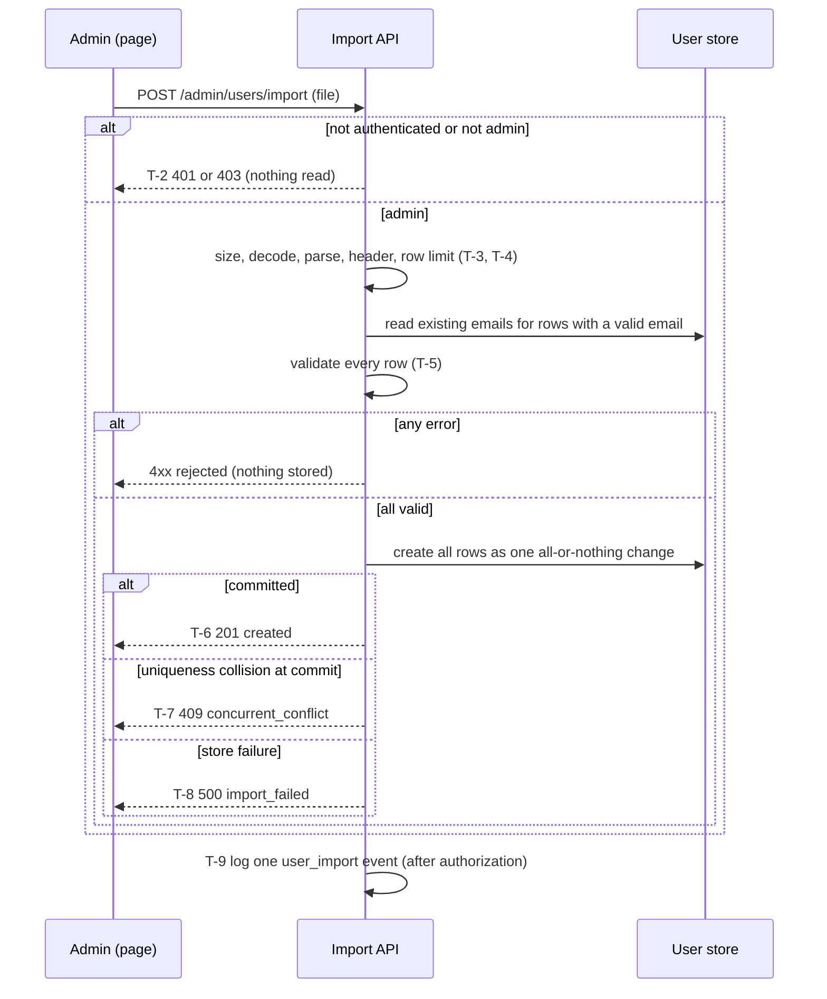

# Admin User Management: Product Specification

This is the maintained requirements home for admin-facing user management. It records what the product must do;
how it is built lives in `KNOWLEDGE/architecture.md` (decisions `AD-<n>`). Product decisions here are `PD-<n>`.

## Provenance and evidence limits

- **Source of intent.** The request "Let admins upload a CSV to bulk-create users." (received 2026-11-21). Nothing
  else states intent; every other rule below is a labelled default (`PD-<n>`) chosen so the request can work
  correctly and safely, not a user requirement.
- **No baseline exists in this run.** There was no repository, discovery result, research result, earlier spec or
  selected baseline, so nothing was observed about the current system. Every statement about existing behaviour
  (admin role, user store, single-user creation, theme, routes) is an assumption, listed in `## Submission` and
  bound by `P-1` below. This spec adds behaviour; it changes none, because none was observed.
- **Nothing was executed.** Every example below is marked `NOT-REPLAYED` where it was only walked by hand
  (see `## Evidence for worked examples`). No test, product code or `backchain-check` graph was written or run.
- **Request outcomes (O-n)**, used for traceability:
  O-1 an admin can upload a CSV; O-2 each user described in the CSV is created, in bulk; O-3 only admins can do it.

## Conventions used by every acceptance line

- **Principals:** `admin1` (administrator), `member1` (authenticated non-admin), `anonymous` (not signed in).
- **Seed state S0** (every case starts here unless it says otherwise): the user store holds exactly three users,
  `admin1@example.com` (administrator), `member1@example.com` and `existing@example.com` (both non-admin).
  "User count" means the number of users in the store; S0 has 3.
- **API surface:** `POST /admin/users/import`, `multipart/form-data`, file in part `file`. The path and part name are
  defaults (PD-12) that planning may remap to the product's route conventions; the behaviour does not change.
- **Page surface:** the admin import page, `GET /admin/users/import` (R-12).
- **Row numbering (PD-8):** a row number is the position of a record in the file, counting the header as row 1, so the
  first data row is row 2 (matches spreadsheet numbering). Blank records count for numbering but are ignored.
- **Fixtures** are byte-exact and named `F-…`; they are defined once in `## Fixtures` and cited by name.
  `\n` is LF (0x0A) unless a fixture says CRLF.

## Product decisions (defaults the request leaves open)

Each is reversible; the basis is the request's goal plus the stated safety reason. None is a user requirement.

| ID | Decision | Basis and alternative not chosen |
|---|---|---|
| PD-1 | An import is all-or-nothing: any error anywhere in the file means no user is created. | Admin gets one unambiguous end state and can retry the same file after fixing it. Alternative: create the valid rows and report the rest (leaves a half-imported file the admin must reconcile by hand). |
| PD-2 | CSV columns: `email` and `name`, both required; any other column rejects the file. | The request names no fields; email identifies a user and name is the minimum to display one. Unknown columns are rejected, not ignored, so a `role` or `password` column is never silently dropped. |
| PD-3 | Limits: file content at most 524,288 bytes; at most 1,000 data rows. | Unbounded upload is unsafe and the result must come back from one request. Defaults, not measured; see R-3 and R-14. |
| PD-4 | Email is trimmed and lower-cased; uniqueness compares the normalized value. | Prevents `ADA@x.com` and `ada@x.com` becoming two accounts. |
| PD-5 | A row whose email already exists is an error. Existing users are never updated, skipped or merged. | An import that silently overwrites accounts is unsafe; "create" is what was asked. |
| PD-6 | The response to the upload is the whole result; no import history, job or stored report. | Keeps state minimal (see `## State lifecycle`). |
| PD-7 | Imported users are created exactly as the product creates a user through its existing single-user admin path (role, status, credential state), and never as administrators. No passwords in the CSV, no emails sent. | The request does not ask for credentials or invitations; parity avoids inventing an onboarding flow. |
| PD-8 | Row numbering as defined under Conventions. | Admins locate errors in the spreadsheet they exported. |
| PD-9 | The file is judged by its content only; filename and declared content type are ignored. | Browsers and OSes label CSV inconsistently. |
| PD-10 | Per field at most one error is reported per row, the first that applies in the order listed in R-4/R-5; all rows are checked and all errors reported. | The admin fixes the file once instead of one error per attempt. |
| PD-11 | Error reports carry codes and row numbers, never cell values (header names excepted, R-7). | Avoids reflecting or logging personal data. |
| PD-12 | Route and part name as under Conventions. | Needed to make acceptance lines replayable. |

## Requirements

Each requirement below carries: **Basis**, **Preserved/changed**, **Source locators**, **Evidence limits**, **Pending**,
behaviour with boundaries and error behaviour, the **consumer outcome**, and acceptance lines `AC-<n>.<k>`. Every
acceptance line gives type (positive / failure / boundary, or `n/a: reason`), the consumer surface, and how confirmed.

### R-1 Only admins can import

- **Basis:** request, "Let admins upload a CSV…" (2026-11-21): the word "admins". Outcome O-3.
- **Preserved/changed:** add. No existing authorization rule was observed; the product's own admin notion is reused (P-1), no role is added or changed.
- **Source locators:** request sentence, "admins"; Behavior-model guidance (guard on every transition, T-2).
- **Evidence limits:** the admin role and session mechanism were not inspected (P-1).
- **Pending:** implementation and checks not started.
- **Behaviour:** the import API accepts a request only from an authenticated principal the product currently treats as an administrator. Authorization is evaluated per request against current role data, before the request body is read or parsed. A role revoked after a page loaded takes effect on the next request.
- **Error behaviour:** `anonymous` gets 401 and `member1` gets 403; neither parses the file, creates a user, or learns whether any email exists. Status codes follow the product's existing unauthenticated/forbidden convention if it has one; 401/403 are the default.
- **Consumer outcome:** an admin can import; nobody else can, and the refusal leaves the store untouched.
- **Domain rules left out:** finer-grained permissions (e.g. "may import but not delete"), per-team scoping, approval of imports.
- **Acceptance:**
  - AC-1.1 positive: `admin1` posts F-A → status 201 (not 401/403). Surface: API. Confirmed by: API test with an admin session.
  - AC-1.2 failure: `member1` posts F-A → 403; user count stays 3. Surface: API. Confirmed by: API test, then user list.
  - AC-1.3 failure: `anonymous` posts F-A → 401 (or the product's existing sign-in redirect for non-API callers); user count stays 3. Surface: API. Confirmed by: API test, then user list.
  - AC-1.4 boundary: authorization precedes body handling: `member1` posts F-SIZE-OVER → 403 (not 413); `anonymous` posts F-MALFORMED → 401 (not 422). Surface: API. Confirmed by: API test asserting status order.
  - AC-1.5 boundary: `admin1` loads the import page, the account's administrator role is then removed through the product's existing means, the page then submits F-A → 403, user count unchanged. `NOT-REPLAYED`: needs the product's role-removal path (P-1), which is not known; the expected result follows from "evaluated per request". Surface: Page + API. Confirmed by: end-to-end test once P-1 is resolved.

### R-2 Upload a CSV file and have it understood

- **Basis:** request, "upload a CSV" (2026-11-21); PD-2, PD-9. Outcome O-1.
- **Preserved/changed:** add.
- **Source locators:** request sentence, "upload a CSV"; PD-2, PD-8, PD-9.
- **Evidence limits:** the CSV exports of real spreadsheet programs were not sampled; BOM/CRLF handling follows the common behaviour of Excel "CSV UTF-8" and is checked by fixture only.
- **Pending:** implementation and checks not started.
- **Behaviour:** the API accepts one file in part `file`. The content must be UTF-8 (a leading byte-order mark is ignored), comma-delimited, RFC 4180 quoting (`"` quotes a field; `""` is a literal quote; a quoted field may contain commas and line breaks), records separated by LF or CRLF. The header is the first non-blank record; header names are trimmed and compared case-insensitively. Required columns are `email` and `name`; their order is free. Whitespace-only records are blank and ignored. After authorization (R-1), checks run in this order and stop at the first that fires: (1) part `file` present; (2) size (R-3); (3) valid UTF-8; (4) well-formed CSV; (5) at least one non-blank record; (6) header (missing, unknown, duplicate columns are all reported together); (7) at least one data row; (8) row limit (R-3); (9) row validation (R-4, R-5).
- **Error behaviour** (all with `created: 0`, nothing stored): no `file` part → 400 `file_missing`; undecodable bytes → 422 `invalid_encoding`; unclosed quote, quote inside an unquoted field, text after a closing quote, or a CR not followed by LF outside quotes → 422 `malformed_csv` with `row` = the record where the problem starts; no non-blank record → 422 `empty_file`; header problems → 422 with one file error per problem, in this order: `duplicate_column` (a repeated `email` or `name`), `missing_column` (`email` then `name`), `unknown_column` (every other header, in file order, header text lower-cased and cut to 64 characters); header only → 422 `no_data_rows`. A row with more or fewer fields than the header is a row error `column_count_mismatch` (R-4).
- **Consumer outcome:** a spreadsheet export is accepted without the admin editing it; every refusal names the reason by code.
- **Domain rules left out:** other delimiters (the semicolon files some locales export are rejected, with a header error that shows it), other encodings, `.xlsx`, column mapping UI, a header-less mode, multiple files per request, compressed files.
- **Acceptance:**
  - AC-2.1 positive: `admin1` posts, each separately from S0: F-A → 201 created 3; F-A-CRLF-BOM → 201 created 3; F-A-UPPERHDR → 201 created 1; F-QUOTED → 201 created 2 with names `Hopper, Grace` and `Alan "Bletchley" Turing`. Surface: API. Confirmed by: API test asserting status, `created` and stored names.
  - AC-2.2 failure: from S0, `admin1` posts: a request with no `file` part → 400 `file_missing`; F-CP1252 → 422 `invalid_encoding`; F-MALFORMED → 422 `malformed_csv` row 2; F-EMPTY and F-BLANKS → 422 `empty_file`; F-HEADERONLY → 422 `no_data_rows`; F-MISSINGCOL → 422 `missing_column` column `name`; F-UNKNOWNCOL → 422 `unknown_column` column `role`; F-DUPCOL → 422 `duplicate_column` column `email`; F-SEMICOLON → 422 `missing_column` email, `missing_column` name, `unknown_column` `email;name`. Each: `created` 0, user count stays 3, `row_errors` empty. Surface: API. Confirmed by: API test per fixture.
  - AC-2.3 boundary: F-BLANKMID → 422, the only error is row 4 (`name_required`), proving blank row 3 was ignored but counted; F-TABBLANKTRAIL → 201 created 1; F-A uploaded under filename `users.txt` with content type `text/plain` → 201; the bytes `FF FE 00 01` uploaded as `users.csv` with content type `text/csv` → 422 `invalid_encoding`. Surface: API. Confirmed by: API test.

### R-3 Upload size and row limits

- **Basis:** the request does not state a limit; PD-3 introduces one because an unbounded upload cannot be handled safely and the result must return from one request. The values are defaults.
- **Preserved/changed:** add.
- **Source locators:** PD-3; requirements-definition guide ("numeric bound inside any hard platform limit").
- **Evidence limits:** the deployed runtime's request-body, timeout and transaction limits are unknown here (no repository). The values are not measured; they are chosen to be small (a 1,000-row file is about 31 KB with short values, F-1000 below).
- **Pending:** implementation, checks, and revalidation of the values against the real runtime (R-14).
- **Behaviour:** file content up to and including 524,288 bytes is accepted for processing; at most 1,000 non-blank data rows are accepted. Blank records are not data rows: they count toward the byte limit only. Multipart framing bytes do not count toward the 524,288.
- **Error behaviour:** content of 524,289 bytes or more → 413 `file_too_large`; 1,001 or more data rows → 422 `too_many_rows` carrying `limit` 1000 and `found` (the number of non-blank data rows, here 1001). Neither creates a user or validates rows.
- **Consumer outcome:** an admin with a larger list splits it and is told the exact limit.
- **Domain rules left out:** chunked or resumable uploads, an asynchronous path for larger files.
- **Revalidation condition:** change the values (a decision, not a bug) when the runtime's request-size limit is below 524,288 bytes plus framing, when F-1000 does not finish inside the runtime's request time limit (R-14), or when admins need larger files.
- **Acceptance:**
  - AC-3.1 positive: F-1000 (31,011 bytes, 1,000 rows) → 201 created 1000, user count 1003; F-SIZE-OK (exactly 524,288 bytes: F-A plus 524,188 trailing LFs) → 201 created 3. Surface: API. Confirmed by: API test.
  - AC-3.2 failure: F-1001 (31,042 bytes) → 422 `too_many_rows` limit 1000 found 1001, user count stays 3; F-SIZE-OVER (524,289 bytes) → 413 `file_too_large`, user count stays 3. Surface: API. Confirmed by: API test.
  - AC-3.3 boundary: the pairs 1,000/1,001 rows and 524,288/524,289 bytes are the exact boundaries and are asserted in AC-3.1 and AC-3.2; F-SIZE-OK also proves 524,188 blank records do not count as rows. n/a otherwise: no separate positive/failure expectation adds anything.

### R-4 Every row is validated; all errors are reported

- **Basis:** request, "bulk-create users" (2026-11-21), which cannot work correctly without defining what a valid user row is; PD-2, PD-4, PD-10.
- **Preserved/changed:** add.
- **Source locators:** request sentence, "users"; PD-2, PD-4, PD-10, PD-11.
- **Evidence limits:** the product's existing single-user rules (name length, email rules) were not observed. If they are stricter than the rules below, the stricter rule wins and R-4 is revised through the correction route (P-1); they must not be looser.
- **Pending:** implementation and checks not started.
- **Behaviour:** each non-blank data row is checked independently; the file is rejected if any row has an error, and the response lists every error from every row (R-7). A row whose field count differs from the header's gets only `column_count_mismatch` (no field errors). Otherwise, per field, the first applicable error:
  - `email`: trimmed and lower-cased first. Empty → `email_required`. More than 254 characters, or not matching `local@domain` where `local` is one or more characters excluding whitespace and `@`, and `domain` is two or more dot-separated non-empty labels with no whitespace or `@` → `email_invalid`. Then R-5 errors.
  - `name`: trimmed. Empty → `name_required`. More than 100 characters (Unicode code points) → `name_too_long`. Any control character (Unicode category Cc, including tab and line breaks inside a quoted field) → `name_invalid`. Internal spaces and all other characters, including a leading `=`, `+`, `-`, `@` or `<`, are stored as given.
- **Consumer outcome:** the admin sees every fixable problem in one pass.
- **Domain rules left out:** deliverability or domain checks, disposable-address blocking, name-format policy, additional user fields, internationalized-domain normalization beyond lower-casing.
- **Acceptance:**
  - AC-4.1 positive: F-NORM (`  Ada@Example.COM  ,  Ada Lovelace  `) → 201 created 1 and the stored user has email `ada@example.com`, name `Ada Lovelace`. Surface: API + user list. Confirmed by: API test then store read.
  - AC-4.2 failure: F-MIXED → 422, `created` 0, `row_errors` exactly `[{row 3, field email, code email_invalid}, {row 4, field name, code name_required}, {row 5, field email, code duplicate_in_file, first_row 2}]`; F-COMMAROW → row 2 `email_required` and row 2 `name_required` (in that order); F-COLCOUNT → rows 3 and 4 each `column_count_mismatch` with no `field`; F-NAMECTRL → row 2 `name_invalid`. User count stays 3 in each. Surface: API. Confirmed by: API test comparing the body exactly.
  - AC-4.3 boundary: F-NAME100 → 201; F-NAME101 → 422 row 2 `name_too_long`; F-EMAIL254 → 201; F-EMAIL255 → 422 row 2 `email_invalid`. Surface: API. Confirmed by: API test.

### R-5 Email uniqueness

- **Basis:** request, "create users" (2026-11-21): an import must not create a second account for an existing person; PD-4, PD-5.
- **Preserved/changed:** add. Assumes the product already treats email as a unique user identifier (P-1); if it does not, that is a decision for the user and R-5 stays unready.
- **Source locators:** PD-4, PD-5, PD-10.
- **Evidence limits:** the store's actual uniqueness mechanism was not observed.
- **Pending:** implementation and checks not started.
- **Behaviour:** the normalized email of every created user is unique in the store at all times. Per row, the email error priority is `email_required`, `email_invalid`, `duplicate_in_file`, `email_taken`. A row repeating a normalized email already present on an earlier row (even if that earlier row has other errors) → `duplicate_in_file` carrying `first_row`; a row whose normalized email belongs to an existing user → `email_taken`. Existing users are never changed (PD-5).
- **Concurrent imports:** if two imports with overlapping emails are in flight, at most one can create each address; the other is rejected whole with 409 `concurrent_conflict` (R-8), never partially applied. If the first has already committed when the second validates, the second sees ordinary `email_taken` errors (422).
- **Consumer outcome:** no duplicates ever exist, and the admin is told which rows collide.
- **Domain rules left out:** merge/update of an existing user, "skip existing" mode, matching on anything other than email.
- **Acceptance:**
  - AC-5.1 positive: F-A from S0 (no email collides) → 201 created 3. Surface: API. Confirmed by: API test.
  - AC-5.2 failure: F-TAKEN → 422 `row_errors` `[{row 2, email, email_taken}]`, and `new1@example.com` is not created (count stays 3); F-DUPFIRSTBAD → `[{row 2, name, name_required}, {row 3, email, duplicate_in_file, first_row 2}]`; F-DUPTAKEN → `[{row 3, email, duplicate_in_file, first_row 2}, {row 4, email, email_taken}]`; F-UPPERTAKEN → `[{row 2, email, email_taken}]` (case-insensitive match with the seed user `admin1@example.com`). Surface: API. Confirmed by: API test comparing bodies, then store count.
  - AC-5.3 boundary, serial: `admin1` posts F-CONC-X then F-CONC-Y, in that order, to completion. Walk: X creates a@, b@ (201, 2). Y: row 2 `b@example.com` exists → `email_taken`; row 3 `c@example.com` is free → 422 `[{row 2, email, email_taken}]`, c@ not created. Final: S0 + a@ + b@ = 5 users. Surface: API. Confirmed by: API test.
  - AC-5.4 boundary, concurrent: the same two requests, both validated before either commits. Walk: both pass validation (neither b@ nor c@ in store); each then tries to commit b@; the store admits only one. Winner 201; loser 409 `concurrent_conflict`, `created` 0. If X wins the store is S0 + a@ + b@; if Y wins, S0 + b@ + c@. Either way `b@example.com` exists once and no partial rows of the loser exist. `NOT-REPLAYED`: needs a pause between validation and commit in the implementation, which does not exist yet; the expected result is derived from this requirement, not an observation. Surface: API + store. Confirmed by: concurrency test with a commit barrier.

### R-6 Valid files create all users atomically

- **Basis:** request, "bulk-create users" (2026-11-21); outcome O-2; PD-1. Primary outcome.
- **Preserved/changed:** add.
- **Source locators:** request sentence, "bulk-create"; PD-1, PD-6.
- **Evidence limits:** whether the product's store offers atomic multi-row creation is not established; AD-2 records the dependency and planning must verify it before this requirement is ready.
- **Pending:** implementation and checks not started.
- **Behaviour:** when the whole file passes every check, every row becomes a user, and the store changes in one step: afterwards either all rows exist or none do. Created users carry the normalized email and trimmed name (R-4). The import response is returned only after the outcome is durable.
- **State and data assessment:** *Resource:* the user store (durable). *Target identity:* users keyed by normalized email. *Before:* N users, none with any of the file's emails (else rejected earlier). *After on 201:* N + k users, k = data rows, each row present exactly once. *After on any non-201:* exactly N users, unchanged. *Recovery:* a failure mid-way leaves the store as before (R-8); the admin may re-upload the same file. *Checks:* AC-6.1 to AC-6.4. *Unknowns:* store transaction and uniqueness capability (AD-2).
- **Consumer outcome:** the users in the CSV exist and can be listed; or none of them do.
- **Domain rules left out:** import history, undo/rollback of a successful import, scheduled imports.
- **Acceptance:**
  - AC-6.1 positive: from S0, `admin1` posts F-A → afterwards the user list shows 6 users, including `ada@example.com` / `Ada Lovelace`, `grace@example.com` / `Grace Hopper`, `alan@example.com` / `Alan Turing`. Surface: API + user list. Confirmed by: API test then store read.
  - AC-6.2 failure: from S0, F-MIXED → 422 and the store still holds exactly the 3 seed users, including no `ada@example.com` although row 2 is valid on its own. Surface: user list. Confirmed by: store read after the request.
  - AC-6.3 failure (injected): from S0, F-A with the store made to fail while inserting the second of three rows → 500 `import_failed` (R-8) and `ada@`, `grace@`, `alan@` all absent. `NOT-REPLAYED`: requires a fault-injection point that does not exist yet. Surface: API + store. Confirmed by: integration test with an injected write fault.
  - AC-6.4 boundary: F-1000 → 1003 users, each `user0001…user1000@example.com` present once; then re-posting F-A after AC-6.1 changes nothing: 422 `email_taken` for rows 2, 3 and 4, count stays 6 (a retry never duplicates). Surface: API + user list. Confirmed by: API test then store read.

### R-7 Result contract

- **Basis:** request, outcome O-1 and O-2: the uploader must be able to tell what happened; PD-8, PD-10, PD-11.
- **Preserved/changed:** add.
- **Source locators:** PD-8, PD-10, PD-11.
- **Evidence limits:** field names of this JSON are defaults (PD-12); consumers are the import page and tests only.
- **Pending:** implementation and checks not started.
- **Behaviour:** responses are `application/json` with one shape: `status` (`created`, `rejected` or `failed`), `created` (integer), and either `users` (on `created`) or `file_errors` and `row_errors` (on the others; arrays, possibly empty). On `created`, `users` lists every created user in file order as `{row, id, email, name}` with `id` an opaque string. `row_errors` are ordered by row then field (`email` before `name`); each is `{row, field, code}` plus `first_row` for `duplicate_in_file`, and has no `field` for `column_count_mismatch`. File-level errors and row errors never appear together (a file-level error stops row validation). No cell value appears in any response; the only echoed file text is `column` in header errors (PD-11).
- **Consumer outcome:** the admin can map every error to a row and a fix.
- **Domain rules left out:** localized messages from the server (the page maps codes to text), downloadable error reports.
- **Acceptance:**
  - AC-7.1 positive: F-A response body is `{"status":"created","created":3,"users":[{"row":2,"id":<string>,"email":"ada@example.com","name":"Ada Lovelace"},{"row":3,…"grace@example.com","Grace Hopper"},{"row":4,…"alan@example.com","Alan Turing"}]}`. Surface: API. Confirmed by: exact-shape assertion (id asserted only as non-empty string).
  - AC-7.2 failure: F-MIXED response is `{"status":"rejected","created":0,"file_errors":[],"row_errors":[<the three errors of AC-4.2>]}` and the serialized body contains neither `not-an-email` nor `Bad Row`; F-SEMICOLON has non-empty `file_errors` and empty `row_errors`. Surface: API. Confirmed by: exact-body assertion and substring-absence assertion.
  - AC-7.3 boundary: with 1,000 row errors possible, all are returned (no truncation): a 1,000-row file whose every email is `bad` → 422 with 1,000 `email_invalid` entries, rows 2 to 1001, in order. Surface: API. Confirmed by: API test counting entries.

### R-8 Failure, conflict and unknown outcome

- **Basis:** request, "bulk-create users" (2026-11-21), PD-1; consequential alternative states of a multi-record write.
- **Preserved/changed:** add.
- **Source locators:** PD-1, T-7, T-8.
- **Evidence limits:** failure injection points do not exist yet.
- **Pending:** implementation and checks not started.
- **Behaviour:** a store failure while creating → 500 with `{"status":"failed","created":0,"file_errors":[{"code":"import_failed"}],"row_errors":[]}`; a commit-time uniqueness collision with a concurrent import → 409 `concurrent_conflict` with `status` `rejected`. In both, no user from the file exists afterwards. If the response is lost (connection drop, timeout) the outcome is still all-or-none; the admin learns which by re-uploading the same file: all rows `email_taken` means it had been applied, success means it had not. No partial state can be observed.
- **Consumer outcome:** every failure is safe to retry.
- **Domain rules left out:** automatic retry, server-side import resume, notification to the admin of a lost result.
- **Acceptance:**
  - AC-8.1 failure: the injected-fault case of AC-6.3 returns exactly the 500 body above. `NOT-REPLAYED` (fault injection missing). Surface: API. Confirmed by: integration test.
  - AC-8.2 failure: the loser of AC-5.4 returns 409 `concurrent_conflict` with `created` 0. `NOT-REPLAYED` (commit barrier missing). Surface: API. Confirmed by: concurrency test.
  - AC-8.3 boundary: after F-A is applied and its response is discarded by the client (simulated: the test ignores the 201), re-posting F-A → 422 `email_taken` rows 2, 3, 4, count 6; if the discarded request instead never reached the store, re-posting → 201. Walk: first state is S0 + 3 or S0; each re-post is permitted (admin1, R-1) and its outcome follows R-5/R-6. `NOT-REPLAYED` by tool; derived by hand. Surface: API. Confirmed by: API test.

### R-9 Imported users are ordinary, non-admin users

- **Basis:** request, "bulk-create users" (2026-11-21); PD-2, PD-7.
- **Preserved/changed:** add; preserves, by reference, whatever the existing single-user creation does (not observed, P-1).
- **Source locators:** PD-2, PD-7.
- **Evidence limits:** the existing single-create behaviour (default role, status, credential state, welcome email) was not observed, so "same as single-create" cannot yet be compared concretely.
- **Pending:** implementation, the baseline comparison and checks.
- **Behaviour:** a created user has the same role, status and credential state as a user created through the product's existing single-user admin path with the same email and name, differing only in generated identifiers and timestamps. The import never grants administrator rights, sets a password, or sends an email or invitation. If the product has no single-user admin path, imported users are created non-admin with no credential, able to sign in only through the product's existing account-recovery flow, if any (PD-7).
- **Consumer outcome:** imported users are indistinguishable from individually created ones.
- **Domain rules left out:** passwords or temporary credentials in the CSV, invitation emails, role/group/team columns, MFA enrollment, import-time deactivation.
- **Acceptance:**
  - AC-9.1 positive: after F-A, each of the three created users has role non-admin and the same status and credential state as a user created through the single-create path for the same email and name (comparison excludes id and timestamps). Surface: user store / admin user list. Confirmed by: store comparison test (blocked until P-1 identifies the single-create path; if none exists, assert non-admin and no credential).
  - AC-9.2 failure: F-UNKNOWNCOL (`role` column set to `admin`) → 422 `unknown_column`; no user is created and none is an administrator. Surface: API + user list. Confirmed by: API test then store read.
  - AC-9.3 boundary: during F-A, no outbound email is sent. Surface: the product's mail sink or outbound-mail log. Confirmed by: assertion that the sink is empty; `n/a` if the product has no mail facility (record that).

### R-10 Uploaded data is not retained or exposed

- **Basis:** request (2026-11-21) implies personal data (names, emails) in a file; the safe handling default is PD-6, PD-11. Not requested directly.
- **Preserved/changed:** add.
- **Source locators:** PD-6, PD-11; state/information lifecycle duty.
- **Evidence limits:** the product's logging, temp-file and upload-handling behaviour was not observed.
- **Pending:** implementation and checks not started.
- **Behaviour:** the file's bytes exist only for the duration of one request. No copy survives the request, whether it succeeded or failed: not in a persistent store, not in a temp or spool file, not in logs (R-11). The only durable record of an email or name is the user record itself on success. Results are returned only to the requesting admin, in the response; no endpoint returns a past import's file, rows or report (PD-6).
- **Consumer outcome:** a second admin or an operator reading logs or disk cannot recover the CSV.
- **Domain rules left out:** an upload archive for audit, encryption of stored files (nothing is stored), a data-retention period for import content (nothing is retained).
- **Acceptance:**
  - AC-10.1 positive: post F-PRIV (`sentinel.pii.7f3a@example.com`, `Sentinel Person 7f3a`) as `admin1` → 201; afterwards the string `7f3a` occurs in the user store and nowhere in application logs or temporary/upload directories. Surface: logs, filesystem, store. Confirmed by: search after the request.
  - AC-10.2 failure: post F-MALFORMED, F-MIXED and F-SIZE-OVER → the same search of temp/upload directories finds no leftover file or fragment once each request has finished. Surface: filesystem. Confirmed by: directory listing before and after.
  - AC-10.3 boundary: n/a: there is no import history, report or download endpoint to bound, by PD-6.

### R-11 One log event per attempt, without personal data

- **Basis:** request (2026-11-21): a privileged bulk action needs a trace; the minimum is PD-6 and PD-11. Not requested directly.
- **Preserved/changed:** add.
- **Source locators:** PD-11; service-discovery guidance (owned event coverage).
- **Evidence limits:** the product's logging facility and its login/authorization logging were not observed; the event reuses them.
- **Pending:** implementation and checks not started.
- **Behaviour:** every authorized attempt (after R-1 passes) writes one structured log event `user_import` through the product's existing logging, with: `import_id` (fresh, opaque), acting admin's id, `outcome` (`created`, `rejected`, `failed`), data-row count when determinable, `created` count, the distinct error codes seen, and duration. It contains no email, name, filename or other cell content. Failing authorization is covered by the product's existing authorization logging, not by this event. A logging failure does not change the HTTP result or the stored data.
- **Consumer outcome:** an operator can answer who imported, when, and what happened, without seeing personal data.
- **Domain rules left out:** an audit trail UI, alerting, retention of this event beyond the product's existing log retention (inherited, no period set here).
- **Acceptance:**
  - AC-11.1 positive: F-A as `admin1` → exactly one `user_import` event with outcome `created`, created 3, actor `admin1`. Surface: log output. Confirmed by: log capture in an API test.
  - AC-11.2 failure: F-MIXED → one event, outcome `rejected`, created 0, codes exactly `email_invalid`, `name_required`, `duplicate_in_file`, and the captured log contains none of `not-an-email`, `Bad Row`, `ada@example.com`. Surface: log output. Confirmed by: log capture and substring-absence assertion.
  - AC-11.3 boundary: with the logging sink made to fail, F-A still returns 201 and creates the 3 users. `NOT-REPLAYED`: needs a failing sink double. Surface: API + store. Confirmed by: integration test.

### R-12 Admin import page

- **Basis:** request, "Let admins upload a CSV" (2026-11-21): an admin uploads a file, which is a human action on a page. Outcome O-1. Primary outcome. That the product has a web admin area is an assumption (P-1).
- **Preserved/changed:** add a new page; if an admin area and design system exist, the page inherits their identity (R-17).
- **Source locators:** request sentence, "admins upload"; Interaction design guide; UI-specific planning (components, interaction model, skin).
- **Evidence limits:** no existing UI or design tokens were inspected.
- **Pending:** implementation and checks not started.
- **Components:** page heading; a short instruction block stating the two required columns (`email`, `name`), that the file must be comma-separated UTF-8, and the limits from R-3 (1,000 rows, 512 KB) stated so they cannot disagree with the server's; a file drop zone that wraps a native `<input type="file" accept=".csv,text/csv">` (drag-and-drop is an enhancement; the native input is always usable); a selected-file summary (filename and size); a primary "Import users" button; a result region.
- **Interaction model:** states are *idle* (no file; button disabled), *file chosen* (button enabled), *pending* (request sent), *created*, *rejected*, *failed-unknown*. Pending disables the drop zone, the input and the button, shows a busy indicator with no invented progress figure (the work is one atomic request), and sends exactly one request however many times the button is activated. The result belongs to the request that produced it; choosing another file after a result clears the result. The server is the only validator (AD-4): the page applies no row validation of its own, so it cannot disagree with the server.
- **Result display:** *created*: "N users created" and the created users' emails and names. *rejected*: a plain statement that nothing was imported, then each error with its row number and a message mapped from its code (file-level errors first), grouped so a 1,000-error report stays scannable; the admin can fix the file and choose it again. *failed-unknown* (network error, timeout, 5xx without a parsed body): "We couldn't confirm the result. The import either fully applied or did not apply at all. Check the user list before importing again." (R-8). Server-supplied text is rendered as text, never as markup.
- **Access:** a non-admin who opens the page gets the product's forbidden response with no form in the page; an anonymous visitor goes to sign-in (R-1).
- **Consumer outcome:** an admin completes an import entirely from the page, by keyboard or pointer, and always knows what happened.
- **Domain rules left out:** in-browser CSV preview or editing, client-side validation, a downloadable template, progress percentage, import history, cancelling an in-flight import (cancelling the page request would not undo a server effect).
- **Acceptance:**
  - AC-12.1 positive: `admin1` opens the page, tabs to the file input, chooses F-A, activates "Import users" with the keyboard → the button shows a busy state, then the page shows "3 users created" listing `ada@example.com`, `grace@example.com`, `alan@example.com`; focus moves to the result heading and the outcome is exposed in a polite live region. Surface: browser (real page). Confirmed by: browser test with semantic queries and a controlled slow response to observe the pending state.
  - AC-12.2 failure: with F-MIXED the page shows "nothing was imported" and three error lines for rows 3, 4, 5 with messages mapped from `email_invalid`, `name_required`, `duplicate_in_file` (the last naming row 2); with F-CP1252 an encoding message; with the network dropped after the request is sent, the failed-unknown message above, and neither "created" nor "rejected" wording. Surface: browser. Confirmed by: browser test with stubbed responses for the network case and the live API for the others.
  - AC-12.3 boundary: double-clicking "Import users" with a slow response produces exactly one `POST` (request count 1); the page loaded as `member1` returns 403 and contains no file input; F-XSS (a name of ``) is created and shown as literal text with no script executed, and the page keeps working after it. Surface: browser. Confirmed by: browser test counting requests, asserting DOM text and absence of script execution.

## Non-functional requirements

Operating conditions: an admin importing a spreadsheet export of at most the R-3 limits from a desktop or phone browser, a few times a day at most. Priorities: data integrity and safety over speed.

### R-13 Security of the import

- **Basis:** request, "admins" (2026-11-21); platform-neutral security duties for an upload that creates accounts. **Preserved/changed:** add. **Evidence limits:** the product's session and CSRF mechanism are not observed (P-1). **Pending:** all.
- **Requirement:** authorization per R-1; a request from another origin that rides the admin's cookies is refused (the state-changing upload carries the product's anti-forgery protection, if sessions use cookies); file content is parsed in memory within the R-3 bound and never executed or interpreted as formulas or markup; cell values beginning `=`, `+`, `-`, `@` are stored verbatim (R-4); rendered text is escaped (AC-12.3).
- **Acceptance:** positive: AC-1.1. Failure: a cross-origin form post with the admin's cookies and no anti-forgery token → rejected, count unchanged (confirmed by API test; `n/a` if the product authenticates only by an explicit header, recorded then). Boundary: AC-1.4 and AC-3.2 (rejection before parsing cost). Verification: API and browser tests as cited.
- **Left out:** spreadsheet-export safety of stored names beginning `=` (a later export feature must neutralize them; no export is in scope).

### R-14 Capacity and latency

- **Basis:** PD-3 defaults. **Preserved/changed:** add. **Evidence limits:** runtime limits unknown. **Pending:** measurement.
- **Requirement:** F-1000 (the largest accepted file) completes and returns its result within the deployed runtime's request time limit, with the user store consistent afterwards. **Unresolved bound:** no latency target was requested and none is invented; the numeric time limit of the deployed runtime is not known here. Resolution: read the runtime's request limit when the environment is known, record a measured baseline for F-1000, and, if F-1000 does not fit, lower the PD-3 limits (a decision) instead of weakening R-6.
- **Acceptance:** positive: AC-3.1 (F-1000) succeeds on the deployed target. Failure/boundary: n/a: no numeric target to cross until the unresolved bound is set. Verification: timed run against the target; synthetic local timing is evidence of that surface only.
- **Left out:** independent-user throughput and hot-record load (an admin-only, rare action; shared-email contention is covered by AC-5.3 and AC-5.4).

### R-15 Reliability and data integrity

- **Basis:** PD-1. **Preserved/changed:** add. **Pending:** all.
- **Requirement:** after any outcome the store satisfies: unique normalized emails; no partial import; user count is N or N + k. **Acceptance:** AC-6.2, AC-6.3, AC-5.4, AC-8.3 (already stated; confirmation as there). Boundary: n/a: covered by those lines.

### R-16 Accessibility of the import page

- **Basis:** stage non-functional duty for any UI. **Preserved/changed:** add. **Pending:** all.
- **Requirement:** every control has an accessible name; the whole flow works by keyboard alone with visible focus; focus moves to the result and returns to a sensible control after a new file is chosen; pending, success and error are announced in a live region; text contrast at least 4.5:1 (3:1 for large text and control boundaries) in both themes (WCAG AA); error information is not conveyed by colour alone; no content is lost at 400% zoom or at 320 px width.
- **Acceptance:** positive: AC-12.1 by keyboard. Failure: the rejected state exposes its errors as text, not colour. Boundary: contrast measured in light and dark for text, borders and focus ring; 320 px width has no horizontal scroll. Verification: browser test with semantic queries plus an automated contrast check plus a manual keyboard pass. Automated checks do not replace a manual pass.

### R-17 Designed interface for the import page

- **Basis:** stage non-functional duty for a deliverable with a UI; `platforms/ui.md#light-expressive-starting-point`. **Preserved/changed:** add. **Evidence limits:** whether the product has an established identity is unknown (P-1); explicit constraints, established identity and platform conventions take precedence over everything below. **Pending:** all.
- **Named reference and starting appearance:** if no product identity exists, the light Google Gemini look and feel using Material 3 Expressive principles: airy composition, tonal rounded surfaces, a restrained saturated accent, friendly precise sans-serif type, purposeful short motion. Web UI starts light with a dark option. The plan fixes concrete tokens and records them in AD-5.
- **Observable criteria:** (1) one visual system: a spacing scale, a type scale and a palette defined once and reused, with a light and a dark theme; (2) designed idle (instructions plus drop zone), pending, success, rejected and failed-unknown states, none a bare browser default; (3) at 360 px and 1440 px widths the layout works with no horizontal overflow, the drop zone and the next action staying prominent; (4) visible focus states on every interactive element; (5) motion only to explain a change (drop-zone hover or drag-over, pending to result), disabled when the user prefers reduced motion; (6) one icon set; (7) the primary activity (the drop zone, then the result) has the strongest visual weight.
- **Acceptance:** positive: screenshots of each state in light and dark at the two widths show criteria 1 to 7. Failure: with `prefers-reduced-motion: reduce` no transition or animation runs. Boundary: a 1,000-error report at 360 px does not overflow horizontally. Verification: browser screenshots reviewed against this list, plus the reduced-motion and overflow assertions. A screenshot cannot prove motion timing.

### R-18 Compatibility with spreadsheet exports

- **Basis:** PD-2, PD-9. **Preserved/changed:** add. **Pending:** all.
- **Requirement:** CSV exported from Excel ("CSV UTF-8", which adds a byte-order mark and CRLF) and from Google Sheets ("Comma-separated values", LF) imports without editing. Windows-1252 and semicolon-delimited exports are refused with a clear code (R-2). **Acceptance:** positive: AC-2.1 (F-A-CRLF-BOM, F-A). Failure: AC-2.2 (F-CP1252, F-SEMICOLON). Boundary: n/a: the file-format edges are R-2's. **Verification:** fixtures only; no real export was sampled. Supported browsers are the product's existing matrix (unknown, P-1).

### Exclusions and justifications

- Rate limiting of the import endpoint: excluded, admin-only, bounded per request (R-1, R-3); revalidate if a non-human caller is ever allowed.
- Server-side localization: excluded, the page maps codes to text and follows the product's existing localization convention if any.
- Upload progress bar: excluded, at most 512 KB.
- Availability or SLA target: none requested and none invented.

## Request outcome map (traceability)

| Outcome | Acceptance lines |
|---|---|
| O-1 admin can upload a CSV | R-2 (AC-2.1 to 2.3), R-3 (AC-3.1 to 3.3), R-7, R-12 (AC-12.1 to 12.3), R-18 |
| O-2 users in the CSV are created, in bulk | R-4 (AC-4.1 to 4.3), R-5 (AC-5.1 to 5.4), R-6 (AC-6.1 to 6.4), R-8, R-9 (AC-9.1 to 9.3) |
| O-3 only admins | R-1 (AC-1.1 to 1.5), AC-12.3 (member1 page), R-13 |
| Derived safety and quality (not requested directly) | R-10, R-11, R-13 to R-17 |

Every requirement has at least one acceptance line; every acceptance line traces to O-1, O-2 or O-3, or is marked derived. No modeled feature lacks a request outcome or a PD default behind it.

## Behavior model

### Flows

- **F-1 Successful import** (R-1, R-2, R-3, R-4, R-5, R-6, R-7, R-11, R-12). Admin chooses file, page posts; API authorizes, reads, validates, commits, logs, returns 201.
- **F-2 Rejected import** (R-2 to R-5, R-7, R-11, R-12). Same up to the first failed check; returns 4xx with nothing stored.
- **F-3 Conflict or failure** (R-5, R-8). Validation passes, commit fails; nothing stored; 409 or 500.
- **F-4 Refused caller** (R-1). 401 or 403 before anything is read.

### State inventory

The import attempt has no state that outlives its request (PD-6); the only durable entity it changes is the user.

| Entity | States and meaning | Owner / durability |
|---|---|---|
| Import attempt | Received, Authorized, Refused (terminal), Rejected (terminal), Committed (terminal), Conflict (terminal), Failed (terminal) | the request; transient, gone when the response is sent (outcome kept only in the log event, R-11) |
| User | absent, present. Invariant: normalized email unique; a user from an import exists iff its whole import Committed | user store; durable |
| Page | idle, file-chosen, pending, created, rejected, failed-unknown | browser memory; lost on navigation or reload; not authoritative |

### Transition ledger

| ID | Before to after | Trigger and guard | Effect and observation | R / cases |
|---|---|---|---|---|
| T-1 | Received to Authorized | request from a current administrator | file part becomes readable | R-1 / AC-1.1 |
| T-2 | Received to Refused | anonymous (401) or non-admin (403) | no read, no change | R-1 / AC-1.2 to 1.4 |
| T-3 | Authorized to Rejected | file part missing (400) or over 524,288 bytes (413) | no change | R-2, R-3 / AC-2.2, AC-3.2 |
| T-4 | Authorized to Rejected | decode, CSV, header, empty, row-count check fails (422) | no change; no row validation | R-2, R-3 / AC-2.2, AC-3.2 |
| T-5 | Authorized to Rejected | at least one row error (422) | no change; all errors listed | R-4, R-5, R-7 / AC-4.2, AC-5.2 |
| T-6 | Authorized to Committed | all checks pass and commit succeeds | N + k users; 201 | R-6, R-7 / AC-6.1, AC-6.4 |
| T-7 | Authorized to Conflict | commit hits a uniqueness collision with a concurrent import | no change; 409 | R-5, R-8 / AC-5.4, AC-8.2 |
| T-8 | Authorized to Failed | commit fails for any other store reason | no change; 500 | R-6, R-8 / AC-6.3, AC-8.1 |
| T-9 | any authorized outcome | after the outcome is known | one log event; a logging failure changes nothing | R-11 / AC-11.1 to 11.3 |

Invalid or repeated events: re-posting an applied file is not a special state; it is a fresh attempt that fails as T-5 with `email_taken` (AC-6.4). A page double-activation is absorbed by the pending state (AC-12.3).

## State and data assessment (summary)

Affected resources: the user store (changed on T-6 only); the log (appended, no personal data); nothing else persists. Target identities: users by normalized email. Authority: the product's admin role, evaluated per request. Partial failure: impossible by R-6; recovery is re-upload (R-8). Unknowns: the store's atomic-write and uniqueness capability (AD-2) and the product's existing creation defaults (R-9); both stay unverified until planning reads the system.

## State lifecycle (information, in proportion to the request)

| Piece | Owner and location | Who may read | Simultaneous change | Ends and removal | Quotas |
|---|---|---|---|---|---|
| Uploaded file bytes | the import request, memory | that request only | n/a: one request owns its bytes | freed at request end, never written (R-10) | 524,288 bytes (R-3) |
| Validation results | the import request | returned to the requesting admin only | n/a: per request | freed at request end | at most 1,000 row errors, one per field per row |
| User records | product user store | whoever the product already lets read users | uniqueness decides; one concurrent import wins whole, the other 409 (R-5) | the product's existing user deletion; this feature adds none | no new quota; existing user capacity applies |
| `user_import` log event | product logging | operators, per existing log access | independent appends | product's existing log retention (inherited, not set here) | one event per attempt |
| Page state | browser memory | the admin's tab | the pending state blocks a second submit | discarded on navigation | one file at a time |

Personal data (emails, names): shown to the requesting admin in the response and page; stored only as user records; never logged (R-11) or kept in files (R-10); removed only by the product's existing user deletion. The feature adds no identity, sharing or persistence beyond that.

## Service boundaries

Browser to import API; import API to user store. No other service, queue or job (AD-1).

- **Current authority:** role and email data are read live per request; there is no cache (R-1).
- **Freshness versus revocation:** a revoked admin is refused on the next request; the in-flight request already authorized completes. Within that bound, n/a: no cache to invalidate.
- **Incremental state:** n/a: one request carries the whole file; no cursors or deltas.
- **Async completion and recovery:** n/a: the response is the completion; an interrupted request is recovered by re-upload (R-8).
- **Owned event coverage:** the `user_import` event (R-11); authorization failures stay in the product's existing logging.

## Open gaps

- **P-1 (prerequisite, under R-1, R-4, R-5, R-9, R-12, R-13, R-17):** the product's existing admin role and session mechanism, user store with unique email, single-user creation behaviour, web admin area and design identity were not available to this run (no repository). The request itself presupposes admins and users. Planning must locate them before dependent work; this keeps those requirements unready until bound, while the rules of R-2, R-3 and R-7 (which depend on none of them) may proceed. If the product turns out to have no unique-email rule or no admin role, that becomes a decision for the user, not one this spec makes. No other gap needs the user: each unstated choice has a labelled default (PD-1 to PD-12).
- **Unresolved bound (under R-14):** the deployed runtime's request time and size limits (see R-3, R-14).

## Evidence for worked examples (duty 10)

- No example was executed. A local reference model of the validation rules was drafted but not run (running it was not permitted in this session), so it is not evidence. Every expected result in the acceptance lines was recomputed by hand-walking the ordered checks in R-2, R-4 and R-5 against the fixtures below; each is therefore `NOT-REPLAYED` by tool and stays open for the test stage to run. Hand-counted sizes: F-A is 100 bytes (11 + 29 + 31 + 29); F-1000 is 11 + 31 × 1,000 = 31,011; F-1001 is 31,042.
- Procedures checked for reachability (start reachable by a permitted actor, each action permitted in the state left by the previous): AC-5.3 (`admin1`, R-1 permits both posts; second post's state is S0 + a@ + b@, so `b@` is `email_taken` by R-5); AC-6.4 re-post (state S0 + 3 after AC-6.1, R-5 gives `email_taken`); AC-8.3. AC-1.5 and AC-5.4 and AC-6.3 and AC-11.3 have unreachable starts today (no role-removal path, commit barrier, fault injection, or failing sink exists) and are marked `NOT-REPLAYED` and open, not claimed as run.
- Weaker stand-ins rejected: bodies are compared exactly, store state is read after each request, absence is asserted for the sentinel and cell strings, and request counts are counted, not inferred from the DOM.
- No documented command was claimed; no runtime or library capability is asserted (AD-2 lists what must be verified).
- Nothing was dropped or weakened: there was no prior version.

## Fixtures

All fixtures are UTF-8 unless stated. `␊` is LF; fixtures listed "…" are shown in full.

- **F-A** (100 bytes): `email,name␊ada@example.com,Ada Lovelace␊grace@example.com,Grace Hopper␊alan@example.com,Alan Turing␊`
- **F-A-CRLF-BOM**: bytes `EF BB BF` followed by F-A with every LF replaced by CR LF.
- **F-A-UPPERHDR**: `Email , NAME␊ada@example.com,Ada Lovelace␊`
- **F-NORM**: `email,name␊  Ada@Example.COM  ,  Ada Lovelace  ␊`
- **F-QUOTED**: `email,name␊grace@example.com,"Hopper, Grace"␊alan@example.com,"Alan ""Bletchley"" Turing"␊`
- **F-MIXED**: `email,name␊ada@example.com,Ada Lovelace␊not-an-email,Bad Row␊grace@example.com,␊ADA@example.com,Ada Again␊`
- **F-TAKEN**: `email,name␊existing@example.com,Dup Of Existing␊new1@example.com,New One␊`
- **F-DUPFIRSTBAD**: `email,name␊ada@example.com,␊ada@example.com,Ada␊`
- **F-DUPTAKEN**: `email,name␊new@example.com,N␊new@example.com,N2␊existing@example.com,E␊`
- **F-UPPERTAKEN**: `email,name␊ADMIN1@EXAMPLE.COM,Dup␊`
- **F-SEMICOLON**: `email;name␊ada@example.com;Ada Lovelace␊`
- **F-CP1252**: `email,name␊jose@example.com,Jos` then byte `E9` then `␊` (not valid UTF-8).
- **F-EMPTY**: zero bytes. **F-BLANKS**: `␊  ␊`. **F-HEADERONLY**: `email,name␊`.
- **F-MISSINGCOL**: `email␊ada@example.com␊`. **F-UNKNOWNCOL**: `email,name,role␊ada@example.com,Ada Lovelace,admin␊`. **F-DUPCOL**: `email,email,name␊ada@example.com,ada@example.com,Ada␊`.
- **F-MALFORMED**: `email,name␊ada@example.com,"Ada Lovelace␊grace@example.com,Grace Hopper␊` (quote opened on row 2, never closed).
- **F-COLCOUNT**: `email,name␊ada@example.com,Ada Lovelace␊grace@example.com␊alan@example.com,Alan,Extra␊`
- **F-BLANKMID**: `email,name␊ada@example.com,Ada Lovelace␊␊grace@example.com,␊`
- **F-TABBLANKTRAIL**: `email,name␊ada@example.com,Ada␊` then a record of one tab and one space, then `␊`.
- **F-COMMAROW**: `email,name␊,␊`
- **F-NAMECTRL**: `email,name␊ada@example.com,"Ada` LF `Lovelace"␊`
- **F-NAME100 / F-NAME101**: `email,name␊ada@example.com,` plus 100 / 101 `x` characters plus `␊`.
- **F-EMAIL254 / F-EMAIL255**: `email,name␊` + email + `,Long␊`, where the email is 64 `a`, `@`, 60 `b`, `.`, 60 `c`, `.`, 60 `d`, `.`, then 6 `e` (254 characters) / 7 `e` (255).
- **F-1000 / F-1001**: header `email,name␊` then rows `userNNNN@example.com,User NNNN␊` for NNNN = 0001 to 1000 / 1001.
- **F-SIZE-OK / F-SIZE-OVER**: F-A followed by 524,188 / 524,189 LF bytes (total 524,288 / 524,289).
- **F-CONC-X**: `email,name␊a@example.com,A␊b@example.com,B␊`. **F-CONC-Y**: `email,name␊b@example.com,B2␊c@example.com,C␊`.
- **F-PRIV**: `email,name␊sentinel.pii.7f3a@example.com,Sentinel Person 7f3a␊`
- **F-XSS**: `email,name␊xss@example.com,␊`
- **F-ALLBAD** (AC-7.3): header `email,name␊` then 1,000 rows `bad,Name NNNN␊`.

## Retired

None. There was no earlier specification, so no requirement is retired, relaxed or dropped.

## Submission

**summary:** First spec for admin CSV bulk user creation, written from the one-sentence request alone (no repository, discovery, research or baseline existed; nothing was executed). Twelve behavioural requirements (R-1 to R-12) and six non-functional ones (R-13 to R-18) cover authorization, file format, limits, row validation, uniqueness, atomic creation, the result contract, failure and recovery, user parity, data retention, logging and the admin page. Defaults chosen and labelled PD-1 to PD-12; the main ones: all-or-nothing import (PD-1); columns `email` and `name` with unknown columns rejected (PD-2); limits 524,288 bytes and 1,000 rows (PD-3); lower-cased email as the unique key and existing users never updated (PD-4, PD-5); synchronous result with no import history (PD-6).

Assumptions (each a reversible default, each with a revalidation condition):
- A-1: the product already has authenticated sessions, an administrator role, a user store keyed by unique email, and a web admin area. Basis: the request says "admins" and "users". Alternative: API-only product (R-12 would drop). Revalidate when the codebase is read (P-1).
- A-2: user data to import is email and name only. Basis: the request names no fields. Alternative: more profile fields (PD-2 changes, columns added). Revalidate when the single-create path is read.
- A-3: limits 524,288 bytes and 1,000 rows (PD-3). Basis: small, safe for a synchronous atomic request; unmeasured. Alternatives: larger limits with an asynchronous job. Revalidate against the runtime's request-size and time limits (R-3, R-14).
- A-4: all-or-nothing (PD-1). Alternative: partial import with per-row report. Revalidate if admins need to import large messy lists.
- A-5: route `POST /admin/users/import` and the JSON field names (PD-12) are defaults; remap to the product's conventions.
- A-6: imported users follow the existing single-create defaults and get no invitation email (PD-7). Alternative: invitation or temporary credential flow. Revalidate when the single-create path is read.
- A-7: no latency target (R-14): none was requested, none invented.
- Open: P-1 (existing system not available) blocks R-1, R-4, R-5, R-9, R-12, R-13, R-17 until bound; the R-14 time bound is unresolved. No user decision is open unless P-1 shows the product has no admin role or no unique email.
- Not executed: all examples are `NOT-REPLAYED` (hand-walked); AC-1.5, AC-5.4, AC-6.3, AC-8.1, AC-8.2, AC-11.3 have starts that cannot yet occur. `backchain-check` does not exist here and no graph was written.

**primary:** R-1, R-2, R-6, R-12. (R-1: only admins. R-2 and R-12: upload a CSV by file and through the page. R-6: users are created in bulk.)

**evidence_refs:** `KNOWLEDGE/spec.md` (this file: R-1 to R-18, Behavior model, Fixtures, Evidence for worked examples); `KNOWLEDGE/architecture.md` (AD-1 to AD-5); the request text (2026-11-21); guides consulted: `GUIDES/requirements-definition.md`, `GUIDES/behavioral-requirements.md#behavior-model`, `#traceability-and-review`, `#actors-channels-and-state-ownership`, `GUIDES/platforms/ui.md#light-expressive-starting-point`, `GUIDES/service-discovery.md#verification`, `GUIDES/current-system-baseline.md#planning-and-review-handoff`, `GUIDES/project-knowledge.md#maintained-product-requirements`. No discovery or research result, selected baseline or `backchain-check` receipt exists.
