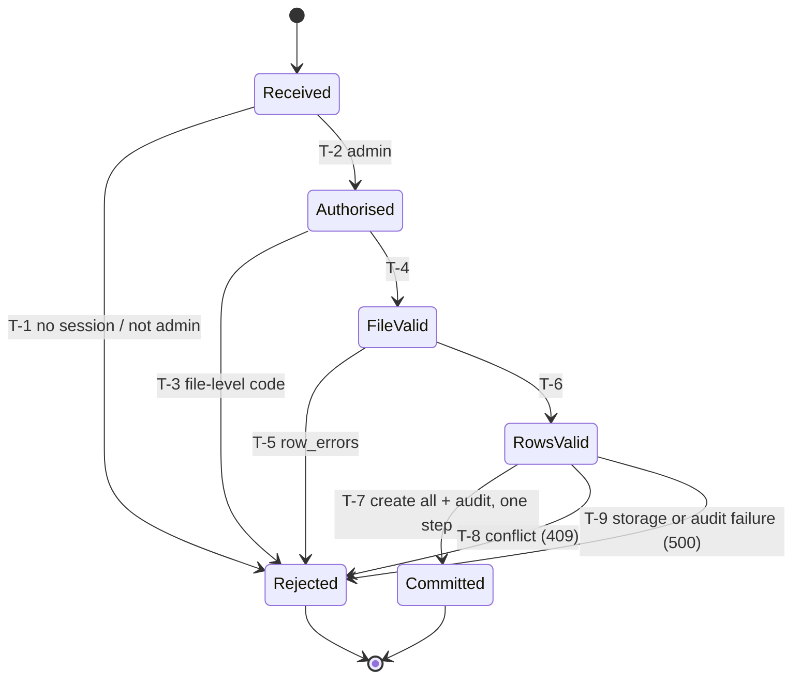

# User Administration — Product Specification

Living specification for the product's administrator-facing user management. First entry: bulk user import from CSV.
Structure and technology choices live in `architecture.md` as `AD-<n>`; this file holds product behaviour only.

## Scope, sources and evidence limits

| Item | Content |
| --- | --- |
| Request (source S-1) | 2026-11-21: "Let admins upload a CSV to bulk-create users." One sentence; it names no fields, limits, error policy, onboarding or UI. |
| Baseline | **Unavailable.** This run has no repository, no discovery or research result, no earlier spec and no selected baseline. Nothing about the existing user model, admin role, single-user create flow, UI, audit or mail is observed. Every statement about them below is an assumption (A-n) or an open gap (G-n), never an observation. |
| Guides applied | Behavior model, traceability, requirements definition, state and data assessment, service discovery verification, interaction design, UI visual direction (all under `GUIDES/`). |
| Status | Draft, **open**: requirements are specified and checkable, but G-1..G-7 below keep the affected implementation work unready until the baseline is inspected. |

### Assumptions (defaults taken unattended; each is changed in place if the person decides otherwise)

| ID | Default | Why / what changes if wrong |
| --- | --- | --- |
| A-1 | The product already has authenticated users, an administrator role, and a single-user "create user" operation. Bulk import reuses that operation's rules. | The request says "bulk-create", so a create operation is implied. If absent, R-2/R-4/R-7 need the user model defined first. |
| A-2 | Imported users carry two attributes: `email` (required, the identity key) and `name` (required). | Smallest set that identifies a person. Real required fields come from the single-create contract (G-2). |
| A-3 | The CSV carries **no password and no role**. Imported users get the same default role and initial state as a user made through single-create. | A password in a file is a secret at rest; a role column is a privilege-escalation path. Not requested, so not added. Unknown headers are rejected, never silently ignored. |
| A-4 | **All-or-nothing**: if anything in the file is invalid or conflicts, no user is created and every problem is reported at once. | Chosen over per-row partial creation so a failed import leaves no state to clean up and a corrected file can be re-uploaded whole. |
| A-5 | Import is **create-only**: an email that already belongs to a user is an error, never an update or skip. | "Bulk-create" does not say "update". |
| A-6 | The product has a web admin area; the upload is a screen there plus the request it makes. | "Upload" implies a page. If the product has no web UI, R-9, R-10 and NFR-6 retire to the request contract (G-6). |
| A-7 | The import runs synchronously in one request, bounded by configured row and byte limits (G-5). | No numeric bound is invented here; a larger scale would need an asynchronous design (AD-5 revisit trigger). |
| A-8 | The result is shown to the submitting admin only and is not stored server-side; it is gone once they leave the screen. | Smallest lifecycle that meets the request. Created users stay visible in the existing user list. |

### Open gaps (prerequisites and decisions; each names its safe interim and how to close it)

| ID | Gap | Affects | Safe interim until closed | Confirming observation / decision |
| --- | --- | --- | --- | --- |
| G-1 | How the admin role is represented and how fresh the server's view of it is (session claim with a TTL vs. a per-request lookup). | R-1 | Treat the role as read from the user record on every import request. | Inspect the auth code and role store; record revocation lag if a token claim is used. |
| G-2 | The single-create contract: required and optional fields, email validator, length limits, default role, initial state. | R-2, R-4, R-7 | `email` + `name` (A-2); email check per AC-4.1; length limits "identical to single-create". | Read the single-create handler and its validators; replace the AC-4.1 email rule and the A-2 fields with the real ones. |
| G-3 | Whether a unique constraint on the normalised email exists at storage level. | R-5 | Assume absent: it is a prerequisite work item (add before the importer). | Inspect the users schema; if duplicate emails already exist, a cleanup decision is needed before the constraint can be added. |
| G-4 | How a new user is onboarded (invitation email, set-password link, none) and whether that sends mail. | R-7 | None sent by the import beyond what single-create does. | Read single-create's post-create effects and the mail/queue integration. |
| G-5 | The values of the row limit and byte limit, and the platform's request-size and request-time ceilings. | R-3, NFR-1 | Both are configuration values with no default in this spec; tests set `IMPORT_MAX_ROWS=5`, `IMPORT_MAX_BYTES=2048`. | Product owner picks values within the measured platform ceilings (probe at the limit, AC in NFR-1). |
| G-6 | Whether a web admin UI exists and what its visual identity and tokens are. | R-9, R-10, NFR-6 | A-6 and the UI visual starting point in NFR-6. | Inspect the admin UI; an existing identity takes precedence over the starting point. |
| G-7 | Whether an audit trail already exists, its sink, access and retention. | R-8 | Write the import audit record to the same store as the users. | Inspect existing audit/logging; retention is a product decision. |

## Request-to-requirement map

| Outcome in the request | Requirement(s) | Acceptance lines |
| --- | --- | --- |
| O-1 "admins" — only admins can do it | R-1 | AC-1.1, AC-1.2 |
| O-2 "upload a CSV" — a CSV file is accepted from the admin | R-3, R-9, R-10 | AC-3.1..AC-3.5, AC-9.1..AC-9.4, AC-10.1 |
| O-3 "bulk-create users" — many users are created from the rows | R-2, R-4, R-5, R-6, R-7 | AC-2.1, AC-4.1, AC-4.2, AC-5.1..AC-5.3, AC-6.1, AC-7.1, AC-7.2 |
| Supporting (not stated, needed to run it safely) | R-8, NFR-1..NFR-7 | AC-8.1, AC-8.2, NFR-1..NFR-7 |

Primary requirements (what the request asks for directly): **R-1, R-2, R-3, R-9**.

## Test fixtures (replayable inputs)

Test configuration: `IMPORT_MAX_ROWS=5`, `IMPORT_MAX_BYTES=2048`. Actors: `admin@example.com` (administrator), `member@example.com` (non-admin). Unless a case says otherwise the user store holds no user with an email used in the fixture. Line 1 of a file is the header; "row" counts non-blank data records starting at 1; "line" is the physical line where that record starts. `\n`, `\r\n`, `` are written literally where bytes matter.

| ID | Bytes | Hand-derived expectation |
| --- | --- | --- |
| FX-1 | `email,name\n` `ada@example.com,Ada Lovelace\n` `grace@example.com,Grace Hopper\n` `alan@example.com,Alan Turing\n` (100 bytes) | 3 rows at lines 2, 3, 4; no row errors. |
| FX-1p | FX-1 followed by 1948 extra `\n` (2048 bytes); FX-1q: FX-1 followed by 1949 extra `\n` (2049 bytes) | Blank lines are skipped, so FX-1p is valid at exactly the byte limit and FX-1q is one byte over. |
| FX-2 | `email,name\n` `ada@example.com,Ada Lovelace\n` `not-an-email,Bad Row\n` `ADA@example.com,Ada Again\n` `alan@example.com,\n` | row 1 (line 2) ok; row 2 (line 3) `invalid_email`; row 3 (line 4) `duplicate_in_file` of row 1; row 4 (line 5) `missing_name`. total 4, invalid 3. |
| FX-3 | = FX-1, with a user `grace@example.com` already existing | row 2 (line 3) `email_exists`; nothing created. |
| FX-4 | `email,name\n` then `u1@example.com,User 1` … `u5@example.com,User 5`, one per line | 5 rows, at the row limit: valid. |
| FX-5 | FX-4 plus `u6@example.com,User 6\n` | 6 rows: `too_many_rows` (max 5, actual 6). |
| FX-6a | `email,name\r\n` `"o'brien@example.com","O'Brien, Pat"\r\n` | BOM and CRLF accepted; 1 row; name is `O'Brien, Pat` (comma kept), email `o'brien@example.com`. |
| FX-6b | `email,name\r\n` `"o'brien@example.com","O'Brien, Pat"\r\n` `"lee@example.com","Lee ""Ace""\r\nWu"\r\n` `bad,Bob\r\n` | row 1 (line 2) ok; row 2 starts line 3 and spans lines 3–4: `invalid_name` (line break in a name); row 3 starts line 5: `invalid_email`. |
| FX-7a / 7b / 7c / 7d | headers `mail,name` / `email,name,role` / `email,email,name` / `email;name`, each with one data line of matching shape | `invalid_header` with `missing/unknown/duplicate` = (7a) `["email"]`/`["mail"]`/`[]`; (7b) `[]`/`["role"]`/`[]`; (7c) `[]`/`[]`/`["email"]`; (7d) `["email","name"]`/`["email;name"]`/`[]`. |
| FX-8a / 8b / 8c | zero bytes / `email,name\n` only / `email,name\nada@example.com,Ada\n\n\n` | `empty_file` / `no_rows` / valid with 1 row (trailing blank lines skipped). |
| FX-9a / 9b | `email,name\nada@example.com,Ad\xff\n` (invalid UTF-8) / the 8 bytes `PK\x03\x04\x14\x00\x06\x00` (start of a spreadsheet workbook, contains NUL) | both `unsupported_encoding`. |
| FX-10 | `email,name\nada@example.com,"Ada\n` | `malformed_csv`, line 2 (the quote opened there never closes). |
| FX-11 | `email,name\nada@example.com,Ada,extra\nx@example.com\n` | row 1 (line 2) `wrong_field_count`; row 2 (line 3) `wrong_field_count`. |

Evidence for this table: derived by hand from the rules in R-3/R-4/R-5 (byte counts: header 11, then 29 + 31 + 29 bytes of rows = 100). A machine replay was **NOT-REPLAYED**: running a script was not permitted in this run, and no product exists to execute it against. Treat the table as an unexecuted oracle to be re-derived by the test author.

## Requirements

Common response contract (used by the acceptance lines; the transport and route are AD-1):

- Success: HTTP 201, `{"status":"created","total":N,"created":N,"users":[{"row","line","id","email"}…]}`.
- Rejected: `{"status":"rejected","code":C,"created":0,…}` with HTTP 400 (`no_file`), 401, 403 (`forbidden`), 413 (`file_too_large`), 422 (other file-level codes and `row_errors`), 409 (`conflict`), 500 (`import_failed`). `row_errors` and `conflict` carry `total`, `invalid` and `errors:[{"row","line","email","code",…}]`, ordered by row.
- File checks run in this order and the first failing one decides the response: size → empty → encoding → header → CSV syntax → row limit → no rows. Row-level checks run only on a file that passed all of them.

### R-1 Only administrators can import

- **Basis:** S-1 "admins" (2026-11-21). **Change:** added. **Preserved:** existing authentication and administrator rules, unchanged (A-1). **Source locators:** none (no baseline); G-1.
- **Behaviour:** the import is available only to an authenticated user who holds the administrator role at the moment the request is processed. The role is decided on the server for each request. A denied request is refused before the file is read, so it reveals nothing about existing users.
- **Boundaries:** a role revoked after the screen loaded and before submit counts as non-admin. Authorisation is not inferred from the page the request came from.
- **Errors:** no session → 401; non-admin → 403 `forbidden`; no user is created and no row of the file is evaluated.
- **Consumer outcome:** a non-admin sees no "Import users" entry point; reaching the screen's address directly shows the product's existing forbidden view.
- **Acceptance**
  - **AC-1.1** — positive: `admin@example.com` submits FX-1 and is processed (outcome per AC-2.1). Failure: `member@example.com` submits FX-3 → 403 `forbidden`, the body has no `email_exists` or row detail, and the user count is unchanged; a request with no session → 401. Boundary: `admin@example.com` loads the screen, a second admin removes that role, the first submits FX-1 → 403 and the count is unchanged. Surface: HTTP API. Confirm: automated API test with a user-store count before and after (a status code alone is not enough).
  - **AC-1.2** — positive: admin's navigation shows "Import users". Failure: member's navigation does not, and opening the import address as `member@example.com` shows the forbidden view. Boundary: n/a: the role-change timing case is AC-1.1. Surface: browser, as each user. Confirm: browser test with accessible-name queries.
- **Open:** G-1. **Pending:** implementation; the boundary case needs a way to change a role mid-test (relies on the product's existing role management; if none exists, the test changes the role in the store directly and says so).

### R-2 A valid CSV creates one user per row

- **Basis:** S-1 "bulk-create users" (2026-11-21). **Change:** added. **Preserved:** single-user creation behaviour is unchanged by this work. **Source locators:** none; G-2.
- **Behaviour:** when the file passes every check in R-3, R-4 and R-5, one user is created for every row, using the same rules as single-create (A-1), all in one step: either all users exist afterwards or none do (A-4). `email` is trimmed and `name` is trimmed before storing.
- **Boundaries:** a file at the row limit (FX-4) and at the byte limit (FX-1p) is processed like any other valid file. Row order in the file does not change the outcome.
- **Errors:** any failure leaves the user store exactly as it was (R-4, R-5, AC-2.2).
- **Consumer outcome:** the admin is told how many users were created and can find them in the existing user list.
- **Acceptance**
  - **AC-2.1** — positive: as `admin@example.com`, submit FX-1 → 201, `total=3`, `created=3`, `users` lists `ada@example.com`, `grace@example.com`, `alan@example.com` at rows 1–3; the store now holds exactly those 3 new users with names `Ada Lovelace`, `Grace Hopper`, `Alan Turing`, each in the initial state single-create gives. Failure: n/a: failures are AC-2.2, AC-4.x, AC-5.x. Boundary: FX-4 → 201 with 5 users; FX-1p → 201 with the same 3 users as FX-1. Surface: HTTP API plus user-store read-back. Confirm: automated API test, then reading the store (the response alone does not prove the rows exist).
  - **AC-2.2** — positive: n/a: covered by AC-2.1. Failure: simulate a storage failure on the third insert while importing FX-1 → 500 `import_failed`, `created=0`, and the store holds none of the three. Boundary: n/a: one all-or-nothing rule has no separate boundary. Surface: integration test with a fault-injection seam at the storage boundary. Confirm: user count before = after.
- **Pending:** implementation and both checks. G-2 may change the attribute set and the validators.

### R-3 File acceptance and file-level validation

- **Basis:** S-1 "upload a CSV" (2026-11-21). **Change:** added. **Preserved:** n/a: no upload exists today (A-1). **Source locators:** none; G-5.
- **Behaviour:** the request carries exactly one file in the field named `file`. The server judges it by content, not by file name, extension or declared type (operating systems label CSV files inconsistently). The file must be UTF-8 (an optional leading BOM is ignored), comma-delimited, with LF or CRLF line ends, quoted fields per RFC 4180 (commas, doubled quotes and line breaks inside quotes), and a header row. Header names are trimmed and case-insensitive; exactly `email` and `name`, each once, in any order, and no other column. Blank lines are skipped and not counted.
- **Boundaries:** at `IMPORT_MAX_BYTES` accepted, one byte over refused; at `IMPORT_MAX_ROWS` accepted, one row over refused. A file with only a header has no rows. NUL bytes or invalid UTF-8 mean "not a text CSV".
- **Errors** (nothing created, nothing partially processed): `no_file` 400; `file_too_large` 413 (refused as soon as the limit is exceeded, without reading on); `empty_file`, `unsupported_encoding`, `invalid_header` (with `missing`, `unknown`, `duplicate` lists), `malformed_csv` (with the `line` where the unterminated quote began, or text after a closing quote), `too_many_rows` (with `max` and `actual`), `no_rows` — all 422.
- **Consumer outcome:** the admin learns which file-level problem it is, in plain words, and what to change.
- **Acceptance**
  - **AC-3.1** — positive: FX-6a → accepted, 1 user `o'brien@example.com` named `O'Brien, Pat` created; FX-8c → accepted, 1 row. Failure: no `file` part → 400 `no_file`; FX-8a → 422 `empty_file`; FX-8b → 422 `no_rows`. Boundary: a file named `users.txt` with FX-1's bytes is accepted. Surface: HTTP API. Confirm: automated API test, store read-back for the positive cases.
  - **AC-3.2** — positive: n/a: accepted files are AC-3.1. Failure: FX-7a, 7b, 7c, 7d → 422 `invalid_header` with the lists in the fixture table, nothing created. Boundary: header `Email, NAME` with FX-1's rows is accepted. Surface: HTTP API. Confirm: automated test asserting the three lists and the unchanged store.
  - **AC-3.3** — positive: n/a: valid encoding is AC-3.1. Failure: FX-9a and FX-9b → 422 `unsupported_encoding`; FX-10 → 422 `malformed_csv` with `line` 2. Boundary: n/a: encoding has no numeric boundary. Surface: HTTP API. Confirm: automated test, store unchanged.
  - **AC-3.4** — positive: FX-4 and FX-1p accepted. Failure: FX-5 → 422 `too_many_rows` with `max` 5 and `actual` 6; FX-1q → 413 `file_too_large`. Boundary: the pairs FX-4/FX-5 and FX-1p/FX-1q are the exact boundary pairs. Surface: HTTP API under the test configuration. Confirm: automated test, store unchanged on both failures.
  - **AC-3.5** — positive: n/a. Failure: a file with a valid header and one malformed quote after 4 valid rows is refused as `malformed_csv` before any row-level result is returned (precedence rule: syntax before row checks). Boundary: a file that is both over the row limit and has a row-level error returns `too_many_rows` only. Surface: HTTP API. Confirm: automated test asserting the exact `code` and absence of `errors`.
- **Open:** G-5 (the limit values). **Pending:** implementation and checks.

### R-4 Row-level validation, reported together

- **Basis:** S-1 "bulk-create users" plus A-4 (all-or-nothing, a default pending confirmation). **Change:** added. **Preserved:** single-create's validation rules apply per row, not weakened (A-1). **Source locators:** none; G-2.
- **Behaviour:** after the file passes R-3, every row is checked, and all problems are returned in one response (no fix-one-resubmit loop). Each row reports at most one code, the first that applies in this order: `wrong_field_count` (not exactly two fields), `missing_email`, `invalid_email`, `value_too_long` (a limit identical to single-create; the field is named), `missing_name`, `invalid_name` (a control character or line break), then the R-5 codes. Default `invalid_email` rule until G-2 replaces it: after trimming, exactly one `@`, non-empty text on both sides, no whitespace. If any row has a code, nothing is created.
- **Boundaries:** `,` alone is two empty fields → `missing_email`; a value that is only spaces counts as empty; a field of exactly the single-create limit is valid and one more character is `value_too_long`.
- **Errors:** `row_errors` 422 with `total`, `invalid`, `created=0` and one entry per bad row.
- **Consumer outcome:** the admin can fix every flagged row in one pass using `row` and `line`.
- **Acceptance**
  - **AC-4.1** — positive: the valid row in FX-2 (row 1) is not listed in `errors`. Failure: FX-2 → 422 `row_errors`, `total=4`, `invalid=3`, errors exactly: row 2 line 3 `invalid_email`, row 3 line 4 `duplicate_in_file`, row 4 line 5 `missing_name`; the store is unchanged (row 1 was not created). Boundary: FX-11 → two `wrong_field_count` entries at row 1 line 2 and row 2 line 3; FX-6b → row 2 line 3 `invalid_name` and row 3 line 5 `invalid_email` (shows `row` and `line` differ after a multi-line record). Surface: HTTP API. Confirm: automated test asserting the full `errors` array and the store count.
  - **AC-4.2** — positive: n/a: accepted rows are AC-2.1. Failure: a row whose email is one character over the single-create limit → `value_too_long` naming `email`. Boundary: a row exactly at the limit is created. Surface: HTTP API. Confirm: automated test using the limit constant read from the single-create validator (so the test cannot drift from it). Pending: G-2 supplies the limit.
- **Open:** G-2; A-4 (all-or-nothing) awaits confirmation, and changes R-2, R-4, R-6 and R-9 together if reversed.

### R-5 Uniqueness and concurrency

- **Basis:** S-1 "bulk-create users" plus A-5 (create-only). **Change:** added. **Preserved:** the rule that an email identifies one user, as single-create enforces (A-1). **Source locators:** none; G-3.
- **Behaviour:** emails are compared after trimming and ignoring case. A row is `duplicate_in_file` when an earlier row has the same email (the earlier row counts whether or not it has other problems, and the report names it as `first_row`); it is `email_exists` when a user with that email already exists. The later of two clashing rows is the one flagged. Existing users are never changed. If another actor creates a clashing user after the check but before the users are written, the write fails as a whole: 409 `conflict` with the clashing rows as `email_exists`, nothing created.
- **Boundaries:** `ADA@example.com` against `ada@example.com` clashes. The same file submitted twice is not a special case: the second submission finds every email taken.
- **Errors:** `duplicate_in_file` and `email_exists` inside `row_errors` (422); `conflict` (409) for the race.
- **Consumer outcome:** the admin can tell a repeated email in the file from one already in use, and a double click or a repeated upload never creates duplicates.
- **Acceptance**
  - **AC-5.1** — positive: n/a: clean files are AC-2.1. Failure: FX-3 → 422 `row_errors`, `invalid=1`, one entry row 2 line 3 `grace@example.com` `email_exists`; neither `ada@example.com` nor `alan@example.com` exists afterwards. Boundary: FX-2's row 3 (`ADA@example.com`) is flagged `duplicate_in_file` with `first_row=1`, proving case-insensitivity. Surface: HTTP API plus store read-back. Confirm: automated test.
  - **AC-5.2** — positive: n/a. Failure: as an admin, submit FX-1 (201), then submit FX-1 again → 422 `row_errors` with three `email_exists` entries (rows 1–3, lines 2–4); the store holds exactly 3 users, not 6. Boundary: n/a: repeat submission is the case itself. Surface: HTTP API plus store read-back. Confirm: automated test. Walk: the second step is permitted under R-1 (any admin may import), the store after step 1 holds the three emails (AC-2.1), so each row hits `email_exists` (this rule); recomputed result as stated.
  - **AC-5.3** — positive: n/a. Failure: import FX-1 with a test seam that pauses after the existence check; a second connection inserts `grace@example.com`; release → 409 `conflict` listing row 2 line 3 `email_exists`, `created=0`, and `ada@example.com` and `alan@example.com` absent. Boundary: n/a: single race point. Surface: integration test with a seam, then a direct storage-level uniqueness probe (inserting a case-variant duplicate directly must fail). Confirm: automated; the storage probe also confirms G-3. A real concurrent-request test is not deterministic and is not the oracle.
- **Open:** G-3 (the storage-level guarantee). **Pending:** implementation and checks.

### R-6 Result report to the admin

- **Basis:** S-1 plus the need to act on a bulk outcome (decision basis: reasonable in-scope design, not a user requirement). **Change:** added. **Preserved:** n/a. **Source locators:** none.
- **Behaviour:** every processed request returns the common response contract above: counts (`total`, `created`, `invalid`), a list of created users on success, and the row-level errors on rejection. Values echoed from the file (`email`) are exactly what was in the file after trimming; they are data, never markup. The report is bounded by the row limit, so its size is bounded.
- **Boundaries:** a successful import's `users` has `total` entries; a rejected import's `created` is always 0.
- **Errors:** the report never includes another user's data beyond the emails the admin submitted.
- **Consumer outcome:** the admin sees an exact account of what happened without inspecting the user list.
- **Acceptance**
  - **AC-6.1** — positive: AC-2.1's response has `total == created == len(users)`. Failure: AC-4.1's response has `created=0` and `invalid == len(errors)`. Boundary: a file whose only data row is `a<b@example.com,Angle` (valid under the default email rule) → 201 and `users[0].email` is exactly `a<b@example.com`, unescaped in the JSON (escaping is the display layer's job, AC-9.3). Surface: HTTP API. Confirm: automated test of the response shape.
- **Pending:** implementation and check.

### R-7 Created users and what follows creation

- **Basis:** S-1 plus A-1 and A-3. **Change:** added. **Preserved:** single-user creation, and the user list, behave as before. **Source locators:** none; G-2, G-4.
- **Behaviour:** an imported user is indistinguishable from one made through single-create in role, initial state and effects, with one exception: effects that leave the system (onboarding email or similar, per G-4) happen only after the whole import has been durably committed, and never for users of a rejected import. A failure of such an effect does not undo any user; it is reported against that user and recovered with the product's existing resend or reset mechanism. No password is read from or written to the file or the response.
- **Boundaries:** a header named `password` or `role` is rejected as an unknown column (AC-3.2 covers `role`).
- **Errors:** a rejected import sends nothing.
- **Consumer outcome:** imported users can start using the product exactly as single-created users do; no one is notified for a user that does not exist.
- **Acceptance**
  - **AC-7.1** — positive: after AC-2.1, an imported user `ada@example.com` equals the single-created reference user `ref@example.com` (created through the existing single-create, name `Ref`) in every attribute other than id, email, name and timestamps. Failure: n/a: failure is AC-7.2. Boundary: a header `password` → 422 `invalid_header` with `unknown=["password"]`. Surface: user-store read-back. Confirm: automated comparison test. Pending: needs G-2.
  - **AC-7.2** — positive: if G-4 shows onboarding mail exists, after FX-1 succeeds exactly one message is queued per created user, none before the commit. Failure: FX-2 and FX-3 queue none. Boundary: a delivery failure for `grace@example.com` leaves all 3 users created and flags that user in the result. Surface: the mail/queue test double. Confirm: automated test. `n/a: no onboarding effect` if G-4 finds none.
- **Open:** G-4.

### R-8 Audit, logging and data handling

- **Basis:** decision basis: bulk creation of accounts is a consequential administrative action; reasonable in-scope design, not a user requirement. **Change:** added. **Preserved:** existing audit and logging conventions, reused (G-7). **Source locators:** none.
- **Behaviour:** each import attempt by an authenticated user writes one audit record: actor, time, sanitised file name, total rows if known, created count, outcome (`created` or the rejection code) and counts per rejection code. Denials (403) are recorded with the actor. Audit and logs contain **no email addresses, names or file content.** The uploaded bytes live only for the request and any temporary copy is removed when the request ends, on success, failure or client disconnect. A successful import's audit record is written in the same step as the users: if it cannot be written, the import fails and creates nothing. A failure to write a rejection's audit record does not change the response; it is logged without row data.
- **Boundaries:** a client disconnect mid-upload processes nothing and leaves no temporary file.
- **Errors:** an audit failure on success → 500 `import_failed`, nothing created.
- **Consumer outcome:** an operator can answer who imported how many users and when, without the audit trail becoming a second copy of the personal data.
- **Acceptance**
  - **AC-8.1** — positive: after AC-2.1 there is exactly one audit record for `admin@example.com` with created=3, outcome `created`; after AC-4.1 one with created=0, outcome `row_errors`, count `invalid_email`=1, `duplicate_in_file`=1, `missing_name`=1. Failure: with the audit write forced to fail, FX-1 → 500 `import_failed` and the store holds none of the users. Boundary: after the `member@example.com` request in AC-1.1 there is one denial record. Surface: audit store read-back plus API. Confirm: automated test.
  - **AC-8.2** — positive: n/a. Failure: search the application logs and the audit store, after running FX-1, FX-2 and FX-6a, for `ada@example.com`, `Ada Lovelace` and `O'Brien` → zero hits. Boundary: after each request, including one aborted mid-upload, the request's temporary directory holds no file. Surface: log and audit read-back, filesystem listing. Confirm: automated test.
- **Open:** G-7 (sink and retention: retention period is a product decision not made here).

### R-9 Import screen

- **Basis:** S-1 "upload" via A-6. **Change:** added. **Preserved:** the admin area's existing layout, navigation and identity (G-6). **Source locators:** none.
- **Behaviour:** an admin-only screen in the admin area with: a short statement of the format (two columns, the limits taken from the server's configuration, all-or-nothing), a "Download template" link (R-10), a native file chooser that also accepts a dropped file, the chosen file's name and size, and a primary "Import users" action that is disabled until a file is chosen and while a request is in flight. Exactly one request can be in flight from the screen. States and what each shows:
  - **Empty** (no file): instructions and the template link; "Import users" disabled.
  - **Ready** (file chosen): name, size, "Import users" enabled, a way to choose a different file.
  - **Working**: the action shows it is busy; text "Importing…" with no invented progress figure; the screen cannot be submitted again.
  - **Success**: "N users created", with a link to the user list; "Import another file".
  - **File rejected**: the file-level reason in plain words and what to change; nothing created, stated.
  - **Rows rejected**: "Nothing was created. Fix N rows and upload again", followed by a table with row, line, email and problem in plain words (one phrase per code), in row order.
  - **Conflict**: "Someone else created some of these users while you were importing. Nothing was created. Upload again to see the current conflicts."
  - **Denied / signed out** (401, 403): says the session or permission is gone; no result shown.
  - **Unknown outcome** (network loss or timeout after sending): "We couldn't confirm whether this import finished. Check the user list before uploading again." It never claims success or failure.
  - **Server error** (500): "Something went wrong. Nothing was created." (true by AC-2.2).
- **Boundaries:** a file over the byte limit is refused by the screen before sending as a convenience; the server stays authoritative and the screen shows the server's answer when they differ. The result is held in page memory only and cleared when a new file is chosen or the screen is left.
- **Errors:** every server code in R-1..R-8 has a mapped message; an unrecognised code shows the generic server-error state, never raw JSON.
- **Consumer outcome:** the admin can run an import end to end by keyboard, and can always tell what state their request is in.
- **Acceptance**
  - **AC-9.1** — positive: as `admin@example.com`, choose FX-1 → Ready (name and size shown, action enabled) → activate → Working → Success reading "3 users created", and the user list shows the 3 users. Failure: with no file chosen, "Import users" is disabled and unfocusable by activation. Boundary: activating twice quickly sends exactly one request (observed by a request counter). Surface: browser against the running app. Confirm: automated browser test.
  - **AC-9.2** — positive: n/a. Failure: FX-2 → Rows rejected with a table of exactly 3 rows (2, 3, 4 and their lines 3, 4, 5, problem phrases for `invalid_email`, `duplicate_in_file`, `missing_name`) and the text "Nothing was created"; FX-7a → File rejected naming `email` as missing and `mail` as unknown. Boundary: FX-5 → File rejected stating the maximum (5 under test configuration). Surface: browser. Confirm: automated browser test with accessible-role queries.
  - **AC-9.3** — positive: n/a. Failure: a file with the data row `@example.com,X` (rejected as `invalid_email` because of the whitespace, so its email is echoed in the rows table) → the echoed value is rendered as literal text, no script executes, no element is injected. Boundary: a successful import of `a<b@example.com,Angle` shows `a<b@example.com` as literal text in the Success state. Surface: browser. Confirm: browser test asserting the DOM contains no `img` inside the results and a dialog event never fires.
  - **AC-9.4** — positive: n/a. Failure: with the network response for the import held then dropped → the Unknown outcome message, and the action becomes available again; stubbed 401, 403, 409 and 500 responses each show their own state from the list above. Boundary: n/a. Surface: browser with controlled response completion. Confirm: automated browser test (controlled responses, not sleeps).
- **Open:** G-6 (existence and identity of the admin UI). **Pending:** implementation, checks, and the NFR-6 interface criteria.

### R-10 Template download

- **Basis:** decision basis: a format that is only described invites header mistakes (the most likely R-3 failure); reasonable in-scope design, not a user requirement. **Change:** added. **Preserved:** n/a. **Source locators:** none.
- **Behaviour:** the screen offers a template file named `users-import-template.csv` containing exactly `email,name\n` and one example row `jane.doe@example.com,Jane Doe\n`. It is the same file for every admin and is available to admins only.
- **Boundaries:** the example row is an ordinary row: importing the unedited template creates `jane.doe@example.com`. That is accepted behaviour, not an error; the screen tells the admin to replace the example row.
- **Errors:** a non-admin request for the template → 403.
- **Consumer outcome:** the admin starts from a file that passes the header check.
- **Acceptance**
  - **AC-10.1** — positive: downloading gives a file named `users-import-template.csv` whose bytes equal `email,name\njane.doe@example.com,Jane Doe\n`, and uploading it unchanged returns 201 with 1 user. Failure: `member@example.com` requesting it → 403. Boundary: n/a: fixed content. Surface: browser download plus API. Confirm: automated test comparing bytes.

## Retired

None. This is the first specification; there are no earlier requirement IDs.

## Non-functional requirements

All limits below are either an observable pass/fail line or an explicitly unresolved bound; no number is invented.

### NFR-1 Capacity and time (R-3, R-2)

- **Operating conditions:** one admin per request, a file up to `IMPORT_MAX_BYTES` and `IMPORT_MAX_ROWS`; synchronous processing (A-7).
- **Requirement:** a valid file at both limits completes with a final response (success or a rejection) before any platform timeout, and leaves either all rows or none (AC-2.2). The latency target and the limit values are **unresolved** (G-5): the missing decision is the product owner's choice of values within the platform's measured ceilings.
- **Verification:** probe the deployed target with a valid file at the configured maximum and record the response time and the platform ceilings; if the maximum cannot finish in one request, escalate to AD-5's asynchronous revisit. Status: not run.

### NFR-2 Data integrity and recovery (R-2, R-5, R-8)

- **Requirement:** the user store never holds part of an import (AC-2.2, AC-5.3); an unknown outcome is recoverable by reading the user list, and re-submitting the same file is safe (AC-5.2).
- **Verification:** the fault-injection and race seams named in AC-2.2 and AC-5.3. Exclusion: no durable import record or resume is provided (A-8) because the all-or-nothing rule makes a resume unnecessary.

### NFR-3 Security (R-1, R-3, R-6, R-9)

- **Requirement:** authorisation is server-side per request (AC-1.1); a state-changing request from the browser is protected by whatever request-forgery defence the product already uses for admin actions (reuse, G-1): a forged cross-site import with a valid admin cookie but no valid token → refused, nothing created; uploaded content is never executed or stored (R-8); echoed values are inert text (AC-9.3); the import returns no existing-user data except the clash of an email the admin submitted.
- **Verification:** AC-1.1, AC-9.3 and one forged-request test. The forged-request line is `NOT-REPLAYED` until the product's defence is known; if none exists, that is a pre-existing gap to raise, not to invent here.

### NFR-4 Privacy (R-8, R-9)

- **Requirement:** names and emails appear only in the submitting admin's response and screen and in the user records themselves; never in audit, logs or the browser's persistent storage; uploaded bytes are removed at request end. Retention of the audit record is **unresolved** (G-7: product decision).
- **Verification:** AC-8.2 and a browser check that no local or session storage key holds file content after an import.

### NFR-5 Compatibility (R-3)

- **Requirement:** files saved by common spreadsheet programs as "CSV UTF-8" (BOM, CRLF) import (AC-3.1, FX-6a). Semicolon-delimited and non-UTF-8 files are refused with a specific code (FX-7d, FX-9a); that limit is stated on the screen.
- **Verification:** AC-3.1, AC-3.2, AC-3.3.

### NFR-6 Interface quality for the import screen (R-9, R-10)

Applies under A-6. An existing admin identity takes precedence (G-6).

- **Visual reference and starting appearance (used where nothing is established):** the light Google Gemini look and feel with Material 3 Expressive principles (airy tonal rounded surfaces, friendly precise sans-serif type from local fonts, one restrained saturated accent, confident primary action), light first with a dark option that follows the system setting. The plan (AD-4) picks the concrete tokens, shapes and the single visual signature; this spec does not.
- **Criteria (observable):**
  - **Consistent visual system:** one spacing scale and one type scale; one palette defined as tokens for light and dark; one icon set; every colour on the screen comes from a token.
  - **Designed states:** Empty, Ready, Working, Success, File rejected, Rows rejected, Conflict, Denied, Unknown outcome and Server error (R-9) each have a designed appearance; none is a raw message or unstyled text.
  - **Layout:** at 360 px and at 1280 px viewport width the page has no horizontal scroll (`document.documentElement.scrollWidth <= clientWidth`), the primary "Import users" action is visible without scrolling in Empty and Ready states at 360 px × 640 px, and the rows table does not push the page wider (it reflows or scrolls inside its own container).
  - **Focus and contrast:** every control has a visible focus indicator; text meets WCAG 2.2 AA contrast (4.5:1, large text 3:1) and interface components and focus indicators 3:1, in both light and dark.
  - **Keyboard and assistive technology:** the whole flow works by keyboard; the file chooser has an accessible name; the busy state is exposed; on a result, the result heading receives focus (or is announced through a status region) and focus returns to the file chooser on "Import another file"; the row-errors table has header cells.
  - **Motion:** motion only explains a change (e.g. state transitions of the result); with `prefers-reduced-motion: reduce` there is no non-essential animation.
- **Verification:** browser tests at the two widths in light and dark (`prefers-color-scheme` emulation); an automated accessibility scan (a partial audit only) plus a manual check of focus order and contrast on the token pairs; reduced-motion emulation. Status: not run.

### NFR-7 Operability (R-8)

- **Requirement:** each import outcome appears as one structured event in the product's existing logging, with counts and codes and no personal data (AC-8.1, AC-8.2), so a failure rate by code can be read. No new telemetry facility is added.
- **Verification:** AC-8.1, AC-8.2. Exclusions: availability and throughput targets for the import are not set (an occasional admin task; no figure is requested); revisit if G-5 produces a high limit.

Excluded with reason: *maintainability and portability* — no constraint beyond the product's existing conventions (AD-2 reuses the stack); *localisation* — not requested.

## Behaviour model

### State inventory

| State of an import attempt | Meaning and invariant | Owner / durability |
| --- | --- | --- |
| Received | request arrived; nothing evaluated | request memory, transient |
| Authorised | caller is an administrator now (R-1) | request memory |
| FileValid | passed all R-3 file checks | request memory |
| RowsValid | every row passed R-4/R-5 | request memory |
| Committed (terminal) | all users and the audit record are durable | user store and audit store, durable |
| Rejected (terminal) | the user store is exactly as before; one rejection code | response; audit record when authenticated |

Cross-entity invariant: user store before = user store after unless the attempt ends Committed, in which case after = before plus exactly `total` users. Each upload is a new attempt; a Rejected attempt is never resumed.

### Transition ledger

| ID | R / F | Before → after | Guard and operation | Failure and recovery | Cases |
| --- | --- | --- | --- | --- | --- |
| T-1 | R-1 / F-2 | Received → Rejected | 401 no session; 403 role is not administrator at this moment; file not read | none to recover; one denial audit record if authenticated | AC-1.1 |
| T-2 | R-1 / F-1 | Received → Authorised | role is administrator | — | AC-1.1 |
| T-3 | R-3 / F-2 | Authorised → Rejected | the first failing check in the R-3 order | store unchanged; no temp file left | AC-3.1..AC-3.5 |
| T-4 | R-3 / F-1 | Authorised → FileValid | all file checks pass | — | AC-3.1 |
| T-5 | R-4, R-5 / F-3 | FileValid → Rejected | at least one row has a code (incl. `email_exists`) | store unchanged | AC-4.1, AC-4.2, AC-5.1, AC-5.2 |
| T-6 | R-4 / F-1 | FileValid → RowsValid | no row has a code | — | AC-2.1 |
| T-7 | R-2, R-8 / F-1 | RowsValid → Committed | insert all users and the audit record in one atomic step | on failure see T-8/T-9; after commit, outgoing effects (R-7) run, failures reported per user | AC-2.1, AC-7.2, AC-8.1 |
| T-8 | R-5 / F-4 | RowsValid → Rejected | the atomic step hits a uniqueness violation: rolled back, 409 | store unchanged; the admin re-uploads | AC-5.3 |
| T-9 | R-2, R-8 / F-5 | RowsValid → Rejected | any other storage or audit failure: rolled back, 500 | store unchanged; unknown outcome handled in R-9 | AC-2.2, AC-8.1 |

Invalid events: a second submission while the first is pending is prevented by the screen (AC-9.1) and, if sent anyway, is an independent attempt that ends in T-5 with `email_exists` once the first has committed, or in T-8 if they race; there is no lock and no exactly-once claim. A client that disconnects after sending: the attempt still runs to Committed or Rejected; only the response is lost (the Unknown outcome state).

### Flows

- **F-1 Successful import** (R-1, R-2, R-3, R-4, R-5, R-7, R-8, R-9): admin chooses FX-1 → screen sends it → T-2, T-4, T-6, T-7 → 201 report → screen shows "3 users created" → onboarding effects run after commit.
- **F-2 Refused before reading** (R-1): T-1 → 401/403 → screen shows Denied.
- **F-3 Rejected for content** (R-3, R-4, R-5): T-3 or T-5 → 422 report → screen shows File rejected or Rows rejected; admin fixes the file and starts F-1 again.
- **F-4 Lost race** (R-5): T-8 → 409 → screen shows Conflict.
- **F-5 Failure** (R-2, R-8): T-9 → 500 → "Nothing was created"; if the response never arrives: Unknown outcome, admin reads the user list.

## State, data and service assessment

| Piece of state | Owner and location | Who may read | Simultaneous changes | Ends and is removed | Quotas met |
| --- | --- | --- | --- | --- | --- |
| Uploaded bytes and parsed rows | request memory (and a request-scoped temporary file only if the platform spools uploads) | the request handler only | none: one attempt, one request | at request end, in every outcome (AC-8.2) | `IMPORT_MAX_BYTES`, `IMPORT_MAX_ROWS` |
| Created users | existing user store (unchanged owner, A-1) | whoever may read users today; unchanged | resolved by the uniqueness rule and the atomic step (R-5) | not removed by this feature; existing user-removal rules apply | none new |
| Import audit record | the audit store (G-7) | operators with audit access today | append-only, one per attempt | per the audit retention (G-7, unresolved) | none |
| Result report | the response; page memory in the browser | the submitting admin | none | cleared on new file or leaving the screen; never in storage (NFR-4) | bounded by the row limit |
| Outgoing onboarding messages | the existing mail/queue (G-4) | per existing | one per created user, after commit | per existing | per existing |

Personal data: emails and names are shown only in the response and screen to the submitting admin; stored only as user records; never logged or audited; the upload is not kept.

Affected resources and checks: target identity of a user is the normalised email. Before an attempt, the store holds the set U. After `Committed`, it holds U plus exactly `total` new users; after `Rejected`, exactly U (checked by a user count and an email-set comparison in AC-2.1, 2.2, 4.1, 5.1, 5.3). Recovery is rollback; the unknown outcome recovers by reading the list. Unknown: whether the unique guarantee exists in storage (G-3), whether audit shares the store (G-7).

### Service boundaries

| Boundary | Contract |
| --- | --- |
| Identity / role authority | Current authority: the administrator role is decided per request on the server. Freshness vs revocation: revocation takes effect on the next import request (AC-1.1 boundary); if the role comes from a signed token with a lifetime, the lag is that lifetime, which is an open question (G-1). |
| User store | Authority for users; atomic multi-insert with a storage-level uniqueness guarantee (G-3). Incremental state, caches: **not applicable** (create-only, no cache, no sync). |
| Onboarding mail / queue (if any, G-4) | Effects are requested only after commit; delivery is asynchronous and owned by the existing mechanism, completion is not part of the import result; failure is reported per user and recovered by the existing resend. If none exists: **not applicable**. |
| Audit and logging | Owned event coverage: one import event per attempt and one denial event (R-8); sink failure behaviour as specified in R-8. Existing logging reused (NFR-7). |
| Async completion | **Not applicable**: the import is synchronous (A-7); an unknown outcome is handled by reading the user list. |

## Replay and consistency review (stage duty 10)

| Check | Result |
| --- | --- |
| Concrete inputs | Fixtures FX-1..FX-11 fix bytes, config, actors and expected values. |
| Ordered procedures walked | AC-5.2: start state reachable (admin may import, R-1); step 1 allowed by R-2; step 2 allowed by R-1, hits `email_exists` by R-5; recomputed result 3 `email_exists` at rows 1–3, store 3 users. AC-1.1 boundary: needs a second admin and a role-removal action, whose existence is unknown (G-1): `NOT-REPLAYED: no product; the role-change mechanism is unverified`. AC-5.3: the seam is a test construct, not a product action; the permitted-action question does not arise. |
| Weaker stand-ins | Each failure line asserts the store read-back, not only the status; AC-4.2 reads the limit from the validator; AC-7.2 only applies if mail exists, marked conditional. |
| Documented commands | None documented. |
| Prior version | None; nothing dropped or weakened. |
| Platform claims | Multipart limits, a transactional multi-insert, and request-time ceilings are assumed, not verified; they are listed in `architecture.md` as claims needing a probe and none is relied on here as fact. |
| Machine replay of the fixture table | `NOT-REPLAYED: script execution not permitted in this run`; the expectations are hand-derived. |
| Fixes applied during review | AC-6.1 and AC-9.3 use concrete echoed-value cases (`a<b@example.com`; `@example.com`, which is rejected for whitespace so it appears in the rows table). R-10's boundary was reworded to state one rule. |

## Submission

- **summary:** Specified bulk user import from CSV for administrators as R-1..R-10 and NFR-1..NFR-7, with behaviour model, ledger T-1..T-9, state/lifecycle and service-boundary contracts, and decisions AD-1..AD-5 in `architecture.md`. Status: **open**. No repository or baseline existed, so the user model, admin role, single-create rules, UI identity, audit and mail are unobserved. Assumptions taken as defaults: A-1..A-8 (notably all-or-nothing, create-only, no password or role in the CSV, synchronous, email+name columns). Open gaps keeping the affected work unready until the baseline is inspected: G-1 role authority and freshness; G-2 single-create contract; G-3 storage-level email uniqueness; G-4 onboarding mail; G-5 row/byte limit values and platform ceilings; G-6 admin UI existence and identity; G-7 audit sink and retention. No requirement conflict found. Not replayed: the fixture oracle (script execution was not permitted) and AC-1.1's role-change boundary. No `backchain-check` (not available here, duty 11 omitted).
- **primary:** R-1, R-2, R-3, R-9
- **evidence_refs:** `spec.md` (this file, every requirement section R-1..R-10, NFR-1..NFR-7, Behaviour model, State/data/service assessment); `architecture.md` ## Decisions; source S-1 (the request text, 2026-11-21); `GUIDES/README.md`; `GUIDES/behavioral-requirements.md` (Behavior model, Traceability, Actors/channels/state ownership); `GUIDES/requirements-definition.md`; `GUIDES/current-system-baseline.md` (Planning and review handoff); `GUIDES/service-discovery.md` (Select scope, Runtime state placement, Asynchronous cooperation, Observability coverage, Verification); `GUIDES/platforms/ui.md` (Light expressive starting point).
