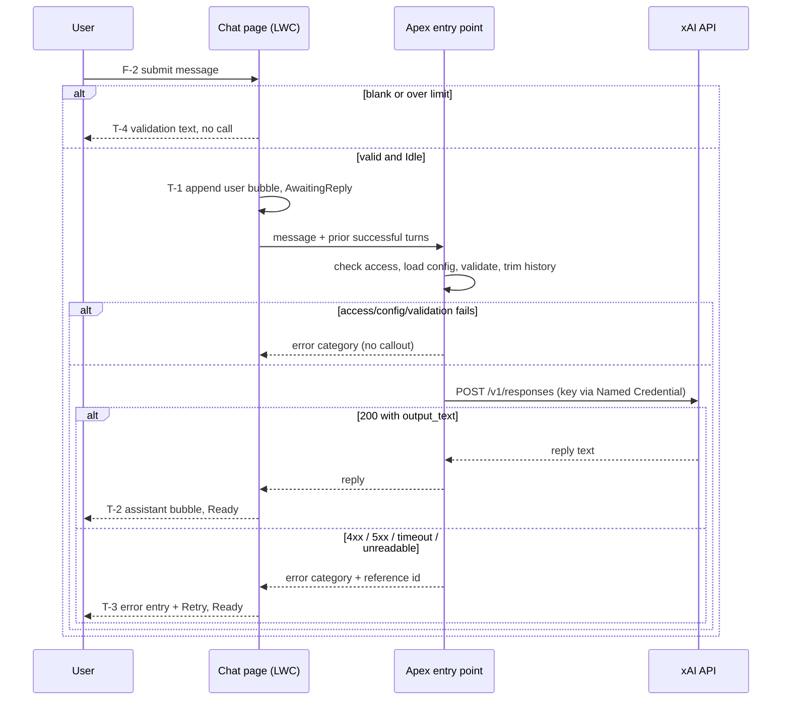
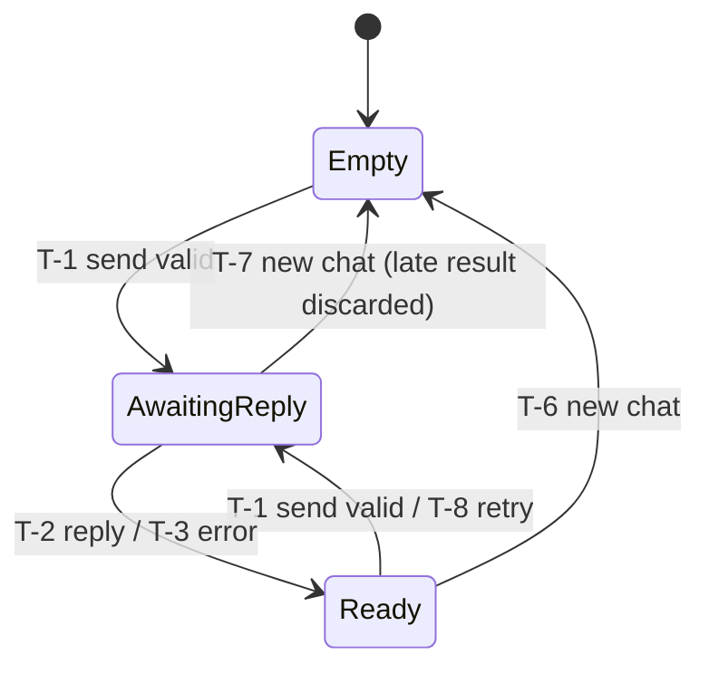

# Grok Bot for Salesforce — Product Specification

Living product spec. Requirements are `R-<n>`; structure and technology choices are `AD-<n>` in
`KNOWLEDGE/architecture.md`. Product decisions that are not requirements are `PD-<n>` (never `AD-`).

## Request and basis

- **Request (2026-11-21):** "Create a Grok bot in a Salesforce development org."
- **Starting point:** genuinely new. No prior `KNOWLEDGE/spec.md`, repository, discovery or research result, selected
  baseline, org alias or org observation exists for this run. No Salesforce org was inspected, so nothing below
  describes an observed org state (see G-1, G-6). Every behaviour here is **accepted intent proposed by this stage**,
  not observed implementation, and nothing has been implemented or run.
- **Interpretation of the terse request** (a user decision may reverse it; see PD-1 and G-5):
  - "Grok" = xAI's Grok models, reached over xAI's HTTPS API.
  - "bot" = a conversational chat experience a Salesforce user opens inside Lightning Experience, where each message
    is answered by Grok.
  - "in a Salesforce development org" = built as Salesforce metadata (Apex, Lightning Web Component, tab, app,
    permission sets, credentials, configuration) deployed to a non-production org the user names (Developer Edition,
    sandbox or scratch org). Which org is not given (G-1).

### Request outcomes → requirements (traceability)

| Outcome | Meaning | Requirements |
| --- | --- | --- |
| O-1 | A bot exists in the dev org and a permitted user can open it | R-1, R-7 |
| O-2 | The bot's answers come from Grok | R-2, R-6, R-8 |
| O-3 | The bot holds a conversation | R-2, R-3, R-10 |
| O-4 | (implied by "bot in an org") it is safe to run there | R-4, R-5, R-6, R-7, R-9, NFR-* |

### Product decisions (not requirements, not AD)

- **PD-1:** The bot is a Lightning Web Component chat page. It is not an Agentforce agent, Einstein Bot, Messaging
  channel or Slack bot. Basis: the request names no channel; a chat page is the smallest surface a developer can open
  and verify in a dev org. Alternative: Agentforce/Einstein Bot (needs separate licences and a different model of
  "Grok" integration). Revalidate if the user says otherwise (G-5).
- **PD-2:** The bot answers general conversation only. It does not read or write Salesforce records. Basis: nothing in
  the request asks for CRM grounding, and adding it multiplies the data-exposure surface (R-9).
- **PD-3:** Conversation history lives only in the open page and is lost on reload. Basis: nothing in the request needs
  durable history; adding stored chat records would add personal data, retention and sharing rules (R-9).

### Out of scope (bounds each R it is listed under)

Streaming/token-by-token output (R-2); markdown/HTML rendering of replies (R-2, NFR-6); file, image or voice input and
Grok image/voice models (R-2); xAI tools such as web search, code execution, function calling (R-2); reading Salesforce
records or acting on them (PD-2, R-9); persisted or shared conversations, per-user history, transcript export (R-3, R-9);
multi-user shared chat (R-10); managed-package or production release (R-1); Experience Cloud/community, mobile-app and
Slack surfaces (R-1); per-user API keys (R-6); usage metering, billing display or spend limits (R-5); automatic retry
(R-5); multi-language UI translation (NFR-4).

## Requirements

Salesforce component names (Apex, Named Credential, custom metadata, `with sharing`) appear below only as the observable
surface a test or admin touches. The choices behind them are `AD-1`..`AD-10` in `KNOWLEDGE/architecture.md`; if an AD
changes, the requirement's observable outcome stays.

Each acceptance block gives Positive / Failure / Boundary expectations (`n/a: <reason>` where one adds nothing), the
**surface** where it is observed and **how** it is confirmed. Case IDs `TC-<n>` are listed in the Behavior model and map
to Apex tests with a mocked xAI endpoint (`APEX`), Jest (`JEST`) or the real org UI/API (`ORG`). Status of all cases:
**not run** (nothing is implemented).

### R-1 The Grok bot is installed in the dev org and openable by a permitted user (primary)

- **Behaviour:** Deploying the project to the named dev org makes a Lightning tab labelled **Grok Bot**, inside a
  Lightning app labelled **Grok Bot**, available. A user who holds the permission set **Grok Bot User** opens it from
  App Launcher or by the URL path `/lightning/n/Grok_Bot` and sees the chat page.
- **Boundaries:** Deployment targets only the org the user names (G-1). Deploy is metadata only: it creates no records,
  and does not assign permission sets or store the xAI key (those are separate person steps, R-6, R-7). Package
  namespace: none (unmanaged).
- **Error behaviour:** A user without the permission set gets no App Launcher entry and `/lightning/n/Grok_Bot` shows
  Salesforce's "Page does not exist" page (R-7). A failed deployment leaves the org with no partial Grok Bot metadata
  that is reported as deployed (deploy is evaluated from the deploy receipt's terminal status, not the accepted job ID).
- **Consumer outcome:** the chat page is reachable for the intended user.
- **Acceptance:**
  - Positive: after deploy, `sf org list metadata --metadata-type CustomTab --target-org <alias>` lists `Grok_Bot`, and
    the same for `CustomApplication`, `LightningComponentBundle`, `ApexClass`, `PermissionSet`, `NamedCredential`,
    `ExternalCredential`, `CustomObject` (`Grok_Bot_Config__mdt`). Signed in as a user holding **Grok Bot User**,
    navigating to `/lightning/n/Grok_Bot` renders the Grok Bot page with an empty transcript and a composer. Surface:
    ORG (browser, Lightning). Confirmed by: metadata listing + browser observation. **NOT-REPLAYED** (no org, G-1).
  - Failure: n/a: unauthorized access is R-7's acceptance; a failed deploy is confirmed by the CLI terminal status,
    exercised in the planned release check (`sf project deploy validate` dry-run), not a separate product behaviour.
  - Boundary: metadata names do not clash with existing org/package names (G-6): the pre-deploy listing finds none of
    the chosen API names (AD-7). Confirmed by: ORG metadata listing before deploy.
- **Basis:** request 2026-11-21 ("Create … in a Salesforce development org"); PD-1. Preserved: n/a (new). Source
  locators: GUIDES/platforms/salesforce.md § Service discovery, § Consumer entry access. Evidence limits: none gathered
  from an org. Pending: implementation, deploy, release check.

### R-2 A user sends a message and gets Grok's reply (primary)

- **Behaviour:** The user types text in the composer and presses **Send** (or Enter). The page immediately shows the
  user's message in the transcript and a visible "Grok is thinking" indicator. The server sends one request to xAI
  carrying the model, the system instruction and the conversation (R-3, R-8), and the assistant text from xAI's
  response is shown as an assistant message in the transcript, as plain text with line breaks preserved.
- **Boundaries:** one xAI request per accepted message; a reply is the concatenated `text` of the response's
  `output_text` content parts (AD-3). Reply text is never interpreted as HTML or markdown (NFR-6). No streaming.
- **Error behaviour:** any failure shows an error entry, per R-5, never an empty or partial assistant message.
- **Consumer outcome:** the user reads Grok's answer in the chat page.
- **Acceptance:**
  - Positive (mock, exactly replayable): with the xAI endpoint mocked to answer HTTP 200 and body
    `{"output":[{"type":"message","role":"assistant","content":[{"type":"output_text","text":"101 multiplied by 3 is 303."}]}]}`,
    sending the user message `What is 101 multiplied by 3?` returns reply text exactly `101 multiplied by 3 is 303.`;
    the outgoing request is `POST callout:<Named Credential>/v1/responses` whose body has `model` = the configured
    model, `store` = `false`, and an `input` array whose last element is
    `{"role":"user","content":"What is 101 multiplied by 3?"}`. Surface: APEX (HttpCalloutMock). TC-1, TC-2.
  - Positive (live): with the real key configured (G-2), sending `What is 101 multiplied by 3?` shows a non-empty
    assistant message; it is not asserted to equal any fixed string because model output varies. Surface: ORG browser.
    TC-3. **NOT-REPLAYED** until G-1/G-2 are resolved.
  - Positive (rendering): the same mock string rendered in the LWC appears in the transcript as an assistant bubble
    after the user bubble, and `<b>x</b>` in a reply is displayed literally, not as bold. Surface: JEST. TC-4.
  - Failure: n/a here; see R-5 for every failure path.
  - Boundary: response with two `output_text` parts `"A"` and `"B"` yields `AB` (documented concatenation rule); a
    response with `output` items of other types (e.g. `reasoning`) alongside the message ignores them. Surface: APEX.
    TC-5.
- **Basis:** request 2026-11-21 ("a Grok bot"). xAI documentation: https://docs.x.ai/developers/rest-api-reference/inference/responses
  (response `output[]` `message` item, `content[].type = output_text`, `text`; request `model`, `input`, `store`),
  read 2026-11-21. Preserved: n/a (new). Evidence limits: the fetched docs page does not state whether
  `/v1/chat/completions` is deprecated (a search snippet calls it legacy; its docs pages returned 404); live
  behaviour unverified (G-2). Pending: implementation and TC-1..TC-5.

### R-3 The bot keeps conversational context across turns, bounded

- **Behaviour:** Each request includes the preceding successful turns (user and assistant messages, in order) so Grok
  can answer follow-ups. At most **10 prior turn pairs** (20 messages) are sent (default; configurable, R-8). Older
  messages are omitted from the request but stay visible in the transcript. **New chat** empties the transcript and
  context.
- **Boundaries (exact):** let k be the 1-based index of the user message being sent and every earlier turn succeeded.
  The request `input` holds the last min(2·(k−1), 20) prior messages plus the new user message. So message 1 sends 1
  element; message 11 sends 21 elements beginning with message 1's user turn; message 12 sends 21 elements beginning
  with message 2's user turn (message 1's pair dropped). (Hand-walked; the verifying script was **NOT-REPLAYED**
  because executing it needed approval.) A failed turn (R-5) is excluded from context once the user sends a different
  message.
- **Error behaviour:** a client-supplied history that contains a role other than `user`/`assistant` or empty content is
  rejected (R-4); history is trimmed by the server (the client's own trimming is not trusted).
- **Consumer outcome:** follow-ups like "and times 2?" are answered in context.
- **Acceptance:**
  - Positive: mock records the request body; after turns `u1/a1` (`What is 101 multiplied by 3?` /
    `101 multiplied by 3 is 303.`) and new message `And times 2?`, the `input` array is exactly
    `[user u1, assistant a1, user "And times 2?"]` in that order. Surface: APEX. TC-6.
  - Failure: n/a: invalid history is R-4's acceptance.
  - Boundary: with 11 prior pairs supplied to the Apex entry point, the request `input` has 21 elements and the first
    is pair 2's user message; with exactly 10 prior pairs it has 21 elements and the first is pair 1's user message;
    with 0 prior pairs it has 1. Surface: APEX. TC-7.
  - New chat: after one completed turn, clicking **New chat** leaves an empty transcript, and the next message's
    request has 1 element. Surface: JEST + APEX. TC-8.
- **Basis:** request 2026-11-21 ("bot"); default cap 10 pairs is an assumption (A-3). Preserved: n/a. Pending:
  implementation, TC-6..TC-8.

### R-4 Input is validated on the server, and the client cannot widen what is sent

- **Behaviour:** Before any xAI call the server checks the new message and supplied history. The message is trimmed;
  an empty (after trim) message is rejected. A message longer than **4,000 characters** (default, configurable via R-8;
  characters are UTF-16 code units as Salesforce `String.length()` counts them, so an emoji counts 2) is rejected. The
  history may contain only roles `user` and `assistant`, each with non-empty text. The model, system instruction,
  token limit, endpoint and timeout always come from configuration, never from the client.
- **Boundaries:** length 4,000 is accepted; 4,001 is rejected. 1 non-whitespace character is accepted.
- **Error behaviour:** rejection makes **no xAI call**, changes no state, and returns a validation error shown per
  R-5 (messages `Enter a message to send.` / `Message is too long (max 4000 characters).`). The composer also disables
  **Send** for blank input and shows a live character count, but the server check is the authority.
- **Consumer outcome:** invalid input never reaches xAI; the user is told why.
- **Acceptance:**
  - Positive: `"a"` (1 char) and a 4,000-char string are sent (callout count 1 each). Surface: APEX. TC-9.
  - Failure: `""`, `"   \n "`, a 4,001-char string, and a history entry with role `system` each return the matching
    validation error with callout count 0. Surface: APEX. TC-10.
  - Boundary: 4,000 accepted / 4,001 rejected is the boundary pair; UI: Send is disabled for blank input and the count
    shows `4001 / 4000` styled as an error. Surface: APEX + JEST. TC-9, TC-10, TC-11.
- **Basis:** request-implied safety (O-4); limit value is an assumption (A-1). Pending: TC-9..TC-11.

### R-5 Failures are reported clearly, recoverably, and without leaking secrets or payloads

- **Behaviour:** Every failure becomes an error entry in the transcript with a fixed user-facing message (table
  below), a short reference id (correlation id), and a **Retry** action that re-sends the failed message. The user's
  conversation so far is preserved; the composer becomes usable again. The page never shows the API key, the
  Authorization header, raw xAI response bodies or Apex stack traces.

| Category | Trigger | User-facing message |
| --- | --- | --- |
| VALIDATION | R-4 rejection | as in R-4 |
| CONFIG | R-8 configuration invalid or missing | `The Grok bot is not configured correctly. Contact your administrator.` |
| NOT_AUTHORIZED | caller lacks the credential principal/Apex access | `You don't have access to the Grok bot. Contact your administrator.` |
| AUTH_FAILED | xAI HTTP 401 or 403 | `Grok rejected the bot's credentials. Contact your administrator.` |
| RATE_LIMITED | xAI HTTP 429 | `Grok is busy or a usage limit was reached. Try again shortly.` |
| REQUEST_REJECTED | other xAI HTTP 4xx (e.g. 400, 404 unknown model) | `Grok could not process this request. Contact your administrator if it persists.` |
| UPSTREAM_ERROR | xAI HTTP 5xx | `Grok is temporarily unavailable. Try again shortly.` |
| TIMEOUT | no complete response within the configured timeout | `Grok took too long to respond. Try again.` |
| BAD_RESPONSE | HTTP 200 whose body is not JSON or has no `output_text` text | `Grok returned a response the bot could not read. Try again.` |

- **Boundaries:** timeout default **60 s**, allowed range 1–120 s (R-8; 120 s is the documented maximum for one
  callout/continuation, **to be re-verified** because the Salesforce docs pages returned HTTP 403 to this stage's
  fetch — G-4). No automatic retry: a timed-out request may still have been processed and billed by xAI, so only the
  user's explicit **Retry** resends (outcome unknown is therefore reported as TIMEOUT, never as success). Retry
  re-sends the same text as a new request with no idempotency key; a duplicate upstream effect is accepted.
- **Error behaviour (state):** an error leaves transcript contents unchanged except the appended error entry; no
  assistant message is appended; the in-flight indicator ends (R-10).
- **Consumer outcome:** the user knows what failed and what to do.
- **Acceptance:**
  - Positive: n/a: this requirement is entirely about failures.
  - Failure: for each of the mocked responses HTTP 401, 403, 429, 400, 404, 500, 503, 200 with body `not json`, 200
    with body `{"output":[]}`, and a thrown `CalloutException` ("Read timed out"), the Apex entry point returns the
    category and message in the table above (401/403 → AUTH_FAILED; 400/404 → REQUEST_REJECTED; 500/503 →
    UPSTREAM_ERROR; the two 200s → BAD_RESPONSE; exception → TIMEOUT). Surface: APEX. TC-12.
  - Failure (secrecy): for TC-12 cases the returned message, reference id and (via source search) any `System.debug`
    argument contain none of: the mock key value `sk-TEST-DO-NOT-LEAK`, the string `Bearer`, or the mock response body
    text `internal detail 42`. Surface: APEX + source scan. TC-13.
  - Failure (UI): an error from Apex renders an error entry with a Retry button; clicking Retry issues the same
    message again; the prior transcript is intact. Surface: JEST. TC-14.
  - Boundary: configured timeout 120 s accepted, 121 s and 0 s are CONFIG errors (R-8). Surface: APEX. TC-15.
    Live: with a wrong key in the credential, the UI shows the AUTH_FAILED message. Surface: ORG. TC-16
    **NOT-REPLAYED** (G-1, G-2).
- **Basis:** request-implied (O-4); defaults A-2 (timeout). Pending: TC-12..TC-16.

### R-6 The xAI API key is held only in Salesforce's credential store

- **Behaviour:** The key is entered once by an administrator into the External Credential's principal in Setup (a
  person-only step, G-2). The bot reaches xAI only through a Named Credential bound to it, so Apex never holds or sees
  the key. The key is not in source, metadata files, custom metadata, custom settings, records, debug logs, the UI,
  browser memory or test fixtures.
- **Boundaries:** one shared key for the org (no per-user keys; out of scope).
- **Error behaviour:** key absent or invalid → R-5 AUTH_FAILED (or NOT_AUTHORIZED when the caller cannot use the
  principal). Deploying never overwrites an already-entered secret.
- **Consumer outcome:** nobody but an administrator with Setup access can read or replace the key; end users cannot
  extract it.
- **Acceptance:**
  - Positive: all callouts address `callout:<Named Credential>`; no Apex source contains the literal host
    `api.x.ai` or an `Authorization` header assignment. Surface: source scan. TC-17.
  - Failure: n/a: failure paths are R-5.
  - Boundary: a repository secret scan (key-shaped strings such as `xai-` followed by ≥20 characters) over the
    deployable source and tests finds nothing; the committed `.gitignore` ignores `.sf/` and `.sfdx/`. Surface: source
    scan. TC-18. Live: the xAI call succeeds with the key stored in Setup only. Surface: ORG, **NOT-REPLAYED** (G-2).
- **Basis:** Salesforce guide GUIDES/service-discovery.md § Runtime state placement (platform secret facilities) and
  Salesforce documentation on Named/External Credentials (secrets not readable by Apex/SOQL/API; summary from search,
  primary pages not retrievable by this stage → verify at deploy). Pending: TC-17, TC-18.

### R-7 Only authorized users can use the bot, and admins configure it separately

- **Behaviour:** Access is granted by permission sets: **Grok Bot User** (opens the app/tab, runs the Apex entry
  point, uses the External Credential principal) and **Grok Bot Admin** (everything in User plus editing the bot's
  configuration, R-8). Nothing is granted to any profile by default. The Apex entry point runs `with sharing`, touches
  no standard or custom object other than reading its own configuration, and therefore needs no object/field access;
  sharing, object permission and field permission are separate and none applies to chat content because none is
  stored (PD-3).
- **Boundaries:** permission-set assignment is a person step planned by name at release (not performed by deploy).
- **Error behaviour:** a user lacking the permission set sees no entry (R-1) and a direct call to the Apex entry point
  returns NOT_AUTHORIZED (R-5) with no xAI call.
- **Consumer outcome:** a non-permitted user cannot use or reach the key.
- **Acceptance:**
  - Positive: a test user holding **Grok Bot User** (`System.runAs`) reaches the xAI mock (callout count 1). Surface:
    APEX. TC-19.
  - Failure: a test user with no permission set gets NOT_AUTHORIZED, callout count 0; and in the org a user without
    the permission set cannot open `/lightning/n/Grok_Bot`. Surface: APEX + ORG. TC-20; ORG part **NOT-REPLAYED**
    (G-1). The read-only probe (`PermissionSetAssignment`, `PermissionSetTabSetting`, `SetupEntityAccess`) from
    GUIDES/platforms/salesforce.md § Consumer entry access is run at release-check.
  - Boundary: **Grok Bot User** alone cannot edit the configuration record; **Grok Bot Admin** can. Surface: ORG
    (Setup > Custom Metadata Types), **NOT-REPLAYED** (G-1). TC-21.
- **Basis:** request-implied (O-4), GUIDES/platforms/salesforce.md. Evidence limits: whether Apex `System.runAs`
  exercises External Credential principal access in a unit test is unverified (G-7); the ORG case is authoritative.

### R-8 Model, instruction and limits are administrator configuration, not code

- **Behaviour:** One configuration record holds: model id (default `grok-4.7`), system instruction (default
  `You are Grok, a helpful assistant inside Salesforce. Answer concisely.`), max message characters (4000), max
  history pairs (10), max output tokens (2048), timeout seconds (60). An administrator changes them in Setup without a
  deploy; the next message uses the new values.
- **Boundaries:** message chars 1–32,000; history pairs 0–50; output tokens 1–128,000 (the documented xAI default
  when unset is 128,000); timeout 1–120 s. Values are defaults (A-1…A-4), chosen reversibly; only the upper bounds of
  tokens (xAI docs) and timeout (Salesforce, to re-verify) are platform-sourced.
- **Error behaviour:** a missing record, blank model or out-of-range value → CONFIG error (R-5), **no xAI call**, no
  silent substitution of defaults.
- **Consumer outcome:** the bot's behaviour can be tuned in the org.
- **Acceptance:**
  - Positive: changing the model to `grok-4.3` in test configuration makes the mock see `"model":"grok-4.3"`; the
    instruction appears as the request's `instructions` field. Surface: APEX. TC-22.
  - Failure: blank model, timeout 0, timeout 121, history pairs −1, max chars 0 each yield CONFIG with callout count 0.
    Surface: APEX. TC-15.
  - Boundary: timeout 120 and 1 accepted; max output tokens 128,000 accepted and 128,001 rejected. Surface: APEX. TC-15.
- **Basis:** request-implied; xAI Models page listing of model ids, read 2026-11-21 (https://docs.x.ai/developers/models);
  model-id acceptance by the real key is unverified (G-3). Pending: TC-15, TC-22.

### R-9 Privacy: only what the user types leaves the org, and nothing is retained by the bot

- **Behaviour:** The only content sent to xAI is the system instruction, the user's typed messages and prior bot
  replies in the current page session. No Salesforce record data, user name, email or org identifiers are added. The
  request sets `store` to `false`. The bot stores no transcript anywhere (no records, files, cache or browser storage),
  writes no message text to logs, and shows a notice in the page that messages are sent to xAI.
- **Boundaries:** retention by xAI beyond `store:false` (e.g. abuse-monitoring) is outside this product's control and
  **unknown**; the notice does not promise otherwise. Closing/reloading the page, or **New chat**, ends the
  transcript.
- **Error behaviour:** failures (R-5) do not write the message text to logs.
- **Consumer outcome:** users know where their text goes; admins can rely on no in-org copy existing.
- **Acceptance:**
  - Positive: the mock sees no field values other than `model`, `instructions`, `input`, `store`, `max_output_tokens`;
    `store` is `false`. Surface: APEX. TC-2 (shared).
  - Failure: after any TC-12 case no DML occurred (`Limits.getDmlStatements() == 0`) and the source scan finds no
    `System.debug` that references message text. Surface: APEX + source scan. TC-13 (shared).
  - Boundary: the page contains the disclosure notice text `Messages are sent to xAI (Grok) to generate replies.`
    and uses no `localStorage`/`sessionStorage`. Surface: JEST + source scan. TC-23.
- **Basis:** request-implied (O-4), PD-2, PD-3; xAI Responses docs for `store`. Evidence limits: the default value of
  `store` when omitted is not stated in the fetched docs, hence it is always set explicitly.

### R-10 One outstanding request per chat; stale replies never appear

- **Behaviour:** While a request is outstanding the page shows the indicator and disables Send/Enter; a second send
  (double click, Enter held down) makes no second callout. If the user clicks **New chat** while a request is
  outstanding, the transcript is cleared and the late reply or error is discarded, not appended to the new chat. If the
  user navigates away, nothing is retained.
- **Boundaries:** limits are per open page; two browser tabs are independent chats (no shared state, PD-3).
- **Error behaviour:** n/a: no server-side state exists to conflict (stateless, R-9).
- **Consumer outcome:** no duplicate answers, no answers appearing in the wrong conversation.
- **Acceptance:**
  - Positive: n/a: covered by R-2.
  - Failure: a double click on Send with a pending (unresolved) mocked Apex promise calls Apex exactly once. Surface:
    JEST. TC-24.
  - Boundary: Send, then New chat, then resolve the earlier promise with a reply `LATE` → the transcript stays empty and
    `LATE` is not shown; then a fresh send works normally. Surface: JEST. TC-25.
- **Basis:** request-implied (usability/data integrity). Pending: TC-24, TC-25.

## Retired

None. This is the first spec for the product; no `R-<n>` existed to move.

## Non-functional requirements

Operating conditions: one interactive user per page, low volume (a developer-org assistant); human-paced requests. No
scale target was requested and none is invented.

- **NFR-1 Responsiveness and honest feedback.** The user's message and the indicator appear before the server call
  returns (no waiting on xAI to show the user bubble). A request that does not finish within the configured timeout
  (default 60 s, max 120 s) ends in TIMEOUT (R-5). No latency target for xAI itself is set (model-dependent;
  **unresolved** — no bound invented). Verify: JEST (optimistic rendering) TC-4; ORG observation.
- **NFR-2 Platform limits and concurrency.** Each message uses one callout, no DML and no SOQL (custom-metadata reads
  only). Bulk/batch inputs: **n/a** — the entry point is a single interactive message, so no collection input exists.
  **Unresolved (G-4):** Salesforce's cap on concurrent long-running requests (search results disagree: a 2015 blog used
  10 requests over 5 s as an illustration; Trailhead says 25 over 20 s) and whether a Continuation is supported from
  an LWC are not established by primary documentation this stage could read (pages returned HTTP 403). Until
  resolved, AD-4 stays open and the plan must include a probe in the target org. Verify: ORG probe with N parallel
  mocked-slow calls; APEX test for single-callout/no-DML (`Limits`).
- **NFR-3 Reliability and recovery.** xAI outage/timeouts degrade to R-5 messages; the page stays usable; no data
  can be lost because none is kept. No availability SLA (out of scope for a dev org).
- **NFR-4 Interface quality (deliberately designed UI).** Visual system: Salesforce/SLDS platform conventions take
  precedence inside Lightning Experience; within them the starting appearance is the **light** Google Gemini look
  using Material 3 Expressive principles (airy canvas, tonal rounded surfaces, friendly sans-serif from platform
  fonts, one confident accent, short purposeful transitions), adapted to the Grok Bot name. Criteria:
  - one token set (spacing scale, type scale, palette) defined once; **light theme by default with a dark theme**
    variant; whether the platform exposes a theme signal to the component is **unverified** (plan decides, G-8);
  - the transcript and composer are the focal point; message groups are visually distinct for user, assistant, error;
  - designed **empty** state (greeting + example prompts), **loading** state (indicator, Send disabled), **error**
    state (R-5 entry with Retry);
  - works at narrow (≈360 px) and wide (≈1440 px) widths with no horizontal overflow; long unbroken text wraps;
  - visible keyboard focus on every control; text/controls meet WCAG 2.1 AA contrast (4.5:1 text, 3:1 large text/UI);
  - motion only to explain change (new message appears, indicator), disabled under `prefers-reduced-motion`;
  - one icon set: SLDS utility icons via `lightning-icon`; no external fonts or CDNs (platform CSP);
  - UI text is English only.
  Verify: rendered screenshots at 360 and 1440 px in both themes (ORG, once G-1 resolves) plus JEST for states.
- **NFR-5 Accessibility.** Enter sends, Shift+Enter inserts a newline, Escape does nothing destructive; the transcript
  is a labelled live region so new replies are announced; focus returns to the composer after a reply/error;
  Send/Retry/New chat have accessible names; the character count and error text are programmatically associated with
  the composer. Verify: JEST DOM assertions; keyboard-only run in ORG.
- **NFR-6 Security.** Replies and errors are rendered as text nodes only (no `innerHTML`, no `lwc:dom="manual"`, no
  markdown/HTML parse); the client cannot set model, system role or endpoint (R-4); the callout is server-side so no
  CSP Trusted Site or browser-side call to xAI exists; Apex is `with sharing`; logs omit key, headers and message text
  (R-5, R-9). Verify: JEST (`<b>` literal), APEX, source scan.
- **NFR-7 Compatibility.** Targets Lightning Experience in a current-release dev org; the Apex/LWC API version is the
  one the target org reports at plan time (not assumed here). Verify: `sf org display` at plan time. **Unresolved
  until G-1.**
- **NFR-8 Testability and operability.** All Apex behaviour is testable without a key or network (mocked HTTP); no test
  performs a live xAI call. Apex tests run in the org with `sf apex run test --result-format tap` (a remote test,
  GUIDES/platforms/salesforce.md § Remote tests); LWC with Jest locally. Failures are traceable by the reference id
  shown to the user and written (with category, HTTP status and elapsed ms, never content) to the Apex debug log.
  No custom logging object is added (inapplicable: no operational consequence beyond a dev-org assistant). Verify:
  TC-13 and the `sf` test runs, **NOT-REPLAYED** (no sfdx project exists at the spec stage).
- **NFR-9 Dependency and repository hygiene.** No third-party JS/Apex dependency; `.sf/` and `.sfdx/` in `.gitignore`;
  no secrets in the repo (R-6).

## State and data assessment

| State / resource | Owner and location | Read by | Change rule | Ends / removed | Quotas met | Check |
| --- | --- | --- | --- | --- | --- | --- |
| xAI API key | External Credential principal (Salesforce credential store) | callout runtime only (not Apex/SOQL/UI) | set/replaced by an admin in Setup; deploy never overwrites | admin deletes principal | n/a | TC-17, TC-18, ORG |
| Configuration record | custom metadata type (deployed record, editable in Setup) | Apex (server), admins | last-write-wins per Setup edit; deploy of the same record overwrites admin edits unless excluded (**assumption A-5**) | deleted by admin/redeploy | n/a | TC-15, TC-22 |
| Chat transcript | LWC component memory in the open page (transient) | that user's page only | single page, one outstanding request (R-10) | reload, **New chat**, navigate away | none | TC-8, TC-24, TC-25 |
| Request payload to xAI | in flight only | xAI | n/a | not retained by the bot; xAI retention outside control (unknown) | callout size/time | TC-2 |
| Permission-set assignments | Salesforce setup data | admins | assigned/removed by admin, a person step | admin removes | n/a | ORG probe |
| Deployed metadata | the dev org | admins | deploy is all-or-nothing by default; partial/failed deploy is judged from the terminal deploy status | rollback = delete metadata (destructive deploy); secret must be re-entered if the External Credential is deleted | n/a | release check |

Before/after invariants: a user message leaves no record anywhere in the org (before = after for all org data); the
key exists only in the credential store; config reads fail closed. Unknowns: xAI-side retention; deploy-over-admin-edit
behaviour for custom metadata (A-5).

## Service boundary contracts

| Concern | Salesforce dev org (host) | xAI API (remote) |
| --- | --- | --- |
| Current authority | Salesforce owns identity, access, credential store | xAI owns model, completion content and usage accounting |
| Route | `sf` CLI deploy (development); LWC → Apex → Named Credential (runtime) | `POST /v1/responses` with `Authorization: Bearer <key>` (docs.x.ai, read 2026-11-21) |
| Freshness vs revocation | permission-set removal takes effect on the next call (no cache); key revocation → next call gets 401 → AUTH_FAILED | no response cache anywhere: every message is a live call |
| Incremental state | none; full context resent each turn (R-3) | none held by the bot; `store:false` |
| Async completion/recovery | synchronous request with timeout (AD-4 open); unknown outcome on timeout is reported as TIMEOUT, no auto retry | request may complete after the bot gave up (accepted, noted) |
| Owned event coverage | Apex debug log line per call outcome (R-5, NFR-8); provider events (login/audit) are Salesforce's | usage visible in the xAI console to the key owner (not retrievable by the bot) |
| Not applicable | cache, outbox, worker, polling — none added | idempotency key not supported/needed |

## Behavior model

### Flows

- **F-1 Open the bot (R-1, R-7):** User → App Launcher "Grok Bot" or `/lightning/n/Grok_Bot` → Salesforce checks tab
  visibility → page renders empty state. Alternative: no permission → "Page does not exist" (no state change).
- **F-2 Send a message (R-2, R-3, R-4, R-9, R-10):** (1) user submits text; (2) page validates blank/length (T-1/T-4);
  (3) page appends the user bubble, shows indicator, disables Send (T-1); (4) page calls the Apex entry point with
  message + prior successful turns (sync from the user's view; async promise in the page); (5) Apex checks access,
  loads configuration, validates (R-4), trims history (R-3); (6) Apex calls xAI through the Named Credential; (7)
  Apex parses `output_text`, returns reply; (8) page appends the assistant bubble, re-enables Send (T-2).
  Alternatives: validation/config/access failure at (5) → no callout; xAI error/timeout/bad body at (6)–(7) → error
  entry (T-3); New chat during (4)–(7) → reply discarded (T-7).
- **F-3 Retry (R-5):** user clicks Retry on an error entry → page removes that error entry and re-sends the failed
  message with the same history (T-8).
- **F-4 New chat (R-3, R-10):** user clicks New chat → transcript and context cleared (T-6/T-7).
- **F-5 Administer (R-6, R-7, R-8):** admin enters the key in the External Credential principal, assigns permission
  sets, edits the configuration record in Setup. Person-only steps (G-2).

### Chat session states (owner: the open LWC page; transient)

| State | Meaning / invariant |
| --- | --- |
| Empty | no messages; empty state shown; Send enabled only with valid text |
| Ready | ≥1 entry, no outstanding request |
| AwaitingReply | exactly one outstanding request; Send/Enter ignored; indicator shown |

### Transition ledger

| ID | R / F | Before | Trigger and guard | Operation | After and observation | Failure / recovery | Case |
| --- | --- | --- | --- | --- | --- | --- | --- |
| T-1 | R-2,R-4,R-10 / F-2 | Empty or Ready | send; trimmed text length 1..max | append user entry; call Apex | AwaitingReply; indicator | Apex rejects → T-3 | TC-1, TC-9, TC-24 |
| T-2 | R-2 / F-2 | AwaitingReply | Apex returns reply for the current request token | append assistant entry | Ready; Send enabled; focus to composer | n/a | TC-1, TC-4 |
| T-3 | R-5 / F-2 | AwaitingReply | Apex returns an error or the promise rejects | append error entry (category message, reference id, Retry); keep transcript | Ready | user may Retry or send a new message | TC-12, TC-14 |
| T-4 | R-4 / F-2 | Empty/Ready | blank or over-limit text | show validation text; no call | unchanged | n/a | TC-10, TC-11 |
| T-5 | R-10 / F-2 | AwaitingReply | send/Enter pressed | ignored | unchanged, no second call | n/a | TC-24 |
| T-6 | R-3 / F-4 | Empty/Ready | New chat | clear transcript and context | Empty | n/a | TC-8 |
| T-7 | R-10 / F-4 | AwaitingReply | New chat | clear; invalidate request token | Empty; late result discarded | n/a | TC-25 |
| T-8 | R-5 / F-3 | Ready with error entry | Retry | remove error entry; resend failed message | AwaitingReply | as T-3 | TC-14 |

Event-family audit: invalid input (T-4), duplicates (T-5), timeout/bounded retry (manual only, no auto retry),
cancellation (T-7; xAI request cannot be cancelled, accepted), concurrent actors (n/a: no shared state), stale callbacks
(T-7), partial persistence (n/a: no persistence), lifecycle expiry (reload ends the session), unauthorized actor
(R-7), boundary values (4000/4001, 10/11 pairs, 1/120 s). Omissions/unknowns: Retry after New chat does not exist
(entry removed with the transcript).

### Case index

TC-1 happy path 303 mock; TC-2 request shape (model, store:false, input, instructions); TC-3 live reply; TC-4 render
and literal HTML; TC-5 multi-part/other output items; TC-6 ordered context; TC-7 history cap boundary; TC-8 New chat;
TC-9 accepted lengths; TC-10 rejected inputs; TC-11 UI blank/over-limit; TC-12 error matrix; TC-13 no secret/payload
leak, no DML; TC-14 Retry UI; TC-15 config validation bounds; TC-16 live wrong key; TC-17 callout via Named Credential
only; TC-18 secret scan; TC-19 permitted user; TC-20 unpermitted user; TC-21 admin-only config edit; TC-22 config
applied; TC-23 disclosure/no browser storage; TC-24 double send; TC-25 stale reply discarded.
Environment: APEX/JEST cases use mocks only (no key, no network); ORG cases need G-1/G-2. All **not run**.

## Open gaps and prerequisites

- **G-1 (R-1, R-7, NFR-7; blocks deploy and all ORG cases):** target dev org not identified (alias/username, edition,
  whether sandbox/scratch/Developer). Owner: user. Smallest confirming observation: `sf org list` shows the alias and
  `sf org display --target-org <alias>` reports API version. Independent work (Apex/LWC source and mock tests) may
  proceed.
- **G-2 (R-2, R-6; blocks live reply TC-3/TC-16):** an xAI API key with available credits, and an admin to enter it in
  the External Credential principal, are person-only steps. Owner: user. Not required for mocked tests.
- **G-3 (R-8):** default model `grok-4.7` taken from the xAI Models page; whether the user's key can call it is
  unverified (the page does not state a models-listing endpoint). Smallest confirm: one authorized live call at
  release-verify; change via configuration without redeploy.
- **G-4 (R-5, NFR-2):** sync Apex callout vs Continuation from LWC, the concurrent long-running-request limit and
  the 120 s maximum are not verified from primary docs (HTTP 403 to fetch). Interim: AD-4 keeps a synchronous callout
  with the configured timeout. Confirming observation: read the current limits docs by an authorized route, or probe
  the org. Dependent: timeout default and concurrency NFR only.
- **G-5 (PD-1):** a user choice between this LWC chat and an Agentforce/Einstein bot interpretation was not available
  (unattended run); default recorded. Revalidate before implementation if the user disagrees.
- **G-6 (R-1):** name clashes in the org (Apex classes, LWC `grokBot*`, tab, app, permission sets, credentials) are not
  checked. Confirm with the metadata listings from GUIDES/platforms/salesforce.md § Service discovery before naming.
- **G-7 (R-7):** whether `System.runAs` exercises External Credential principal access in an Apex unit test is
  unverified; if not, the NOT_AUTHORIZED path is mocked in Apex and proven in the org.
- **G-8 (NFR-4):** how the dark theme is applied inside Lightning (platform theme signal vs `prefers-color-scheme`)
  is a plan decision to verify in the org.

## Assumptions (also in Submission)

- **A-1** max message length 4,000 chars (range 1–32,000); basis: bounds oversized input needed for safety/cost, no
  request value; alternatives 2,000/8,000; revalidate if users need long pastes.
- **A-2** timeout 60 s (range 1–120); basis: Salesforce one-callout maximum 120 s (to re-verify, G-4); alternatives
  30/100 s; revalidate with real Grok latency for the chosen model (reasoning models can be slow).
- **A-3** history 10 pairs (range 0–50); basis: keeps request size and cost small while allowing follow-ups; revalidate
  against model context limits.
- **A-4** max output tokens 2,048; basis: bounds latency and keeps the reply inside heap/response limits; xAI default
  128,000 is too large for an interactive dev-org bot; revalidate if replies are truncated.
- **A-5** configuration record is deployed with default values and may be overwritten by a redeploy; plan may exclude
  it from redeploys; revalidate at release-plan.
- **A-6** one shared org-level key; per-user keys out of scope.

## Evidence

Sources: the request (2026-11-21); GUIDES/platforms/salesforce.md; GUIDES/service-discovery.md; GUIDES/behavioral-requirements.md
(behavior model, traceability); GUIDES/requirements-definition.md; GUIDES/platforms/ui.md § Light expressive starting point;
xAI docs https://docs.x.ai/developers/models and https://docs.x.ai/developers/rest-api-reference/inference/responses
(read 2026-11-21 through a fetch agent; the chat-completions pages returned 404); web searches 2026-11-21 on Salesforce
Named/External Credentials, Continuations and limits (primary Salesforce pages returned HTTP 403 to fetch, so those
claims are labelled unverified above). Replays: R-3 window arithmetic hand-walked (k=1 → 1 element; k=11 → 21,
first = u1; k=12 → 21, first = u2); the script `window.py` was written but **NOT-REPLAYED** (execution needed
approval). No `sf` command was run; every documented command is **NOT-REPLAYED** (no sfdx project, no org). Duty 11
(`backchain-check`) is left out as instructed.

## Submission

- **summary:** First spec for a Grok bot in a Salesforce dev org: an LWC chat tab (Grok Bot) backed by an Apex entry
  point that calls xAI `POST /v1/responses` through a Named Credential/External Credential (R-1..R-10, NFR-1..NFR-9,
  PD-1..PD-3). Open: G-1 org not identified (blocks deploy and ORG cases), G-2 xAI key is a person-only step (blocks
  live reply), G-3 model id acceptance, G-4 sync vs Continuation and concurrency limit unverified, G-5 interpretation
  (LWC chat vs Agentforce) defaulted, G-6 name clashes, G-7 runAs vs External Credential, G-8 dark-theme mechanism.
  Assumptions (value, basis, alternatives, revalidation): A-1 max message 4,000 chars; A-2 timeout 60 s (≤120 s);
  A-3 history 10 pairs; A-4 max output 2,048 tokens; A-5 config record redeploy semantics; A-6 single shared key.
  No material requirement conflict. Nothing implemented or run.
- **primary:** R-1, R-2, R-3
- **evidence_refs:** KNOWLEDGE/spec.md (all R-1..R-10 sections, NFR, State and data assessment, Service boundary
  contracts, Behavior model), KNOWLEDGE/architecture.md (AD-1..AD-9), GUIDES/platforms/salesforce.md,
  GUIDES/service-discovery.md, GUIDES/behavioral-requirements.md, GUIDES/requirements-definition.md,
  GUIDES/platforms/ui.md, https://docs.x.ai/developers/rest-api-reference/inference/responses,
  https://docs.x.ai/developers/models.
