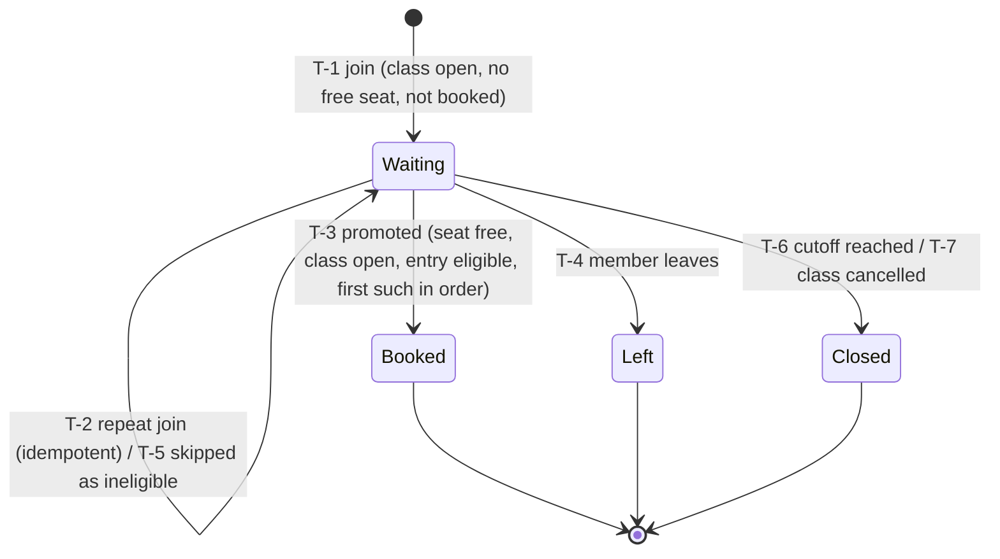
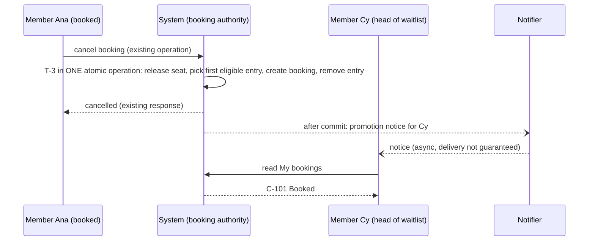

# Class Booking App: Product Specification

Living specification for the class booking app. This revision adds the **class waitlist**.
Nothing existed before it: no earlier `spec.md`, no repository, no discovery or research result was supplied to this
stage, so every behaviour about the *existing* app below is **unobserved** and marked as such (see "Current-system baseline").

Conventions: requirements are `R-<n>` (functional R-1..R-11, non-functional R-12..R-13). `DEC-<n>` are product decisions made
here (never `AD-`; structure and technology decisions are `AD-<n>` in `architecture.md`). `OG-<n>` are open gaps.
`F-<n>` flows, `T-<n>` transitions, `S<n>` replay scenarios. Each requirement's acceptance lines are `R-<n>.A<k>`.

## Request and basis

Request (user, 2026-11-21): *"Add a waitlist to our class booking app so full classes don't turn people away."*

| Outcome | Kind | Source |
| --- | --- | --- |
| O-1: a member who meets a full class can queue for it instead of being turned away | **Stated** | request words, 2026-11-21 |
| O-2: when a seat opens, the people queued get it, first come first served | **Inferred** from the meaning of "waitlist" (a waitlist that never grants seats would still turn people away) | DEC-1 |

Everything else in this document is either a guard needed to make O-1/O-2 correct and safe, a preserved behaviour, or an
explicit default recorded as a decision or assumption. No product policy beyond that is invented; items the request leaves
out are listed as out of scope under the requirement they bound.

## Current-system baseline

| Source | Status | Note |
| --- | --- | --- |
| Existing app code, data model, booking rules, UI | **Unavailable** | not supplied to this stage; not "absent". Observations: none. |
| Earlier spec / maintained requirements / architecture decisions | **None supplied** | no R-IDs to preserve; nothing retired |
| Guides in `GUIDES/` (behavioral-requirements, requirements-definition, service-discovery, platforms/ui) | Read | method only, not product evidence |

Consequence: every statement of "existing behaviour is preserved" (R-11) and every reference to "the app's existing X"
(booking checks, booking-close rule, confirmation channel, capacity edit, staff role) is an **inference from the request
wording** and an open prerequisite (OG-2). The planning stage must recover those facts before it relies on them.

## Decisions (product)

| ID | Decision | Basis | Alternatives | Revalidate when |
| --- | --- | --- | --- | --- |
| DEC-1 | Order is **first come, first served** by the order the system records joins. | O-2; the plain meaning of waitlist | priority by membership tier or by booking history (domain rule the request leaves out) | the user asks for priority rules |
| DEC-2 | **Cutoff**: joins and promotions stop at the app's existing booking-close time for the class; if none exists, at class start. The instant `start` is closed; one second before is open. **Default value.** | A class that has started cannot be attended, so promoting into it is incorrect; this is the minimum bound without which promotion misbehaves | a fixed lead time before start (e.g. N minutes); no cutoff | baseline shows an existing close rule (it then wins, as preserved contract) or the user states a lead time |
| DEC-3 | **No cap on waitlist length.** The only bound introduced is **one entry per member per class**. | A cap is not needed for correct or safe behaviour: the one-entry rule already bounds a list by the number of members not holding a seat, and promotion work is bounded by seats freed. Inventing a number would turn people away, which the request opposes | cap per class (N entries); cap on lists a member may join | the baseline shows a platform quota the list could hit, or the user wants a cap (then it becomes an acceptance line with at/beyond-cap behaviour) |
| DEC-4 | A waitlisted member is **booked automatically** at promotion (no offer-and-confirm step, hence no claim timer). A head entry that fails the booking checks is **skipped and kept** (position retained), not removed. **Defaults.** | "don't turn people away": fewest steps; avoids inventing a claim-window value with no evidence behind it; keeping the entry is the most reversible choice | offer with claim window of T minutes (T has no evidence, so not introduced); skip-and-remove | user wants confirm-before-booking, or the app's booking checks reveal failures that are permanent |
| DEC-5 | One booking occupies **one seat**; one entry asks for one seat. **Default.** | simplest reading of "class booking" | multi-seat / guests | baseline shows multi-seat bookings (OG-6) |
| DEC-6 | No real-time push. A member's view is current as of its last fetch: refreshed when the class view or My-bookings view opens, regains focus, and after the member's own actions. The UI never claims to be "live". | position changes are low-urgency; avoids a new transport (behavioral-requirements: "live" does not by itself require sockets) | polling or push | users need sub-minute awareness without a refresh |
| DEC-7 | Members see **their own position only**, not the list length or other members. | privacy of other members' records (R-10); not required to meet O-1 | show length / "N people waiting" | user asks for it |
| DEC-8 | Leaving the waitlist asks for an explicit confirmation in the UI because the position cannot be recovered (a rejoin goes to the end). | irreversible loss of position | no confirmation | usability feedback |

## Behaviour model

Actors: **Member** (books, cancels, joins, leaves), **Staff** (cancels a class; may edit capacity or remove a booking, *if the
app supports these*, OG-2), **System** (applies the rules and promotes), **Notifier** (existing confirmation channel, OG-1).

Flows: **F-1** join (R-1, R-2); **F-2** seat released → promotion (R-3, R-4, R-7); **F-3** leave (R-6); **F-4** waitlist closes (R-8);
**F-5** member views status (R-5).

Transition ledger (entity: waitlist entry; owner: the booking authority; durable):

| ID | R / F | Before | Trigger and guard | Operation | After and observation | Failure / recovery |
| --- | --- | --- | --- | --- | --- | --- |
| T-1 | R-1 R-2 / F-1 | no entry; member not booked; class open; free seats = 0 | Member join | append entry at end in join order | `Waiting`, position = prior length + 1, returned | write fails → no entry, error shown, member may retry (T-2 makes retry safe) |
| T-2 | R-2 / F-1 | `Waiting` | Member repeat join | none | same entry and position returned; one entry | none needed |
| T-3 | R-3 R-4 / F-2 | `Waiting`, first eligible in order | seat released (member cancel, capacity raise, staff removal) while class open | atomically: free seat consumed, booking created, entry removed, entries behind renumber | `Booked`; booking readable by that member immediately after the releasing operation returns | atomic: seat release and promotion commit together or neither; if the platform cannot guarantee that, a reconcile restores R-9.I5 before the next read |
| T-4 | R-6 / F-3 | `Waiting` | Member leave (own entry) | remove entry; entries behind renumber | `Left`; position n-1 for those behind; bookings untouched | repeat leave → `NOT_ON_WAITLIST`, no change |
| T-5 | R-4 / F-2 | `Waiting`, head fails booking checks | promotion pass | skip; keep entry and position; evaluate next | entry unchanged | none; re-evaluated at the next release |
| T-6 | R-8 / F-4 | `Waiting` | time ≥ cutoff | none stored: entries are **inert** (no promotion, shown as closed); housekeeping removes them after class end | `Closed` | housekeeping failure has no behavioural effect |
| T-7 | R-8 / F-4 | `Waiting` | Staff cancels class | remove all entries | `Closed`; members told via existing class-cancel notice (OG-2) | partial removal retried; no entry may promote on a cancelled class |

Forbidden or ignored events (state unchanged, defined reason): join with free seat → `SEATS_AVAILABLE`; join while booked →
`ALREADY_BOOKED`; join when closed/cancelled → `CLOSED`; leave when not listed → `NOT_ON_WAITLIST`; acting on another
member's entry → denied per R-10; promotion trigger when class is closed → no promotion (seat stays free).

## Requirements

### R-1 Join the waitlist of a full class  (primary; added)

- **Basis**: request 2026-11-21 ("...so full classes don't turn people away"); DEC-1. **Source-section locators**: none (no existing spec).
  **Preserved**: booking a class with free seats (R-11). **Changed**: a booking attempt on a full class, previously refused
  (inferred, unobserved), is now accompanied by a join action. **Evidence limits**: no app access. **Pending**: implementation and all checks.
- **Behaviour**: a signed-in member viewing an open class with no free seat can join its waitlist. The entry takes the
  next position in the order joins are recorded; the response states that position.
- **Boundaries**: join is accepted only while free seats = 0 and the class is open (R-8). Positions are 1-based and contiguous.
- **Error behaviour**: refusals are defined in R-2.
- **Consumer outcome**: the member sees "On waitlist, position N" on the class and in My bookings (R-5) instead of a dead end.
- **Acceptance**
  - **R-1.A1** positive, fixture S1 (C-101, capacity 2, Ana and Ben booked): Cy joins → success, position 1; Dee → 2; Eli → 3.
    Surface: member surface (UI) plus the app's own read path for the class. Confirm: end-to-end through the member
    surface, then read back the stored waitlist order = [Cy, Dee, Eli].
  - **R-1.A2** failure: `n/a: every refusal is a guard on join and is specified in R-2.A2..A4`.
  - **R-1.A3** boundary: the first join on a class that has just become full gets position 1 (Cy above); order is
    arrival order, never alphabetical or by member ID. Confirm: join in the order Eli, Dee, Cy on a fresh copy of the fixture → positions 1, 2, 3 respectively.
- **Open gaps**: OG-2 (what "signed-in member" and "class view" are in the existing app).
- **Out of scope** (domain rules the request leaves out): priority tiers, paid waitlist places, waitlisting several
  classes as a bundle, recurring-series waitlists, joining on behalf of another member.

### R-2 Join guards and the one-entry bound  (added)

- **Basis**: DEC-3 and the correctness of R-1. **Evidence limits / pending**: as R-1.
- **Behaviour**: a join changes nothing and returns a distinct reason when: a seat is free (`SEATS_AVAILABLE`, "book instead");
  the member holds a booking in that class (`ALREADY_BOOKED`); the class is closed or cancelled (`CLOSED`); the caller is not
  authenticated or the class does not exist (the app's existing handling). A repeat join by a member already listed is
  **idempotent**: success, same position, still one entry.
- **Boundaries**: effective bound = **one entry per member per class** (a rule, not a numeric cap; DEC-3). At the bound: a duplicate join returns the
  existing entry. Beyond the bound: a second entry cannot be created by any sequence of requests, including simultaneous ones (R-9).
  List length itself is uncapped; observable behaviour at any length is the same as at length 1.
- **Consumer outcome**: the control re-renders to match the truth (a "Book" button if a seat is free; "On waitlist" if already listed).
- **Acceptance**
  - **R-2.A1** positive (idempotent repeat), S1: Cy joins C-101 again → success, position 1, entry count stays 3.
  - **R-2.A2** failure, S1: Ana (booked) joins C-101 → `ALREADY_BOOKED`; list stays [Cy, Dee, Eli].
  - **R-2.A3** failure, S7 (C-107, capacity 2, only Ana booked): Cy joins → `SEATS_AVAILABLE`; no entry created; the class view offers "Book".
  - **R-2.A4** failure/boundary, S4 (C-103, capacity 1, Ana booked, start 2026-12-01 18:00): Cy joins at 18:00:00 → `CLOSED`.
  - **R-2.A5** boundary, S4: Ben joins at 17:59:59 → accepted, position 1 (one second before cutoff).
  - Surface for all: service operation (API or equivalent) for the status/reason, plus the member UI for the re-render. Confirm: service-level test asserting reason code and unchanged stored list; UI check of the re-rendered control.
- **Open gaps**: OG-2 (reason-code vocabulary must follow the app's existing error conventions).
- **Out of scope**: rate limiting of join requests (no evidence of need; the one-entry bound already limits stored state).

### R-3 Automatic promotion in join order when a seat is released  (primary; added)

- **Basis**: request 2026-11-21; O-2 (inferred); DEC-1, DEC-4. **Preserved**: member cancellation as it works today (permissions, cutoffs). **Changed**: a cancellation on a class with a waitlist now also books the next member. **Evidence limits / pending**: as R-1.
- **Behaviour**: when an operation leaves an open class with free seats and an eligible waiting entry, the first eligible entry
  in join order becomes a booking, once per free seat, **inside the same operation** that released the seat (AD-2). Triggers: (a) a member cancels
  their booking; (b) staff raise capacity; (c) staff remove a member's booking. (b) and (c) apply only if the app has those capabilities (OG-2).
  Entries behind the promoted one move up. A promotion creates the same kind of booking a member would create themselves (DEC-4/R-4).
- **Boundaries**: promotions per operation ≤ seats freed; with more seats than waiting entries the surplus seats stay free for direct booking;
  with more entries than seats the rest remain in order. No promotion when the class is closed (R-8).
- **Error behaviour**: a failed promotion leaves the seat release and the list in a consistent state (all or nothing, T-3, R-9).
- **Consumer outcome**: the promoted member's My bookings shows the class as Booked; those behind see their position drop; class booked count never exceeds capacity.
- **Acceptance**
  - **R-3.A1** positive, S1: Ana cancels C-101 → Cy booked, bookings = [Ben, Cy], waitlist = [Dee, Eli], Dee position 1, Eli 2.
    Surface: service read-back and member UI of Cy and Dee. Confirm: end-to-end as Ana, then read as Cy and Dee.
  - **R-3.A2** failure/boundary (closed class), S4 (C-104, capacity 1, Ana booked, Ben waiting, start 2026-12-01 18:00): the seat is released at 18:00:00 → no promotion; bookings = [], Ben is not booked. Conditional: only if the app lets a booking be cancelled at/after start (OG-2); otherwise `n/a: cannot occur`.
  - **R-3.A3** boundary, more entries than seats, S2 (continues S1 with waitlist [Eli, Fay, Dee]): staff raise C-101 capacity 2 → 4 → Eli and Fay are booked in that order, Dee stays at position 1. Conditional on capacity edit existing (OG-2).
  - **R-3.A4** boundary, more seats than entries, S8 (C-108, capacity 3, bookings [Ana, Ben, Cy], waitlist [Dee]): Ana cancels → Dee booked; Ben cancels → no entry left, 1 seat free; Eli books directly → success.
  - **R-3.A5** cutoff edge, S4 (C-103 after Ben joined at 17:59:59): Ana cancels at 17:59:59 → Ben promoted.
- **Open gaps**: OG-2 (triggers b and c; whether cancellation is allowed after start); OG-5 (does the existing booking carry a charge/credit? see R-4).
- **Out of scope**: refunds or credits for the cancelling member, late-cancel penalties, notifying the cancelling member about who replaced them.

### R-4 Eligibility, skipping and no queue-jumping  (added)

- **Basis**: DEC-4, DEC-5. **Evidence limits**: the app's booking checks are unknown (OG-2). **Pending**: all.
- **Behaviour**: at promotion the entry is subjected to the **same checks a direct booking by that member would face at that moment**
  (whatever the app applies today, e.g. credits, overlapping classes). An entry that fails is **skipped and kept** with its position; the next entry is evaluated. A seat
  therefore stays free after an operation only when no waiting entry is eligible, and in that case direct booking is allowed. A newcomer can never take a seat
  that an eligible waiting entry could have had, because the seat is consumed by promotion inside the releasing operation.
- **Boundaries**: all entries ineligible → seat stays free; exactly one eligible entry among many → that one is booked even if last.
- **Error behaviour**: a skip changes nothing visible to the skipped member beyond keeping their position (no notice by default, OG-4).
- **Consumer outcome**: the seat goes to the first member who can actually take it; no seat is lost while an eligible member waits.
- **Acceptance** (needs a concrete ineligibility rule from the baseline, so the fixture's failing check is named when OG-2 closes)
  - **R-4.A1** positive, S6 (C-106, capacity 1, Ana booked, waitlist [Ben, Cy], Ben fails the booking checks): Ana cancels → Cy booked, Ben stays waitlisted at position 1.
  - **R-4.A2** boundary/failure, S6 continued: Cy cancels → Ben still ineligible → no promotion, seat free, bookings = []. Dee (eligible) books directly → success.
  - **R-4.A3** queue-jump check, S1: after Ana's cancellation Fay tries to book C-101 → `FULL` (Ben and Cy hold both seats); she did not take the seat.
  - Surface: service operations plus member UI. Confirm: service-level test with a fixture member made ineligible by the app's real rule.
- **Open gaps**: OG-2 (the real checks); OG-4 (user: notify skipped members? default no); OG-5 (does promotion charge or consume credit? default: it behaves exactly as a booking made at that moment, so a failed charge means ineligible and skipped); OG-6 (multi-seat).
- **Out of scope**: waiving checks for waitlisted members, reserving a seat for a member while they resolve a failed check.

### R-5 Member sees their own waitlist status and position  (added)

- **Basis**: O-1 (a member must be able to tell they are queued, not turned away); DEC-6, DEC-7.
- **Behaviour**: for the signed-in member the class view shows exactly one of: *Book* (free seat), *Full, join waitlist*, *Joining…* (request in flight; not yet listed), *On waitlist, position N* with *Leave*, *Booked*, *Waitlist closed, not booked* (R-8). My bookings lists waitlisted classes in their own section separate from booked ones, with position. Pending state is truthful: "On waitlist" appears only after the system confirms the entry.
- **Boundaries**: position is as of the last fetch (DEC-6); after any change the member sees the correct position on the next fetch. Zero waitlisted classes → designed empty state (R-12).
- **Error behaviour**: a failed join/leave shows the reason and leaves the previous truthful state and an enabled control.
- **Consumer outcome**: no member is left unsure whether they hold a place.
- **Acceptance**
  - **R-5.A1** positive, S1: after joins Dee's class view shows "position 2"; after Ana's cancellation Dee shows "position 1" and Cy shows "Booked".
  - **R-5.A2** failure: a join request that fails (service rejects with a server error) never displays "On waitlist"; the control returns to enabled with the error text.
  - **R-5.A3** boundary: after Dee leaves (S1g) Eli's position changes from 2 to 1 on Eli's next fetch; a member with no waitlisted classes sees the empty state.
  - Surface: member UI (browser at the app's web surface, or the platform's equivalent). Confirm: rendered check of each named state, with the join request held in flight to observe *Joining…* and forced to fail to observe the error state.
- **Open gaps**: OG-2 (the existing screens these states join).
- **Out of scope**: showing the list length or who is ahead (DEC-7), estimated chance of getting in.

### R-6 Member leaves the waitlist  (added)

- **Basis**: a queued member who no longer wants a seat must not be auto-booked into it (follows from DEC-4).
- **Behaviour**: a member can remove **their own** entry. Those behind move up one. Bookings are never affected. A rejoin after leaving goes to the end (DEC-1). UI asks for confirmation first (DEC-8).
- **Boundaries**: leaving as the only entry leaves an empty list.
- **Error behaviour**: leaving when not listed → `NOT_ON_WAITLIST`, nothing changes; leaving another member's entry → R-10.
- **Consumer outcome**: the member sees the class as *Full, join waitlist* again; no booking appears.
- **Acceptance**
  - **R-6.A1** positive, S1g (after Ana's cancellation, waitlist [Dee, Eli]): Dee leaves → waitlist [Eli], Eli position 1, bookings [Ben, Cy] unchanged.
  - **R-6.A2** failure: Dee leaves again → `NOT_ON_WAITLIST`; waitlist unchanged.
  - **R-6.A3** boundary, S1h: Fay then Dee join → [Eli, Fay, Dee]; Dee's rejoin position is 3, not her old 1.
  - Surface: service operation and member UI (confirmation step). Confirm: service-level test for state; UI check that cancelling the confirmation leaves the entry.
- **Out of scope**: pausing a place; leave-on-behalf by staff (OG-3).

### R-7 The promoted member is told  (added)

- **Basis**: a promoted member may not be looking at the app; O-1 is met only if they know. DEC-4.
- **Behaviour**: after the promotion commits, one notice per promotion is sent through the app's **existing booking-confirmation channel** (OG-1) naming the class and start time and saying the member was moved from the waitlist and is now booked. The booking is the source of truth and is visible in the app whether or not delivery succeeds. A notification failure does not undo the booking and does not block other promotions.
- **Boundaries**: two promotions in one operation → two notices, one per member; members who were not promoted get none.
- **Error behaviour**: channel unavailable → booking stands, failure is recorded by the service's own log (class ID, member ID, outcome; no names or contact details); retry behaviour follows the channel's existing behaviour (no new retry policy invented).
- **Consumer outcome**: promoted member receives the notice and, independently, sees *Booked*.
- **Acceptance**
  - **R-7.A1** positive, S1: Ana cancels → exactly one notice, to Cy, naming C-101 and 2026-12-01 18:00; none to Dee or Eli.
  - **R-7.A2** failure: the channel rejects the send → Cy still shows Booked on read; Dee's position still updated; a log line for the failed delivery exists with class and member IDs only.
  - **R-7.A3** boundary, S2: capacity 2 → 4 → two notices, Eli and Fay; none to Dee.
  - Surface: notification channel (test inbox or recorded sends) and member UI. Confirm: recorded-send assertion plus read of the booking; the real channel is verified only if reachable, otherwise recorded as unverified with owner = whoever owns the channel, due at integration.
- **Open gaps**: OG-1 (**user decision**: which channel; default = existing confirmation channel; if the app has none, in-app status only and the gap stays open because a member who is away would not learn of the seat).
- **Out of scope**: reminders, notices to members who were skipped (OG-4), notification preferences, language/templating beyond the existing channel's.

### R-8 The waitlist closes  (added)

- **Basis**: DEC-2. **Evidence limits**: the existing close rule is unknown (OG-2).
- **Behaviour**: from the cutoff instant (existing booking-close time, else class start, DEC-2) no member can join, and no promotion occurs. Remaining entries are **inert** and shown to their owner as *Waitlist closed, not booked*; correctness never depends on a background job (AD-3). Entries are removed by housekeeping no later than after the class ends. When staff cancel a class, entries are removed at once and members are told through the app's existing class-cancellation notice, if it exists (OG-2). Entries are never converted to bookings after the cutoff.
- **Boundaries**: `start` itself is closed; `start − 1 s` is open (default value, DEC-2).
- **Error behaviour**: housekeeping failure has no behavioural effect (inert entries stay inert).
- **Consumer outcome**: no member is promoted into a class that has begun or been cancelled; no stale "position 1" is displayed after the class.
- **Acceptance**
  - **R-8.A1** positive/boundary: S4 as in R-2.A4/A5 and R-3.A5 (17:59:59 open, 18:00:00 closed).
  - **R-8.A2** failure: R-3.A2 (release at 18:00:00 → no promotion); Ben's view at 18:00:00 reads *Waitlist closed, not booked*, not a position.
  - **R-8.A3** class cancelled, S5 (C-105, capacity 1, Ana booked, Cy waiting): staff cancel the class → waitlist empty; Dee's join → `CLOSED`; Cy gets the class-cancellation notice if that notice exists, else the gap stays open.
  - Surface: service operations with an injectable clock; member UI. Confirm: service-level tests at the boundary instants; UI check of the closed state.
- **Open gaps**: OG-2 (cutoff rule, class cancellation capability and notice).
- **Out of scope**: reopening a waitlist, late-promotion exceptions, cleanup policy for historical entries beyond "removed after class end".

### R-9 Concurrency and integrity  (added)

- **Basis**: promotion changes seat counts, which is consequential; two simultaneous operations on one class are normal (two people cancelling, a double-clicked join).
- **Behaviour**: after every completed operation on a class: **I1** booked ≤ capacity; **I2** a member appears at most once in the list and never in both bookings and list; **I3** each freed seat is given to at most one entry and each entry is promoted at most once; **I4** positions are contiguous 1..n in join order; **I5** while the class is open, no seat is free while an eligible entry waits. Simultaneous operations on one class behave as if applied one at a time in some order. A release and its promotion commit together or not at all; if the platform cannot guarantee that, a reconcile step restores I5 before the next read (OG-2).
- **Boundaries**: last seat contested; two releases at once; two joins by one member at once.
- **Error behaviour**: the losing operation of a conflict returns a defined refusal (e.g. `SEATS_AVAILABLE`), never a partial result.
- **Consumer outcome**: no overbooking, no duplicate or lost seat, whatever the interleaving.
- **Acceptance**
  - **R-9.A1** positive, S3 (C-102, capacity 2, bookings [Ana, Ben], waitlist [Cy, Dee, Eli]): Ana and Ben cancel simultaneously → in both orders (Ana then Ben; Ben then Ana) final bookings = {Cy, Dee}, waitlist = [Eli], and booked ≤ 2 after each step.
  - **R-9.A2** duplicate: two simultaneous joins by Cy on C-101 → both succeed with position 1; stored entries for Cy = 1.
  - **R-9.A3** contested last seat, S9 (C-109, capacity 1, Ana booked, empty list): Ana's cancellation and Cy's join arrive together. Order cancel→join: join refused `SEATS_AVAILABLE`, Cy not listed, view shows *Book*. Order join→cancel: Cy listed at 1, then promoted → booked. Both are accepted outcomes; **never** acceptable: Cy listed while a seat is free.
  - **R-9.A4** interruption: a fault injected between the release and the promotion leaves either the pre-state (seat held, entry waiting) or the post-state (Cy booked) and never a free seat with Cy still waiting after the next read. Conditional on a fault-injection point in the real system (OG-2); otherwise recorded unverified with owner = implementer, due at integration.
  - Surface: service level with controlled interleaving (not observable through a browser). Confirm: integration tests that gate and release the two operations to force each order; a browser check cannot prove these.
- **Open gaps**: OG-2 (the store's transaction or conditional-write capability; AD-1/AD-2 assume it and it is **unverified**).
- **Out of scope**: multi-class atomicity, fairness across classes.

### R-10 Access and privacy  (added)

- **Basis**: another person's record must not reach a member's client (spec rule on information lifecycle); the entry holds only identifiers.
- **Behaviour**: a member can create, read and remove **only their own** entry. A member's client never receives other members' identity or the list length; the position number is the only derived fact (DEC-7). The member to promote is always chosen by the service, never named by a client. Entry data = class ID, member ID, join order: no new personal data. Logs hold IDs only. Entries are removed per R-6, R-8, promotion, and when a member's account is deleted or anonymised (if the app has that). Staff visibility of the list is **not** added by default (OG-3).
- **Boundaries**: a member id passed in a request that is not the caller's → denied.
- **Error behaviour**: denial follows the app's existing convention (forbidden or not-found) and changes nothing.
- **Consumer outcome**: members learn nothing about who else waits.
- **Acceptance**
  - **R-10.A1** positive: Dee reads her own status on C-101 and sees only her position.
  - **R-10.A2** failure: Dee calls leave with Cy's entry identifier or member ID → denied; Cy's entry unchanged.
  - **R-10.A3** boundary, S1 state after the three joins (bookings [Ana, Ben], waitlist [Cy, Dee, Eli]): the complete responses to Dee for the class view and My bookings contain no waitlist identity: not `Cy`, not `Eli`, not their member IDs, and not the list length (3). Booked members' visibility is whatever the app does today and is not asserted here.
  - Surface: service responses (the client must not receive the data, so UI inspection is insufficient). Confirm: service-level tests that inspect raw response bodies.
- **Open gaps**: OG-3 (user decision: staff view/management; default none); OG-2 (identity model).
- **Out of scope**: audit history of waitlist events, data export.

### R-11 Existing booking behaviour is preserved  (preserved; added as an explicit guard)

- **Basis**: request wording "Add a waitlist"; accepted-product rule that unmentioned behaviour stays. **Evidence limits**: baseline unobserved (OG-2), so this requirement names the *classes* of behaviour to be captured and compared, not their specifics.
- **Behaviour**: booking a class with a free seat, booking a full class (still refused, now with the waitlist offered), cancellation permissions and cutoffs, capacity limits, and every existing screen outside the waitlist states behave as before. With an **empty waitlist**, a cancellation behaves exactly as today.
- **Boundaries**: capacity never exceeded (I1).
- **Error behaviour**: unchanged existing errors and messages.
- **Consumer outcome**: members and staff who never use the waitlist see no difference.
- **Acceptance**
  - **R-11.A1** positive, S7 (C-107, capacity 2, Ana booked): Dee books → success, bookings [Ana, Dee].
  - **R-11.A2** failure/boundary: S7 continued: Cy books the now full class → refused as today (reason `FULL` or the app's existing equivalent) and the waitlist is offered.
  - **R-11.A3** empty-list cancellation: Ana cancels C-107 with an empty list → seat count rises by 1, no booking created for anyone, no notice sent.
  - Surface: the existing regression suite, extended. Confirm: compare against recorded pre-change behaviour captured by discovery; **until that capture exists these lines are unverifiable** (OG-2).
- **Open gaps**: OG-2.

## Non-functional requirements

### R-12 A designed, accessible interface for the waitlist surfaces  (added)

- **Scope**: the new states on the class view and the My-bookings section (R-5). Not a redesign of the app.
- **Visual system**: **inherit the existing product identity** (tokens, type scale, icon set, components); a new screen inside an existing product inherits it. Only if discovery finds no identity does the fallback apply: the *light expressive starting point* (`platforms/ui.md`), i.e. the light Gemini look with Material 3 Expressive principles, light first with a dark option; the plan records concrete tokens in an AD. Whether the app is a web UI at all is unverified (OG-2); for a native or terminal surface the equivalent platform conventions apply and the checks adapt.
- **Observable criteria**
  1. Consistent spacing and type scale and a palette with **light and dark** themes; waitlist states use existing semantic tokens, no one-off colours.
  2. Designed **empty** (member waitlisted nowhere: a sentence and next step), **loading** (*Joining…* / *Leaving…* control state, list skeleton) and **error** (reason text + retry that keeps the entered state) states.
  3. Works at **360 px** and **1280 px** wide with no horizontal scroll.
  4. Visible keyboard focus on Join, Leave, Confirm and Cancel; Join/Leave/confirm fully operable by keyboard; focus returns to the originating control after confirmation closes.
  5. **WCAG AA contrast**: 4.5:1 for text, 3:1 for control boundaries and state indicators, in both themes.
  6. Status changes (joined, position changed, promoted, closed) are announced through a polite live region and never rely on colour or motion alone.
  7. Motion only to explain a change (a position decrement, a promotion to Booked), skipped under `prefers-reduced-motion`.
  8. One icon set (the app's existing one).
- **Verification**: browser checks of the named states at both widths and both themes; automated accessibility scan plus a manual keyboard-only walk; emulated reduced motion; request held in flight and forced to fail for loading and error. A screenshot alone does not establish focus order, announcements or motion timing.
- **Open gaps**: OG-2.

### R-13 Timeliness, capacity and reliability  (added)

- **Observable criterion (no invented number)**: once an operation that releases a seat has returned success, the next read by the promoted member shows *Booked* (read-your-writes at the booking authority); promotions never run after the response returns. Work per operation is bounded by waitlist length for one class; there is no cross-class scan.
- **Reliability and recovery**: R-9 (atomicity, reconcile), R-7 (notification failure isolated), AD-3 (no scheduler needed for correctness). A crash after commit but before the notice leaves a booked member without a notice; the booking stays visible. Accepted risk for the default; revalidate if the notice is the only way a member learns.
- **Operability**: one service log line per promotion and per notification failure carrying class ID, member ID and outcome, no names or contact details (R-10).
- **Unresolved numeric bounds**: a latency target and a waitlist-size/throughput target are **not set**: the request gives none and the baseline has no workload (class sizes, member counts) to base one on; a number here would be invented. Needed: typical and maximum class capacity and members; owner: whoever supplies the baseline; due: before test strategy sets performance checks.
- **Excluded with reasons**: an availability SLA and a load-test system (no evidence of need for a feature of this size); a new dependency or datastore (AD-1).
- **Verification**: R-13 read-your-writes via integration test (cancel → immediate read as Cy); log-line assertion; the rest is covered by R-7/R-9 acceptance.

## State and data assessment

| Resource | Target identity | Change | Before → after invariant | Recovery | Check |
| --- | --- | --- | --- | --- | --- |
| Waitlist entry (**new**) | (class ID, member ID), join order | created by join; removed by promote, leave, cutoff housekeeping, class cancel, account removal | none → one entry per member per class; contiguous order | atomic with seat release (T-3); idempotent join (T-2) | R-1, R-2, R-6, R-9 |
| Booking | existing booking of (class, member) | **created** by promotion | seats free = k ≥ 1 and entry waiting → seats free = k−1, booking exists | atomic with the releasing operation | R-3, R-9 |
| Class capacity / seat count | existing class record | **observed**; changed only by staff capacity edits that already exist | unchanged semantics; I1 holds | n/a: not changed by this feature | R-11 |
| Notification | per promotion | derived, sent after commit | none → at most one notice per promotion | failure isolated; booking is authority | R-7 |
| Display of position | client, per fetch | transient, derived | never stored by the client | refetch (DEC-6) | R-5 |

Unknowns (affect R-9, R-4): which store holds bookings and whether it offers transactions or conditional writes; whether availability is cached anywhere (a stale cache may show a free seat, which is safe because join and book are re-validated against the authority; a stale "full" simply delays a booking until refresh); whether data is migrated (the new entity is additive; rollout order: add the entity, then the service logic, then UI; rollback: disable the join action, leaving inert entries, with already-made promotions remaining valid bookings). Observed vs inferred: nothing here is observed.

## Service boundaries

- **Authority**: the existing booking store/service owns bookings, capacity and (AD-1) the waitlist. A new client never decides a promotion.
- **Freshness vs revocation**: displayed availability may be stale; every join, book, leave and promotion is checked against the authority at the moment of the operation. No delegated tokens or revocable grants are introduced: `n/a`.
- **Incremental state / event replay**: n/a, no feed or subscription (DEC-6).
- **Async completion and recovery**: only the notification is asynchronous; acknowledgement means "handed to the channel", not "read by the member"; unknown outcome is tolerated because the booking is visible regardless (R-7).
- **Owned event coverage**: the service logs promotions and failed notices (R-13); sign-in coverage stays with the existing provider.
- **Payment or credit service**: not assumed; if the baseline shows bookings consume credit or charge, promotion follows R-4 (OG-5).

## State and information lifecycle

| State | Owner and location | Who may read | Simultaneous changes | Ends / removed | Quotas |
| --- | --- | --- | --- | --- | --- |
| Waitlist entry | booking authority, same store as bookings (AD-1) | the owning member (own position only); staff **not** by default (OG-3) | serialised per class (R-9) | promote, leave, class end housekeeping, class cancel, account removal | runtime quotas unknown (OG-2) |
| Promoted booking | booking authority | as any booking today | as bookings today plus R-9 | as bookings today | as today |
| Join/leave pending state | client memory, transient | that client | superseded by the response; stale response cannot overwrite a newer fetch | page unload | n/a |
| Notice | notification channel | recipient | one per promotion | per channel | existing |

Personal data: the entry holds IDs and join order only; shown only to the owner as a position; stored in the booking store; logged as IDs only; removed per the table above. No identity, sharing or persistence is added beyond what the request needs.

UI interaction premises: *components*: existing class card/detail and My-bookings list gain the states in R-5, as variants rather than new primitives; *interaction model*: optimistic feedback is **not** used for join (truthful *Joining…* until confirmed); a late response never overwrites a newer fetch; headless behaviour (promotion without any screen open) is owned by the service; *skin*: R-12.

## Out of scope (domain rules the request leaves out, by requirement)

R-1: priority tiers, paid places, bundles, recurring series. R-3: refunds, penalties, replacement notices to the canceller. R-4: waiving checks, holding seats. R-7: reminders, preferences. R-8: reopening, late exceptions. R-10: audit history, export. Global: staff tools to view, reorder or add members to a waitlist (OG-3); overbooking; guest/multi-seat bookings (OG-6); reducing a class's capacity below its booked count (existing behaviour, untouched).

## Open gaps

| ID | Gap | Kind | Under | Default meanwhile | Blocks |
| --- | --- | --- | --- | --- | --- |
| OG-1 | Which channel tells a promoted member | **user decision** | R-7 | existing booking-confirmation channel; else in-app only | R-7 readiness only |
| OG-2 | The existing app is unavailable: stack, UI kind, data model, booking checks, capacity edit and staff removal, close rule, cancel-after-start, class-cancel notice, availability cache, transaction support, quotas | **prerequisite** (discovery/baseline recovery) | R-1..R-4, R-8, R-9, R-11, R-12 | model in this spec | R-3(b,c), R-4 values, R-8 cutoff value, R-9 mechanism, R-11, R-12 treatment stay unready; R-1, R-2, R-3(a), R-5, R-6, R-10 can be planned against the default model once the baseline is recovered |
| OG-3 | Should staff see or manage waitlists | **user decision** | R-10 | no | none |
| OG-4 | Notify members whose entry is skipped | **user decision** | R-4 | no notice | none |
| OG-5 | Does a booking charge or consume credit | prerequisite | R-3, R-4 | promotion behaves as a booking made then | R-4 fixture |
| OG-6 | Multi-seat or guest bookings | prerequisite | R-4 | one seat (DEC-5) | none |

## Retired

None. This is the first specification; no earlier R-IDs existed.

## Replay record (duty 10)

Fixtures (all times local, "now" for non-timed steps = 2026-11-30 09:00, class start = 2026-12-01 18:00 unless stated). Members: Ana, Ben, Cy, Dee, Eli, Fay.
S1 C-101 cap 2, bookings [Ana, Ben]. S2 continues S1 with waitlist [Eli, Fay, Dee] and capacity edit 2→4. S3 C-102 cap 2, [Ana, Ben], waitlist [Cy, Dee, Eli]. S4 C-103 cap 1 [Ana]; C-104 cap 1 [Ana], waitlist [Ben]. S5 C-105 cap 1 [Ana], waitlist [Cy]. S6 C-106 cap 1 [Ana], waitlist [Ben, Cy], Ben ineligible. S7 C-107 cap 2 [Ana]. S8 C-108 cap 3 [Ana, Ben, Cy], waitlist [Dee]. S9 C-109 cap 1 [Ana], empty waitlist.

Each acceptance line starts from a fresh copy of the fixture it names unless it says "continued" or "after"; where a fixture is named by two lines (for example S4 or S7) they are independent runs.

Method: each step was walked by hand from its stated start against the rule named in this spec. For each action I checked that the actor can reach the start (the seeded bookings come from the app's ordinary booking path, which is itself unobserved), that the action is permitted in the state the previous actions left, and that the observer can see the result (service read-back or the member's own view). Expected results were then recomputed from that walk. One defect was found and fixed: a join was first allowed when a seat was free but the member was ineligible; it is now refused whenever any seat is free (R-2, `SEATS_AVAILABLE`), which also keeps I5 coherent.

| Case | Hand-walked result | Executable replay |
| --- | --- | --- |
| S1 a..h | FULL; positions 1,2,3; idempotent 1; `ALREADY_BOOKED`; Cy promoted; Fay `FULL`; Dee leaves → Eli 1, repeat `NOT_ON_WAITLIST`; rejoin order [Eli, Fay, Dee] | **NOT-REPLAYED**: a reference model exists at the session scratchpad (`waitlist_model.py`, derived from these rules, covering S1..S6) but running it needed approval that was not granted in this unattended run; it was not executed. S7..S9 are hand-walked only. |
| S2 | Eli, Fay promoted in order; Dee position 1 | NOT-REPLAYED (same) |
| S3 both orders | {Cy, Dee} booked, [Eli] waiting, never > 2 booked | NOT-REPLAYED (same) |
| S4, S5, S6 | as stated in R-2, R-3, R-4, R-8 | NOT-REPLAYED (same) |
| S7, S8, S9 | as stated in R-2, R-3, R-9, R-11 | NOT-REPLAYED: hand walk only |
| All, against the real app | n/a | **NOT-REPLAYED**: the app is unavailable (OG-2); no command, test or UI action was run against any product; no execution is claimed from a plan |

Stand-in check: no acceptance line can pass on a hardcoded value or title-only test because each names an exact state to read back (stored list order, booking set, raw response bodies, recorded notice count). Documented commands: none. Platform or library capability claims: none relied on; the store's transaction support is listed as an **unverified assumption** (OG-2), not a claim.

## Submission

**summary**

Spec for the class waitlist written from a one-sentence request with **no app access** (no code, spec, discovery or research available), so existing behaviour is unobserved and OG-2 holds back the dependent parts (R-3 triggers b and c, R-4 values, R-8 cutoff value, R-9 mechanism, R-11, R-12 treatment). Requirements R-1..R-11 functional, R-12..R-13 non-functional. Request outcomes: O-1 (queue instead of being turned away) → R-1, R-2, R-5, R-6; O-2 (seats go to the queue in order) → R-3, R-4, R-7, R-8, R-9. Preserved behaviour is captured only as classes of behaviour in R-11.

Assumptions (value, basis, alternatives, revalidation):
- **R-8 cutoff = default: class start; `start` closed, `start − 1 s` open.** Basis: promoting into a started class is incorrect and this is the minimum bound; no evidence of an existing rule. Alternatives: N minutes before start, none. Revalidate: baseline shows an existing booking-close rule (it wins) or the user states a lead time.
- **R-2 no cap on waitlist length; the only bound is one entry per member per class.** Basis: correctness and safety do not require a cap and the one-entry rule bounds the list by membership; a number would be invented and would turn people away. Alternatives: per-class cap N, per-member cap. Revalidate: baseline reveals a platform quota or the user asks for a cap, which then needs at/beyond-cap acceptance lines.
- **R-3/R-4 auto-book at promotion, no claim window; ineligible head skipped and kept.** Basis: fewest steps toward the request's intent; a claim-timer value has no supporting evidence so none is introduced. Alternatives: offer with a T-minute claim window, skip-and-remove. Revalidate: user wants confirm-first, or baseline checks fail permanently for some members.
- **R-4 one seat per booking.** Alternatives: multi-seat. Revalidate: baseline shows guests or multi-seat (OG-6).
- **R-5 no real-time push; view current as of last fetch.** Alternatives: polling, push. Revalidate: users need sub-minute awareness.
- **R-7 notice through the existing confirmation channel, else in-app only.** Open user decision OG-1.
- **R-10 members see own position only; no staff view.** Open user decisions OG-3, OG-4.
- **R-13 no latency or throughput bound set.** Basis: no workload evidence; needs typical and maximum class size and member count; revalidate when the baseline supplies them.

Open and unreplayed: OG-2 prerequisite; user decisions OG-1, OG-3, OG-4; all scenarios NOT-REPLAYED against a product; the reference model was written but not executed (approval not granted). `backchain-check` does not exist here and was not run (duty 11 left out).

**primary**: R-1, R-3

**evidence_refs**: `spec.md` (whole), `architecture.md` (AD-1..AD-6), requirement sections R-1..R-13 in `spec.md`; sources: the request text (2026-11-21); `GUIDES/README.md`; `GUIDES/behavioral-requirements.md` (#behavior-model, #traceability-and-review, #actors-channels-and-state-ownership); `GUIDES/requirements-definition.md` (#state-and-data-change-assessment and non-functional sections); `GUIDES/service-discovery.md` (#runtime-state-placement, #verification); `GUIDES/current-system-baseline.md` (#planning-and-review-handoff); `GUIDES/platforms/ui.md` (#light-expressive-starting-point). The scratchpad model `waitlist_model.py` is cited as written-not-run, not as evidence of passing.
