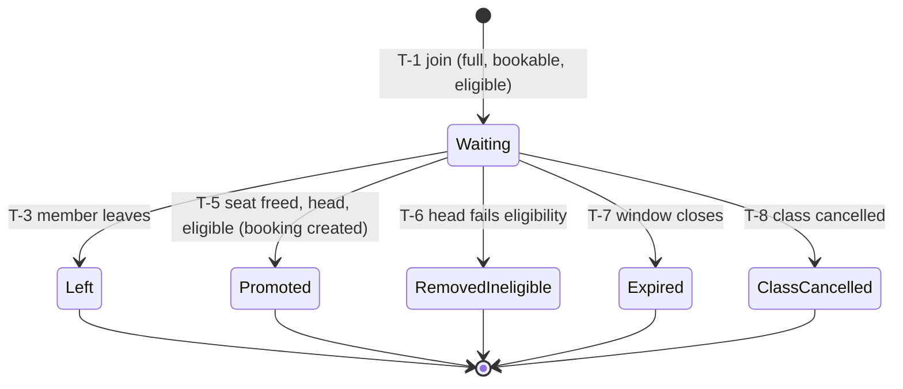

# Class Booking App — Product Specification

Status: first specification in this knowledge home (no earlier `spec.md`, so every R-n below is new and `## Retired` is empty).
Stage: spec, run on its own. Nothing ran before it and nothing runs after it. No product code and no tests are written here.
Dated basis for this run's additions: the request of 2026-11-21 (REQ-2026-11-21).

> REQ-2026-11-21 (verbatim): "Add a waitlist to our class booking app so full classes don't turn people away."

No structure or technology choice is made in this document. Choices the plan must still make are listed under "Decisions deferred to the plan" and become AD-n in `architecture.md ## Decisions`. `architecture.md` is not written by this stage because this stage decides nothing structural.

---

## 1. Sources, baseline and evidence limits

| Item | Finding |
|---|---|
| Earlier spec | None. `KNOWLEDGE/spec.md` did not exist. No R-n to keep, change or retire. |
| Discovery / research results | None exist (the stage runs on its own). |
| Selected baseline | None. There is no repository, no running app and no baseline note. Classification (Current-system baseline guide): an existing product ("our class booking app") **without an adequate baseline**. It is not "genuinely new", so the spec does not fabricate an as-is product. Facts about the current app are marked as prerequisites P-1..P-7 and are not asserted. |
| Guides read | Behavior-model guidance, Behavior traceability guidance, Interaction design guide, Requirements definition guide (state/data assessment, NFR section), Service discovery guidance (verification), Current-system baseline guide (planning and review handoff), UI visual-direction guide. |
| Evidence limits | Nothing was run against a product. The scenarios in section 6 were walked by hand against the rules in this document. A small reference-model script was drafted in the scratchpad but its execution was not approved, so **no script execution is claimed**. |

### Prerequisites that only the repository can answer (not user decisions)

These facts about the existing app are unknown here. Each keeps only the work that depends on it unready; independent work proceeds. All are resolved by discovery of the repository before planning the dependent work.

| ID | Unknown | Bounds |
|---|---|---|
| P-1 | The existing direct-booking eligibility rules (entitlement/credits, payment, membership state, overlapping bookings) and whether a booking charges or consumes anything. | R-1, R-4 |
| P-2 | The existing booking window and class lifecycle statuses (open, cancelled, started), and the exact boundary instant semantics. | R-6 |
| P-3 | The existing cancellation policy (cutoffs, penalties) and which staff actions exist: edit capacity, remove a member's booking, cancel a class. | R-3, R-5, R-6 |
| P-4 | Existing outbound notification channel(s) for booking events, if any. | R-7 |
| P-5 | Client surfaces (web or mobile), UI stack, design tokens and established visual identity. | R-11 |
| P-6 | The persistence layer and whether it can apply a multi-record change atomically. | R-8 |
| P-7 | Member identity, authentication and role model. | R-9 |

---

## 2. Request outcomes and traceability

| Outcome | Source | Requirements | Acceptance lines |
|---|---|---|---|
| O-1 A waitlist exists for classes in the booking app. | REQ-2026-11-21 "Add a waitlist" | R-1, R-2, R-3, R-6 | AC-1.1, AC-2.1, AC-3.1, AC-6.1 |
| O-2 A member who finds a class full is not turned away: they can stay in line instead of meeting a dead end. | REQ-2026-11-21 "so full classes don't turn people away" | R-1, R-2, R-10 | AC-1.1, AC-1.4, AC-2.1, AC-10.1 |
| O-3 A waitlisted member actually receives a seat when one opens. This is **inferred** from what a waitlist is (the word "waitlist"), not stated separately. | Meaning of "waitlist" in REQ-2026-11-21 | R-3, R-4, R-5, R-7 | AC-3.1, AC-3.2, AC-4.1, AC-5.1, AC-7.1 |
| O-4 Existing booking behaviour is not disturbed. This is preserved intent: silence in the request is not retirement. | Preserved by Requirements definition guide | R-10 | AC-10.1, AC-10.2 |
| O-5 The waitlist is correct, fair and private enough to be trusted. This is derived from the domain rules a waitlist needs to work safely, not from extra scope. | Derived; see R-8, R-9 | R-8, R-9 | AC-8.1..8.4, AC-9.1, AC-9.2 |

Primary requirements, which carry what the user asked for directly (O-1, O-2, O-3): **R-1 and R-3** (`primary` field in the submission).

Every modelled feature traces to O-1..O-5. Nothing is modelled beyond them; what the request leaves out is listed under the R-n it bounds.

---

## 3. Defaults chosen (assumptions)

The request leaves these open. Each is the best reversible default; no numeric limit is introduced anywhere. Each is repeated in `## Submission`.

| ID | Default | Basis | Alternatives | Revalidate when |
|---|---|---|---|---|
| A-1 | **Automatic promotion**: when a seat opens, the head of the waitlist is booked at once. There is no offer, confirm or hold window. | Simplest behaviour that makes the waitlist deliver a seat (O-3); avoids a timer and an unanswered-offer state. Reversible, because an offer window can be layered on later without changing queue order. | Offer with a claim window (needs a duration and an expiry mechanism); confirm-to-accept. | P-1/P-3 show that bookings charge money/credits or that late-cancel penalties exist (see G-1), or members report unwanted bookings. |
| A-2 | **FIFO** by server-recorded join order. No priority tiers. | A waitlist's ordinary meaning; the request names no priority. | Tiered, paid or staff-ordered waitlists. | A priority rule is requested. |
| A-3 | **No cap on waitlist length.** The rule is one entry per member per class. | The list is already bounded by the number of members. A cap would turn people away, against the request's stated purpose. No numeric bound is invented. | A cap of N entries (needs N and the at-cap behaviour). | P-6 shows a storage/UI constraint, or lists become operationally unmanageable. |
| A-4 | The waitlist is open exactly while direct booking of that class would be open, at the same instant semantics (inherits P-2). If the app has no explicit booking cutoff, the class start time is the cutoff. | Uses an existing rule instead of inventing a time value. | Close N hours before start. | P-2 is read. |
| A-5 | An ineligible head entry is **removed and the member is told**, and the pass continues to the next entry. | Keeps the promotion pass deterministic and bounded. | Skip but keep position; hold the seat until eligible. | Members need to keep position across a temporary ineligibility. |
| A-6 | Joining requires the same eligibility as a direct booking at the moment of joining. It is re-checked at promotion (R-4). | Avoids queueing people who could never be booked, and reuses P-1 without new policy. | Allow anyone to join. | P-1 is read. |
| A-7 | A waitlisted member sees their own position and the total length as "#p of n". Everyone else sees only that the class is full and joinable. | The member needs honest expectations; the aggregate count carries no identity. | Show nothing; show the count to everyone. | UX feedback. |
| A-8 | Movement in position is seen on the next view or refresh and is not pushed. Promotion, removal, expiry and class cancellation are notified (R-7). | Notifies only the consequential events. | Push on every movement. | Members miss movement. |
| A-9 | A member holding a time-overlapping booking elsewhere is handled by the existing eligibility rules (P-1). No new overlap rule. | Avoids new business policy. | A dedicated overlap rule for waitlists. | P-1 is read. |
| A-10 | Staff get no waitlist view and no manual promotion in this change. | Not requested. | Staff roster with waitlist; manual reorder. | A staff need is stated. |
| A-11 | No history is retained once an entry ends. The only durable trace is the "from waitlist" origin marker on the resulting booking. | Data minimisation; nothing asks for history. | Keep an audit trail. | Support or dispute handling needs it. |
| A-12 | A promoted booking is cancelled under the **existing** cancellation rules, unchanged. | Preserves P-3 behaviour; no new policy. | Penalty-free cancel shortly after promotion. | G-1 fires. |

---

## 4. Requirements

Terms used by all acceptance lines:

- *Full*: booked count ≥ capacity. *Bookable*: the booking window is open and the class is not cancelled (R-6, A-4).
- *Waitlist head*: the entry with position 1. *Position* = 1 + the number of entries ahead.
- *Member client*: the member-facing booking client (web or mobile per P-5). *Read-back*: reading the booking system's own records for the class, a test-harness surface.
- **Outcome kinds** are labels used by this spec. Their wire form follows the existing app's conventions (P-1, P-7): `BOOKED`, `CLASS_FULL`, `WAITLIST_JOINED(position)`, `ALREADY_WAITLISTED(position)`, `ALREADY_BOOKED`, `CLASS_HAS_SPACE`, `NOT_ELIGIBLE`, `BOOKING_CLOSED`, `LEFT`, `NOT_ON_WAITLIST`, `ON_WAITLIST_CLASS_FULL`. Notification kinds are `PROMOTED`, `REMOVED_INELIGIBLE`, `EXPIRED`, `CLASS_CANCELLED`.
- AC lines are cited as `AC-<R>.<k>`. Each is one planned case `TC-<R>.<k>`, not authored and not run.
- Scenario IDs `SC-n` and their step numbers are in section 6.

Every R below carries: basis, preserved/changed behaviour, source locators, evidence limits, pending implementation and checks. All R-1..R-10 share these, unless stated:

- **Basis:** REQ-2026-11-21 and the defaults A-1..A-12 as cited.
- **Source locators:** the request text; baseline sections are pending (P-n cited per R).
- **Evidence limits:** no baseline and no execution (section 1). "Previous behaviour" statements are **inferences** from the request's wording, not observations.
- **Pending:** implementation not started; planned checks `TC-*` not authored.

### R-1 Member joins the waitlist of a full class  *(primary)*

**Behaviour.** A signed-in member viewing a full, bookable class can join its waitlist. The entry is appended at the end. The member is told their position.
**Boundaries.** Joinable exactly when booked count = capacity (full) and bookable; one entry per member per class; no cap on length (A-3).
**Error behaviour.** Guards reject with a defined outcome and leave all data unchanged (see AC-1.2).
**Consumer outcome.** Where the class used to read as unavailable, the member client offers "Join waitlist"; afterwards it shows "Waitlisted · #p of n".

- **Preserved / changed.** Preserved: direct booking of a class with open seats, and the rejection of a direct booking of a full class. Changed (inferred from "turn people away"): a full class was a dead end for the member; it now offers the waitlist.
- **Left out by the request, bounding R-1:** priority, VIP or paid waitlists; waitlisting a whole recurring series; staff adding a member; guests/plus-ones; any new overlap rule (A-9).
- **State/data.** Resources: new waitlist entry (class, member, join order); class booked count (observed, unchanged by a join). Before: member has no entry or booking on the class. After: exactly one entry, last in order. Recovery: a failed join leaves no entry (single-record change). Check: read-back of entry order. Unknown: storage type (P-6).
- **Open gaps:** P-1 (what "eligible" means).

Acceptance lines:

- **AC-1.1**
  - Positive: SC-1 steps 3-5. C1 (capacity 2) is booked [M1, M2]; M3 joins and gets `WAITLIST_JOINED(1)`; M4 gets `WAITLIST_JOINED(2)`; M5 gets `WAITLIST_JOINED(3)`.
  - Boundary: the first entry on an empty list is position 1 (step 3); the join is accepted at exactly 2 booked of 2 (full).
  - Failure: n/a: guard failures are AC-1.2.
  - Surface: member client class card and class detail, plus read-back.
  - Confirmed by: browser-driven check on the member client asserting the control text before ("Join waitlist") and after ("Waitlisted · #1 of 1" for M3 after step 3), and read-back asserting order [M3, M4, M5] after step 5. A status-only check does not pass.
- **AC-1.2**
  - Failure (each leaves the waitlist and bookings unchanged, verified by read-back), SC-5: join when C1 is 0 of 2 booked → `CLASS_HAS_SPACE`; join by M2 who holds a seat → `ALREADY_BOOKED`; join by M9 who fails the P-1 eligibility check → `NOT_ELIGIBLE`; join after the window closes → `BOOKING_CLOSED` (SC-4); join while signed out → the existing unauthenticated response.
  - Boundary: at 1 booked of 2 → `CLASS_HAS_SPACE` (one below full); at 2 of 2 → joinable (AC-1.1).
  - Positive: n/a: covered by AC-1.1.
  - Surface: member client (the control is absent or disabled with an explanation, never silently ignored) and the response to the join request.
  - Confirmed by: one case per guard, asserting the outcome kind and an unchanged entry list.
- **AC-1.3**
  - Positive/boundary: SC-5. M3 is at position 1; M3 submits the join again (double click or retry) → `ALREADY_WAITLISTED(1)`; the list remains exactly [M3], length 1.
  - Failure: n/a: not a failure; the repeat is idempotent.
  - Surface: member client and read-back.
  - Confirmed by: read-back asserting length 1 after two join submissions.
- **AC-1.4**
  - Consumer outcome: SC-1 step 9. M6 (not waitlisted) attempts a direct booking of full C1 → the existing full rejection (`CLASS_FULL`, preserved) and the response/UI offers "Join waitlist"; step 10 M6 joins → `WAITLIST_JOINED(1)`.
  - Failure: the rejection must not auto-join M6; read-back after step 9 shows M6 absent from the list.
  - Boundary: n/a: no further boundary.
  - Surface: member client.
  - Confirmed by: browser-driven check.

### R-2 Member sees their position and can leave

**Behaviour.** A waitlisted member sees "#p of n" for each waitlisted class and can leave. Leaving removes the entry; later entries move up by one. Rejoining goes to the end.
**Boundaries.** Position is contiguous 1..n; leaving the only entry leaves an empty list on a still-full, still-joinable class.
**Error behaviour.** Leaving when not on the list is a no-op with `NOT_ON_WAITLIST`.
**Consumer outcome.** The member's own list of bookings shows waitlisted classes with position and a Leave action.

- **Preserved / changed.** Preserved: the member's existing bookings view. Added: waitlisted entries in it.
- **Left out by the request:** estimated chance of getting in; staff reordering; reminders about position.
- **State/data.** Resource: waitlist entries of one class. Invariant: positions stay contiguous after a removal. Recovery: removal is a single-record change. Check: read-back.
- **Open gaps:** P-5 (where the bookings view lives).

Acceptance lines:

- **AC-2.1**
  - Positive: SC-1. After step 5 the list is [M3, M4, M5] and M3 sees "#1 of 3". After step 6 (M1 cancels and M3 is promoted) M4 sees "#1 of 2" and M5 sees "#2 of 2". After step 7 (M4 leaves, `LEFT`) M5 sees "#1 of 1".
  - Boundary: leaving the last entry leaves the list empty; C1 stays full and a new join returns `WAITLIST_JOINED(1)`.
  - Failure: n/a: covered by AC-2.2.
  - Surface: member client, as each named member (the observer is the member themself, which R-9 permits).
  - Confirmed by: browser-driven check asserting the exact strings after each step.
- **AC-2.2**
  - Failure/no-op: SC-5. M4 leaves a list they are not on → `NOT_ON_WAITLIST`, no change; M3 leaves twice → `LEFT` then `NOT_ON_WAITLIST`.
  - Boundary: rejoin (SC-1b). From the state after step 7 (booked [M2, M3], list [M5]), M4 joins again → `WAITLIST_JOINED(2)`, behind M5.
  - Positive: n/a: covered by AC-2.1.
  - Surface: member client and read-back.
  - Confirmed by: read-back asserting order [M5, M4].

### R-3 Seat released by a cancellation is promoted automatically (FIFO)  *(primary)*

**Behaviour.** When a member's booking on a bookable class is cancelled and the waitlist is non-empty, the same operation runs a promotion pass. The head entry that passes R-4 is booked, marked "from waitlist", and removed from the list. Remaining positions shift up by one. The pass repeats while a seat is free and entries remain.
**Boundaries.** Order is strictly by position; one seat goes to exactly one member; a pass never books past capacity.
**Error behaviour.** The cancellation and the promotion are one unit (R-8): if the unit cannot complete, nothing changes and the canceller gets the existing error.
**Consumer outcome.** The promoted member finds the class among their bookings, labelled "From waitlist", and is notified (R-7).

- **Preserved / changed.** Preserved: cancellation by a member and its existing rules (A-12, P-3). Changed: a freed seat on a class with a waitlist goes to the head of the list instead of becoming open.
- **Left out by the request:** confirm-or-decline offers and timers (A-1); partial-party promotion; no-show handling; auto-rebooking.
- **State/data.** Resources: booking (created), waitlist entry (removed), class booked count. Before: booked 2 of 2 and list [M3, M4, M5]. After: booked 2 of 2 with M3 in and M1 out, list [M4, M5]. Invariants are in R-8. Recovery: all-or-nothing. Checks: read-back. Unknown: P-1 (does a booking charge), P-6.
- **Open gaps:** G-1 (charging and penalties on a promoted booking).

Acceptance lines:

- **AC-3.1**
  - Positive: SC-1 step 6. C1 is booked [M1, M2] and the list is [M3, M4, M5]; M1 cancels → booked [M2, M3], list [M4, M5], and M3's booking carries "from waitlist". Step 8: M2 cancels → booked [M3, M5], list [].
  - Boundary: when the list has exactly one entry (step 8) the list becomes empty and C1 is full again, so M6's direct booking in step 9 is `CLASS_FULL`.
  - Failure: n/a: eligibility failure is AC-4.1.
  - Surface: member client for M3 and M5 ("My bookings"), plus read-back.
  - Confirmed by: read-back asserting the exact booked sets and lists after each step; the browser check asserts M3's "From waitlist" label.
- **AC-3.2**
  - Positive: promotion happens inside the cancellation operation. When the cancel request has returned, a read-back already shows M3 booked, with no polling or delay.
  - Failure: if the unit cannot complete (injected store failure), M1's booking is unchanged, the list is unchanged and the canceller sees the existing error.
  - Boundary: with an empty list (booked [M1, M2], list []), M1 cancels → booked [M2] and one open seat; M6 books → `BOOKED`.
  - Surface: API response and read-back; member client for the canceller.
  - Confirmed by: ordering assertion (read immediately after the response); fault-injection case for the failure path.
- **AC-3.3**
  - Positive: a promoted booking is an ordinary booking. M3 can cancel it under the existing rules (A-12), which triggers the next promotion, and it counts toward capacity.
  - Failure/boundary: n/a: same behaviour as any booking, covered by AC-3.1 and AC-10.1.
  - Surface: member client.
  - Confirmed by: browser-driven check cancelling M3's promoted booking and asserting that the next entry is promoted.

### R-4 Eligibility is rechecked at promotion; an ineligible entry is removed

**Behaviour.** At promotion each head entry is checked with the same eligibility as a direct booking (A-6, P-1) at that instant. If it fails, the entry is removed, the member is told (`REMOVED_INELIGIBLE`), and the pass continues with the next entry.
**Boundaries.** A pass ends when no seat is free or no entry remains. If all remaining entries are ineligible the list drains and the seat stays open for direct booking.
**Error behaviour.** No seat is held for an ineligible member; no partial booking.
**Consumer outcome.** The removed member sees a clear removal notice and the class is no longer under their waitlist.

- **Preserved / changed.** Preserved: P-1 eligibility rules (not redefined). Added: they are applied again at promotion time.
- **Left out by the request:** keeping position through ineligibility (A-5); automatic retry.
- **State/data.** Resource: waitlist entries and the booking. Invariant after a pass: no waitlisted member is also booked. Recovery: same unit as R-3. Unknown: P-1 (the concrete ineligibility conditions; the fixture uses an eligibility flag).
- **Open gaps:** P-1; G-1.

Acceptance lines:

- **AC-4.1**
  - Positive/failure: SC-2. C1 is booked [M3, M5], the list is [M7, M6], and M7 becomes ineligible after joining. M3 cancels → M7 is removed (`REMOVED_INELIGIBLE`) and M6 is promoted: booked [M5, M6], list [].
  - Boundary: one removal and one promotion in a single pass; M6's position changes from 2 to 1 before it is promoted.
  - Surface: M7 and M6 clients plus read-back.
  - Confirmed by: assertions on both members' views and notifications. M7 has no booking and no entry; M6 is booked.
- **AC-4.2**
  - Boundary: C1 is booked [M3, M5], the list is [M7] and M7 is ineligible. M3 cancels → M7 is removed, booked [M5], list [], and one seat is open; M6 then books directly → `BOOKED`.
  - Failure: n/a: covered by AC-4.1.
  - Positive: n/a: covered by AC-3.1.
  - Surface: read-back and the M6 client.
  - Confirmed by: read-back asserting the seat is open and M6 booked.

### R-5 Other events that free seats also promote; a capacity cut removes nobody

**Behaviour.** Any event that leaves a bookable class with free seats and a non-empty list runs the same promotion pass: a capacity increase, and a staff removal of a booking where that action exists (P-3). Reducing capacity below the booked count removes no booking and promotes nobody until booked < capacity.
**Boundaries.** Free seats = capacity − booked, floored at 0. Promotions = min(free seats, eligible entries).
**Error behaviour.** Same as R-3.
**Consumer outcome.** Waitlisted members are promoted as if a member had cancelled.

- **Preserved / changed.** Preserved: staff authority over capacity and bookings (P-3). Added: promotion after a seat-freeing change.
- **Left out by the request:** staff-visible waitlist, manual promotion or reorder (A-10); notifying booked members of a capacity cut.
- **State/data.** Resource: class capacity (observed and changed by staff, not by this feature). Before: capacity 2, booked [M1, M2], list [M8, M9, M10]. After a capacity change to 4: booked [M1, M2, M8, M9], list [M10]. Check: read-back.
- **Open gaps:** P-3 (whether staff capacity edit and booking removal exist; if a surface does not exist its cases are not applicable, and that must be recorded rather than assumed).

Acceptance lines:

- **AC-5.1**
  - Positive/boundary: SC-3. Capacity 2 → 4 with the list [M8, M9, M10] → M8 and M9 are promoted (2 free seats, 3 entries): booked [M1, M2, M8, M9], list [M10], and M10 sees "#1 of 1".
  - Failure: n/a: covered by AC-5.2.
  - Surface: staff surface (the action) and the member clients (the effect), plus read-back.
  - Confirmed by: read-back asserting exact sets; M10 browser assertion.
- **AC-5.2**
  - Boundary/failure: SC-3 continued. Capacity 4 → 1 with booked [M1, M2, M8, M9] → no booking removed, no promotion, list [M10] retained. Then M1, M2 and M8 cancel in turn (booked 3, 2, then 1 = capacity): still no promotion. Then M9 cancels (booked 0 < 1) → M10 is promoted: booked [M10], list [].
  - Positive: n/a: covered by AC-5.1.
  - Surface: read-back.
  - Confirmed by: read-back after each of the four cancellations.
- **AC-5.3**
  - Positive: where a staff "remove member's booking" action exists, removing M1 from [M1, M2] with list [M3] behaves exactly as AC-3.1 step 6 (M3 promoted). Where the action does not exist: `n/a: P-3 shows no such action`, recorded at plan.
  - Failure/boundary: n/a: same unit and guards as R-3.
  - Surface: staff surface plus read-back.
  - Confirmed by: read-back.

### R-6 The waitlist closes with the booking window; a cancelled class clears it

**Behaviour.** The waitlist is open exactly while direct booking would be open (A-4). When the window closes, all entries expire and no promotion occurs, even if a seat is freed afterwards. If staff cancel the class, all entries are removed and no booking is created.
**Boundaries.** At the instant direct booking closes (existing boundary semantics, P-2), the waitlist is also closed. The expiry is observable by time, whether or not a cleanup job has yet run.
**Error behaviour.** Join after closure → `BOOKING_CLOSED`.
**Consumer outcome.** Affected members see `EXPIRED` or `CLASS_CANCELLED` and no stale waitlist state.

- **Preserved / changed.** Preserved: the booking window and class cancellation (P-2, P-3).
- **Left out by the request:** moving waitlisted members to another session; a waitlist for past classes.
- **State/data.** Resource: entries of the class. After closure: zero entries, observable at once at the boundary even if a cleanup job is later. Recovery: if the expiry mechanism is delayed, reads still show an empty list. Unknown: P-2.
- **Decisions deferred to the plan:** how expiry is realised (read-time evaluation versus a scheduled job). Either must give the observable behaviour here.
- **Open gaps:** P-2.

Acceptance lines:

- **AC-6.1**
  - Positive: SC-4. C1 is booked [M1, M2] and the list is [M3, M4]; the window closes → M3 and M4 each get `EXPIRED`, the list is [] and read-back/clients show no entries.
  - Boundary: with the test clock set to exactly the cutoff instant, join → `BOOKING_CLOSED`. One instant before the cutoff, join is accepted (class full).
  - Failure: n/a: see AC-6.2.
  - Surface: member clients, read-back, test clock.
  - Confirmed by: clock-controlled browser check; time is controlled, not waited for.
- **AC-6.2**
  - Failure/negative: after closure, M1 cancels (where the existing rules still permit it, P-3) → booked [M2], **no promotion**, list stays []; M5 joins → `BOOKING_CLOSED`.
  - Positive: staff cancel the class with list [M3, M4] → both get `CLASS_CANCELLED`, the list is [], and no booking is created for M3 or M4.
  - Boundary: n/a: covered by AC-6.1.
  - Surface: member clients, staff surface, read-back.
  - Confirmed by: read-back and notification assertions.

### R-7 Members are told what happened

**Behaviour.** The affected member is told of `PROMOTED` (booking confirmed, with class and time), `REMOVED_INELIGIBLE`, `EXPIRED` and `CLASS_CANCELLED`. The booking system's own state is authoritative; a notification is an additional signal.
**Boundaries.** Position movement is not pushed (A-8). Each event notifies only the affected member.
**Error behaviour.** Delivery failure of a notification does not undo a promotion, removal or expiry.
**Consumer outcome.** Even if the member never opens a notification, their bookings view shows the true state ("From waitlist" booking, or the removal notice).

- **Preserved / changed.** Preserved: existing booking notifications (P-4). Added: the four kinds above through the same channel.
- **Left out by the request:** new channels (SMS, push, email) if none exist (see G-2); reminders; digests.
- **State/data.** Resource: notification records or sends (owned by the existing mechanism, P-4). Personal data: member identifier, class name and time only. Acceptance is distinguished from delivery.
- **Open gaps:** P-4; G-2 (if no outbound channel exists, whether to add one is a user decision; the default is in-app status only).

Acceptance lines:

- **AC-7.1**
  - Positive: SC-1 step 6. M3 receives `PROMOTED` carrying C1's name and time through the existing channel (P-4) and sees the booking in their bookings view, labelled "From waitlist". SC-2: M7 receives `REMOVED_INELIGIBLE`.
  - Boundary: M4 and M5 receive nothing when M3 is promoted (position movement is not pushed).
  - Failure: see AC-7.2.
  - Surface: the existing notification channel (P-4) and the member client.
  - Confirmed by: assertion on the channel's send record and on the view. If P-4 shows no channel, the in-app assertion only is required, and G-2 stays open.
- **AC-7.2**
  - Failure: with the notification sink forced to fail, the SC-1 step 6 cancellation still ends with M3 booked, the list [M4, M5] and M3's view showing "From waitlist"; no promotion is reverted.
  - Positive/boundary: n/a: covered by AC-7.1.
  - Surface: read-back, M3's client, sink fault injection.
  - Confirmed by: fault-injection case.

### R-8 Seat and queue integrity under concurrent actions

**Behaviour.** These invariants hold after every operation, including concurrent ones:
- **I-1** a promotion or booking never takes booked above capacity (a capacity cut may leave booked above capacity until cancellations catch up, R-5);
- **I-2** a non-empty waitlist implies the class is full and bookable (the waitlist is empty whenever a seat is open);
- **I-3** a member has at most one entry and is never both booked and waitlisted on the same class;
- **I-4** order is by server-recorded join order and positions are contiguous 1..n; client clocks never decide order;
- **I-5** a freed seat goes to exactly one party: the head eligible entry, or direct booking if no entry takes it.
**Boundaries.** Concurrent operations on one class behave as if they ran one at a time in some order; every order must satisfy I-1..I-5.
**Error behaviour.** A promotion is all-or-nothing together with its trigger (R-3).
**Consumer outcome.** No member sees a seat taken from the head of the list by someone who joined later or booked directly.

- **Preserved / changed.** Added: guarded concurrent behaviour for the new state. Existing direct-booking concurrency is preserved and assessed against the baseline (P-6).
- **Left out by the request:** overbooking policy.
- **State/data.** Per class: booked set, waitlist order. Owner: the booking system (server side). Recovery: if the store cannot apply the unit atomically, the plan must provide a recovery step that restores I-2 before any member-visible read (decision deferred to the plan, P-6). A mechanism is not chosen here.
- **Open gaps:** P-6.

Acceptance lines:

- **AC-8.1**
  - Positive: SC-6a. Booked [M1, M2], list [M3]. Race A: M1 cancels while M6 books directly. Either order ends booked [M2, M3], list [], and M6 gets `CLASS_FULL`; M6 never holds a seat while M3 waits.
  - Failure: n/a: this is the failure being excluded.
  - Boundary: the race at exactly one free seat and one entry.
  - Surface: API-level concurrent calls with read-back.
  - Confirmed by: a concurrency test running both interleavings, deterministic through controlled ordering, asserting the final state and that M6 was rejected.
- **AC-8.2**
  - Positive: SC-6b. Booked [M1, M2], list [M3, M4]. M1 and M2 cancel concurrently → promotions are M3 then M4 in either order, final booked [M3, M4], list [].
  - Boundary: two seats freed together serve two entries without duplication.
  - Failure: n/a.
  - Surface: API-level concurrent calls with read-back.
  - Confirmed by: both interleavings.
- **AC-8.3**
  - Positive/boundary: SC-6c. C1 is full, list []. M5 and M6 join concurrently → positions 1 and 2 in some order, never both 1. SC-6d: M5 joins while M1 cancels (booked [M1, M2], list []). Either (join first) M5 is promoted: booked [M2, M5]; or (cancel first) M5 gets `CLASS_HAS_SPACE` and is not listed. M5 is never both, and never lost.
  - Failure: n/a.
  - Surface: API-level concurrent calls with read-back.
  - Confirmed by: both interleavings per case; read-back for I-1..I-5.
- **AC-8.4**
  - Failure: an injected failure after the booking is created and before the entry is removed leaves no state in which M3 is both booked and listed, or has an entry removed without a booking; I-3 and I-5 hold after the failure.
  - Boundary/positive: n/a: normal flow is covered by AC-3.1.
  - Surface: read-back under fault injection.
  - Confirmed by: fault-injection case.

### R-9 A member sees and changes only their own waitlist state

**Behaviour.** A member can join, leave and view only their own entry. No response to a member contains another member's identity or position.
**Boundaries.** The aggregate length "of n" is shown only to waitlisted members for their own class (A-7); a non-waitlisted member learns only that the class is full or joinable.
**Error behaviour.** A request that names a different member is rejected with the existing authorization error and changes nothing.
**Consumer outcome.** Members cannot learn who else is waiting.

- **Preserved / changed.** Preserved: the existing authentication and authorization (P-7). Added: the same for waitlist operations.
- **Left out by the request:** staff and admin waitlist views, exports and analytics (A-10).
- **State/data.** Personal data: member identifier and join time, stored only as long as the entry lives (A-11), shown only to that member, logged by member identifier only, with no name or email; removed when the entry ends.
- **Open gaps:** P-7.

Acceptance lines:

- **AC-9.1**
  - Positive: with list [M3, M4, M5], the payload and rendered page returned to M6 (not listed) for C1 contain no identifier of M3, M4 or M5 and no count; M4's payload contains M4's own position and the total (2 of 3) and no other member's identifier.
  - Failure: n/a: see AC-9.2.
  - Boundary: n/a: one observer class per case.
  - Surface: the response payloads (not only the UI) and the member client.
  - Confirmed by: payload inspection asserting the absence of other identifiers, not only a visual check.
- **AC-9.2**
  - Failure: M6 submits a leave or join with M4's member identifier → rejected with the existing authorization error, M4's entry unchanged.
  - Positive/boundary: n/a: covered by AC-9.1.
  - Surface: API-level request, read-back.
  - Confirmed by: negative authorization case asserting an unchanged list.

### R-10 Existing booking behaviour is preserved

**Behaviour.** Classes with open seats book exactly as before. A direct booking of a full class remains rejected and does not auto-join the waitlist. Cancellation, the class listing and existing notifications for non-waitlist events are unchanged. Existing clients that know nothing of the waitlist keep working.
**Boundaries.** Contract changes are additive only.
**Error behaviour.** Existing error outcomes keep their meaning.
**Consumer outcome.** An unchanged client viewing a full class sees the existing full state without failing.

- **Preserved / changed.** This requirement is the preservation clause. Silence in the request is not retirement.
- **Left out by the request:** any change to prices, credits, capacities or the cancellation policy.
- **State/data.** No existing data is migrated. Existing classes start with empty waitlists. Roll-back: removing the feature leaves bookings intact; promoted bookings stay valid.
- **Open gaps:** P-1..P-3 (the existing regression suite and its location).

Acceptance lines:

- **AC-10.1**
  - Positive: with C1 at 1 of 2 booked, M6 books → `BOOKED` exactly as before; the booking confirmation is unchanged.
  - Failure: C1 full and M6 not listed: a direct booking is rejected as before (`CLASS_FULL`) and creates no waitlist entry.
  - Boundary: C1 at exactly 2 of 2 is the first full state.
  - Surface: member client and the booking response.
  - Confirmed by: the baseline's existing booking tests, re-run unchanged (green before and after), plus the cases above.
- **AC-10.2**
  - Positive: a client version that predates the waitlist, shown a full class, renders it as before and ignores additive fields.
  - Failure/boundary: n/a: no further failure mode beyond AC-10.1.
  - Surface: the oldest supported client build (P-5).
  - Confirmed by: a compatibility check on that build. If only one client version exists, record that as n/a with the reason.

---

## 5. Non-functional requirements

### R-11 Designed, polished waitlist interface

**Applies** to every new or changed waitlist surface: class card/detail, bookings view, notification text.
**Identity and visual reference.** The app has an established identity (P-5), which takes precedence, so the new elements inherit it. For choices the existing identity leaves unspecified, the named reference is the light Google Gemini look and feel with Material 3 Expressive principles (UI visual-direction guide, light expressive starting point). Starting appearance: light first with a dark option, unless the existing identity sets another policy. The plan chooses the concrete treatment and records it as an AD.

Observable criteria (no numbers invented beyond the WCAG AA contrast ratios and the two widths chosen for checking):
1. **Visual system.** One spacing scale, one type scale, a palette with light and dark themes; no ad-hoc values in new components.
2. **States.** Designed loading ("Joining…" with the control disabled and busy, no optimistic position), empty (no waitlisted classes: an explanation with a path to the schedule), error (persistent inline message with a Retry action, not a transient toast alone) and success ("Waitlisted · #p of n"; promoted).
3. **Layout.** Works at 360 px and at 1280 px wide with no horizontal overflow in either theme.
4. **Accessibility.** Visible focus states; WCAG AA contrast (4.5:1 text, 3:1 for controls and focus indicators); a position change or promotion announced through a polite live region; focus returns to the triggering control after join and leave.
5. **Motion.** Only where it explains a change (entering the list, a position change); `prefers-reduced-motion` turns it into an instant change or a crossfade.
6. **Icons.** One icon set, the app's existing one (P-5).
7. **Truthful async feedback.** Trigger → pending state → confirmed or failed state. A position is shown only from the server's response. A timer or a finished animation never confirms the outcome.

Component premises (the class card has the variants Open, Full-joinable, Waitlisted, Booked-from-waitlist, Closed), the interaction model and the skin are specified here as premises for the plan, not decided.

Verification: render the card variants at 360 px and 1280 px in both themes; run an automated contrast and overflow check; do a keyboard-only walkthrough; emulate reduced motion; review screenshots against criteria 1-7. A DOM or ARIA assertion alone is not an accessibility audit.
Open gap: P-5. If the app's identity cannot be recovered, the reference above is used as the fallback.

- **AC-11.1** Positive: each criterion 1-7 has a pass/fail observation as above. Failure: a horizontal scrollbar at 360 px or a contrast pair below AA fails. Boundary: both widths and both themes are checked. Surface: member client rendered in a browser or device. Confirmed by: the checks named above.

### R-12 Capacity and performance

No workload, latency or throughput target is stated by the request or available from a baseline. **None is invented.**
- Unresolved bound: expected members and classes, and the latency target. Missing evidence: the app's current targets (P-5/P-6) or a user decision. Owner: the user. Due: before the plan's test strategy. Only performance verification waits.
- Observable acceptance that does not need a number (AC-12.1): promotion completes inside the cancel operation (AC-3.2), and with a list of 50 entries (a test value, not a limit) positions remain 1..50 and contiguous after 10 members leave.
- **AC-12.1** Positive: as above. Failure/boundary: n/a: no numeric bound to test. Surface: API and read-back. Confirmed by: the listed case.

### R-13 Operability

Each `PROMOTED`, `REMOVED_INELIGIBLE`, `EXPIRED` and `CLASS_CANCELLED` event is recorded in the app's existing log mechanism, identified by member identifier, class and event kind only (no name or email), so that a "why was I removed?" report can be investigated (default; the existing logging mechanism is P-6). No new dashboard or metric is added.
- **AC-13.1** Positive: SC-2 produces a `REMOVED_INELIGIBLE` record for M7 and a `PROMOTED` record for M6. Failure: a log record containing a name or email fails. Boundary: n/a. Surface: log read-back. Confirmed by: log inspection.

### Justified exclusions (not "N/A for lack of data")

- Availability/SLA: not requested; nothing in a waitlist changes the app's existing availability.
- Localisation: follows the existing app's approach; no new language requirement.
- Data migration: none; a new entity only, and existing classes start with empty lists.
- Security/privacy/compatibility/reliability: carried by R-9, R-10, R-8 and R-7 respectively.

---

## 6. Behaviour model, replay scenarios and evidence

### Fixtures

- **C1** "Spin", 2026-12-01 18:00, capacity 2. The booking window is open, and "now" is 2026-11-21, ten days before, so no existing cancellation cutoff applies (P-3). Window-closure cases use a controllable test clock.
- **M1..M11** are signed-in members. All pass the P-1 eligibility check unless stated. **M7** passes at join time and fails at promotion time. **M9** fails at all times. The concrete ineligibility mechanism is whichever existing rule rejects a direct booking (P-1); the spec's cases only need that effect.
- Notation: `booked [..]` lists bookings in booking order; `list [..]` lists the waitlist head-first.

### Sequence flows

| Flow | Requirements | Actors and boundaries | Summary |
|---|---|---|---|
| F-1 Join | R-1, R-8, R-9 | Member client → booking system (authority) | Guards: signed in, own identity, bookable, full, eligible, not booked, not listed. Append entry, return position. Rejections change nothing. |
| F-2 Leave / view | R-2, R-9 | Member client → booking system | Own entry only; remove and renumber. |
| F-3 Cancel → promotion pass | R-3, R-4, R-7, R-8 | Member client → booking system → notification channel (async, best effort) | One unit: remove booking, loop {head eligible → book and mark "from waitlist", head ineligible → remove and notify}, until no free seat or no entries. Then notify. |
| F-4 Capacity change / staff removal | R-5 | Staff surface → booking system | Same promotion pass. |
| F-5 Window close / class cancel | R-6, R-7 | Clock or staff → booking system | Expire or clear entries; notify; no booking. |
| F-6 Direct booking on a class with a list | R-1, R-8, R-10 | Member client → booking system | Rejected as full (existing); a listed member is told they are already waitlisted. |

### States

All terminal states are final for the entry; a member may create a fresh entry by T-1 later, going to the end. Class state dimension: Open-with-space, Full-bookable (the only state with a non-empty list, I-2), Closed.

### Transition ledger

| ID | R / F | Before | Trigger and guard | Operation | After / observation | Failure and recovery | Cases |
|---|---|---|---|---|---|---|---|
| T-1 | R-1 / F-1 | no entry, not booked, class full and bookable | member joins; eligible | append entry | `WAITLIST_JOINED(p)` | single record; failure leaves nothing | TC-1.1 |
| T-2 | R-1 / F-1 | any | join with a failed guard | none | the matching outcome kind, no change | n/a | TC-1.2, TC-1.3 |
| T-3 | R-2 / F-2 | Waiting | member leaves | remove, renumber | `LEFT` | single record | TC-2.1 |
| T-4 | R-2 / F-2 | not Waiting | leave | none | `NOT_ON_WAITLIST` | n/a | TC-2.2 |
| T-5 | R-3, R-5 / F-3, F-4 | Waiting at head, free seat, bookable | seat freed; eligible | create booking "from waitlist", remove entry | `PROMOTED` | one unit with its trigger | TC-3.1, TC-3.2, TC-5.1 |
| T-6 | R-4 / F-3, F-4 | Waiting at head, free seat | head fails eligibility | remove entry, notify, continue pass | `REMOVED_INELIGIBLE` | same unit | TC-4.1, TC-4.2 |
| T-7 | R-6 / F-5 | Waiting | window closes | remove entries | `EXPIRED`; no promotions afterwards | expiry by time, whether or not cleanup has run | TC-6.1, TC-6.2 |
| T-8 | R-6 / F-5 | Waiting | class cancelled | remove entries | `CLASS_CANCELLED` | n/a | TC-6.2 |
| T-9 | R-10, R-8 / F-6 | any | direct booking on a full class or with a non-empty list | none | `CLASS_FULL` (or `ON_WAITLIST_CLASS_FULL` for a listed member) | n/a | TC-1.4, TC-8.1, TC-10.1 |
| T-10 | R-5 | list non-empty | capacity cut below booked | none | no removal, no promotion | n/a | TC-5.2 |

### Scenario walks (recomputed by hand against the rules)

Method: each action was applied to the state left by the previous one, citing the rule that permits it. Observer: the named member's own client, or read-back for the class (a test-harness surface; staff have no waitlist view, A-10). The product was not run (NOT-REPLAYED against a product: none exists in this stage). The per-step values below are the **expected values the checks must assert**.

**SC-1 primary path** (C1 capacity 2, empty; rules R-1, R-3, R-8, R-10):

| Step | Action | Rule that permits it | Outcome | booked | list |
|---|---|---|---|---|---|
| 1 | M1 books | R-10, class has space | `BOOKED` | [M1] | [] |
| 2 | M2 books | R-10, class has space | `BOOKED` | [M1, M2] | [] |
| 3 | M3 joins | R-1, full and eligible | `WAITLIST_JOINED(1)` | [M1, M2] | [M3] |
| 4 | M4 joins | R-1 | `WAITLIST_JOINED(2)` | [M1, M2] | [M3, M4] |
| 5 | M5 joins | R-1 | `WAITLIST_JOINED(3)` | [M1, M2] | [M3, M4, M5] |
| 6 | M1 cancels | existing cancel (P-3); R-3 | M3 promoted | [M2, M3] | [M4, M5] |
| 7 | M4 leaves | R-2 | `LEFT` | [M2, M3] | [M5] |
| 8 | M2 cancels | existing cancel; R-3 | M5 promoted | [M3, M5] | [] |
| 9 | M6 books directly | R-10: full | `CLASS_FULL`, offer of waitlist | [M3, M5] | [] |
| 10 | M6 joins | R-1 | `WAITLIST_JOINED(1)` | [M3, M5] | [M6] |

SC-1b branch from the state after step 7: M4 joins → `WAITLIST_JOINED(2)`; list [M5, M4].

**SC-2** (R-4): booked [M3, M5], capacity 2; M7 joins (`WAITLIST_JOINED(1)`), M6 joins (`WAITLIST_JOINED(2)`); M7 becomes ineligible; M3 cancels → M7 removed (`REMOVED_INELIGIBLE`), M6 promoted; booked [M5, M6], list []. Variant: only M7 listed → after M3 cancels booked [M5], list [], one seat open, M6 books → `BOOKED`.

**SC-3** (R-5): capacity 2, booked [M1, M2]; M8, M9, M10 join (positions 1, 2, 3). Capacity → 4: free seats 2 → M8, M9 promoted; booked [M1, M2, M8, M9], list [M10]. Capacity → 1: nobody removed, no promotion, list [M10]. M1, M2, M8 cancel: booked 3, 2, 1, so no promotion at any step. M9 cancels: booked 0 < 1 → M10 promoted; booked [M10], list [].

**SC-4** (R-6): booked [M1, M2], list [M3, M4]; clock moves to the cutoff → both get `EXPIRED`, list []; M1 cancels (if the existing rules permit it): booked [M2], no promotion; M5 joins → `BOOKING_CLOSED`.

**SC-5** (R-1/R-2 guards; capacity 2; M9 ineligible): M1 joins at 0 booked → `CLASS_HAS_SPACE`; M1 and M2 book → `BOOKED`; M2 joins → `ALREADY_BOOKED`; M3 joins → `WAITLIST_JOINED(1)`; M3 joins again → `ALREADY_WAITLISTED(1)`, list [M3]; M9 joins → `NOT_ELIGIBLE`; M3 books directly → `ON_WAITLIST_CLASS_FULL`; M4 leaves → `NOT_ON_WAITLIST`; M3 leaves → `LEFT`; M3 leaves again → `NOT_ON_WAITLIST`.

**SC-6 concurrency** (R-8). All interleavings are serialisations; the expected final states:
- 6a: booked [M1, M2], list [M3]; "M1 cancels" and "M6 books" in either order → booked [M2, M3], list [], M6 `CLASS_FULL`.
- 6b: booked [M1, M2], list [M3, M4]; M1 and M2 cancel in either order → booked [M3, M4], list [].
- 6c: full, list []; M5 and M6 join in either order → positions {1, 2}, distinct.
- 6d: booked [M1, M2], list []; M5 joins and M1 cancels. Join first → booked [M2, M5], list []. Cancel first → booked [M2], M5 gets `CLASS_HAS_SPACE`, list []. No other final state is allowed.

Every start state above is reachable from the fixtures by actions the rules permit: the booking and joining steps are SC-1 steps 1-5, and cancellation is permitted because the class is ten days out (fixture). Replay status: **NOT-REPLAYED against a product** (none exists here); hand-walked only. Any value mismatch found by the later checks is a finding against the plan, not something to adjust in the test.

### State and information lifecycle (per piece of state)

| State | Owner and location | Who may read | Simultaneous changes | What ends it | Quotas met |
|---|---|---|---|---|---|
| Waitlist entry (member, class, order) | The booking system, server side; location is decided in the plan (P-6) | The owning member (own position and total); no other member (R-9); no staff view in this change (A-10) | Serialised per class; the server decides order (I-4) | Promoted, left, removed as ineligible, expired, class cancelled (T-3..T-8); no history kept (A-11) | None known; storage limits come from P-6; none invented |
| Booking "from waitlist" origin marker | The booking record | The booking's own member (and wherever bookings are already visible) | As any booking | As the booking | As bookings today |
| Client display and pending state | The member client, transient | The member | The server response wins; a late reply for a superseded request must not overwrite newer accepted state | Page leave | n/a |
| Notifications | The existing notification mechanism (P-4) | The addressed member | Independent of the booking transition | Per the existing policy | Existing channel's |
| Logs | The existing logging mechanism | Operators | n/a | Existing log retention | Existing |

Personal data: the entry holds the member identifier and join time only; it is shown only to that member; it is logged by identifier only; it is removed when the entry ends. No sharing, identity or persistence beyond this is added.

### Service-boundary contracts (Service discovery guidance, verification)

- **Current authority.** The booking system is the single authority for seats, bookings and the list. The client keeps no authority.
- **Freshness versus revocation.** Client views read through on load, refresh and after each action. A stale "Join waitlist" or "Book" control is corrected by the server's guard: `CLASS_HAS_SPACE` or `CLASS_FULL` (TC-1.2, TC-1.4). Eligibility is not cached; it is re-evaluated at promotion (R-4), so a revoked entitlement takes effect without a data edit.
- **Incremental state.** A promotion changes only the affected class's bookings and entries; unrelated members' bookings are untouched (TC-3.1).
- **Async completion and recovery.** Promotion is synchronous with its trigger (AC-3.2). Notification is asynchronous and best effort; acceptance is not delivery, and its failure never reverses a booking (AC-7.2). If the plan adds a scheduled expiry job it must preserve the R-6 time-based behaviour (deferred decision).
- **Owned event coverage.** `PROMOTED`, `REMOVED_INELIGIBLE`, `EXPIRED`, `CLASS_CANCELLED` are logged (R-13); the existing login coverage is reused (P-7).
- **Inapplicable, in one line each.** No cache layer, queue, new service or worker is added by this spec. Remote-schema and cache-safety checks apply only if the plan introduces one.

### Decisions deferred to the plan (to be recorded as AD-n in `architecture.md ## Decisions`)

Where entries are stored; how the cancel-and-promote unit is made atomic and how concurrency is serialised per class (P-6); how window expiry is realised; the notification delivery path (P-4); the concrete UI treatment (R-11). None is decided here.

---

## 7. Open gaps

| ID | Under | Gap | Default in force | Owner / due | Effect |
|---|---|---|---|---|---|
| G-1 | R-3, R-4 | If P-1/P-3 show that a booking charges money or credits, or that a late-cancel or no-show penalty exists, it must be decided whether a promoted booking charges at promotion, and whether a cancellation shortly after promotion is penalised. | A-1 and A-12: charge and penalise exactly as for a direct booking. | User; before the plan's promotion work item | Only the charging path of R-3/R-4 is unready. |
| G-2 | R-7 | If P-4 finds no outbound channel, whether to add one (for example email). | In-app status only. | User; before the plan's notification work item | Only the outbound part of R-7 is unready. |
| G-3 | R-12 | The latency or workload target is unresolved. | None invented. | User; before the test strategy | Only performance verification is unready. |
| G-4 | R-11 | The established visual identity is unknown (P-5). | The named reference is the fallback. | Discovery of the repository; before UI planning | Only UI planning is unready. |
| P-1..P-7 | as in section 1 | Facts only the repository can answer. | n/a | Discovery of the repository | Only dependent work is unready. |

No material conflict between requirements was found. No decision is open that needs a person before **independent** work proceeds.

## 8. Retired

None. This is the first version of the spec.

---

## Submission

**summary.** This first spec of the class booking app adds a waitlist (REQ-2026-11-21) as R-1..R-10, with non-functional R-11..R-13. Request outcomes O-1..O-5 are mapped to acceptance lines in section 2. Nothing was run, and there was no repository, baseline, earlier spec or research result.

The assumptions (value, basis, alternatives, revalidation condition for each are in section 3):
- A-1 (R-3): automatic promotion with no hold window.
- A-2 (R-1, R-3): FIFO.
- A-3 (R-1): no cap on waitlist length; one entry per member per class. No numeric limit was introduced anywhere.
- A-4 (R-6): the waitlist window equals the existing booking window.
- A-5 (R-4): an ineligible head entry is removed and the member told.
- A-6 (R-1, R-4): the same eligibility as a direct booking, checked at join and again at promotion.
- A-7 (R-2, R-9): the member sees "#p of n" for their own entry only.
- A-8 (R-7): movement in position is not pushed.
- A-9 (R-1): no new overlap rule.
- A-10 (R-5, R-9): no staff waitlist view.
- A-11 (R-9): no history retained.
- A-12 (R-3): the existing cancellation rules apply to a promoted booking.

Open items: P-1..P-7 (repository facts, which keep only their dependent work unready); G-1 (charging and penalties, if they exist); G-2 (whether to add an outbound channel if none exists); G-3 (the performance target, nothing invented); G-4 (the visual identity, with a named fallback reference). No requirement conflict was found. The scenarios in section 6 were hand-walked and are NOT-REPLAYED against a product. A reference-model script was drafted but never run (execution was not approved), so no execution is claimed. The `backchain-check` command does not exist here and duty 11 was left out.

**primary.** R-1, R-3.

**evidence_refs.** `spec.md` (whole); sections R-1..R-13; section 1 sources (REQ-2026-11-21, none for the others); sections 3, 6 and 7; guides `behavioral-requirements.md#behavior-model`, `behavioral-requirements.md#traceability-and-review`, `behavioral-requirements.md#actors-channels-and-state-ownership`, `requirements-definition.md` (state and data change assessment, define non-functional requirements), `service-discovery.md#verification`, `current-system-baseline.md#planning-and-review-handoff`, `platforms/ui.md#light-expressive-starting-point`.
