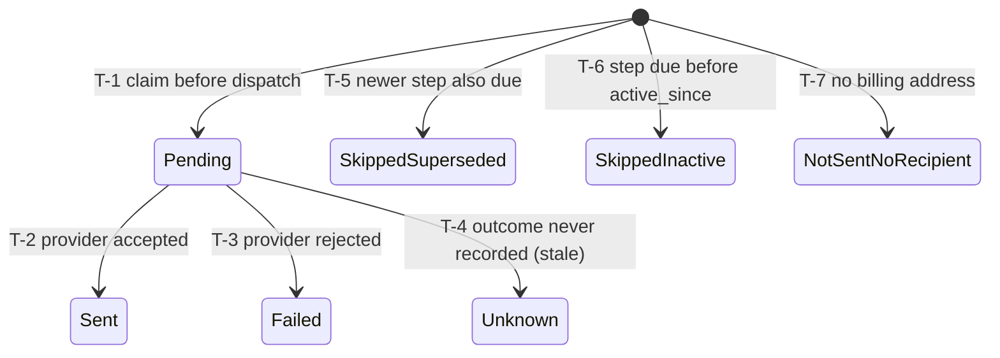

# Invoicing: unpaid-invoice payment reminders — product specification

Living spec. Requirement IDs are `R-<n>`; product decisions are `D-<n>`; open gaps are `G-<n>`; structure and technology choices are `AD-<n>` in `architecture.md`, never here.

## Request and baseline

- **Request (2026-11-21):** "Set up automatic reminders for unpaid invoices."
- **Baseline:** none. No repository, discovery result, research result, earlier spec or selected baseline exists for this run. Everything below is *proposed behaviour derived from the request*; nothing describes an existing system. Which invoicing system holds the invoices, whether it already sends any reminder, and how it records payments are **unknown** (open prerequisite P-1).
- **Request outcomes** (each mapped to acceptance lines):

| Outcome | Words in the request | Covered by |
| --- | --- | --- |
| O-1 | "Set up" — an authorised person can configure reminders | R-1, R-9 |
| O-2 | "automatic" — reminders go out without a person triggering each one | R-3, R-8 |
| O-3 | "reminders" — a message reminding the customer of the invoice | R-3, R-5, R-6, R-7 |
| O-4 | "unpaid invoices" — only invoices still unpaid, and not after payment | R-2, R-4 |

- **Observation / inference / unknown** — Observation: the request is one sentence naming no channel, schedule, recipient, platform or limit. Inference: a reminder for an unpaid invoice is, conventionally, a message to the customer who owes it, sent relative to the due date. Unknown: everything listed in `## Open gaps`. Inferences are marked `D-<n>` and carry a revalidation condition; none is presented as a user instruction.

## Product model (shared by the requirements)

**Entities.**
- *Reminder policy* — one per account (the business issuing invoices): `enabled`, ordered `schedule` of distinct integer day offsets from the invoice due date (negative = before due, 0 = on due date, positive = after), and per-offset `active_since` timestamp. Owner: the account. Durable.
- *Reminder record* — one per (invoice, offset). Holds `state`, `reason`, `recipient` (address actually used), `attempted_at`. Owner: the reminder system. Durable. Unique on (invoice, offset).
- *Invoice* — owned by the invoicing system (not changed by this feature). Read-only inputs used: invoice id, number, due date, outstanding balance and currency, status, billing contact address.

**Due instant** (D-2): a step's due instant is 00:00 on calendar date (invoice due date + offset) in the policy time zone (D-3). Time of day of the actual send is the first scheduler run at or after the due instant.

**Reminder record states** (terminal unless noted; ledger below):

**Flows.**
- F-1 *Configure*: authorised actor → configuration surface → policy stored → read back (R-1, R-9).
- F-2 *Scheduled run*: scheduler → for each invoice with an enabled policy: eligibility (R-2) → due steps (R-3) → unpaid re-check immediately before claiming (R-4) → claim (R-8) → dispatch (R-5) → record outcome (R-6, R-7). Sync boundary: dispatch call to the mail transport; completion of delivery to the mailbox is *not* observed (accepted-by-provider is the recorded success; D-6).

**Transition ledger.**

| T | Origin | Before | Trigger / guard | Operation | After / observation | Failure & recovery |
| --- | --- | --- | --- | --- | --- | --- |
| T-1 | R-3, R-8, F-2 | no record for (invoice, offset) | run; invoice eligible; step due; chosen by catch-up rule; unpaid re-check passes | atomically insert record `Pending` (unique key); then dispatch | Pending | insert conflict → another run owns it; this run does nothing (no-op, no email) |
| T-2 | R-5, R-6 | Pending | provider accepts message | set `Sent`, `attempted_at` | Sent, visible in history | crash before set → T-4 |
| T-3 | R-6 | Pending | provider rejects synchronously | set `Failed` + reason | Failed, no automatic retry (G-3 interim) | operator reads history; next offset unaffected |
| T-4 | R-6, R-8 | Pending, no outcome recorded | record is stale (threshold open, G-10) | mark `Unknown`; never resent automatically | Unknown, visible | operator decides; no auto-resend (at-most-once bias, D-7) |
| T-5 | R-3 | no record; ≥2 steps due | catch-up rule | record all but the latest-offset due step as `SkippedSuperseded` | records only | none |
| T-6 | R-9 | no record | step due instant < `active_since` | record `SkippedInactive` | records only | none |
| T-7 | R-5 | no record | invoice has no billing address | record `NotSentNoRecipient` | visible in history; no email | fixed by adding an address; the step is **not** retried (its date has passed; the next offset still runs) |

Invalid/forbidden events: any attempt to change a terminal record, or to create a second record for the same (invoice, offset), is rejected or no-ops with no email and no change (R-8).

## Requirements

### R-1 Configure reminder policy

**Basis:** request 2026-11-21, "Set up … reminders". Day-offset schedule and per-account scope are D-1 (inference, reversible). **Preserved:** none (no baseline). **Changed:** adds the feature. **Source locators:** request sentence; behaviour model `behavioral-requirements.md#behavior-model`. **Evidence limits:** no existing configuration surface was inspected; its form (screen, API, file) is undecided. **Pending:** implementation, checks.

Behaviour: an authorised actor can enable or disable reminders and set the schedule: a non-empty list of distinct integer day offsets from the due date. Settings are persisted and read back exactly as saved. Until a schedule is saved, **no reminder is ever sent** (no built-in schedule; see G-2 on why no default is invented).

Boundaries / errors: empty schedule while enabled → rejected, previous policy unchanged. Duplicate offsets, non-integers → rejected, unchanged. An offset such that due date + offset is not a representable calendar date → rejected (this runtime-derived limit is the only offset bound; no numeric range is invented). Actor not authorised (G-1) → rejected, unchanged. A schedule-length maximum is open (G-2); until decided none is enforced beyond distinctness, so a schedule is finite and bounded by what the authorised actor entered.

Acceptance lines:
- **AC-1.1 Positive.** Surface: configuration surface (S-Config) then read-back. Given no policy, an authorised actor saves `enabled=true, schedule=[+3, +10]`; read-back shows exactly `[+3, +10]`, enabled. Confirm: S-Config read-back and a scheduler run showing reminders follow it (AC-3.1).
- **AC-1.2 Failure.** Saving `enabled=true, schedule=[]`, `[+3, +3]`, `[+2.5]` or `[+99999999]` (date not representable) each returns an error naming the field and leaves the stored policy `[+3, +10]` unchanged. Confirm: S-Config error text and read-back.
- **AC-1.3 Failure (authority).** An actor without configure authority saving any policy is rejected; read-back unchanged. Authority definition is G-1; the check uses whichever non-authorised actor the invoicing system has, and is `NOT-REPLAYED` until G-1/P-1 resolve.
- **AC-1.4 Boundary.** `schedule=[0]` (single step on the due date) and `schedule=[-5, 0, +30]` (negative, zero, positive) are accepted and read back. Beyond-bound behaviour for list length: n/a until G-2 gives a bound; distinctness is the only limit.
- **AC-1.5 Boundary (nothing configured).** With no policy saved, a scheduler run on any date sends zero messages and creates zero records. Surface: S-Mail + S-History.

Out of scope for R-1 (left out by the request): per-customer or per-invoice schedules, message templates/branding, multiple channels.
State and data: *Reminder policy* (account-owned, durable); before: none or prior policy; after: exactly the saved policy; failed save leaves the prior policy intact; check: read-back. Concurrent saves: last write wins on the whole policy, never a merge of two (D-8). Open: G-1, G-2.

### R-2 Eligibility: only unpaid invoices

**Basis:** request, "unpaid invoices". Treatment of partial payment, drafts and voids is D-4 (inference), open as G-4. **Source locators:** request; no system source. **Evidence limits:** invoice status vocabulary unknown (P-1). **Pending:** implementation, checks.

Behaviour: an invoice is eligible when it has been issued to the customer (not a draft), is not voided/cancelled/written-off, and has an outstanding balance greater than zero. Drafts, voided and fully paid invoices never receive a reminder. A partially paid invoice counts as unpaid and its reminder states the *remaining* balance (D-4; G-4).

Acceptance lines:
- **AC-2.1 Positive.** INV-1001 (issued, due 2026-11-10, outstanding 500.00 USD) with policy `[+3]`, scheduler run at 2026-11-13T08:00Z → one reminder (R-3). Surface: S-Mail.
- **AC-2.2 Failure.** For each of INV-2001 (draft), INV-2002 (voided), INV-2003 (balance 0.00, paid in full), each due 2026-11-10, run at 2026-11-13T08:00Z → zero messages and zero records for all three. Surface: S-Mail, S-History.
- **AC-2.3 Boundary.** INV-1002 (total 500.00, paid 200.00, balance 300.00) → eligible; the message states 300.00 (D-4). INV-2004 with balance 0.01 → eligible; balance 0.00 → not. Confirm: S-Mail body.

Out of scope: disputes, payment plans, credit-note netting beyond the balance the invoicing system reports.
State and data: invoices are **observed only**; this feature never modifies an invoice. Unknown: how the invoicing system exposes balance and status (P-1).

### R-3 Automatic scheduled sending

**Basis:** request, "automatic reminders". Catch-up rule and day granularity are D-2 and D-5 (inferences needed for safe behaviour after downtime). **Source locators:** request; `service-discovery.md#asynchronous-cooperation` for ownership/recovery. **Evidence limits:** the scheduling facility and run cadence depend on the unknown platform (P-1, AD-1). **Pending:** implementation, checks.

Behaviour: the system itself finds due steps and sends; no person triggers each message. For each eligible invoice and each schedule offset whose due instant has arrived, exactly one reminder is sent per (invoice, offset) (R-8). **Catch-up rule (D-5):** if, at a run, several offsets of one invoice are due and have no record, only the offset with the **latest** due instant is sent; the others are recorded `SkippedSuperseded`. After the final offset there is no further reminder for that invoice, however long it stays unpaid.

Acceptance lines (fixture F-A: policy `[+3, +10]`, time zone UTC, `active_since` 2026-11-01T00:00Z for both offsets; INV-1001 due 2026-11-10, 500.00 USD, billing address ap@example.test):
- **AC-3.1 Positive.** Run at 2026-11-13T08:00Z → exactly one message (offset +3). Run at 2026-11-20T08:00Z → exactly one more (offset +10). Surface: S-Mail (captured outbox), S-History shows two `Sent` records.
- **AC-3.2 Boundary (before due).** Run at 2026-11-12T23:59:59Z → zero messages; run at 2026-11-13T00:00:00Z → one message (due instant is inclusive).
- **AC-3.3 Boundary (beyond last step).** Runs at 2026-11-27T08:00Z and 2027-03-01T08:00Z with INV-1001 still unpaid after both reminders were sent → zero further messages; History still shows exactly two records.
- **AC-3.4 Failure/recovery (catch-up).** No run happens between 2026-11-10 and 2026-11-21T08:00Z. The run at 2026-11-21T08:00Z sends exactly **one** message (offset +10) and records offset +3 as `SkippedSuperseded`; total 2 records, 1 message.
- **AC-3.5 Positive (distinct invoices).** INV-1001 and INV-1005 (due 2026-11-10, balance 120.00, billing address bob@example.test) both unpaid at the 2026-11-13T08:00Z run → one message to each address, none to the other's address.
- **AC-3.6 Boundary (cadence, D-2).** Scheduler runs at least once per calendar day in the policy time zone (default, see NFR-1); verified by test clock, not wall-clock waiting.

Out of scope: reminders to anyone but the invoice's billing contact; escalation sequences, late fees, calls, SMS; sending time-of-day preferences; per-run send-rate caps beyond what NFR-2 later resolves.
State and data: writes *Reminder records* only; before: no record for (invoice, offset); after: exactly one record per processed offset; recovery: R-8 and T-4.

### R-4 Payment stops reminders

**Basis:** request, "unpaid" — a reminder for an already-paid invoice would contradict the request. **Source locators:** request. **Evidence limits:** how payment is recorded and its latency is unknown (P-1). **Pending:** implementation, checks.

Behaviour: the invoice's unpaid status is evaluated **immediately before each dispatch**, not only when the run starts. An invoice paid (balance 0), voided, or credited before dispatch receives no reminder, and its remaining steps are never sent while it stays ineligible. A payment that lands after the final check but before delivery cannot be recalled: at most that one already-dispatched reminder is sent (accepted limitation; no retraction). If a paid invoice is later re-opened (balance > 0 again), later steps that are due and have no record follow R-3 (catch-up applies).

Acceptance lines:
- **AC-4.1 Positive.** INV-1001 balance set to 0.00 on 2026-11-12; runs at 2026-11-13T08:00Z and 2026-11-20T08:00Z → zero messages, zero records.
- **AC-4.2 Boundary (race).** Payment recorded at 08:00:00Z, run's eligibility re-check at 08:00:01Z → zero messages. Payment recorded after the re-check but before dispatch completes → one message may go out and a `Sent` record exists; no second message follows (AC-4.1 applies to later steps). Surface: S-Mail, S-History; a deterministic test injects the payment between re-check and dispatch.
- **AC-4.3 Failure.** If the unpaid re-check itself cannot be performed (invoice data unreadable), no message is sent for that step in that run, no record is claimed for it, and it is retried on the next run (D-9). Confirm: S-History shows no record; next run sends if still due and unpaid.
- **AC-4.4 Boundary (re-open).** INV-1001 paid 2026-11-12, re-opened with balance 500.00 on 2026-11-21 → run at 2026-11-21T08:00Z sends one message (offset +10) and records +3 `SkippedSuperseded`.

State and data: reads invoice status; writes no invoice data.

### R-5 Reminder content and recipient

**Basis:** request, "reminders"; channel and content fields are D-6 (inference). **Evidence limits:** no existing invoice email or template was seen. **Pending:** implementation, checks.

Behaviour: one message per reminder, by email (D-6; G-6) to the invoice's billing contact address. It states the invoice number, the outstanding balance with currency, the due date, and whether it is before due, on the due date, or *N* days overdue. It contains only that invoice's data; one customer never sees another customer's data. How to pay (link or instructions) is included if and only if the invoicing system already has one for that invoice (G-6); otherwise the message says to contact the issuer. A plain-text part is always present.

Acceptance lines (fixture F-A):
- **AC-5.1 Positive.** The AC-3.1 offset +3 message to ap@example.test contains `INV-1001`, `500.00 USD`, `2026-11-10`, and the text "3 days overdue"; the offset +10 message says "10 days overdue". Surface: S-Mail captured message.
- **AC-5.2 Boundary.** A policy offset `-2` (before due) on a run at 2026-11-08T00:00Z yields a message stating the due date and "due in 2 days"; offset `0` says "due today".
- **AC-5.3 Failure (no recipient).** INV-2006 with no billing address → no message; record `NotSentNoRecipient`; History shows the reason; the next offset is still processed independently on its own date.
- **AC-5.4 Boundary (isolation).** In AC-3.5 neither captured message contains the other invoice's number, amount or address.

Out of scope: customer-editable templates, translations/locales, attachments, multiple recipients, open/click tracking.
State and data (personal data): the recipient address is read from the invoice and copied into the *Reminder record* (so history shows who was reminded even if the contact later changes); it appears in the message and the record only, and never in application logs (logs carry invoice id and record id). It is removed with the record (R-7 retention).

### R-6 Delivery failure handling

**Basis:** consequential alternative state of "automatic reminders" (transport can fail); chosen interim behaviour is D-7. **Evidence limits:** transport and its error semantics unknown (AD-1). **Pending:** value open (G-3), implementation, checks.

Behaviour: a synchronous rejection by the mail transport sets the record `Failed` with a reason and the failure is visible in history (R-7). **Automatic retry count and backoff are open (G-3); interim: zero automatic retries** — one dispatch attempt per (invoice, offset), the next offset is unaffected. At the interim bound (1 attempt), behaviour beyond it: no second attempt ever occurs for that offset. A record left `Pending` with no outcome beyond the stale threshold (G-10) becomes `Unknown` and is never resent automatically (D-7).

Acceptance lines:
- **AC-6.1 Failure.** Transport double rejects INV-1003's send at 2026-11-13T08:00Z → record `Failed` with the rejection reason; a repeat run at 2026-11-13T09:00Z sends nothing for that offset (still one attempt); the run at 2026-11-20T08:00Z attempts offset +10 normally. Surface: transport double call count, S-History.
- **AC-6.2 Failure (crash).** Process stopped after the `Pending` claim and before the outcome is recorded; restarted run → record stays `Pending`/becomes `Unknown` (per G-10), message count for that offset is at most 1, never 2. `NOT-REPLAYED` until G-10 gives the threshold.
- **AC-6.3 Boundary (retry bound).** n/a until G-3 is decided: the only bound today is 1 attempt, covered by AC-6.1.

### R-7 Reminder history visible to the owner

**Basis:** request outcome "reminders" needs an observable result; visibility is D-10 (inference needed so failures and unknowns are not silent). **Evidence limits:** no existing UI/API inspected. **Pending:** implementation, checks.

Behaviour: an authorised actor (G-1) can see, per invoice, every reminder record: offset, state, reason, recipient, attempted time. History is read-only. Customers (invoice recipients) have no access to it. Records are kept as long as the invoice's records exist and are deleted with the invoice (D-11; retention period itself open, G-8).

Acceptance lines:
- **AC-7.1 Positive.** After AC-3.1, History for INV-1001 lists two records: `+3 Sent ap@example.test`, `+10 Sent ap@example.test`, each with a timestamp.
- **AC-7.2 Failure.** An unauthorised actor requesting History is refused; no records returned. `NOT-REPLAYED` until G-1/P-1.
- **AC-7.3 Boundary.** An invoice with no records shows an explicit empty state ("no reminders sent"), not an error; deleting the invoice removes its records (read-back returns none).

### R-8 No duplicate reminders

**Basis:** "reminders" sent repeatedly would be incorrect behaviour for a periodic automatic process; derived requirement, D-7. **Source locators:** `service-discovery.md#asynchronous-cooperation` (idempotency, no exactly-once promise). **Evidence limits:** the store's transaction/uniqueness facility is unknown (AD-1). **Pending:** implementation, checks.

Behaviour: at most one message is dispatched per (invoice, offset), across repeated runs, overlapping runs, restarts and retries of the same run. The record is claimed (unique on invoice+offset) before dispatch; the process that fails to claim does nothing. The system favours *at most once* over *at least once*; exactly-once is not promised (a crash after dispatch and before recording yields `Unknown`, not a resend).

Acceptance lines:
- **AC-8.1 Positive.** Run twice at 2026-11-13T08:00Z and 08:05Z with fixture F-A → one message total.
- **AC-8.2 Boundary (concurrency).** Two runs started simultaneously for the same invoice → exactly one message and one record. Surface: S-Mail count, S-History count. Test: two scheduler invocations released by a barrier against a shared store.
- **AC-8.3 Failure.** A claim conflict (record already exists in any state, including `Failed`, `Unknown`, skipped) → no message and no change to that record.

### R-9 Policy changes, enabling and disabling

**Basis:** consequential alternative state of "Set up": enabling on a system with overdue invoices must not blast customers (D-12, inference, reversible). **Evidence limits:** none from a system. **Pending:** implementation, checks.

Behaviour: each offset has an `active_since` timestamp = when it was added to an enabled policy; enabling a disabled policy sets it for all offsets to the enabling time. A step whose due instant is earlier than `active_since` is never sent (recorded `SkippedInactive`); equal is sent. Disabling stops all future sends immediately; existing records are untouched. Removing an offset prevents its future sends; adding an offset follows `active_since`. An offset that already has a record is never resent even if removed and re-added.

Acceptance lines (INV-1001 due 2026-11-10, unpaid):
- **AC-9.1 Positive.** Policy `[+3, +10]` enabled at 2026-11-15T00:00Z. Run 2026-11-15T08:00Z → zero messages, offset +3 recorded `SkippedInactive` (due 2026-11-13 < active_since); run 2026-11-20T08:00Z → one message (offset +10, due 2026-11-20T00:00Z ≥ active_since).
- **AC-9.2 Boundary.** Policy enabled exactly at 2026-11-13T00:00:00Z → run 2026-11-13T08:00Z sends offset +3 (due instant equals `active_since`).
- **AC-9.3 Positive (disable).** Disable at 2026-11-14; run 2026-11-20T08:00Z → zero messages; the earlier `Sent` +3 record is unchanged.
- **AC-9.4 Boundary (re-add).** After +3 is `Sent`, remove then re-add +3 → no second message for +3.
- **AC-9.5 Failure.** Saving a change that fails validation (AC-1.2) neither alters `active_since` nor any record.

## Non-functional requirements

- **NFR-1 Timeliness (R-3), default.** Each due step is dispatched by the first scheduler run at or after its due instant; the scheduler runs at least once per calendar day in the policy time zone. *Basis:* day-granularity offsets (D-2) make a ≤24 h cadence the minimum that keeps "sent on the due date" true; a stricter latency target is **not** set and none is invented. Hard platform limits unknown (P-1). Verification: test clock (AC-3.2, AC-3.4, AC-3.6).
- **NFR-2 Capacity/throughput — unresolved.** Missing: invoice volume per account and the mail provider's send quotas. Interim behaviour: a run that cannot dispatch every due step (quota or time limit) leaves the unprocessed steps unclaimed, so the next run's catch-up rule (D-5) sends the latest due step per invoice; it never sends duplicates. Needs: expected volume, provider quota (G-7).
- **NFR-3 Reliability.** Run restart and overlap safety are covered by R-8; a failed run does not corrupt records (T-1…T-7 are individually atomic on the claim). Verification: AC-8.x, AC-6.2.
- **NFR-4 Privacy and security.** Personal data: customer billing address and invoice amounts. Shown: only in that customer's own message and to authorised owners (R-7). Stored: Reminder record (address snapshot). Logged: never addresses or message bodies. Kept: with the invoice's records, removed with them (G-8 for the period). Mail-transport credentials are held in the platform's secret facility, never in the spec, records or logs (AD-1). Verification: log capture assertion in AC-3.1 run contains invoice id and no address; read access checks AC-1.3/AC-7.2.
- **NFR-5 Observability.** Each outcome is an owned record (R-7). Each scheduler run records start, end, number of steps sent/skipped/failed so a run that did not complete is detectable; acceptance: after AC-3.1 run, the run summary shows `sent=1`. Alerting on failures beyond History is out of scope (G-11).
- **NFR-6 Testability.** Time (current time/time zone) and the mail transport can be replaced in tests by a controlled clock and a capturing outbox, so every time-dependent acceptance line is replayable without real waiting or real delivery. Verification: used by all AC lines with dates.
- **NFR-7 Compatibility/runtime — unresolved.** Language, platform and invoicing-system integration are unknown (P-1, AD-1); no runtime limits recorded.
- **NFR-8 Accessibility and interface quality.**
  - *Reminder email* (static rendered document; keeps its own medium's conventions): plain-text alternative always present; content readable at 320 px width without horizontal scroll; body text contrast ≥ WCAG AA 4.5:1 against its background in light and dark mail clients; no information conveyed by colour alone; no motion. Verification: render the captured message at 320 px and 800 px, plus a contrast check.
  - *Configuration and history surface* — **applies only if a graphical UI is built (open, P-1).** If the invoicing product already has a UI, the new screens inherit its established identity, tokens and platform conventions (they take precedence). If a new graphical UI is created with no such identity, it is a deliberately designed interface, not scaffolding: light-first with a dark option (named visual reference: the "light expressive" starting point of `platforms/ui.md#light-expressive-starting-point` — Material 3 Expressive principles, tonal rounded surfaces, one restrained accent; concrete choices are an AD in the plan); a consistent spacing and type scale and palette in light and dark; designed empty (AC-7.3), loading and error states (AC-1.2 messages, failed-load state); no horizontal overflow at 360 px and 1280 px widths; visible keyboard focus and WCAG AA contrast; motion only to explain a change and disabled under `prefers-reduced-motion`; one icon set; truthful async feedback (a "Saved" state is shown only after read-back succeeds). Verification: browser checks at both widths, keyboard-only pass, contrast check, reduced-motion check.
- **NFR-9 Exclusions.** No availability SLA, latency percentile, or load target is set: the request gives none and the feature is a once-a-day background process; revisit if volume (G-7) shows otherwise.

## Open gaps

- **P-1 (prerequisite, blocks integration work).** The invoicing system, platform and how invoices, balances, payments and billing contacts are read are unknown; no discovery exists. Smallest confirming observation: inspect the invoicing system's data model and any existing reminder/email feature. Interim: all behaviour above is stated against the abstract inputs listed in *Product model*. Affects R-2, R-4, R-5, NFR-7, NFR-8. Work not touching integration (policy model, catch-up and idempotency logic) may proceed.
- **G-1 (R-1, R-7).** Who may configure/see reminders. Interim: the account owner/admin role only. Needs a product decision once the system's roles are known.
- **G-2 (R-1).** Maximum number of schedule entries. No basis for a number; interim: none enforced; the finite, human-entered, distinct-offset list (at most one reminder per invoice per day) is the cap. A hard maximum should be added if the owner states one.
- **G-3 (R-6).** Automatic retry count/backoff. No evidence for a value; interim 0 retries (one attempt). Revalidate when the transport's failure semantics are known.
- **G-4 (R-2).** Whether partially paid invoices are "unpaid". Interim: yes, remaining balance.
- **G-5 (R-3, NFR-1).** Policy time zone. Interim: UTC unless the account already has a business time zone (then that one).
- **G-6 (R-5).** Channel and payment link. Interim: email to the invoice's billing contact; link only if one already exists.
- **G-7 (NFR-2).** Volume and provider quota.
- **G-8 (R-7, NFR-4).** Retention period for records beyond "deleted with the invoice".
- **G-9 (R-5, NFR-4).** Legal/compliance rules for payment-reminder emails (unsubscribe, consent, regional rules) — not assessed here; needs the owner's decision. Does not block building to this spec; blocks production enablement.
- **G-10 (R-6, R-8).** Time after which a `Pending` record counts as stale. Interim: never auto-resend; `Unknown` is set by an operator-visible reconciliation once the threshold exists.
- **G-11 (NFR-5).** Whether failures should actively notify the owner. Interim: History only.

## Decisions (product, not structure)

| ID | Decision | Basis | Alternatives | Revalidate when |
| --- | --- | --- | --- | --- |
| D-1 | One policy per account; schedule is day offsets from due date | conventional reminder shape; request names no schedule | per-customer, per-invoice, absolute dates | owner states a different model |
| D-2 | Day granularity, due instant 00:00 policy-zone; send on first run ≥ it | simplest rule that matches whole-day offsets | hour offsets | request needs sub-day timing |
| D-3 | Time zone per G-5 | needed to define a calendar day | server local | G-5 resolved |
| D-4 | Balance > 0 means unpaid | request word "unpaid" | exclude partials | G-4 resolved |
| D-5 | Catch-up sends only the latest due step | avoids a burst of messages after downtime | send all missed; send none | owner states otherwise |
| D-6 | Email to billing contact; success = provider acceptance | invoices are conventionally emailed; unverified | in-app, SMS | G-6/P-1 |
| D-7 | At-most-once bias; no auto-retry; no auto-resend of unknown | avoids customer spam; reversible by config later | at-least-once with dedupe | G-3/G-10 |
| D-8 | Whole-policy last-write-wins | simplest consistent resolution | versioned optimistic locking | multi-admin use is observed |
| D-9 | Unreadable invoice state → skip this run, try next run | never remind on unverified status | send anyway | — |
| D-10 | History visible to authorised owner | failures must not be silent | no UI | — |
| D-11 | Records deleted with the invoice | no independent retention need stated | fixed retention | G-8 |
| D-12 | `active_since` prevents backfill blast on enabling/adding steps | enabling must not mail all overdue customers at once | send all overdue | owner wants backfill |

## Verification surfaces

- **S-Mail:** captured outgoing messages (test outbox / transport double); real delivery is not proven by it (a real-boundary check for the actual provider is an AD-1 follow-up).
- **S-Config:** the policy configuration surface (screen, API or file — undecided) with read-back.
- **S-History:** the reminder-record view/API of R-7.
- **S-Clock:** the controlled clock and scheduler trigger of NFR-6.

## Hand-walk of replayable examples (duty 10)

Method: each step walked by hand from the stated start against the spec's own rules (no implementation exists, no helper or product exists to run). Start reachable: an authorised actor creates policy F-A (R-1 AC-1.1) under interim G-1; invoices exist in the invoicing system (P-1, assumed). Results recomputed:
- Due instants F-A for INV-1001 (due 2026-11-10): +3 → 2026-11-13T00:00Z; +10 → 2026-11-20T00:00Z. AC-3.1: 11-13 run → +3 due, one message; 11-20 run → +10 due and +3 has a record → one message. ✔
- AC-3.4: run 2026-11-21: due without records = {+3, +10}; latest = +10 sent, +3 `SkippedSuperseded`. ✔ (1 message, 2 records).
- AC-9.1: active_since 2026-11-15T00:00Z; +3 due instant 11-13 < active_since → `SkippedInactive`; +10 due 11-20 ≥ active_since → sent on 11-20. ✔ AC-9.2: equal → sent. ✔
- AC-5.2: offset −2 on due 2026-11-10 → due instant 2026-11-08T00:00Z; run at that instant sends "due in 2 days". ✔
- AC-4.4: re-open on 11-21 with +3, +10 both unrecorded and due → same as AC-3.4. ✔
- AC-3.5 needs INV-1005 (fixture: due 2026-11-10, 120.00, bob@example.test). ✔
- `NOT-REPLAYED`: AC-1.3, AC-6.2, AC-7.2 (need G-1/G-10/P-1); every AC is also `NOT-REPLAYED` against a running product (nothing exists). No command was documented or run; no exit code to report.

## Retired

None. No earlier spec or requirement exists to retire.

## Submission

**summary:** Spec for automatic unpaid-invoice reminders written from a one-sentence request with no repository, baseline, discovery or research (nothing inspected). Nine requirements R-1…R-9 and nine NFR items; 12 product decisions D-1…D-12, 11 open gaps G-1…G-11 and one open prerequisite P-1. The spec is not ready for integration work (P-1 unresolved); policy, schedule, catch-up and idempotency logic can be planned and built now. No material requirement conflict found.

Assumptions (default values the request leaves open, each with basis, alternatives and revalidation condition):
- **R-1 / G-2 schedule length:** no maximum enforced. Basis: no evidence for a number; at most one reminder per invoice per day (distinct whole-day offsets), list authored by an authorised actor. Alternative: a hard cap. Revalidate: owner states a cap or volume complaints appear.
- **R-1 / R-3 nothing sent until a schedule is saved:** no built-in default schedule (a default value had no evidence basis). Alternative: ship a conventional default. Revalidate: owner supplies one.
- **R-6 / G-3 automatic retries = 0 (one attempt):** chosen default; basis: safest against duplicate customer mail, reversible by configuration, no transport knowledge. Alternatives: N retries with backoff. Revalidate: transport failure semantics known (P-1/AD-1).
- **R-3 day granularity and ≥1 scheduler run per calendar day (NFR-1):** default; basis: whole-day offsets. Alternative: hourly. Revalidate: platform scheduling limits and any sub-day need.
- **R-3 catch-up sends only the latest due step (D-5):** basis: avoid bursts after downtime. Alternative: send all, send none. Revalidate: owner preference.
- **R-9 `active_since` anti-backfill (D-12):** basis: enabling must not mass-mail overdue customers. Alternative: backfill. Revalidate: owner wants backfill.
- **R-2 partial payment counts as unpaid (D-4), R-5 email to billing contact (D-6), G-5 UTC time zone, R-8/R-6 unknown-outcome never resent (D-7, G-10), R-7 records deleted with the invoice (D-11):** defaults as stated in the decision table with their revalidation conditions.

**primary:** R-1, R-2, R-3, R-4 (R-5 carries the reminder content that makes R-3 observable; R-6…R-9 are derived safety and recovery behaviour).

**evidence_refs:** KNOWLEDGE/spec.md (this file: `## Requirements` R-1…R-9, `## Non-functional requirements`, `## Open gaps`, hand-walk); KNOWLEDGE/architecture.md; the request text (2026-11-21); GUIDES/behavioral-requirements.md#behavior-model and #traceability-and-review; GUIDES/requirements-definition.md (state/data and non-functional sections); GUIDES/service-discovery.md#asynchronous-cooperation and #runtime-state-placement; GUIDES/platforms/ui.md#light-expressive-starting-point; GUIDES/current-system-baseline.md#planning-and-review-handoff (no baseline exists). No backchain receipt (duty 11 does not apply here).
