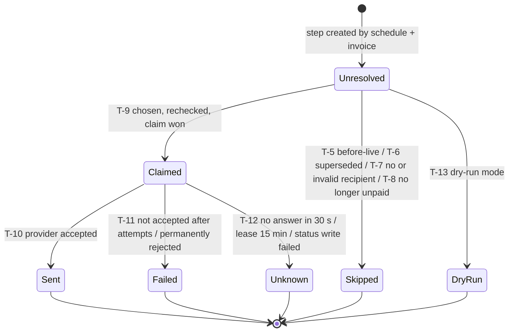

# Invoice Reminders — Living Product Specification

Status: **proposed, pending implementation and verification.** Nothing in this document has been implemented or run.
IDs: `R-<n>` requirements, `AC-<n>.<k>` acceptance lines, `D-<n>` product decisions (defaults chosen here, not user
instructions), `OG-<n>` open gaps, `F-`/`T-` flows and transitions. Structure and technology choices are `AD-<n>`
in `KNOWLEDGE/architecture.md`, never here.

## Request, basis and baseline

- **Request (2026-11-21, verbatim):** "Set up automatic reminders for unpaid invoices."
- **Request outcomes** (each is mapped to acceptance lines in *Traceability*):
  - O-1 *automatic*: reminders go out with no person triggering each one.
  - O-2 *reminders*: the customer owing the invoice is reminded of it.
  - O-3 *unpaid invoices*: only invoices that are still unpaid are reminded about, and reminders stop once paid.
  - O-4 *set up*: an operator can configure the reminders and turn them on.
- **Baseline:** no repository, discovery result, research result, earlier spec or selected baseline exists for this
  run. The starting point is therefore recorded as *genuinely new as far as the evidence shows*, not as proof that no
  invoicing system exists. Whether a host invoicing system exists is **OG-2**. No `R-` ID existed before; nothing is
  retired.
- **Evidence limits:** the request is one sentence. Every rule below that the sentence does not state is a labelled
  product decision (`D-n`) taken as a reversible default, with its basis and revalidation condition in *Submission →
  summary*. Nothing was observed in a running system; all expected results are hand-derived (see *Evidence and replay*).

## Product decisions (defaults the request leaves open)

These are design decisions with rationale, not user requirements. A later run must not promote them to binding
conditions without a user source.

| ID | Decision (default) | Why |
| --- | --- | --- |
| D-1 | One business account; the people who use the reminder screens are that business's authenticated operators; customers never sign in. | Request names no multi-tenant or customer-portal need. |
| D-2 | Channel is email only; one recipient per invoice: the invoice's billing contact address. No cc/bcc. | "Reminders" with no channel stated; email is the minimal channel for an invoice. |
| D-3 | Default schedule = reminder offsets (days relative to the due date) **-3, 0, 7, 14**; send time **09:00**; account time zone **UTC** until set. | A finite, conventional cadence; finite list bounds the volume of mail per invoice. |
| D-4 | Settings bounds: 1 to 10 offsets, each an integer from **-30** to **365**, no duplicates; send time `HH:MM` 00:00-23:59; time zone is a valid IANA name. | Needed so a typo cannot create unbounded or nonsensical mail; values are defaults. |
| D-5 | Catch-up: at an evaluation, per invoice, only the **latest** due unsent step is sent; earlier due steps are marked superseded; a step older than an already-sent step is never sent (no out-of-order reminders). | Avoids a burst of stale reminders after downtime, a late import, or a schedule edit. |
| D-6 | Activation boundary: when reminders become *enabled and live*, `live_since` = that account-local date; steps dated before it are skipped, never sent. | Switching on must not mail customers about the whole historical backlog. |
| D-7 | Delivery: at most 3 attempts per step within one evaluation, waits of 60 s then 300 s between them, retrying only definitive not-accepted answers; provider call limit 30 s; a call with no answer in 30 s is `unknown` and is **never** retried; an abandoned `claimed` row becomes `unknown` after 15 min. | At-most-once beats duplicate dunning mail; failures stay visible. |
| D-8 | Delivery mode is `dry-run` (compute and record, send nothing) until a sender identity is verified; only then can the operator choose `live`. Fresh default: enabled, `dry-run`. | Safe default while the sender prerequisite (OG-1) is a person-only step. |
| D-9 | Message is fixed-template plain text; template customization, HTML and attachments are out. | Not requested; minimal and accessible. |
| D-10 | No per-invoice or per-customer pause, no public unsubscribe link; the only stop controls are the global `enabled` switch, `dry-run` mode, and the invoice leaving the unpaid state. | Not requested; listed under R-4 as left out, with its revalidation trigger. |
| D-11 | Reminder history lives and ends with its invoice record; run records are kept without expiry. | No retention period is stated; tying history to the invoice avoids orphaned personal data. |
| D-12 | The operator screens show a warning when a scheduled evaluation is more than 60 minutes overdue. | An automatic feature must not fail silently. |
| D-13 | The consumer surface for set-up and inspection is an in-product operator screen pair (Reminder settings, per-invoice Reminder history). | "Set up" implies a human-facing configuration step. |

## Domain contract the reminders depend on (read-only input)

The reminders read invoices from the invoicing system of record; they never create or edit invoices. The fields
needed per invoice: `number` (text), `status` (`draft` | `issued` | `paid` | `void`), `outstanding_balance`
(decimal, in `currency`), `currency` (ISO 4217), `due_date` (calendar date, no time), `customer_name`,
`billing_email` (may be empty), optional `payment_link`. Mapping this contract to the host's real data is **OG-2**.

Terms: a **step** is one configured offset applied to one invoice; its **step date** is `due_date + offset` days. The
**local date** of an instant is its calendar date in the account time zone. An **evaluation** is one run of the
reminder logic as of an instant (`as-of`).

## Requirements

### R-1 Only unpaid invoices are eligible

- **Behaviour:** an invoice is eligible iff `status = issued` AND `outstanding_balance > 0`. Draft, paid, void,
  zero-balance and negative-balance (credit) invoices are never reminded. Eligibility is read from the invoice
  source at the start of each evaluation and again immediately before each send (R-4).
- **Boundaries:** balance `0.01` eligible; `0.00` and `-5.00` not.
- **Error behaviour:** an `issued` invoice with a missing/unreadable due date or balance is not eligible; it is
  counted as `invalid-invoice` in the run record and never mailed.
- **Consumer outcome:** only customers who still owe money receive a message.
- **Left out (bounded by this R):** partial-payment policies beyond "reminder shows the remaining balance";
  disputed or on-hold statuses; currency conversion; reminders for draft or not-yet-issued invoices; per-customer
  consolidation of several invoices into one message.
- **Basis:** request 2026-11-21 "unpaid invoices"; D-1, OG-2. **Preserved:** none (new). **Changed:** adds.
  **Source locators:** request sentence; `behavioral-requirements.md#behavior-model`. **Evidence limit:** invoice data
  model assumed, not observed (OG-2). **Pending:** implementation, AC-1.1 to AC-1.4.
- **State/data:** reads Invoice (owner: invoicing system, read-only, current at evaluation time, not cached across
  evaluations). Before/after: invoices unchanged. Recovery: n/a (no write). Unknown: real field names (OG-2).
- **Open gap OG-2** applies (see *Open gaps*).
- **Acceptance lines**
  - AC-1.1 *positive.* With CFG-A (below) and an empty ledger, evaluation as-of `2026-12-10T09:00:00Z` over fixtures
    INV-1001..INV-1008 sends exactly three messages: INV-1001 → `ap@customer-a.example`, INV-1004 →
    `ap@customer-b.example`, INV-1005 → `ap@customer-c.example`. *Surface:* captured outbound messages (capturing sender
    standing in for the customer inbox). *Confirmed by:* automated system test comparing the captured list to exactly
    those three (recipient, invoice number); expected result hand-derived as TL-6.
  - AC-1.2 *failure/negative.* In the same evaluation INV-1002 (paid), INV-1003 (draft), INV-1007 (void) and INV-1008
    (issued, balance 0.00) produce no message and no ledger row. *Surface:* captured messages and ledger read-back.
    *Confirmed by:* same test, asserting zero messages and zero rows for those four numbers.
  - AC-1.3 *boundary.* INV-1005 (balance 0.01) is mailed (covered by AC-1.1); a fixture with balance `-5.00`, status
    `issued`, is not mailed. *Surface:* captured messages. *Confirmed by:* system test on a fixture set containing only
    that invoice: zero messages.
  - AC-1.4 *failure.* Fixture INV-1009 (`issued`, balance 10.00, no due date), alone in its fixture set: zero messages,
    zero ledger rows, run record shows `invalid-invoice = 1`. *Surface:* captured messages, run record (operator run
    card). *Confirmed by:* system test.

### R-2 Operator can set up the reminders

- **Behaviour:** an operator can view and save Reminder settings: `enabled`, delivery `mode` (`dry-run`|`live`),
  `offsets`, `send_time`, `time_zone`. Fresh defaults: enabled = true, mode = `dry-run`, offsets `[-3,0,7,14]`,
  send time `09:00`, time zone `UTC` (D-3, D-8). Settings apply to the next evaluation only; nothing is applied
  retroactively. Each save carries the settings revision it was based on. When settings become *enabled and live*
  (first go-live, or re-enable while live, or dry-run to live), `live_since` is set to the current account-local
  date (D-6).
- **Boundaries (defaults, D-4):** 1..10 offsets; each offset -30..365; send time 00:00..23:59.
- **Error behaviour:** an invalid save is rejected with a field-level message and the stored settings are
  unchanged. Choosing `live` while no sender identity is verified is rejected (OG-1). A save based on a stale
  revision is rejected as a conflict and the current values are shown. A request from anyone who is not an
  authenticated operator is denied and returns no settings.
- **Consumer outcome:** the operator sees the saved schedule on reload and the next evaluation obeys it.
- **Left out:** per-customer schedules, template editing, multiple channels, approvals before go-live.
- **Basis:** request "Set up"; D-1, D-3, D-4, D-6, D-8, D-13. **Preserved:** none. **Changed:** adds. **Source
  locators:** request; `behavioral-requirements.md#actors-channels-and-state-ownership`. **Evidence limit:** operator
  authentication is the host's (OG-2). **Pending:** implementation, AC-2.1 to AC-2.8.
- **State/data:** Settings (owner: reminders component; single record; durable; carries `revision`; read/written by
  operators only). Before/after invariant: settings are always a valid combination; `live_since` is never in the
  future of its setting time. Recovery: a rejected write changes nothing. Unknown: where operators authenticate (OG-2).
- **Acceptance lines**
  - AC-2.1 *positive.* On a fresh system the screen shows the defaults above. Saving offsets `[-7,-1,3]`, send time
    `08:30`, time zone `America/New_York` is confirmed on the screen, survives a full reload and a restart of the
    product, and a settings-change audit entry records operator, time, old and new values. *Surface:* settings screen
    and a read-back of stored settings. *Confirmed by:* browser test (save → reload) plus state read-back.
  - AC-2.2 *failure.* Each of these saves is rejected with a message naming the field, and a read-back shows the prior
    settings: offsets `[]`; offsets `[0,0]`; offsets `[7,"abc"]`; send time `25:00`; time zone `Mars/Base`. *Surface:*
    settings screen, stored-settings read-back. *Confirmed by:* browser test per input.
  - AC-2.3 *boundary.* Accepted: 10 offsets `[-30,-14,-7,-3,0,3,7,14,30,365]`; send times `00:00` and `23:59`.
    Rejected: 11 offsets; offset `-31`; offset `366`. *Surface:* settings screen. *Confirmed by:* browser test.
  - AC-2.4 *failure.* With no verified sender, choosing `live` is rejected with "Sender not verified", mode stays
    `dry-run`, and nothing else in the same save is applied (the save is all-or-nothing). *Surface:* settings screen,
    read-back. *Confirmed by:* browser test with the capturing sender's `verified=false`.
  - AC-2.5 *positive.* With a verified sender, on `2026-12-01` (UTC) choosing `live` succeeds and `live_since` reads
    `2026-12-01`. Disabling then re-enabling on `2026-12-20` sets `live_since = 2026-12-20`. *Surface:* settings screen
    ("Reminders go to customers from 2026-12-20" line), read-back. *Confirmed by:* system test with an injected
    clock.
  - AC-2.6 *failure/concurrency.* Operators A and B both open revision 4. A saves (revision 5). B then saves from
    revision 4: rejected as a conflict, B sees revision 5's values, A's values are not overwritten. *Surface:* settings
    screen. *Confirmed by:* two-session browser test.
  - AC-2.7 *failure/access.* A request with no session, and a request as a signed-in non-operator, to read or change
    settings or to open a reminder history is denied and returns no settings or customer data. *Surface:* the same
    screens and their backing calls. *Confirmed by:* automated access test.
  - AC-2.8 *positive.* With `enabled = false`, an evaluation as-of `2026-12-07T09:00:00Z` over INV-1001 sends nothing
    and writes no ledger row; switching mode back to `dry-run` stops all mail from the next evaluation with the
    ledger preserved (this is the rollback path). *Surface:* captured messages, ledger read-back. *Confirmed by:*
    system test.

### R-3 Reminders are evaluated and sent automatically on schedule

- **Behaviour:** once enabled, an evaluation runs once per local day at the configured send time, with no person and
  no screen involved. It is a deterministic function of settings, invoice states, ledger and the `as-of` instant.
  For each eligible invoice, steps are `due_date + offset`; an unresolved step is *due* when its step date ≤ the
  local date of `as-of`. Order of rules per invoice: (1) due steps dated before `live_since` → skipped
  `before-live`; (2) due steps dated on or before the latest already-sent step's date → skipped `superseded`;
  (3) of the remaining due steps only the latest is attempted, earlier ones → skipped `superseded` (D-5);
  (4) a missing or malformed billing address → skipped `no-recipient` / `invalid-recipient`. A step that has any
  ledger row is resolved and never reconsidered. Result: at most one message per invoice per evaluation and, since
  offsets are unique, at most one per invoice per local date.
- **Boundaries:** the local date uses the account time zone (an instant late in the evening UTC can be the previous
  or next local day). If the configured local send time does not exist on a day (DST gap) the evaluation runs at the
  first instant after the gap; if it occurs twice (DST overlap) it runs at the first occurrence only, once.
- **Error behaviour:** if the invoice source cannot be read, the evaluation fails closed: no message, no ledger
  row, run record `failed` with reason; the next evaluation recovers through the catch-up rule.
- **Consumer outcome:** customers receive reminders on the schedule without anyone clicking anything; downtime
  produces at most one catch-up reminder per invoice.
- **Left out:** weekend/holiday shifting, per-customer send windows, "send now" button, escalation to collections or
  late fees.
- **Basis:** request "automatic reminders"; D-3, D-5, D-6, D-12. **Preserved:** none. **Changed:** adds. **Source
  locators:** request; `service-discovery.md#asynchronous-cooperation` (scheduled work owned without a screen).
  **Evidence limit:** the scheduling mechanism of the host runtime is unknown (AD-1 proposed). **Pending:**
  implementation, AC-3.1 to AC-3.9.
- **State/data:** reads Settings, Invoices, Ledger; writes Ledger rows and a Run record. The trigger owner is the
  scheduler, which must keep operating when no operator session or screen exists. Before/after invariant: every
  ledger row refers to exactly one (invoice, offset). Recovery: re-running an evaluation is safe (R-7).
- **Acceptance lines** (fixtures CFG-A, INV-1001: step dates -3 → 2026-12-07, 0 → 2026-12-10, +7 → 2026-12-17,
  +14 → 2026-12-24)
  - AC-3.1 *positive.* INV-1001 alone, evaluations daily at 09:00Z: 2026-12-06 sends 0; 12-07 sends 1 (offset -3); 12-08
    and 12-09 send 0; 12-10 sends 1 (offset 0); invoice becomes paid on 12-12; 12-17 and 12-24 send 0. Total 2
    messages. *Surface:* captured messages. *Confirmed by:* system test with injected clock (expected = TL-1).
  - AC-3.2 *positive/catch-up.* INV-1001 alone: evaluation 12-07 sends offset -3; no evaluation runs 12-08 to 12-17;
    evaluation 2026-12-18T09:00Z sends exactly one message (offset 7, "8 days overdue"); offset 0 is recorded
    `skipped:superseded`. *Surface:* captured messages, ledger read-back. *Confirmed by:* system test (TL-2).
  - AC-3.3 *boundary.* INV-1004 (due 2026-11-20, steps 11-17, 11-20, 11-27, 12-04) with `live_since = 2026-12-01`:
    evaluation 12-01 sends nothing and records offsets -3, 0, 7 as `skipped:before-live`; evaluation 12-04 sends one
    message (offset 14, "14 days overdue"). *Surface:* captured messages, ledger. *Confirmed by:* system test (TL-3).
  - AC-3.4 *boundary/time zone.* With time zone `America/New_York`, INV-1001 alone and an empty ledger: evaluation
    as-of `2026-12-07T04:00:00Z` (= 12-06 23:00 local) sends 0; as-of `2026-12-08T03:00:00Z` (= 12-07 22:00 local)
    sends 1 (offset -3 is due on local date 12-07). *Surface:* captured messages. *Confirmed by:* system test.
  - AC-3.5 *boundary/DST.* Time zone `America/New_York`, send time `02:30`: the evaluation on local date 2027-03-14
    (02:30 does not exist) runs once at `2027-03-14T07:00:00Z` (03:00 EDT); on 2027-11-07 (01:30 occurs twice) it runs
    once at `2027-11-07T05:30:00Z` (first occurrence). *Surface:* the "Next run" instant on the settings screen and
    the scheduler's computed trigger. *Confirmed by:* unit test of next-run computation plus a screen check of the
    displayed "Next run" the evening before each date.
  - AC-3.6 *failure.* Invoice source unavailable at 2026-12-07T09:00Z: zero messages, zero ledger rows, run record
    `failed` (`invoice-source-unavailable`); once restored, evaluation 2026-12-08T09:00Z sends offset -3 (catch-up).
    *Surface:* captured messages, run card. *Confirmed by:* system test with a failing source fake.
  - AC-3.7 *positive/headless.* With no operator signed in and no screen open, and after a full restart of the
    product runtime between 2026-12-06 and 2026-12-07, the scheduled evaluation for 2026-12-07 09:00Z still happens
    and sends offset -3. *Surface:* captured messages. *Confirmed by:* restart test (clock-controlled where the
    runtime allows; otherwise `NOT-REPLAYED` until a target exists).
  - AC-3.8 *boundary/ordering.* Ledger holds offsets -3, 0, 7 as `sent` for INV-1001; the operator adds offset 3 (step
    date 12-13); evaluation 2026-12-18T09:00Z sends nothing and records offset 3 as `skipped:superseded`. *Surface:*
    captured messages, ledger. *Confirmed by:* system test (hand-derived).
  - AC-3.9 *boundary/scope.* An evaluation never sends more than one message for the same invoice in one local date.
    *Surface:* the capture log over the AC-3.1 and AC-3.2 runs. *Confirmed by:* assertion over every run in those tests.

### R-4 Reminders stop when the invoice is no longer unpaid

- **Behaviour:** immediately before a message is claimed for sending, the invoice is re-read from the source. If it
  is no longer eligible (R-1) nothing is sent and the step is recorded `skipped:no-longer-unpaid`. Invoices that are
  ineligible at the start of an evaluation are ignored (no rows). A later return to eligibility (for example a payment
  reversal) resumes normal rules: resolved steps are not replayed; the latest due unresolved step may fire.
  The message shows the *current* outstanding balance.
- **Boundaries:** a payment recorded after the re-read but before the provider accepts the message can still yield one
  message. This residual window is accepted; the message therefore says "If you have already paid, please disregard
  this message." (R-5).
- **Error behaviour:** if the re-read itself fails, the step is not sent and the evaluation records the failure for
  that invoice (counted in the run record as `reread-failed`); the step is **not** marked resolved, so the next
  evaluation tries again under the normal rules.
- **Consumer outcome:** a customer who has paid does not get dunning mail.
- **Left out:** disputes, payment plans, grace periods for payments in flight, notifying the customer of receipt.
- **Basis:** request "unpaid invoices" (reminders for unpaid invoices end when paid); D-10. **Preserved:** none.
  **Changed:** adds. **Source locators:** request; `service-discovery.md#cache-and-authorization` (current authority
  is read, not cached). **Evidence limit:** whether the source can report payment status in real time is unknown (OG-2).
  **Pending:** implementation, AC-4.1 to AC-4.5.
- **State/data:** reads Invoice; writes a Ledger row. Before/after: no message is sent for an invoice that the source
  reported ineligible at the re-read. Recovery: re-read failure leaves the step unresolved.
- **Acceptance lines**
  - AC-4.1 *positive.* INV-1001 becomes paid on 2026-12-12 (status `paid`, balance 0.00); evaluations 12-17 and 12-24
    send nothing; the invoice's history screen states "Reminders stopped: invoice is no longer unpaid".
    *Surface:* captured messages, history screen. *Confirmed by:* system test + browser check (TL-1).
  - AC-4.2 *failure/race.* During evaluation as-of 2026-12-07T09:00Z the source fake flips INV-1001 to paid after the
    list read and before the re-read: no message; ledger row (INV-1001, -3) is `skipped:no-longer-unpaid`.
    *Surface:* captured messages, ledger. *Confirmed by:* system test with a hook between the two reads.
  - AC-4.3 *boundary.* Balance drops from 250.00 to 100.00 on 2026-12-09 (partial payment): the 12-10 message states
    "Outstanding balance: 100.00 USD". *Surface:* captured message body. *Confirmed by:* system test.
  - AC-4.4 *positive/reversal.* INV-1001: -3 sent 12-07; paid 12-08; payment reversed 12-09 (issued, 250.00); evaluation
    12-10 sends offset 0; offset -3 is not resent. *Surface:* captured messages. *Confirmed by:* system test.
  - AC-4.5 *failure.* The re-read fails (source error) for INV-1001 at 2026-12-07T09:00Z: no message, run record
    `reread-failed = 1`; evaluation 12-08T09:00Z sends offset -3. *Surface:* captured messages, run record.
    *Confirmed by:* system test.

### R-5 The reminder message and its recipient

- **Behaviour:** one plain-text message per step (D-9), to the invoice's billing address only (D-2), with Reply-To set
  to the business's reply address and the sender display name set to the business name. The *phase* is chosen by the
  local date at send time versus the due date, not by the offset sign. Subjects: before due date
  `Reminder: invoice {number} is due on {due_date}`; on the due date `Invoice {number} is due today`; after the due
  date `Overdue: invoice {number} was due on {due_date}`. Dates are ISO `YYYY-MM-DD`. Body lines, in order:
  `Hello {customer_name},` / `This is a reminder about invoice {number}.` / `Outstanding balance: {amount} {currency}` /
  `Due date: {due_date}` / one of `Due in {n} day(s).`, `Due today.`, `{n} day(s) overdue.` (singular for 1) /
  `Pay online: {payment_link}` only when a payment link exists / `If you have already paid, please disregard this
  message.` / `{business_name}`. The amount uses the currency's standard number of decimal places.
- **Boundaries:** 1 day is singular ("Due in 1 day.", "1 day overdue."); amount `0.01` renders `0.01 USD`.
- **Error behaviour:** empty billing address → step `skipped:no-recipient`; syntactically invalid address (no `@`,
  empty local part, or no dot in the domain, or whitespace) → `skipped:invalid-recipient`; neither calls the provider.
- **Consumer outcome:** the customer receives a clear, single-invoice message and can reply to the business.
- **Left out:** custom wording, localisation of dates and language, HTML, attachments (invoice PDF), multiple
  recipients.
- **Basis:** request "reminders"; D-2, D-9. **Preserved:** none. **Changed:** adds. **Source locators:** request;
  `behavioral-requirements.md#incoming-events-connections-and-state-agreement` (consumer outcome). **Evidence limit:**
  business name and reply address source is OG-2; real-mailbox rendering unobserved (OG-1). **Pending:**
  implementation, AC-5.1 to AC-5.4.
- **State/data:** the rendered message is derived from the invoice at send time; the ledger keeps recipient address,
  subject and template version, not the body (data minimisation, D-11). Recovery: n/a.
- **Acceptance lines**
  - AC-5.1 *positive.* INV-1001 (250.00 USD, due 2026-12-10, `payment_link = https://pay.acme.example/i/1001`):
    12-07 message → To `ap@customer-a.example`, subject `Reminder: invoice INV-1001 is due on 2026-12-10`, body has
    `Outstanding balance: 250.00 USD`, `Due date: 2026-12-10`, `Due in 3 days.`, `Pay online:
    https://pay.acme.example/i/1001`. 12-10 message → subject `Invoice INV-1001 is due today`, `Due today.`. TL-2's
    12-18 message → subject `Overdue: invoice INV-1001 was due on 2026-12-10`, `8 days overdue.`. *Surface:* captured
    message headers and body. *Confirmed by:* system test asserting those exact strings.
  - AC-5.2 *boundary.* Singular forms ("Due in 1 day." on 12-09 with an offset `-1`; "1 day overdue." on 12-11 with an
    offset `1`); INV-1005 body has `Outstanding balance: 0.01 USD`; with no payment link there is no `Pay online:`
    line. *Surface:* captured body. *Confirmed by:* system test with schedule `[-1,1]`.
  - AC-5.3 *failure.* INV-1006 (empty billing address) and a fixture with address `ap@` produce no provider call; the
    ledger shows `skipped:no-recipient` and `skipped:invalid-recipient` respectively and the history screen shows
    each reason. *Surface:* captured messages, history screen. *Confirmed by:* system test + browser check.
  - AC-5.4 *privacy/boundary.* With INV-1001 and INV-1010 (issued, 60.00 USD, due 2026-12-10, same address
    `ap@customer-a.example`) evaluated at 12-10: two separate messages to that address; each body contains only its own
    invoice number and amount, and neither contains any text about INV-1004 or INV-1005 or their customers. *Surface:*
    captured messages. *Confirmed by:* system test on a fixture set of exactly those two invoices plus INV-1004 and
    INV-1005.

### R-6 Delivery and outcome recording

- **Behaviour:** for the step chosen by R-3 and cleared by R-4, the system records a claim, calls the email provider
  through the delivery boundary, and records the outcome: `sent` (provider accepted — this proves acceptance, not
  inbox delivery or reading), `failed`, or `unknown`. A definitive not-accepted answer is retried up to 3 attempts
  total (waits 60 s, then 300 s); permanent rejection of the address is `failed` after one attempt; no answer
  within 30 s is `unknown` after one attempt and is never retried; a `claimed` row older than 15 min is shown as
  `unknown` (D-7). In `dry-run` mode no provider call is made; a `dry-run` row with the rendered subject is
  recorded once per (invoice, offset) and does not count as sent for any later rule.
- **Boundaries:** a response at 29 s is an acceptance; no response by 31 s is `unknown`.
- **Error behaviour:** `failed` and `unknown` are terminal for that step: no automatic retry in later evaluations,
  later steps proceed normally, and both are shown to the operator (R-8). Provider credentials are never shown,
  logged or stored in ledger/settings.
- **Consumer outcome:** the customer receives at most one copy per step; the operator can tell what happened to every
  step.
- **Left out:** bounce, complaint, open or click tracking after provider acceptance; automatic resend of `unknown`
  steps; provider failover; per-provider rate shaping (NF-3).
- **Basis:** request "automatic reminders" (delivery to the customer); D-7, D-8. **Preserved:** none. **Changed:**
  adds. **Source locators:** request; `service-discovery.md#asynchronous-cooperation`; `service-discovery.md#verification`.
  **Evidence limit:** provider not chosen; its real accept/reject/timeout semantics unobserved (OG-1).
  **Pending:** implementation, AC-6.1 to AC-6.7.
- **State/data:** writes Ledger rows (`claimed`, `sent`, `failed`, `unknown`, `dry-run`). Before/after: a claimed
  step ends in exactly one terminal status. Recovery: the 15-minute rule; no automatic resend.
- **Open gap OG-1** applies.
- **Acceptance lines** (fixture sender is a controllable fake of the provider boundary)
  - AC-6.1 *positive.* Live mode, 2026-12-07T09:00Z, provider accepts: ledger row (INV-1001, -3) `sent`, attempts 1,
    one captured message. *Surface:* captured messages, ledger read-back, history screen. *Confirmed by:* system test.
  - AC-6.2 *failure/retry.* Provider answers definitive "not accepted" (503) to the first two attempts, accepts the
    third: attempts at 09:00:00, 09:01:00, 09:06:00; status `sent`, attempts 3; one captured message. *Surface:*
    captured messages, ledger. *Confirmed by:* system test with injected clock.
  - AC-6.3 *failure/exhaustion.* "Not accepted" on all three attempts: status `failed`, attempts 3; evaluation
    12-08 sends nothing; evaluation 12-10 still sends offset 0. History shows "Failed (3 attempts)"; the run card
    shows failed = 1. *Surface:* captured messages, ledger, screens. *Confirmed by:* system test + browser check (TL-5).
  - AC-6.4 *failure/permanent.* Provider reports the address permanently rejected: `failed`, attempts 1, reason
    `rejected-recipient`, no retry. *Surface:* ledger. *Confirmed by:* system test.
  - AC-6.5 *failure/unknown + boundary.* Provider does not answer within 30 s: `unknown`, attempts 1, no retry in this
    evaluation or on 12-08; evaluation 12-10 still sends offset 0; history shows "Outcome unknown — check the email
    provider". Boundary: an answer at 29 s → `sent`; none by 31 s → `unknown`. *Surface:* ledger, history screen.
    *Confirmed by:* system test with injected clock.
  - AC-6.6 *positive/dry-run.* In `dry-run` mode, evaluation 12-07 records one `dry-run` row for (INV-1001, -3) and the
    provider fake receives zero calls; evaluation 12-08 adds no second `dry-run` row for that step; the operator then
    goes live on 12-08 (`live_since = 2026-12-08`): offset -3 (step date 12-07) is `skipped:before-live`, 12-08 sends
    nothing, 12-10 sends offset 0. *Surface:* provider fake call log, ledger. *Confirmed by:* system test (hand-derived).
  - AC-6.7 *failure/recovery.* After a claim is written and the process is killed before any provider answer is
    recorded, an evaluation 20 minutes later shows the row as `unknown` and sends nothing for that step; at 14
    minutes it is still `claimed`. *Surface:* ledger/history. *Confirmed by:* fault-injection system test.

### R-7 At most once per step, even when evaluations overlap or repeat

- **Behaviour:** for each (invoice, offset) in live mode at most one claim can ever exist, including when two
  evaluations run at the same moment, an evaluation is repeated with the same `as-of`, or a crash happens between
  provider acceptance and recording. When the final status cannot be recorded after provider acceptance, the row
  stays `claimed` and is treated as `unknown` (never resent). No exactly-once claim is made: the guarantee is
  at-most-once with visible `unknown`.
- **Boundaries:** dry-run rows are tracked separately from live rows (a dry-run never consumes a live step).
- **Error behaviour:** the loser of a simultaneous claim does nothing for that step and counts it as
  `already-claimed` in its run record.
- **Consumer outcome:** no customer is mailed twice for the same step.
- **Left out:** distributed multi-site coordination beyond one product deployment.
- **Basis:** derived necessity of "automatic" sending (a repeated or racing trigger must not spam customers); D-7.
  **Preserved:** none. **Changed:** adds. **Source locators:** `service-discovery.md#asynchronous-cooperation`
  (no exactly-once promise). **Evidence limit:** the datastore's real atomicity is unknown (AD-2 proposed).
  **Pending:** implementation, AC-7.1 to AC-7.4.
- **State/data:** Ledger uniqueness on (invoice, offset, mode). Invariant: ≤ 1 live row per (invoice, offset).
- **Acceptance lines**
  - AC-7.1 *positive/concurrency.* Two evaluations started simultaneously as-of 2026-12-07T09:00:00Z over INV-1001 with
    an empty ledger: exactly one captured message; exactly one live ledger row (INV-1001, -3); the second run record
    shows `already-claimed = 1`. *Surface:* captured messages, ledger, run records. *Confirmed by:* concurrent system
    test (repeated, since a single pass can miss a race).
  - AC-7.2 *idempotent replay.* Evaluation as-of 12-07T09:00Z executed twice in sequence: one message total; the second
    run record shows sent = 0. *Surface:* captured messages. *Confirmed by:* system test.
  - AC-7.3 *failure/partial persistence.* Provider accepts, then the write of status `sent` fails (injected): the row
    remains `claimed`; evaluations on 12-07 (rerun) and later send nothing for that step; after 15 min it shows
    `unknown`. *Surface:* captured messages, ledger. *Confirmed by:* fault-injection system test.
  - AC-7.4 *boundary.* Dry-run rows do not block live: a `dry-run` row for (INV-1001, 0) on 12-10 followed by going live
    on 12-10 (`live_since = 2026-12-10`) and an evaluation on 12-10 later that day sends offset 0 once. *Surface:*
    captured messages. *Confirmed by:* system test.

### R-8 The operator can see what the system did and is warned when it stops

- **Behaviour (derived necessity: an automatic customer-facing action must be inspectable, D-13):** the Reminder
  settings screen shows delivery mode, `live_since`, the last evaluation (time, status, counts of sent / failed /
  unknown / skipped by reason / `invalid-invoice` / `reread-failed` / `already-claimed`), and the next scheduled
  instant. It warns when the most recent scheduled instant has no completed run record and strictly more than
  60 minutes have passed (D-12). Each invoice has a Reminder history listing every configured step with its step date
  and its state: *Scheduled* (no row yet), *Sent* (time), *Failed* / *Unknown* (reason, attempts), *Skipped* (reason),
  *Would send* (dry-run); and, for an invoice that is not eligible, "Reminders stopped: invoice is no longer unpaid".
- **Boundaries:** 10:00:00 after a 09:00 instant is not stale; 10:00:01 is.
- **Error behaviour:** failed and unknown states stay visible until the invoice leaves the unpaid state and are not
  dismissible toasts; a read failure shows an error state with retry, not an empty list.
- **Consumer outcome:** an operator can answer "did this customer get a reminder, and why not?" without a developer.
- **Left out:** exporting, email notifications to operators, dashboards across customers.
- **Basis:** D-12, D-13; derived from O-1 (automatic work needs an owner who can see it). **Preserved:** none.
  **Changed:** adds. **Source locators:** `behavioral-requirements.md#ui-specific-planning`; `service-discovery.md#observability-coverage`.
  **Pending:** implementation, AC-8.1 to AC-8.4.
- **State/data:** reads Ledger, Run records, Settings, Invoice. Visible to operators only (AC-2.7).
- **Acceptance lines**
  - AC-8.1 *positive.* After the TL-1 evaluations through 12-10 with INV-1001 still unpaid: history shows -3 / 2026-12-07
    *Sent* (2026-12-07 09:00Z), 0 / 2026-12-10 *Sent*, 7 / 2026-12-17 *Scheduled*, 14 / 2026-12-24 *Scheduled*. After
    payment on 12-12 it shows the "Reminders stopped" line and the two later steps are not *Scheduled*. *Surface:*
    history screen. *Confirmed by:* browser test over seeded ledger + invoice state.
  - AC-8.2 *failure.* After AC-6.3 and AC-6.5, *Failed* and *Unknown* are shown with reason and attempts, survive a
    reload, and no toast is the only place they appear. A forced read failure shows an error state with a retry control.
    *Surface:* history screen. *Confirmed by:* browser test.
  - AC-8.3 *boundary.* With a last completed run for 2026-12-07 and no run for the 2026-12-08T09:00Z instant: at
    `2026-12-08T10:00:00Z` no warning; at `2026-12-08T10:00:01Z` the settings screen shows the overdue-run warning.
    *Surface:* settings screen. *Confirmed by:* browser test with injected clock.
  - AC-8.4 *empty state.* Fresh system: the run card says no evaluation has run yet and shows the next scheduled
    instant; an invoice with no steps recorded shows its *Scheduled* steps. *Surface:* both screens. *Confirmed by:* browser test.

## Retired

None. (No earlier specification existed.)

## Non-functional requirements

Priority and tradeoffs: customer-facing correctness (no duplicate, no mail for paid invoices) outranks
timeliness; a late reminder is preferable to a duplicate or wrong one.

- **NF-1 Security and privacy.** *Condition:* all runs. *Criteria:* only authenticated operators read or change
  settings and history (AC-2.7); provider credentials are held in the platform's secret facility, never returned by
  any screen or call, and never written to ledger, settings, logs or run records; application logs for an
  evaluation contain invoice numbers, step offsets, statuses and run IDs but **no** billing address, customer name or
  message body. *Verification:* run AC-3.1 and AC-6.2 with fixtures and assert that captured logs contain none of
  `ap@customer-a.example`, `Customer A Ltd`, `Outstanding balance`; read-back assertion that no screen/API response
  contains credential material. Retention: ledger rows (which keep the recipient address) end with their invoice (D-11).
- **NF-2 Reliability and recovery.** *Criteria:* outcomes of R-3 (catch-up), R-7 (no duplicates after faults) and AC-3.6
  (fail closed). Restart of the runtime loses no setting, ledger row or schedule. *Verification:* AC-3.6, AC-3.7,
  AC-6.7, AC-7.1 to AC-7.3.
- **NF-3 Capacity and performance.** **Unresolved bound, not invented.** Missing evidence: the real number of unpaid
  invoices, and the email provider's sending quota (OG-1). *Interim obligation (observable):* each invoice's step is
  committed independently, so an interrupted or overlong evaluation resumes in the next one without a duplicate
  (covered by AC-7.2 and AC-7.3). A numeric duration or throughput target waits for those two inputs.
- **NF-4 Time correctness.** *Criteria:* AC-3.4 and AC-3.5 (local date, DST gap/overlap). *Verification:* named
  instants in those lines, which were hand-derived (see *Evidence and replay*).
- **NF-5 Observability.** *Criteria:* every evaluation writes one run record (as-of, start/finish, status, counts); each
  state transition is logged with run ID and invoice number; every settings change writes an audit entry (operator,
  time, old/new values); failure of the log sink never stops or alters sending. *Verification:* AC-2.1 audit read-back;
  injected sink failure during AC-6.1 still ends with one sent message.
- **NF-6 Testability.** The evaluation accepts an explicit `as-of` instant and behaves exactly as the scheduled
  trigger does; the provider and the invoice source are replaceable by controllable fakes. *Verification:* every
  system-test line above uses them; absence would leave the time-dependent lines unverifiable.
- **NF-7 Interface quality (applies: operator screens, D-13).** *Visual reference and starting appearance:* no existing
  product identity was found (no repository inspected), so the new UI starts from the "light Gemini look with Material 3
  Expressive principles" profile in `GUIDES/platforms/ui.md#light-expressive-starting-point`: **light first with a dark
  option**; a host identity found later takes precedence (OG-2). The plan chooses the concrete treatment in an AD.
  *Observable criteria:* (a) a consistent visual system: spacing and type taken from defined scales, a palette defined
  as tokens for both light and dark themes, no ad-hoc values; (b) designed empty, loading, saving and error states for
  the settings screen, run card and history; (c) layouts check out at 360 px and 1280 px wide with no horizontal
  overflow; (d) visible keyboard focus on every control and WCAG 2.2 AA contrast (4.5:1 text, 3:1 controls/focus) in both
  themes; (e) motion only to explain a change (saving → saved, new history entry) and removed under
  `prefers-reduced-motion`; (f) one icon set; (g) truthful async feedback: *Saving…* until the stored revision is
  confirmed, then *Saved*; a conflict (AC-2.6) and a failure show actionable messages and keep the operator's draft;
  unsaved changes warn before leaving. *Interface premises:* components = schedule editor (offset chips on a
  due-date axis, keyboard add/remove), delivery-mode control with a go-live confirmation, run card, per-invoice
  history list, plain-text email preview; interaction = draft kept separate from saved settings; the schedule editor
  with live email preview is the primary focal point. *Verification:* browser tests at the two widths in both themes
  for (c)-(e), an automated contrast check, a keyboard-only walk of AC-2.1 and AC-8.1, and a token audit for (a).
  Rendered checks are **pending**; none were run.
- **NF-8 Compatibility.** Plain text with no remote images satisfies common mail clients (justified exclusion of
  HTML, D-9). Compatibility with the host runtime, browsers and operator authentication is **unresolved** under OG-2.
- **NF-9 Operability and rollback.** The scheduler does not depend on a developer workstation or an open operator
  session (AC-3.7). Rollback is switching to `dry-run` or disabling (AC-2.8); the ledger is kept. Release mechanics
  depend on the host (unresolved, OG-2).

## State and data assessment

| State | Owner and location | Who may read | Simultaneous changes | Ends / removed | Runtime quota |
| --- | --- | --- | --- | --- | --- |
| Invoice (input) | Invoicing system of record; reminders read only | Operators (screens show their own fields) | Not written here; evaluation re-reads before sending (R-4) | Per owner | Unknown (OG-2) |
| Reminder settings | Reminders component, one durable record with `revision` | Operators | Stale save rejected (AC-2.6) | Kept; replaced in place; audit entries kept | Unknown |
| Reminder ledger | Reminders component, durable | Operators | One live row per (invoice, offset) (R-7) | Removed with its invoice (D-11) | Unknown |
| Run record | Reminders component, durable | Operators | One per evaluation | Kept without expiry (D-11); revalidate if volume matters | Unknown |
| Provider credentials / sender identity | Platform secret facility (OG-1); never in app data | Nobody through the product | n/a | Rotated by the owner | Provider quota unknown (NF-3) |
| Settings form draft | Operator's browser, transient | That operator | Separate from saved state; confirmed only by stored revision | On leave/reload (with warning) | n/a |

Personal data: customer name and billing address are read from the invoice, shown only to operators, kept in the
ledger as recipient address and subject only, never logged, and removed with the invoice. Message bodies are not
stored. Identity target: operator identity comes from the host (OG-2); no new identity or sharing is introduced.
Applicable checks: AC-2.7, NF-1. Unknown: retention rules of the host for invoices (inherited by D-11).

## Service boundaries (verifiable contracts)

- **Invoice source (read).** *Authority:* the invoicing system is the single authority for status, balance, due
  date and contact; *freshness:* read at evaluation start and again before every send, no cache retained, so a payment
  is honoured at the next read (no revocation lag beyond the re-read window in R-4); *incremental state:* none, a full
  scan of issued invoices with balance > 0 each evaluation; *async completion:* n/a (synchronous read); *failure:* fail
  closed (AC-3.6, AC-4.5); *event coverage:* run record counts. Unresolved: shape, pagination and access (OG-2).
- **Email delivery provider (write).** *Authority:* provider decides acceptance; *acceptance meaning:* accepted ≠
  delivered ≠ read; *async/recovery:* claim → accepted / definitive-failure / unknown, with the lease rule (R-6, R-7);
  *identity:* the product's own sender credential obtained from the platform secret facility, not a developer or
  operator session; *event coverage:* provider bounce/complaint feeds are **not** consumed (out of scope; revalidate if
  operators need delivery proof). Unavailable access does not mean those events are absent. Unresolved: provider,
  limits, behaviour (OG-1).
- **Scheduler trigger (headless).** Owned by the product runtime, operates without a screen or session (AC-3.7).
  Not applicable: cache, broker/queue, subscription or realtime channel, incremental sync. None is added.

## Flows and transition ledger

- **F-1 Set up (R-2):** operator edits draft → *Saving…* → server validates (D-4), checks revision, requires verified
  sender for `live` → stores, bumps revision, writes audit, sets `live_since` on activation (T-1..T-4) → screen shows *Saved*.
- **F-2 Evaluation (R-3, R-4, R-5, R-6, R-7):** trigger at send time (or explicit `as-of`) → read settings; if not
  enabled stop → read eligible invoices (fail closed, T-14) → per invoice apply step rules (T-5..T-7) → re-read invoice
  (T-8) → claim (T-9) → deliver (T-10..T-12, or T-13 in dry-run) → write run record (T-14).
- **F-3 Inspect (R-8):** operator opens settings or history → read-only views of ledger, run records, derived steps.

| T | R / F | Before | Trigger and guard | Operation → after | Failure and recovery | Cases |
| --- | --- | --- | --- | --- | --- | --- |
| T-1 | R-2 / F-1 | valid settings rev n | valid save from operator with rev n | store, rev n+1, audit | invalid → rejected, unchanged (T-2) | AC-2.1 |
| T-2 | R-2 / F-1 | settings rev n | invalid field, `live` without verified sender, or non-operator | reject, unchanged | none | AC-2.2-2.4, 2.7 |
| T-3 | R-2 / F-1 | settings rev n+1 | save based on rev n | reject conflict, show current | retry from current | AC-2.6 |
| T-4 | R-2 / F-1 | not (enabled ∧ live) | save makes enabled ∧ live | `live_since` = local date | n/a | AC-2.5 |
| T-5 | R-3 / F-2 | unresolved step | due, step date < `live_since` | Skipped `before-live` | write failure → unresolved, retried next evaluation | AC-3.3 |
| T-6 | R-3 / F-2 | unresolved step | due and (≤ latest sent date, or not the latest due) | Skipped `superseded` | as T-5 | AC-3.2, 3.8 |
| T-7 | R-3, R-5 / F-2 | chosen step | billing address empty / invalid | Skipped `no-recipient`/`invalid-recipient`, no provider call | as T-5 | AC-5.3 |
| T-8 | R-4 / F-2 | chosen step | re-read says not eligible | Skipped `no-longer-unpaid` | re-read fails → unresolved, `reread-failed` | AC-4.2, 4.5 |
| T-9 | R-6, R-7 / F-2 | chosen, rechecked, live mode | claim on (invoice, offset) succeeds | Claimed | claim lost → `already-claimed`, nothing else | AC-7.1 |
| T-10 | R-6 / F-2 | Claimed | provider accepts ≤ 30 s | Sent, attempts k | status write fails → stays Claimed → Unknown | AC-6.1, 6.2 |
| T-11 | R-6 / F-2 | Claimed | definitive not-accepted ×3 or permanent rejection | Failed | none; visible | AC-6.3, 6.4 |
| T-12 | R-6, R-7 / F-2 | Claimed | no answer in 30 s, or age > 15 min, or status write failure | Unknown, never retried | operator checks provider | AC-6.5, 6.7, 7.3 |
| T-13 | R-6 / F-2 | chosen, dry-run mode | no live claim | DryRun row once per (invoice, offset), no call | n/a | AC-6.6, 7.4 |
| T-14 | R-3 / F-2 | evaluation starts | source unreadable | Run record `failed`, no rows | next evaluation catches up | AC-3.6 |

Invalid/forbidden events audited: second evaluation with the same `as-of` (no-op for resolved steps, AC-7.2); evaluation
while disabled (no-op, no rows, AC-2.8); re-enable after downtime (steps before `live_since` skipped, AC-2.5);
payment reversal (steps resume, AC-4.4); duplicate offsets (rejected, AC-2.2); concurrent settings saves (AC-2.6).
Omitted with reason: cancellation of an in-flight send (not offered; disabling does not recall an already-claimed
send, which finishes and is recorded).

## Open gaps

- **OG-1 (under R-6, R-2, NF-3) — sender identity and provider access. Person-only step.** An owner must choose or
  supply the email provider account and verify a sender identity or domain. *Affected:* `live` mode, real delivery
  proof, NF-3 quota. *Safe interim:* `dry-run` default (D-8); `live` is rejected until verified (AC-2.4). *Confirming
  observation:* sender reported verified, then one test message from a live evaluation received in an
  operator-controlled mailbox. Independent work (R-1..R-5, R-7, R-8 against fakes) may proceed.
- **OG-2 (under R-1, R-2, R-4, R-5, NF-7, NF-8, NF-9) — host invoicing system and access.** Whether an invoicing system
  of record exists, how its fields map to the *Domain contract*, how operators authenticate, which runtime/scheduler
  and UI toolkit exist, and the business name/reply address source. *Affected:* every R that reads invoices or shows
  screens is unready until mapped; R-2's validation rules and R-7's ledger rules can proceed. *Safe interim:* work
  against the stated Domain contract with a fake source. *Confirming observation:* inspect the host repository/system
  at planning and record the mapping; if no invoicing system exists, invoice creation is a separate request and is not
  invented here.

## Traceability

| Request outcome | Acceptance lines |
| --- | --- |
| O-1 automatic | AC-3.1, 3.2, 3.7, 3.9, 6.1, 7.1, 7.2 |
| O-2 reminders reach the customer | AC-5.1, 5.2, 5.4, 6.1, 6.2, OG-1 real-mailbox observation |
| O-3 unpaid only, stops when paid | AC-1.1-1.4, 4.1-4.5, 3.1 |
| O-4 set up | AC-2.1-2.8, 8.1, 8.4 |
| Derived safety (not requested directly) | R-7 (AC-7.1-7.4), R-8 (AC-8.1-8.4), D-5, D-6 |

## Evidence and replay

- **Fixtures.** CFG-A: enabled, mode `live` (sender verified), `live_since = 2026-12-01`, offsets `[-3,0,7,14]`,
  send time 09:00, UTC, business name "Acme Billing", reply-to `billing@acme.example`. Invoices (USD unless
  stated): INV-1001 issued 250.00 due 2026-12-10 `ap@customer-a.example` (customer "Customer A Ltd", payment link
  `https://pay.acme.example/i/1001`); INV-1002 paid 0.00 due 12-10; INV-1003 draft 90.00 due 12-10; INV-1004 issued
  80.00 due 2026-11-20 `ap@customer-b.example`; INV-1005 issued 0.01 due 12-10 `ap@customer-c.example`; INV-1006 issued
  40.00 due 12-10, empty address; INV-1007 void 40.00; INV-1008 issued 0.00. Additional fixtures used only where named:
  INV-1009 issued 10.00 no due date (AC-1.4); INV-1010 issued 60.00 due 12-10 `ap@customer-a.example` (AC-5.4).
  Each case runs on exactly the invoices it names.
- **Recomputed expected results (hand walk).** Starting from CFG-A and an empty ledger, each action was checked
  against the rule that permits it (R-1 eligibility; R-3 rules 1-4; R-4 re-read; R-6/R-7 claim): TL-1 → 2 messages
  (12-07, 12-10); TL-2 → 12-07 sends offset -3, 12-18 sends offset 7 (18-10 = 8 days overdue) with offset 0 superseded;
  TL-3 → INV-1004: 12-01 sends none (offsets -3, 0, 7 before-live), 12-04 sends offset 14 (14 days overdue);
  TL-5 → failure on 12-07 then 12-08 none, 12-10 offset 0 sends; unknown behaves the same; TL-6 → INV-1001 sends offset 0
  (offset -3 superseded), INV-1004 sends offset 14 (12-10 − 11-20 = 20 days overdue), INV-1005 sends offset 0, INV-1006
  records -3 superseded and 0 `no-recipient`: three messages in total. Calendar facts: 2027-03-14 is the second Sunday
  of March 2027 (US clocks 02:00 → 03:00, 03:00 EDT = 07:00Z) and 2027-11-07 is the first Sunday of November 2027
  (01:30 occurs at 05:30Z then 06:30Z); 2026-12-08T03:00Z is 2026-12-07 22:00 EST (UTC-5).
- **Machine cross-check: `NOT-REPLAYED`.** A small calculation script applying the same rules was written in the
  session scratchpad but could not be executed because the run's command approval was not granted. The expected
  results above are therefore hand-derived only and remain unconfirmed by execution. The calendar facts also rest on
  the author's calendar arithmetic, not on a probe or a primary tz-database source; a test author should confirm
  AC-3.4 and AC-3.5 against the IANA tz database before relying on them.
- **No execution claimed.** No product code, test, command or screen was run or built for this specification.
- **Duty 11 (backchain graph):** intentionally not performed; the `backchain-check` command does not exist here.

## Submission

**summary.** Specification for automatic reminders for unpaid invoices, drafted from a single sentence with no
repository, discovery, research or baseline. 8 requirements (R-1 eligibility, R-2 set-up, R-3 automatic scheduled
evaluation, R-4 stop when paid, R-5 message content, R-6 delivery and outcomes, R-7 at-most-once, R-8 operator
visibility), 9 non-functional requirements (NF-3 capacity is an unresolved bound; NF-7 carries the interface quality
criteria), 45 acceptance lines. No conflicts between requirements. Open items: **OG-1** (person-only: email provider
account and sender verification; interim `dry-run`; dependent only: `live` mode, real-delivery proof, NF-3) and
**OG-2** (prerequisite: host invoicing system, field mapping, operator authentication, runtime; dependent: R-1, R-4,
R-5 reads, screens; independent work may proceed against fakes). Per-R state and data assessment, service boundaries
and lifecycle are in the sections above. Verification status: nothing run; expected results hand-derived,
machine cross-check `NOT-REPLAYED`.

Assumptions (defaults taken because the request leaves them open; each is a product decision, reversible; basis is
the request's silence plus the reasoning in the *Product decisions* table; revalidate when the stated condition holds):

| ID | R | Value | Alternatives considered | Revalidate when |
| --- | --- | --- | --- | --- |
| D-1 | R-2 | single account, operator-only | multi-tenant; customer portal | any request for customers or several businesses |
| D-2 | R-5 | email, one billing recipient | SMS, several recipients | a second channel or contact is requested |
| D-3 | R-2, R-3 | offsets -3, 0, 7, 14; 09:00; UTC | fewer/more steps; local business hours | the requester states a cadence or time zone |
| D-4 | R-2 | 1-10 offsets, -30..365, HH:MM | no cap | a real cadence needs more, or provider quota (OG-1) |
| D-5 | R-3 | latest due step only; no out-of-order | send every missed step; skip catch-up entirely | users report missing or excess reminders |
| D-6 | R-2, R-3 | `live_since` boundary, no historical backlog | mail the backlog; let the operator pick a date | the requester wants backlog reminders |
| D-7 | R-6 | 3 attempts, 60 s then 300 s, 30 s call limit, 15 min lease, `unknown` never retried | unlimited retry; at-least-once | provider semantics are known (OG-1) |
| D-8 | R-2, R-6 | `dry-run` until sender verified | live by default | OG-1 resolved |
| D-9 | R-5 | fixed plain-text template, ISO dates | HTML; editable template; localised | wording or branding is requested |
| D-10 | R-4 | no per-invoice/customer pause, no public unsubscribe | pause flags; unsubscribe link | disputes arise or the operator's jurisdiction requires opt-out |
| D-11 | R-6, state | history lives with the invoice; run records kept | fixed retention (e.g. months) | a retention policy exists or run volume matters |
| D-12 | R-8 | stale-run warning after 60 min | none; push alert | operators need proactive alerts |
| D-13 | R-2, R-8 | in-product operator screens | config file; API only | the host has no UI (OG-2) |

**primary.** R-1, R-2, R-3, R-4, R-5, R-6 (the outcomes the request names directly: unpaid-only, set up, automatic,
the reminder itself and its delivery, stopping when paid). R-7 and R-8 are derived safety and visibility requirements.

**evidence_refs.**
- `KNOWLEDGE/spec.md` (this file), sections R-1 to R-8, Non-functional requirements, State and data assessment,
  Service boundaries, Flows and transition ledger, Open gaps, Traceability, Evidence and replay
- `KNOWLEDGE/architecture.md#decisions` (AD-1 to AD-5, proposed)
- Request text: "Set up automatic reminders for unpaid invoices." (2026-11-21)
- `GUIDES/behavioral-requirements.md#behavior-model`, `#traceability-and-review`,
  `#actors-channels-and-state-ownership`
- `GUIDES/requirements-definition.md` (non-functional requirements; state and data change assessment)
- `GUIDES/service-discovery.md#asynchronous-cooperation`, `#cache-and-authorization`, `#observability-coverage`, `#verification`
- `GUIDES/current-system-baseline.md#planning-and-review-handoff` (no baseline exists: recorded as a gap, OG-2)
- `GUIDES/platforms/ui.md#light-expressive-starting-point`
- `GUIDES/project-knowledge.md#maintained-product-requirements`
- Hand-derived scenario results TL-1..TL-6 (section *Evidence and replay*); machine cross-check `NOT-REPLAYED`
