# ShipLoop artifact flow: what is produced, what is in it, and who checks that a consumer gets what it expects

Evidence base: two real runs on skill-craft 1.27.0 / ShipLoop 0.59.0, built from the same source. Checkers (26 accepted actions, 47 state writes by the revision counter, pass) is the main example. Hello (24 accepted actions, pass) is the contrast. Both are one Claude session each, with no fresh start recorded (compactions were not measured), no revise, no replan, no blocked state and no refused `complete` call. Read every "enforced" below with that in mind: the gates exist and are unit-tested, but neither run submitted a bad result, so none was seen refusing in a live run. The idea that a context-cleared model re-reads these files was also not exercised.

## Short answer to the four questions

**What is actually produced?** Three families of files.
1. The run folder (`run/`), which the engine owns: the ledger (`state.md`), one record per accepted result, one packet per action, loop contracts and receipts, ShipLoop's own test, lint and expectation records, an Improve receipt per review, and derived displays.
2. The knowledge home (`docs/shiploop/`) plus the product, inside the user's repository, which the model writes and the engine commits and gates. The engine adds the commit history and the return to the user's branch.
3. Run products: `report.html` (engine), and on the E2E side `result.json`, `metrics.json`, the Run Review export and the baseline row. A real user only gets the engine's files.

**What is in it / not in it?** The tables in section 2 give this per artifact. The pattern is consistent. Fields a script consumes are structured and checked (criteria, steps, paths, test commands, expectations, system commands, consumer checks, unverified outcomes). Everything a later model stage is meant to build on (decisions, open questions, what was left uncovered, learnings) is prose: a free-text `summary`, or a markdown file.

**How are artifacts handed off?** Script to script, through `state.md` fields: strong. Script to model, through packet text rebuilt from state: strong in shape. Model stage to model stage, through a path in "Results this stage builds on": weak. The path points at a summary or a markdown file, no content is inlined, and in the Checkers run no command opened a `results/*.md` file at all.

**Is the consumer's expectation forced on the producer?** Where a script is the consumer, mostly yes. Where a later model stage or a person is the consumer, mostly no: the producer is checked for shape, the file existing, credentials, and R-/AD- ID retention, not for the thing the consumer needs. For most knowledge files the producer is also not enforced as the owner. Section 4 lists the cases.

---

## 1. One-screen picture

Solid arrows are hand-offs a script reads or checks. Dotted arrows are hand-offs where the consumer is a model or a person and nothing forces the producer to meet the expectation.

```mermaid
flowchart TB
  subgraph RUN["Layer 1: run folder (engine owned, run/)"]
    PK["packets/ACTION.md"]
    CT["loops/ACTION-contract.json"]
    RC["loops/ACTION-terminal.json (receipt)"]
    IN["inbox/ACTION.md (model result file)"]
    ST["state.md (ledger)"]
    RS["results/ACTION.md"]
    CI["context-index.md"]
    SR["tests/ lint/ expectations/ records"]
    IMP["improve/ACTION/ receipt + evidence"]
    NT["notes/ACTION.md (optional pass log)"]
  end

  subgraph KH["Layer 2: knowledge home and product (user repo, docs/shiploop/ and code)"]
    KF["spec, architecture, environment, test-strategy, README"]
    FF["features/SLUG: spec, plan, test-spec, system-tests, release-plan, outcome"]
    CODE["product code and tests"]
    GIT["git history: Improve, item, knowledge, retire, leftovers commits"]
  end

  WS["workspace folder: workspace.md, return-plan.md, return-receipt.md"]

  subgraph PROD["Layer 3: run products"]
    RPT["report.html (engine)"]
    PRG["progress.html (engine observer)"]
    HAR["result.json, metrics.json, baselines.jsonl (E2E harness only)"]
    EXP["review-export and run-review.html (exporter, harness-called)"]
  end

  ST -->|"render() rebuilds the packet from state + stage_spec"| PK
  ST -->|"loops.contract rebuilt from state"| CT
  CT -->|"Start command, contract on stdin"| RC
  PK -->|"result template printed in packet"| IN
  IN -->|"complete: _canonical_result + stage gates"| ST
  RC -->|"evidence_refs must name receipt; check_terminal"| ST
  ST -->|"save() in one transaction"| RS
  ST -->|"save() derives"| CI
  SR -->|"gates read these records"| ST
  IMP -->|"improve-complete imports receipt"| ST
  RS -.->|"path only, 'Results this stage builds on'"| PK
  CI -.->|"path line; model opens it after a reset"| PK
  NT -.->|"instructed by loop text; optional; read only by the progress view for display, by no gate"| PRG

  PK -.->|"model writes files named in packet"| KF
  PK -.->|"model writes"| FF
  PK -->|"model writes; test and lint gates run it"| CODE
  KF -->|"knowledge.check: non-blank files at the 4 closes; credential screen and ID retention at every accepted stage that changed the home"| GIT
  FF -->|"retire at handoff: IDs checked in living spec"| GIT
  CODE -->|"item_scope.commit_item at verify"| GIT
  GIT -->|"workspace return: fast-forward observed live"| WS
  GIT -.->|"last 3 messages printed at intake and discovery"| PK
  KF -.->|"grounding lines in inner packets"| PK

  ST -->|"save() at done or halted"| RPT
  ST -.->|"observer, best effort; link printed unconditionally"| PRG
  ST -->|"state.md + timeline.json read"| HAR
  HAR -->|"export_run, before the quality block exists"| EXP
```

---

## 2. Per layer: artifact, producer, contents, gaps, readers, enforcement

### Layer 1: run folder (`run/`, engine owned)

Paths below are relative to `.shiploop-runs/work-20261011-064426-73ddd7/run/` in the Checkers run.

| Artifact | Produced by, when | Contains | Does NOT contain | Read by | Enforced by |
|---|---|---|---|---|---|
| `state.md` | Script only, in one write-ahead transaction at init and at every accepted `complete`, Improve bind and complete, pause, resume, halt | One `shiploop-state` JSON fence: 26 keys in the Checkers run (30 allowed; four optional ones absent), including `accepted{action: result}`, `history`, `work_items`, `inner_loops`, `improve_results`, `lint`, `revisions` | Timestamps, a structured commit field (commit hashes appear only inside free-text summaries), test and lint output, loop detail, Improve review text, the model's draft, refused attempts | Every verb, every packet render, the loop-contract rebuild, test command lookup, item scope | `store.loads`, `navigator.validate` (key set, cursor consistency, re-runs `_canonical_result` on every saved result), crash recovery. Strongest-enforced artifact |
| `packets/<action>.md` and the printed head | Script (`emit` then `render` and `packet_head`) at init, `next`, and the end of every dispatch | Goal, Done-when, Checked-by (generated from the stage table `complete_runs` plus hand-written gate descriptions; the gate code is separate and kept aligned by tests), result template, Until Loop block, knowledge lines, "Results this stage builds on", last accepted summary, request | Head omits the implement step's task text and the reads list. File omits earlier stages' structured fields beyond the current step line | The model; the loop contract lists the packet as a resource; intake, discovery and research cite their own packet as evidence | No runtime check. Tests pin the text (`shiploop-callback-contract`, packet-completeness), which is what keeps the Checked-by text aligned with the gate code. 38 of 39 `complete`/`next` lines in Checkers were piped through `head`, `cut` or `/dev/null`; 13 of 48 packet files were opened (11 main, 2 Improve), mostly by `sed`/`grep` line ranges |
| `inbox/<action>.md` | The model, from the template in the packet | One `shiploop-state` fence; keys must be in `_RESULT_KEYS` (29). `outcome` and `summary` are required | A wrapper (`action`/`result`), the work product, command output | `navigator._submitted_result`, replay compare, the Improve seed | `_submitted_result` (path equality, one fence, no credentials), `_canonical_result`, then the stage gates (`_inner_gates`, `_lint_gate`, `_test_loop_gate`, `_test_rerun_gate`, the `_check_submitted_*` family, `item_scope`). Shape only: at non-loop stages `{outcome: done, summary: '...'}` with empty `evidence_refs` passes (loop stages also need the terminal receipt in `evidence_refs`). Relative evidence refs and URLs are not existence-checked, only absolute paths |
| `results/<action>.md` | Script, in the same transaction as `state.md`; also for rows the script accepts itself (validate-existing, left-out stages) | The canonical accepted result wrapped with action, run id, stage, work item | The pre-Improve result when an Improve review later changed the decision; lessons; a headline for script-written rows | Packets list its path under "Results this stage builds on"; the context-index lists it | Nothing at read time. `state.md accepted[...]` is the authority. In Checkers, no command opened any `results/*.md`; Hello opened one |
| `loops/<action>-contract.json` | Script, on entry to each inner stage | Work text, numbered exit condition (the same `done_when` the packet prints), repeat condition, resources, environment | The request text, the recorded check commands at implement, earlier result content | The Until Loop runtime. `check_terminal` does not read the file; it rebuilds from state | Size budget at write; `check_loop_packet` compares the runtime packet to the rebuilt contract |
| `loops/<action>-terminal.json` (receipt) | The Until Loop runtime, driven by the model's reports | Status, action number, `last_report{classification, exit_assessment, evidence, handoff}`, receipt identity | Per-condition verdicts, commands run, exit codes, diffs | `loops.check_terminal` at `complete` | `check_loop_packet`: exact keys, contract equality, status complete (for done) or stopped (for blocked or revise), `exit_assessment == satisfied`, trivial classification when required. The assessment is the model's own claim; `last_report.evidence` is never read |
| `context-index.md` | Script, derived on every save | Request, planning basis (result path, summary cut at 400 chars, evidence refs, plan assumptions), work items, script records, "Superseded results", and an In-progress block that names the pass log while a stage is active | Result bodies past 400 chars (14 of 26 Checkers summaries are longer), structured fields other than plan assumptions, base, mutation and expectation records, `notes/` | The model after a reset; `context_index.read_first` feeds the packet's reads list | None for consumption. Never opened in either run |
| `tests/` (base, verify, mutation, red-check, check-only), `lint/`, `expectations/` | Script (`test_loop`, `shiploop_mutation`, `lint`, `expectations`) at `complete` or on entry | Run records with command, exit, counts, tails; lint counts and gate decisions; per-expectation results | Full output, exit-criteria evidence for lint ("supporting output") | The gates themselves (floors, refused-run counter, lint waivers); verify records are indexed in `context-index.md` | Script-judged: command exits 0, ids present, test floor, RED on base, mutation refused only if no mutant was killed. Base, mutation and expectation records are not indexed or quoted in later packets |
| `improve/<action>/` (receipt, terminal, evidence), `improve/<action>-bind.md` | Script at `improve-bind` and `improve-complete`; review notes are the Improve child's | Receipt with evidence hashes, review and check refs, optional lessons; bind snapshot of the tree | Any judgment of the review (the receipt says it does not prove review claims). Lessons: the key is absent in 11 of 11 Checkers receipts. The review that found the material issue (only the last one or two review files are archived) | Context-index and the next packet; `_improve_change_gate` | `_derived_improve_receipt` requires review and checks files to exist; uncommitted review edits refuse `improve-complete` |
| `notes/<action>.md` (pass log) | The model, if it chooses; the engine only creates the directory | Free text | Anything guaranteed. Checkers `notes/` is empty; Hello wrote 4 files | Nothing in code; the packet tells a reset model to open it first | None. Five loop Work texts tell the model to record things there (implement exit codes, test change reasons, document N/A reasons, verify trace lines, skill trial) while `PASS_LOG_RULE` calls it optional |
| `reference.md` | Script on every save | Eight anchored rule sections; also the run id, the Recover command and run paths | Run outcomes | Nobody: 0 of 48 Checkers and 0 of 42 Hello packets cite `reference#` | Only its own test |
| `status.md`, `timeline.json` | Script on every save | Status block; one accept timestamp per action | Stage names, outcomes, durations | People; the pace line; the metrics and exporter tools | None. The engine calls `timeline.json` display-only, but metrics, the Run Review exporter (it raises without it) and the progress view use it as input |
| `backchain/<plan action>/check-*.json` | Script, when the model runs `backchain-check` | Structural check verdict on a candidate plan graph (`candidate-*.json` snapshots sit beside them) | Whether the accepted plan used it, other than that the plan result cites the passing check in `evidence_refs` | The model, via stdout | Record only. The plan was accepted after a failing first check and a passing second one, but nothing requires a check |

### Layer 2: knowledge home and product (user repository)

`docs/shiploop/` in the Checkers repo has 11 files, about 19 KB, and the repo ends with 19 commits and 18 files (7 product, 11 knowledge). Section notices fired 0 times and no knowledge refusal fired.

| Artifact | Produced by, when | Contains | Does NOT contain | Read by | Enforced by |
|---|---|---|---|---|---|
| `README.md` (index) | Model. `STAGE_FILES` says intake, plan and release-verify; in Checkers it first appears at the spec stage | Free-form index | Checkers README (218 B) has no link to `environment.md` and no per-file descriptions | The model, as the entry point named in every packet | Non-blank at the prepare and release-verify closes; credential screen. Links and content unchecked |
| `spec.md` (living spec) | Model at spec; later committed by the spec-stage Improve reviews | `R-<n>` requirements each with a "Confirm:" clause; non-functional; Retired | Implementation detail, pass state. R-3 names only `game`; the later `id` alias and the 400/404/413 statuses are not in it | `knowledge.grounding()` in every inner packet; ID retention; `retire`; `spec_pin` | `knowledge.check`: non-blank at prepare, credential screen, `R-<n>` retained against HEAD (an ID dropped by an already-committed Improve edit is invisible, a documented deferral) |
| `architecture.md` | Model at plan, step-plan, implement, carry-forward | Stack, structure, conventions, interfaces, `AD-<n>` decisions, Superseded | Requirements. AD-4 lacks an Alternatives line and nothing flags it | Grounding lines; verify and Improve reviews check for a deviation without a new AD | Non-blank at prepare; `AD-<n>` retention; credential screen |
| `environment.md` | Model; `STAGE_FILES` asks ten stages to keep it current (discovery, research, prepare, step-plan, validate-existing, implement, test, carry-forward, release-plan, release-verify); in Checkers it was first written at prepare and changed later at carry-forward, release-plan and release-verify | Targets, commands, skills, access, platform facts | Credential values. Its `## Commands` prose is not the command list ShipLoop runs (that is the step plan's `test_commands`) | Grounding lines; loop contracts | Non-blank at prepare, release-plan, release-verify. The two command lists are never compared |
| `test-strategy.md` | Model at test-strategy; carry-forward's loop text asks for an update, but `STAGE_FILES['carry-forward']` does not list it and no close checks it, so nothing enforces an owner afterwards | Suites, commands, TC ID convention (R-n to TC-n in prose), real-boundary checks | Results. Still says "All are planned, not passed" after 14 tests passed | Grounding lines; test-stage reads | Non-blank at prepare. No later close |
| `features/<slug>/spec.md` (feature spec) | Model at spec; script removes it at handoff | Checkers: one line, "Implements R-1 to R-11 ... Defaults recorded" | The add/modify/retire ID lists the packet describes | Prepare close; `retire` | Non-blank at prepare. At retire it reads a range by its two ends, so 2 of 11 IDs were checked |
| `features/<slug>/plan.md` | Model at plan, extended at step-plan | First line `Spec: docs/shiploop/spec.md @ <pin>`, steps, `## W1 step plan` | The `## Open` heading that carry-forward and system-test-author are told to use | Test-spec close; step-plan; system-test-author | Non-blank at prepare and test-spec. Nothing reads the pin line |
| `features/<slug>/test-spec.md` | Model in the test-spec loop | One `### <ID>` per case: criterion, R-n, surface, oracle, RED, GREEN, teardown | Results; TC-11 deliberately has no heading | The test stage; verify; system-test-author | `expectations.check_test_spec_ids`: every heading ID is in a focused command's ids and every focused id has a heading. Oracle, RED and GREEN are not checked |
| `features/<slug>/system-tests.md`, `release-plan.md` | Model at system-test-author and release-plan | A case table; the release steps, rollback, post-release checks | Run results | Release-plan close; no script parses either | Non-blank at release-plan. The machine twins (`system_commands`, `consumer_checks`, `consumer_entry`) are result JSON with their own gates and no cross-check against the markdown |
| `features/<slug>/outcome.md` | Model at release-verify | Summary plus `## Learned`, `## Key considerations`, `## Open for the next run` | Evidence paths | `knowledge.learnings()`; its text becomes the body of the release-verify commit | Release-verify close refuses empty sections. Quality unchecked |
| `docs/shiploop/features/README.md` | Script, on each knowledge commit and at retire | Fixed recipes plus a folder list | Summaries, dates | Named in the packet text of five stages (intake, discovery, research, spec, plan) as an "Earlier features:" clause; both runs printed `none yet` in all five. Nothing opens the file | Deterministic, tested. The earlier-run branch was not exercised |
| Knowledge commits | Script after any accepted stage that changed the home | The changed home files; body only at release-verify | Subject names the last stage in the call, so the test-spec close is labelled "after validate-existing" | The `at prepare` subject is looked up by `retire`; the last 3 messages are printed at intake and discovery | `knowledge.check` before, secret screen on commit. Section notices print after acceptance and cannot refuse |
| Improve commits | Script at the model's request (`improve-commit`); message by the Improve child | Free text with `Key learnings:`, optional `Learned-from:` | The child, stage and run; the other card labels are not required (0 of 10 carry classification or streak) | Practically the next Improve child's 7-message read (unverifiable) and the harness counters | `_improve_commit`: message path equality, credential screen, lessons section required (even "none"), citations resolve to a reachable commit. 5 of 5 Checkers commits carry Key learnings; 0 carry Learned-from |
| Item commit (`feat: W1 ...`) | Script at verify accept | Declared step paths, docs, `docs/shiploop/` | Files an Improve commit already took (server.js is not in it); the steps; links to Improve commits | Harness counters, humans | `item_scope.commit_scope`, credential screen. Body is the model's verify summary, unchecked; failure does not block verify |
| Retire commit, leftovers commit | Script at handoff | Deletes the feature spec, records IDs checked; leftovers takes any stray uncommitted file | Lessons; why a leftover is product | `retired_by`, return | Retire guards (route, tracked, clean, IDs in living spec); leftovers has the credential screen only |
| `workspace.md`, `return-plan.md`, `return-receipt.md` | Script (`workspace` verbs) | Source and run branch facts; one row per path with keep/exclude; the return kind and fingerprints | Commit lists or messages | `workspace_completion_guard` (handoff refused unless the receipt is current) | `_validate_plan`, `_return_kind`, drift checks. Only fast-forward-merge has been seen live; working-tree and no-change returns exist in code and tests only |

### Layer 3: run products

| Artifact | Produced by, when | Contains | Does NOT contain | Read by | Enforced by |
|---|---|---|---|---|---|
| `report.html` | Engine, in the `save()` that sets done or halted | Outcome with an "agent-declared" disclaimer, every accepted transition with evidence paths, work items, unverified outcomes, return receipt, what was left in the repo | Cost, minutes, test counts, delivered files, quality | The owner. The harness checks only that the file exists | Escaped and deterministic from state; the unverified rows are gated at submit. The `shiploop` verdict accepts any file (the harness tests use `<html></html>`) |
| `progress.html` | Engine's detached observer, best effort | A snapshot file, overwritten on change and on a heartbeat (the last good content is kept), with key-file previews | History beyond the current state | A human; the head of every active packet links it | Render tests. The link is printed unconditionally; the file is absent in the Checkers and Hello runs, and in 12 of the 16 run stores of 20261010 (across all E2E runs 34 of 53 have it) |
| `result.json`, `metrics.json`, `baselines.jsonl` row | E2E harness only. `result.json` is written twice, the second time adding `quality` | Verdicts, cost, turns, per-stage rows, fidelity, commits and packets blocks | A schema or version field in any of them | The exporter, baseline report, flow viewer | Tests per key. `metrics.fidelity` is schema-versioned and the exporter refuses another schema. The baseline row omits quality, fidelity, commits and packets |
| `review-export/` and `run-review.html` | The Run Review exporter, called by the harness right after the first `result.json` write | A run document, packet documents, facts, a static page | `quality` (built before the quality block exists) | The owner; `iterate.py` copies the compact export into evidence | Exporter validates against its schema before writing. No committed export for 1.20 to 1.27 |

---

## 3. One worked trace: the multi-jump decision (Checkers)

This is the requirement that later became R-8 in `docs/shiploop/spec.md`. It is a good trace because it crosses almost every hand-off and shows where a decision was corrected after the record that described it was already frozen.

1. **Intake (packet to result).** `run/results/nav-23b214da...md` (1,965 B) records the open question "do jumps continue?" with a recorded default: multi-jump continues and keeps the turn. This sits at character 682 of a 1,375-character `summary`. There is no structured open-question field, so no script knows it is a decision. Its `evidence_refs` is the intake packet itself (`packets/nav-23b214da...md`), which passes the exists check and proves nothing.
2. **Hand-off to discovery, spec, plan.** Each later packet lists `results/nav-23b214da...md` as a path under "Results this stage builds on". The model opens the file to read it. The context-index shows only the first 400 characters of the summary, which cuts the default.
3. **Spec stage.** The model writes `docs/shiploop/spec.md` and the feature spec, and the accepted result `results/nav-8b70ede5...md` (spec action) says "multi-jump continuation is mandatory and keeps the turn" at character 398 of 533.
4. **Improve child on the spec result.** It reads the request, writes `worktree/.shiploop-improve/.../nav-8b70ede5.../reviews/review-1.md` (603 B), and finds that forced multi-jump contradicts the request. It edits `spec.md` and the feature spec, and `improve-commit` records the change with a `Key learnings:` line ("Align spec with request: no forced multi-jump chain"). The gate that fires is `_improve_commit` (lessons present, no credentials). Nothing relates the edited file back to the accepted result.
5. **What the run folder keeps.** `state.md accepted[...]` and `results/nav-8b70ede5...md` still say "mandatory". `improve/nav-8b70ede5.../evidence/` archives only `review-3` and `review-4` (215 B each), not the review that found the problem. `improve/.../receipt.md` has no lessons (empty in all 11).
6. **Plan stage.** The plan result resolves the contradiction by citing `spec.md` as the evidence for its assumption A2, so the correction survived, but by the model's choice, not because a script carried it forward.
7. **Spec as it stands.** `spec.md` R-8: "Each jump is one move ... (no forced multi-jump chaining ...)". `architecture.md` AD-2: "Each jump is a single move that switches the turn".
8. **Tests.** `test-strategy.md` maps requirements to cases by naming convention (R-n to TC-n, in prose). `test-spec.md` carries `### TC-n` headings that `expectations.check_test_spec_ids` matches against the step plan's focused command ids. The criterion-to-command-to-id chain is script-checked. The R-8-to-case link is not (the pattern implies TC-8; I did not verify that case's body).
9. **Implement and verify.** The code is `lib/rules.js` (step S1). Implement S1's accepted summary carries the only record of an uncovered helper, and by the time of test, document and verify the Read-first list shows the last implement step only (S3). S1 and S2 appear under "Superseded results".
10. **Handoff.** The feature spec says "Implements R-1 to R-11". At retire the script checks `R-1` and `R-11` against the living spec, not R-8. The feature spec is then removed, and the release-verify commit message carries the `## Learned` / `## Key considerations` / `## Open for the next run` text from `outcome.md`.
11. **Next run.** The intake and discovery packets print the last 3 commit messages. In Checkers the learnings commit is third newest (behind the leftovers commit and the retire commit), so one more commit by anyone would drop it. Both runs were first runs, so this read was not exercised.

What this trace shows: the structured parts of the chain (criterion, command, id, step, path, commit scope) are script-linked end to end. The decision itself rides on prose, was corrected by a review whose finding was not archived and whose effect never reached the record that earlier stages quote, and reaches the next run by a window that is close to its edge.

---

## 4. Contract audit

Ranked by consequence for a normal run. "Gates never exercised" applies throughout: both runs passed with zero refused callbacks, so each row is read from code plus the artifacts, not from an observed refusal.

| # | Expectation nothing forces, or artifact nobody reads | Evidence | Consequence | Smallest fix |
|---|---|---|---|---|
| 1 | The receipt's `exit_assessment` is the only script check on several non-scripted Done-when lines, and it is self-attested | `loops.check_loop_packet` reads the flag, never `last_report.evidence`. All 9 Checkers receipts: complete at iteration 1, trivial, satisfied. The model's `done.sh` sets satisfied exactly when classification is trivial. Implement S1's receipt says satisfied while its own evidence says the recorded check "can only exit 0 after S2", against exit condition 2 | A stage can be accepted while its own text says an exit condition is false | At implement, have `complete` rerun the step's recorded check commands (the machinery exists in `test_loop`), and add a step-plan gate that each step's check is runnable after that step |
| 2 | Done-when lines with no carrier: test ("every test change made to pass has an independent reason"), verify ("each entry point traced with valid, boundary and invalid input", "later checks marked pending with owner"), document, implement ("every check exited 0"; "behaviours not covered" is reported only as result prose with no field) | Loop Work text sends the first four groups to `notes/<action>.md`; `PASS_LOG_RULE` says optional, never a gate. Checkers `notes/` empty; Hello wrote 4 files, so the two runs differ | The proof of those lines exists in one run and not the other. A reviewer cannot tell which | Choose per line: give it a required result field with a non-blank gate, or delete the Done-when claim. Also fix the contradiction between the Work text and `PASS_LOG_RULE` |
| 3 | Accepted result summaries go stale when an Improve review edits what they describe | Section 3. All 11 Checkers `improve_results` lack a revised result; spec summary still says "mandatory" while `spec.md` R-8 says the opposite. The end-of-work Improve also added the `id` alias and tests after verify without touching R-3 | Later stages that read the summary first inherit the wrong decision | Derive it: when `improve_changes.review_changes` lists changed files, the next packet's "Results this stage builds on" line adds "revised by an Improve review: <files>" |
| 4 | Carry-forward is told to update `spec.md`, `test-strategy.md` and `plan.md ## Open`, but its packet lists only two files and nothing checks the rest | `loops.WORK['carry-forward']` vs `STAGE_FILES['carry-forward']`. Checkers `test-strategy.md` still "planned, not passed"; `plan.md` has no `## Open`, which system-test-author is told to read. Hello did update its spec, so the outcome varies by model | Spec and test strategy go stale with every run; the next run grounds on them | Add the three files to `STAGE_FILES['carry-forward']` so the packet lists them, or remove them from the loop text. Decide first who owns the spec after planning (section 5) |
| 5 | Producers of knowledge files are told to write them early, but the first refusal is at a later close | `knowledge_home.check` returns early outside `CLOSES` unless the home changed. Environment.md first written at prepare though discovery and research were told to keep it; `system-tests.md` checked only at release-plan | A missing file is found stages later, with the producing stage long past | The packet already names the later close ("ShipLoop refuses <close> if any of these is missing or empty"); only the stage that produces the file is not itself refused. Add the file to that stage's own check if an early refusal is wanted |
| 6 | Earlier implement steps drop out of "Results this stage builds on" while verify is told to assemble all steps | `planning_revision.current_actions` keeps the latest row per (item, stage). Test, document and verify packets list S3 only; S1 and S2 are "Superseded" in `context-index.md` | Per-step findings (for example an uncovered helper) are not in the reads of the stages that need them | Let `item:implement` in `reads=` return all done implement rows for the item |
| 7 | Learnings reach the next run through a 3-commit window the run fills with its own closing commits | `knowledge_home.recent_commits(repo, 3)`: Checkers learnings commit is third behind leftovers and retire; Hello second behind retire. Fresh repo: the window holds only the empty baseline. Both runs were first runs | One extra commit hides the learnings from the next intake | Print the prior run's `outcome.md` path (via `features/README.md`) in the intake packet instead of, or as well as, the window |
| 8 | `evidence_refs` has to exist but nothing forces it to be evidence | `_check_submitted_evidence` tests existence only. Intake, discovery and research cite their own packet; operations cites nothing; implement cites only the loop receipt. The packet calls them "not read by the navigator", but the receipt in the list is read | The report's evidence column looks full and proves little | Refuse a ref equal to the action's own packet |
| 9 | Mutation records are written but survivors are never shown, and one kill passes | Checkers `tests/nav-2443d722...-mutation1.md`: 8 sampled, 2 killed, 6 survived, passed. The harness's own count was 71 of 82 killed. `RECORD_GLOBS` omits mutation and base records | A weak test suite passes with no signal to the next stage | Index the mutation record and list the survivors in the verify packet. No threshold change (the owner decided against one) |
| 10 | Release identity and the "clean copy of the returned result" are not what the gates observed | Release result names the candidate commit as the released identity; the delivered head is later. The verify record says `where: work-area`, `reason: no completed return is recorded`. The packet tells the handoff model to list that limit; the handoff summary did not | The report can claim more than was observed | Have the script write the observed-place limit line into the handoff result template |
| 11 | The Run Review export never contains `quality` | `run.main` exports, then runs the quality phase and rewrites `result.json`. Checkers `result.json` mutation ratio 0.8659; the export document has no `quality` key | The tool the owner iterates with misses the main quality number | Export after the quality phase, or re-export once `quality` is written |
| 12 | The feature spec's ID list is a range and the retire check reads two IDs | `Implements R-1 to R-11`; retire message "checked: R-1, R-11" | The handoff check is weaker than its commit message sounds | Expand `R-a to R-b` ranges in `knowledge_home._REQUIREMENT_ID` |
| 13 | The packet head advertises `progress.html`, which is mostly absent | Printed unconditionally; absent in 12 of the 16 run stores of 20261010 (34 of 53 across all E2E runs have it); cause not established (same build has it in some runs) | A dead link in every active packet | Print the link only when the file exists |
| 14 | Improve receipt lessons are optional and were never written, and the card's other labels are not read back | Receipt lessons are printed in the next packet when present, but they are optional and absent in all 11 Checkers receipts; the commit-message labels other than `Key learnings` and `Learned-from` are read by no script (0 of 10 Improve messages carry classification or streak); `Learned-from` 0 of 5 (Checkers) and 1 of 5 (Hello); the Improve child is a same-context "self-review, inline default" | The cross-step learning channel is the commit message and nothing tells a stage to read it (no implement packet mentions `git log`) | Decide whether implement packets should say to read the last Improve commit messages; do not add a gate until that is decided |
| 15 | Produced but not acted on, or read only by tools outside the engine | `reference.md` (0 of 90 packets cite it); the `choices` result key (rendered but not acted on); the `Spec: ... @ pin` first line of `plan.md` (printed, never parsed); backchain check files as a gate; `SHIPLOOP.md` (a locator in every packet; committed and credential-screened if a model writes it, and nobody does); `release-plan.md` and `system-tests.md` content; `Remote change:` commits (none found in 579 saved commits; the earlier figure of 398 could not be reproduced); `review.json` (read by the Run Review advise mode and the audit harness, not by the engine); the metrics `packets` and `commits` blocks (no reader found, search not exhaustive) | Cost and clutter, little risk | Retire or document each as human-only; no code change needed to be correct |
| 16 | Mismatch between the fidelity block and the engine | Fidelity flags validate-existing as "declared script run without record", but the engine records it by script when every expectation matches, by design | A false flag on the page | Exempt a stage the engine recorded without a packet |

Two caveats that cut across the table: the harness does not recognise three commit classes (remote-change, preparatory-fix, skill commits) and would count them as the model's own, though none occurred in a saved run; and the commit subject does not identify a commit's class (Improve commits borrow the `docs(shiploop):` prefix, and the test-spec close is labelled with the next stage).

Where the maps disagree: none contradict each other on a fact. Two differences of emphasis. One map rates the self-attested receipt as the top gap and another rates the optional `notes/` as the top gap; they are the same family (a Done-when line with only a model claim behind it), so I ranked them together at the top. And the maps count Done-when coverage differently: one estimates about 27 of 67 lines are script-checked (prelude about 3 of 21, inner about 19 of 30, outer about 5 of 16), another lists the individual lines. I used the count only as an order of magnitude, since it depends on how partial checks are scored.

---

## 5. What to settle before further planning

1. **Is a path enough between model stages?** The tenet is that context is cleared between stages and every packet must stand alone. Today the next stage gets a path, and the content is prose. Decide whether decisions, open questions and uncovered behaviours get structured result fields that the script quotes into the next packet, or whether pointers stay and the audit rows 3, 6 and 7 are the fix.
2. **Who owns the living spec and the test strategy after planning?** Carry-forward's loop text asks it to update them, `STAGE_FILES` does not list them, and no close checks them, so nothing enforces an owner. Pick an owner and a close, or accept that they go stale.
3. **Is a model's "satisfied" an acceptable check for the loop stages?** If yes, remove the Done-when lines that promise more. If no, choose which stages re-run something (row 1 suggests implement) and which lines get a required field (row 2).
4. **Should `notes/` be a required artifact or removed?** It is instructed in five places and optional in the rules. One run wrote it and one did not.
5. **What happens to a result when an Improve review changes what it describes?** Flag it (row 3), re-summarise it, or accept that the file is authoritative and the summary is not.
6. **How do learnings reach the next run?** Commit window, a named file, or both. This depends on whether the next run is expected to be the same repo days later.
7. **Which artifacts are human-only?** Mark `reference.md`, `release-plan.md`, `system-tests.md`, the `Spec:` pin, `SHIPLOOP.md` and the progress link as human-facing or retire them, so the audit stops listing them.
8. **Should the Run Review export wait for the quality block?** It is the owner's own iteration tool and currently omits the quality number.
9. **Add a probe that submits bad results and a probe that clears context.** Neither run did either, so the gates in sections 1 and 2 are unit-tested but unproven live, and the cleared-context consumption that the design depends on is unproven. Settle before planning more artifact changes whether these two probes come first.

---

## Verification

Two independent verifiers checked 66 claims in this document against the ShipLoop code and the saved Checkers and Hello runs (every Layer 1 row, the README, spec, architecture and second-half Layer 2 and 3 rows, audit rows 1 to 8, 14 and 15, and every diagram arrow). 23 were corrected, and this text carries the corrections: the state key count, the packet-file count, how Checked-by text is produced, what `reference.md`, `environment.md`, `test-strategy.md`, `features/README.md` and `progress.html` hold or do, what receipts and lessons are, the audit rows on carriers, early files, lessons and unread items, and three diagram arrows plus the workspace-return node. The remaining claims were confirmed. Neither run exercised a refused callback or a cleared context, so the gate statements still rest on code and unit tests, not on an observed refusal.
