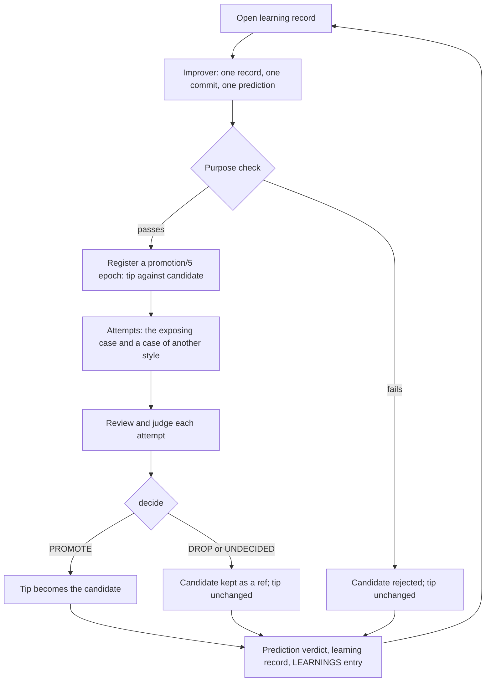

# ShipLoop E2E: closing the learning loop

Plan, 2026-10-30. It follows [the 10-29 loop plan](shiploop-e2e-mission-scorecards-loop-plan-2026-10-29.md), whose P0-P4
landed in 11c851e (v2 reviews, the fresh judge, `promotion/5`, `epoch.py`). This plan is that document's P5 (prove the
loop can say no) and P6 (controlled repetition), made specific. Nothing here changes ShipLoop's own loops, the subject
model or a baseline.

## Why the loop is open today

- `iterate.py` applies findings and builds the next iteration on them without a comparison. It never reverts. It reruns
  only the case that exposed the finding. It ends by marking its final source `comparison_required`
  ([iterate.py:479](../test/shiploop_e2e/iterate.py)).
- `epoch.py` can decide PROMOTE, DROP or UNDECIDED, but no `promotion/5` registration has been run.
- Rounds are run and compared by hand. Wave A's before and after could not use the promotion contract, because
  `metrics.py` changed between its arms ([LEARNINGS.md:4406](../test/shiploop_e2e/LEARNINGS.md)). About 30 entries are
  interim at n = 1.
- The reviewer and the improver remember through `review.last_commit_messages(count=3)`. `iterate.py` writes two commits
  per iteration, so that is about one and a half iterations. SPEC's mission clause asks for append-only learning records
  whose admission and verification are separate ([SPEC.md:53](../test/shiploop_e2e/SPEC.md)). The only ones are each
  epoch's own `events.jsonl`, outside the checkout.

## The cycle

One learning record, one candidate, one decision. The loop tip advances only on PROMOTE.



New terms. They are harness terms, not ShipLoop glossary terms (S-16):
- **learning record**: one lesson's history in `test/shiploop_e2e/learning-records.jsonl`. SPEC already says "learning
  records". The plan avoids "lesson" alone: ShipLoop uses it for the lessons section of its own Improve commits
  (`shiploop_lessons`).
- **prediction**: what a candidate is expected to change, on which case and by how much. It is registered before the
  candidate's first attempt runs.
- **loop tip**: the last promoted commit on the loop branch. Every candidate is built on it.
- **purpose check**: the scripted and reviewed test that a candidate's diff serves its record and nothing else.

## Owner decisions before live work

AGENTS.md makes launching verification runs routine (stages 3 and 4). These are not routine:

| # | Decision | Proposed | Why it is the owner's |
|---|---|---|---|
| D1 | Sample and tolerance rule | Attempts per arm (k) and the efficiency tolerance (t) come from stage 3. t is the smallest value at which at most 10% of A/A splits decide PROMOTE or DROP. `quality_tolerance` stays 0 unless the A/A failure rate makes a false DROP likelier than 20% at k | Open decision 4 of the 10-29 plan |
| D2 | Learning records as the loop's memory | **Decided by the owner, 2026-10-30: alongside** the last three commit messages, not replacing them | Amends SPEC's Purpose |
| D3 | Cycle resource policy | At most 3 subject runs at once. Stop after 2 consecutive cycles without PROMOTE, or at `--cycles`. Token budget per cycle: 2 x the A/A median per attempt x attempts; an unknown measurement leaves the cycle UNDECIDED | Open decision 4 of the 10-29 plan |
| D4 | Review every attempt before PROMOTE | Keep it. `epoch.decide` already requires it. It is 24 of about 38 model sessions a cycle | The owner's 10-29 design |
| D5 | Reuse a promoted candidate's sealed attempts as the next cycle's control | Defer until after the pilot. If adopted: every attempt of that arm, none chosen | Relaxes "registration precedes dispatch" |

## Build order

| Stage | What | Model calls | Depends on |
|---|---|---|---|
| 1 | SPEC amendments, in their own commit | none | D2 |
| 2 | Harness code and its tests | none | 1 |
| 3 | A/A calibration epoch | about 20 subject runs | 1 (runs beside 2) |
| 4 | Known-bad pilot | 6 subject runs | 2, 3 |
| 5 | First qualified cycles | about 38 sessions per cycle | 2, 3, 4, D1, D3 |

Stage 3 runs from a detached worktree at the stage 1 commit (`git worktree add --detach`). `epoch.registration()`
recomputes the qualification snapshot from its own folder, and stage 2 adds top-level `.py` modules, which changes the
evaluator digest. Run from the main checkout, the calibration epoch would refuse to continue. The calibration stays
usable later only while the files that score an attempt are unchanged. `spread.py` records their digests, and `cycle.py`
refuses a calibration whose digests differ from the epoch it is applied to.

## Where it stands (2026-10-31)

**Trying to achieve.** Every improvement to ShipLoop proven by its own comparison: one learning record, one candidate
with a prediction, one `promotion/5` decision, built on only after PROMOTE, and remembered. Done means a live cycle that
promotes a change whose prediction is confirmed, lands it on `main` and marks its record verified. That has not happened.

**Established.** Stages 1 and 2 are on `main` (6337038, CI green): the SPEC rules, the learning records, predictions,
`spread.py`, the purpose check, side-by-side runs and `cycle.py`, with no-model tests. ba51c3f then fixed the controller's
uncommitted learning on its non-DROP exits and recorded the owner's history-first, direct-to-`main` policy. Not
established: how much one ShipLoop build differs from itself, so whether a full-run cycle can see an ordinary improvement.

**Learned, and where.** About the loop: LEARNINGS.md, "Closed loop, stage 2" and "Closed loop review" (what a cycle costs,
the noise question, the corrections). About ShipLoop: `test/shiploop_e2e/learning-records.jsonl` (six records; the
admitted one is the S-13 slip LR-20261030-8ff7a9). The rules the lessons became: SPEC.md's Purpose, "Learning records and
predictions", Change admission's "Purpose", the promotion contract's "Qualified iteration" and the harness rule "A
comparison that promotes is one registered epoch".

**Still to change, in order** (rewritten 2026-10-31, after the owner's two decisions below).

| Step | What | Where | Needs |
|---|---|---|---|
| 1 | Stage 3 (same-build calibration): **skipped by the owner**. The kit stays for a later measurement | `docs/experiments/e2e-calibration-20261031/` | nothing |
| 2 | State the tolerance and attempts per cycle (`--tolerance`, `--attempts`, recorded as unmeasured; start at 0.25 or more). D3 (limits) and D4 (sampled reviews) remain open | the decisions table above | the owner |
| 3 | Trim the cycle if the owner wants it cheaper: sampled reviews, the second case at release, the purpose review on a flag | `epoch.py` `decide` (every attempt reviewed before PROMOTE); `cycle.py` `roles_for` and the purpose review in `qualify` | D4 |
| 4 | Stage 4: the padding overlay must be dropped or left undecided | a new file in `test/shiploop_e2e/overlays/`; `cycle.py --candidate-plugin` | live runs |
| 5 | Stage 5: the first cycle takes the S-13 slip | `skills/shiploop/scripts/shiploop_primary.py` (its `ticket-escalation` comment); `iterate.py --qualify` | live runs |

All live runs need Codex Terra on the owner's computer. The Claude host is reachable from a cloud session, but see the
gap below.

**Corrections and cautions from the 2026-10-31 review of this work**
- The journal span "from Case checks write nothing to Closed loop, stage 2" has 41 entries, not the 42 recorded in the
  "Closed loop review" entry (LEARNINGS.md) and the page built from it. The 21-and-21 split was a hand classification,
  a judgment call and not a measurement; a keyword heuristic on the headings also finds 21 harness or measurement
  entries of 41. Read it as "about half".
- **The release gate reads `LEARNINGS.md` commit order alone, and it is already open.** Any commit touching that file counts
  as an E2E journal entry that covers every earlier ShipLoop commit. This review first found the hazard (an unrelated
  correction there would clear the refusal on c468b25c, a ShipLoop change with no round and no `No-E2E-Round` trailer),
  and kept its corrections out of that file for that reason. The gate had already opened: LEARNINGS commits by other
  sessions after c468b25c (8ff81566, 09a0f19c, 3ba1c25f, bff47775, 0929efd5) made `release.py --dry-run` pass (shiploop
  1.23.3 to 1.24.0 with 3 notes). The message of 0929efd5 records the same finding, including that one of the changes
  it lets through is the Apps Script card text the owner chose to hold until live evidence exists (5ca57d9e). An earlier
  version of this note, and the message of the commit that added it (835e49d1), said the release was still refusing:
  that was true at the last check, about two hours before it was written, and false when written. Nothing in this
  session ran a real release (only `--dry-run`, which writes nothing). Holding the card text, or waiving its round as the
  owner did in 527b9a3, is the owner's decision; nothing mechanical holds it now.
- A gap: `epoch.launch` builds the run's arguments from host, model and effort only and never passes `--backend`, and the
  harness's default backend for the Claude host is Ollama. A cycle on the Claude host therefore tries Ollama and is
  refused wherever Ollama is not running (a cloud session). The Codex host has no such gap.

**Owner decision, 2026-10-31: stage 3 is skipped.** The owner declined the same-build calibration ("skip it; I don't
want 2-3 hrs"). Its kit stays in `docs/experiments/e2e-calibration-20261031/` for anyone who wants the measurement
later. Consequences, so they are not rediscovered:
- No `calibration.json` exists, so D1 (attempts per arm and tolerance) has no measured basis. The noise figure stays
  unknown; the only hint is user-listing's turns on Terra, about ±13% across three mixed builds.
- `iterate.py --qualify` and `cycle.py` refuse to start without `--calibration` (`cycle.load_calibration`). Qualified
  cycles therefore cannot run as built. A later change must either accept an explicit, recorded tolerance and attempt
  count in place of a measurement, or the loop moves to step slices (`experiment.py`). That is a decision for the owner.
- The loop's live parts (the stage 4 pilot, stage 5 cycles) all need Codex Terra runs on the owner's computer; skipping
  stage 3 does not remove that need. As of this date the owner's computer (BigDog) lists `skill-craft` in Remote
  Control but does not offer it to cloud sessions, so a cloud session cannot launch live runs there.

**Owner decision, 2026-10-31 (same day): take option 1.** A cycle takes a stated tolerance and attempt count. `iterate.py
--qualify` and `cycle.py` accept `--tolerance` with `--attempts` in place of `--calibration` (never both, never one alone,
never a default). Under a stated basis the decision still comes from the same `promotion/5` rule, but the cycle's
`decided` and `verdict` events, the record's outcome reason, the LEARNINGS entry and the terminal commits all say
"stated, not measured: the false-decision rate is unknown". A verdict under it is evidence about that comparison and none
about how often the tolerance misleads. The only hint at the noise is user-listing's about ±13% in turns, so a tight
tolerance (10%) would likely call noise a win or a loss: start with 0.25 or more, which lets only large effects promote,
and lower it only with a measurement. The calibration kit stays available to replace the stated basis later.

## Stage 1: SPEC amendments

Done in 2b4c675. One commit, `docs(e2e-spec): ...`, before any code, so the harness is judged against the amended spec:

1. Purpose, "Each iteration": "read the last three commit messages" becomes "read the open learning records and the last
   three commit messages".
2. Mission clause, after "Learning/decision records ...": learning records live in `learning-records.jsonl`. A candidate's
   prediction is registered before its first attempt. The prediction's verdict is recorded beside the promotion
   decision and never replaces it.
3. The promotion contract, a new paragraph: in a qualified iteration, one learning record per candidate. The loop tip
   advances only on PROMOTE. A DROP or UNDECIDED candidate is kept as a ref and never built on.
4. Rules for the harness: a before-and-after round whose arms are not one registered epoch is a diagnostic. It is never
   promotion evidence.
5. Change admission: the purpose check (an S-13 probe-word check and a purpose review) gates registration.

## Stage 2: harness code

Built on `feat/e2e-closed-loop-stage2`. Where the build differs from the text below, the text was corrected:
calibration epochs keep `next` as it was; `same_as` is checked when a finding is recorded, not by the judge; a DROP whose
prediction was confirmed defers the record; and a case is a capability case only when the prediction raises one of its
floors. Building the probe-term list found an S-13 slip already in the engine: `shiploop_primary.py` names
`ticket-escalation` in a comment. It is learning record LR-20261030-8ff7a9, pinned under `known` in `probe_terms.json`.

All of it is opt-in. `iterate.py` without `--qualify` behaves as today.

### 2a. Learning records (`learning_records.py`, `learning-records.jsonl`)

One JSON object per line, appended only by the harness. The improver cannot write it: `boundary.HARNESS_PREFIXES`
already excludes `test/shiploop_e2e/`. It is not in the evaluator digest, which covers only top-level `.py`/`.cjs`,
`SPEC.md`, `cases.json`, `suites.json`, `checks/` and `evaluators/`. So appending to it never invalidates an epoch.

```json
{"event_id": "2026-10-30T18:02:11Z-3f9a1c", "record": "LR-20261030-3f9a1c", "event": "admitted",
 "title": "an unattended run records a missing tracker as an assumption and proceeds",
 "anchor": {"clause_id": "S-14", "relationship": "supports"},
 "materiality": "material", "confidence": "medium",
 "source": {"run": "<run key>", "review_sha256": "...", "finding_id": "D3", "exposure": "development"},
 "files": ["skills/shiploop/scripts/shiploop_prompts.py"],
 "commits": [], "epoch": null, "verdict": null,
 "reason": "...", "reopen_when": null, "owner_decision": null}
```

- **Events:** `opened`, `admitted`, `predicted`, `rejected_at_purpose`, `decided`, `verdict`, `deferred`, `reopened`,
  `owner`. `current()` folds them into one status per record: open, admitted, in candidate, verified, refuted,
  no effect, unexplained gain, deferred or owner.
- **Ids are unique without a sequence:** a timestamp and a random suffix. Two branches that append at once then merge
  without conflict, through `.gitattributes`: `test/shiploop_e2e/learning-records.jsonl merge=union`. The fold accepts
  any line order.
- **`reviewer_view(max_chars=6000)`:** open, admitted and in-candidate records, plus the 10 most recent refuted or
  no-effect ones, as title, anchor and status only. Its effect is that the reviewer stops proposing what was just
  dropped.
- **`improver_view(record)`:** the one record's title, anchor, files and the reviewer's proposal. It carries no evidence
  text, so held-out detail is not passed on through it.
- **Recurrence:** the v2 DISCOVERY schema gains an optional `same_as` (a record id). `learning_records.ingest` checks
  that it names a known record when the finding is recorded; an unknown id opens a new record and keeps the claimed id
  as `same_as_unknown`. A recurrence appends to that record, so evidence accumulates instead of duplicating.
- **Seed:** a session adds about 5 records from the last four LEARNINGS entries. Each cites its entry and carries its
  reopen condition. Example: Wave A's paused `ticket-escalation`, S-14, reopen when it recurs.

### 2b. `epoch.py`

- **Concurrent launches.** `main()` holds `locked(root)` with `LOCK_NB` across `launch`, and `launch` holds it for the
  whole run. A second launch in the same epoch therefore fails. Change it to take the lock only for `launch_intent` and
  `record_run`, so that `append` keeps its sequence. `runner.main` runs unlocked.
- **`init --prediction FILE`.** It writes `prediction.json` once (`write_json`, immutable), and the `registered` event
  carries its digest. This becomes contract `shiploop-epoch/2`; `/1` epochs stay readable.
- **Calibration.** `next_action` is unchanged for a calibration epoch: an existing test pins it asking for reviews, and
  a calibration run's review can still surface a discovery. Stage 3 simply runs none; `spread.py` reads the sealed
  attempts. A calibration decision is diagnostic and can never PROMOTE.

### 2c. `spread.py` (no model)

Input: an A/A epoch folder. Output: `calibration.json`.
- Per case: attempts, successes and the failure rate.
- Per measure (tokens, turns, and minutes from timing-valid attempts only): median, minimum and maximum.
- **Resampling.** Over every k-against-k split of each case's attempts, it applies promotion's own per-success comparison
  (`promotion._strict_per_success`) at t in 0.05, 0.10, ..., 0.50. It reports the rate of false PROMOTE or DROP at each t,
  and the D1 recommendation. Reusing promotion's code means the calibration measures the rule that will decide.
- **Regression risk.** For a regression case, the chance of at least one failure in k attempts at the observed failure
  rate. That is the false-DROP risk at `quality_tolerance` 0.
- It records the digests of `scorecard.py`, `metrics.py`, the `checks/` tree and the case entries it calibrated.

### 2d. `prediction.py`

```json
{"contract": "prediction/1", "record": "LR-20261030-3f9a1c", "anchor": "S-14",
 "because": "one sentence: why this change should move this measure",
 "effects": [{"case": "ticket-escalation", "measure": "tokens", "direction": "down", "at_least": 0.15}],
 "guards":  [{"case": "*", "measure": "accuracy", "direction": "not_down"}]}
```

**Refused at registration** when:
- no effect has a direction of `up` or `down` ("no worse" alone is not a prediction);
- `at_least` is below the calibrated t for that measure (the cycle cannot resolve it at k attempts, so the record is
  deferred with that reason);
- a measure is not in `promotion.METRICS`, not a required floor and not a `scorecard/6` diagnostic key;
- a case is not registered.

**The verdict after `decide`:** each effect is `confirmed`, `refuted` (moved the other way beyond t), `no_effect` or
`unknown`. It is kept apart from the promotion decision:

| decision | prediction | learning record becomes |
|---|---|---|
| PROMOTE | confirmed | verified |
| PROMOTE | not confirmed | unexplained gain. The change is kept, and a new open record asks why |
| DROP | refuted | refuted, with a reopen condition |
| DROP | confirmed | deferred: the effect is real but the candidate regressed something; reopen for a candidate without the regression |
| DROP | no effect or unknown | no effect, with a reopen condition |
| UNDECIDED | any | admitted again, naming the missing evidence |

This is the mechanical form of "true to purpose": a change is kept because its measures moved, and when it is kept for
some other reason, the reason is recorded as unknown.

### 2e. `purpose_check.py`

**Script part:** no model, on the candidate commit's diff against the loop tip.
- **Scope:** changed files must pass `boundary.candidate_path` (existing). Files outside the record's `files`,
  `changes/shiploop/` and ShipLoop's own tests are listed as `extra_files`. They go to the review, not to an automatic
  stop.
- **Probe words (S-13):** only added lines are matched, against `test/shiploop_e2e/probe_terms.json`, a curated list per
  case: battleship, fleet, sunk, ticket escalation, seat reservation, SLBattle, chess and the like. A match stops the
  candidate. The list avoids words that are also generic: "checkers" already appears legitimately as "type checkers"
  ([shiploop_stage_spec.py:240](../skills/shiploop/scripts/shiploop_stage_spec.py)).
- **One record:** the commit's final paragraph carries exactly one `Learning-Record: LR-...` trailer.

**Review part:** a fresh session on the judge's role profile (Astra xhigh, read-only sandbox). It receives only the
record's title, the anchor clause's text, the prediction and the diff. It does not receive the run evidence, so it judges
purpose, not outcome. It returns, per hunk, whether the hunk serves the record, and an overall verdict: `aligned`,
`extra` or `misaligned`. `misaligned`, or `extra` that one improver retry does not remove, is `rejected_at_purpose`.

### 2f. `cycle.py` and `iterate.py --qualify`

`cycle.qualify(worktree, tip, record, args)`:

1. **Improve.** `improver_prompt` receives `improver_view(record)` and must return a prediction in its JSON block. One
   commit.
2. **Purpose check.** A failure rejects the candidate.
3. **Build** the tip and candidate plugins with `scripts/build-packages.py`, digested by `runner.tree_digest`.
4. **Register** a `promotion/5` epoch:
   - purpose `product_change`;
   - cases: the exposing case and a generality case of another style, each `regression` unless the prediction raises
     one of its floors, which makes it `capability` (a token saving must not cost quality);
   - k and t from `calibration.json`, and the budget from D3;
   - efficiency `["tokens"]`, because attempts overlap and overlapped minutes are not valid evidence. Minutes stay a
     diagnostic.
5. **Run.** `epoch init --prediction`, then launch at most 3 attempts at once, record, review each attempt, decide.
6. **Apply the decision.** PROMOTE fast-forwards the tip. DROP or UNDECIDED runs
   `git update-ref refs/shiploop-loop/<loop>/<record> <candidate>` and resets the loop worktree to the tip. The loop
   branch is the session's own and unpublished. A revert would instead add and then delete a pending change note, which
   only `scripts/release.py` may do.
7. **Record.** The prediction verdict and the learning-record events, then a LEARNINGS entry generated in the existing
   Question, Setup, Result, What it shows shape. It is committed by `record_learnings` after any ShipLoop commit, so the
   release preflight's ancestry rule holds for the right reason.

Around it:
- **Choosing a record:** the oldest admitted, material record with the highest confidence that is not
  confirmation-exposed. An exploration run happens only when no admitted record is open. Otherwise the previous epoch's
  reviews supply the records.
- **Exposure:** findings from reviews of the generality case's attempts are recorded with `exposure: confirmation`. They
  open records but are never offered to the improver; they go to investigation or the owner (10-29 plan, P2).
- **Stops:** `--cycles`; no admitted record left; D3's non-PROMOTE streak or budget; a changed evaluator snapshot; a
  calibration whose digests do not match.
- **`cycle.py --candidate-plugin DIR --prediction FILE`** runs steps 3 to 7 for a candidate built by hand: the stage 4
  pilot, or a hand-made wave like Wave A.

### 2g. Tests (registered in `test/suite_catalog.py`)

- `test/shiploop-e2e-learning-records.test.py`: the fold; two branches' appends merged by union; the view size cap; no
  evidence text in the improver view.
- `test/shiploop-e2e-cycle.test.py`, a no-model campaign on the fake hosts:
  1. a faster but incorrect candidate is DROPPED, the tip is unchanged and the ref is kept;
  2. PROMOTE with a refuted prediction leaves the record open as an unexplained gain;
  3. a probe word rejects the candidate before registration;
  4. two `Learning-Record` trailers are refused;
  5. a crash after launch resumes into reconcile, never a relaunch;
  6. a calibration with different digests is refused.
- `test/shiploop-e2e-epoch.test.py`, extended: two different attempts launched at once both seal, and the same attempt
  launched twice is still refused. `prediction.json` is immutable. A calibration's `next` does not ask for reviews.
- `spread.py`: synthetic A/A cards with a known spread give the expected t.

## Stage 3: A/A calibration

- **Setup:** the detached worktree at the stage 1 commit. Main's plugin is built once and bound to both arms. Driver:
  codex, `gpt-6.1-terra`, xhigh. At most 3 runs at once.
- **Cases:**
  - `user-listing`: 4 attempts per arm;
  - `ticket-assignment`: 4 attempts per arm;
  - `battleship`: 2 attempts per arm. It has never run on Terra, so this also measures its time.
- **Reviews:** none.
- **Output:** `docs/experiments/e2e-calibration-20261030/calibration.json`, baseline rows, and a LEARNINGS entry that
  states k, t and the false-DROP risk.
- **Time:** the 10-29 Terra brownfield runs took 10 to 24 minutes, so the 16 brownfield runs take about 1.5 to 2.5 hours
  at 3 at once. The battleship runs are unknown.
- **If battleship's median exceeds 60 minutes:** the generality case moves to each batch's breadth run, and every cycle
  entry says its claim is scoped to brownfield.

## Stage 4: known-bad pilot

The 10-29 plan's "prove the loop can say no", live:
- **Candidate:** main's build plus an overlay (`overlay.apply_to_plugin`) that adds about 4 KB of inert text to every
  printed packet head: a token cost with no purpose, which S-7 counts as a defect.
- **Prediction:** tokens up on `user-listing` by at least t.
- **Run:** `cycle.py --candidate-plugin` on `user-listing`, k attempts per arm. About 6 runs, about 40 minutes.
- **Pass:** DROP or UNDECIDED, never PROMOTE, and the prediction confirmed (the measurement sees what was planted). The
  tip is unchanged and the record reads refuted.

## Stage 5: first qualified cycles

```sh
bash test/run-integration.sh shiploop-e2e-iterate --case user-listing --qualify --cycles 3 --generality-case battleship
```

- **The first record:** from an exploration run on `user-listing`, or a seeded record whose reopen condition holds.
- **Each cycle:** about 12 subject runs, 12 reviews, 12 judgments, 1 improver and 1 purpose review. About 2 hours of wall
  time on the brownfield pair.
- **Pass:** every cycle ends with a decision, a prediction verdict and a LEARNINGS commit, and the loop branch holds only
  promoted ShipLoop commits. Merging it and releasing with `scripts/release.py` stay routine (AGENTS.md) once the
  preflight and CI pass.

## Change admission

Harness changes go through SPEC's Change admission too.

| Consequence sought | Disposition |
|---|---|
| Gamed predictions: the improver predicts what is easy to hit | Mitigated: a prediction needs a direction and an effect of at least the calibrated t. The purpose review checks that the effect follows from the anchor. Tested in 2g |
| The probe-word check fires on generic words | Mitigated: a curated list, added lines only, "type checkers" as a fixture |
| Learning records flood the reviewer's prompt | Mitigated: a folded view with a 6,000-character cap, titles and anchors only |
| Records carry held-out detail to the improver | Mitigated: the improver view carries no evidence. Confirmation-exposed records are never offered |
| Two sessions append records at once | Mitigated: unique ids, no global sequence, `merge=union`. Tested |
| Narrowing the epoch lock races `append` | Mitigated: every append stays under the lock, and only the runner runs outside it. Tested |
| A DROP loses work | Mitigated: the candidate is kept as `refs/shiploop-loop/...`. Tested |
| More runs per change than today | Accepted: about 12 runs against Wave A's 6, and those 6 could not decide. The extra runs buy a decision |
| Breaks saved epochs or callers | Mitigated: `--qualify` is opt-in, and `shiploop-epoch/1` stays readable |
| Weakens S-1..S-16 | No engine change. The probe-word check enforces S-13 |

## Not in this plan

- Changing ShipLoop's own loops, the subject model, a baseline or `promotion/5`'s rule (D5 is a later, separate
  decision).
- A statistics framework beyond the resampling rule.
- The loop improving the harness itself. Harness findings stay a separate evaluator experiment (SPEC mission clause).
- Publishing or deploying anything.
