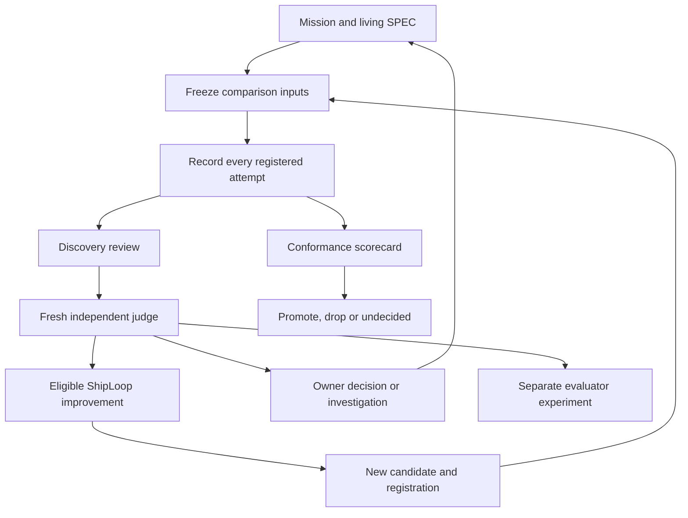

# ShipLoop E2E learning loop — implementation record

The first implementation extends the existing harness with mission-anchored discovery, an independent judge, strict comparative qualification and a durable stepwise controller. It is isolated on `codex/shiploop-e2e-learning-loop`, based on `52bed4712f979aba4adb54ccd71ffdc3f8b426d7`.

**A discovery can change what we investigate without silently changing what counts as success.** Accepted direction, implementation, qualification and publication are separate states.

| Role | New default | Boundary |
|---|---|---|
| Subject | Codex `gpt-6.1-terra`, xhigh | Explicit overrides and recorded resumes retain their identities |
| Reviewer | Codex `gpt-6-astra`, xhigh | Fresh session; read-only Codex sandbox |
| Judge | Codex `gpt-6-astra`, xhigh | Separate fresh session; exact review hash and one assessment per discovery |
| Improver | Codex `gpt-6.1-sol`, xhigh | Candidate-only edit boundary; evaluator findings stay separate |

The authoritative purpose and learning protocol live in [SPEC.md](../test/shiploop_e2e/SPEC.md). The [plan](shiploop-e2e-mission-scorecards-loop-plan-2026-10-29.md) retains the rationale and worked examples. [README.md](../test/shiploop_e2e/README.md) contains the CLI and registration template.

The v2 review records observation separately from interpretation, mission relationship, materiality, confidence, possible impact, alternatives and a next experiment. A material challenge without an existing clause remains owner/investigation work, including when its interpretation is disputed. Malformed findings invalidate the review; an empty discovery list is legitimate. Legacy reviews remain readable but cannot establish discovery-qualified completion.

Strict `promotion/5` freezes the specification, scorer dependencies, recursive checks/evaluators, case requiredness, arm builds, controlled drivers, attempt identities and comparison policy. Each run records the product it actually delivered. Required missing evidence yields `UNDECIDED`; protected regressions remain visible and can establish `DROP`. Declared budgets apply before a quality gain can promote. Quality leads, followed by all-attempt tokens per success and time. Calibration reports diagnostics without claiming a product gain; model-only results identify their narrower cause. Historical `promotion/4` remains available for earlier evidence.

`epoch.py` owns durable registration, dispatch intent, sealed evidence, feedback exposure, review receipts, dispositions and comparison decisions. `status`, `next` and `resume` launch no models. An ambiguous launch blocks retries until reconciled; a new attempt requires a new registration. The controller never edits the active spec or publishes a candidate. `iterate.py` remains the exploration path and explicitly marks a changed final candidate unevaluated pending comparative qualification.

Routine decisions: reuse the existing runner instead of replacing it; keep generated product identity per attempt rather than pre-registering stochastic output; retain a rejected registration and interrupted dispatch as evidence; use separate immutable assessment receipts for recovery. This implementation does not append an E2E round to `LEARNINGS.md`, because hermetic fixtures cannot vouch for a live ShipLoop change or satisfy release preflight.

Independent plan advice reused: verified Opus 5.5 at xhigh, no fallback, and a later successful Astra request at xhigh. Adopted frozen inputs, explicit final-candidate status, feedback exposure, honest generalisation limits and a small durable controller. Statistical confirmation and recursive dogfooding remain deferred until live evidence supports them. Astra response retained locally at `/var/folders/_n/cth41tgs171367b_gghs0kgm0000gn/T/shiploop-astra-plan-review-20261029-upxwe7yu/response.json`.

Independent implementation review found and verified fixes for reviewer write access, incomplete evidence seals,
unsafe symlinks and ambient overlap evidence that could disappear during cleanup or re-scoring. Strict receipts now
bind the runs root and overlapping neighbours' inputs, preserve the run's recorded overlap inventory, and keep a missing
run-time baseline unknown. A submitted card must still agree with a fresh score; changing the context requires new
qualification evidence. Historical scoring remains available separately.

Verification completed against final source fingerprint `9d4ab1d3b4bf1cb041760fd7b2806c40a3313403e5d70ad1ddacc5a19806823a`
(6,258 tracked and non-ignored files; only this implementation report is excluded). HEAD remains the implementation
base until the tested changes are committed. The selected quick tier contains 47 suites. Logs and every earlier
failed or interrupted verification attempt are retained under
`/var/folders/_n/cth41tgs171367b_gghs0kgm0000gn/T/shiploop-learning-loop-verify-a4brljkq/`.

Static verification: all changed Python files introduce zero Ruff diagnostics compared with their base versions;
new test/controller modules pass their full Ruff checks; `git diff --check` passes. Document file links and fence balance
were checked. Mermaid layout has not been visually rendered.

The fixtures have already exposed and corrected an outdated fake reviewer argv, an incorrect controller exception path,
and the distinction between live overlap diagnostics and sealed evidence. The retained logs include those failures;
a later passing run does not erase them.

| Check | Final evidence |
|---|---|
| Selected quick tier | All 47 suites executed: 45 passed initially, 2 had stale fixtures; both affected suites then passed in full after fixture updates |
| Main E2E suite | 474 tests passed; the 33 focused model/review/boundary tests also passed before the full rerun |
| Experiment suite | 59 tests passed with the new default-subject expectation |
| New role/discovery/qualification/controller suites | 4 + 15 + 17 + 18 = 54 tests passed |
| Source identity | Final rechecks retained the exact fingerprint above, unchanged HEAD and status, with no skips or automatic retries |
| Independent implementation review | No remaining material findings after the overlap-baseline fix; review was read-only |

The initial complete quick-tier receipt is `quick-final-receipt/receipt.json` under the evidence root. It truthfully
retains the two failures. Final passing rerun commands, stdout/stderr, exits, durations and source fingerprints are in
`recheck-20261029T093318-60551/`. No executable production logic changed after that complete sweep; the final repair
updated test fixtures, explanatory README wording and the reviewer module's descriptive docstring.

Live model serving, discovery sensitivity on live traces, statistical confirmation, independent-family transfer and
hosted/deployed behaviour remain unqualified. The implementation did not run a live campaign, publish a release, refresh
host installations, or modify ShipLoop's own product loop limits. These fixtures verify the harness mechanics and its
honest treatment of evidence; they do not establish a live improvement in ShipLoop.
