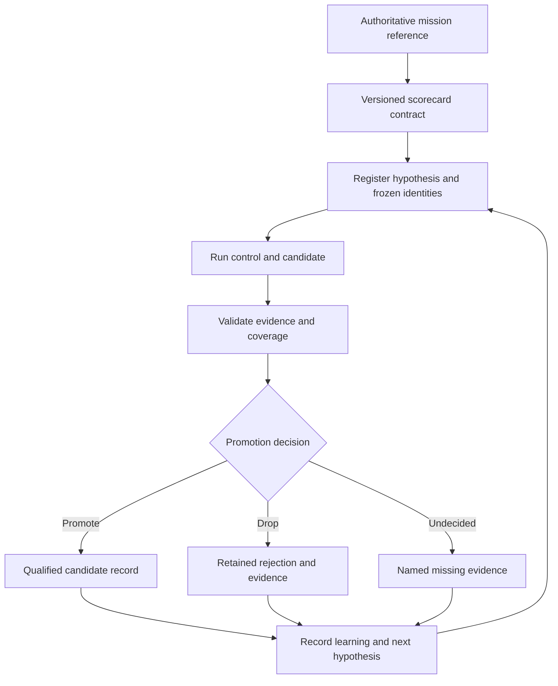

# ShipLoop E2E: mission, scorecards and a measured improvement loop

Status: implementation authorised by the owner on 2026-10-29. The first delivery implements the role profiles, discovery/judgment contract, strict comparison and durable stepwise controller. Live qualification and repeated campaigns remain separate work. See the [implementation record](shiploop-e2e-learning-loop-implementation-2026-10-29.md) for verified scope and evidence.

Build on the existing [loop design](shiploop-e2e-self-improving-loop-design-2026-10-25.md) and [amended recommendations](shiploop-e2e-loop-recommendations-2026-10-25.md). The next deliverable is one auditable improvement cycle, with a mission-derived scorecard and an explicit disposition of the final candidate. Full autonomous operation and recursive ShipLoop-on-ShipLoop development come later.

## Keep the mission authoritative

The mission's primary home remains [SPEC.md — Purpose and design clauses](../test/shiploop_e2e/SPEC.md#purpose). This plan does not create a second normative mission. In reader terms, ShipLoop carries software intent through the applicable SDLC to a verified, committed and returned change, across products and technologies. Both new software and changes to existing repositories matter. A working probe is insufficient when the engine violated its contract.

### Proposed mission wording — for review

> ShipLoop reliably carries authorised software intent through the applicable software development life cycle to working, verified, committed and returned changes. It supports both creating software and evolving existing repositories while preserving the behaviours and constraints the request requires.
>
> Scripts own workflow state, progression, mechanical operations and recorded acceptance. Models supply bounded judgment and perform the current assignment. The work remains recoverable when conversation context is lost, and completion is supported by evidence tied to the delivered change.
>
> The resulting software meets the functional, security, reliability and maintainability requirements of its intended use. Unmet requirements, missing evidence and external blockers remain explicit. Required deployment is performed only within the request's authority.
>
> ShipLoop improves across products, technologies and hosts by learning general principles from evidence. Improvements preserve required quality and engine guarantees; efficiency is assessed after those obligations, using the declared token, time and resource policy.

This is proposed wording that consolidates current intent for discussion. It has not replaced SPEC's Purpose or amended S-1..S-16. The broad mission is a target; each qualification claim remains limited to its observed coverage.

| Mission commitment | What it means in practice |
|---|---|
| Faithfulness to intent | The accepted requirements and constraints remain traceable to the request; requirement changes are explicit |
| Working delivery | Required behaviours are independently checked on the delivered candidate; existing repository behaviour is preserved where required |
| Fitness for intended use | Applicable security, persistence, recovery, maintainability and operational requirements are stated and checked; enterprise fitness is defined through those requirements |
| Durable control | Scripts own state and progression; recovery does not rely on remembering prior conversation |
| Honest evidence | Unknown, blocked, failed and verified outcomes remain distinguishable; a statement of success cannot replace a check |
| General applicability | A lesson becomes a general rule only within its supported scope; case-specific facts remain in case or platform references |
| Disciplined efficiency | Quality and guarantees are protected before tokens or time decide; budgets and experimental limits are declared separately |

### Proposed living-spec structure

Begin with logical sections in the existing authoritative SPEC. Physical file splits, prompt-loading changes and any migration of historical material are later implementation decisions.

| Section | Contains | How it changes |
|---|---|---|
| 1. Mission and boundaries | Purpose, supported jobs, intended end state, priorities and authority | Owner resolves changes to direction or product trade-offs |
| 2. Engine guarantees | Current S-1..S-16, their explicit exceptions and links to accepted refinements | Stable clause IDs; amendments preserve or explicitly supersede obligations |
| 3. Accepted steering rules | Current evidence-backed guidance, organised by the obligation it serves | Equivalent rules consolidate; obsolete rules are superseded with provenance |
| 4. Evidence and qualification | What proves conformance, what evidence must identify, applicability and unknown outcomes | Criteria change between comparisons with explicit versioning and impact analysis |
| 5. Exceptions and known gaps | Deliberate exceptions, applicability boundaries and accepted obligations not yet implemented | A gap remains visible until evidence closes it; an exception names its authority and scope |
| 6. Learning and amendment protocol | Admission, decision ownership, supersession, frozen experiment revisions and links to the append-only history | Process changes are themselves reviewed against the mission |

Use linked references for implementation detail, platform facts and test-subject profiles. Terra 6.1 xhigh is a planned test profile, not part of ShipLoop's product-agnostic mission. The existing LEARNINGS journal remains the chronological evidence/decision history; it is not copied wholesale into the active specification.

Each accepted rule has one primary home, a stable clause anchor, normative wording, rationale, applicability/exception conditions, a proof obligation and evidence/decision links. Track **decision status** separately from **implementation status**. Acceptance means the rule is required; implemented and verified mean the corresponding work and evidence exist. A supported requirement can be accepted before the implementation satisfies it.

Make a short **mission reference template** that points to that source, its revision and the relevant clauses. Reviews, experiments and scorecards consume the same reference. Any proposed change to the mission itself is a separate owner decision, never an automatic response to a disappointing score.

Proposed template fields, not an implemented schema:

```yaml
mission_ref:
  source: test/shiploop_e2e/SPEC.md
  revision: <frozen source revision and content digest>
  clauses: <the clauses this experiment measures or protects>
claim: <the observable improvement expected from this change>
protected_outcomes: <what must continue to hold>
evidence: <independent checks and exact candidate identity>
coverage: <requirements, repository families and hosts exercised>
unknowns: <missing observations and which decisions they block>
```

The template is a reference and decision aid. It must not grow into boilerplate copied into every packet or replace the operative SPEC clauses.

## Let the steering spec learn between experiments

Owner planning input, 2026-10-29: repeated E2E runs should build persistent knowledge that steers ShipLoop while preserving its purpose. Treat SPEC as a curated, living account of accepted intent and principles. Append observations and decisions to the learning history; revise the active specification to incorporate accepted knowledge, resolve contradictions and supersede obsolete guidance. Growth in learning does not require perpetual growth in the active spec's length.

| Knowledge | Home and treatment |
|---|---|
| Purpose and fundamental priorities | SPEC's mission and invariants; changes in direction remain owner decisions |
| Accepted steering knowledge | Current SPEC clauses with stable IDs, rationale, applicability and links to decision/evidence records |
| Observations, hypotheses and decisions | Append-only learning history retaining supporting evidence, contrary evidence, rejected proposals and supersession links |
| Enforced behaviour and measurement | Runtime guides/scripts, regression checks and scorecards linked to the accepted clauses |

Add a **knowledge-promotion contract** to P0. Every run records whether its lesson confirms an existing clause, exposes a defect in implementation or measurement, proposes a new principle, or contradicts accepted guidance. A proposed principle states the underlying mechanism, applicable scope, evidence, counterexamples considered, protected outcomes and the test that would expose a violation. A single deterministic counterexample can justify a correction; broad reliability or generalisation claims need evidence of the corresponding breadth.

Give each lesson a durable ID and an explicit disposition: proposed, accepted, rejected or superseded. An accepted lesson closes only when its active clause and applicable implementation/check/scorecard changes are linked, or remaining work is explicitly recorded. One outcome must not automatically become a universal rule. Preserve rejected explanations so a later session does not repeat the same experiment without new grounds. This extends the existing SPEC Change admission and LEARNINGS mismatch process rather than adding a competing authority.

Freeze the applicable SPEC revision and measurement contract for each comparison. Incorporate accepted amendments between experiments. A changed success criterion creates a new measurement version, with both control and candidate evaluated consistently before claiming improvement. The mission can be clarified deliberately; a failing candidate cannot rewrite its own success criteria during a trial.

The active spec must remain usable: consolidate equivalent clauses, explicitly supersede conflicts, keep detailed histories behind evidence links, and route accepted operational knowledge into the relevant stage guides. The current reviewer loads the full SPEC and the last three commit messages; historical retention alone therefore cannot substitute for incorporating accepted lessons into the current guidance.

### Worked example: a learning becomes an accepted amendment

**Illustrative scenario, not a new live-run result.** It is grounded in the reviewed `iterate.py` control flow: the last iteration can apply a change and run the quick tier without another E2E evaluation of that change. It does not imply that the current runner explicitly claims that final change passed E2E.

1. **Observation.** A retained run evaluates candidate A. The improver produces candidate B, and B passes the quick tier. The campaign ends with no required E2E evidence for B. Record the two artifact identities, run/result paths, the final change and the missing receipt. The supported conclusion is that B's E2E qualification is unobserved.
2. **Classify the lesson.** Anchor it to S-9 and the existing candidate-identity/delivery-evidence provisions. First check whether the current specification already requires the behaviour. If it does, record an implementation gap and strengthen its executable check; an amendment is needed only to resolve a real ambiguity. This example proposes an explicit clarification for campaign qualification.
3. **Propose the general mechanism.** Evidence about an earlier candidate is insufficient to qualify a later candidate. This is a claim about evidence identity, not a rule about a particular game, host or number of iterations.
4. **Attack the proposal.** Check unchanged artifacts, changed evaluator criteria, partial/slice evidence and an external blocker. Matching artifact bytes can retain compatible evidence; a change within the declared artifact invalidates that identity match; slice evidence qualifies only its declared scope; an external blocker leaves qualification unknown rather than proving a product defect. A matching digest alone is insufficient if the mission, required coverage, evaluator or driver conditions changed incompatibly.
5. **Record an acceptance decision.** Subject to the existing admission/owner rules, accept the clarified obligation with its rationale, protected behaviours and proof obligations. Append a decision event linking the lesson and the amendment. Record implementation as pending until it is exercised. These are proposed future events, not decisions taken by this document.
6. **Implement and verify later.** Add fail-first controller checks, implement candidate-bound qualification and retain the affected E2E evidence. Record implementation and verification events separately. The rule takes effect under a new frozen specification revision for subsequent comparisons.

**Proposed amendment wording, anchored to S-9 rather than inventing a second equivalent rule:**

> A qualification claim identifies the exact candidate artifact, its scope and the required evidence under a recorded specification and evaluation contract. Evidence qualifies only a compatible candidate and contract. A subsequent change within the declared candidate artifact leaves the changed candidate unevaluated for that claim until its required evidence is established. Ending a campaign does not itself qualify the final candidate. Missing required evidence is reported as unobserved.

Proposed acceptance checks for that amendment:

| Constructed condition | Required conclusion |
|---|---|
| A has passing E2E evidence; B differs and has only quick-tier evidence | B is unobserved for E2E qualification |
| B is evaluated and fails a required check | B fails that qualification |
| B meets all required checks with compatible, complete evidence | B qualifies within the recorded scope |
| The final artifact is byte-identical to A and the required contract/conditions remain compatible | A's compatible evidence can be reused |
| Candidate matches but required coverage or evaluator contract changed | Qualification under the new contract remains unobserved until compatible evidence exists |

Only after this obligation is accepted should a scorecard expose its derived measure: whether the final artifact has complete, compatible qualification evidence. It is an evidence-validity condition; it does not award extra points for rerunning tests. This illustrates the derivation order: mission commitment → normative obligation → falsifiable proof obligation → measure.

## Make the scorecards answer the mission

The questions below are provisional candidates for derivation. Review the mission and living-spec obligations first; then decide which measures faithfully implement them. No scorecard schema or threshold is accepted by this plan.

Keep a vector of outcomes, validity and efficiency rather than one weighted total. Quality cannot be bought back with cheaper tokens. Preserve the existing policy of quality first, then tokens, then time; record dollars separately for budgets and cost decisions. A mission or measurement change requires versioning and an explicit old-to-new mapping.

### Derive a measure through an explicit obligation

For each measure, write the chain **mission commitment → accepted spec obligation → proof obligation → evidence → decision**. A desirable metric without an obligation remains diagnostic. A valid obligation without an implemented check remains an acknowledged measurement gap. Proposed mission wording and amendments must be accepted before their derived measures become operative gates.

| Mission commitment | Obligation to establish in the living spec | Proof obligation | Derived scorecard role |
|---|---|---|---|
| Faithfulness and working delivery | Accepted requirements remain traceable to intent and hold on the final candidate | Frozen request-to-requirement mapping plus independent behavioural checks, bound to candidate bytes | Required functional outcomes, each pass/fail/unknown |
| Preserve existing behaviour | A repository change retains its required existing contracts | Base regression checks run meaningfully against the changed product, plus case-owned preservation probes | Required non-regression outcomes |
| Fitness for intended use | Applicable access, persistence, recovery and other quality requirements are explicit and satisfied | Calibrated behavioural checks appropriate to the case; implementation-authored test counts alone are insufficient | Case-owned quality floors, with unmeasured obligations visible |
| Durable script control | Applicable engine guarantees hold, including context-independent recovery | Accepted-action/state records and purpose-built reset/recovery probes; complete evidence is required to conclude compliance | Engine-conformance outcomes, separate from product correctness |
| Honest evidence | Qualification belongs to an identified candidate, contract and scope | Compatible artifact, SPEC, evaluator, driver and evidence identities; required coverage and exposure records | Validity conditions on the claims being made |
| General applicability | Improvement claims do not exceed tested task families and conditions | Registered independent-family/confirmation coverage, with exposure tracked | Explicit scope and transfer status; no universal generalisation score |
| Disciplined efficiency | Efficiency is judged after the protected quality requirements under a declared policy | Comparable all-attempt tokens, timing and available dollars, including failed attempts and resumed sessions | Comparative targets and resource gates, never substitutes for quality |

Each required row names its authority and revision, applicability, exact expected behaviour, evidence references, result and reason. Freeze these before observing the candidate result. A reviewer may propose an additional row for a subsequent comparison; it cannot quietly change the current trial's contract.

### Two linked views: the run and the proposed improvement

**Run scorecard:** what this attempt established about delivered behaviour, engine conformance and the validity/scope of its evidence. Preserve separate rows rather than a weighted overall percentage.

**Improvement scorecard:** what the registered control/candidate comparison established about the proposed change. It consumes every registered attempt and its run scorecard. A valid failed run is useful evidence about success share; it is not discarded because it is red. Missing evidence cannot be silently counted as a success, converted to a product failure, or omitted from the attempt inventory.

These are views over the existing run/scorecard/promotion records, not a proposal for a second storage system. Applicable decision rules:

- **PASS:** trustworthy evidence establishes the row's required behaviour within its declared scope.
- **FAIL:** trustworthy evidence establishes a violation of that requirement.
- **UNKNOWN:** required evidence is missing, incomplete, incompatible or insufficiently trustworthy. A reason and the smallest resolving observation accompany it.
- **NOT APPLICABLE:** the frozen contract explicitly excludes this obligation for this case and states why. A missing rubric or unavailable tool is not itself a reason for exemption. This proposed applicability rule must be reconciled with today's enterprise placeholder before it becomes operative.

For a run's declared qualification: an established required violation makes it fail, while all unknown rows remain visible; otherwise a required unknown leaves qualification unknown; all required rows passing establishes conformance within that scope. An invalid receipt does not prove the product is defective. For example, artifact mismatch invalidates its qualification evidence and leaves the affected behaviour unknown until checked on the right artifact. Independently verified failures remain failures.

### Worked scorecard example — hypothetical outcomes

Case: add CSV export to an existing task service. The frozen request requires each user to export only their own tasks, correct CSV quoting, preservation of the existing API, and recovery after a context reset without repeating an already accepted state-changing action. All three scenarios below have trustworthy candidate identity; the missing checks in C are explicitly recorded.

| Required observation | A: complete successful evidence | B: confirmed access defect | C: incomplete evidence |
|---|---|---|---|
| Export content and CSV quoting | PASS | PASS | PASS |
| Another user's tasks cannot be exported | PASS | FAIL: independent probe retrieves another user's task | UNKNOWN: access-isolation probe was not completed |
| Existing API contracts are preserved | PASS | PASS | PASS |
| Recovery honours accepted state | PASS | PASS | UNKNOWN: reset probe was not exercised |
| Final artifact matches evaluated artifact | PASS | PASS | PASS |
| Qualification for the declared case | PASS | FAIL | UNKNOWN |

If B uses fewer tokens than A, the access violation remains a failure. If C reports no defects, the absent observations still prevent qualification. If access probing is unavailable because of an external prerequisite, C can truthfully record that blocker; truthful reporting satisfies an honesty obligation but does not establish access correctness.

The scope here is one service change and its registered recovery condition. It does not establish reliability across repeated attempts, recovery at every boundary or transfer to other repository families.

### From run outcomes to a change decision

The comparison uses a frozen registration: protected requirements/cases, capability being improved, sample and confirmation rule, measurement versions, subject/driver identities, applicability, efficiency priority/tolerance and any resource policy. No numerical tolerance or sample count is selected by this example.

| Comparative evidence | Proposed disposition |
|---|---|
| An established requirement regresses beyond its registered allowance, even though tokens fall | DROP |
| The targeted capability improves under the confirmation rule, protected requirements hold and required resource evidence satisfies the policy | PROMOTE within the registered scope; state its measured costs |
| Quality is equivalent under the registered rule and comparable all-attempt tokens per success improve beyond the declared tolerance | PROMOTE, provided all other required gates hold |
| Both versions pass, but the required efficiency difference is unmeasured or inconclusive and no quality gain is established | UNDECIDED: successful delivery does not establish an improvement |
| Required access, identity, coverage, confirmation or budget evidence is unknown | UNDECIDED; state which observation is missing |
| The registered applicable budget is demonstrably exceeded | DROP |

This comparison does not require every capability attempt to pass before quality can improve; it assesses the registered success shares and confirmation rule while protecting established requirements. Known failures and unknown evidence remain distinct. A broad transfer claim stays unknown until independent affected-family coverage supports it, even if a narrow improvement qualifies.

Keep refusals, review counts, packet sizes and planning time as diagnostics. A lower count does not itself establish progress. Report an honest external blocker separately from a defect, and keep unfinished delivery distinct from success.

`scorecard/6` measures accuracy and fidelity but leaves enterprise `not_applicable`. At implementation base `52bed471`, Checkers, user-listing, ticket-assignment and ticket-escalation declare acceptance modules; the last two extend the earlier planning snapshot. The breadth suite still excludes brownfield, parallel-graph and hosted-platform coverage. Those are limits on claims, not coverage to infer from a green card. Sources: [scorecard.py](../test/shiploop_e2e/scorecard.py), [cases.json](../test/shiploop_e2e/cases.json), [suites.json](../test/shiploop_e2e/suites.json).

## How the pieces connect



**The script owns the cycle; evidence determines the disposition.** The mission changes through an owner decision, not through this feedback edge. Qualification is recorded against exact artifact bytes; it is distinct from publication.

## Work in dependency order

These stages describe the dependency order. The owner's later “implement plan” authorises the first implementation; it does not supply missing live evidence or choose a sampling policy.

| Stage | Depends on | Concrete deliverable | Acceptance evidence |
|---|---|---|---|
| P0 — Mission and claims | Existing SPEC and owner intent | Mission reference template; knowledge-promotion contract; greenfield/brownfield outcomes; applicable quality criteria; scorecard policy | Every required dimension traces to intent or a SPEC clause; every proposed metric has an evidence source, applicability rule and unknown outcome; a sample lesson traces from observation through disposition to its active clause and applicable checks |
| P1 — Trustworthy promotion | P0 | Tightened, versioned registration and comparison contract | Constructed late-registration, wrong-artifact, duplicate-attempt, mixed-driver and unknown-budget inputs cannot promote; known regression drops; conflicting token/time/dollar rankings obey the mission's metric precedence |
| P2 — Calibrated coverage | P0, P1 | Requirement-to-check map; development, confirmation and canary roles; repository-family and exposure records | References and legitimate alternatives pass; targeted broken implementations fail; inspected feedback is recorded as exposure; missing affected coverage blocks the corresponding claim |
| P3 — Requested testing profile | P0 | New-run subject default: Codex, `gpt-6.1-terra`, `xhigh`, consistently selected by run, slice, experiment and iteration entrypoints | Fake-host tests prove argv and recorded settings, explicit overrides and recorded resumes; a separately authorised live smoke confirms served identity |
| P4 — One durable cycle | P1, P2, P3 | A small controller offering next/status/resume over an append-only event history | Recovery reconciles a stable launch key or blocks in unknown-launch state without retrying; no attempt disappears; the exact final candidate is evaluated; each candidate ends promote, drop, undecided or unevaluated |
| P5 — Qualification of the controller | P4 | Fixture campaign plus a separately authorised small live pilot | Known-bad candidate is rejected; missing evidence stays undecided; a post-change candidate cannot inherit its parent's passing result; records survive cleanup |
| P6 — Controlled repetition | P5 | Repeated cycles within an agreed experiment and resource policy | Confirmation results reproduce the claimed gain, rejected attempts remain counted, coverage claims remain bounded, and the report binds qualification to the final artifact |

P2 and P3 can proceed independently after their prerequisites. P4 must consume their receipts. P6 does not change ShipLoop's own loop limits or exit conditions. Epoch sampling, spend and stopping rules are separate experimental policy to settle before live execution.

### P1: fix the decision boundary before optimising it

Review found three constructed-input promotion failures: card-file inputs can omit run-start evidence; a lower-bound cost can bypass a budget check before a capability gain promotes; and the comparator does not bind each arm to a distinct candidate artifact and controlled driver. These are reproducible synthetic decision-path probes, not observed live-campaign failures. See [promotion.py — arm and decide](../test/shiploop_e2e/promotion.py).

The revised registration should bind mission/scorecard version, timestamp, control and candidate digests, evaluator and oracle identities, controlled host/model/effort, required cases, unique attempts, quality equivalence, primary efficiency metric, sample/confirmation rule and resource policy. Missing budget evidence must block budget qualification. An experiment intentionally changing the model must name that variable and cannot be reported as evidence that a ShipLoop code change caused the gain.

Resolve metric precedence explicitly: the current `promotion.py` default orders dollars before minutes, whereas the mission policy in SPEC prioritises tokens before time. Add a fail-first comparison where token, time and dollar rankings disagree, plus a case with unmeasured tokens, so neither defaults nor missing evidence silently change the intended order.

Prefer run folders and immutable attempt receipts in controller use. Legacy card-file comparison may remain a diagnostic path, clearly unable to supply missing qualification evidence. Define the identity of a logical attempt and its resumed sessions once, reusing the existing accounting rather than charging a resume twice.

### P2: improve the tests without teaching to them

Keep two tracks. Candidate experiments change ShipLoop while evaluators stay frozen. Evaluator experiments change checks, scorecards or reviewer premises and must first demonstrate discrimination against correct references, legitimate alternatives and known-bad products. Regrade both arms consistently after an evaluator change; do not compare scores across measurement versions as if they were unchanged.

Track exposure through review text and aggregate decisions as well as file reads. Withholding an oracle file does not make a case independent after its failure details reach the improver. The current corpus is too small to promise an independent holdout for every family. The first cycle may honestly report generalisation unobserved. Add independent repository families before claiming transfer, and retain exposed cases as development regressions.

Calibrate any enterprise criteria against actual intended use. Do not force an authentication or migration checklist onto a hello-world probe. Conversely, a stateful or access-controlled case needs checks for those requirements before it can support the relevant claim.

### P3: Terra is the requested subject, with separate historical evidence

The owner selected Terra 6.1 at xhigh on 2026-10-29. The intended CLI identity is `gpt-6.1-terra`; official [model guidance](https://learn.chatgpt.com/docs/models) documents that slug, and the [model reference](https://developers.openai.com/api/docs/models/gpt-6.1-terra) supports xhigh. Local Codex CLI 0.165.0 and its model catalog list that selection. No live served-model claim has been established by this review.

Use one shared subject profile. Preserve explicit overrides, recorded resumes, historical baseline rows and in-flight experiment identities. Terra begins a new comparison cell. The settled independent profiles are reviewer Astra xhigh, a fresh separate Astra xhigh judge, and improver Sol 6.1 xhigh. Subject options do not select those other roles. Record requested identities separately from any observed served-model evidence; fixture argv checks cannot attest live serving.

### P4: connect existing machinery instead of replacing it

Reuse run records, scorecards, promotion, lifecycle ownership, review and the experiment claim/arms/evaluator format. Keep `iterate.py` labelled as exploration until the controller can qualify its output. Its current clean-review stopping rule is not comparative evidence, and its last improvement can receive only the quick tier before it exits. See [iterate.py — main](../test/shiploop_e2e/iterate.py).

The controller should record finding → hypothesis → registration → attempt → candidate → score → decision → disposition. Durable events own state and transitions. Model prompts carry only the current task and necessary evidence. A resumed controller verifies identities and phase receipts before choosing the next action. A changed final candidate is explicitly unevaluated until its own required runs finish. Freeze the evaluator checkout and reviewer premise throughout a cycle, including between iterations.

Before dispatch, durably record a stable launch key and intent. On recovery, reconcile that key against the owned process/session and retained run receipts. If a crash occurred between dispatch and its receipt and the launch cannot be established, record `unknown-launch` and block automatic retry until reconciled. Do not claim exactly-once external execution without an idempotent launch mechanism; preserving an ambiguous attempt is safer than silently creating a second one.

## Prove the loop can say no

Start with no-model fixtures that exercise a full cycle. Include a faster but incorrect candidate, a malformed review, a missing attempt, a reused attempt, an exposed confirmation case, an unknown budget, an evaluator change and a crash after launch. Verify the disposition, retained evidence and recovery behaviour, not just exit zero.

Then plan a small live pilot against a known-bad candidate with one cheap regression case and a relevant capability case. Its first success criterion is rejection or an honest undecided result, never a forced promotion. Do not read a fresh confirmation case's detailed failures into the improver. Determine sample count from observed variability and the claim being tested; one lucky pass is a discovery signal, not a reliability claim.

Use the cheapest adequate test rung: deterministic replay, step slice, small full case, then affected end-to-end coverage. A slice qualifies only its measured scope. Broader or hosted claims require their own evidence and, for deployments, the owner's existing authorization boundaries.

## Decisions still required for live qualification

1. Which intended-use quality criteria are universal floors, and which are case-dependent? Enterprise remains unmeasured until its rubric and calibration exist.
2. Which parts of accuracy and engine fidelity are already hard enough to qualify a candidate, and which need stronger independent checks?
3. Which repository families can supply fresh confirmation cases without exposing the entire small corpus?
4. What sample/confirmation rule, quality-equivalence tolerance and cycle resource policy are justified? Preserve the existing quality → tokens → time priority unless the owner changes it.
5. What bounded live pilot and confirmation coverage should follow the fixture campaign? The subject, reviewer, judge and improver defaults are settled separately above.

The mission and learning protocol now have their primary home in SPEC. The first implementation adds strict `promotion/5` beside historical `promotion/4`, preserving earlier comparisons as diagnostics. It also applies the selected new-run defaults. No live trial, release or deployment has been established by this implementation.

## Review evidence and limits

Source inspected: `202b2643a08cf43c5432c2127842c40a3531a2e7`. Two focused no-model commands passed: 9 iteration convergence/boundary tests and 25 scorecard/promotion tests, with no skips and unchanged source. These establish the covered local contracts; they do not establish a successful live improvement cycle.

Independent review: Opus alias served verified `claude-opus-5-5`, xhigh, exit 0, fallback false. Adopted its recommendations for frozen evaluator identity, explicit final-candidate evaluation, exposure accounting, reuse of the experiment format and a next/status controller before full automation. A further statistics framework and recursive dogfooding are deferred until one complete cycle is trustworthy.

The plan narrows earlier holdout language: unavailable independent coverage is unobserved, not implied by assigning a pool name. No historical failure has been assumed current without checking today's code.

Astra's subsequent read-only review identified the need to freeze requiredness and recursive evaluator inputs, retain complete attempts, distinguish generated product identity from the tested ShipLoop build, preserve known failures alongside unrelated unknowns, and prevent A/A or model-only comparisons from claiming a ShipLoop code gain. These corrections are incorporated in the first implementation. Review transport requested `gpt-6-astra` at xhigh and returned successfully; it did not independently attest the served model. The retained response is referenced in the implementation record.

Document checks: local link targets and Markdown fence balance were checked. Rendered Mermaid layout has not been visually inspected.
