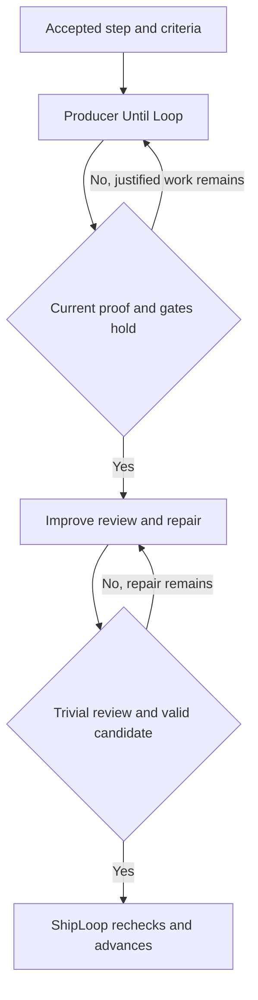

Execute: ask

# Implement-step improvement plan — refreshed 2026-10-25

**Main now fixes the original exit-zero failed-test case. Two narrower acceptance defects remain: mixed pytest
pass/error output and reuse of a pre-fix false-pass receipt.** Keep these, valid procedures and obligation continuity
ahead of further prompt shortening.

This is the current version of the existing plan. It supersedes its
[2026-10-18 snapshot](shiploop-implement-step-fix-plan-2026-10-17-as-of-2026-10-18.md), while retaining the same
22 recommendation IDs, eight considerations, fourteen Code craft rules and 52 qualification IDs. Historical
Chess/Battleship outcomes remain attributed to their runs; they do not qualify this main revision.

## 1. Baseline and what changed

The source baseline is fetched `main` at `5d3628b0497c2402d7554c73011bb3d87a13bf55`. The checkout and `origin/main`
match. There are 46 commits including merged history since the previous `e707b794` audit. The
[previous plan](shiploop-implement-step-fix-plan-2026-10-17-as-of-e707b794.md) and its frozen maps remain historical.

This turn began with unresolved stash-application conflicts in `test/shiploop_e2e/run.py` and `slice.py`, at HEAD
`621beeb0`. All merge stages and working files were saved before mutation. Another process then cleared those
conflicts by restoring the upstream files, leaving experiment test edits active. The requested rebase with
`--autostash` completed, and the owner explicitly authorized reconciling the effort experiments as well. Their
combined changes are verified separately from the committed-source audit; no main-source assertion depends on
that uncommitted experiment overlay.

| Area | Previous audit | Current main and consequence |
|---|---|---|
| Reporter failure at exit zero | Demonstrated false pass | `5fb29784` rejects recognized failed tallies/IDs; keep the narrower error-summary and stale-receipt defects below |
| Step sizing and paths | Optional paths, prose sizing | Packet asks each step for every changed path and at most 4 criteria/3 product files; per-step paths remain optional in the schema, item-level paths are required, and the counts are not CLI gates |
| Revised Improve results | Producer bounds not applied at import | `_check_producer_bounds` now checks work-item context, open assumptions per item and step task/proof/named criterion text before revised-result storage/advance |
| Improve convergence | Contract used first-trivial policy; some bound text conflicted | Bound instructions now align on the first trivial review |
| Run limits | Engine/harness had artificial total/count limits | No default Until Loop iteration limit, refused-run stop count or send-back-count cap. Grok retains an 8-continuation host cap; implement has a model-applied 7-attempt same-failure threshold; test commands have a 600-second timeout each and no total run time budget |
| Core step proof | Shared Step block, action/candidate receipts and re-proof implemented | Retained; do not reimplement |
| Older forms and wording | Lean guide selected; three Code craft expansions absent | Extra forms remain superseded; CC3/CC6/CC9 additions remain proposals |

The [current source map](shiploop-implement-prompt-audit-evidence/main-5d3628b0/reference-code-map.md) binds all 22
recommendations, eight considerations and fourteen rules to **118 exact excerpts from 27 source files**. Seven
previous excerpts changed in content; all other excerpts were relocated and rehashed against this revision. An
unchanged excerpt is not an assertion that its whole file was unchanged.

### Decisions carried forward

The lifecycle remains generic: project commands, platforms and domain rules enter through accepted records and
cards. Inline execution handles one step and its Improve review at a time; the ask-agent route handles the whole
plan. Each step proves only its assigned criteria, keeps other requirements intact, starts no later step and leaves
permanent test authoring with the test stage. Script-owned state, callbacks and observations remain authoritative.

Later committed owner decisions supersede the old proposal: the lean A0 port omits new per-step assessment fields;
Improve stops at its first trivial pass; the knowledge symbol and outcome vocabulary changed; and base/mutation
reuse was deferred after examining representative run costs. These are verified source decisions, not new
permissions inferred from this audit. `Execute: ask` still applies to implementing this plan in this chat.

## 2. Recommendation disposition

**Implemented** means the mechanism is present in committed source, with qualification limits shown below.
**Partial** means a specific remaining change or acceptance question remains. **Superseded** identifies a later
recorded design choice. **Deferred/conditional** is outside the immediate implementation queue.

| ID | Recommendation | Current disposition | Remaining work |
|---|---|---|---|
| R01 | Step-specific executable checks | implemented | Retain Proof. Qualify the new sizing guidance and resolve or document the prompt/schema difference on step paths; do not describe the 4/3 guidance as a hard CLI gate. |
| R02 | One assignment on every surface | implemented | Retain the shared assignment. Test emitted surfaces under current bounds; do not restore the older full printed loop argument. |
| R03 | Criterion evidence and changed-candidate proof | superseded | Keep re-proof and existing observations/notes. Retire the proposed evidence-row schema; acceptance correctness is still required without adding that form. |
| R04 | Static method, cards, match and Code craft | partial; structural rewrite superseded | Preserve the lean guide and retire the extra forms/extraction. Earlier CC3 complex-unit, CC6 resource-release and CC9 composable-unit expansions remain absent; the lean-port record does not explicitly resolve them. Retain these as low-priority wording proposals. |
| R05 | Valid procedures through final review and person ask | partial | Extend only the missing inherited review/person boundary after a fixture shows where an invalid carried procedure survives. Keep valid setup and actual observation separate. |
| R06 | Early actor/access prerequisites | implemented | Retain early checks and qualify actor/entry evidence on the actual target. No new permission mechanism is needed. |
| R07 | Required acceptance and partial/declined replies | partial | Prove requirement-to-case-to-obligation continuity across partial replies, stage changes and omitted obligations. A required consumer observation must remain open; add enforcement only for a reproduced omission. |
| R08 | Observe the intended copy and reporter outcomes | partial | Fix recognized pytest errors and qualify cancelled/skipped outcomes. Invalidate or rejudge receipts across judge-semantics changes, including step Proof. Preserve positive reporter controls. Intended-copy identity and deliberate negated-check behavior remain separate qualifications. Do not reimplement the landed failed-tally fix. |
| R09 | Mutation restoration and interrupted recovery | conditional | Do not build remote restoration machinery for the excluded route. If an authorized remote mutation path is introduced, require effect tracking, accepted-candidate restoration and interrupted recovery before enabling it. |
| R10 | Mutation check-only reuse | deferred | Keep the measured deferral. Reopen only when representative command cost justifies the identity/invalidation risk; do not remove mutation from check-only merely to shorten it. |
| R11 | Narrow revisions and unchanged prefix reuse | deferred | Treat prefix reuse as a separate optimization pilot. Preserve exact definitions and reopen actual product repair; no empty-diff shortcut. |
| R12 | Compact, valid result and callback contracts | implemented | Update examples to the current contracts and keep their validator checks. The old inline-notes and two-review policies are obsolete. |
| R13 | Resolvable references and essential facts | partial | Qualify locator resolution and essential command/target facts at the actual emitted head and installed path lengths. No demonstrated need for a second packet format or new symbol DSL. |
| R14 | Evidence-based Improve and relevant history | implemented | Retain current history selection and first-trivial review policy; qualify relevant evidence instead of adding a review quota. |
| R15 | Same scoped probe authority for implement and Improve | partial | For a genuinely authorized test route, make the opening and review permissions consistent with that route and its target/limits. Do not infer a release grant or introduce new authority. |
| R16 | Actual release state, not invented absence | outstanding | Repair release-plan, release-check and both reference copies to record observed current state and the remaining delta. One observation cannot prove present/absent discrimination; do not manufacture absence. |
| R17 | Product/test/tool-state classification and source return | partial | Fix the misleading no-action-needed message and qualify one unignored-tool-state fixture through review/return. Preserve required keep/exclude decisions and product configuration; do not add a classification taxonomy without demonstrating a bypass. |
| R18 | Harness keep, terminal state and reporting | implemented | Retain these distinctions. Qualify done-but-uncommitted, host exit and cleanup with harness integration fixtures; do not claim a fresh live platform outcome from this refresh. |
| R19 | Run-owned loop state and recovery | outstanding | Use a run-owned backing-state directory and preserve active receipt next_argv recovery. Validate fresh-context resume and missing-state failure without inferring success or overwriting receipts. |
| R20 | Applicable guidance across software packages | implemented | Preserve applicability across library, CLI, service, UI, data/config/docs and empty-repository cases. Card tests are not proof of every package type. |
| R21 | Avoid redundant system-stage executions | partial | Qualify reuse on stateful/remote commands before broadening it. A changed relevant external state must invalidate or bypass reuse; keep the broader system-stage optimization a measured pilot. |
| R22 | One directive with distinct production and Improve phases | optional | Optional wording-only cleanup: remove the repeated completion clause from WORK_STEP while preserving scope, all acceptance/continuation conditions and recovery. Do not restore the two-pass rule, extra nested loops or the old printed argument. |

The [code map](shiploop-implement-prompt-audit-evidence/main-5d3628b0/reference-code-map.md) gives the current behavior,
exact source spans and corresponding qualification IDs for every row. It also maps every consideration and Code
craft rule individually. A source anchor locates the implementation; it does not establish behavior by itself.

## 3. Remaining work, in priority order

### P1 — close the residual reporter and receipt defects (R08 / T37)

The original masked-failure case is fixed on current main. A fresh probe records both the repair and two remaining
helper-boundary failures:

| Input / reuse condition | Current result | Required behavior |
|---|---|---|
| Exit 0, named pytest FAILED, summary `1 failed` | `failed` in focused and check modes | Correct; retain landed regression tests |
| Exit 0, named pytest PASSED, summary `1 passed, 1 error` | `passed` in focused and check modes | Reject the recognized error |
| Unchanged product tree and command; saved pre-fix receipt says passed but its tally says failed | `_reused` returns the saved passed run | Rejudge or invalidate the obsolete verdict |
| Passing test title contains FAILED | `passed` | Correct; preserve reporter semantics rather than word matching |

[Retained probe](shiploop-implement-prompt-audit-evidence/main-5d3628b0/judge-current-probe.json) and its
[reproduction script](shiploop-implement-prompt-audit-evidence/main-5d3628b0/probe-current-judge.py) identify the
boundary precisely. The receipt probe uses an actual saved record and stubs only the unchanged product-tree lookup;
it is not a full callback/live-run replay. Step-Proof reuse also trusts its saved verdict, by source inspection.

Add a failing callback fixture for the mixed error and a receipt-upgrade fixture covering candidate and step-Proof
reuse. Preserve zero-tests, missing-ID precedence, passing FAILED titles and deliberate negated checks. The same
judge feeds step Proof and verification; false passed IDs can feed the primary lower-layer gate. Do not repeat the
already-landed failed-tally fix or mark all of R08 complete.

T37's other clauses remain explicit: there is no general script binding to a deployed revision; qualify the intended
copy separately. Mutation treats a nonzero command exit as a kill, including setup/build failures; a behavioral-only
kill rule remains a separate proposal. These probes neither qualify a deployment nor strengthen mutation's oracle.

[judge](/Users/dadleet/src/skill-craft/docs/shiploop-implement-prompt-audit-evidence/main-5d3628b0/reference-code-excerpts.md:550); [_pytest: error count omitted from failed tally](/Users/dadleet/src/skill-craft/docs/shiploop-implement-prompt-audit-evidence/main-5d3628b0/reference-code-excerpts.md:2839); [_reused](/Users/dadleet/src/skill-craft/docs/shiploop-implement-prompt-audit-evidence/main-5d3628b0/reference-code-excerpts.md:632); [step_proof](/Users/dadleet/src/skill-craft/docs/shiploop-implement-prompt-audit-evidence/main-5d3628b0/reference-code-excerpts.md:60); [MaskedZeroExitFailureTests](/Users/dadleet/src/skill-craft/docs/shiploop-implement-prompt-audit-evidence/main-5d3628b0/reference-code-excerpts.md:3288).

### P1 — establish valid acceptance and safe reuse boundaries (R05/R07/R21)

The procedure walk is now present where plans and cases are written. Carry-forward's code focus still lacks an
explicit check of inherited procedures. Add a narrow fixture in which an earlier accepted procedure becomes
impossible after a setup change; verify the last responsible review sends it back before a person is asked.

Required delivery contracts already block due stages, and partial replies have regression coverage. What remains
is end-to-end continuity from the original requirement through case, open-item and delivery-obligation records.
Use a required interaction that receives only a partial reply, then a revision that omits its obligation. If the
current gate already rejects it, retain that evidence and close the work; if it accepts, repair the omission path.
Do not add a second evidence form. The new primary-requirement validator requires a passed lower-layer test for an
unverified primary outcome; that row remains unverified and does not waive an actual required consumer observation.

Candidate receipt reuse is bounded by action/stage/item, command records, source tree and floors. A stateful target
can change while those values remain equal. Qualify that boundary with an isolated fixture; changed relevant target
or fixture state must invalidate reuse or force a fresh execution. This is a correctness check of existing reuse,
not authorization for a broader system-stage cache.

[Inherited review focus](/Users/dadleet/src/skill-craft/docs/shiploop-implement-prompt-audit-evidence/main-5d3628b0/reference-code-excerpts.md:2042); [delivery transition gate](/Users/dadleet/src/skill-craft/docs/shiploop-implement-prompt-audit-evidence/main-5d3628b0/reference-code-excerpts.md:1134); [primary lower-layer gate](/Users/dadleet/src/skill-craft/docs/shiploop-implement-prompt-audit-evidence/main-5d3628b0/reference-code-excerpts.md:1263); [reuse identity](/Users/dadleet/src/skill-craft/docs/shiploop-implement-prompt-audit-evidence/main-5d3628b0/reference-code-excerpts.md:632).


### P2 — align scope, state and return handling (R15/R16/R17/R19)

| Change | Concrete acceptance procedure |
|---|---|
| Render consistent already-authorized probe authority in producer and Improve | Given one permitted isolated test route, both surfaces carry its target and limits; a release effect still requires its own authority. No new grant is inferred from a command string. |
| Describe actual release state | Start with an authorized candidate already staged. Update release-plan, release-check and both reference copies. Report present state and remaining delta; one observation cannot prove both positive and negative discrimination. Never delete resources to create absence. |
| Make residual review explicit | Leave one product configuration and one unignored tool-state file after the last item. Confirm plan-return may commit them locally but still requires keep/exclude decisions; the message must not say no action is needed while review is pending. An excluded path cannot enter the target unnoticed. |
| Place stage-loop backing state under its run | Start a loop, resume from a fresh context using the receipt, and check that its backing state is under RUN. Missing state remains incomplete; it cannot be reconstructed as success or overwritten by a replacement start. |

The stage start's explicit `--receipt` selects the isolated runtime branch. Without `--directory`, that branch uses
a temporary backing file. This is the actual invoked path; automatic host-session storage does not apply to that
call. No observed production loss is claimed by this source inspection.

[Improve authority](/Users/dadleet/src/skill-craft/docs/shiploop-implement-prompt-audit-evidence/main-5d3628b0/reference-code-excerpts.md:2157); [release-check wording](/Users/dadleet/src/skill-craft/docs/shiploop-implement-prompt-audit-evidence/main-5d3628b0/reference-code-excerpts.md:2131); [leftover commit](/Users/dadleet/src/skill-craft/docs/shiploop-implement-prompt-audit-evidence/main-5d3628b0/reference-code-excerpts.md:1448); [pending review message](/Users/dadleet/src/skill-craft/docs/shiploop-implement-prompt-audit-evidence/main-5d3628b0/reference-code-excerpts.md:2762); [required return review](/Users/dadleet/src/skill-craft/docs/shiploop-implement-prompt-audit-evidence/main-5d3628b0/reference-code-excerpts.md:2791); [stage start](/Users/dadleet/src/skill-craft/docs/shiploop-implement-prompt-audit-evidence/main-5d3628b0/reference-code-excerpts.md:1562); [runtime dispatch](/Users/dadleet/src/skill-craft/docs/shiploop-implement-prompt-audit-evidence/main-5d3628b0/reference-code-excerpts.md:2468).


### P3 — resolve remaining wording proposals and measure replay changes (R04/R10/R11/R13/R22)

All fourteen Code craft rules are present, but three earlier proposed expansions are absent: CC3's complex-unit
contract/tombstone, CC6's release of acquired resources on every exit, and CC9's narrow interface/pure-core/side-effect
design. The lean-port record chooses the guide and one-line rules 10–14; it does not explicitly reject those three
expansions. Keep them as separate wording proposals after acceptance correctness, with current rules unchanged.
The [individual rule map](shiploop-implement-prompt-audit-evidence/main-5d3628b0/reference-code-map.md) distinguishes
their existing source from the missing additions.

Preserve the later base/mutation reuse deferral: the retained study found small savings and a new stale-acceptance
risk. Its timings are historical measurements, not current benchmark results. Cross-plan prefix reuse and broader
outer-stage reuse remain pilots. Preserve an unchanged-prefix rule if a pilot is authorized; an empty diff alone
cannot establish equivalent plans or valid evidence.

Further prompt work should test essential content at the emitted head and actual source reads, not optimize only
packet characters. Current constants distinguish the 16,000-character full-print switch, 19,500 required-content
boundary and 20,000 head limit. Do not restore the old plan's 16,000 head target or claim token/latency savings.

Work-field deduplication is an optional proposal, not required backlog. The current phrase is explicitly pinned as
the owner’s D4 wording; any later implementation must reconcile that choice with the requested direction. The
proposed shortening preserves stage sequencing, acceptance, continuation, callbacks and the first-trivial Improve policy.

[Later reuse decision](/Users/dadleet/src/skill-craft/docs/shiploop-implement-prompt-audit-evidence/main-5d3628b0/reference-code-excerpts.md:2534); [current rendering bounds](/Users/dadleet/src/skill-craft/docs/shiploop-implement-prompt-audit-evidence/main-5d3628b0/reference-code-excerpts.md:2695); [current Work wording](/Users/dadleet/src/skill-craft/docs/shiploop-implement-prompt-audit-evidence/main-5d3628b0/reference-code-excerpts.md:2329).


## 4. Before and after: generic inner-loop prompts

### Direction and completion

The current architecture is already close to the requested directive-plus-condition structure:



The producer establishes the step; Improve reviews it; ShipLoop accepts it. Both loops already exist. No extra loop
inside an Improve pass is proposed. A real blocker takes the existing blocked/send-back route rather than an endless
retry. A later-owned delivery item stays later-owned.

**Current Work template, excerpt** (the exact source is linked below):

```text
Implement all of step {step} ... anchored in ... ({criteria}{serving}) ... ({decisions}),
until each criterion assigned to this step is satisfied and none of the others is broken.
Do duty items {items} of {run}/packets/{action}.md. Write no tests and start no later step.
```

**Optional replacement Work field**, illustrated with a configuration parser and frozen accepted IDs:

```text
Implement S1's assigned criteria (C1, C2), serving R-1 and following AD-1, by executing
its duty items in /absolute/run/packets/A17.md. Keep other requirements and unassigned criteria intact.
Write no tests; start no later step.
```

The existing generated `exit_condition` and `repeat_condition` stay unchanged. They remain in the contract and are
printed by the runtime; the caller does not repeat them in a second argument. Generate the IDs and locator from the
accepted step plan as now. “Above” is not a recovery locator. “All delivery items anchored” is too broad for one step,
and a file location alone is not an observation.

[Current Work](/Users/dadleet/src/skill-craft/docs/shiploop-implement-prompt-audit-evidence/main-5d3628b0/reference-code-excerpts.md:2329); [frozen C/R/AD bindings](/Users/dadleet/src/skill-craft/docs/shiploop-implement-prompt-audit-evidence/main-5d3628b0/reference-code-excerpts.md:1627); [contract-on-disk invocation](/Users/dadleet/src/skill-craft/docs/shiploop-implement-prompt-audit-evidence/main-5d3628b0/reference-code-excerpts.md:2382); [first-trivial Improve policy](/Users/dadleet/src/skill-craft/docs/shiploop-implement-prompt-audit-evidence/main-5d3628b0/reference-code-excerpts.md:2408).


### Proof and inherited acceptance

**Earlier problematic request:**

```text
Implement S1, then run every item check, including the CLI that S2 will add.
Review the files and say whether delivery is complete.
```

**Current intended generic contract:**

```text
S1: configuration parser. C1: valid input returns the specified normalized result.
C2: invalid input returns the specified error without changing the input.
proof: the accepted parser check, using only S1 and accepted dependencies.
Later: S2 owns CLI process behavior.
Review this candidate from its recorded step-entry base. Run the same proof after a repair.
```

Proof execution, scoped assignment and re-proof are now implemented. The remaining acceptance review must inspect
what the output demonstrates, not merely whether a command exited zero.

**Remaining procedure improvement:**

```text
Before asking for confirmation, replay the inherited procedure from its actual starting state.
For every action, name the observable result and the actor who can observe it.
If the sequence cannot occur, send it back to its owner. If a required observation is unanswered,
leave it unverified; record exactly what the person's reply did establish.
```

These are illustrative prompt fragments, not literal runnable packets. Actual callbacks and result fields come from
the script. Package type changes the accepted check/actor/boundary, not this lifecycle.

## 5. Qualification catalogue

T1–T52 are stable plan references, not 52 newly implemented or passing tests. “Covered mechanism” means relevant
source/test machinery exists; it does not certify every original assertion or a live workflow. The specific six-suite
execution is reported in §7. Historical formulations and decisions remain in the archived plan.

| ID | Current acceptance target | Disposition |
|---|---|---|
| T1 | Missing step proof is refused by the real step-plan gate. | Covered mechanism; uses proof, not check. |
| T2 | Proof can run using only the current step and accepted dependencies; semantic vacuity is challenged. | Execution landed; semantic qualification remains. |
| T3 | Skills/cards resolve without a new cards_na form. | Old mandatory form superseded by lean port. |
| T4 | Reuse the correct example/design context without a new match field. | Old mandatory form superseded by lean port. |
| T5 | Resolve the packet/schema distinction on paths and qualify the new 4-criteria/3-product-file guidance. | Packet asks each step for changed paths; the schema permits omitted per-step paths but requires item-level paths. The 4/3 counts are not CLI gates. |
| T6 | A failing inline proof refuses complete and produces an action-bound record. | Covered mechanism; selected suite passed. |
| T7 | Current evidence remains reviewable through summary/notes and proof receipts. | criterion_evidence gate superseded. |
| T8 | Head/full/Improve share step identity, proof and review base. | Covered mechanism; packet suite passed. |
| T9 | Only this step’s criteria and cases are quoted. | Covered mechanism; retain scoped-render tests. |
| T10 | Required assignment and the current loop-start route survive emission. | Old full-argument/last-block wording superseded. |
| T11 | Frozen criteria, served requirements and AD directions bind Work. | Covered mechanism; loop suite passed. |
| T12 | Contract rebuild and receipt recovery preserve the accepted assignment. | Covered mechanism; loop suite passed. |
| T13 | Code-only rubric/lint guidance follows actual applicability. | Retain applicability qualification. |
| T14 | Two relevant non-bookkeeping commits appear in the inline look-back. | Mechanism landed; no new history quota. |
| T15 | Library, CLI, service, UI, data/config/docs share a generic lifecycle. | Cross-package qualification remains. |
| T16 | Capture actual emit with long/multibyte fields under current bounds. | Use 19,500/20,000 head contract, not old 16,000 head target. |
| T17 | Current state-v9 requirements fail clearly on incompatible saved state. | Retain current migration/refusal contract. |
| T18 | Every required locator/ID resolves at the referenced revision. | Resolution and installed-path qualification. |
| T19 | One authoritative assignment per surface; no extra anchor form. | Covered shared-block design. |
| T20 | Consideration guide remains static and referenced by implement. | Old inline four-section extraction superseded. |
| T21 | Preserve the current shared Code craft rubric and its consumers. | Mandatory code-craft.md extraction superseded. |
| T22 | The actual duty/guide locator resolves; no invented Method heading. | Use existing resolver, not a new static_text API. |
| T23 | Built package contains the selected referenced guide. | No second reference file required by this plan. |
| T24 | All fourteen current rules reach applicable reviews; evaluate the three absent expansions separately. | Current rules implemented; CC3/CC6/CC9 expansion proposals unresolved. |
| T25 | Invalid transitions and invisible observations are rejected by the responsible reviewer. | Semantic review pilot remains. |
| T26 | A later-owned check may remain planned; a current required observation stays open. | Acceptance-boundary qualification. |
| T27 | Exact proof runs on the final candidate; wrong receipt cannot satisfy it. | Covered mechanism; semantic false positives separate. |
| T28 | Actor/entry/runner gaps retain their owner and due stage. | Preparation guidance landed; real-target qualification remains. |
| T29 | Changed procedure setup invalidates inherited observation claims. | Outstanding inherited-procedure fixture. |
| T30 | Return, target commits, lifecycle and review receipts remain separate claims. | Harness/source-return qualification. |
| T31 | Whole-plan ask-agent route keeps item checks without per-step proof. | Intentional and tested; not a missing mechanism. |
| T32 | Paired runs preserve quality before measuring reads, tokens and latency. | Deferred live comparative pilot. |
| T33 | Improve repair that breaks proof refuses import; receipt reuse requires valid judge semantics as well as an unchanged candidate. | Covered unchanged-candidate mechanism; reuse across judge-semantic changes remains open under R08. |
| T34 | Inherited procedure review reaches final review/person ask without expanding case schema. | Outstanding narrow procedure work. |
| T35 | All surfaces honor the same granted probe route, target and limits. | Outstanding authority wording consistency. |
| T36 | Behavioral stub/source search cannot establish an executed behavior claim. | New confirm/test-layer gates help; semantic qualification remains. |
| T37 | Reject reporter errors and obsolete cached verdicts; qualify the deployed copy and mutation oracle separately. | Original failed-output case fixed; mixed pass/error and stale candidate receipt reproduced at helper boundaries. |
| T38 | A future remote mutation path restores accepted state on every ending. | Conditional: current local mutation excludes remote commands. |
| T39 | Reuse base/mutation verdicts only with complete identity and measured value. | Explicitly deferred by later cost/risk decision. |
| T40 | Unchanged-prefix reuse requires exact definitions and fresh relevant proof. | Deferred optimization; no empty-diff shortcut. |
| T41 | A revisited step names its own prior result/commit and narrow repair. | Per-step locator repair landed. |
| T42 | Rendered examples use proof/settle/due_stage, current callbacks and --notes FILE. | Update old examples; retain actual schema tests. |
| T43 | Required command/target facts survive locator-based heads; measure total reads. | Content/installation qualification remains. |
| T44 | Partial/no reply cannot silently remove a required consumer obligation. | Existing partial-reply tests; omission/continuity fixture still needed. |
| T45 | Claimed passes cite accepted runs, with distinct criterion/case/runner IDs. | Retain qualification; R08 can corrupt downstream pass evidence. |
| T46 | Already-staged candidate is reported present; no artificial absence. | Outstanding release-state wording and fixture. |
| T47 | Pending keep/exclude review remains explicit after a leftover commit; unignored tool state cannot silently return. | Ignore and return gates landed; wording fix and one adversarial fixture remain. |
| T48 | Keep policy, host terminal evidence and cleanup report their actual outcomes. | Current keep logic landed; live/harness qualification separate. |
| T49 | Stage backing state is run-owned and receipt recovery remains exact. | Outstanding directory argument and recovery fixture. |
| T50 | Guidance follows accepted package/runtime/surface facts. | Conditional module/platform guidance landed; diverse fixtures remain. |
| T51 | Changed relevant target/fixture/authority state invalidates existing reuse. | Qualification of existing reuse; broader cache remains a pilot. |
| T52 | Producer completion and first-trivial Improve remain distinct bound phases. | Use current gate zero versus one, not old gate two. |

## 6. Implementation sequence and boundaries

1. Add the remaining T37 mixed-error and receipt-upgrade cases; repair those narrow paths and verify downstream
   primary-outcome acceptance. Retain the already-landed masked-failure fix.
2. Run the narrow T29/T34/T44/T51 adversarial fixtures. Repair only the continuity, procedure or reuse boundaries
   they show are missing; close a recommendation when current enforcement already satisfies it.
3. Address the concrete P2 source deltas with their paired before/after acceptance procedures.
4. Measure optional Work shortening and replay optimization only after these correctness checks. Quality comes
   first, then actual token consumption, then latency.

Do not port the old integration branch wholesale, introduce a domain-specific lifecycle branch, create another
ledger, add a review quota, or reintroduce the rejected mandatory evidence forms. A later code change needs its
normal change note and relevant fail-first checks. The owner separately authorized reconciling the effort-experiment merge; that work does not implement the
engine recommendations in this plan. Live trials, release, installation, commit and push remain outside this update.

## 7. Evidence and verification

The [current map](shiploop-implement-prompt-audit-evidence/main-5d3628b0/reference-code-map.md) and
[machine-readable map](shiploop-implement-prompt-audit-evidence/main-5d3628b0/reference-code-map.json) bind every
recommendation/consideration/rule to committed source. All 58 Chess and 91 Battleship gap entries remain mapped in
the [Chess index](shiploop-implement-prompt-audit-evidence/main-5d3628b0/chess-analysis-disposition.json) and
[Battleship index](shiploop-implement-prompt-audit-evidence/main-5d3628b0/battleship-analysis-disposition.json), with the
eight ranked Chess fixes retained. Repeated entries are not independent defects.

The previous e707b794 check record (329 passing tests, broader receipt INCOMPLETE because concurrent files
appeared) remains historical. It does not qualify the new main or the reconciled effort experiments.

Current verification is recorded in
[verification.json](shiploop-implement-prompt-audit-evidence/main-5d3628b0/verification.json): committed-source checks,
focused tests of the combined experiment snapshot, the direct judge/reuse probe, and exact before/after fingerprints
are separate entries. Pending or failed checks are retained as such; no full suite, CI refresh, installed-host check,
live consumer acceptance or controlled performance comparison is inferred. The
[source validator](shiploop-implement-prompt-audit-evidence/validate-reference-map.py) checks the current map, excerpts,
links and retained report indexes. Its
[result](shiploop-implement-prompt-audit-evidence/main-5d3628b0/reference-validation.json) is provenance evidence.

The earlier [Opus review](shiploop-implement-prompt-audit-evidence/opus-main-refresh-2026-10-25.md) applies to e707b794.
This refresh rechecks its conclusions against the newer source; it is not a second Opus review. A focused independent
source audit confirmed the judge repair, producer-bound import and prompt-only sizing distinction. The coordinating
agent verified the retained claims and reproduced the two narrower judge/reuse cases. Visual rendering was not
inspected; the earlier browser-policy denial was not bypassed.
